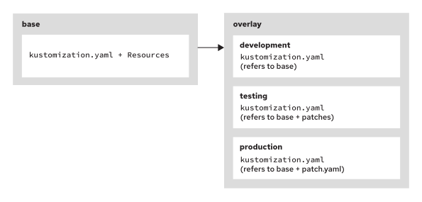

Quản trị Red Hat OpenShift II: Cấu hình Cụm Môi trường Sản xuất
---------------------------------------------------------------

# Chương 1. Quản lý tài nguyên theo phương thức khai báo
## Tệp định nghĩa tài nguyên - Resource Manifests
### Lệnh Mệnh lệnh và Lệnh Khai báo
Một ứng dụng trong cụm Kubernetes thường bao gồm nhiều tài nguyên hoạt động cùng nhau. Mỗi tài nguyên đều có phần định nghĩa và cấu hình riêng. Nhiều cấu hình tài nguyên có các thuộc tính chung cần phải khớp với nhau để hệ thống vận hành chính xác.

Có hai phương thức quản lý tài nguyên: mệnh lệnh (imperative) và khai báo (declarative). Mỗi phương thức đều có những ưu và nhược điểm riêng, được trình bày dưới đây.

Các lệnh mệnh lệnh thực hiện cấu hình từng tài nguyên một. Tuy nhiên, việc sử dụng các lệnh mệnh lệnh có những nhược điểm sau:

* Khả năng tái lập bị hạn chế
* Thiếu cơ chế kiểm soát phiên bản
* Thiếu hỗ trợ cho GitOps

Các lệnh khai báo (declarative commands) là phương thức được ưu tiên để quản lý tài nguyên thông qua việc sử dụng các tệp định nghĩa tài nguyên (resource manifests). Tệp định nghĩa tài nguyên là tệp định dạng YAML hoặc JSON chứa toàn bộ các thuộc tính của một ứng dụng, có thể là một tệp đơn lẻ hoặc một tập hợp các tệp có liên quan. Các tệp này giúp đơn giản hóa việc quản lý tài nguyên Kubernetes và cho phép kiểm soát phiên bản, từ đó hỗ trợ việc truy xuất nguồn gốc các thay đổi cấu hình. Khi xảy ra các thay đổi không mong muốn, hệ thống có thể hoàn tác về phiên bản trước đó để đảm bảo khả năng khôi phục.

Các tệp định nghĩa tài nguyên đảm bảo khả năng tái tạo chính xác ứng dụng, thường chỉ cần một lệnh duy nhất để triển khai nhiều tài nguyên cùng lúc. Khả năng tái tạo này hỗ trợ tự động hóa các quy trình GitOps, bao gồm tích hợp liên tục và chuyển giao liên tục (CI/CD).

#### Quy trình làm việc dạng mệnh lệnh và dạng khai báo
OpenShift CLI sử dụng cả hai loại lệnh: mệnh lệnh (imperative) và khai báo (declarative). Các lệnh mệnh lệnh thực hiện hành động dựa trên chính lệnh đó, với tên lệnh phản ánh trực tiếp hành động được thực hiện. Ngược lại, các lệnh khai báo sử dụng tệp manifest tài nguyên để xác định trạng thái mong muốn của tài nguyên.

Thay vì sử dụng các lệnh mệnh lệnh để tạo tài nguyên OpenShift, việc dùng tệp manifest cho phép tập hợp mọi thông tin chi tiết về tài nguyên vào một tệp duy nhất. Cách tiếp cận này giúp quy trình làm việc có tính nhất quán và dễ tái lập hơn; thay vì phải thực hiện lại một chuỗi các lệnh mệnh lệnh, bạn có thể áp dụng toàn bộ định nghĩa tài nguyên chỉ trong một bước duy nhất. Ngoài ra, sử dụng tệp manifest còn hỗ trợ hiệu quả cho việc theo dõi các thay đổi cấu hình hệ thống thông qua hệ thống quản lý mã nguồn.

Khi có tệp manifest tài nguyên mới hoặc đã được cập nhật, OpenShift cung cấp các lệnh để so sánh trạng thái mong muốn được quy định trong tệp manifest với trạng thái hiện tại của tài nguyên. Sau đó, các lệnh này sẽ thực hiện các thay đổi cần thiết lên trạng thái hiện tại để đưa nó về đúng trạng thái mong muốn.

#### Quy trình làm việc mệnh lệnh
Quy trình làm việc kiểu mệnh lệnh (imperative workflow) rất hữu ích cho quá trình phát triển và thử nghiệm. Ví dụ sau đây sử dụng lệnh mệnh lệnh `oc create deployment` để tạo một deployment cho cơ sở dữ liệu MariaDB:

```bash
$ oc create deployment db-pod --port 3306 \
    --image registry.redhat.io/rhel10/mariadb-118:1785156451
deployment.apps/db-pod created
```

Ngoài việc sử dụng các động từ thể hiện hành động của lệnh, các lệnh mệnh lệnh (imperative commands) còn sử dụng các tùy chọn để cung cấp thông tin chi tiết. Lệnh ví dụ sử dụng các tùy chọn `--port` và `--image` để cung cấp những thông tin cần thiết cho việc tạo deployment.

Việc sử dụng các lệnh mệnh lệnh có ảnh hưởng đến quá trình áp dụng thay đổi cho các tài nguyên đang hoạt động. Ví dụ, pod từ deployment trước đó sẽ không thể khởi động do thiếu các biến môi trường. Lệnh mệnh lệnh `oc set env deployment` dưới đây sẽ khắc phục vấn đề này bằng cách thêm các biến môi trường cần thiết vào deployment:

```bash
$ oc set env deployment/db-pod \
    MYSQL_USER='user1' \
    MYSQL_PASSWORD='mypa55w0rd' \
    MYSQL_DATABASE='items'
deployment.apps/db-pod updated
```

Việc thực thi lệnh `oc set env deployment` này sẽ thay đổi tài nguyên triển khai có tên `db-pod` và cung cấp các biến cần thiết để khởi động container. Lập trình viên có thể tiếp tục xây dựng ứng dụng bằng cách sử dụng các lệnh mệnh lệnh (imperative commands) để thêm các thành phần như service, route, volume mount và persistent volume claim. Với mỗi thành phần được thêm vào, lập trình viên có thể chạy kiểm thử để đảm bảo rằng thành phần đó thực hiện đúng chức năng mong muốn.

Các lệnh mệnh lệnh rất hữu ích cho quá trình phát triển và thử nghiệm. Với các lệnh này, lập trình viên có thể xây dựng ứng dụng theo từng thành phần một. Khi một thành phần được thêm vào, cụm OpenShift sẽ cung cấp các thông báo lỗi cụ thể cho thành phần đó. Quy trình này tương tự như việc sử dụng công cụ gỡ lỗi (debugger) để theo dõi quá trình thực thi mã nguồn từng dòng một. Việc sử dụng lệnh mệnh lệnh thường mang lại thông báo lỗi rõ ràng hơn so với các phương pháp khai báo (declarative methods), vì lỗi sẽ xuất hiện ngay sau khi thêm một thành phần cụ thể.

Tuy nhiên, các dòng lệnh dài và quy trình triển khai ứng dụng bị phân mảnh không phải là lựa chọn lý tưởng để triển khai ứng dụng trong môi trường sản xuất (production). Với lệnh mệnh lệnh, các thay đổi bao gồm một chuỗi các lệnh cần được duy trì để phản ánh trạng thái mong muốn của tài nguyên; do đó, chuỗi lệnh này cần được theo dõi và cập nhật liên tục.

#### Sử dụng các lệnh khai báo
Thay vì theo dõi một chuỗi các lệnh, tệp manifest (tệp khai báo) ghi lại trạng thái mong muốn của chuỗi đó. Trái ngược với việc sử dụng các lệnh mệnh lệnh (imperative), các lệnh khai báo (declarative) sử dụng một tệp manifest — hoặc một tập hợp các tệp manifest — để tổng hợp mọi chi tiết cần thiết cho việc tạo ra các thành phần đó vào các tệp YAML; các tệp này sau đó có thể được triển khai chỉ bằng một lệnh duy nhất. Khi cần thay đổi trong tương lai, người dùng chỉ cần áp dụng lại các tệp manifest này. Thay vì phải theo dõi một chuỗi các lệnh phức tạp, các hệ thống kiểm soát phiên bản có thể theo dõi trực tiếp những thay đổi trên tệp manifest.

Mặc dù tệp manifest cũng có thể sử dụng cú pháp JSON, nhưng YAML thường được ưa chuộng và phổ biến hơn. Tiếp tục với phép so sánh về quy trình gỡ lỗi: việc gỡ lỗi một ứng dụng được triển khai từ các tệp manifest cũng tương tự như việc gỡ lỗi một ứng dụng đã hoàn thiện và đang chạy thực tế. Quá trình tìm kiếm nguồn gốc lỗi có thể tốn nhiều công sức hơn, đặc biệt là khi lỗi không xuất phát từ chính các tệp manifest đó.

#### Tạo các tệp manifest OpenShift
Việc tạo các tệp manifest từ đầu có thể tốn thời gian. Bạn có thể sử dụng các kỹ thuật sau đây để tạo điểm khởi đầu cho các tệp manifest của mình:

* Sử dụng chế độ xem YAML của tài nguyên từ giao diện web (web console).
* Sử dụng các lệnh mệnh lệnh (imperative commands) kết hợp với tùy chọn `--dry-run=client` để tạo ra các tệp cấu hình (manifests) tương ứng với lệnh đó.

Lệnh `oc explain` cung cấp thông tin chi tiết về bất kỳ trường nào trong tệp manifest. Ví dụ, hãy sử dụng lệnh `oc explain deployment.spec.template.spec` để xem mô tả các trường xác định đối tượng pod bên trong tệp manifest của deployment.

Để tạo tệp manifest mẫu cho deployment, hãy sử dụng lệnh `oc create deployment` kết hợp với tùy chọn `--dry-run=client` để tạo tệp manifest:

```bash
$ oc create deployment hello-openshift -o yaml \
    --image quay.io/redhattraining/hello-world-nginx:v1.0 \
    --save-config \ (1)
    --dry-run=client \ (2)
    > ~/my-app/example-deployment.yaml
```

1. Tùy chọn `--save-config` bổ sung các thuộc tính cấu hình mà các lệnh khai báo (declarative commands) sử dụng. Đối với các tài nguyên triển khai (deployment resources), tùy chọn này lưu cấu hình tài nguyên vào chú thích `kubectl.kubernetes.io/last-applied-configuration`.
2. Tùy chọn `--dry-run=client` ngăn lệnh thực hiện việc tạo tài nguyên trong cụm (cluster).

Ví dụ sau đây cho thấy một tệp manifest triển khai tối giản dành cho deployment `hello-openshift` — tệp này chưa sẵn sàng để sử dụng trong môi trường thực tế (production):

```yaml
apiVersion: apps/v1
kind: Deployment
metadata:
  annotations:
    ...output omitted...
  creationTimestamp: null
  labels:
    app: hello-openshift
  name: hello-openshift
spec:
  replicas: 1
  selector:
    matchLabels:
      app: hello-openshift
  strategy: {}
  template:
    metadata:
      creationTimestamp: null
      labels:
        app: hello-openshift
    spec:
      containers:
      - image: quay.io/redhattraining/hello-world-nginx:v1.0
        name: hello-world-nginx
        resources: {}
status: {}
```

Khi sử dụng các lệnh mệnh lệnh (imperative commands) để tạo tệp manifest, các tệp này có thể chứa những trường không cần thiết cho việc tạo tài nguyên. Ví dụ, trường hợp dưới đây điều chỉnh tệp manifest bằng cách loại bỏ các trường trống hoặc có giá trị null. Việc loại bỏ các trường không cần thiết có thể giúp giảm đáng kể độ dài của tệp manifest, từ đó giảm bớt khối lượng công việc khi xử lý chúng.

Ngoài ra, bạn có thể cần tùy chỉnh thêm các tệp manifest này. Chẳng hạn, đối với một deployment, bạn có thể tùy chỉnh số lượng bản sao (replicas) hoặc khai báo các cổng (ports) mà deployment đó cung cấp:

```yaml
apiVersion: apps/v1
kind: Deployment
metadata:
  namespace: resource-manifests # (1)
  labels:
    app: hello-openshift
  name: hello-openshift
spec:
  replicas: 2 # (2)
  selector:
    matchLabels:
      app: hello-openshift
  template:
    metadata:
      labels:
        app: hello-openshift
    spec:
      containers:
      - image: quay.io/redhattraining/hello-world-nginx:v1.0
        name: hello-world-nginx
        ports:
        - containerPort: 8080 # (3)
          protocol: TCP
```

1. Thêm thuộc tính namespace để tránh triển khai vào sai dự án.
2. Yêu cầu hai bản sao (replica) thay vì một.
3. Chỉ định cổng container mà dịch vụ sẽ sử dụng.

Bạn có thể tạo một tệp manifest cho mỗi tài nguyên mà bạn quản lý. Hoặc, bạn có thể gộp các manifest này vào một tệp YAML đa phần (multipart) duy nhất và sử dụng dòng `---` để phân tách chúng:

```yaml
---
apiVersion: apps/v1
kind: Deployment
metadata:
  namespace: resource-manifests
  annotations:
  ...output omitted...
---
apiVersion: v1
kind: Service
metadata:
  namespace: resource-manifests
  labels:
    app: hello-openshift
  name: hello-openshift
spec:
  ...output omitted...
```

Việc lựa chọn giữa phương pháp sử dụng một tệp duy nhất chứa nhiều bản khai (manifest) và phương pháp sử dụng nhiều tệp bản khai riêng biệt tùy thuộc vào quy tắc tổ chức của bạn. Phương pháp dùng một tệp duy nhất có ưu điểm là giúp tập hợp các bản khai có liên quan lại với nhau; cách này giúp việc thay đổi một tài nguyên cần được cập nhật đồng bộ trên nhiều bản khai trở nên thuận tiện hơn. Ngược lại, việc lưu trữ các bản khai trong nhiều tệp riêng biệt lại thuận tiện hơn khi cần chia sẻ các định nghĩa tài nguyên với người khác.

Sau khi tạo các bản khai, bạn có thể kiểm thử chúng trong môi trường phi sản xuất hoặc tiến hành triển khai. Hãy kiểm tra tính hợp lệ của các bản khai tài nguyên trước khi triển khai ứng dụng vào môi trường sản xuất.

#### Quy trình làm việc khai báo
Các lệnh khai báo (declarative commands) sử dụng tệp định nghĩa tài nguyên (resource manifest) thay vì phải nhập chi tiết thông số qua nhiều tùy chọn trên dòng lệnh. Để tạo tài nguyên, hãy sử dụng lệnh `oc create -f resource.yaml`. Thay vì chỉ định một tên tệp cụ thể, bạn có thể truyền đường dẫn thư mục vào lệnh để xử lý tất cả các tệp tài nguyên nằm trong thư mục đó. Hãy thêm tùy chọn `--recursive=true` hoặc `-R` để xử lý đệ quy các tệp tài nguyên nằm trong nhiều thư mục con.

Ví dụ dưới đây tạo các tài nguyên dựa trên các tệp định nghĩa trong thư mục `my-app`. Trong ví dụ này, thư mục `my-app` chứa các tệp `example-deployment.yaml` và `service/example-service.yaml`:

```bash
$ tree my-app
my-app
├── example_deployment.yaml
└── service
    └── example_service.yaml

$ oc create -R -f ~/my-app
deployment.apps/hello-openshift created
service/hello-openshift created
```

Trong ví dụ này, lệnh cũng chấp nhận một URL cho tệp YAML:

```bash
$ oc create -f https://example.com/example-apps/deployment.yaml
deployment.apps/hello-openshift created
```

#### Cập nhật tài nguyên
Lệnh `oc apply` cũng có thể tạo các tài nguyên bằng cách sử dụng tùy chọn `-f` tương tự như đã minh họa với lệnh `oc create`. Tuy nhiên, lệnh `oc apply` còn có khả năng cập nhật tài nguyên.

Việc cập nhật tài nguyên phức tạp hơn so với việc tạo mới. Lệnh `oc apply` áp dụng một số kỹ thuật để thực hiện cập nhật mà không gây ra sự cố.

Lệnh `oc apply` ghi nội dung của tệp cấu hình vào chú thích (annotation) `kubectl.kubernetes.io/last-applied-configuration`. Lệnh `oc create` cũng có thể tạo chú thích này nếu sử dụng tùy chọn `--save-config`. Lệnh `oc apply` sử dụng chú thích `last-applied-configuration` để xác định các trường đã bị loại bỏ khỏi tệp cấu hình và cần được xóa khỏi cấu hình thực tế đang chạy (live configuration).

Mặc dù lệnh `oc create -f` có thể tạo tài nguyên từ tệp định nghĩa (manifest), nhưng đây là lệnh mang tính mệnh lệnh (imperative) và do đó không tính đến trạng thái hiện tại của tài nguyên đang chạy. Việc thực thi `oc create -f` với một tệp định nghĩa dành cho tài nguyên đã tồn tại sẽ gây ra lỗi. Ngược lại, lệnh `oc apply -f` mang tính khai báo (declarative) và xem xét sự khác biệt giữa trạng thái tài nguyên hiện tại trong cụm (cluster) với trạng thái tài nguyên mong muốn được mô tả trong tệp định nghĩa.

Ví dụ: để cập nhật image của container từ phiên bản `v1.0` lên `latest`, trước tiên hãy cập nhật tệp định nghĩa tài nguyên YAML để chỉ định thẻ (tag) mới cho image. Sau đó, sử dụng lệnh `oc apply` để yêu cầu OpenShift tạo phiên bản tài nguyên deployment sử dụng phiên bản image đã được cập nhật trong tệp định nghĩa.

#### Kiểm tra tính hợp lệ của YAML
Trước khi áp dụng các thay đổi cho tài nguyên, hãy sử dụng các cờ `--dry-run=server` và `--validate=true` để kiểm tra lỗi trong tệp. 

* Tùy chọn `--dry-run=server` gửi một yêu cầu đến phía máy chủ mà không lưu lại tài nguyên. 
* Tùy chọn `--validate=true` sử dụng lược đồ (schema) để xác thực dữ liệu đầu vào và sẽ khiến yêu cầu thất bại nếu dữ liệu không hợp lệ.

Mọi lỗi cú pháp trong tệp YAML đều sẽ xuất hiện trong kết quả đầu ra. Quan trọng nhất, tùy chọn `--dry-run=server` giúp ngăn chặn việc áp dụng bất kỳ thay đổi nào vào môi trường thực thi OpenShift:

```bash
$ oc apply -f ~/my-app/example-deployment.yaml --dry-run=server --validate=true
deployment.apps/hello-openshift created (server dry-run) (1)
```

1. Dòng đầu ra kết thúc bằng (`server dry-run`) cho biết hành động mà tệp tài nguyên sẽ thực hiện nếu được áp dụng.

> **Lưu ý:** Tùy chọn `--dry-run=client` chỉ hiển thị đối tượng sẽ được gửi đến máy chủ. Các bộ điều khiển tài nguyên trong cụm (cluster resource controllers) có thể từ chối tệp manifest ngay cả khi cú pháp là YAML hợp lệ. Ngược lại, tùy chọn `--dry-run=server` gửi yêu cầu đến máy chủ để xác nhận rằng tệp manifest tuân thủ các chính sách hiện hành của máy chủ, mà không thực sự tạo ra tài nguyên trên máy chủ đó.

#### So sánh các tài nguyên
Hãy sử dụng lệnh `oc diff` để xem xét sự khác biệt giữa các đối tượng đang hoạt động (live objects) và các tệp manifest. Khi cập nhật tệp manifest của tài nguyên, bạn có thể theo dõi sự khác biệt trong các tệp đã thay đổi. Tuy nhiên, nhiều thay đổi trong tệp manifest khi được áp dụng lại không làm thay đổi trạng thái của các tài nguyên trong cụm (cluster). Một công cụ so sánh văn bản (text-based diff tool) thông thường sẽ hiển thị tất cả những khác biệt đó, dẫn đến kết quả đầu ra chứa quá nhiều thông tin không cần thiết.

Ngược lại, sử dụng lệnh `oc diff` có thể thuận tiện hơn để xem trước các thay đổi. Lệnh `oc diff` tập trung vào những thay đổi quan trọng đối với cụm OpenShift. Hãy xem xét các điểm khác biệt này để xác nhận rằng những thay đổi trong tệp manifest mang lại kết quả như mong muốn:

```bash
$ oc diff -f example-deployment.yaml
...output omitted...
diff -u -N /tmp/LIVE-2647853521/apps.v1.Deployment.resource...
--- /tmp/LIVE-2647853521/apps.v1.Deployment.resource-manife...
+++ /tmp/MERGED-2640652736/apps.v1.Deployment.resource-mani...
@@ -6,7 +6,7 @@
     kubectl.kubernetes.io/last-applied-configuration: |
       ...output omitted...
   creationTimestamp: "2026-08-17T13:53:47Z"
-  generation: 1 (1)
+  generation: 2
   labels:
     app: hello-openshift
   name: hello-openshift
@@ -32,7 +32,7 @@
         app: hello-openshift
     spec:
       containers:
-      - image: quay.io/redhattraining/hello-world-nginx:v1.0 (2)
+      - image: quay.io/redhattraining/hello-world-nginx:latest
         imagePullPolicy: IfNotPresent
         name: hello-openshift
         ports:
```

1. Dòng bắt đầu bằng ký tự `-` cho thấy bản triển khai hiện tại đang ở thế hệ 1. Dòng tiếp theo, bắt đầu bằng ký tự `+`, cho thấy thế hệ sẽ chuyển sang 2 khi tệp manifest được áp dụng.
2. Dòng image bắt đầu bằng ký tự `-` cho thấy image hiện tại đang sử dụng phiên bản v1.0. Dòng tiếp theo, bắt đầu bằng ký tự `+`, cho thấy sự thay đổi phiên bản sang `latest` khi tệp manifest được áp dụng.

Các bộ điều khiển tài nguyên (resource controller) trong OpenShift tự động thêm các chú thích (annotation) và thuộc tính vào tài nguyên đang hoạt động (live resource); điều này khiến kết quả từ các công cụ so sánh văn bản thông thường trở nên gây hiểu lầm, do chúng báo cáo nhiều điểm khác biệt không thực sự ảnh hưởng đến cấu hình tài nguyên. Việc trích xuất các tệp định nghĩa (manifest) từ tài nguyên đang hoạt động và so sánh chúng bằng các công cụ như lệnh `diff` thường dẫn đến việc ghi nhận nhiều khác biệt vô nghĩa. Lệnh `oc diff` được sử dụng để xác nhận xem tài nguyên đang hoạt động có khớp với cấu hình tài nguyên được định nghĩa trong tệp manifest hay không. Các công cụ GitOps dựa vào lệnh `oc diff` để phát hiện liệu có ai đó đã thay đổi tài nguyên bên ngoài quy trình làm việc GitOps hay không. Do bản thân các công cụ này không thể nắm bắt mọi chi tiết về cách các bộ điều khiển có thể thay đổi tài nguyên, chúng cần tham chiếu đến cụm (cluster) để xác định xem liệu một thay đổi có thực sự quan trọng hay không.

#### Các lưu ý khi cập nhật
Khi sử dụng lệnh `oc diff`, cần lưu ý trường hợp việc áp dụng thay đổi trong tệp manifest không tạo ra các pod mới. Ví dụ: nếu tệp manifest đã cập nhật chỉ thay đổi các giá trị trong một secret hoặc config map, thì việc áp dụng tệp này sẽ không tạo ra các pod mới sử dụng những giá trị đó. Do các pod chỉ đọc secret và config map khi khởi động, nên trong trường hợp này, việc áp dụng tệp manifest đã cập nhật sẽ khiến các pod rơi vào trạng thái dễ gặp lỗi, với các giá trị cũ không đồng bộ với secret hoặc config map đã được cập nhật.

Để giải quyết vấn đề này, hãy sử dụng lệnh `oc rollout restart deployment deployment-name` nhằm buộc khởi động lại các pod liên kết với deployment đó. Việc buộc khởi động lại sẽ tạo ra các pod sử dụng những giá trị mới từ secret hoặc config map đã cập nhật.

Đối với các deployment chỉ có một bản sao (replica), bạn cũng có thể khắc phục vấn đề bằng cách xóa pod hiện tại. OpenShift sẽ tự động tạo một pod mới để thay thế pod đã bị xóa. Tuy nhiên, đối với trường hợp có nhiều bản sao, việc sử dụng lệnh `oc rollout` để khởi động lại các pod là phương án tối ưu hơn, vì các pod sẽ được dừng và thay thế theo cách giúp giảm thiểu thời gian gián đoạn dịch vụ.

Khóa học DO280 sẽ đề cập đến các cơ chế quản lý tài nguyên khác có khả năng tự động hóa quy trình hoặc loại bỏ một số thách thức nêu trên.

#### Áp dụng các thay đổi
Lệnh `oc create` cố gắng tạo các tài nguyên được chỉ định trong tệp manifest. Việc sử dụng lệnh `oc create` sẽ gây ra lỗi nếu các tài nguyên đích đã tồn tại (đang hoạt động) trong cụm (cluster). Ngược lại, lệnh `oc apply` so sánh ba nguồn dữ liệu để xác định cách xử lý yêu cầu và áp dụng các thay đổi:

* Tệp manifest
* Cấu hình hiện tại của tài nguyên trong cụm
* Cấu hình được lưu trữ trong annotation `last-applied-configuration`

Nếu tài nguyên được chỉ định trong tệp manifest không tồn tại, lệnh `oc apply` sẽ tạo ra tài nguyên đó. Nếu bất kỳ trường nào trong chú thích `last-applied-configuration` của tài nguyên hiện hành (live resource) không có trong tệp manifest, lệnh này sẽ loại bỏ các trường đó khỏi cấu hình hiện hành. Sau khi áp dụng các thay đổi cho tài nguyên hiện hành, lệnh `oc apply` sẽ cập nhật chú thích `last-applied-configuration` của tài nguyên đó để phản ánh sự thay đổi này.

Khi tạo một tài nguyên, tùy chọn `--save-config` của lệnh `oc create` sẽ tạo ra các chú thích cần thiết để các lệnh `oc apply` trong tương lai có thể hoạt động.

### Áp dụng bản vá cho các tài nguyên OpenShift
Bạn có thể sửa đổi các đối tượng trong OpenShift theo cách có thể lặp lại bằng lệnh `oc patch`. Lệnh `oc patch` cập nhật hoặc thêm các trường vào một đối tượng hiện có dựa trên đoạn mã hoặc tệp JSON/YAML được cung cấp. Các nhà phát triển phần mềm có thể phân phối tệp hoặc đoạn mã vá lỗi để khắc phục sự cố trước khi có bản cập nhật toàn diện.

Để áp dụng bản vá cho một đối tượng từ một đoạn mã, hãy sử dụng lệnh `oc patch` kết hợp với tùy chọn `-p` và đoạn mã đó. Ví dụ sau đây cập nhật deployment có tên `hello` để thiết lập yêu cầu tài nguyên CPU là `100m` bằng cách sử dụng một đoạn mã JSON:

```bash
$ oc patch deployment hello -p \
    '{"spec":{"template":{"spec":{"containers":[{"name": \
    "hello-rhel10","resources": {"requests": {"cpu": "100m"}}}]}}}}'
deployment/hello patched
```

Để áp dụng bản vá cho một đối tượng từ tệp bản vá, hãy sử dụng lệnh `oc patch` với tùy chọn `--patch-file` và đường dẫn đến tệp bản vá đó. Ví dụ sau đây cập nhật deployment `hello` để bổ sung nội dung từ tệp bản vá `~/volume-mount.yaml`:

```bash
$ oc patch deployment hello --patch-file ~/volume-mount.yaml
deployment.apps/hello patched
```

Các nội dung sau đây của tệp bản vá mô tả việc gắn một yêu cầu volume bền vững (persistent volume claim) dưới dạng một volume:

```yaml
spec:
  template:
    spec:
      containers:
        - name: hello
          volumeMounts:
            - name: www
              mountPath: /usr/share/nginx/html/
      volumes:
        - name: www
          persistentVolumeClaim:
            claimName: nginx-www
```

Trong ví dụ này, deployment có tên `hello` trong cụm đã có một volume `www`, nhưng lại đang sử dụng tên volume claim và đường dẫn mount đã lỗi thời:

```yaml
apiVersion: apps/v1
kind: Deployment
metadata:
  name: hello
  ...output omitted...
spec:
  ...output omitted...
  template:
    ...output omitted...
    spec:
      containers:
        ...output omitted...
        name: server
        ...output omitted...
        volumeMounts:
        - mountPath: /usr/share/nginx/www/ # (1)
          name: www
        - mountPath: /etc/nginx/conf.d/
          name: tls-conf
      ...output omitted...
      volumes:
      - configMap:
          defaultMode: 420
          name: tls-conf
        name: tls-conf
      - persistentVolumeClaim:
          claimName: deprecated-www # (2)
        name: www
...output omitted...
```

* (1), (2) - The www volume already exists with an old volume claim name and mount path.

Khi bạn áp dụng tệp bản vá, lệnh `oc patch` sẽ sửa đổi deployment `hello` để sử dụng tên volume claim và đường dẫn mount mới:

```yaml
apiVersion: apps/v1
kind: Deployment
metadata:
  name: hello
  ...output omitted...
spec:
  ...output omitted...
  template:
    ...output omitted...
    spec:
      containers:
        ...output omitted...
        name: server
        ...output omitted...
        volumeMounts:
        - mountPath: /usr/share/nginx/html/
          name: www
        - mountPath: /etc/nginx/conf.d/
          name: tls-conf
      ...output omitted...
      volumes:
      - configMap:
          defaultMode: 420
          name: tls-conf
        name: tls-conf
      - persistentVolumeClaim:
          claimName: nginx-www
        name: www
...output omitted...
```

Bản vá được áp dụng cho deployment `hello` bất kể việc mount volume `www` có tồn tại hay không. Nếu mount volume `www` chưa tồn tại, lệnh `oc patch` sẽ tạo nó; nếu mount volume `www` đã tồn tại, lệnh `oc patch` sẽ sửa đổi nó.

## Kustomize Overlays
### Kustomize
Khi sử dụng Kubernetes, nhiều nhóm thường triển khai ứng dụng trên các môi trường khác nhau như phát triển (development), dàn dựng (staging), kiểm thử (testing) và vận hành thực tế (production). Các môi trường này sử dụng cùng một ứng dụng nhưng có những thay đổi nhỏ về cấu hình.

Nhiều tổ chức triển khai một ứng dụng duy nhất tới nhiều trung tâm dữ liệu để phục vụ các nhóm và khu vực địa lý khác nhau. Tùy thuộc vào khối lượng công việc (tải), tổ chức cần số lượng bản sao (replica) khác nhau cho mỗi khu vực. Ngoài ra, tổ chức cũng có thể cần các cấu hình riêng biệt cho từng trung tâm dữ liệu hoặc từng nhóm cụ thể.

Tất cả các trường hợp sử dụng này đều đòi hỏi một bộ tệp định nghĩa (manifest) duy nhất nhưng lại cần nhiều tùy chỉnh ở các cấp độ khác nhau. Kustomize có thể đáp ứng tốt các nhu cầu này.

Kustomize là công cụ quản lý cấu hình cho phép thực hiện các thay đổi mang tính khai báo (declarative) đối với cấu hình và thành phần ứng dụng, đồng thời vẫn giữ nguyên các tệp YAML gốc (base). Bạn gom các tài nguyên Kubernetes tạo nên ứng dụng vào một thư mục, sau đó sử dụng Kustomize để sao chép và điều chỉnh các tệp tài nguyên này cho phù hợp với từng môi trường và cụm (cluster) cụ thể. Cả hai lệnh `kubectl` và `oc` đều đã tích hợp sẵn công cụ Kustomize.

### Cấu trúc tệp Kustomize
Kustomize hoạt động trên các thư mục có chứa tệp `kustomization.yaml` ở thư mục gốc. Công cụ này hỗ trợ việc kết hợp và tùy chỉnh các tài nguyên khác nhau như Deployment, Service và Secret. Bạn có thể sử dụng các bản vá (patch) để áp dụng tùy chỉnh cho những tài nguyên này. Kustomize vận hành dựa trên khái niệm "base" (nền tảng cơ sở) và "overlay" (lớp tùy biến đè lên).

#### Base
Một thư mục base chứa tệp `kustomization.yaml`. Tệp `kustomization.yaml` này có một trường liệt kê tài nguyên (resource list) để bao gồm tất cả các tệp tài nguyên. Đúng như tên gọi, tất cả các tài nguyên trong thư mục base tạo thành một tập hợp tài nguyên chung. Bạn có thể tạo một ứng dụng base bằng cách kết hợp tất cả các tài nguyên chung từ thư mục base này.

Sơ đồ dưới đây minh họa cấu trúc của một thư mục base:

```
base
├── configmap.yaml
├── deployment.yaml
├── secret.yaml
├── service.yaml
├── route.yaml
└── kustomization.yaml
```

Thư mục cơ sở chứa các tệp YAML để tạo các tài nguyên configuration map, deployment, service, secret và route. Thư mục cơ sở cũng chứa một tệp kustomization.yaml, chẳng hạn như ví dụ sau:

```yaml
apiVersion: kustomize.config.k8s.io/v1beta1
kind: Kustomization
resources:
- configmap.yaml
- deployment.yaml
- secret.yaml
- service.yaml
- route.yaml
```

Tệp `kustomization.yaml` liệt kê tất cả các tệp tài nguyên.

#### Overlays
Kustomize sử dụng các lớp phủ (overlay) – bao gồm các thành phần YAML khai báo hoặc các bản vá (patch) – để ghi đè lên các thiết lập chung mà không làm thay đổi các tệp gốc. Mỗi thư mục overlay đều chứa một tệp `kustomization.yaml`. Tệp `kustomization.yaml` này có thể tham chiếu đến một hoặc nhiều thư mục đóng vai trò là các cấu hình cơ sở (base). Nhiều overlay có thể cùng sử dụng một thư mục cấu hình cơ sở chung.

Sơ đồ dưới đây minh họa cấu trúc của các thư mục Kustomize:

**Hình 1.1: Cấu trúc tệp Kustomize**  


Ví dụ sau đây minh họa cấu trúc thư mục của thư mục `frontend-app`, bao gồm các thư mục `base` và `overlays`:

```bash
$ tree
base
├── configmap.yaml
├── deployment.yaml
├── secret.yaml
├── service.yaml
├── route.yaml
└── kustomization.yaml
overlays
└── development
    └── kustomization.yaml
└── testing
    └── kustomization.yaml
└── production
    ├── kustomization.yaml
    └── patch.yaml
```

Ví dụ sau đây hiển thị tệp `kustomization.yaml` trong thư mục `overlays/development`:

```yaml
apiVersion: kustomize.config.k8s.io/v1beta1
kind: Kustomization
namespace: dev-env
resources:
- ../../base
```

Tệp `frontend-app/overlays/development/kustomization.yaml` sử dụng tệp kustomization cơ sở tại `../../base` để tạo tất cả các tài nguyên ứng dụng trong namespace `dev-env`.

Kustomize cung cấp các trường để thiết lập giá trị cho tất cả các tài nguyên trong tệp `kustomization`:

| Trường            | Mô tả                                                     |
|-------------------|-----------------------------------------------------------|
| namespace         | Thiết lập một namespace cụ thể cho tất cả các tài nguyên. |
| namePrefix        | Thêm tiền tố vào tên của tất cả các tài nguyên.           |
| nameSuffix        | Thêm hậu tố vào tên của tất cả các tài nguyên.            |
| labels            | Thêm nhãn vào tất cả các tài nguyên và bộ chọn.           |
| commonAnnotations | Thêm chú thích vào tất cả các tài nguyên và bộ chọn.      |

> **Lưu ý:** Trường `commonLabels` là một khóa đã lỗi thời (deprecated) có cơ chế hoạt động tương tự như trường `labels`. Bạn có thể bắt gặp khóa này trong các tệp `kustomization` hiện có; tuy nhiên, bạn nên tránh sử dụng khóa đã lỗi thời này khi tạo các tệp `kustomization` mới.  
> Nếu bạn sử dụng khóa `commonLabels` đã bị loại bỏ (deprecated), thông báo lỗi sẽ gợi ý chạy lệnh `kustomize edit fix` để chuyển đổi tệp sang cú pháp mới. Lệnh `kustomize edit fix` chỉ có sẵn trong tệp thực thi (binary) kustomize độc lập và không được tích hợp vào các lệnh `oc` hoặc `kubectl`. Để khắc phục lỗi này, hãy thay thế thủ công khóa `commonLabels` bằng khóa `labels` cùng với khóa con `pairs`, như được minh họa trong ví dụ trước đó.

Bạn có thể tùy chỉnh cấu hình cho nhiều môi trường khác nhau bằng cách sử dụng các overlay và cơ chế patch (áp dụng bản vá). Cơ chế patch bao gồm hai thành phần: patch (bản vá) và target (đối tượng đích).

Trước đây, Kustomize sử dụng các khóa `PatchesJson6902` và `PatchesStrategicMerge` để thêm các bản vá tài nguyên. Các khóa này đã bị loại bỏ trong Kustomize phiên bản 5 và được thay thế bằng một khóa duy nhất. Tuy nhiên, nội dung của khóa patch vẫn sử dụng các định dạng patch như cũ.

Kustomize hỗ trợ hai định dạng patch:

* JSON Patch: sử dụng các khóa `op`, `path` và `value` để chỉ định các thao tác cụ thể trên tài nguyên. 
* Strategic merge patch: sử dụng cấu trúc YAML tương tự như tài nguyên đích và thực hiện hợp nhất các trường được chỉ định.

Hãy tham khảo phần tài liệu tham khảo để biết thêm thông tin về cả hai định dạng patch này.

Ví dụ dưới đây sử dụng các thao tác JSON Patch trong tệp `kustomization.yaml` nằm tại thư mục `overlays/testing`:

```yaml
apiVersion: kustomize.config.k8s.io/v1beta1
kind: Kustomization
namespace: test-env
patches: # (1)
- patch: |-
    - op: replace # (2)
      path: /metadata/name
      value: frontend-test
  target: # (3)
    kind: Deployment
    name: frontend
- patch: |- # (4)
    - op: replace
      path: /spec/replicas
      value: 15
  target:
    kind: Deployment
    name: frontend
resources: # (5)
- ../../base
labels: # (6)
- pairs:
    env: test
```

1. Trường `patches` chứa danh sách các bản vá (patch).
2. Trường `patch` định nghĩa các khóa `operation` (thao tác), `path` (đường dẫn) và `value` (giá trị). Trong ví dụ này, tên được đổi thành `frontend-test`.
3. Trường `target` xác định loại (kind) và tên của tài nguyên cần áp dụng bản vá. Trong ví dụ này, bạn đang thay đổi tên của deployment `frontend` thành `frontend-test`.
4. Bản vá này cập nhật số lượng bản sao (replicas) của deployment `frontend`.
5. Tệp `frontend-app/overlays/testing/kustomization.yaml` sử dụng tệp kustomization cơ sở tại `../../base` để tạo ứng dụng.
6. Trường `labels` thêm nhãn `env: test` vào tất cả các tài nguyên. Khóa `pairs` xác định các cặp `key-value` trị của nhãn.

Cơ chế patch cũng cung cấp tùy chọn bao gồm các patch từ một tệp YAML riêng biệt thông qua việc sử dụng khóa `path`.

Ví dụ sau đây sử dụng một "strategic merge patch" từ tệp `patch.yaml`:

```yaml
apiVersion: kustomize.config.k8s.io/v1beta1
kind: Kustomization
namespace: prod-env
patches: # (1)
- path: patch.yaml # (2)
  target: # (3)
    kind: Deployment
    name: frontend
  options:
    allowNameChange: true # (4)
resources: # (5)
- ../../base
labels: # (6)
- pairs:
    env: prod
```

1. Trường `patches` liệt kê các bản vá (patch) được áp dụng bằng cách sử dụng tệp kustomization cho môi trường production.
2. Trường `path` chỉ định tên của tệp YAML chứa bản vá.
3. Trường `target` xác định loại (kind) và tên của tài nguyên sẽ được áp dụng bản vá. Trong ví dụ này, mục tiêu là deployment của frontend.
4. Trường `allowNameChange` cho phép kustomization cập nhật tên tài nguyên thông qua tệp YAML chứa bản vá.
5. Tệp `frontend-app/overlays/production/kustomization.yaml` sử dụng tệp kustomization cơ sở (base) tại đường dẫn `../../base` để tạo ứng dụng.
6. Trường `labels` thêm nhãn `env: prod` vào tất cả các tài nguyên. Trường `pairs` xác định các cặp khóa-giá trị (key-value) của nhãn.

Tệp `patch.yaml` có nội dung sau:

```yaml
apiVersion: apps/v1
kind: Deployment
metadata:
  name: frontend-prod # (1)
spec:
  replicas: 5 # (2)
```

1. Trường `metadata.name` trong tệp patch cập nhật tên của deployment frontend thành `frontend-prod` nếu trường `allowNameChange` được đặt là `true` trong tệp YAML kustomization.
2. Trường `spec/replicas` trong tệp patch cập nhật số lượng bản sao (replicas) của deployment `frontend-prod`.

### Xem và triển khai tài nguyên bằng cách sử dụng Kustomize
Chạy lệnh `oc kustomize kustomization-directory` để tạo các tệp manifest mà không áp dụng chúng vào cụm.

```bash
$ oc kustomize overlays/production
...output omitted...
kind: Deployment
metadata:
  labels:
    app: frontend
    env: prod
  name: frontend-prod
...output omitted...
spec:
  replicas: 5
  selector:
    matchLabels:
      app: frontend
      env: prod
...output omitted...
```

Bạn cũng có thể sử dụng lệnh `oc apply -k kustomization-directory --dry-run=server` để xác thực các tệp manifest đã được tạo (rendered manifests) với cụm (cluster) mà không cần tạo tài nguyên thực tế.

Lệnh `oc apply` áp dụng các cấu hình cho các tài nguyên trong cụm. Nếu tài nguyên chưa tồn tại, lệnh `oc apply` sẽ tạo ra các tài nguyên đó. Lệnh `oc apply` áp dụng cấu hình kustomization khi sử dụng tùy chọn `-k`.

```bash
$ oc apply -k overlays/production
deployment.apps/frontend-prod created
...output omitted...
```

### Xóa tài nguyên bằng Kustomize
Chạy lệnh `oc delete -k kustomization-directory` để xóa các tài nguyên đã được triển khai bằng Kustomize.

```bash
$ oc delete -k overlays/production
configmap "database" deleted
secret "database" deleted
service "database" deleted
deployment.apps "database" deleted
```

### Các trình tạo Kustomize
Configuration map lưu trữ các chi tiết cấu hình dưới dạng cặp khóa-giá trị (key-value pair). Secret cũng tương tự như configuration map nhưng lưu trữ các thông tin nhạy cảm như tên người dùng và mật khẩu. Kustomize cung cấp các trường `configMapGenerator` và `secretGenerator` để tạo ra các tài nguyên configuration map và secret.

Các trình tạo (generator) này có thể đưa nội dung từ các tệp tin bên ngoài vào trong các tài nguyên được tạo ra. Việc tách biệt nội dung tài nguyên khỏi các định nghĩa tài nguyên cho phép bạn sử dụng các tệp tin do công cụ khác tạo ra hoặc các tệp tin được lưu trữ trên những hệ thống khác. Các trình tạo giúp quản lý nội dung của configuration map và secret bằng cách tự động xử lý việc mã hóa và tích hợp nội dung từ nhiều nguồn khác nhau.

#### Công cụ tạo sơ đồ cấu hình
Kustomize cung cấp trường `configMapGenerator` để tạo một configuration map. Configuration map được tạo bởi trường `configMapGenerator` có cơ chế hoạt động khác so với các configuration map được tạo mà không sử dụng tệp Kustomize. Đối với các configuration map được tạo theo cách này, Kustomize sẽ thêm một chuỗi băm (hash) vào tên của chúng, và bất kỳ thay đổi nào trong configuration map cũng sẽ kích hoạt quá trình cập nhật cuốn chiếu (rolling update). Cơ chế này giải quyết vấn đề các pod vẫn tiếp tục sử dụng các giá trị cũ từ configuration map hoặc secret sau khi cập nhật, mà không cần phải thực hiện thủ công lệnh `oc rollout restart`.

Ví dụ dưới đây thêm một configuration map bằng cách sử dụng trường `configMapGenerator` trong tệp kustomization dành cho môi trường phát triển (development). Deployment của ứng dụng `hello` có hai biến môi trường tham chiếu đến configuration map có tên là `hello-app-configmap`.

Tệp `kustomization.yaml` có nội dung như sau:

```yaml
apiVersion: kustomize.config.k8s.io/v1beta1
kind: Kustomization
namespace: hello-stage
resources:
- ../../base
configMapGenerator:
- name: hello-app-configmap
  literals:
    - msg="Welcome!"
    - enable="true"
```

Tệp `deployment.yaml` có nội dung sau:

```yaml
apiVersion: apps/v1
kind: Deployment
metadata:
  name: hello
  labels:
    app: hello
    name: hello
spec:
...output omitted...
    spec:
      containers:
      - name: hello
        image: quay.io/hello-app:v1.0
        env:
        - name: MY_MESSAGE
          valueFrom:
            configMapKeyRef:
              name: hello-app-configmap
              key: msg
        - name: MSG_ENABLE
          valueFrom:
            configMapKeyRef:
              name: hello-app-configmap
              key: enable
```

Bạn có thể xem và triển khai tất cả các tài nguyên cũng như tùy chỉnh được định nghĩa trong tệp YAML kustomization tại thư mục `development`.

```bash
$ oc kustomize overlays/development
```

```yaml
apiVersion: v1
data:
  enable: "true"
  msg: Welcome!
kind: ConfigMap
metadata:
  name: hello-app-configmap-9tcmf95d77
  namespace: hello-stage
---
apiVersion: apps/v1
kind: Deployment
metadata:
  labels:
    app: hello
    name: hello
  name: hello
  namespace: hello-stage
spec:
...output omitted...
    spec:
      containers:
      - env:
        - name: MY_MESSAGE
          valueFrom:
            configMapKeyRef:
              key: msg
              name: hello-app-configmap-9tcmf95d77
        - name: MSG_ENABLE
          valueFrom:
            configMapKeyRef:
              key: enable
              name: hello-app-configmap-9tcmf95d77
...output omitted...
```

```bash
$ oc apply -k overlays/development
configmap/hello-app-configmap-9tcmf95d77 created
deployment.apps/hello created

$ oc get all
NAME                         READY   STATUS    RESTARTS   AGE
pod/hello-75dc9cfc87-jh62k   1/1     Running   0          97s

NAME                    READY   UP-TO-DATE   AVAILABLE   AGE
deployment.apps/hello   1/1     1            1           97s

NAME                               DESIRED   CURRENT   READY   AGE
replicaset.apps/hello-75dc9cfc87   1         1         1       97s
```

Lệnh `oc apply -k` tạo ra một ConfigMap có tên `hello-app-configmap-9tcmf95d77` và một deployment có tên `hello`. Hãy cập nhật tệp `kustomization.yaml` với các giá trị của ConfigMap này.

```yaml
apiVersion: kustomize.config.k8s.io/v1beta1
kind: Kustomization
namespace: hello-stage
resources:
- ../../base
configMapGenerator:
- name: hello-app-configmap
  literals:
    - msg="Welcome Back!"
    - enable="true"
```

Sau đó, áp dụng lớp phủ bằng lệnh `oc apply`.

```bash
$ oc apply -k overlays/development
configmap/hello-app-configmap-696dm8h728 created
deployment.apps/hello configured

$ oc get all
NAME                        READY   STATUS    RESTARTS   AGE
pod/hello-55bc55ff9-hrszh   1/1     Running   0          3s

NAME                    READY   UP-TO-DATE   AVAILABLE   AGE
deployment.apps/hello   1/1     1            1           5m5s

NAME                               DESIRED   CURRENT   READY   AGE
replicaset.apps/hello-55bc55ff9    1         1         1       3s
replicaset.apps/hello-75dc9cfc87   0         0         0       5m5s
```

Lệnh `oc apply -k` thực thi định nghĩa Kustomize. Kustomize thêm một mã băm (hash) mới vào tên của ConfigMap, tạo ra một ConfigMap có tên là `hello-app-configmap-696dm8h728`. ConfigMap mới này kích hoạt việc tạo ra một pod mới có tên `hello-55bc55ff9-hrszh`.

Bạn có thể tạo ConfigMap từ một tệp tin, chẳng hạn như tệp `.properties` của Java hoặc tệp biến môi trường chứa các cặp khóa-giá trị. Bạn cũng có thể tạo ConfigMap từ các cặp khóa-giá trị cụ thể bằng cách sử dụng khóa `literals`.

Ví dụ dưới đây hiển thị một tệp `kustomization.yaml` có chứa trường `configMapGenerator`.

```yaml
...output omitted...
configMapGenerator:
- name: configmap-1 # (1)
  files:
    - application.properties
- name: configmap-2 # (2)
  envs:
    - configmap-2.env
- name: configmap-3 # (3)
  literals:
    - name="configmap-3"
    - description="literal key-value pair"
```

1. Khóa `configmap-1` sử dụng tệp application.properties.
2. Khóa `configmap-2` sử dụng tệp configmap-2.env.
3. Khóa `configmap-3` sử dụng cặp khóa-giá trị trực tiếp (literal).

Ví dụ sau đây hiển thị tệp `application.properties` được tham chiếu trong khóa `configmap-1`.

```
Day=Monday
Enable=True
```

Ví dụ sau đây hiển thị tệp `configmap-2.env` được tham chiếu trong khóa `configmap-2`.

```
Greet=Welcome
Enable=True
```

Chạy lệnh `oc kustomize` để xem chi tiết các tài nguyên và tùy chỉnh được định nghĩa trong tệp YAML kustomization:

```bash
$ oc kustomize .
```

```yaml
apiVersion: v1
data:
  application.properties: |
    Day=Monday
    Enable=True
kind: ConfigMap
metadata:
  name: configmap-1-5g2mh569b5 (1)
---
apiVersion: v1
data:
  Enable: "True"
  Greet: Welcome
kind: ConfigMap
metadata:
  name: configmap-2-92m84tg9kt (2)
---
apiVersion: v1
data:
  description: literal key-value pair
  name: configmap-3
kind: ConfigMap
metadata:
  name: configmap-3-k7g7d5bffd (3)
---
...output omitted...
```

1. Trường configMapGenerator thêm một mã băm (hash) vào tất cả các tài nguyên ConfigMap. ConfigMap có tên `configmap-1-5g2mh569b5` được tạo từ tệp `application.properties`, và trường `data` chứa một khóa duy nhất tương ứng với nội dung của tệp `application.properties`.
2. ConfigMap có tên `configmap-2-92m84tg9kt` được tạo từ tệp `configmap-2.env`, và trường `data` chứa các khóa riêng biệt cho từng biến được liệt kê trong tệp `configmap-2.env`.
3. ConfigMap có tên `configmap-3-k7g7d5bffd` được tạo từ một cặp khóa-giá trị (key-value pair) được định nghĩa trực tiếp.

#### Công cụ tạo bí mật - Secret Generator
Một tài nguyên secret chứa các dữ liệu nhạy cảm như tên người dùng và mật khẩu. Bạn có thể tạo secret bằng cách sử dụng trường `secretGenerator`. Trường `secretGenerator` hoạt động tương tự như trường `configMapGenerator`. Tuy nhiên, `secretGenerator` còn thực hiện việc mã hóa base64 theo yêu cầu của các tài nguyên secret.

Ví dụ sau đây minh họa một tệp `kustomization.yaml` có chứa trường `secretGenerator`:

```yaml
...output omitted...
secretGenerator:
- name: secret-1 # (1)
  files:
    - password.txt
- name: secret-2 # (2)
  envs:
    - secret-mysql.env
- name: secret-3 # (3)
  literals:
    - MYSQL_DB=mysql
    - MYSQL_PASS=root
```

1. Khóa secret-1 sử dụng tệp password.txt.
2. Khóa secret-2 sử dụng tệp secret-mysql.env.
3. Khóa secret-3 sử dụng các cặp khóa-giá trị trực tiếp.

#### Các tùy chọn trình tạo
Kustomize cung cấp trường `generatorOptions` để thay đổi hành vi mặc định của các trình tạo (generator) trong Kustomize. Các trường `configMapGenerator` và `secretGenerator` sẽ thêm một hậu tố băm (hash suffix) vào tên của các tài nguyên được tạo ra.

Các tài nguyên dạng workload (như Deployment) không tự động phát hiện những thay đổi về nội dung trong các ConfigMap và Secret. Do đó, bất kỳ thay đổi nào đối với ConfigMap hoặc Secret sẽ không được áp dụng ngay lập tức.

Vì các trình tạo thêm một mã băm vào tên, nên khi bạn cập nhật ConfigMap hoặc Secret, tên tài nguyên sẽ thay đổi. Sự thay đổi này sẽ kích hoạt quá trình triển khai lại (rollout).

Trong một số trường hợp, mã băm này là không cần thiết. Một số Operator có khả năng theo dõi nội dung của các ConfigMap và Secret mà chúng sử dụng, và sẽ áp dụng các thay đổi ngay lập tức. Ví dụ, OpenShift OAuth Operator sẽ tự động áp dụng các thay đổi đối với Secret loại `htpasswd`. Bạn có thể tắt tính năng này bằng cách sử dụng trường `generatorOptions`.

Bạn cũng có thể thêm các nhãn (label) và chú giải (annotation) vào các tài nguyên được tạo ra thông qua trường `generatorOptions`.

Ví dụ dưới đây minh họa cách sử dụng trường `generatorOptions`.

```yaml
...output omitted...
configMapGenerator:
- name: my-configmap
  literals:
    - name="configmap-3"
    - description="literal key-value pair"
generatorOptions:
  disableNameSuffixHash: true
  labels:
    type: generated-disabled-suffix
  annotations:
    note: generated-disabled-suffix
```

Bạn có thể sử dụng lệnh `oc kustomize` để kết xuất các thay đổi và xác minh tác động của chúng.

```bash
$ oc kustomize .
apiVersion: v1
data:
  description: literal key-value pair
  name: configmap-3
kind: ConfigMap
metadata:
  annotations:
    note: generated-disabled-suffix
  labels:
    type: generated-disabled-suffix
  name: my-configmap
```

ConfigMap `my-configmap` không có hậu tố băm, đồng thời có nhãn và các chú thích được định nghĩa trong tệp kustomization.
