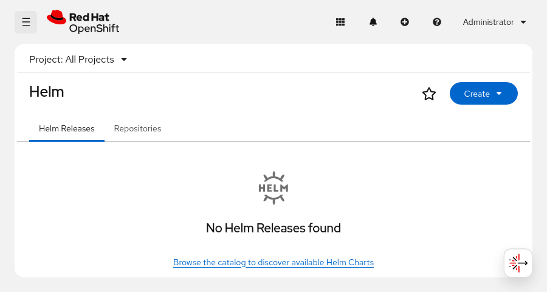
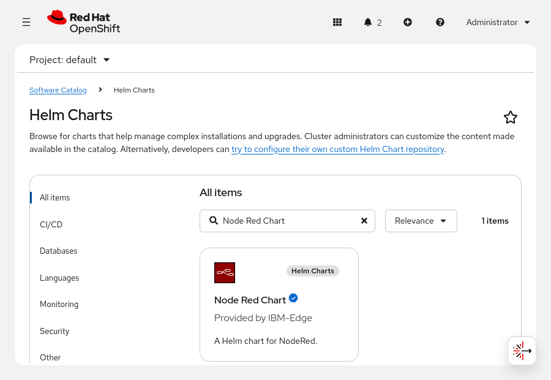
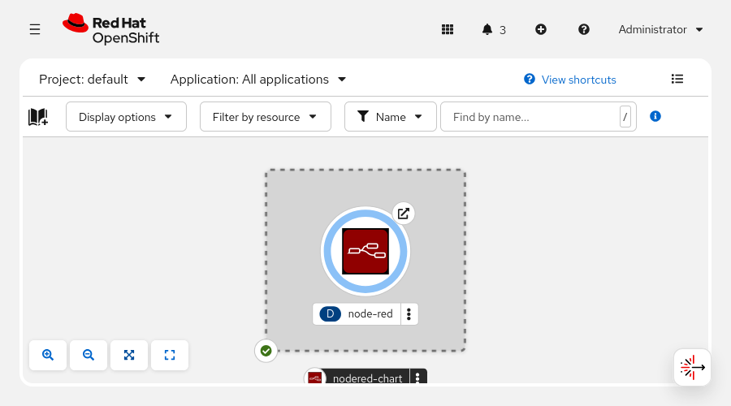
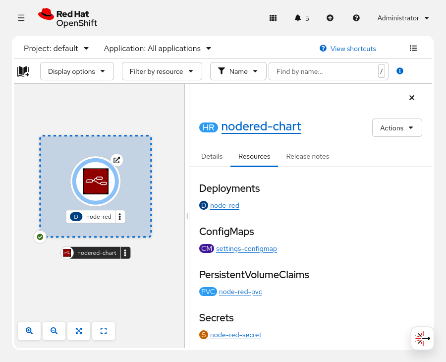
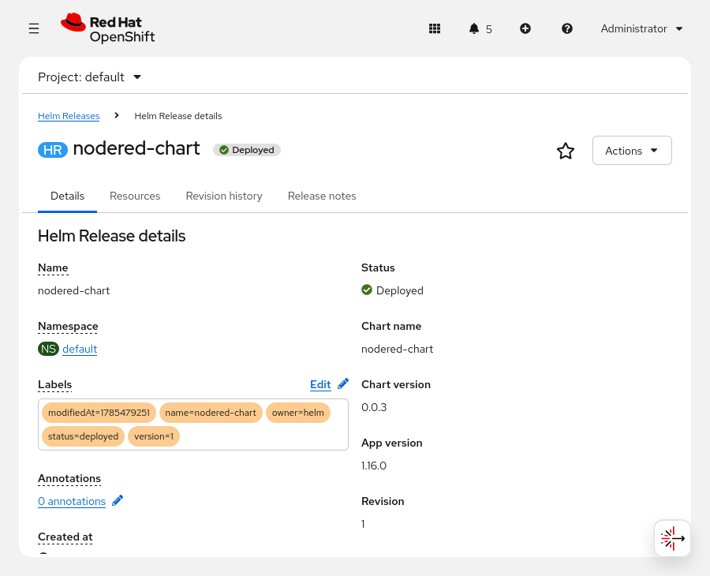

Quản trị Red Hat OpenShift II: Cấu hình Cụm Môi trường Sản xuất
---------------------------------------------------------------

# Chương 2. Triển khai các ứng dụng đóng gói
## Sử dụng các Template OpenShift
### OpenShift Templates
Template (mẫu) là một tài nguyên tùy chỉnh (custom resource) trong Kubernetes, dùng để mô tả một tập hợp các cấu hình tài nguyên Kubernetes. Các template có thể bao gồm các tham số. Bạn có thể tạo một tập hợp các đối tượng Kubernetes có liên quan từ một template bằng cách xử lý template đó và cung cấp giá trị cho các tham số. Template cũng có thể định nghĩa một tập hợp các nhãn (label) để áp dụng cho mọi đối tượng được định nghĩa trong template đó.

Template có nhiều trường hợp sử dụng đa dạng và có thể tạo bất kỳ tài nguyên Kubernetes nào mà bạn có quyền tạo trong một dự án. Bạn có thể tạo danh sách các đối tượng từ một template bằng cách sử dụng CLI hoặc thông qua giao diện web console (nếu template đã được tải lên dự án của bạn hoặc thư viện template toàn cục).

Tài nguyên template là một phần mở rộng Kubernetes do Red Hat OpenShift cung cấp. Cluster Samples Operator sẽ thực hiện nạp các template (và image stream) vào namespace `openshift`.

Bạn có thể chọn không thêm các template trong quá trình cài đặt, cũng như giới hạn danh sách các template mà operator sẽ nạp vào hệ thống. Ngoài ra, bạn có thể tự tạo template mới hoàn toàn, hoặc sao chép và tùy chỉnh một template hiện có để phù hợp với nhu cầu của dự án.

#### Khám phá các Template
Các mẫu (template) do Cluster Samples Operator cung cấp nằm trong namespace `openshift`. Bạn có thể sử dụng lệnh sau để xem danh sách các mẫu này. Lệnh này hiển thị tên của từng mẫu, phần mô tả, số lượng tham số và số lượng đối tượng mà mẫu đó tạo ra.

```console
[user@host ~]$ oc get templates -n openshift
NAME                      DESCRIPTION              PARAMETERS          OBJECTS
cakephp-mysql-example     An example CakePHP...    21 (4 blank)        8
postgresql-ephemeral      PostgreSQL database...    7 (2 generated)    3
```

Để đánh giá bất kỳ mẫu (template) nào, hãy sử dụng lệnh `oc describe template template-name -n namespace` để xem thông tin chi tiết về mẫu đó, bao gồm phần mô tả, các nhãn (label) được sử dụng, các tham số và các tài nguyên mà mẫu sẽ tạo ra.

Ví dụ sau đây hiển thị thông tin chi tiết về mẫu `postgresql-ephemeral` trong namespace `openshift`:

```yaml
Name:         postgresql-ephemeral
Namespace:    openshift
Created:      7 months ago
Labels:       samples.operator.openshift.io/managed=true
Description:  PostgreSQL database service, without persistent storage... # (1)
Annotations:  iconClass=icon-postgresql
...output omitted...

Parameters: # (2)

 ...output omitted...


    Name:          DATABASE_SERVICE_NAME
    Display Name:  Database Service Name
    Description:   The name of the OpenShift Service exposed for the database.
    Required:      true
    Value:         postgresql # (3)

 ...output omitted...

    Name:          POSTGRESQL_PASSWORD
    Display Name:  PostgreSQL Connection Password
    Description:   Password for the PostgreSQL connection user.
    Required:      true
    Generated:     expression # (4)
    From:          [a-zA-Z0-9]{16} # (5)

 ...output omitted...

Object Labels:  template=postgresql-ephemeral-template # (6)

Message:      The following service(s) have been created in your project...

Objects: # (7)
    Secret                              ${DATABASE_SERVICE_NAME}
    Service                             ${DATABASE_SERVICE_NAME}
    DeploymentConfig.apps.openshift.io  ${DATABASE_SERVICE_NAME}
```

1. Sử dụng phần mô tả để xác định mục đích của mẫu (template).
2. Các tham số mang lại sự linh hoạt trong quá trình triển khai.
3. Trường giá trị cung cấp giá trị mặc định mà bạn có thể thay đổi.
4. Trường "Generated" tạo ra giá trị mặc định cho tham số.
5. Trường "From" tạo ra giá trị mặc định cho tham số.
6. Các nhãn đối tượng được áp dụng cho tất cả các tài nguyên do mẫu tạo ra.
7. Phần đối tượng liệt kê các tài nguyên mà mẫu tạo ra.

Ngoài lệnh `oc describe` để xem thông tin về một template, bạn có thể sử dụng lệnh `oc process` với tùy chọn `--parameters` để xem các tham số mà template đó sử dụng. Ví dụ sau đây hiển thị các tham số mà template `postgresql-ephemeral` sử dụng:

```console
[user@host ~]$ oc process --parameters postgresql-ephemeral -n openshift
NAME                     ...   GENERATOR    VALUE
MEMORY_LIMIT             ...                512Mi
NAMESPACE                ...                openshift
DATABASE_SERVICE_NAME    ...                postgresql
POSTGRESQL_USER          ...   expression   user[A-Z0-9]{3}
POSTGRESQL_PASSWORD      ...   expression   [a-zA-Z0-9]{16}
POSTGRESQL_DATABASE      ...                sampledb
POSTGRESQL_VERSION       ...                10-el8
```

Các mẫu tùy chỉnh có thể được định nghĩa trong các tệp tài nguyên. Để xem các tham số của một mẫu được định nghĩa trong tệp, bạn có thể sử dụng tùy chọn `-f`:

```console
[user@host ~]$ oc process --parameters -f my-postgresql.yaml
```

Để xem tệp manifest của một template, hãy sử dụng lệnh `oc get template template-name -o yaml -n namespace`. Trong tệp manifest này, bạn có thể xem cách template tạo ra các tài nguyên. Tệp manifest cũng là nguồn tài liệu hữu ích để tìm hiểu cách tạo template.

Ví dụ sau đây lấy tệp manifest cho template `postgresql-ephemeral`:

```console
[user@host ~]$ oc get template postgresql-ephemeral -o yaml -n openshift
apiVersion: template.openshift.io/v1
kind: Template
labels:
  template: postgresql-ephemeral-template
metadata:
 ...output omitted...
- apiVersion: v1
  kind: Secret
  metadata:
 ...output omitted...
- apiVersion: v1
  kind: Service
  metadata:
 ...output omitted...
- apiVersion: apps.openshift.io/v1
  kind: DeploymentConfig
  metadata:
 ...output omitted...
parameters:
- description: Maximum amount of memory the container can use.
  displayName: Memory Limit
  name: MEMORY_LIMIT
  required: true
  value: 512Mi
 ...output omitted...
```

#### Sử dụng Template

Để tạo các tài nguyên được định nghĩa trong một template, bạn cần khởi tạo template đó. Bạn có thể thực hiện việc này bằng cách sử dụng lệnh `oc new-app` kết hợp với tùy chọn `--template` (theo sau là tên template) và tùy chọn `-p` (theo sau là các tham số).

Ví dụ dưới đây triển khai các tài nguyên được định nghĩa bởi template `postgresql-ephemeral` từ dự án `openshift` và thiết lập giá trị của tham số `POSTGRESQL_USER` thành `my-user`:

```console
[user@host ~]$ oc new-app --template postgresql-ephemeral -p POSTGRESQL_USER=my-user
```

Lệnh `oc new-app` rất thuận tiện cho mục đích phát triển và thử nghiệm. Tuy nhiên, đối với môi trường vận hành thực tế (production), bạn nên sử dụng các template theo cách hỗ trợ việc theo dõi tài nguyên và cấu hình. Ví dụ: bạn có thể dùng lệnh `oc process` để chuyển đổi template thành danh sách các tài nguyên, sau đó dùng lệnh `oc apply` để tạo hoặc cập nhật các tài nguyên đó.

Lệnh `oc process` có thể xử lý cả các template được lưu trữ trong tệp tin cục bộ lẫn các template được lưu trữ trong cụm (cluster). Để xử lý các template trong một namespace, bạn cần có quyền ghi đối với namespace chứa template đó. Chẳng hạn, để chạy lệnh `oc process` với các template nằm trong namespace `openshift`, bạn bắt buộc phải có quyền ghi trên namespace này.

> **Lưu ý:** Theo mặc định, người dùng không có đặc quyền có thể đọc các template trong namespace `openshift`. Những người dùng này có thể trích xuất template từ namespace `openshift` và tạo một bản sao trong dự án mà họ có quyền hạn rộng hơn. Sau khi sao chép template sang một dự án, họ có thể sử dụng lệnh `oc process` với template đó.

#### Triển khai ứng dụng từ các template

Lệnh `oc process` sử dụng các giá trị tham số để chuyển đổi một template thành một tập hợp các tệp định nghĩa tài nguyên Kubernetes có liên quan. Hãy sử dụng tùy chọn `-p` kèm theo các cặp `key=value` (khóa=giá trị) cùng với lệnh `oc process` để thiết lập các giá trị tham số này.

Ví dụ: lệnh dưới đây tạo ra một tập hợp các tệp định nghĩa tài nguyên cho template `my-postgresql` và thiết lập giá trị của tham số `POSTGRESQL_USER` thành `user1`. Lệnh này sẽ ghi các tệp định nghĩa thu được vào tệp `my-postgresql-manifest.yaml`.

```console
[user@host ~]$ oc process my-postgresql \
-p POSTGRESQL_USER=user1 -o yaml > my-postgresql-manifest.yaml
```

Bạn có thể sử dụng tùy chọn `-f` với lệnh `oc process` để xử lý một template được định nghĩa trong một tệp:

```console
[user@host ~]$ oc process -f my-postgresql.yaml \
-p POSTGRESQL_USER=user1 -o yaml > my-postgresql-manifest.yaml
```

Ví dụ sau đây truyền ba giá trị tham số cho mẫu `my-postgresql` và ghi đè các giá trị mặc định của các tham số được chỉ định:

```console
[user@host ~]$ oc process my-postgresql -o yaml \
-p MEMORY_LIMIT=1024Mi \
-p POSTGRESQL_USER='db-user' \
-p POSTGRESQL_PASSWORD='my-secret-password' \
> my-postgresql-manifest.yaml
```

Thay vì chỉ định các tham số trên dòng lệnh, hãy đặt chúng vào một tệp tin. Cách làm này giúp dòng lệnh gọn gàng hơn khi cần sử dụng nhiều tham số. Hãy lưu tệp chứa tham số này vào hệ thống quản lý phiên bản để lưu lại thông tin về các tham số được sử dụng trong quá trình triển khai thực tế (production).

Ví dụ: thay vì sử dụng các tùy chọn dòng lệnh như trong các ví dụ trước, hãy đặt các cặp khóa-giá trị vào tệp `my-postgresql-params.env`. Hãy thêm các cặp khóa-giá trị này vào tệp, với mỗi cặp nằm trên một dòng riêng biệt:

```
MEMORY_LIMIT=1024Mi
POSTGRESQL_USER='db-user'
POSTGRESQL_PASSWORD='my-secret-password'
```

Lệnh `oc process` tương ứng sử dụng tùy chọn `--param-file` để truyền các tham số như sau:

```console
[user@host ~]$ oc process my-postgresql -o yaml \
--param-file my-postgresql-params.env > my-postgresql-manifest.yaml
```

Việc tạo tệp manifest là không bắt buộc khi sử dụng các template. Thay vào đó, hãy chuyển (pipe) đầu ra của lệnh `oc process` trực tiếp vào đầu vào của lệnh `oc apply -f -`. Lệnh `oc apply` sẽ tạo các tài nguyên thực tế trên cụm Kubernetes.

```console
[user@host ~]$ oc process my-postgresql \
--param-file my-postgresql-params.env | oc apply -f -
```

Do các mẫu có tính linh hoạt, bạn có thể sử dụng cùng một mẫu để tạo ra các tài nguyên khác nhau bằng cách thay đổi các tham số đầu vào.

#### Cập nhật ứng dụng từ các mẫu
Vì bạn sử dụng lệnh `oc apply`, nên sau khi triển khai một tập hợp các tệp manifest từ một template, bạn có thể xử lý lại template đó và dùng lệnh `oc apply` để thực hiện cập nhật. Quy trình này cho phép thực hiện các thay đổi đơn giản đối với các template đã triển khai, chẳng hạn như thay đổi một tham số. Tuy nhiên, cơ chế này không hỗ trợ được nhiều loại cập nhật workload khác.

Để quản lý các ứng dụng phức tạp hơn, hãy cân nhắc sử dụng các cơ chế khác, chẳng hạn như Helm chart (được đề cập ở phần khác trong khóa học này).

Để so sánh kết quả khi áp dụng một tệp tham số khác cho template với các tài nguyên đang hoạt động (live resources), hãy chuyển (pipe) tệp manifest sang lệnh `oc diff -f -`. Ví dụ, đối với tệp tham số thứ hai có tên là `my-postgresql-params-2.env`, hãy sử dụng lệnh sau:

```console
[user@host ~]$ oc process my-postgresql -o yaml \
--param-file my-postgresql-params-2.env | oc diff -f -
 ...output omitted...
-  generation: 1
+  generation: 2
   labels:
     template: postgresql-ephemeral-template
@@ -86,10 +86,10 @@
           timeoutSeconds: 10
         resources:
           limits:
-            memory: 1Gi
+            memory: 2Gi
           requests:
             cpu: 500m
-            memory: 1Gi
+            memory: 2Gi
         terminationMessagePath: /dev/termination-log
         terminationMessagePolicy: File
         volumeMounts:
```

Trong trường hợp này, thay đổi cấu hình làm tăng mức sử dụng bộ nhớ của ứng dụng. Kết quả đầu ra cho thấy các tham số mới làm thay đổi giá trị "generation" và cập nhật tài nguyên để sử dụng 2Gi bộ nhớ thay vì 1Gi.

Sau khi xác nhận các thay đổi đúng như ý muốn, bạn có thể chuyển (pipe) kết quả đầu ra của lệnh `oc` sang lệnh `oc apply -f -`.

#### Quản lý Templates
Đối với môi trường sản xuất, bạn nên tạo một bản sao của mẫu (template) tiêu chuẩn mà bạn định sử dụng và tùy chỉnh các giá trị tham số mặc định cho dự án đích. Để sao chép một mẫu vào dự án của mình, hãy sử dụng lệnh `oc get template` với tùy chọn `-o yaml` để lưu nội dung YAML của mẫu đó vào một tệp tin.

Ví dụ sau đây sao chép mẫu `postgresql-ephemeral` từ dự án `openshift` sang một tệp tin có tên là `my-postgresql.yaml`:

```console
[user@host ~]$ oc get template postgresql-ephemeral -o yaml \
-n openshift > my-postgresql.yaml
```

Sau khi tạo tệp YAML cho mẫu (template), hãy cân nhắc sửa đổi mẫu như sau:

* Đặt tên mới cho mẫu sao cho phản ánh cụ thể mục đích sử dụng các tài nguyên của mẫu đó. 
* Điều chỉnh phù hợp các giá trị mặc định của tham số ở cuối tệp. 
* Xóa trường namespace của tài nguyên mẫu.

Nếu có quyền, bạn có thể xử lý các tài nguyên mẫu (template resources) trong các namespace khác. Việc xử lý mẫu trong một dự án khác mà không thay đổi namespace của mẫu để khớp với namespace đích sẽ gây ra lỗi. Ngoài ra, bạn cũng có thể tùy chọn xóa trường namespace khỏi phần metadata của tài nguyên mẫu.

Sau khi có tệp YAML cho mẫu, hãy sử dụng lệnh `oc create -f` để tải mẫu đó lên dự án hiện tại. Trong trường hợp này, lệnh `oc create` không tạo ra các tài nguyên mà mẫu định nghĩa; thay vào đó, lệnh này tạo ra một tài nguyên mẫu trong dự án. Việc sử dụng mẫu đã được tải lên dự án giúp làm rõ mẫu nào cung cấp các định nghĩa tài nguyên cho dự án đó. Sau khi tải lên, mẫu sẽ khả dụng cho bất kỳ ai có quyền truy cập vào dự án.

Ví dụ sau đây tải một mẫu tùy chỉnh được định nghĩa trong tệp `my-postgresql.yaml` lên dự án hiện tại:

```console
[user@host ~]$ oc create -f my-postgresql.yaml
```

Sử dụng tùy chọn namespace `-n` để tải mẫu lên một dự án khác. Ví dụ sau đây tải mẫu được định nghĩa trong tệp `my-postgresql.yaml` lên dự án `shared-templates`:

```console
[user@host ~]$ oc create -f my-postgresql.yaml -n shared-templates
```

Sử dụng lệnh `oc get templates` để xem danh sách các mẫu có sẵn trong dự án:

```console
[user@host ~]$ oc get templates -n shared-templates
NAME                      DESCRIPTION              PARAMETERS          OBJECTS
my-postgresql             PostgreSQL database...    7 (2 generated)    3
```

## Triển khai Helm Chart
### Tổng quan về Helm
Helm là một ứng dụng mã nguồn mở giúp quản lý vòng đời của các ứng dụng Kubernetes. Helm giới thiệu khái niệm "chart". Một chart là một gói mô tả tập hợp các tài nguyên Kubernetes mà bạn có thể triển khai. Các Helm chart định nghĩa các giá trị mà bạn có thể tùy chỉnh khi triển khai ứng dụng. Helm bao gồm các chức năng để phân phối chart và các bản cập nhật. Nhiều tổ chức phân phối Helm chart để triển khai ứng dụng. Thông thường, Helm là cơ chế được hỗ trợ để triển khai một ứng dụng cụ thể. Tuy nhiên, Helm không đáp ứng được mọi nhu cầu quản lý đối với một số loại ứng dụng nhất định. Operator cung cấp một mô hình toàn diện hơn, có khả năng xử lý vòng đời của các ứng dụng phức tạp hơn. Để biết thêm chi tiết về operator, hãy tham khảo tài liệu về Kubernetes Operator và Operator Lifecycle Manager.

### Helm Charts
Helm chart định nghĩa các tài nguyên Kubernetes mà bạn có thể triển khai. Một chart là tập hợp các tệp tin có cấu trúc xác định. Các tệp tin này bao gồm siêu dữ liệu của chart (chẳng hạn như tên hoặc phiên bản chart), các định nghĩa tài nguyên và các tài liệu bổ trợ. Sơ đồ dưới đây minh họa cấu trúc của một Helm chart tối giản:

```
sample/
├── Chart.yaml (1)
├── templates/ (2)
│   └── example.yaml
└── values.yaml (3)
```

1. Tệp `Chart.yaml` chứa siêu dữ liệu của chart, chẳng hạn như tên và phiên bản của chart.
2. Thư mục `templates` chứa các tệp định nghĩa tài nguyên ứng dụng, ví dụ như các deployment.
3. Tệp `values.yaml` chứa các giá trị mặc định cho chart.

Helm chart có thể chứa các hook mà Helm sẽ thực thi tại những thời điểm khác nhau trong quá trình cài đặt và nâng cấp. Các hook này giúp tự động hóa các tác vụ cài đặt và nâng cấp. Nhờ có hook, Helm chart có khả năng quản lý các ứng dụng phức tạp hơn so với các quy trình chỉ dựa thuần túy vào file manifest. Hãy tham khảo tài liệu về chart để tìm hiểu chi tiết về các hook cũng như vai trò của chúng.

### Sử dụng Helm Chart
Helm là một ứng dụng dòng lệnh. Lệnh `helm` tương tác với các thành phần sau:

**Chart**  
Chart là các ứng dụng đã được đóng gói mà lệnh `helm` sẽ triển khai.

**Release**  
Release là kết quả của việc triển khai một chart. Bạn có thể triển khai một chart nhiều lần trên cùng một cụm (cluster); mỗi lần triển khai như vậy được coi là một release riêng biệt.

**Version**  
Một Helm chart có thể có nhiều phiên bản. Người tạo chart có thể phát hành các bản cập nhật để thích ứng với các phiên bản ứng dụng mới hơn, bổ sung tính năng hoặc sửa lỗi.

Bạn có thể sử dụng và tham chiếu đến các chart theo nhiều cách khác nhau. Ví dụ: nếu chart nằm trong hệ thống tệp cục bộ của bạn, bạn có thể tham chiếu đến nó bằng cách sử dụng đường dẫn đến thư mục chứa chart đó. Bạn cũng có thể sử dụng đường dẫn hoặc URL trỏ đến một chart đã được đóng gói dưới dạng tệp nén tar (với chuẩn nén gzip).

#### Kiểm tra Helm Chart
Sử dụng lệnh `helm show` để hiển thị thông tin về một chart. Lệnh con `show chart` hiển thị các thông tin chung, chẳng hạn như thông tin người bảo trì hoặc URL nguồn.

```console
[user@host ~]$ helm show chart chart-reference
apiVersion: v1
description: A Helm chart for Kubernetes
name: examplechart
version: 0.1.0
maintainers:
- email: dev@example.com
  name: Developer
sources:
- https://git.example.com/examplechart
```

Lệnh `helm show values` hiển thị các giá trị mặc định của chart. Kết quả đầu ra có định dạng YAML và được lấy từ tệp `values.yaml` trong chart.

```console
[user@host ~]$ helm show values chart-reference
image:
  repository: "sample"
  tag: "1.8.10"
  pullPolicy: IfNotPresent
...output omitted...
```

Theo mặc định, các tài nguyên của Chart sử dụng các giá trị từ tệp `values.yaml`. Bạn có thể ghi đè các giá trị mặc định này. Hãy sử dụng kết quả đầu ra của lệnh `helm show values` để biết các giá trị có thể tùy chỉnh.

#### Cài đặt Helm Chart
Sau khi kiểm tra chart, hãy triển khai các tài nguyên trong chart đó bằng cách sử dụng lệnh `helm install`. Trong Helm, thao tác "install" (cài đặt) có nghĩa là triển khai các tài nguyên của chart để tạo ra một bản phát hành (release). Hãy luôn tham khảo tài liệu của chart trước khi cài đặt để nắm bắt các điều kiện tiên quyết, các bước cài đặt bổ sung và những thông tin cần thiết khác. Để cài đặt một chart, bạn cần xác định các tham số sau:

* Namespace (không gian tên) đích để triển khai
* Các giá trị cần ghi đè (override)
* Tên của bản phát hành (release name)

Helm chart có thể chứa các tài nguyên Kubernetes thuộc bất kỳ loại nào. Các tài nguyên này có thể thuộc phạm vi namespace (namespaced) hoặc không thuộc phạm vi namespace (non-namespaced). Tương tự như các định nghĩa tài nguyên thông thường, các tài nguyên thuộc phạm vi namespace trong chart có thể bao gồm hoặc bỏ qua khai báo namespace. Hầu hết các Helm chart dùng để triển khai ứng dụng đều không tự tạo namespace, và các tài nguyên thuộc phạm vi namespace trong chart thường không khai báo namespace cụ thể. Thông thường, khi triển khai một chart theo cấu trúc này, bạn sẽ tạo một namespace cho quá trình triển khai, và Helm sẽ tạo các tài nguyên thuộc phạm vi namespace ngay trong namespace đó.

Sau khi xác định namespace đích, hãy lên kế hoạch cho các giá trị (values) sẽ sử dụng. Hãy tham khảo tài liệu và kết quả đầu ra của lệnh `helm show values` để quyết định xem cần ghi đè những giá trị nào. Bạn có thể định nghĩa các giá trị này bằng cách tạo một tệp YAML chứa chúng. Tệp YAML này có thể tuân theo cấu trúc từ kết quả đầu ra của lệnh `helm show values` (vốn chứa các giá trị mặc định), nhưng chỉ cần chỉ định những giá trị mà bạn muốn ghi đè.

Người tạo chart có thể sử dụng tính năng template của ngôn ngữ Go để định nghĩa các tài nguyên. Ví dụ: thay vì chỉ định cố định image cho một deployment, chart có thể sử dụng các giá trị do người dùng cung cấp để xác định image đó. Việc sử dụng các giá trị để chọn image cho phép quản trị viên cụm (cluster administrator) thay thế image công khai mặc định bằng một image từ kho lưu trữ riêng (private repository).

Hãy xem xét kết quả đầu ra sau đây từ lệnh `helm show values` đối với một chart mẫu:

```yaml
image:
  repository: "sample"
  tag: "1.8.10"
  pullPolicy: IfNotPresent
```

Hãy tạo tệp values.yaml không bao gồm khóa `image` nếu bạn không muốn ghi đè bất kỳ tham số hình ảnh nào. Hãy bỏ qua khóa `pullPolicy` nếu bạn muốn ghi đè khóa `tag` mà không thay đổi chính sách kéo ảnh (pull policy). Ví dụ, tệp YAML dưới đây sẽ chỉ ghi đè thẻ (tag) của hình ảnh:

```yaml
image:
  tag: "1.8.10-patched"
```

Ngoài tệp YAML, bạn có thể ghi đè các giá trị cụ thể bằng cách sử dụng các tham số dòng lệnh.

Bước cuối cùng để chuẩn bị triển khai một chart là chọn tên cho bản phát hành (release name). Bạn có thể triển khai một chart nhiều lần vào cùng một cụm (cluster); mỗi lần triển khai phải có một tên bản phát hành duy nhất để phân biệt. Nhiều Helm chart sử dụng tên bản phát hành này để đặt tên cho các tài nguyên được tạo ra. Với namespace, các giá trị cấu hình (values) và tên bản phát hành đã xác định, bạn có thể bắt đầu quá trình triển khai. Lệnh `helm install` sẽ tạo ra một bản phát hành trong một namespace cụ thể, dựa trên tập hợp các giá trị đã cung cấp.

#### Kết xuất các tệp manifest từ một Chart
Sử dụng tùy chọn `--dry-run` để xem trước kết quả của việc cài đặt một Chart.

```console
[user@host ~]$ helm install release-name chart-reference  --dry-run \
--values my-values.yaml
NAME: release-name (1)
LAST DEPLOYED: Fri Aug 14 13:14:57 2026
NAMESPACE: current-namespace
STATUS: pending-install
REVISION: 1
TEST SUITE: None
HOOKS:
MANIFEST:
---
# Source: chart/templates/serviceaccount.yaml (2)
apiVersion: v1
kind: ServiceAccount
metadata:
  name: my-release-sa
  labels:
...output omitted...

NOTES: (3)
The application can be accessed via port 1234.
...output omitted...
```

1. Thông tin chung về bản phát hành mới
2. Danh sách các tài nguyên mà lệnh `helm install` sẽ tạo ra
3. Thông tin bổ sung

> **Lưu ý:** Hãy xác định các giá trị sử dụng cho quá trình cài đặt bằng tùy chọn `--values ​​my-values.yaml`. Trong tệp này, bạn sẽ ghi đè lên các giá trị mặc định của chart vốn được định nghĩa trong tệp `values.yaml` đi kèm với chart đó.

Thông thường, tên các tài nguyên trong chart sẽ bao gồm tên bản phát hành (release name). Trong kết quả ví dụ của lệnh `helm install`, tên tài khoản dịch vụ (service account) là sự kết hợp giữa tên bản phát hành và chuỗi ký tự `-sa`. Người tạo chart có thể cung cấp các ghi chú cài đặt sử dụng các giá trị cấu hình của chart. Cũng trong ví dụ đó, số cổng (port number) hiển thị trong phần ghi chú phản ánh một giá trị từ cấu hình của chart. Nếu phần xem trước hiển thị đúng như mong đợi, hãy chạy lại lệnh đó nhưng bỏ tùy chọn `--dry-run` để triển khai các tài nguyên và tạo bản phát hành.

### Bản phát hành - Releases
Khi lệnh `helm install` thực thi thành công, bên cạnh việc tạo ra các tài nguyên, Helm còn tạo ra một bản phát hành (release). Helm lưu trữ thông tin về bản phát hành này dưới dạng một secret có kiểu `helm.sh/release.v1`.

### Kiểm tra Bản phát hành
Sử dụng lệnh `helm list` để kiểm tra các bản phát hành trên cụm.

```console
[user@host ~]$ helm list
NAME         NAMESPACE   REVISION  ...  STATUS     CHART            APP VERSION
my-release   example     1         ...  deployed   example-4.12.1   1.8.10
```

Tương tự như các lệnh `oc`, nhiều lệnh `helm` hỗ trợ các tùy chọn `--all-namespaces` và `--namespace`. Khi không sử dụng tùy chọn nào, lệnh `helm list` sẽ liệt kê các bản phát hành (release) trong namespace hiện tại. Nếu sử dụng tùy chọn `--all-namespaces`, lệnh sẽ liệt kê các bản phát hành trong tất cả các namespace. Nếu sử dụng tùy chọn `--namespace`, lệnh sẽ liệt kê các bản phát hành trong một namespace cụ thể.

> **Cảnh báo:** Không được can thiệp vào secret của bản phát hành (release secret). Nếu bạn xóa secret này, Helm sẽ không thể thao tác với bản phát hành đó.

#### Nâng cấp các bản phát hành
Lệnh `helm upgrade` có thể áp dụng các thay đổi cho những bản phát hành hiện có, chẳng hạn như cập nhật các giá trị hoặc phiên bản chart.

> **Quan trọng:** Theo mặc định, lệnh `helm upgrade` tự động cập nhật các bản phát hành để sử dụng phiên bản mới nhất của chart.

Lệnh `helm upgrade` sử dụng các tham số và tùy chọn tương tự như lệnh `helm install`. Tuy nhiên, thay vì tạo mới tài nguyên từ đầu, lệnh `helm upgrade` lại tương tác với các tài nguyên hiện có trong cụm (cluster). Do đó, lệnh này có thể dẫn đến những tác động phức tạp hơn, chẳng hạn như các thay đổi gây xung đột. Bạn nên luôn xem kỹ tài liệu của chart khi sử dụng phiên bản chart mới hơn hoặc khi thay đổi các giá trị cấu hình. Bạn có thể sử dụng tùy chọn `--dry-run` để xem trước các tệp định nghĩa tài nguyên (manifests) mà lệnh `helm upgrade` sẽ sử dụng, đồng thời so sánh chúng với các tài nguyên đang hoạt động trong hệ thống.

#### Hoàn tác các bản nâng cấp Helm
Helm lưu lại nhật ký các bản nâng cấp (release), cho phép bạn xem lại các thay đổi và hoàn tác về các phiên bản trước đó. Bạn có thể xem nhật ký này bằng cách sử dụng lệnh `helm history`:

```console
[user@host ~]$ helm history release_name
REVISION  UPDATED        STATUS      CHART        APP VERSION  DESCRIPTION
1         Wed May 31...  superseded  chart-0.0.6  latest       Install complete
2         Wed May 31...  deployed    chart-0.0.7  latest       Upgrade complete
```

Bạn có thể sử dụng lệnh `helm rollback` để quay lại phiên bản trước đó của Helm chart:

```console
[user@host ~]$ helm rollback release_name revision
Rollback was a success! Happy Helming!
```

Việc hoàn tác (rollback) có thể mang lại những hệ quả lớn hơn so với việc nâng cấp, bởi lẽ các bản nâng cấp đôi khi không thể đảo ngược được. Nếu duy trì một môi trường thử nghiệm có các bản nâng cấp tương tự như môi trường thực tế (production), bạn có thể kiểm thử quy trình hoàn tác trước khi thực hiện trên môi trường thực tế nhằm phát hiện các vấn đề tiềm ẩn.

### Kho lưu trữ Helm
Các Chart có thể được phân phối dưới dạng tệp, tệp nén, image container hoặc thông qua việc sử dụng kho lưu trữ Chart. Lệnh `helm repo` cung cấp các lệnh con sau đây để thao tác với các kho lưu trữ Chart.

| Lệnh con                                    | Mô tả                                |
|---------------------------------------------|--------------------------------------|
| add NAME REPOSITORY_URL                     | Thêm một kho lưu trữ Helm chart.     |
| list                                        | Liệt kê các kho lưu trữ Helm chart.  |
| update                                      | Cập nhật các kho lưu trữ Helm chart. |
| remove REPOSITORY1_NAME REPOSITORY2_NAME …  | Xóa các kho lưu trữ Helm chart.      |

Sử dụng lệnh `helm repo add` để thêm một kho lưu trữ chart vào cấu hình Helm cục bộ của bạn:

```console
[user@host ~]$ helm repo add \
openshift-helm-charts https://charts.openshift.io/
"openshift-helm-charts" has been added to your repositories
```

Lệnh `helm repo add` và các lệnh quản lý kho lưu trữ (repository) khác chỉ thay đổi cấu hình cục bộ chứ không ảnh hưởng đến bất kỳ tài nguyên nào trong cụm (cluster). Lệnh `helm repo add` cập nhật tệp cấu hình `~/.config/helm/repositories.yaml` – nơi lưu trữ danh sách các kho đã được cấu hình. Khi các kho lưu trữ đã được cấu hình, các lệnh khác có thể sử dụng danh sách này để thực hiện các thao tác. Ví dụ, lệnh `helm search repo` sẽ liệt kê tất cả các chart có sẵn trong các kho lưu trữ đã được cấu hình:

```console
[user@host ~]$ helm search repo
NAME          CHART VERSION    APP VERSION    DESCRIPTION
repo/chart    0.0.7            latest         A sample chart
...output omitted...
```

Theo mặc định, lệnh `helm search repo` chỉ hiển thị phiên bản mới nhất của chart. Hãy sử dụng tùy chọn `--versions` để liệt kê tất cả các phiên bản hiện có. Theo mặc định, các lệnh `install` và `upgrade` sử dụng phiên bản mới nhất của chart trong kho lưu trữ (repository). Bạn có thể sử dụng tùy chọn `--version` để cài đặt các phiên bản cụ thể.

### Sử dụng Helm trong OpenShift Web Console
Red Hat OpenShift Container Platform cung cấp giao diện đồ họa trên bảng điều khiển web để quản lý toàn bộ vòng đời của các ứng dụng Helm.

#### Truy cập giao diện người dùng Helm
Để truy cập các tính năng Helm trong bảng điều khiển web, hãy vào mục **Ecosystem → Helm** trên menu điều hướng. Trang Helm hiển thị danh sách các bản phát hành Helm đã được triển khai trong dự án hiện tại.

**Hình 2.1: Trang các bản phát hành Helm**  


Cài đặt Helm Chart từ Software Catalog

Software Catalog trên giao diện web cung cấp một nơi tập trung để duyệt và cài đặt các Helm chart. Bạn có thể thực hiện theo quy trình sau để cài đặt một Helm chart từ Software Catalog:

1. Trên giao diện web, truy cập vào mục Ecosystem → Helm. 
2. Tại trang Helm, nhấp vào nút Create và chọn tùy chọn Helm Release để hiển thị tất cả các Helm chart có trong Software Catalog.

> **Lưu ý:** Các kho lưu trữ (repository) được thêm bằng lệnh `helm repo add` sẽ được lưu trữ cục bộ trong cấu hình máy khách Helm và không hiển thị trên giao diện web (web console). Để một kho lưu trữ Helm chart hiển thị trên giao diện web, quản trị viên cụm cần tạo tài nguyên tùy chỉnh `HelmChartRepository` (để truy cập trên toàn bộ cụm) hoặc `ProjectHelmChartRepository` (để truy cập trong phạm vi dự án).

**Hình 2.2: Các Helm chart trong Danh mục Phần mềm**  


3. Chọn một chart từ danh mục để xem chi tiết.
4. Nhấn Create. Bảng điều khiển sẽ hướng dẫn bạn thực hiện quy trình cài đặt.
5. Trên trang Create Helm Release, hãy nhập tên duy nhất cho bản phát hành vào trường Release name.
6. Chọn phiên bản chart cần thiết từ danh sách thả xuống Chart version.
7. Sử dụng chế độ xem Form hoặc YAML để cấu hình các giá trị của chart. Việc chỉnh sửa các giá trị mặc định tương đương với việc sử dụng tệp values.yaml tùy chỉnh cùng với lệnh helm install.
8. Nhấn Create.

Sau khi cài đặt, bảng điều khiển web hiển thị chế độ xem Topology, cho thấy các tài nguyên được tạo bởi tất cả các bản phát hành Helm trong dự án hiện tại.

**Hình 2.3: Chế độ xem Topology của một Helm chart**  


#### Cài đặt Helm Chart từ URL
Bạn có thể cài đặt Helm chart trực tiếp từ một URL mà không cần thêm chart đó vào kho lưu trữ (repository) trước. Việc cài đặt từ URL rất hữu ích khi chart không có sẵn trong danh mục phần mềm hoặc trong kho lưu trữ đã được cấu hình. Giao diện web hỗ trợ cả URL dạng `https://` và `oci://` đối với các chart được lưu trữ trong registry tuân thủ chuẩn OCI.

> **Cảnh báo:** Việc cài đặt Helm chart từ một URL trực tiếp sẽ bỏ qua các bước kiểm tra xác thực do danh mục phần mềm (software catalog) cung cấp. Chỉ cài đặt chart từ các URL mà bạn tin tưởng, vì những chart chưa được xác thực có thể gây rủi ro bảo mật cho cụm (cluster) của bạn. Khi có thể, hãy sử dụng chart từ danh mục phần mềm hoặc từ kho lưu trữ Helm đã được cấu hình.

Bạn thực hiện quy trình sau để cài đặt Helm chart từ một URL:

1. Trong giao diện web console, truy cập vào mục **Ecosystem → Helm**. 
2. Chọn dự án đích từ menu thả xuống Project. 
3. Tại trang Helm, nhấp vào nút Create và chọn tùy chọn Helm chart URL để hiển thị trang `Install Helm chart from URL`. 
4. Tại trường Chart URL, nhập URL của Helm chart.

> **Lưu ý:** Đối với các Helm chart được lưu trữ trong registry tuân thủ chuẩn OCI, URL phải sử dụng giao thức oci://. Ví dụ: oci://quay.io/organization/repository/chart-name

5. Trong trường `Release name`, hãy nhập tên cho bản phát hành Helm.
6. Trong trường `Chart version`, hãy nhập số phiên bản chart nếu trường này không được tự động điền.
7. Nhấn **Next**.
8. Xem lại cấu hình và chọn chế độ `Form view` hoặc `YAML view` để cấu hình các giá trị của chart.
9. Nhấn **Install**.

#### Quản lý các bản phát hành Helm

Trên trang Helm (truy cập qua mục Ecosystem → Helm), danh sách tất cả các bản phát hành Helm đã cài đặt cho dự án được chọn sẽ hiển thị. Tại đây, bạn có thể xem trạng thái, số hiệu bản sửa đổi (revision number) và phiên bản chart của từng bản phát hành.

Giao diện quản lý cung cấp các chế độ xem chuyên biệt sau đây để quản lý các bản phát hành:

**Chế độ xem Topology (Sơ đồ cấu trúc)**  
Sau khi triển khai ứng dụng, một bản phát hành Helm sẽ được tạo ra. Ứng dụng đã triển khai sẽ xuất hiện trong chế độ xem `Topology` và được phân loại là một bản phát hành Helm. Chế độ xem `Topology` cung cấp hình ảnh trực quan về bản phát hành Helm cùng tất cả các tài nguyên Kubernetes mà chart đó tạo ra, chẳng hạn như deployment, service và route. Hãy nhấp vào tên bản phát hành để xem chi tiết, bao gồm các tài nguyên mà nó quản lý, lịch sử sửa đổi và các giá trị (values) được sử dụng cho quá trình triển khai. Bạn có thể truy cập chế độ xem `Topology` thông qua tùy chọn **Workloads → Topology**.

**Hình 2.4: Chế độ xem Topology của Helm release**  


**Trang Chi tiết Bản phát hành**  
Truy cập **Ecosystem → Helm** và chọn tên bản phát hành để mở trang chi tiết chuyên biệt, nơi tập hợp các chức năng quản lý chính sau đây:

| Mục              | Mô tả                                                                                                                       |
|------------------|-----------------------------------------------------------------------------------------------------------------------------|
| Details          | Cung cấp thông tin chung, chẳng hạn như phiên bản biểu đồ, trạng thái phát hành và số hiệu bản sửa đổi.                     |
| Resources        | Liệt kê tất cả các tài nguyên Kubernetes cơ sở (pod, deployment và service) mà bản phát hành Helm này đã tạo và quản lý.    |
| Revision History | Hiển thị nhật ký của tất cả các lần nâng cấp và hoàn tác trước đó, mỗi lần đều được định danh bằng một số hiệu bản sửa đổi. |
| Release Notes    | Hiển thị các ghi chú cài đặt do tác giả chart cung cấp, tương tự như phần đầu ra NOTES của lệnh `helm install`.             |

**Hình 2.5: Chi tiết bản Helm release**  


#### Nâng cấp Helm Release

Bạn có thể nâng cấp một Helm release lên phiên bản chart mới hơn hoặc thay đổi các giá trị cấu hình của nó. Hãy thực hiện các bước sau để nâng cấp Helm release từ giao diện web:

1. Truy cập **Ecosystem** → **Helm** để xem các Helm release trong namespace. 
2. Nhấp vào biểu tượng dấu ba chấm dọc (⋮) bên cạnh release đó và chọn **Upgrade**. 
3. Trên trang **Upgrade Helm Release**, hãy chọn phiên bản chart muốn nâng cấp, chỉnh sửa các giá trị nếu cần, rồi nhấp vào **Upgrade**.

> **Lưu ý:** Nếu bạn đã cài đặt Helm chart bằng cách sử dụng URL trực tiếp, bạn không thể thay đổi trường Chart Version. Thay vào đó, hãy chỉnh sửa các giá trị trong chế độ Form view hoặc YAML view.

Quá trình nâng cấp tạo ra một bản sửa đổi khác cho bản phát hành.

#### Hoàn tác (Rollback) một bản phát hành Helm
Nếu quá trình nâng cấp gây ra sự cố, bạn có thể hoàn tác bản phát hành về phiên bản (revision) đã triển khai trước đó. Hãy thực hiện các bước sau để hoàn tác một bản phát hành Helm từ giao diện web:

1. Truy cập **Ecosystem** → **Helm** để xem các bản phát hành Helm trong namespace. 
2. Nhấp vào biểu tượng dấu ba chấm dọc bên cạnh bản phát hành và chọn **Rollback**. 
3. Trên trang **Rollback Helm Release**, chọn phiên bản muốn hoàn tác về và nhấp vào **Rollback**. 
4. Trên trang **Helm Releases**, nhấp vào tên bản phát hành để xem chi tiết và các tài nguyên của bản phát hành đó. 
5. Chuyển đến tab **Revision History** để xem tất cả các phiên bản của bản phát hành này.

Helm sẽ đưa ứng dụng trở lại trạng thái của phiên bản đã chọn.

#### Gỡ cài đặt Helm Release
Việc gỡ cài đặt một Helm release sẽ loại bỏ tất cả các tài nguyên Kubernetes liên quan khỏi cụm (cluster). Hãy thực hiện các bước sau để gỡ cài đặt Helm release từ giao diện web:

1. Truy cập **Ecosystem** → **Helm** để xem các Helm release trong namespace. 
2. Nhấp vào biểu tượng dấu ba chấm dọc bên cạnh release đó và chọn **Delete Helm Release**. 
3. Trong hộp thoại xác nhận, nhập tên của chart và nhấp vào **Delete**.

> **Quan trọng:** Việc gỡ cài đặt một bản phát hành (release) Helm là hành động không thể đảo ngược. Thao tác này xóa tất cả các tài nguyên do bản phát hành đó quản lý, và có thể bao gồm cả dữ liệu bền vững nếu chart được cấu hình để xóa các yêu cầu về volume bền vững (persistent volume claims).

Để đảm bảo quản lý hiệu quả các bản phát hành Helm, hãy thường xuyên xem xét tài liệu về chart và kiểm thử các thay đổi trong môi trường phi sản xuất.
