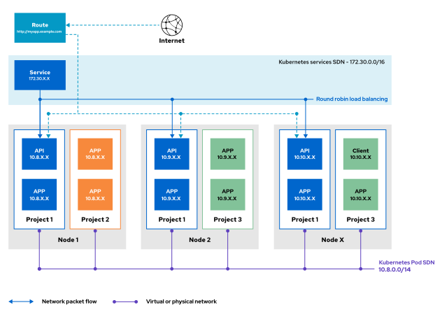
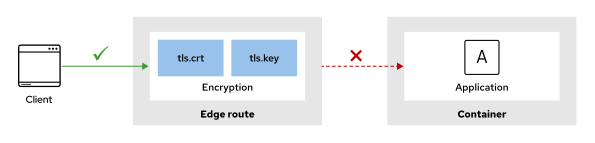
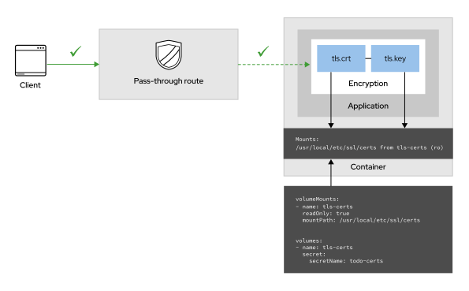

Quản trị Red Hat OpenShift II: Cấu hình Cụm Môi trường Sản xuất
---------------------------------------------------------------

# Chương 4. Bảo mật mạng
## Bảo vệ lưu lượng truy cập bên ngoài bằng TLS
### Truy cập ứng dụng từ mạng bên ngoài
Bạn có thể công khai các ứng dụng của mình ra mạng bên ngoài bằng cách sử dụng các phương thức và tài nguyên có sẵn trong Red Hat OpenShift Container Platform. Các phương thức này hỗ trợ nhiều loại lưu lượng truy cập khác nhau, chẳng hạn như HTTP, HTTPS, TCP và lưu lượng không phải TCP. Một số phương thức sử dụng các loại dịch vụ (service type) như NodePort hoặc LoadBalancer, trong khi các phương thức khác sử dụng tài nguyên API riêng như Ingress và Route.

Với OpenShift Route, bạn có thể công khai ứng dụng ra mạng bên ngoài để truy cập chúng thông qua một tên máy chủ (hostname) duy nhất có thể truy cập công khai. Tài nguyên Route trong RHOCP dựa vào ingress controller để chuyển hướng lưu lượng từ địa chỉ IP công khai đến các pod ứng dụng cụ thể.

> **Lưu ý:** Trên Red Hat OpenShift Service on AWS (ROSA) và OpenShift Dedicated (OSD), các cụm (cluster) riêng tư có thể công khai ứng dụng thông qua một ingress controller phụ hướng ra mạng công khai. Ingress controller này sẽ khởi tạo một bộ cân bằng tải (load balancer) gốc của nhà cung cấp đám mây—chẳng hạn như AWS Network Load Balancer (NLB) hoặc Application Load Balancer (ALB)—tại biên mạng internet, trong khi bản thân cụm vẫn duy trì trạng thái riêng tư.

Sơ đồ dưới đây minh họa cách một Route công khai một ứng dụng đang chạy dưới dạng các pod trong cụm của bạn:

**Hình 4.1: Sử dụng các route để công khai ứng dụng**  


> **Lưu ý:** Vì lý do hiệu năng, các bộ định tuyến (router) gửi yêu cầu trực tiếp đến các pod dựa trên cấu hình dịch vụ (service). Đường nét đứt trong sơ đồ thể hiện cơ chế triển khai này. Bộ định tuyến truy cập vào các pod thông qua mạng dịch vụ.

### Mã hóa Route
Các route có thể được mã hóa hoặc không mã hóa. Route không mã hóa là loại đơn giản nhất để cấu hình vì chúng không yêu cầu khóa hay chứng chỉ. Ngược lại, route được mã hóa sẽ mã hóa lưu lượng truy cập đến và đi từ các pod, đồng thời yêu cầu cấu hình khóa và chứng chỉ.

Một route được mã hóa sẽ xác định cơ chế kết thúc TLS (TLS termination) cho route đó. Các route được mã hóa hỗ trợ nhiều loại kết thúc TLS để cung cấp chứng chỉ cho client. Các loại kết thúc sau đây được hỗ trợ:

**Edge**  
Với cơ chế kết thúc tại biên (edge termination), quá trình kết thúc TLS diễn ra tại bộ định tuyến (router) trước khi lưu lượng được chuyển đến các pod. Do router là nơi cung cấp chứng chỉ TLS, bạn phải cấu hình chứng chỉ trên route; nếu không, OpenShift sẽ tự gán chứng chỉ của riêng nó cho router để thực hiện kết thúc TLS. Vì TLS kết thúc tại router, các kết nối từ router đến các điểm cuối (endpoint) qua mạng nội bộ sẽ không được mã hóa.

**Passthrough**  
Với cơ chế kết thúc passthrough, lưu lượng đã mã hóa được gửi thẳng đến pod đích mà không qua bước kết thúc TLS tại router. Ở chế độ này, ứng dụng chịu trách nhiệm cung cấp chứng chỉ và giải mã lưu lượng. Cơ chế passthrough cung cấp phương thức xác thực lẫn nhau giữa ứng dụng và client truy cập vào ứng dụng đó.

**Re-encryption**  
Re-encryption (mã hóa lại) là một biến thể của cơ chế kết thúc tại biên (edge termination), trong đó router kết thúc TLS bằng một chứng chỉ, sau đó mã hóa lại kết nối tới điểm cuối (endpoint)—nơi có thể sử dụng một chứng chỉ khác. Nhờ đó, toàn bộ đường truyền kết nối đều được mã hóa, ngay cả khi đi qua mạng nội bộ. Router sử dụng các cơ chế kiểm tra trạng thái (health check) để xác định tính xác thực của host.

#### Bảo mật ứng dụng bằng Edge Route
Trước khi tạo một route được mã hóa, bạn cần có chứng chỉ TLS. Lệnh sau đây minh họa cách tạo một edge route được mã hóa sử dụng chứng chỉ TLS tùy chỉnh:

```bash
$ oc create route edge \
--service api-frontend --hostname api.apps.acme.com \
--key api.key --cert api.crt  (1) (2)
```

1. Tùy chọn `--key` yêu cầu khóa riêng của chứng chỉ.
2. Tùy chọn `--cert` yêu cầu chứng chỉ đã được ký.

> **Lưu ý:** Các lệnh con `oc create route` (bao gồm `edge`, `passthrough` và `reencrypt`) không hỗ trợ tùy chọn `--dry-run=server`. Lệnh sẽ tạo route trên cụm ngay cả khi bạn chỉ định tùy chọn `--dry-run=server`. Hãy sử dụng tùy chọn `--dry-run=client` để tạo tệp định nghĩa (manifest) của route mà không thực sự tạo tài nguyên.

Nếu bỏ qua các tùy chọn `--key` và `--cert`, Ingress Operator sẽ cung cấp chứng chỉ từ Cơ quan cấp chứng chỉ (CA) nội bộ. Trong trường hợp này, route không tham chiếu trực tiếp đến chứng chỉ mà tham chiếu đến đối tượng secret chứa chứng chỉ do hệ thống nội bộ cung cấp. Hãy sử dụng lệnh `oc get secrets/router-ca -n openshift-ingress-operator -o yaml` để xem chứng chỉ do CA nội bộ cung cấp.

Khi sử dụng route ở chế độ edge, lưu lượng truy cập giữa client và router được mã hóa, nhưng lưu lượng truy cập giữa router và các pod ứng dụng thì không được mã hóa:

**Hình 4.2: Bảo mật ứng dụng bằng edge routes**  


> **Lưu ý:** Các chính sách mạng có thể giúp bạn bảo vệ lưu lượng truy cập nội bộ giữa các ứng dụng hoặc giữa các dự án.

#### Bảo mật ứng dụng bằng Passthrough Route
Ví dụ trước đã minh họa cách tạo một "edge route" – loại route trong OpenShift thực hiện việc trình bày chứng chỉ tại điểm biên (edge). Passthrough route mang lại giải pháp thay thế an toàn hơn vì ứng dụng sẽ trực tiếp sử dụng chứng chỉ TLS của chính nó. Nhờ đó, dữ liệu được mã hóa trên toàn bộ đường truyền giữa máy khách (client) và ứng dụng.

Để tạo một passthrough route, bạn cần có chứng chỉ và phương thức để ứng dụng truy cập được chứng chỉ đó. Bạn có thể cung cấp chứng chỉ bằng cách sử dụng các đối tượng TLS secret trong OpenShift. Các secret này được gắn (mount) vào container dưới dạng volume.

Sơ đồ dưới đây minh họa cách gắn tài nguyên secret vào container và cho phép ứng dụng truy cập vào chứng chỉ của bạn.

**Hình 4.3: Bảo mật các ứng dụng bằng passthrough routes**  


### Bảo mật ứng dụng bằng cơ chế Re-encrypt Route
Các route thuộc loại "re-encrypt" (mã hóa lại) cung cấp khả năng mã hóa đầu-cuối (end-to-end). Trước tiên, cơ chế này kết thúc (terminate) quá trình mã hóa giữa máy khách bên ngoài và bộ định tuyến (router). Quá trình mã hóa này sử dụng một chứng chỉ có tên miền đầy đủ (FQDN) mà máy khách tin cậy, chẳng hạn như tên máy chủ `my-app.example.com`.

Sau đó, bộ định tuyến sẽ mã hóa lại kết nối khi truy cập vào một dịch vụ nội bộ trong cụm (cluster service). Việc giao tiếp nội bộ này đòi hỏi phải có chứng chỉ dành cho dịch vụ đích với FQDN theo định dạng của OpenShift, ví dụ như tên máy chủ `my-app.namespace.svc.cluster.local`.

Các chứng chỉ cho kết nối TLS nội bộ cần có hạ tầng khóa công khai (PKI) để thực hiện ký chứng chỉ. OpenShift cung cấp bộ điều khiển `service-ca` để tạo và ký các chứng chỉ dịch vụ phục vụ lưu lượng truy cập nội bộ. Bộ điều khiển `service-ca` tạo ra một đối tượng Secret chứa chứng chỉ và khóa đã được ký. Một deployment có thể gắn (mount) Secret này dưới dạng volume để sử dụng chứng chỉ đã ký đó. Việc sử dụng bộ điều khiển `service-ca` nằm ngoài phạm vi của phần này.

## Cấu hình các chính sách mạng
### Quản lý Chính sách Mạng trong OpenShift
Theo mặc định, tất cả các pod và máy ảo (VM) trong một dự án đều có thể truy cập được từ các pod, VM và điểm cuối (endpoint) khác trong cụm (cluster). Cấu hình mặc định này cho phép giao tiếp thông suốt; chẳng hạn, một pod hoặc VM trong namespace này có thể kết nối với một pod hoặc VM trong namespace khác.

Tuy nhiên, nhiều ứng dụng doanh nghiệp đòi hỏi sự cô lập mạng chặt chẽ hơn. Để thực hiện phân đoạn mạng và hạn chế kết nối, bạn có thể sử dụng các chính sách mạng (network policy). Với các tài nguyên NetworkPolicy của Kubernetes, bạn có thể cấu hình các chính sách cô lập chi tiết cho pod và VM của mình.

Khác với tường lửa truyền thống, các chính sách mạng Kubernetes kiểm soát lưu lượng mạng giữa các pod bằng cách sử dụng nhãn (label) thay vì địa chỉ IP. Các chính sách này dựa vào nhãn trên pod, VM và namespace để xác định luồng lưu lượng cần kiểm soát.

Thông qua chính sách mạng, bạn có thể thiết lập quy tắc cô lập cho từng pod riêng lẻ. Các chính sách mạng không yêu cầu quyền quản trị hệ thống, nhờ đó các nhà phát triển có quyền kiểm soát tốt hơn đối với ứng dụng trong dự án của họ.

Bạn có thể sử dụng chính sách mạng để tạo ra các vùng logic trong mạng định nghĩa bằng phần mềm (SDN) tương ứng với các vùng mạng thực tế của tổ chức. Ưu điểm của phương pháp này là vị trí của các pod đang chạy không còn quan trọng; nhờ chính sách mạng, bạn có thể phân tách lưu lượng bất kể nguồn gốc của nó là gì.

> **Lưu ý quan trọng:** Các chính sách mạng (network policy) không chặn lưu lượng truy cập từ các pod sử dụng chế độ mạng máy chủ (host networking) đến các pod nằm trên cùng một node. Ví dụ, trong một cụm (cluster) chỉ có một node, một chính sách từ chối mọi lưu lượng truy cập sẽ không ngăn được các pod sử dụng chế độ mạng máy chủ truy cập vào các pod ứng dụng.  
> Bên trong một node, lưu lượng truy cập từ các pod sử dụng chế độ mạng máy chủ được xử lý khác biệt so với lưu lượng từ các pod khác. Các chính sách mạng chỉ kiểm soát lưu lượng nội bộ từ những pod không sử dụng chế độ mạng máy chủ. Khi lưu lượng rời khỏi node, sự khác biệt này không còn nữa và các chính sách mạng sẽ kiểm soát toàn bộ lưu lượng từ các node khác.

#### So sánh các loại Chính sách Mạng (Network Policy)
Red Hat OpenShift Container Platform hỗ trợ các loại tài nguyên chính sách mạng sau: `NetworkPolicy` (NP), `AdminNetworkPolicy` (ANP) và `BaselineAdminNetworkPolicy` (BANP). NP cho phép các nhà phát triển và quản trị viên namespace định nghĩa các quy tắc mạng cho ứng dụng của họ trong phạm vi một namespace. ANP cho phép quản trị viên cụm (cluster administrator) thực thi các quy tắc mạng trên toàn cụm mà người dùng tại các namespace riêng lẻ không thể ghi đè. Ngược lại, BANP cho phép quản trị viên cụm định nghĩa một tập hợp các quy tắc mạng cơ sở mà người dùng tại các namespace riêng lẻ có thể ghi đè.

OVN-Kubernetes trong Red Hat OpenShift Container Platform triển khai các loại chính sách mạng này bằng cách sử dụng các cấp độ Danh sách Kiểm soát Truy cập (ACL Tier) để đánh giá và áp dụng chúng. OVN-Kubernetes đánh giá các ACL theo thứ tự giảm dần từ Tier 1 đến Tier 3. Các ACL Tier 1 đánh giá các đối tượng ANP, ACL Tier 2 đánh giá các đối tượng NP và ACL Tier 3 đánh giá các đối tượng BANP.

Kubernetes trước tiên đánh giá ANP, loại chính sách có mức độ ưu tiên cao nhất trong cụm. Nếu lưu lượng truy cập khớp với một quy tắc ANP, lưu lượng đó sẽ được cho phép hoặc từ chối dựa trên quy tắc ANP đó, và mọi quy tắc NP hiện có sẽ bị bỏ qua. Nếu không tìm thấy ANP nào khớp, hoặc nếu khớp với một quy tắc "cho phép" (pass rule) của ANP, quá trình đánh giá sẽ chuyển từ ACL Tier 1 sang Tier 2, nơi các đối tượng NP được đánh giá.

Do OVN-Kubernetes đánh giá Tier 2 trước Tier 3, nhà phát triển có thể tạo một đối tượng `NetworkPolicy` cho phép lưu lượng truy cập mà tài nguyên `BaselineAdminNetworkPolicy` (ở cấp độ thấp hơn) lại chặn. Ngược lại, nhà phát triển không thể ghi đè quy tắc "Từ chối" (Deny) do quản trị viên cụm định nghĩa trong tài nguyên `AdminNetworkPolicy` ở Tier 1.

> **Lưu ý:** Tài nguyên `BaselineAdminNetworkPolicy` nằm ngoài phạm vi của khóa học này.

#### Bảo mật ứng dụng bằng Chính sách mạng
Bạn có thể áp dụng nhiều chính sách mạng cho một pod hoặc máy ảo (VM). Các chính sách mạng có tính chất cộng dồn; do đó, tập hợp tất cả các chính sách phù hợp sẽ xác định lưu lượng truy cập được phép.

Theo mặc định, tất cả các pod được tạo trong một namespace đều cho phép mọi lưu lượng truy cập mạng từ bất kỳ nguồn nào, bao gồm cả các luồng truy cập không mong muốn. Vì vậy, để bảo mật một namespace, các quản trị viên thường bắt đầu bằng việc tạo một chính sách mạng mặc định từ chối (default-deny). Chính sách này chặn mọi lưu lượng truy cập trừ khi bạn thiết lập một chính sách cụ thể để ghi đè lên hành vi mặc định đó. Việc thực thi các chính sách mạng và áp dụng mã hóa TLS đầu-cuối là những biện pháp kiểm soát then chốt để duy trì chủ quyền kỹ thuật số, đảm bảo rằng dữ liệu nhạy cảm trong quá trình truyền tải luôn được bảo vệ và cách ly nghiêm ngặt khỏi sự truy cập trái phép từ bên ngoài.

```yaml
kind: NetworkPolicy
apiVersion: networking.k8s.io/v1
metadata:
  name: default-deny
spec:
  podSelector: {} # (1)
```

1. Một podSelector trống có nghĩa là chính sách này áp dụng cho tất cả các pod trong dự án này.

Do không có quy tắc ingress nào được xác định, chính sách này chặn toàn bộ lưu lượng truy cập.

> **Quan trọng:** Nếu một pod không khớp với bất kỳ chính sách mạng nào, OpenShift sẽ không hạn chế lưu lượng truy cập đến pod đó. Để tạo ra một môi trường chỉ cho phép lưu lượng mạng được cấp quyền cụ thể, bạn phải thiết lập một chính sách từ chối mọi lưu lượng truy cập.

#### Quản lý giao tiếp mạng giữa các namespace
Để quản lý giao tiếp mạng giữa các pod thuộc hai namespace khác nhau, hãy gán nhãn cho namespace cần truy cập vào namespace kia. Sau đó, tạo một chính sách mạng (network policy) nhắm vào các nhãn này.

Bạn có thể sử dụng nhãn trên các pod, máy ảo (VM) và namespace để xác định các tài nguyên mà chính sách mạng sẽ áp dụng. Ví dụ: các chính sách mạng sử dụng nhãn trên tài nguyên namespace để chỉ định namespace đích. Quản trị viên có thể sử dụng dòng lệnh hoặc giao diện web để thêm nhãn vào namespace nhằm chuẩn bị cho việc áp dụng chính sách mạng.

Bạn cũng có thể sử dụng chính sách mạng để chọn các nhãn trên từng pod riêng lẻ nhằm thiết lập quy tắc ingress (truy cập vào) hoặc egress (truy cập ra). Trong chính sách mạng, hãy sử dụng các bộ chọn (selector) trong phần `spec` để xác định các pod đích chịu tác động của chính sách, và sử dụng các bộ chọn trong phần `spec.ingress` để xác định các pod nguồn được phép truy cập.

Lệnh sau đây gán nhãn `network=network-1` cho namespace `network-1`:

```bash
$ oc label namespace network-1 network=network-1
```

> **Lưu ý:** Network policy là các tài nguyên Kubernetes. Bạn có thể quản lý chúng bằng các lệnh `oc`.

Các ví dụ sau đây mô tả các chính sách mạng cho phép giao tiếp giữa các pod trong các namespace network-1 và network-2:

* Chính sách mạng sau đây áp dụng cho các pod có nhãn `deployment="product-catalog"` trong namespace `network-1`. Namespace `network-2` có nhãn `network=network-2`. Chính sách này cho phép lưu lượng TCP qua cổng 8080 từ các pod có nhãn `role="qa"` nằm trong các namespace có nhãn `network=network-2`.

```yaml
kind: NetworkPolicy
apiVersion: networking.k8s.io/v1
metadata:
  name: network-1-policy
  namespace: network-1
spec:
  podSelector: # (1)
    matchLabels:
      deployment: product-catalog
  ingress: # (2)
  - from: # (3)
    - namespaceSelector:
        matchLabels:
          network: network-2
      podSelector:
        matchLabels:
          role: qa
    ports: # (4)
    - port: 8080
      protocol: TCP
```

1. Trường `podSelector` ở cấp cao nhất là bắt buộc và xác định các pod nào sẽ áp dụng chính sách mạng (network policy).
2. Trường `ingress` xác định danh sách các quy tắc cho lưu lượng truy cập vào (ingress traffic) để áp dụng cho các pod khớp với tiêu chí của trường `podSelector` cấp cao nhất.
3. Trường `from` xác định danh sách các quy tắc để khớp với lưu lượng truy cập từ mọi nguồn. Các bộ chọn (selector) không bị giới hạn trong phạm vi dự án nơi chính sách mạng được định nghĩa.
4. Trường `ports` là danh sách các cổng đích cho phép lưu lượng truy cập đi đến các pod đã được chọn.

* Chính sách mạng sau đây cho phép lưu lượng truy cập từ bất kỳ pod nào thuộc các namespace có nhãn `network=network-1` đi vào bất kỳ pod và cổng (port) nào trong namespace `network-2`. Chính sách này ít hạn chế hơn so với chính sách `network-1`, vì nó không hạn chế lưu lượng truy cập từ các pod thuộc namespace `network-1`.

```yaml
kind: NetworkPolicy
apiVersion: networking.k8s.io/v1
metadata:
  name: network-2-policy
  namespace: network-2
spec:
  podSelector: {} # (1)
  ingress: # (2)
  - from: # (3)
    - namespaceSelector:
        matchLabels:
          network: network-1
```

1. Một `podSelector` trống có nghĩa là chính sách này áp dụng cho tất cả các pod trong namespace `network-2`.
2. Sự hiện diện của trường `ingress` và sự vắng mặt của trường `egress` có nghĩa là chính sách này chỉ hạn chế lưu lượng truy cập đi vào (inbound traffic).
3. `namespaceSelector` cho phép lưu lượng truy cập đi vào từ bất kỳ pod nào nằm trong một namespace có nhãn `network=network-1`.

#### Chính sách mạng giữa các dự án
Việc quản lý bảo mật giữa các dự án bằng các công nghệ lớp 2 (như VLAN) là không khả thi do thiếu khả năng kiểm soát linh hoạt mà các chính sách mạng mang lại. Bằng cách sử dụng chính sách mạng, bạn có thể thiết lập các quy tắc tùy chỉnh giữa các dự án để đảm bảo người dùng chỉ truy cập được những tài nguyên cần thiết. Cách tiếp cận này tuân thủ nguyên tắc đặc quyền tối thiểu (principle of least privilege).

Các trường trong chính sách mạng chấp nhận danh sách đối tượng có thể chứa các đối tượng được gộp chung hoặc liệt kê dưới dạng nhiều đối tượng riêng biệt. Nếu được gộp chung, các điều kiện sẽ được kết hợp theo toán tử logic AND. Nếu được liệt kê riêng biệt, các điều kiện sẽ được kết hợp theo toán tử logic OR.

Các ví dụ sau đây làm rõ sự khác biệt giữa các toán tử logic này:

* Ví dụ này kết hợp các bộ chọn vào một quy tắc duy nhất, qua đó chỉ cho phép truy cập từ các pod có nhãn `app=mobile` nằm trong các namespace có nhãn `network=dev`. Ví dụ này minh họa một phép toán logic AND.

```yaml
...output omitted...
  ingress: # (1)
  - from:
    - namespaceSelector: # (2)
        matchLabels:
          network: dev
      podSelector: # (3)
        matchLabels:
          app: mobile
```

1. Quy tắc này được định nghĩa trong phần `ingress`, nghĩa là nó kiểm soát lưu lượng truy cập đi vào.
2. `namespaceSelector` yêu cầu namespace nguồn phải có nhãn `network=dev`.
3. `podSelector` được lồng trực tiếp bên dưới mục trong danh sách `namespaceSelector` (trường `from`), tạo ra một phép toán logic AND. Pod nguồn cũng phải có nhãn `app=mobile`.

* Bằng cách chuyển trường `podSelector` trong ví dụ trước thành một phần tử thuộc danh sách `from`, bất kỳ pod nào nằm trong các namespace có nhãn `network=dev`, hoặc bất kỳ pod nào có nhãn `app=mobile` (từ bất kỳ namespace nào), đều có thể kết nối tới các pod khớp với trường `podSelector` ở cấp cao nhất. Ví dụ này minh họa một phép toán logic OR (hoặc).

```yaml
...output omitted...
  ingress:
  - from:
    - namespaceSelector: # (1)
        matchLabels:
          network: dev
    - podSelector: # (2)
        matchLabels:
          app: mobile
```

1. Quy tắc đầu tiên cho phép lưu lượng truy cập từ bất kỳ pod nào nằm trong namespace có nhãn `network=dev`.
2. Quy tắc thứ hai, tách biệt (thuộc trường `podSelector`), cho phép lưu lượng truy cập từ bất kỳ pod nào có nhãn `app=mobile`, bất kể pod đó thuộc namespace nào. Do cả hai quy tắc đều là các thành phần ngang hàng nằm dưới trường `from:`, chúng hoạt động theo cơ chế logic OR (hoặc).

#### Cho phép truy cập từ các dịch vụ của cụm OpenShift
Khi bảo vệ các pod bằng chính sách mạng (network policy), các dịch vụ của cụm OpenShift có thể cần các chính sách cụ thể để truy cập vào các pod này. Các chính sách cụ thể là bắt buộc đối với một số trường hợp phổ biến:

* Các pod bộ định tuyến (router pod) cho phép truy cập từ bên ngoài cụm thông qua việc sử dụng tài nguyên Ingress hoặc Route
* Dịch vụ giám sát (monitoring service), nếu ứng dụng của bạn cung cấp các điểm cuối (endpoint) để thu thập chỉ số (metrics)

Các chính sách sau đây cho phép lưu lượng truy cập vào (ingress) từ dịch vụ giám sát và các pod ingress của OpenShift:

```yaml
---
apiVersion: networking.k8s.io/v1
kind: NetworkPolicy
metadata:
  name: allow-from-openshift-ingress
spec:
  podSelector: {} # (1)
  ingress:
  - from:
    - namespaceSelector: # (2)
        matchLabels:
          policy-group.network.openshift.io/ingress: ""
---
apiVersion: networking.k8s.io/v1
kind: NetworkPolicy
metadata:
  name: allow-from-openshift-monitoring
spec:
  podSelector: {} # (3)
  ingress:
  - from:
    - namespaceSelector: # (4)
        matchLabels:
          network.openshift.io/policy-group: monitoring
```

1. `podSelector` để trống đảm bảo rằng chính sách được áp dụng cho tất cả các pod ứng dụng người dùng trong namespace.
2. `namespaceSelector` nhắm mục tiêu đến namespace `openshift-ingress`, namespace có nhãn `policy-group.network.openshift.io/ingress`.
3. `podSelector` để trống đảm bảo rằng chính sách được áp dụng cho tất cả các pod ứng dụng người dùng trong namespace.
4. `namespaceSelector` nhắm mục tiêu đến namespace `openshift-monitoring`, namespace có nhãn `network.openshift.io/policy-group: monitoring`.

> **Lưu ý:** Bắt đầu từ phiên bản RHOCP 4.22, các operator quản lý DNS cụm (cluster DNS) và ingress cụm (cluster ingress) sẽ tự động cài đặt và duy trì các đối tượng NetworkPolicy mặc định với quy tắc từ chối tất cả (deny-all) trong các namespace tương ứng của chúng (openshift-dns, openshift-dns-operator, openshift-ingress và openshift-ingress-operator). Không được sửa đổi các chính sách mặc định này hoặc chạy các pod tùy chỉnh trong những namespace đó. Do các namespace này hoạt động theo mô hình từ chối theo mặc định (deny-by-default), lưu lượng mạng sẽ bị chặn đối với bất kỳ container nào không được quản lý đang chạy trong các namespace này.

#### Sử dụng Chính sách Mạng Quản trị viên trên toàn Cụm (Cluster-wide AdminNetworkPolicy)

Các tài nguyên AdminNetworkPolicy (ANP) có phạm vi áp dụng trên toàn cụm. Những tài nguyên này cho phép quản trị viên cụm định nghĩa và thực thi việc phân đoạn mạng ở cấp độ cao hơn so với các tài nguyên NetworkPolicy có phạm vi namespace. Các ANP được đánh giá trước các chính sách mạng tiêu chuẩn. Chúng rất hữu ích trong việc thiết lập các tiêu chuẩn bảo mật cơ bản trên toàn bộ cụm.

Bạn tạo và áp dụng các ANP tương tự như các tài nguyên Kubernetes tiêu chuẩn. Ví dụ dưới đây minh họa một ANP đơn giản giúp chặn mọi lưu lượng truy cập từ một namespace có nhãn `untrusted=true` đến bất kỳ pod nào trong bất kỳ namespace nào:

```yaml
apiVersion: policy.networking.k8s.io/v1alpha1 # (1)
kind: AdminNetworkPolicy
metadata:
  name: block-untrusted
spec:
  priority: 50 # (2)
  subject: # (3)
    namespaces: {}
  ingress:
  - from: # (4)
    - namespaces:
        matchLabels:
          untrusted: "true"
    action: Deny # (5)
    name: deny-untrusted-ingress # (6)
```

1. Nhóm API cho ANP là policy.networking.k8s.io/v1alpha1.
2. Trường `priority` xác định thứ tự áp dụng các chính sách; các giá trị thấp hơn sẽ được đánh giá trước (phạm vi: 0-99).
3. Trường `subject` chỉ định các namespace mà quy tắc ANP áp dụng; nếu bộ chọn namespace để trống, quy tắc sẽ được áp dụng cho toàn bộ cụm (cluster).
4. Phần này khớp với lưu lượng truy cập đến (ingress) bắt nguồn từ bất kỳ namespace nào có nhãn `untrusted=true`.
5. Hành động được đặt là `Deny`, nghĩa là mọi lưu lượng khớp với quy tắc này sẽ bị loại bỏ ngay lập tức.
6. Trường `name` là bắt buộc đối với các quy tắc ANP để cung cấp định danh duy nhất cho quy tắc cụ thể đó.

> **Lưu ý:** Các tài nguyên `AdminNetworkPolicy` sẽ ghi đè lên các tài nguyên `NetworkPolicy` ở phạm vi namespace khi xảy ra xung đột và khi các quy tắc sử dụng hành động Cho phép (Allow) hoặc Từ chối (Deny), dựa trên giá trị độ ưu tiên. Quản trị viên cần cẩn trọng khi gán độ ưu tiên để tránh việc ghi đè ngoài ý muốn.

Ví dụ sau đây cho thấy một ANP chặn tất cả lưu lượng truy cập vào (ingress traffic) đối với các namespace có nhãn `sensitive=true`:

```yaml
kind: AdminNetworkPolicy
apiVersion: policy.networking.k8s.io/v1alpha1
metadata:
  name: deny-sensitive-ingress
spec:
  priority: 10 # (1)
  subject: # (2)
    namespaces:
      matchLabels:
        sensitive: true
  ingress:
  - name: deny-all-ingress # (3)
    action: Deny # (4)
    from:
    - namespaces: {} # (5)
```

1. Trường ưu tiên (priority) xác định thứ tự áp dụng các chính sách; các giá trị thấp hơn sẽ được đánh giá trước (phạm vi: 0-99).
2. Trường đối tượng (subject) xác định các namespace hoặc pod mà chính sách áp dụng, thông qua việc sử dụng bộ chọn namespace hoặc pod.
3. Trường tên (name) là bắt buộc đối với các quy tắc ANP.
4. Hành động (action) được đặt là Deny (Từ chối), giúp chặn tất cả lưu lượng truy cập khớp với quy tắc.
5. Bộ chọn namespace để trống sẽ khớp với lưu lượng truy cập từ tất cả các namespace trong cụm (cluster).

Một ví dụ khác cho phép lưu lượng truy cập đi ra (egress traffic) từ các pod nằm trong các namespace có nhãn `app=frontend` đến một dải CIDR (Classless Inter-Domain Routing) bên ngoài cụ thể, chẳng hạn như dịch vụ cơ sở dữ liệu:

```yaml
kind: AdminNetworkPolicy
apiVersion: policy.networking.k8s.io/v1alpha1
metadata:
  name: allow-frontend-egress
spec:
  priority: 20 # (1)
  subject: # (2)
    namespaces:
      matchLabels:
        app: frontend
  egress: # (3)
  - action: Allow # (4)
    name: allow-db-egress
    to:
    - networks: # (5)
      - 10.0.0.0/24
    ports: # (6)
    - portNumber:
        port: 3306
        protocol: TCP
```

1. Trường `priority` xác định thứ tự áp dụng các chính sách; các giá trị thấp hơn sẽ được đánh giá trước (phạm vi: 0-99).
2. Trường `subject` chỉ định các namespace hoặc pod mà chính sách áp dụng.
3. Trường `egress` định nghĩa các quy tắc cho lưu lượng truy cập đi ra từ các namespace hoặc pod đã chọn.
4. Trường `action` là bắt buộc đối với các quy tắc ANP; giá trị `Allow` cho phép lưu lượng truy cập khớp với quy tắc đi qua.
5. Trường `networks` chọn các điểm đích (peer) dựa trên khối CIDR đối với lưu lượng truy cập ra bên ngoài cụm (cluster).
6. Trường `ports` sử dụng `portNumber` để khớp lưu lượng truy cập trên một cổng và giao thức cụ thể.

## Bảo vệ lưu lượng truy cập nội bộ bằng TLS
### Môi trường Zero-trust
Các môi trường zero-trust (không tin cậy mặc định) hoạt động dựa trên giả định rằng mọi tương tác đều bắt đầu ở trạng thái không được tin cậy. Trong mô hình zero-trust, người dùng chỉ có thể truy cập các tệp hoặc đối tượng được cấp quyền cụ thể. Quá trình giao tiếp phải được mã hóa và các ứng dụng phía máy khách (client) phải xác thực tính xác thực của máy chủ (server).

Theo mặc định, Red Hat OpenShift mã hóa lưu lượng mạng giữa các node và control plane. Cơ chế mã hóa này ngăn chặn các thực thể bên ngoài đọc được lưu lượng quản lý cụm (cluster) nội bộ. Cơ chế mặc định này mang lại mức độ bảo mật cao hơn so với Kubernetes tiêu chuẩn, vốn không tự động mã hóa loại lưu lượng nội bộ này. Mặc dù Red Hat OpenShift mã hóa lưu lượng của control plane, nhưng nó không mã hóa lưu lượng của ứng dụng theo mặc định. Ngoài ra, các ứng dụng trong Red Hat OpenShift không nhất thiết phải xác thực lẫn nhau. Các môi trường zero-trust yêu cầu một cơ quan cấp chứng thư số (CA) đáng tin cậy phải ký vào các chứng thư được sử dụng để mã hóa lưu lượng. Bằng cách tham chiếu chứng thư CA, một ứng dụng có thể xác thực tính xác thực của một ứng dụng khác (vốn sở hữu chứng thư đã được ký) thông qua các phương thức mật mã học.

### Mật mã học hậu lượng tử trong OpenShift
RHOCP tăng cường khả năng sẵn sàng cho mật mã học hậu lượng tử (PQC) thông qua việc hỗ trợ cơ chế đóng gói khóa (KEM) lai dựa trên cấu trúc Module-Lattice (ML-KEM) trong các kết nối TLS 1.3. Khả năng kháng lượng tử này hoạt động dựa trên các cơ chế trao đổi khóa lai, kết hợp mật mã học đường cong elliptic truyền thống với các thuật toán hậu lượng tử. Việc hỗ trợ PQC của nền tảng được thực hiện thông qua các thư viện mật mã của RHEL và RHEL CoreOS bên dưới; các thư viện này cung cấp những thành phần mật mã cơ sở cần thiết cho quá trình trao đổi khóa an toàn trước máy tính lượng tử. Quản trị viên có thể kích hoạt cơ chế bảo vệ này bằng cách cấu hình hồ sơ bảo mật TLS "Modern" (hiện đại) trên các máy chủ API, bộ điều khiển ingress và các thành phần hỗ trợ TLS khác, do tất cả các cơ chế PQC đều yêu cầu TLS 1.3 là phiên bản giao thức tối thiểu. Các tính năng quản lý chứng chỉ trong OpenShift hỗ trợ mật mã học sẵn sàng cho PQC khi các hồ sơ bảo mật TLS 1.3 được cấu hình. Vì việc kích hoạt các thuật toán an toàn trước máy tính lượng tử hiện không tương thích với mật mã học đã được chứng nhận FIPS 140, nên quản trị viên cần lựa chọn giữa việc tuân thủ FIPS và áp dụng cơ chế bảo vệ PQC, tùy thuộc vào các yêu cầu bảo mật và mô hình đe dọa trong tổ chức của mình.

### Bảo mật lưu lượng mạng
RHOCP cung cấp các công cụ tích hợp sẵn để bảo mật lưu lượng truy cập vào cụm từ nguồn bên ngoài cũng như lưu lượng giữa các ứng dụng bên trong cụm. Bạn có thể bảo mật lưu lượng bên ngoài bằng cách cấu hình các tuyến đường (route) an toàn, và bảo mật lưu lượng nội bộ bằng cách cấu hình các chứng chỉ dịch vụ được tự động tạo và ký.

#### Bảo mật lưu lượng truy cập từ bên ngoài bằng Route
Trong RHOCP, một Route sẽ hiển thị (expose) một Service thông qua một tên máy chủ (hostname) – chẳng hạn như www.example.com – để các client bên ngoài có thể truy cập vào đó bằng tên này. Để bảo mật một Route, bạn cần cung cấp chứng chỉ và khóa được ký bởi một CA (Cơ quan cấp chứng chỉ) đáng tin cậy. Bạn có thể cấu hình cách thức Route sử dụng chứng chỉ bằng cách thiết lập loại kết thúc TLS (TLS termination type).

**Bảng 4.1. Các loại kết thúc TLS**

| Loại hình chấm dứt | Mô tả                                                                                                                                                                                                                         |
|--------------------|-------------------------------------------------------------------------------------------------------------------------------------------------------------------------------------------------------------------------------|
| Edge               | Lưu lượng TLS được kết thúc tại ingress controller. Lưu lượng di chuyển ở dạng không mã hóa từ ingress controller đến pod. Kết thúc tại biên (edge termination) là loại mặc định.                                             |
| Passthrough        | Ingress controller không thực hiện chấm dứt TLS. Lưu lượng truy cập đã mã hóa được gửi trực tiếp đến pod. Pod chịu trách nhiệm giải mã lưu lượng truy cập đó.                                                                 |
| Re-encrypt         | Lưu lượng truy cập TLS được kết thúc tại ingress controller và sau đó được mã hóa lại cho kết nối tới pod. Phương thức này yêu cầu một chứng chỉ cho pod (có thể là chứng chỉ dịch vụ) và là hình thức kết thúc an toàn nhất. |

Sử dụng lệnh `oc create route` để tạo các tuyến đường được mã hóa từ CLI. Hãy tham khảo kết quả của lệnh `oc create route --help` để biết thêm chi tiết.

#### Bảo mật lưu lượng truy cập nội bộ bằng chứng chỉ dịch vụ
RHOCP cung cấp bộ điều khiển `service-ca` để tạo và ký các chứng chỉ dịch vụ phục vụ lưu lượng truy cập nội bộ. Bộ điều khiển `service-ca` theo dõi các dịch vụ có chứa một chú thích (annotation) cụ thể và tự động tạo một đối tượng Secret chứa chứng chỉ đã ký cùng cặp khóa. Một deployment có thể gắn (mount) Secret này dưới dạng volume để sử dụng chứng chỉ đã ký cho giao tiếp TLS.

##### Tạo chứng chỉ dịch vụ
Để tạo chứng chỉ và cặp khóa cho một dịch vụ, hãy áp dụng chú thích `service.beta.openshift.io/serving-cert-secret-name=your-secret` cho dịch vụ đó. Bộ điều khiển `service-ca` sẽ tạo một Secret có tên là `your-secret` trong cùng namespace. Sau đó, bộ điều khiển này sẽ đưa tệp chứng chỉ `tls.crt` (đã ký) và tệp khóa riêng `tls.key` dành cho dịch vụ đó vào trong Secret này.

```bash
$ oc annotate service hello \ (1)
service.beta.openshift.io/serving-cert-secret-name=hello-secret (2)
service/hello annotated
```

1. Dịch vụ hello được gắn chú thích.
2. Secret chứa chứng chỉ và cặp khóa có tên là hello-secret.

Sau khi Red Hat OpenShift tạo secret, bạn phải gắn secret đó vào quá trình triển khai ứng dụng dưới dạng một volume. Vị trí đặt chứng chỉ và khóa sẽ tùy thuộc vào ứng dụng cụ thể. Đoạn YAML patch dưới đây dành cho việc triển khai NGINX:

```yaml
spec:
  template:
    spec:
      containers:
        - name: hello
          volumeMounts:
            - name: hello-volume # (1)
              mountPath: /etc/pki/nginx/ # (2)
      volumes:
        - name: hello-volume # (3)
          secret:
            defaultMode: 420 # (4)
            secretName: hello-secret # (5)
            items:
              - key: tls.crt # (6)
                path: server.crt # (7)
              - key: tls.key # (8)
                path: private/server.key # (9)
```

1. Đặt tên cho volume và điểm gắn (mount) volume là hello-volume.
2. Đường dẫn gắn (mount path) dành riêng cho ứng dụng.
3. Đặt tên cho volume và điểm gắn (mount) volume là hello-volume.
4. Các quyền đọc-ghi mà ứng dụng khuyến nghị.
5. Secret đã được định nghĩa trong phần chú thích (annotation) trước đó.
6. Secret này chứa tls.crt là chứng chỉ đã được ký và tls.key là khóa (key).
7. Các vị trí đích dành riêng cho ứng dụng để lưu trữ chứng chỉ và khóa.
8. Secret này chứa tls.crt là chứng chỉ đã được ký và tls.key là khóa (key).
9. Các vị trí đích dành riêng cho ứng dụng để lưu trữ chứng chỉ và khóa.

Sau khi gắn secret vào container ứng dụng, ứng dụng có thể sử dụng chứng chỉ đã ký để phục vụ lưu lượng truy cập TLS.

##### Cấu hình các ứng dụng client
Để một ứng dụng client có thể xác thực tính hợp lệ của chứng chỉ dịch vụ, client cần có CA bundle đã ký chứng chỉ đó. Bộ điều khiển `service-ca` có thể đưa CA bundle của nó vào các đối tượng cụ thể khi bạn áp dụng annotation `service.beta.openshift.io/inject-cabundle=true`. Bạn có thể áp dụng annotation này cho các ConfigMap, API service, Custom Resource Definition (CRD), mutating webhook và validating webhook.

Đối với các ứng dụng client, thông thường bạn sẽ đưa CA bundle vào một ConfigMap. Bộ điều khiển `service-ca` sẽ đưa CA bundle vào khóa `service-ca.crt` nằm trong trường `data` của ConfigMap đó.

> **Quan trọng:** Bộ điều khiển service-ca sẽ thay thế toàn bộ dữ liệu trong ConfigMap được chọn bằng bộ CA (CA bundle). Bạn phải sử dụng một ConfigMap dành riêng cho bộ CA để tránh ghi đè lên dữ liệu hiện có.

```bash
$ oc create configmap ca-bundle
configmap/ca-bundle created

$ oc annotate configmap ca-bundle \
service.beta.openshift.io/inject-cabundle=true
configmap/ca-bundle annotated
```

Sau khi CA bundle đã có trong ConfigMap, bạn có thể mount ConfigMap đó dưới dạng một volume vào pod client. Khi đó, ứng dụng client có thể được cấu hình để sử dụng CA bundle này nhằm xác thực chứng chỉ máy chủ.

##### Luân chuyển chứng chỉ
Theo mặc định, chứng chỉ CA của dịch vụ có hiệu lực trong 26 tháng. Chứng chỉ CA sẽ tự động được luân chuyển khi thời hạn hiệu lực còn dưới 13 tháng. Sau khi luân chuyển, có một khoảng thời gian ân hạn kéo dài 13 tháng, trong đó chứng chỉ CA ban đầu vẫn còn hiệu lực. Trong khoảng thời gian ân hạn này, bạn cần khởi động lại các pod được cấu hình tin cậy chứng chỉ CA ban đầu để chúng được cập nhật bộ chứng chỉ CA mới.

Bạn cũng có thể thực hiện luân chuyển chứng chỉ theo cách thủ công. Để luân chuyển một chứng chỉ dịch vụ đã được tạo, hãy xóa secret chứa chứng chỉ đó. Bộ điều khiển service-ca sẽ tự động tạo một secret mới kèm theo chứng chỉ mới.

```bash
$ oc delete secret hello-secret
secret/"hello-secret" deleted
```

Để luân chuyển chứng thủ công chỉ CA dịch vụ, hãy xóa secret chứa khóa ký (signing-key) trong namespace `openshift-service-ca`.

```bash
$ oc delete secret/signing-key -n openshift-service-ca
secret/"signing-key" deleted
```

> **Cảnh báo:** Việc luân chuyển thủ công chứng chỉ CA dịch vụ sẽ ngay lập tức làm mất hiệu lực của chứng chỉ CA dịch vụ trước đó. Bạn phải khởi động lại tất cả các pod sử dụng chứng chỉ dịch vụ để TLS hoạt động chính xác.

### Các giải pháp thay thế để bảo mật lưu lượng truy cập
Có những tùy chọn khác có thể xử lý việc mã hóa TLS bên trong cụm RHOCP. Red Hat OpenShift Service Mesh cung cấp khả năng giao tiếp được mã hóa giữa các dịch vụ thông qua cơ chế mutual TLS (mTLS) và mang lại các tính năng quản lý lưu lượng nâng cao khác. Operator cert-manager dành cho RHOCP có thể tự động hóa vòng đời của các chứng chỉ. Bạn có thể sử dụng cert-manager operator để ủy quyền quy trình ký chứng chỉ cho một dịch vụ bên ngoài đáng tin cậy (chẳng hạn như Let's Encrypt) và quản lý việc gia hạn chứng chỉ.
