Quản trị Red Hat OpenShift II: Cấu hình Cụm Môi trường Sản xuất
---------------------------------------------------------------

# Chương 5. Phơi bày các ứng dụng không sử dụng HTTP/SNI
## Dịch vụ cân bằng tải
### Phơi bày các dịch vụ không phải HTTP
Khi sử dụng Kubernetes, bạn vận hành các khối lượng công việc (workload) cung cấp dịch vụ cho người dùng. Bạn tạo ra các tài nguyên như Deployment để chạy các khối lượng công việc này, chẳng hạn như một ứng dụng web. Ingress và Route cung cấp phương thức để công khai (expose) các dịch vụ do những khối lượng công việc này triển khai. Nhờ sử dụng Ingress và Route, lưu lượng truy cập HTTP từ bên ngoài được chuyển tiếp đến ứng dụng mà không cần mở thêm cổng hoặc địa chỉ IP trong cụm (cluster).

Tuy nhiên, trong một số trường hợp, Ingress và Route là chưa đủ để công khai dịch vụ mà một Pod cung cấp.

Nhiều dịch vụ Internet triển khai quy trình lắng nghe trên một cổng và địa chỉ IP cụ thể. Ví dụ: một dịch vụ sử dụng địa chỉ IP 1.2.3.4 chạy máy chủ SSH lắng nghe trên cổng 22. Các máy khách (client) sẽ kết nối tới cổng 22 của địa chỉ IP đó để sử dụng dịch vụ SSH.

Các máy chủ web triển khai giao thức HTTP và các giao thức liên quan khác như HTTPS. Ingress của Kubernetes và Route của OpenShift tận dụng tính năng "virtual hosting" (lưu trữ ảo) của giao thức HTTP để công khai các dịch vụ web đang chạy trong cụm. Ingress và Route vận hành một máy chủ web duy nhất sử dụng virtual hosting để định tuyến từng yêu cầu gửi đến một dịch vụ Kubernetes dựa trên hostname của yêu cầu đó.

Ví dụ: Ingress có thể định tuyến các yêu cầu cho URL https://a.example.com đến một dịch vụ Kubernetes trong cụm, đồng thời định tuyến các yêu cầu cho URL https://b.example.com đến một dịch vụ khác trong cùng cụm đó.

Tuy nhiên, nhiều giao thức khác lại không có các tính năng tương đương. Tài nguyên Ingress và Route chỉ có thể công khai các dịch vụ HTTP và các dịch vụ được mã hóa TLS có hỗ trợ SNI (Server Name Indication). Các giao thức dựa trên văn bản (text-based) khác như SMTP, POP3 và IMAP không thể được công khai bằng tài nguyên Route và Ingress. Tương tự, các giao thức nhị phân (binary) như SSH, LDAP hay các dịch vụ cơ sở dữ liệu như MySQL cũng không thể sử dụng các tài nguyên này để công khai.

Để công khai các dịch vụ không phải HTTP, bạn cần sử dụng một loại tài nguyên khác. Do các tài nguyên này không thể công khai nhiều dịch vụ trên cùng một địa chỉ IP và cổng, chúng đòi hỏi nhiều công sức thiết lập hơn và có thể cần nhiều tài nguyên hệ thống hơn, chẳng hạn như thêm các địa chỉ IP.

> **Quan trọng:** Nên sử dụng Ingress và Route để công khai các dịch vụ.

### Kubernetes Services
Các workload (khối lượng công việc) trong Kubernetes là những tài nguyên linh hoạt có khả năng tạo ra nhiều pod. Việc tạo nhiều pod cho một workload giúp Kubernetes nâng cao độ tin cậy và hiệu năng. Nếu một pod gặp sự cố, các pod khác vẫn có thể tiếp tục cung cấp dịch vụ. Với việc sử dụng nhiều pod—có thể chạy trên các hệ thống khác nhau—workload có thể tận dụng nhiều tài nguyên hơn để đạt hiệu năng cao hơn.

Tuy nhiên, khi có nhiều pod cùng cung cấp một dịch vụ workload, người dùng sẽ không thể truy cập dịch vụ đó chỉ bằng cách sử dụng một cặp địa chỉ IP và cổng (port) duy nhất. Để cho phép truy cập liền mạch vào các dịch vụ workload chạy trên nhiều pod, Kubernetes sử dụng tài nguyên thuộc loại Service. Một tài nguyên Service bao gồm các thông tin sau:

* Bộ chọn (selector) mô tả các pod đang chạy dịch vụ
* Danh sách các cổng (port) cung cấp dịch vụ trên các pod đó

Có nhiều loại dịch vụ Kubernetes khác nhau, mỗi loại phục vụ các mục đích riêng:

**Giao tiếp nội bộ**  
Các dịch vụ thuộc loại ClusterIP cung cấp khả năng truy cập dịch vụ bên trong cụm (cluster).

Sơ đồ dưới đây mô tả loại dịch vụ ClusterIP:

**Hình 5.1: Dịch vụ Cluster IP**  
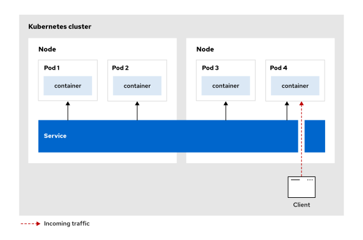

Khi các pod hoặc dịch vụ khác gửi lưu lượng truy cập đến địa chỉ IP của cluster này, dịch vụ sẽ tự động đóng vai trò như một bộ cân bằng tải nội bộ và chuyển tiếp yêu cầu đến một trong các pod back-end đang hoạt động bình thường.

**Giao tiếp bên ngoài**  
Các dịch vụ thuộc loại `NodePort` và `LoadBalancer`, cũng như việc sử dụng tính năng external IP của các dịch vụ `ClusterIP`, cho phép các dịch vụ đang chạy trong cluster có thể được truy cập từ bên ngoài cluster.

Sơ đồ dưới đây mô tả dịch vụ loại `NodePort`:

**Hình 5.2: Dịch vụ NodePort**  
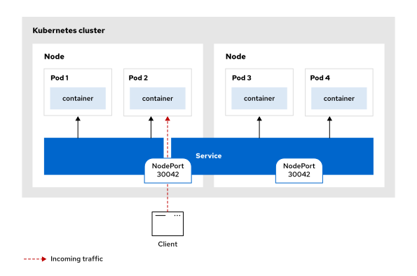

Dịch vụ `NodePort` cung cấp dịch vụ thông qua một cổng cố định trên địa chỉ IP của mỗi node trong cụm (cluster). Điều này cho phép truy cập dịch vụ từ bên ngoài cụm bằng cách sử dụng địa chỉ `NodeIP:NodePort`. Khi lưu lượng truy cập từ bên ngoài đến cổng này trên bất kỳ node nào, dịch vụ sẽ tự động định tuyến yêu cầu tới địa chỉ IP nội bộ của cụm; từ đó, yêu cầu được cân bằng tải đến một trong các pod back-end đang hoạt động bình thường.

Sơ đồ dưới đây mô tả dịch vụ thuộc loại `LoadBalancer`:

**Hình 5.3: Dịch vụ cân bằng tải**  
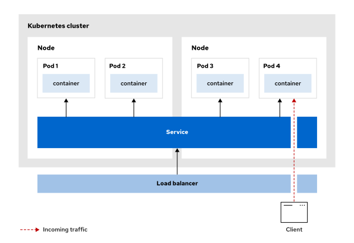

Dịch vụ cân bằng tải (load balancer service) tự động khởi tạo một bộ cân bằng tải bên ngoài—thường là từ các nhà cung cấp dịch vụ đám mây như Amazon Web Services (AWS), Google Cloud Platform (GCP) hoặc Microsoft Azure—nhằm cung cấp một địa chỉ IP công khai duy nhất và ổn định. Khi lưu lượng truy cập từ bên ngoài đi đến địa chỉ IP công khai này, bộ cân bằng tải sẽ chuyển hướng nó tới cổng node (node port) của dịch vụ trên một trong các node của cụm (cluster). Từ đó, dịch vụ sẽ định tuyến lưu lượng truy cập nội bộ đến một trong các pod back-end đang hoạt động bình thường.

Các nhà cung cấp khác nhau có thể triển khai các dịch vụ Kubernetes thông qua việc sử dụng trường `type` của tài nguyên dịch vụ.

Mặc dù các dịch vụ này hữu ích trong những tình huống cụ thể, một số dịch vụ đòi hỏi phải cấu hình thêm và có thể tiềm ẩn các thách thức về bảo mật.

### Dịch vụ cân bằng tải
Các dịch vụ cân bằng tải đòi hỏi phải sử dụng những tính năng mạng không có sẵn trong mọi môi trường. Ví dụ, các nhà cung cấp dịch vụ đám mây thường cung cấp dịch vụ cân bằng tải riêng của họ; các dịch vụ này sử dụng những tính năng đặc thù của chính nhà cung cấp đó.

Nếu bạn vận hành một cụm Kubernetes trên nền tảng của nhà cung cấp dịch vụ đám mây, thành phần "cloud controller manager" sẽ sử dụng các API của nhà cung cấp đó để cấu hình những tài nguyên đám mây cần thiết cho dịch vụ cân bằng tải. Các tính năng đám mây này không có sẵn trong các cụm tự triển khai (self-hosted clusters). Đối với các cụm tự triển khai, bạn có thể sử dụng một "load balancer operator" (chẳng hạn như MetalLB) để cấu hình dịch vụ cân bằng tải phù hợp với các thiết lập mạng cụ thể của mình.

#### Cấu hình Tài nguyên Dịch vụ Load Balancer cho Môi trường Cloud
Bạn có thể tạo các dịch vụ load balancer (bộ cân bằng tải) để cung cấp quyền truy cập từ bên ngoài vào các ứng dụng chạy trên các cụm (cluster) được triển khai trên cơ sở hạ tầng của nhà cung cấp dịch vụ đám mây. Khi bạn tạo một dịch vụ load balancer, Kubernetes sẽ tự động cấu hình một load balancer bên ngoài trên cơ sở hạ tầng của nhà cung cấp đám mây đó. 

* Khi bạn tạo dịch vụ load balancer trên một cụm được triển khai trên AWS, Kubernetes sẽ tạo một load balancer trên Amazon Elastic Load Balancing. 
* Khi bạn triển khai một cụm trên Azure, các dịch vụ load balancer của Kubernetes sẽ được tạo trên dịch vụ Azure Load Balancer. 
* Khi bạn triển khai một cụm trên IBM Cloud, các dịch vụ load balancer của Kubernetes sẽ được tạo trên dịch vụ load balancer của IBM Cloud. 
* Khi bạn triển khai một cụm trên Google Cloud Platform, các dịch vụ load balancer của Kubernetes sẽ được tạo trên dịch vụ Google Cloud Load Balancing.

> **Lưu ý:** Mỗi dịch vụ cân bằng tải Kubernetes sẽ tạo ra một bộ cân bằng tải trong cơ sở hạ tầng của nhà cung cấp dịch vụ đám mây. Bạn có thể xem chi phí của từng bộ cân bằng tải trong cơ sở hạ tầng của nhà cung cấp dịch vụ đám mây để ước tính tổng chi phí cho loại dịch vụ mạng này.

#### Cấu hình tài nguyên dịch vụ Load Balancer cho môi trường phi đám mây
Đối với các cụm (cluster) được triển khai trên máy chủ vật lý (bare metal), các dịch vụ thuộc loại `LoadBalancer` hoạt động theo cách khác. Kubernetes sẽ gán cho dịch vụ một địa chỉ IP lấy từ nhóm địa chỉ bên ngoài do quản trị viên cụm chuẩn bị sẵn.

Quản trị viên cụm cần cấu hình các địa chỉ IP bên ngoài này để mạng có thể định tuyến chúng đến một nút (node) trong cụm. Khi các nút nhận được gói tin có địa chỉ IP đích trùng với địa chỉ IP bên ngoài của dịch vụ, chúng sẽ chuyển tiếp lưu lượng truy cập đến các pod hoặc máy ảo có liên kết với dịch vụ đó.

### MetalLB Operator
MetalLB là một giải pháp cân bằng tải dành cho Kubernetes, cung cấp dịch vụ cân bằng tải cho các cụm (cluster) không chạy trên nền tảng nhà cung cấp dịch vụ đám mây (ví dụ: cụm bare-metal) hoặc các cụm chạy trên hypervisor. MetalLB hoạt động ở hai chế độ: lớp 2 (layer-2) sử dụng giao thức ARP (Address Resolution Protocol) và lớp 3 (layer-3) sử dụng giao thức BGP (Border Gateway Protocol). Hai chế độ này có các đặc tính và yêu cầu khác nhau:

**Lớp 2 (ARP)**  
Chế độ lớp 2 được thiết lập mặc định khi MetalLB được cài đặt và cấu hình bằng MetalLB operator. Chế độ này sử dụng các gói tin gratuitous ARP để quảng bá địa chỉ IP của dịch vụ cân bằng tải. Lưu lượng truy cập gửi đến một địa chỉ IP do MetalLB quản lý sẽ được chuyển tiếp tới node đã quảng bá địa chỉ đó thông qua ARP.

**Lớp 3 (BGP)**  
Chế độ lớp 3 sử dụng BGP để quảng bá các tuyến đường (route) của dịch vụ cân bằng tải tới các đối tác BGP (BGP peer) khác. MetalLB yêu cầu quản trị viên phải cấu hình số hiệu Autonomous System (AS). Khi router nhận được lưu lượng truy cập cho dịch vụ cân bằng tải, nó sẽ chọn một trong các node đã quảng bá địa chỉ IP của dịch vụ đó. Router gửi lưu lượng đến node đã chọn, và service proxy của plugin mạng CNI sẽ phân phối lưu lượng tới tất cả các pod khớp với bộ chọn dịch vụ (service selector).

MetalLB là một operator mà bạn có thể cài đặt bằng Operator Lifecycle Manager. Sau khi cài đặt operator, bạn cần cấu hình MetalLB thông qua các định nghĩa tài nguyên tùy chỉnh (custom resource definitions). Trong hầu hết các trường hợp, bạn cần cung cấp cho MetalLB một dải địa chỉ IP. Bạn cần xem xét các yêu cầu về mạng trước khi cài đặt MetalLB trong cụm OpenShift của mình.

Quản trị viên cụm có thể cài đặt MetalLB operator thông qua giao diện web console hoặc dòng lệnh. Sau khi cài đặt operator, bạn cần tạo một nhóm địa chỉ IP (IP address pool) để gán địa chỉ IP cho các dịch vụ. MetalLB operator sẽ tạo các tài nguyên tùy chỉnh trong dự án (project) `metallb-system`. Quản trị viên cụm cần cấp quyền truy cập vào dự án `metallb-system` cho những người dùng không phải là quản trị viên cụm để họ có thể xem các tài nguyên tùy chỉnh của MetalLB.

**MetalLB**  
Tài nguyên tùy chỉnh này đại diện cho instance chính mà MetalLB operator triển khai.

```console
[user@host ~]$ oc get metallb -n metallb-system
NAME      AVAILABLE   DEGRADED    PROGRESSING   AGE
metallb   True        False       False         7d
```

**IPAddressPool**  
Tài nguyên tùy chỉnh IPAddressPool chứa dải địa chỉ IP mà MetalLB có thể cấp phát cho các dịch vụ cân bằng tải. Bạn cần cấu hình dải địa chỉ này sao cho phù hợp với cấu hình mạng của môi trường nơi triển khai cụm (cluster).

```console
[user@host ~]$ oc get ipaddresspool -n metallb-system
NAME                        ...   ADDRESSES
gls-metallb-ipaddresspool   ...   ["192.168.50.20-192.168.50.21"] (1)
```

1. Pool địa chỉ IP cho MetalLB bao gồm các địa chỉ trong dải từ 192.168.50.20 đến 192.168.50.21.

**L2Advertisement**  
Tài nguyên tùy chỉnh `L2Advertisement` cho phép quảng bá các địa chỉ IP của bộ cân bằng tải (do các pool được chọn cung cấp) thông qua các gói tin ARP miễn phí (gratuitous ARP) ở lớp 2.


```console
[user@host ~]$ oc get l2advertisement -n metallb-system
NAME                          IPADDRESSPOOLS                  ...
gls-metallb-l2advertisement   ["gls-metallb-ipaddresspool"]   ... (1)
```

1. MetalLB tạo các thông báo lớp 2 (layer-2 advertisements) cho các địa chỉ IP của bộ cân bằng tải trong nhóm địa chỉ IP `gls-metallb-ipaddresspool`.

### Sử dụng các dịch vụ Load Balancer
Khi một cụm (cluster) đã được cấu hình thành phần cân bằng tải (load balancer), bạn có thể tạo các dịch vụ thuộc loại `LoadBalancer` để công khai các dịch vụ không phải HTTP ra bên ngoài cụm.

Ví dụ, định nghĩa tài nguyên dưới đây công khai cổng 1234 trên các pod có nhãn (label) mang tên là `example`.

```yaml
apiVersion: v1
kind: Service
metadata:
  name: example-lb
  namespace: example
spec:
  ports:
  - port: 1234 # (1)
    protocol: TCP
    targetPort: 1234
  selector:
    name: example # (2)
  type: LoadBalancer # (3)
```

1. Cổng được lộ ra (Exposed port)
2. Bộ chọn Pod (Pod selector)
3. Loại dịch vụ LoadBalancer

Bạn cũng có thể sử dụng lệnh `oc expose` với tham số `--type LoadBalancer` để tạo các dịch vụ cân bằng tải theo phương thức mệnh lệnh (imperative).

Sau khi bạn tạo dịch vụ, thành phần cân bằng tải sẽ cập nhật tài nguyên dịch vụ với các thông tin như địa chỉ IP công khai nơi dịch vụ khả dụng.

```console
[user@host ~]$ oc get service
NAME         TYPE           CLUSTER-IP       EXTERNAL-IP     PORT(S)          AGE
example-lb   LoadBalancer   172.30.21.79     192.168.50.20   1234:31265/TCP   4m7s
```

Giờ đây, bạn có thể kết nối với dịch vụ tại cổng 1234 của địa chỉ 192.168.50.20.

Bạn cũng có thể lấy địa chỉ này từ trường trạng thái của tài nguyên.

```console
[user@host ~]$ oc get service example-lb -o jsonpath="{.status.loadBalancer.ingress}"
[{"ip":"192.168.50.20"}]
```

Mỗi dịch vụ cân bằng tải đều cấp phát địa chỉ IP cho các dịch vụ theo những quy trình khác nhau. Ví dụ, khi cài đặt MetalLB, bạn cần cung cấp các dải địa chỉ IP để MetalLB gán cho các dịch vụ.

Sau khi công khai (expose) một dịch vụ thông qua bộ cân bằng tải, hãy luôn kiểm tra xem dịch vụ đó có thể truy cập được từ các vị trí mạng dự kiến hay không. Hãy sử dụng một ứng dụng khách (client) tương ứng với giao thức đã được công khai để đảm bảo khả năng kết nối, đồng thời kiểm tra xem cơ chế cân bằng tải có hoạt động đúng như mong đợi hay không. Một số giao thức có thể cần được điều chỉnh thêm để hoạt động chính xác khi nằm sau bộ cân bằng tải. Bạn cũng có thể sử dụng các công cụ gỡ lỗi mạng, chẳng hạn như lệnh `ping` và `traceroute`, để kiểm tra kết nối.

## Cấu hình các mạng Pod bổ sung
### Sử dụng các mạng khác nhau
Kubernetes quản lý cả mạng pod và mạng service. Mạng pod cung cấp các giao diện mạng cho từng pod và, theo mặc định, cho phép giao tiếp mạng giữa tất cả các pod. Mạng service cung cấp cơ chế đánh địa chỉ ổn định cho các service chạy trên các pod. Ngoài ra, còn có các cơ chế khác giúp công khai (expose) các service ra bên ngoài cụm (cluster).

Tuy nhiên, trong một số trường hợp, việc kết nối các pod hoặc máy ảo (VM) vào một mạng khác có thể mang lại lợi ích hoặc giúp đáp ứng các yêu cầu cụ thể.

Ví dụ, việc sử dụng mạng và tài nguyên chuyên dụng có thể cải thiện hiệu suất cho các luồng lưu lượng truy cập cụ thể. Thêm vào đó, mạng chuyên dụng có thể sở hữu các đặc tính bảo mật khác biệt so với mạng mặc định, qua đó giúp đáp ứng các yêu cầu về bảo mật.

Bên cạnh những ưu điểm này, việc sử dụng thêm các giao diện mạng còn giúp đơn giản hóa một số tác vụ, chẳng hạn như kiểm soát lưu lượng truy cập đi ra từ các pod và máy ảo. Plugin Multus CNI (Container Network Interface) hỗ trợ việc kết nối các pod vào những mạng tùy chỉnh. Các mạng tùy chỉnh này có thể là mạng hiện có bên ngoài cụm hoặc mạng tùy chỉnh nằm ngay trong nội bộ cụm.

### Cấu hình các mạng bổ sung
Để sử dụng các mạng tùy chỉnh hiện có, trước tiên bạn cần đảm bảo mạng đó đã sẵn sàng trên các nút của cụm (cluster nodes).

Bạn có thể sử dụng các operator—chẳng hạn như Kubernetes NMState operator hoặc SR-IOV (Single Root I/O Virtualization) network operator—để tùy chỉnh cấu hình mạng cho nút. Với các operator này, bạn định nghĩa các tài nguyên tùy chỉnh (CR) để mô tả cấu hình mạng mong muốn, và operator sẽ thực hiện áp dụng cấu hình đó.

SR-IOV network operator thực hiện cấu hình các thiết bị mạng SR-IOV nhằm cải thiện băng thông và độ trễ trên một số nền tảng và thiết bị nhất định.

Trong OpenShift, bạn có thể cấu hình các mạng phụ cho pod bằng cách sử dụng mạng do người dùng định nghĩa (user-defined networks - UDN), mạng do người dùng định nghĩa ở cấp cụm (cluster user-defined networks - CUDN) hoặc định nghĩa gắn kết mạng (network attachment definitions - NAD).

> **Lưu ý:** Việc kết nối trực tiếp các pod và máy ảo (VM) vào mạng underlay bằng cách sử dụng các plugin CNI như bridge, MACVLAN, IPVLAN hoặc host device không được hỗ trợ trên các dịch vụ đám mây của Red Hat (Red Hat OpenShift Service on AWS, Azure Red Hat OpenShift hoặc OpenShift Dedicated), do các nền tảng này không hỗ trợ các thao tác lớp 2 (Layer 2) cần thiết. Trên các nền tảng đám mây công cộng, phương pháp được khuyến nghị là kết nối các khối công việc (workload) vào các mạng do người dùng định nghĩa có cấu trúc liên kết lớp 2.

### Mạng do người dùng định nghĩa (UDN) trong OpenShift
UDN cho phép người dùng không phải là quản trị viên tự tạo và quản lý mạng của riêng họ thông qua cấu hình mạng đơn giản hơn so với việc sử dụng NAD. Ngoài ra, các tài nguyên tùy chỉnh (custom resource) của UDN còn cung cấp tính năng xác thực cấu hình và phần hiển thị trạng thái để theo dõi tình trạng mạng cũng như các lỗi phát sinh. Bạn vẫn có thể sử dụng NAD để tạo thêm các mạng cho những trường hợp sử dụng cụ thể, chẳng hạn như kết nối pod với mạng bên ngoài hoặc sử dụng một plugin CNI cụ thể.

UDN sử dụng OVN-Kubernetes để quản lý mạng. OVN-Kubernetes theo dõi các tài nguyên tùy chỉnh UDN và tạo ra các NAD để thiết lập mạng. OVN-Kubernetes cung cấp hai định nghĩa tài nguyên tùy chỉnh để tạo mạng do người dùng định nghĩa:

**UserDefinedNetwork**  
Một tài nguyên tùy chỉnh do quản trị viên dự án tạo ra để định nghĩa UDN trong một namespace, đồng thời cung cấp khả năng cách ly mạng với các namespace khác. UDN có thể được sử dụng làm giao diện mạng chính hoặc phụ cho các pod của bạn. 

Sơ đồ dưới đây minh họa cách UDN cách ly các pod trong một namespace khỏi phần còn lại của cụm (cluster). Mỗi namespace có UDN riêng với mạng lớp 2 (layer-2) và subnet chuyên biệt. Các pod trong cùng một namespace có thể giao tiếp thông qua UDN dùng chung, nhưng các pod ở những namespace khác nhau không thể kết nối với nhau do các UDN của chúng bị cách ly.

**Hình 5.4: Cô lập không gian tên với UDN**  
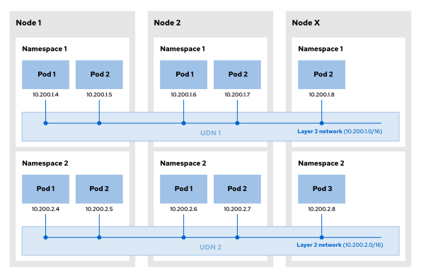

**ClusterUserDefinedNetwork**  
Một tài nguyên tùy chỉnh do quản trị viên cụm tạo ra để định nghĩa CUDN, cho phép kết nối nhiều namespace lại với nhau trong cùng một mạng. 

Sơ đồ dưới đây minh họa cách CUDN kết nối các pod giữa nhiều namespace trong một mạng dùng chung. Mỗi khách thuê (tenant) sử dụng một CUDN duy nhất trải rộng trên nhiều namespace, giúp các pod trong các namespace đó có thể giao tiếp với nhau.

**Hình 5.5: Cô lập tenant tên với CUDN**  
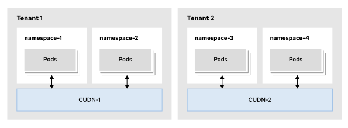

UDN mang lại những lợi ích sau so với mạng pod:

**Cô lập tenant**  
Mỗi namespace có thể có UDN riêng, được cô lập khỏi mạng pod và các UDN khác. Nhiều namespace có thể chia sẻ cùng một mạng thông qua UDN của cụm (cluster UDN).

> **Lưu ý:** Bạn cần có quyền quản trị viên cụm để tạo UDN cụm.

**Đơn giản hóa cấu hình mạng**  
Do các UDN được cô lập theo mặc định, bạn có thể hạn chế giao tiếp giữa các pod trong cụm mà không cần tạo các chính sách mạng phức tạp.

**Địa chỉ IP nhất quán**  
Bạn có thể thiết lập để các pod sở hữu địa chỉ IP nhất quán. Bạn có thể chỉ định và tái sử dụng các subnet IP trên nhiều namespace. Điều này cho phép duy trì môi trường mạng đồng nhất giữa các namespace trong khi vẫn đảm bảo sự cô lập giữa các ứng dụng. Ví dụ: bạn có thể cấu hình các môi trường phát triển, kiểm thử và vận hành (production) cho ứng dụng, trong đó tất cả các môi trường đều sử dụng cùng một subnet IP nhưng lại được cô lập với nhau.

Bạn có thể tạo UDN để đóng vai trò là mạng chính (primary) hoặc mạng phụ (secondary) cho các pod. Khi tạo UDN làm mạng chính (P-UDN), OpenShift sẽ tạo tất cả các pod trong namespace với UDN đó là giao diện mạng chính thay vì mạng pod mặc định của cụm; theo đó, toàn bộ lưu lượng truy cập của pod sẽ sử dụng giao diện mạng này theo mặc định.

Khi tạo UDN làm mạng phụ (S-UDN), các pod trong namespace sẽ sử dụng UDN đó làm giao diện mạng phụ, và chỉ những lưu lượng truy cập thuộc mạng này mới sử dụng giao diện mạng đó.

Các UDN hỗ trợ cấu trúc liên kết (topology) lớp 2 và lớp 3. Mỗi pod sử dụng một địa chỉ IP từ subnet của node, và mỗi node sử dụng một subnet riêng biệt. Khi một pod di chuyển sang node mới, nó sẽ nhận được địa chỉ IP mới thuộc subnet của node đích. Cấu trúc liên kết mạng này tương đồng với cấu trúc mà mạng pod của cụm đang sử dụng.

### Tạo Mạng do Người dùng Định nghĩa (UDN)
Để sử dụng UDN hoặc CUDN làm giao diện mạng chính cho các pod, bạn phải tạo namespace với nhãn `k8s.ovn.org/primary-user-defined-network`:

```yaml
apiVersion: v1
kind: Namespace
metadata:
  name: my-namespace
  labels:
    k8s.ovn.org/primary-user-defined-network: ""
```

Bạn có thể tạo namespace từ giao diện web của OpenShift, tại trang **Administration → Namespaces**, bằng cách nhấp vào **Create Namespace**. Sau đó, hãy thêm nhãn `k8s.ovn.org/primary-user-defined-network` vào biểu mẫu tạo.

> **Lưu ý:** Bạn không thể thêm nhãn UDN vào một namespace đã tồn tại. Bạn phải tạo namespace kèm theo nhãn UDN ngay từ đầu. Để tạo namespace có nhãn này, bạn cần có quyền cluster-admin hoặc quyền xem và chỉnh sửa liên quan đến kiểm soát truy cập dựa trên vai trò (RBAC).

Sau khi tạo namespace với nhãn UDN, các pod trong namespace đó sẽ không còn sử dụng mạng pod của cụm (cluster pod network) nữa mà chuyển sang sử dụng UDN được chỉ định cho namespace đó. Nếu không có UDN nào tồn tại trong namespace, OpenShift sẽ không thể khởi động bất kỳ pod nào tại đó và hiển thị thông báo lỗi sau trên tab Events (Sự kiện) của trang chi tiết Pod:

```
addLogicalPort failed for my-namespace/my-pod: invalid primary network state for namespace "my-namespace": a valid primary user defined network or network attachment definition custom resource, and required namespace label "k8s.ovn.org/primary-user-defined-network" must both be present
```

Bạn có thể tạo UDN từ bảng điều khiển web OpenShift, tại trang **Networking → UserDefinedNetworks**, bằng cách nhấp vào **Create → UserDefinedNetwork**.

**Hình 5.6: Tạo mạng do người dùng định nghĩa**  
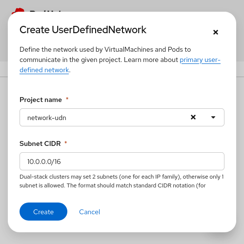

Chỉ định dự án để tạo UDN và mạng con (subnet) ở định dạng CIDR, sau đó nhấp vào Create.

Bạn có thể xác minh rằng OpenShift đã tạo thành công UDN bằng cách kiểm tra trạng thái của nó trong phần Conditions.

**Hình 5.7: Trạng thái mạng do người dùng xác định**  
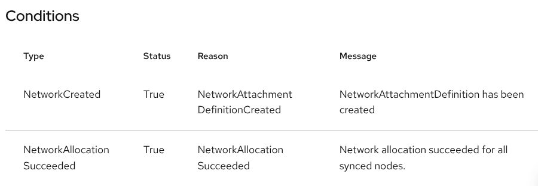

Nếu namespace đích không có nhãn UDN, thì đối tượng UDN sẽ được tạo nhưng quá trình cấp phát mạng sẽ thất bại. Các điều kiện hiển thị lỗi sau:

**Hình 5.8: Lỗi tạo mạng do người dùng định nghĩa do thiếu nhãn**  
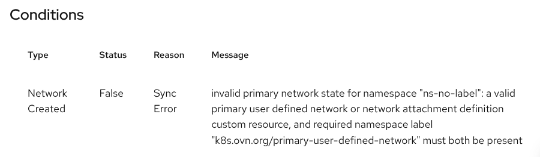

Từ bảng điều khiển web, bạn chỉ có thể tạo một UDN cho mỗi namespace; OpenShift sẽ sử dụng UDN này làm giao diện mạng chính cho các pod của bạn.

> **Quan trọng:** Bạn phải tạo UDN khi nhãn UDN được thiết lập trên namespace. OpenShift không thể tạo bất kỳ pod nào trong namespace cho đến khi bạn tạo UDN.

Bạn có thể tạo UDN từ CLI bằng cách tạo tài nguyên tùy chỉnh UserDefinedNetwork, như sau:

```yaml
apiVersion: k8s.ovn.org/v1
kind: UserDefinedNetwork
metadata:
  name: my-udn
  namespace: my-namespace
spec:
  topology: Layer2 # (1)
  layer2:
    role: Primary # (2)
    subnets: # (3)
      - "10.0.0.0/16"
      - "2001:db8::/60"
    ipam:
      lifecycle: Persistent # (4)
```

1. Xác định cấu trúc liên kết (topology) của mạng.
2. Xác định xem mạng này có phải là giao diện mạng chính cho các pod và máy ảo (VM) hay không.
3. Chỉ định các mạng con (subnet) cho mạng theo định dạng CIDR. Bạn phải chỉ định một mạng con cho IPv4 và tùy chọn một mạng con cho IPv6.
4. Xác định xem các địa chỉ IP có được duy trì sau khi khởi động lại và di chuyển nút (node) hay không. Cài đặt này là bắt buộc để các máy ảo hỗ trợ tính năng di chuyển trực tiếp (live migration).

Sau khi tạo UDN, bạn có thể xác minh việc tạo thành công bằng cách kiểm tra trạng thái của tài nguyên tùy chỉnh `UserDefinedNetwork`:

```console
[user@host ~]$ oc get userdefinednetwork primary-udn \
-o yaml -n my-namespace
apiVersion: k8s.ovn.org/v1
kind: UserDefinedNetwork
metadata:
  name: primary-udn
  namespace: my-namespace
  ...output omitted...
spec:
  layer2:
    ipam:
      lifecycle: Persistent
    role: Primary
    subnets:
    - 10.0.0.0/16
  topology: Layer2
status:
  conditions:
  - lastTransitionTime: "2026-08-03T11:23:26Z"
    message: NetworkAttachmentDefinition has been created
    reason: NetworkAttachmentDefinitionCreated
    status: "True"
    type: NetworkCreated
  - lastTransitionTime: "2026-08-03T11:23:26Z"
    message: Network allocation succeeded for all synced nodes.
    reason: NetworkAllocationSucceeded
    status: "True"
    type: NetworkAllocationSucceeded
```

Theo mặc định, các pod trên UDN bị cô lập khỏi mạng mặc định. Bạn có thể sử dụng annotation `k8s.ovn.org/open-default-ports` trên các pod UDN để cho phép chúng giao tiếp với mạng mặc định khi các dịch vụ giám sát đang chạy trong cụm. Annotation này mở các cổng cụ thể trên pod UDN để cho phép truy cập từ mạng mặc định.

```yaml
apiVersion: v1
kind: Pod
metadata:
  annotations:
    k8s.ovn.org/open-default-ports: |
      - protocol: tcp
        port: 80
      - protocol: udp
        port: 53
...output omitted...
```

### Cô lập Tenant bằng Mạng do người dùng định nghĩa ở cấp cụm (Cluster UDN)
Bạn có thể tạo một Cluster UDN để sử dụng trên nhiều namespace từ bảng điều khiển web, tại trang **Networking → UserDefinedNetworks**, bằng cách nhấp vào **Create → ClusterUserDefinedNetwork**.

**Hình 5.9: Tạo mạng do người dùng định nghĩa theo cụm**  
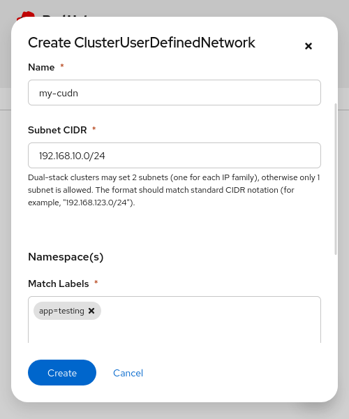

Ngoài tên UDN và subnet, bạn cần chỉ định các nhãn mà OpenShift sử dụng để xác định các namespace có thể tham gia mạng.

Nhấn vào **Review selected Namespace(s)** để liệt kê các namespace khớp với các nhãn đó, rồi nhấn **Create**.

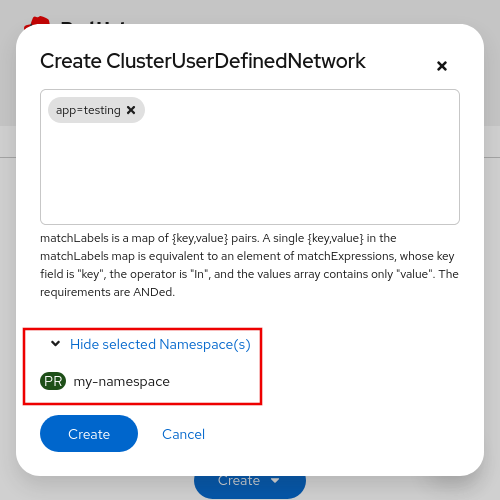

> **Quan trọng:** Vì việc tạo một UDN cụm (cluster UDN) sẽ tạo ra một NAD có cùng tên trong các namespace tương ứng, bạn cần đảm bảo rằng chưa có NAD nào khác trong cụm đang sử dụng tên CUDN đó. Nếu đã tồn tại một NAD cùng tên trong cụm, quá trình tạo CUDN sẽ thất bại kèm theo thông báo lỗi sau:
> 
> ```
> foreign NetworkAttachmentDefinition with the desired name already exist [my-namespace/udn-name]
> ```
> 
> Để ngăn chặn tình trạng này và tránh xung đột tên NAD, Red Hat khuyến nghị sử dụng tên duy nhất cho các CUDN và UDN trong cụm.

Bạn có thể tạo CUT từ CLI bằng cách tạo một tài nguyên tùy chỉnh Cluster User Defined Network, như sau:

```yaml
apiVersion: k8s.ovn.org/v1
kind: ClusterUserDefinedNetwork
metadata:
  name: development-udn
spec:
  namespaceSelector: # (1)
    matchLabels:
      environment: development
  network:
    topology: Layer2 # (2)
    layer2:
      role: Primary # (3)
      subnets: # (4)
      - 10.0.0.0/16
      - 2001:db8::/60
      ipam:
        lifecycle: Persistent # (5)
```

1. Chỉ định các nhãn mà OpenShift sử dụng để xác định các namespace sẽ tham gia vào mạng.
2. Chỉ định cấu trúc liên kết (topology) của mạng.
3. Chỉ định xem mạng này có phải là giao diện mạng chính cho các pod và VM hay không.
4. Chỉ định các subnet cho mạng theo định dạng CIDR. Bạn phải chỉ định một subnet cho IPv4 và tùy chọn một subnet cho IPv6.
5. Chỉ định xem các địa chỉ IP có được duy trì sau khi khởi động lại và di chuyển node hay không. Cài đặt này là bắt buộc để các VM hỗ trợ tính năng di chuyển trực tiếp (live migration).

Thay vì sử dụng bộ chọn `matchLabels`, bạn có thể dùng bộ chọn `matchExpressions` để chỉ định các namespace tham gia vào mạng. Trong ví dụ dưới đây, CUDN tham gia vào các namespace `my-namespace` và `another-project`:

```yaml
apiVersion: k8s.ovn.org/v1
kind: ClusterUserDefinedNetwork
metadata:
  name: development-udn
spec:
  namespaceSelector:
    matchExpressions:
      - key: kubernetes.io/metadata.name
        operator: In
        values:
          - my-namespace
          - another-project
...output omitted...
```

Bạn có thể xác minh trạng thái tạo CUDN bằng cách kiểm tra mục **Conditions** (Điều kiện) trên trang chi tiết CUDN tại bảng điều khiển web, hoặc sử dụng lệnh `oc describe cluster user defined network cudn_name`.

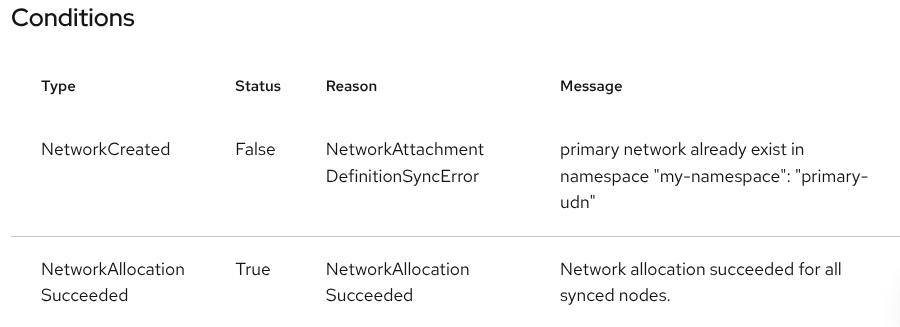

Bạn có thể sử dụng lệnh `oc get net-attach-def -A` để liệt kê các NAD trong cụm. Các NAD do UDN hoặc CUDN quản lý sẽ có nhãn `k8s.ovn.org/user-defined-network`.

```console
[user@host ~]$ oc get net-attach-def -A \
-l k8s.ovn.org/user-defined-network
NAMESPACE            NAME          AGE
my-namespace         primary-udn   34m
my-other-namespace   my-cudn       3m36s
```

### Định nghĩa mạng bằng tài nguyên NAD
UDN (User-Defined Networks - Mạng do người dùng định nghĩa) là phương pháp được khuyến nghị để tạo các mạng biệt lập trong cụm (cluster). Tuy nhiên, một số trường hợp sử dụng đòi hỏi phải kết nối trực tiếp các pod với mạng vật lý bên ngoài hoặc sử dụng các plugin CNI cụ thể như bridge, MACVLAN, IPVLAN hoặc host device. Đối với những trường hợp này, bạn có thể tạo tài nguyên NetworkAttachmentDefinition (NAD).

Ngoài ra, bạn có thể cập nhật cấu hình của Cluster Network Operator để thêm mạng phụ. Một số NAD tạo và quản lý các thiết bị mạng ảo, bao gồm cả các bridge ảo; các thiết bị mạng ảo này kết nối với những mạng hiện có được cấu hình và quản lý bên ngoài OpenShift. Các NAD khác lại sử dụng các giao diện mạng có sẵn trên các node của cụm. NAD cũng có thể cấu hình thêm các mạng bổ sung. Tài nguyên NAD hoạt động theo phạm vi namespace và chỉ khả dụng đối với các pod cũng như máy ảo (VM) nằm trong cùng namespace đó.

#### Tài nguyên tùy chỉnh NAD
Bạn có thể tạo các NAD thuộc các loại sau:

* **Host device (Thiết bị máy chủ):** Gắn một giao diện mạng vào một pod duy nhất.
* **Bridge (Cầu nối):** Sử dụng giao diện bridge hiện có trên node hoặc cấu hình một giao diện bridge mới. Các pod được kết nối với mạng này có thể giao tiếp với nhau thông qua bridge, cũng như với bất kỳ mạng nào khác được kết nối với bridge đó.
* **IPVLAN:** Tạo một mạng dựa trên IPVLAN được gắn vào một giao diện mạng.
* **MACVLAN**: Tạo một mạng dựa trên MACVLAN được gắn vào một giao diện mạng.

Bridge là các giao diện mạng có khả năng chuyển tiếp gói tin giữa các giao diện mạng khác nhau được kết nối với chính bridge đó. Các môi trường ảo hóa thường sử dụng bridge để kết nối giao diện mạng của máy ảo vào mạng.

IPVLAN và MACVLAN là các trình điều khiển mạng (network driver) trên Linux được thiết kế cho môi trường container. Các môi trường container thường sử dụng những trình điều khiển mạng này để kết nối các pod vào mạng.

Mặc dù giao diện bridge, IPVLAN và MACVLAN có mục đích sử dụng tương tự nhau, chúng lại sở hữu những đặc điểm khác biệt, chẳng hạn như cách sử dụng địa chỉ MAC, khả năng lọc gói tin và các tính năng khác. Ví dụ, bạn có thể cần sử dụng IPVLAN thay vì MACVLAN trong các mạng có giới hạn về số lượng địa chỉ MAC, do IPVLAN sử dụng ít địa chỉ MAC hơn.

Định nghĩa tài nguyên dưới đây thể hiện một tài nguyên NetworkAttachmentDefinition dành cho thiết bị host:

```yaml
apiVersion: k8s.cni.cncf.io/v1
kind: NetworkAttachmentDefinition
metadata:
  name: example # (1)
spec:
  config: |-
    {
      "cniVersion": "0.3.1",
      "name": "example", (2)
      "type": "host-device", (3)
      "device": "ens4",
      "ipam": { (4)
        "type": "dhcp"
      }
    }
```

1. Tên mạng
2. Giá trị cho tham số tên giống như giá trị bạn đã cung cấp trước đó cho NAD này
3. Loại mạng
4. Cấu hình mạng bổ sung

#### Cài đặt Network Operator
Bạn cũng có thể tạo kết nối mạng tương tự bằng cách chỉnh sửa cấu hình network operator của cụm:

```yaml
apiVersion: operator.openshift.io/v1
kind: Network
metadata:
  name: cluster
spec:
...output omitted...
  additionalNetworks:
  - name: example # (1)
    namespace: example # (2)
    rawCNIConfig: |- # (3)
      {
        "cniVersion": "0.3.1",
        "name": "example", (4)
        "type": "host-device", (5)
        "device": "ens4",
        "ipam": { (6)
          "type": "dhcp"
        }
      }
    type: Raw
```

1. Tên mạng
2. Không gian tên (namespace)
3. Cấu hình plugin CNI ở định dạng JSON
4. Giá trị cho tham số tên (name) giống với giá trị bạn đã cung cấp trước đó cho mạng bổ sung này
5. Loại mạng
6. Cấu hình mạng bổ sung

Plugin CNI quản lý địa chỉ IP (IPAM) cung cấp các địa chỉ IP cho các plugin CNI khác.

Trong các ví dụ trước, khóa `ipam` chứa cấu hình mạng sử dụng DHCP. Bạn có thể cung cấp các cấu hình mạng phức tạp hơn trong khóa `ipam`. Ví dụ, cấu hình dưới đây sử dụng địa chỉ tĩnh:

```json
"ipam": {
  "type": "static",
  "addresses": [
    {"address": "192.168.X.X/24"}
  ]
}
```

#### Kết nối Pod với các mạng phụ
Khi cụm (cluster) có các mạng bổ sung, bạn có thể thêm chú thích (annotation) `k8s.v1.cni.cncf.io/networks` vào mẫu (template) của pod để sử dụng một trong các mạng đó. Giá trị của chú thích này là tên của NAD, UDN hoặc CUDN cần sử dụng, hoặc một danh sách các cấu trúc dạng map chứa các tùy chọn cấu hình bổ sung. Ngoài việc kết nối mạng theo cách này, bạn cũng có thể đưa các pod vào những mạng do SR-IOV network operator cấu hình.

> **Cảnh báo:** Không sử dụng dấu cách trong danh sách liệt kê nhiều mạng phụ trong phần chú thích.

Ví dụ, cấu hình triển khai sau đây sử dụng mạng mẫu:

```yaml
apiVersion: apps/v1
kind: Deployment
metadata:
  name: example
  namespace: example
spec:
  selector:
    matchLabels:
      app: example
      name: example
  template:
    metadata:
      annotations:
        k8s.v1.cni.cncf.io/networks: example
      labels:
        app: example
        name: example
    spec:
...output omitted...
```

Multus cập nhật chú thích `k8s.v1.cni.cncf.io/network-status` với trạng thái của các mạng bổ sung.

```console
[user@host ~]$ oc get pod example \
-o jsonpath='{.metadata.annotations.k8s\.v1\.cni\.cncf\.io/network-status}'
[{
    "name": "ovn-kubernetes",
    "interface": "eth0",
    "ips": [
        "10.8.0.59"
    ],
    "mac": "0a:58:0a:08:00:3b",
    "default": true,
    "dns": {}
},{
    "name": "non-http-multiple/example", (1)
    "interface": "net1", (2)
    "ips": [
        "1.2.3.4"
    ],
    "mac": "52:54:00:01:33:0a",
    "dns": {}
}]
```

1. Pod mẫu được kết nối với mạng pod mặc định và mạng tùy chỉnh mẫu.
2. Để truy cập mạng tùy chỉnh, Multus tạo một giao diện mạng trong pod. Multus sử dụng chuỗi "net" kèm theo một con số để đặt tên cho các giao diện mạng này.

> **Lưu ý:** Dấu chấm là toán tử truy cập trường trong JSONPath. Thông thường, bạn sử dụng dấu chấm để truy cập các thành phần của tài nguyên, chẳng hạn như trong biểu thức JSONPath `.metadata.annotations`. Để truy cập các trường có chứa dấu chấm bằng JSONPath, bạn phải sử dụng dấu gạch chéo ngược (\) để thoát ký tự dấu chấm đó.

Mặc dù tất cả các pod trong cụm vẫn sử dụng mạng mặc định của toàn cụm để duy trì kết nối, bạn có thể định nghĩa thêm nhiều mạng bổ sung cho cụm của mình. Các mạng bổ sung này mang lại sự linh hoạt khi bạn cấu hình các pod thực hiện chức năng mạng.

Khả năng cách ly mạng mà mạng bổ sung mang lại rất hữu ích cho việc tăng cường hiệu năng hoặc đảm bảo tính bảo mật, tùy thuộc vào nhu cầu của bạn.
