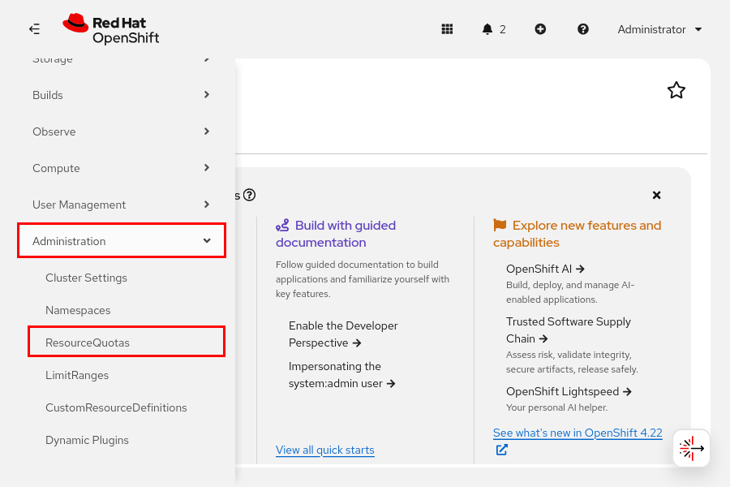
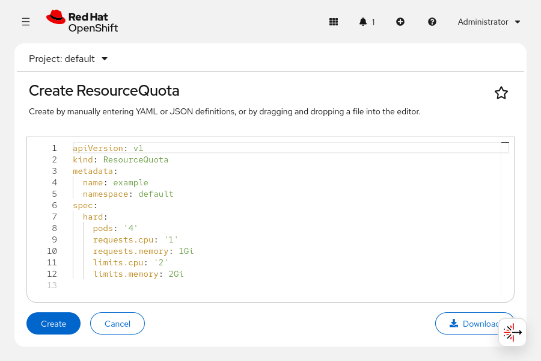
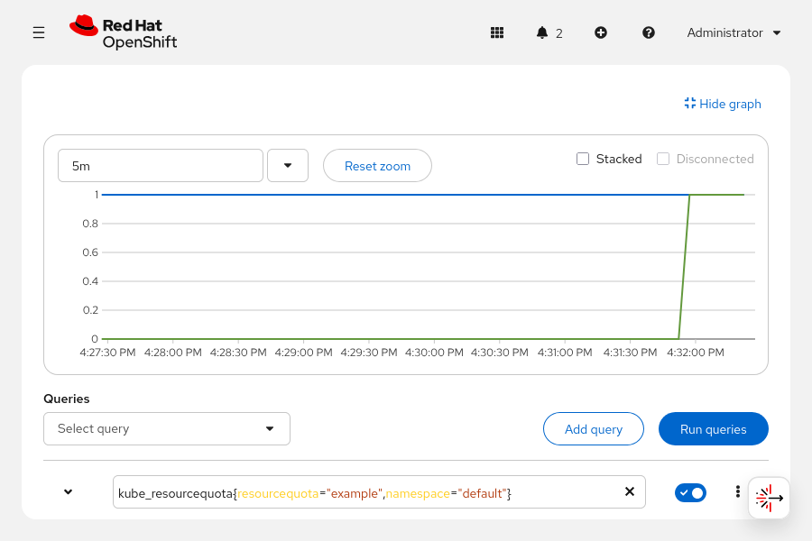

Quản trị Red Hat OpenShift II: Cấu hình Cụm Môi trường Sản xuất
---------------------------------------------------------------

# Chương 6. Cho phép nhà phát triển tự phục vụ
## Hạn mức Dự án và Cụm
### Giới hạn khối lượng công việc
Các cụm Kubernetes có thể chạy các khối lượng công việc (workload) đa dạng trên nhiều nút tính toán. Thông qua cơ chế kiểm soát truy cập dựa trên vai trò (RBAC) của Kubernetes, quản trị viên cụm có thể cho phép người dùng tự tạo các khối lượng công việc. Mặc dù RBAC có thể giới hạn các loại tài nguyên mà người dùng được phép tạo, quản trị viên vẫn có thể cần thêm các biện pháp khác để đảm bảo cụm hoạt động ổn định và chính xác.

Các cụm có nguồn tài nguyên hạn chế, chẳng hạn như CPU, bộ nhớ và dung lượng lưu trữ. Nếu các khối lượng công việc trong cụm vượt quá tài nguyên hiện có, chúng có thể không hoạt động đúng cách. Một cụm được cấu hình tự động mở rộng quy mô (autoscale) cũng có thể phát sinh chi phí không mong muốn nếu nó tự động mở rộng để đáp ứng các khối lượng công việc bất ngờ.

Để giải quyết vấn đề này, các khối lượng công việc trong Kubernetes có thể đặt trước (reserve) tài nguyên và khai báo các giới hạn tài nguyên. Các khối lượng công việc có thể chỉ định các thuộc tính sau:

**Giới hạn tài nguyên (Resource limits)**  
Kubernetes có thể giới hạn lượng tài nguyên mà một khối lượng công việc tiêu thụ. Các khối lượng công việc có thể chỉ định mức trần cho lượng tài nguyên dự kiến sử dụng trong điều kiện hoạt động bình thường. Nếu khối lượng công việc gặp sự cố hoặc chịu tải bất ngờ, các giới hạn tài nguyên sẽ ngăn chặn việc tiêu thụ quá mức tài nguyên, từ đó tránh gây ảnh hưởng đến các khối lượng công việc khác.

**Yêu cầu tài nguyên (Resource requests)**  
Các khối lượng công việc có thể khai báo mức tài nguyên tối thiểu cần thiết. Kubernetes theo dõi các yêu cầu tài nguyên này và sẽ ngăn chặn việc triển khai các khối lượng công việc mới nếu cụm không còn đủ tài nguyên. Việc yêu cầu tài nguyên đảm bảo rằng các khối lượng công việc luôn nhận được lượng tài nguyên cần thiết để hoạt động.

Các biện pháp này giúp ngăn chặn tình trạng một khối lượng công việc gây ảnh hưởng tiêu cực đến các khối lượng công việc khác. Tuy nhiên, quản trị viên cụm có thể cần phải ngăn ngừa thêm các rủi ro khác.

Ví dụ: người dùng có thể vô tình tạo ra các khối lượng công việc không mong muốn. Các yêu cầu tài nguyên của những khối lượng công việc không mong muốn này có thể ngăn cản việc thực thi các khối lượng công việc hợp lệ và quan trọng.

Bằng cách phân chia các khối lượng công việc vào các không gian tên (namespace), Kubernetes cung cấp các tính năng bảo vệ nâng cao. Cấu trúc không gian tên thường phản ánh cơ cấu tổ chức của đơn vị vận hành cụm. Kubernetes cũng đưa ra khái niệm hạn ngạch tài nguyên (resource quota) để giới hạn tổng mức tiêu thụ tài nguyên của tất cả các khối lượng công việc nằm trong cùng một không gian tên.

### Hạn mức tài nguyên
Để thực hiện việc này, các quản trị viên Kubernetes có thể tạo các tài nguyên thuộc loại `ResourceQuota` trong một namespace. Khi một hạn mức tài nguyên (resource quota) đã được thiết lập cho một namespace, Kubernetes sẽ ngăn chặn việc tạo ra các workload vượt quá hạn mức đó.

Trong khi các tính năng hạn mức ở những hệ thống khác thường áp dụng cho người dùng hoặc nhóm người dùng, thì hạn mức tài nguyên trong Kubernetes lại áp dụng cho các namespace.

```yaml
apiVersion: v1
kind: ResourceQuota
metadata:
  name: memory
  namespace: example
spec:
  hard: # (1)
    limits.memory: 4Gi
    requests.memory: 2Gi
  scopes: {} # (2)
  scopeSelector: {} # (2)
```

1. Khóa `hard` liệt kê tập hợp các giới hạn cứng mong muốn cho từng tài nguyên được chỉ định.
2. Các khóa `scopes` và `scopeSelector` xác định những tài nguyên thuộc namespace nào sẽ chịu sự điều chỉnh của hạn mức (quota). Phần này không đề cập đến các khóa đó.

Các phần sau đây mô tả các hạn mức về tài nguyên tính toán và số lượng đối tượng mà bạn có thể đưa vào khóa cứng. Các thành phần khác có thể xác định và thực thi các hạn mức khác.

#### Hạn mức Tài nguyên Tính toán
Bạn có thể thiết lập các hạn mức tính toán sau:

* limits.cpu
* limits.memory
* pods
* requests.cpu
* requests.memory

Các hạn mức giới hạn (limit quotas) tương tác với các giới hạn tài nguyên (resource limits), và các hạn mức yêu cầu (request quotas) tương tác với các yêu cầu tài nguyên (resource requests).

Các hạn mức giới hạn kiểm soát lượng tài nguyên tính toán tối đa mà các workload trong một namespace có thể tiêu thụ. Hãy xem xét một namespace nơi tất cả các workload đều có giới hạn bộ nhớ. Không một workload riêng lẻ nào tiêu thụ đủ bộ nhớ để gây ra sự cố. Tuy nhiên, vì người dùng có thể tạo ra số lượng workload bất kỳ, nên tổng các workload trong một namespace có thể tiêu thụ lượng bộ nhớ đủ lớn để gây ảnh hưởng đến các workload ở những namespace khác. Nếu bạn thiết lập giới hạn sử dụng bộ nhớ cho namespace, thì các workload trong namespace đó sẽ không thể tiêu thụ vượt quá giới hạn này.

Các hạn mức yêu cầu kiểm soát lượng tài nguyên tối đa mà các workload trong một namespace có thể đặt trước (reserve). Nếu bạn không thiết lập hạn mức yêu cầu cho namespace, một workload đơn lẻ có thể yêu cầu bất kỳ lượng tài nguyên nào, chẳng hạn như bộ nhớ hoặc CPU. Yêu cầu này có thể khiến các yêu cầu khác ở những namespace khác bị thất bại. Bằng cách thiết lập hạn mức yêu cầu cho namespace, tổng tài nguyên được yêu cầu bởi các workload trong namespace đó sẽ không thể vượt quá hạn mức đã định.

Việc đặt hạn mức quá cao có thể dẫn đến tình trạng sử dụng tài nguyên không hiệu quả (dưới mức tối ưu) và hạn chế hiệu năng của workload một cách không cần thiết.

Sau khi thiết lập bất kỳ hạn mức tính toán nào, tất cả các workload đều phải định nghĩa yêu cầu hoặc giới hạn tài nguyên tương ứng. Ví dụ: nếu bạn tạo hạn mức `limits.cpu`, thì các workload mà bạn tạo ra bắt buộc phải có khóa `resources.limits.cpu`.

#### Hạn ngạch về số lượng đối tượng
Hạn ngạch cũng có thể giới hạn số lượng tài nguyên thuộc một loại nhất định trong một namespace. Ví dụ: bạn có thể thiết lập hạn ngạch để ngăn chặn việc tạo quá 10 deployment trong một namespace.

Các cụm (cluster) lưu trữ định nghĩa tài nguyên trong một hệ thống lưu trữ nền tảng (backing store). Các hệ thống lưu trữ nền tảng của Kubernetes thực chất là các cơ sở dữ liệu; cũng như mọi cơ sở dữ liệu khác, lượng dữ liệu được lưu trữ càng lớn thì càng cần nhiều tài nguyên để đảm bảo hiệu năng hoạt động ổn định. Các namespace chứa quá nhiều tài nguyên có thể ảnh hưởng đến hiệu năng của Kubernetes. Ngoài ra, bất kỳ tiến trình nào thực hiện tạo tài nguyên cụm đều có nguy cơ gặp sự cố và tạo ra các tài nguyên không mong muốn.

Việc thiết lập hạn ngạch về số lượng đối tượng có thể giúp hạn chế thiệt hại do các sự cố ngoài ý muốn và duy trì hiệu năng ổn định cho cụm.

> **Lưu ý:** Red Hat kiểm chứng hiệu năng của OpenShift với số lượng đối tượng nhất định cho các cấu hình cụ thể. Nếu bạn đang có kế hoạch triển khai một cụm (cluster) quy mô lớn, các kết quả này có thể giúp bạn xác định quy mô cụm và thiết lập hạn mức về số lượng đối tượng.

Một số tài nguyên Kubernetes có thể ảnh hưởng đến các hệ thống bên ngoài. Ví dụ, việc tạo một persistent volume (ổ đĩa bền vững) có thể dẫn đến việc tạo ra một thực thể tại nhà cung cấp dịch vụ lưu trữ. Việc tạo quá nhiều persistent volume có thể gây ra sự cố cho nhà cung cấp dịch vụ lưu trữ này. Hãy xem xét các hệ thống mà cụm (cluster) của bạn tương tác để nắm bắt các giới hạn tài nguyên có thể xảy ra, đồng thời thiết lập hạn ngạch về số lượng đối tượng nhằm ngăn ngừa sự cố.

Hãy sử dụng cú pháp `count/resource_type` để thiết lập hạn ngạch cho các tài nguyên thuộc nhóm cốt lõi (core group). Sử dụng lệnh `oc api-resources` với tham số `api-group` để trống để liệt kê các tài nguyên thuộc nhóm cốt lõi này.

```bash
$ oc api-resources --api-group=""  --namespaced=true
NAME                     SHORTNAMES   APIVERSION   NAMESPACED   KIND
bindings                              v1           true         Binding
...output omitted...
```

Đối với các tài nguyên thuộc các nhóm khác, hãy sử dụng cú pháp `count/resource_type.group`.

Ban đầu, Kubernetes hỗ trợ hạn ngạch cho một số loại tài nguyên nhất định. Các hạn ngạch này không sử dụng cú pháp `count/resource_type`. Bạn có thể sẽ thấy hạn ngạch `services` thay vì `count/services`. Tài liệu tham khảo về Resource Quotas (Hạn ngạch tài nguyên) sẽ mô tả chi tiết hơn về các loại hạn ngạch này.

### Áp dụng Hạn mức Dự án
Truy cập **Administration → ResourceQuotas** để tạo và quản lý các hạn mức tài nguyên từ giao diện web.

**Hình 6.1: Quản lý hạn mức tài nguyên trên bảng điều khiển web**  


Trình chỉnh sửa cung cấp một tệp YAML mẫu mà bạn có thể chỉnh sửa để xác định hạn ngạch tài nguyên.

**Hình 6.2: Trình chỉnh sửa hạn mức tài nguyên trong bảng điều khiển web**  


Bạn cũng có thể sử dụng lệnh `oc` để tạo hạn ngạch tài nguyên (resource quota). Lệnh `oc` cho phép tạo hạn ngạch tài nguyên mà không cần định nghĩa tài nguyên đầy đủ. Hãy chạy lệnh `oc create resourcequota --help` để xem các ví dụ và thông tin hướng dẫn về việc tạo hạn ngạch tài nguyên mà không cần định nghĩa tài nguyên đầy đủ. Bạn có thể sử dụng tên viết tắt `quota` thay cho `resourcequota` khi dùng lệnh `oc create`.

Ví dụ, hãy chạy lệnh sau để tạo một hạn ngạch tài nguyên giới hạn số lượng pod trong một namespace:

```bash
$ oc create quota example --hard count/pods=1
resourcequota/example created
```

Lệnh trước đó tương đương với việc tạo một hạn ngạch tài nguyên với định nghĩa YAML sau:

```yaml
apiVersion: v1
kind: ResourceQuota
metadata:
  name: example
spec:
  hard:
    count/pods: "1"
```

Sau khi tạo hạn mức tài nguyên, khóa trạng thái (status key) trong tài nguyên sẽ mô tả các giá trị và giới hạn hiện tại của hạn mức đó.

```bash
$ oc get quota example -o yaml
```

```yaml
apiVersion: v1
kind: ResourceQuota
metadata:
  creationTimestamp: "2024-01-30T17:59:52Z"
  name: example
  namespace: default
  resourceVersion: "193658"
  uid: df12b484-4e78-4920-acb4-e04ab286a4a1
spec:
  hard:
    count/pods: "1"
status:
  hard:
    count/pods: "1"
  used:
    count/pods: "0"
```

Các lệnh `oc get` và `oc describe` hiển thị thông tin hạn mức tài nguyên theo định dạng tùy chỉnh. Lệnh `oc get` hiển thị trạng thái của hạn mức trong các danh sách tài nguyên:

```bash
$ oc get quota
NAME      REQUEST          LIMIT  AGE
example   count/pods: 0/1         47s
```

Các hạn ngạch tài nguyên (resource quota) tạo ra chỉ số `kube_resourcequota`. Để xem chỉ số này từ giao diện web, hãy truy cập **Observe** → **Metrics**. Bạn có thể xem xét chỉ số này để phục vụ công tác lập kế hoạch và phân tích xu hướng.

Hình ảnh dưới đây hiển thị chỉ số `kube_resourcequota` cho một hạn ngạch tài nguyên mẫu trong namespace mặc định.

**Hình 6.3: Chỉ số hạn ngạch tài nguyên Kubernetes**  


Đường màu xanh lá cây, thể hiện xu hướng tăng trên biểu đồ này, đại diện cho giá trị `status.used.count/pods`; giá trị này ban đầu là 0. Sau khi một pod được triển khai, giá trị này tăng lên 1. Đường màu xanh dương chạy dọc theo phần trên của biểu đồ đại diện cho giá trị `status.hard.count/pods`, vốn được thiết lập ở mức 1.

### Khắc phục sự cố liên quan đến hạn ngạch tài nguyên
Do hạn ngạch tài nguyên có khả năng mở rộng, Kubernetes không thể xác minh tính chính xác của chúng. Ví dụ, lệnh sau đây tạo ra một hạn ngạch tài nguyên không có tác dụng gì:

```bash
$ oc create quota example --hard count/deployment=1
resourcequota/example created
```

Cú pháp chính xác để giới hạn số lượng deployment là `count/deployments.apps`.

Để đảm bảo hạn ngạch tài nguyên (resource quota) được thiết lập chính xác, bạn có thể thực hiện các bước sau:

* Kiểm tra tài nguyên hiện tại của cụm (cluster) để nắm bắt các chỉ số về khả năng cung ứng và mức độ sử dụng trước khi thiết lập hạn ngạch tài nguyên. 
* Tạo một hạn ngạch với giá trị thấp (ở mức thử nghiệm) trong môi trường kiểm thử, và đảm bảo rằng hạn ngạch đó mang lại hiệu quả như mong muốn khi được kích hoạt. 
* Kiểm tra trạng thái hạn ngạch để xác nhận rằng nó hoạt động đúng và tạo ra các giới hạn tài nguyên phù hợp. 

Ví dụ: nếu một namespace có chứa một deployment, nhưng hạn ngạch tài nguyên lại được định nghĩa sai, hệ thống sẽ hiển thị là 0 deployment:

```bash
$ oc get resourcequota
NAME      AGE     REQUEST                 LIMIT
example   2m47s   count/deployment: 0/1
```

Tuy nhiên, hạn ngạch tài nguyên được xác định chính xác sẽ hiển thị việc triển khai:

```bash
$ oc get resourcequota
NAME      AGE   REQUEST                       LIMIT
example   4s    count/deployments.apps: 1/1
```

Việc vượt quá hạn mức thường gây ra lỗi ngay lập tức. Ví dụ: nếu bạn tạo một bản triển khai vượt quá hạn mức triển khai, thì quá trình tạo bản triển khai đó sẽ thất bại.

```bash
$ oc create deployment --image nginx hello
error: failed to create deployment: deployments.apps "hello" is forbidden: exceeded quota: example, requested: count/deployments.apps=1, used: count/deployments.apps=1, limited: count/deployments.apps=1
```

Tuy nhiên, một số hạn mức không khiến các thao tác thất bại ngay lập tức. Ví dụ, nếu bạn thiết lập hạn mức tài nguyên cho các pod, việc tạo Deployment có vẻ như thành công, nhưng Deployment đó lại không bao giờ chuyển sang trạng thái sẵn sàng (available). Khi hạn mức tài nguyên tác động theo cách gián tiếp, các sự kiện (event) của namespace có thể cung cấp thêm thông tin.

```bash
$ oc get event --sort-by .metadata.creationTimestamp
... REASON              OBJECT                 MESSAGE
...output omitted...
    ScalingReplicaSet   deployment/hello       Scaled up replica set hello-5cdfd9c858 to 1
    FailedCreate        replicaset/hello-...   Error creating: pods "hello-5cdfd9c858-zsgn9" is forbidden: exceeded quota: example, requested: count/pods=1, used: count/pods=1, limited: count/pods=1
    FailedCreate        replicaset/hello-...   (combined from similar events): Error creating: pods "hello-5cdfd9c858-h2dv4" is forbidden: exceeded quota: example, requested: count/pods=1, used: count/pods=1, limited: count/pods=1
```

Bảng điều khiển web cũng hiển thị thông tin về hạn mức. Hãy truy cập **Administration → ResourceQuotas** để xem các hạn mức tài nguyên và trạng thái của chúng. Trang dự án tại mục **Home → Projects** cũng hiển thị các hạn mức áp dụng cho một dự án cụ thể.

### Thiết lập hạn mức tài nguyên trên nhiều dự án
Quản trị viên cụm có thể sử dụng hạn mức tài nguyên để áp đặt các giới hạn cho các namespace. Các giới hạn tài nguyên thường tuân theo cơ cấu tổ chức. Mặc dù các namespace thường phản ánh cơ cấu tổ chức, nhưng quản trị viên cụm có thể áp dụng giới hạn tài nguyên mà không bị bó buộc trong phạm vi một namespace duy nhất.

Ví dụ: một nhóm lập trình viên quản lý nhiều namespace. Hạn mức namespace có thể giới hạn mức sử dụng bộ nhớ cho từng namespace. Tuy nhiên, quản trị viên cụm lại không thể giới hạn tổng mức sử dụng bộ nhớ của tất cả các workload do nhóm lập trình viên đó quản lý.

OpenShift giới thiệu khái niệm hạn mức tài nguyên cấp cụm (cluster resource quota) để giải quyết các tình huống này. Hạn mức tài nguyên cấp cụm có cấu trúc tương tự như hạn mức tài nguyên cấp namespace. Tuy nhiên, hạn mức tài nguyên cấp cụm sử dụng các bộ chọn (selector) để xác định những namespace mà hạn mức đó được áp dụng.

Các bộ chọn của hạn mức tài nguyên cấp cụm sử dụng các điều kiện dựa trên tập hợp (set-based requirements). Ví dụ dưới đây minh họa một hạn mức tài nguyên cấp cụm:

```yaml
apiVersion: quota.openshift.io/v1
kind: ClusterResourceQuota
metadata:
  name: example
spec:
  quota: # (1)
    hard:
      limits.cpu: 4
  selector: # (2)
    annotations: {}
    labels:
      matchLabels:
        kubernetes.io/metadata.name: example
```

1. Khóa `quota` chứa định nghĩa về hạn mức. Khóa này tuân theo cấu trúc của đặc tả `ResourceQuota`. Khóa `hard` nằm lồng bên trong khóa `quota`, thay vì nằm trực tiếp trong khóa `spec` như ở các hạn mức tài nguyên (resource quota) thông thường.
2. Khóa `selector` xác định các namespace mà hạn mức tài nguyên cụm (cluster resource quota) được áp dụng. Các tính năng khác của Kubernetes, chẳng hạn như service và network policy, cũng sử dụng cùng loại bộ chọn (selector) này.

Truy cập **Administration** → **CustomResourceDefinitions** để tạo hạn ngạch tài nguyên cụm (cluster resource quota) bằng giao diện web.

Bạn cũng có thể sử dụng lệnh `oc` để tạo hạn ngạch cụm. Lệnh `oc` cho phép tạo hạn ngạch mà không cần định nghĩa tài nguyên đầy đủ. Hãy chạy lệnh `oc create clusterresourcequota --help` để xem các ví dụ và thông tin hướng dẫn về việc tạo hạn ngạch tài nguyên cụm mà không cần định nghĩa tài nguyên đầy đủ.

Ví dụ: hãy chạy lệnh sau để tạo hạn ngạch tài nguyên giới hạn tổng yêu cầu CPU. Hạn ngạch này giới hạn tổng yêu cầu CPU trên các namespace có nhãn nhóm (group label) mang giá trị `dev`.

```bash
$ oc create clusterresourcequota example --project-label-selector=group=dev --hard=requests.cpu=10
clusterresourcequota.quota.openshift.io/example created
```

Lệnh trước đó sử dụng dấu = để gán giá trị cho các tùy chọn `--project-label-selector` và `--hard`. Bạn cũng có thể sử dụng dấu cách để phân tách tùy chọn và giá trị:

```bash
$ oc create clusterresourcequota example --project-label-selector group=dev \
--hard requests.cpu=10
clusterresourcequota.quota.openshift.io/example created
```

Hạn ngạch tài nguyên cụm (cluster resource quotas) tổng hợp mức sử dụng tài nguyên trên các namespace và thực thi các giới hạn. Ví dụ YAML dưới đây hiển thị trạng thái của hạn ngạch tài nguyên cụm đã được thiết lập trước đó:

```yaml
apiVersion: quota.openshift.io/v1
kind: ClusterResourceQuota
metadata:
  name: example
spec:
  quota:
    hard:
      requests.cpu: "10"
  selector:
    annotations: null
    labels:
      matchLabels:
        group: dev
status:
  namespaces: # (1)
  - namespace: example-3
    status:
      hard:
        requests.cpu: "10"
      used:
        requests.cpu: 500m
  - namespace: example-2
    status:
      hard:
        requests.cpu: "10"
      used:
        requests.cpu: 250m
...output omitted...
  total: # (2)
    hard:
      requests.cpu: "10"
    used:
      requests.cpu: 2250m
```

1. Khóa `namespaces` liệt kê các namespace mà hạn mức được áp dụng. Đối với mỗi namespace, khóa `used` hiển thị mức sử dụng hiện tại.
2. Khóa `total` tổng hợp dữ liệu từ khóa `namespaces`.

Người dùng có thể không có quyền đọc đối với các hạn ngạch tài nguyên cụm (cluster resource quotas). OpenShift tạo các tài nguyên thuộc loại `AppliedClusterResourceQuota` trong các namespace chịu ảnh hưởng bởi hạn ngạch tài nguyên cụm. Quản trị viên dự án có thể kiểm tra mức sử dụng hạn ngạch bằng cách xem xét các tài nguyên `AppliedClusterResourceQuota` này. Ví dụ, hãy sử dụng lệnh `oc describe` để xem các hạn ngạch tài nguyên cụm được áp dụng cho một namespace cụ thể:

```bash
$ oc describe AppliedClusterResourceQuota -n example-2
Name:   example
Created:  9 minutes ago
Labels:   <none>
Annotations:  <none>
Namespace Selector: ["example-3" "example-2" "example-4" "example-1"]
Label Selector: group=dev
AnnotationSelector: map[]
Resource  Used  Hard
--------  ----  ----
requests.cpu  2250m 10
```

> **Lưu ý:** Tham số `--all-namespaces` dùng với các lệnh `oc` (chẳng hạn như `get` và `describe`) không hoạt động với các tài nguyên `AppliedClusterResourceQuota`. Các tài nguyên này chỉ được liệt kê khi bạn chọn một namespace cụ thể.

Truy cập **Administration** → **ResourceQuotas** để xem các hạn mức (quota) và trạng thái của chúng. Trang này hiển thị các hạn mức cấp cụm (cluster quota) cùng với các hạn mức cấp namespace (namespace quota). Mặc dù bạn có thể xem các tài nguyên thuộc loại `ClusterResourceQuota` và tạo tài nguyên thuộc loại `ResourceQuota` trên trang **ResourceQuotas**, bạn không thể tạo các đối tượng thuộc loại `ClusterResourceQuota` tại trang này.

Các trang dự án cũng hiển thị những hạn mức cấp cụm được áp dụng cho một dự án cụ thể.

## Các ràng buộc về tài nguyên theo từng dự án: Phạm vi giới hạn (Limit Ranges)
### Quản lý Tài nguyên Namespace
Quản trị viên cụm (cluster) có thể thiết lập hạn ngạch tài nguyên cho các namespace. Hạn ngạch namespace giới hạn lượng tài nguyên mà các workload (khối lượng công việc) trong namespace đó được phép sử dụng. Các hạn ngạch này giải quyết vấn đề quản lý tài nguyên ở cấp độ cụm.

Quản trị viên namespace có thể có thêm các nhu cầu quản lý tài nguyên cụ thể bên trong namespace của họ. 

* Người dùng có thể vô tình tạo ra các workload tiêu thụ quá nhiều tài nguyên trong hạn ngạch của namespace. Những workload không mong muốn này có thể ngăn cản các workload khác hoạt động. 
* Người dùng có thể quên thiết lập các giới hạn (limits) và yêu cầu (requests) cho workload, hoặc cảm thấy việc cấu hình các thông số này tốn nhiều thời gian. Khi một namespace có áp dụng hạn ngạch, việc tạo workload sẽ thất bại nếu workload đó không định nghĩa các giá trị cho limits hoặc requests theo quy định của hạn ngạch.

Kubernetes đưa ra khái niệm "limit range" (phạm vi giới hạn) để hỗ trợ giải quyết các vấn đề này. Limit range là các đối tượng thuộc phạm vi namespace, dùng để xác định các giới hạn cho từng workload bên trong namespace đó.

### Phạm vi giới hạn (Limit Ranges)
Ví dụ sau đây minh họa cấu hình của một phạm vi giới hạn:

```yaml
apiVersion: v1
kind: LimitRange
metadata:
  name: mem-limit-range
  namespace: example
spec:
  limits:
    - default:
        memory: 512Mi
      defaultRequest:
        memory: 256Mi
      type: Container
```

Các phạm vi giới hạn (limit ranges) có thể chỉ định những loại giới hạn sau:

* **Giới hạn mặc định:** Chỉ định các giới hạn mặc định cho khối lượng công việc (workload) nếu các giới hạn này không được xác định cụ thể trong định nghĩa khối lượng công việc.
* **Yêu cầu mặc định:** Thiết lập các yêu cầu tài nguyên mặc định cho khối lượng công việc.
* **Tối đa:** Xác định giới hạn trên cho cả yêu cầu (request) và giới hạn (limit).
* **Tối thiểu:** Thiết lập giới hạn dưới cho cả yêu cầu và giới hạn.
* **Tỷ lệ giới hạn trên yêu cầu:** Áp dụng tỷ lệ tối đa cho phép giữa giới hạn và yêu cầu. Ví dụ: nếu bạn đặt tỷ lệ là 2, thì giới hạn tài nguyên không được vượt quá gấp đôi mức yêu cầu.

Các phạm vi giới hạn (limit ranges) áp dụng cho container, pod, image, image stream và persistent volume claim.

#### Thiết lập các phạm vi giới hạn tối đa và tối thiểu
Các phạm vi giới hạn tối đa giúp ngăn chặn tình trạng cạn kiệt hạn mức bằng cách kiểm soát để khối lượng công việc không vượt quá các giới hạn hoặc yêu cầu tài nguyên đã định. Tuy nhiên, do việc đặt giới hạn tối đa quá khắt khe có thể chặn các khối lượng công việc hợp lệ, bạn nên thiết lập mức tối đa sao cho vẫn đảm bảo đủ sự linh hoạt cho người dùng.

Các phạm vi giới hạn tối thiểu đảm bảo rằng khối lượng công việc có các yêu cầu và giới hạn tài nguyên đầy đủ, qua đó ngăn ngừa tình trạng cấp phát thiếu hụt tài nguyên.

#### Thiết lập các giá trị mặc định
Khi một hạn mức (quota) được áp dụng cho một namespace, mọi container trong namespace đó đều bắt buộc phải xác định các giá trị yêu cầu (requests) và giới hạn (limits). Nếu không, OpenShift sẽ chặn việc tạo pod do không thể tính toán mức tiêu thụ tài nguyên của các workload so với hạn mức của namespace.

Thông qua các giá trị mặc định trong phạm vi giới hạn (limit ranges), OpenShift sẽ tự động gán các thông số requests và limits cho những container không khai báo cụ thể các tham số này.

Các giá trị mặc định đặc biệt hữu ích đối với những workload động không được định nghĩa sẵn requests và limits, chẳng hạn như các workload do công cụ tích hợp liên tục (CI) tạo ra. Ví dụ, các công cụ CI thực hiện kiểm thử cho mỗi thay đổi mã nguồn có thể tạo ra nhiều workload; khi đó, việc thiết lập mặc định giúp đảm bảo phân bổ tài nguyên đồng nhất mà không cần cấu hình thủ công. Tuy nhiên, việc xác định các giá trị mặc định phù hợp có thể là một thách thức đối với những namespace chứa các workload đa dạng.

### Tạo các phạm vi giới hạn (Limit Ranges)
Hãy xem xét một namespace có hạn mức (quota) như sau:

```yaml
apiVersion: v1
kind: ResourceQuota
metadata:
  name: example
  namespace: example
spec:
  hard:
    limits.cpu: "8"
    limits.memory: 8Gi
    requests.cpu: "4"
    requests.memory: 4Gi
```

Lệnh sau đây tạo một deployment không có các thiết lập request và limit:

```bash
$ oc create deployment example --image image
deployment.apps/example created
```

Hệ quả là, hạn mức ngăn cản việc triển khai tạo ra các pod:

```bash
$ oc events
... OBJECT                          MESSAGE
...output omitted...
... ReplicaSet/example-68fdb54c6c   Error creating: pods "example-68fdb54c6c-qrvr4" is forbidden: failed quota: example: must specify limits.cpu for: hello-openshift; limits.memory for: hello-openshift; requests.cpu for: hello-openshift; requests.memory for: hello-openshift
...output omitted...
```

Để khắc phục vấn đề này và cho phép OpenShift chấp nhận các khối lượng công việc không khai báo các giá trị request (yêu cầu) và limit (giới hạn), bạn có thể định nghĩa một LimitRange với các giá trị mặc định. LimitRange dưới đây bao gồm tất cả các loại giới hạn:

```yaml
apiVersion: v1
kind: LimitRange
metadata:
  name: example
  namespace: example
spec:
  limits:
    - default:
        cpu: 500m
        memory: 512Mi
      defaultRequest:
        cpu: 250m
        memory: 256Mi
      max:
        cpu: "1"
        memory: 1Gi
      min:
        cpu: 125m
        memory: 128Mi
      type: Container
```

Các limit range không ảnh hưởng đến các pod hiện có. Nếu bạn xóa deployment và chạy lại lệnh `oc create`, deployment mới sẽ tạo ra một pod được áp dụng các giá trị limit range.

```bash
$ oc describe pod NAME
...output omitted...
Containers:
  hello-openshift:
...output omitted...
    Limits:
      cpu:     500m
      memory:  512Mi
    Requests:
      cpu:        250m
      memory:     256Mi
...output omitted...
```

Các giá trị này tương ứng với các khóa `default` và `defaultRequest` trong phạm vi giới hạn (limit range).

Cấu hình triển khai (deployment) không chứa bất kỳ giới hạn nào trong phần đặc tả (specification). Kubernetes API server có tích hợp một bộ điều khiển tiếp nhận (admission controller) chuyên thực thi các quy tắc về phạm vi giới hạn. Bộ điều khiển này tác động đến định nghĩa của pod, chứ không tác động đến deployment, stateful set hay các loại workload khác.

Bạn có thể thay đổi giới hạn CPU hoặc bổ sung các thông số tài nguyên khác bằng cách sử dụng lệnh `oc set resources`:

```bash
$ oc set resources deployment example --limits cpu=new-cpu-limit
```

Bạn có thể thử nghiệm với các giới hạn CPU khác nhau.

Nếu bạn yêu cầu các giá trị CPU nằm ngoài phạm vi được xác định bởi các khóa min và max, Kubernetes sẽ không tạo các pod và sẽ ghi lại các cảnh báo.

```bash
$ oc events
... OBJECT                          MESSAGE
...output omitted...
... ReplicaSet/example-f7d45c6b4    Error creating: pods "example-f7d45c6b4-sm5xb" is forbidden: minimum cpu usage per Container is 125m, but request is 100m
...output omitted...
```

> **Lưu ý:** Khi thử nghiệm với các deployment và hạn mức tài nguyên (resource quota), hãy cân nhắc điều gì sẽ xảy ra khi bạn sửa đổi một deployment. Các sửa đổi sẽ tạo ra một replica set thay thế, trong khi replica set hiện tại vẫn tiếp tục chạy cho đến khi quá trình triển khai (rollout) hoàn tất. Các pod của cả hai replica set đều được tính vào hạn mức tài nguyên. Nếu replica set mới đáp ứng được hạn mức nhưng tổng tài nguyên của cả hai replica set lại vượt quá hạn mức, thì quá trình triển khai sẽ không thể hoàn tất.

Khi tạo một limit range (phạm vi giới hạn), bạn có thể chỉ định bất kỳ sự kết hợp nào của các khóa `default`, `defaultRequest`, `min` và `max`. Tuy nhiên, nếu bạn không chỉ định khóa `default` hoặc `defaultRequest`, Kubernetes sẽ tự động sửa đổi limit range để thêm các khóa này vào. Kubernetes sẽ sao chép giá trị cho các khóa này từ khóa `min` hoặc `max`. Để đảm bảo hành vi hoạt động ổn định và dễ dự đoán hơn, bạn nên luôn chỉ định cả hai khóa `default` và `defaultRequest` nếu đã chỉ định khóa `min` hoặc `max`.

Các giá trị cho khóa CPU hoặc bộ nhớ (memory) phải tuân thủ các quy tắc sau:

* Giá trị `max` phải lớn hơn hoặc bằng giá trị `default`. 
* Giá trị `default` phải lớn hơn hoặc bằng giá trị `defaultRequest`. 
* Giá trị `defaultRequest` phải lớn hơn hoặc bằng giá trị `min`.

Không nên tạo các limit range gây xung đột trong cùng một namespace. Ví dụ: nếu hai limit range cùng chỉ định các giá trị CPU mặc định (`default`) khác nhau, Kubernetes sẽ không thể xác định giá trị nào cần được áp dụng.

## Mẫu dự án (Project Template) và vai trò Người tự cung ứng (Self-provisioner)
### Tạo dự án
Kubernetes cung cấp các namespace (không gian tên) để cô lập các khối lượng công việc (workload).

Siêu dữ liệu (metadata) của namespace có ảnh hưởng đến vấn đề bảo mật trong cụm (cluster). Ví dụ, các bộ điều khiển chính sách (policy controller) có thể sử dụng nhãn (label) của namespace để giới hạn các quyền hạn trong namespace đó. Nếu người dùng có thể sửa đổi namespace, những kẻ tấn công có thể thay đổi siêu dữ liệu của namespace để vượt qua các biện pháp bảo mật.

Ngoài ra, namespace là tài nguyên có phạm vi toàn cụm. Do đó, việc cấp quyền truy cập chi tiết (granular access) cho namespace gặp một số thách thức. Ví dụ, với cơ chế kiểm soát truy cập dựa trên vai trò (RBAC) của Kubernetes, bạn không thể cho phép người dùng liệt kê một tập hợp con các namespace. Để cho phép người dùng liệt kê các namespace của họ, bạn buộc phải cho phép họ liệt kê tất cả các namespace.

> **Lưu ý:** Việc liệt kê tài nguyên và xem từng tài nguyên riêng lẻ là các thao tác khác nhau. Bạn có thể cấp quyền cho người dùng xem các namespace cụ thể, nhưng việc liệt kê danh sách namespace lại đòi hỏi một quyền riêng biệt.

OpenShift giới thiệu khái niệm "project" (dự án) nhằm cải thiện tính bảo mật và trải nghiệm người dùng khi làm việc với namespace. API server của OpenShift bổ sung loại tài nguyên Project. Khi bạn thực hiện truy vấn để liệt kê các project, API server sẽ liệt kê các namespace, lọc ra những namespace mà người dùng của bạn có quyền nhìn thấy, và trả về kết quả dưới định dạng project.

Bên cạnh đó, OpenShift còn giới thiệu loại tài nguyên ProjectRequest. Khi bạn tạo một yêu cầu project (project request), API server của OpenShift sẽ tạo ra một namespace dựa trên một mẫu (template) có sẵn. Việc sử dụng mẫu cho phép quản trị viên cụm tùy chỉnh quy trình tạo namespace. Ví dụ, quản trị viên có thể đảm bảo rằng các namespace mới được tạo ra sẽ có các quyền hạn, hạn ngạch tài nguyên (resource quota) hoặc phạm vi giới hạn (limit range) cụ thể.

Các tính năng này mang lại khả năng tự quản lý namespace cho người dùng. Quản trị viên cụm có thể cho phép người dùng tạo namespace mà không cần cấp quyền sửa đổi siêu dữ liệu của namespace đó. Họ cũng có thể tùy chỉnh quy trình tạo namespace để đảm bảo các namespace tuân thủ đúng các yêu cầu của tổ chức.

### Lập kế hoạch cho mẫu dự án
Bạn có thể thêm bất kỳ tài nguyên nào thuộc phạm vi namespace (namespace-scoped resource) vào mẫu dự án. Ví dụ: bạn có thể thêm các loại tài nguyên sau:

Vai trò (Roles) và liên kết vai trò (Role bindings)

Thêm các vai trò và liên kết vai trò vào mẫu để cấp các quyền cụ thể trong các dự án mới. Mẫu mặc định sẽ cấp vai trò quản trị viên (admin) cho người dùng yêu cầu tạo dự án. Bạn có thể giữ nguyên quyền này hoặc sử dụng một quyền tương tự khác, chẳng hạn như cấp vai trò quản trị viên cho một nhóm người dùng. Bạn cũng có thể thêm các quyền khác, ví dụ như các quyền chi tiết hơn đối với những loại tài nguyên cụ thể.

Hạn ngạch tài nguyên (Resource quotas) và phạm vi giới hạn (Limit ranges)

Thêm hạn ngạch tài nguyên vào mẫu dự án để đảm bảo tất cả các dự án mới đều có giới hạn về tài nguyên. Nếu bạn thêm hạn ngạch tài nguyên, việc tạo khối lượng công việc (workload) sẽ yêu cầu phải khai báo rõ ràng các giới hạn tài nguyên. Hãy cân nhắc thêm phạm vi giới hạn (limit ranges) để giảm bớt công sức khi tạo khối lượng công việc. 

Ngay cả khi đã có hạn ngạch trong tất cả các namespace, người dùng vẫn có thể tạo thêm dự án để tiếp tục thêm khối lượng công việc vào cụm (cluster). Nếu lo ngại về tình huống này, bạn nên cân nhắc thêm hạn ngạch tài nguyên cấp cụm (cluster resource quotas) cho cụm đó.

Chính sách mạng (Network policies)

Thêm các chính sách mạng vào mẫu để thực thi các yêu cầu của tổ chức về việc cô lập mạng.

### Tạo Mẫu Dự án
Lệnh `oc adm create-bootstrap-project-template` xuất ra một mẫu mà bạn có thể sử dụng để tạo mẫu dự án của riêng mình.

Mẫu này hoạt động tương tự như quy trình tạo dự án mặc định trong OpenShift. Nó bổ sung một liên kết vai trò (role binding) nhằm cấp vai trò cụm (cluster role) `admin` trên namespace mới cho người dùng đã yêu cầu tạo dự án đó.

Các mẫu dự án sử dụng cùng một tính năng tạo mẫu như lệnh `oc new-app`.

Hãy thực thi lệnh sau để tạo một tệp chứa mẫu ban đầu:

```bash
$ oc adm create-bootstrap-project-template -o yaml > template.yaml
```

Mẫu ban đầu này có nội dung sau:

```yaml
apiVersion: template.openshift.io/v1
kind: Template
metadata:
  name: project-request
objects: # (1)
- apiVersion: project.openshift.io/v1
  kind: Project # (2)
  metadata:
    name: ${PROJECT_NAME}
    annotations:
      openshift.io/description: ${PROJECT_DESCRIPTION}
      openshift.io/display-name: ${PROJECT_DISPLAYNAME}
      openshift.io/requester: ${PROJECT_REQUESTING_USER}
  spec: {}
  status: {}
- apiVersion: rbac.authorization.k8s.io/v1
  kind: RoleBinding # (3)
  metadata:
    name: admin
    namespace: ${PROJECT_NAME}
  roleRef:
    apiGroup: rbac.authorization.k8s.io
    kind: ClusterRole
    name: admin
  subjects:
  - apiGroup: rbac.authorization.k8s.io
    kind: User
    name: ${PROJECT_ADMIN_USER}
parameters: # (4)
- name: PROJECT_NAME
- name: PROJECT_DISPLAYNAME
- name: PROJECT_DESCRIPTION
- name: PROJECT_ADMIN_USER
- name: PROJECT_REQUESTING_USER
```

1. Các tài nguyên mà OpenShift tạo ra trong các namespace.
2. Tài nguyên project.
3. Một role binding để cấp quyền admin cho người dùng thực hiện yêu cầu.
4. Các tham số khả dụng cho template.

Khi người dùng yêu cầu một dự án, OpenShift sẽ thay thế cú pháp ${VARIABLE} bằng các tham số của yêu cầu dự án đó, đồng thời tạo ra các tài nguyên được chỉ định trong danh sách đối tượng.

**Bảng 6.1. Các tham số mẫu dự án mặc định**

| Tham số                               | Mô tả                                   |
|---------------------------------------|-----------------------------------------|
| PROJECT_NAME (Bắt buộc)               | Tên của dự án.                          |
| PROJECT_DISPLAYNAME (Có thể để trống) | Tên hiển thị của dự án.                 |
| PROJECT_DESCRIPTION (Có thể để trống) | Mô tả về dự án.                         |
| PROJECT_ADMIN_USER                    | Tên người dùng của người dùng quản trị. |
| PROJECT_REQUESTING_USER               | Tên người dùng của người gửi yêu cầu.   |

Hãy sửa đổi danh sách đối tượng để thêm các tài nguyên cần thiết cho các namespace mới. Kết quả đầu ra dạng YAML từ các lệnh `oc` trả về danh sách đối tượng có định dạng tương tự như phần `objects` trong template. Lệnh sau đây minh họa sự tương đồng về định dạng giữa phần `objects` và kết quả đầu ra YAML của lệnh `oc`.

> **Lưu ý:** Kết quả đầu ra của lệnh sau đây khá dài và được chia thành các phần để dễ theo dõi hơn.

```bash
$ oc get limitrange,resourcequota -o yaml
apiVersion: v1
kind: List
metadata:
  resourceVersion: ""
items:  (1)
```

1. Danh sách các đối tượng được yêu cầu có định dạng tương tự như khóa các đối tượng mẫu.

```yaml
- apiVersion: v1
  kind: LimitRange # (1)
  metadata:
    name: example
    namespace: example
...output omitted...
  spec:
    limits:
    - type: Container
      defaultRequest:
        cpu: 250m
        memory: 256Mi
      default:
        cpu: 500m
        memory: 512Mi
      min:
        cpu: 125m
        memory: 128Mi
      max:
        cpu: "1"
        memory: 1Gi
- apiVersion: v1
  kind: ResourceQuota # (2)
  metadata:
    name: example
    namespace: example
...output omitted...
  spec:
    hard:
      count/pods: "1"
  status:
...output omitted...
```

1. Tài nguyên limit range đã được yêu cầu bằng lệnh `oc get`. Dấu gạch ngang ở đầu dòng biểu thị một mục trong danh sách.
2. Tài nguyên resource quota đã được yêu cầu bằng lệnh `oc get`. Dấu gạch ngang ở đầu dòng biểu thị một mục trong danh sách.

> **Cảnh báo:** Một số tài nguyên phổ biến trong các mẫu dự án (project template), chẳng hạn như hạn mức (quota), không có cơ chế kiểm tra tính hợp lệ chặt chẽ. Ví dụ: nếu mẫu trước đó sử dụng từ khóa `count/pod` thay vì `count/pods`, thì hạn mức sẽ không hoạt động. Bạn có thể tạo mẫu dự án và các namespace mới sẽ bao gồm hạn mức này; tuy nhiên, hạn mức đó lại không có tác dụng.

Để định nghĩa mẫu dự án và giảm thiểu rủi ro xảy ra lỗi, bạn có thể thực hiện các bước sau:

* Tạo một namespace. 
* Tạo các tài nguyên mong muốn và kiểm thử cho đến khi đạt được hành vi như ý. 
* Liệt kê các tài nguyên đó dưới định dạng YAML. 
* Chỉnh sửa danh sách tài nguyên để đảm bảo các định nghĩa sẽ tạo ra đúng các tài nguyên cần thiết. Ví dụ: loại bỏ các thành phần không liên quan đến quá trình tạo tài nguyên, chẳng hạn như khóa `creationTimestamp` hoặc khóa `status`. 
* Thay thế tên namespace bằng giá trị `${PROJECT_NAME}`. 
* Thêm danh sách tài nguyên này vào mẫu dự án được tạo bởi lệnh `oc adm create-bootstrap-project-template`.

> **Lưu ý:** Việc trích xuất định nghĩa tài nguyên từ một tài nguyên hiện có có thể không phải lúc nào cũng mang lại kết quả chính xác. Ngoài việc bao gồm các thành phần không phù hợp cho việc tạo tài nguyên, các định nghĩa hiện có còn có thể chứa những thuộc tính gây ra hành vi không mong muốn. Ví dụ, một bộ điều khiển (controller) có thể thêm vào tài nguyên các chú thích (annotation) không phù hợp với định nghĩa mẫu (template).  
> Ngay cả sau khi đã thử nghiệm các tài nguyên trong một namespace dành cho kiểm thử, bạn vẫn cần luôn xác minh rằng các dự án được tạo từ mẫu của mình chỉ thể hiện đúng những hành vi đã dự kiến.

Sử dụng lệnh `oc create` để tạo tài nguyên template trong namespace `openshift-config`:

```bash
$ oc create -f template.yaml -n openshift-config
template.template.openshift.io/project-request created
```

### Cấu hình mẫu dự án
Sửa đổi phần `spec` của tài nguyên `projects.config.openshift.io/cluster` để sử dụng mẫu dự án mới.

```yaml
apiVersion: config.openshift.io/v1
kind: Project
metadata:
  name: cluster
...output omitted...
spec:
  projectRequestTemplate:
    name: project-request # (1)
```

1. Theo mặc định, tên của mẫu dự án là project-request.

Việc cập nhật thành công tài nguyên `projects.config.openshift.io/cluster` sẽ triển khai một phiên bản mới của deployment `apiserver` trong namespace `openshift-apiserver`. Sau khi quá trình triển khai `apiserver` mới hoàn tất, các dự án mới sẽ bao gồm những tài nguyên được quy định trong mẫu dự án (project template) đã tùy chỉnh.

> **Lưu ý:** Trong quá trình triển khai apiserver, các yêu cầu API có thể tạo ra kết quả không mong muốn.

Để khôi phục về mẫu dự án ban đầu, hãy sửa đổi tài nguyên `projects.config.openshift.io/cluster` và xóa thuộc tính `spec` bằng cách sử dụng một ánh xạ (mapping) trống.

```yaml
apiVersion: config.openshift.io/v1
kind: Project
...output omitted...
spec: {} # (1)
```

1. Giá trị `{}` đại diện cho một ánh xạ rỗng.

### Quản lý quyền tự cấp phát
Người dùng có vai trò cụm (cluster role) `self-provisioner` có thể tạo các dự án. Theo mặc định, vai trò cụm `self-provisioner` được gán cho tất cả người dùng đã xác thực.

> **Quan trọng:** Hãy lưu ý rằng người dùng có quyền quản lý không gian tên có thể tạo các không gian tên không sử dụng mẫu dự án.

Sử dụng lệnh `oc describe` để kiểm tra binding của cluster role `self-provisioners`.

```bash
$ oc describe clusterrolebinding.rbac self-provisioners
Name:         self-provisioners
Labels:       <none>
Annotations:  rbac.authorization.kubernetes.io/autoupdate: true (1)
Role:
  Kind:  ClusterRole
  Name:  self-provisioner
Subjects:
  Kind   Name                        Namespace
  ----   ----                        ---------
  Group  system:authenticated:oauth
```

1. Ràng buộc vai trò cụm có chú thích `rbac.authorization.kubernetes.io/autoupdate`.

Chú thích `rbac.authorization.kubernetes.io/autoupdate` giúp bảo vệ các role và binding khỏi những thay đổi có thể gây ảnh hưởng đến hoạt động của cụm (cluster). Khi API server khởi động, cụm sẽ tự động khôi phục các tài nguyên có chứa chú thích này, trừ khi bạn đặt giá trị của chú thích đó là `false`.

Để thực hiện thay đổi, hãy tắt tính năng tự động cập nhật thông qua chú thích này và chỉnh sửa các subject trong binding.

> **Quan trọng:** Lệnh `oc adm policy remove-cluster-role-from-group` sẽ xóa liên kết vai trò cụm (cluster role binding) khi bạn xóa chủ thể (subject) cuối cùng.  
> Hãy đặc biệt thận trọng khi sử dụng lệnh này để quản lý các liên kết vai trò được bảo vệ, hoặc tốt nhất là tránh sử dụng nó. Lệnh này loại bỏ quyền hạn, nhưng chỉ có hiệu lực cho đến khi API server khởi động lại. Việc loại bỏ quyền hạn vĩnh viễn sau khi xóa liên kết là một quy trình tốn nhiều thời gian hơn so với việc thay đổi các chủ thể.

Để tắt tính năng tự động cấp phát (self-provisioning), hãy thực thi lệnh sau để đặt giá trị của annotation `rbac.authorization.kubernetes.io/autoupdate` thành `false`.

```bash
$ oc annotate clusterrolebinding/self-provisioners \
--overwrite rbac.authorization.kubernetes.io/autoupdate=false
clusterrolebinding.rbac.authorization.k8s.io/self-provisioners annotated
```

Sau đó, hãy xóa thuộc tính `subjects` khỏi `cluster role binding` dành cho `self-provisioners`.

```bash
$ oc patch clusterrolebinding.rbac self-provisioners \
-p '{"subjects": null}'
clusterrolebinding.rbac.authorization.k8s.io/self-provisioners patched
```

Thay vì vô hiệu hóa tính năng tự cấp phát (self-provisioning), bạn có thể cấp quyền tạo dự án cho một nhóm người dùng chuyên trách. Ví dụ: bạn có thể tạo nhóm `provisioners`, sau đó thay đổi đối tượng của liên kết vai trò (role binding) từ nhóm `system:authenticated:oauth` sang nhóm `provisioners` bằng cách sử dụng lệnh `oc edit clusterrolebinding self-provisioners`.

```bash
$ oc edit clusterrolebinding self-provisioners

# Please edit the object below. Lines beginning with a '#' will be ignored,
# and an empty file will abort the edit. If an error occurs while saving this file will be
# reopened with the relevant failures.
#
apiVersion: rbac.authorization.k8s.io/v1
kind: ClusterRoleBinding
...output omitted...
roleRef:
  apiGroup: rbac.authorization.k8s.io
  kind: ClusterRole
  name: self-provisioner
subjects:
- apiGroup: rbac.authorization.k8s.io
  kind: Group
  name: provisioners
```

Bạn cũng có thể tùy chỉnh thông báo mà người dùng nhận được khi họ cố gắng tạo dự án mà không có các quyền cần thiết. Theo mặc định, người dùng sẽ nhận được thông báo "You may not request a new project via this API". Hãy sửa đổi phần `spec` của tài nguyên `projects.config.openshift.io/cluster` để thiết lập thuộc tính `projectRequestMessage` thành thông báo mà bạn muốn.

```yaml
apiVersion: config.openshift.io/v1
kind: Project
metadata:
  name: cluster
...output omitted...
spec:
  projectRequestMessage: "To request a project, contact your system administrator at admin@example.com."
```
