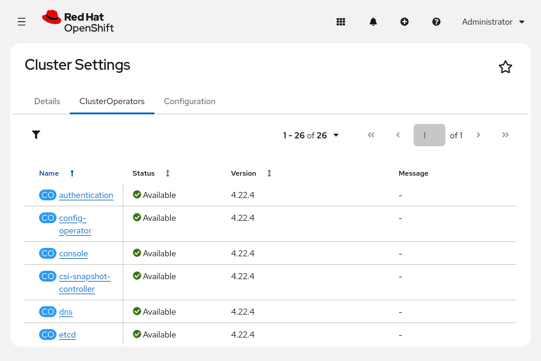
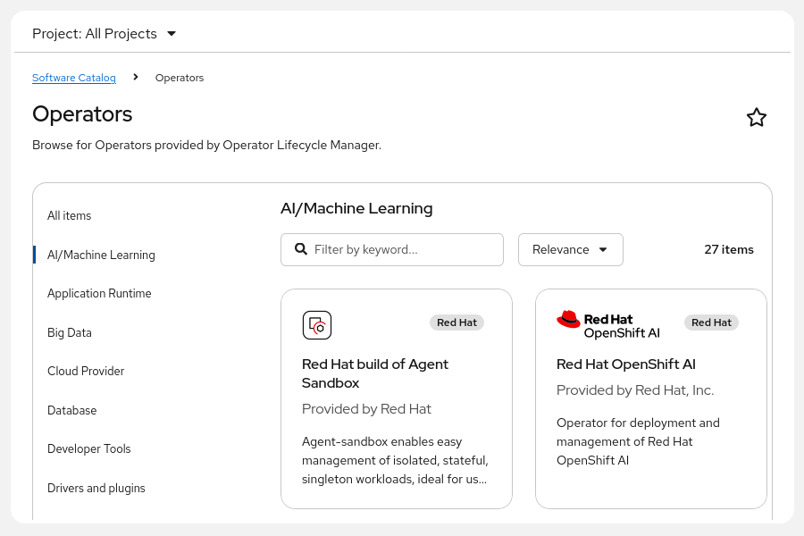
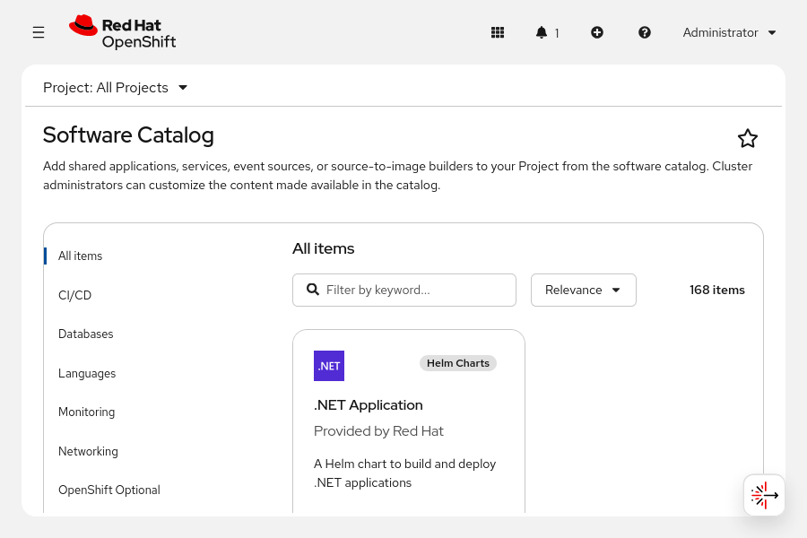
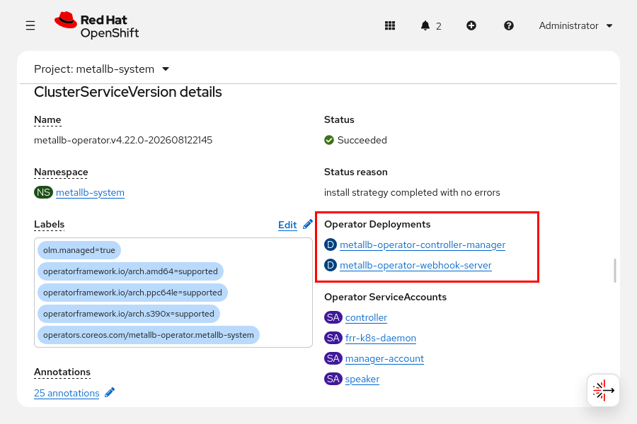

Quản trị Red Hat OpenShift II: Cấu hình Cụm Môi trường Sản xuất
---------------------------------------------------------------

# Chương 7. Quản lý Kubernetes Operator
## Kubernetes Operator và Trình quản lý Operator Lifecycle (OLM)
### Mẫu Operator
Bạn có thể triển khai các workload (khối lượng công việc) lên Kubernetes bằng cách sử dụng các tài nguyên như Deployment, ReplicaSet, StatefulSet, DaemonSet, Job và CronJob. Tất cả các tài nguyên này đều tạo ra một workload để chạy phần mềm được đóng gói dưới dạng container image theo những phương thức vận hành khác nhau. Ví dụ: Job thực thi một tác vụ chỉ chạy một lần; CronJob thực thi các tác vụ theo định kỳ; còn các tài nguyên khác tạo ra các workload có tính chất duy trì liên tục (persistent). Các tài nguyên như Deployment, StatefulSet hay DaemonSet khác nhau ở cách thức phân bổ workload trong cụm (cluster).

Các tài nguyên này là đủ để triển khai nhiều loại workload. Tuy nhiên, những workload phức tạp hơn có thể đòi hỏi nhiều công sức nếu chỉ sử dụng các tài nguyên cơ bản này. Ví dụ, một workload có thể bao gồm nhiều thành phần workload khác nhau, chẳng hạn như máy chủ cơ sở dữ liệu, dịch vụ back-end và dịch vụ front-end (như giao diện web của ứng dụng).

Một workload có thể bao gồm các tác vụ bảo trì có khả năng tự động hóa, chẳng hạn như sao lưu dữ liệu hoặc cập nhật các thành phần của ứng dụng.

Mô hình Operator là một phương pháp triển khai phần mềm có thể tái sử dụng để quản lý các workload phức tạp như vậy. Bằng cách sử dụng Operator, quản trị viên cụm sẽ tạo ra các tài nguyên tùy chỉnh (Custom Resource - CR) mô tả một workload phức tạp, và Operator sẽ chịu trách nhiệm tạo cũng như quản lý các tài nguyên cần thiết cho workload đó.

Một Operator thường định nghĩa các CR chứa thông tin cần thiết để triển khai và quản lý workload. Ví dụ, một Operator chuyên triển khai máy chủ cơ sở dữ liệu sẽ định nghĩa một tài nguyên cơ sở dữ liệu, nơi bạn có thể chỉ định tên cơ sở dữ liệu, các yêu cầu về quy mô (sizing) và những tham số khác.

Operator sẽ theo dõi cụm để phát hiện các instance (thể hiện) của CR, sau đó tạo ra các tài nguyên Kubernetes để triển khai workload tùy chỉnh đó. Ví dụ, khi bạn tạo một tài nguyên cơ sở dữ liệu, Operator cơ sở dữ liệu sẽ tạo ra một StatefulSet và một Persistent Volume để cung cấp cơ sở dữ liệu đúng như mô tả trong tài nguyên đó. Nếu tài nguyên cơ sở dữ liệu có mô tả lịch trình và đích đến cho việc sao lưu, Operator sẽ tạo một CronJob để thực hiện sao lưu cơ sở dữ liệu vào đích đã định theo lịch trình đó.

### Triển khai Operator
Nhiều phần mềm áp dụng mô hình Operator theo những cách khác nhau.

* **Cluster operator:** Cluster operator cung cấp các dịch vụ nền tảng của OpenShift, chẳng hạn như giao diện điều khiển web (web console) và máy chủ OAuth.
* **Add-on operator:** OpenShift bao gồm thành phần Operator Lifecycle Manager (OLM). OLM hỗ trợ người dùng cài đặt và cập nhật các operator bổ sung nhằm thêm tính năng cho cụm (cluster). Các operator do OLM quản lý còn được gọi là add-on operator, để phân biệt với cluster operator vốn đảm nhiệm các dịch vụ nền tảng.
* **Các operator khác:** Các nhà cung cấp phần mềm có thể tạo ra phần mềm tuân theo mô hình Operator, sau đó phân phối phần mềm đó dưới dạng các tệp manifest, Helm chart hoặc các cơ chế phân phối phần mềm khác.

#### Các Cluster Operator
Cluster Version Operator (CVO) thực hiện cài đặt và cập nhật các cluster operator như một phần của quy trình cài đặt và cập nhật OpenShift.

CVO cung cấp thông tin trạng thái của các cluster operator dưới dạng các tài nguyên thuộc loại ClusterOperator. Hãy kiểm tra các tài nguyên cluster operator này để đánh giá tình trạng hoạt động của cụm.

```console
[user@host ~]$ oc get clusteroperator
NAME                      VERSION  AVAILABLE  PROGRESSING  DEGRADED  ...  MESSAGE
authentication            4.22.4   True       False        False     ...
baremetal                 4.22.4   True       False        False     ...
cloud-controller-manager  4.22.4   True       False        False     ...
...output omitted...
```

Trạng thái của các tài nguyên cluster operator bao gồm các điều kiện (condition) giúp xác định các vấn đề của cụm. Lệnh `oc` hiển thị thông báo gắn liền với điều kiện mới nhất; thông báo này có thể cung cấp thêm thông tin về các vấn đề của cụm.

Để xem các tài nguyên cluster operator trong bảng điều khiển web, hãy truy cập **Administration** → **Cluster Settings**, sau đó nhấp vào thẻ **ClusterOperators**.

**Hình 7.1: Trạng thái và phiên bản của các operator cụm**  


#### Quản lý các Operator bổ sung (Add-on Operator)
Quản trị viên có thể sử dụng OLM để cài đặt, cập nhật và gỡ bỏ các Operator.

Bạn có thể sử dụng giao diện web (web console) để tương tác với OLM tại trang Ecosystem → Software Catalog. Do OLM cũng tuân theo mô hình Operator, nó cung cấp các CR (Custom Resource) để quản lý các Operator thông qua Kubernetes API.

**Hình 7.2: Các operator bổ sung có sẵn để cài đặt từ danh mục phần mềm**  


OLM sử dụng các danh mục Operator (operator catalog) để tìm kiếm các Operator có sẵn để cài đặt. Các danh mục Operator là các image container cung cấp thông tin về những Operator hiện có, chẳng hạn như phần mô tả và các phiên bản khả dụng.

OpenShift bao gồm một số danh mục mặc định:

* **Red Hat:** Red Hat đóng gói, phát hành và hỗ trợ các Operator trong danh mục này.
* **Certified (Được chứng nhận):** Các nhà cung cấp phần mềm độc lập và đối tác của Red Hat hỗ trợ các Operator trong danh mục này.
* **Community (Cộng đồng):** Các cộng đồng mã nguồn mở phát triển và hỗ trợ các Operator trong danh mục này.

> **Lưu ý:** Môi trường thực hành bao gồm một catalog duy nhất chứa các operator mà bạn sử dụng trong khóa học. Môi trường này lưu trữ nội dung của catalog đó, cho phép hoàn thành khóa học mà không cần kết nối Internet.

Bạn cũng có thể tự tạo catalog hoặc sao chép (mirror) các catalog cho các cụm (cluster) hoạt động ngoại tuyến. Bằng cách chọn lọc kỹ lưỡng các catalog operator và chỉ tải image từ các registry riêng tư, đáng tin cậy, các tổ chức có thể bảo mật chuỗi cung ứng phần mềm của mình. Phương pháp này là bước quan trọng để đạt được chủ quyền kỹ thuật số và ngăn chặn việc thực thi các phần mềm độc hại hoặc chưa được kiểm chứng. Ngoài ra, tài nguyên ClusterImagePolicy có thể xác thực từng lớp của container image, giúp tăng cường hơn nữa tính toàn vẹn của chuỗi cung ứng đối với các tổ chức có yêu cầu về tuân thủ hoặc chủ quyền kỹ thuật số.

Để biết thêm thông tin về việc quản lý catalog operator, hãy tham khảo phần tài liệu tham khảo.

OLM tạo ra một tài nguyên thuộc loại PackageManifest cho mỗi operator khả dụng. Giao diện web (web console) cũng hiển thị các operator khả dụng và cung cấp trình hướng dẫn để cài đặt chúng. Bạn cũng có thể cài đặt operator bằng cách sử dụng Subscription CR và các CR khác.

Các operator được cài đặt thông qua OLM có vòng đời khác so với các cluster operator. CVO thực hiện cài đặt và cập nhật cluster operator đồng bộ với phiên bản của cụm. Các quản trị viên sử dụng OLM để cài đặt, cập nhật và gỡ bỏ operator một cách độc lập với quá trình cập nhật cụm.

Một số operator có thể yêu cầu các bước bổ sung để thực hiện việc cài đặt, cập nhật hoặc gỡ bỏ.

### Triển khai Operator
Một Operator bao gồm tập hợp các định nghĩa tài nguyên tùy chỉnh (CRD) và một workload Kubernetes. Workload của Operator sử dụng Kubernetes API để theo dõi các instance của CR và tạo ra các workload tương ứng.

> **Lưu ý:** Một cụm bao gồm hai tập hợp khối lượng công việc cho mỗi operator:
> 
> * Khối lượng công việc của operator (do OLM quản lý)
> * Các khối lượng công việc liên quan đến tài nguyên tùy chỉnh (do operator quản lý)

Bạn có thể triển khai các operator để tự động hóa những tác vụ Kubernetes thủ công phù hợp với mô hình operator. Bạn có thể sử dụng hầu hết các nền tảng phát triển phần mềm để tạo operator. Các bộ SDK sau đây cung cấp các thành phần và framework hỗ trợ quá trình phát triển operator:

* **Operator SDK:**: Operator SDK bao gồm các công cụ để phát triển operator bằng ngôn ngữ lập trình Go và Ansible. Operator SDK cũng cung cấp các công cụ để đóng gói Helm chart thành các operator.
* **Java Operator SDK:**: Java Operator SDK bao gồm các công cụ để phát triển operator bằng ngôn ngữ lập trình Java. Java Operator SDK có một phần mở rộng Quarkus để phát triển operator bằng framework Quarkus.

## Cài đặt Operator bằng Web Console
### Cài đặt Operator bằng Web Console
Operator Lifecycle Manager (OLM) là một thành phần của OpenShift giúp quản lý toàn bộ vòng đời của các Operator trong cụm (cluster). Web console của Red Hat OpenShift cung cấp giao diện đồ họa để tương tác với OLM. Tại trang Ecosystem → Software Catalog, bạn có thể xem các Operator hiện có và sử dụng giao diện được cung cấp để thực hiện cài đặt. Trang Ecosystem → Installed Operators liệt kê các Operator đã được cài đặt trong cụm; bạn có thể kiểm tra và gỡ cài đặt các Operator này ngay tại trang đó.

### Trình hướng dẫn (Wizard) Cài đặt Operator
Từ trang Ecosystem → Software Catalog, bạn có thể xem danh sách các Operator hiện có và sử dụng bộ lọc để tìm kiếm Operator dựa trên nhiều tiêu chí khác nhau.

**Hình 7.3: Các Operator khả dụng**  


Nhấp vào một operator để hiển thị thông tin chi tiết.

> **Quan trọng:** Trước khi cài đặt một operator, hãy xem xét thông tin về operator đó và tham khảo tài liệu đi kèm.

Nhấn **Install** (Cài đặt) để bắt đầu trình hướng dẫn cài đặt operator. Hãy chọn các tùy chọn cài đặt operator trong trình hướng dẫn, sau đó nhấn **Install** để bắt đầu cài đặt operator cho cụm (cluster). Nhiều quy trình cài đặt operator sử dụng các thuật ngữ sau:

**Kênh cập nhật (Update channel):** Kênh cập nhật operator xác định một luồng phiên bản cụ thể (ví dụ: *stable* - ổn định hoặc *fast* - nhanh) mà đăng ký (subscription) operator sẽ theo dõi để nhận các bản nâng cấp. Hãy chọn kênh cập nhật operator phù hợp nhất.

**Chế độ cài đặt (Installation mode):** Chế độ cài đặt mặc định là **All namespaces on the cluster** (Tất cả các namespace trên cụm) phù hợp với hầu hết các operator. Chế độ này cấu hình operator để giám sát tất cả các namespace nhằm phát hiện các tài nguyên tùy chỉnh (custom resources). 

Ví dụ: một operator triển khai máy chủ cơ sở dữ liệu sẽ định nghĩa một tài nguyên tùy chỉnh mô tả máy chủ cơ sở dữ liệu đó. Khi sử dụng chế độ **All namespaces on the cluster**, người dùng có thể tạo các tài nguyên tùy chỉnh này trong namespace của họ. Sau đó, operator sẽ triển khai các máy chủ cơ sở dữ liệu ngay trong các namespace đó, cùng với các khối lượng công việc (workload) khác của người dùng. 

Quản trị viên cụm có thể kết hợp chế độ này với các tính năng tự phục vụ (self-service) và các tính năng dựa trên namespace khác—chẳng hạn như kiểm soát truy cập dựa trên vai trò (RBAC) và chính sách mạng (network policies)—để quản lý cách người dùng tương tác với các operator.

**Namespace cài đặt (Installed namespace):** Một số operator được cài đặt mặc định vào namespace `openshift-operators`.

**Phê duyệt cập nhật (Update approval):** OLM sẽ tự động cập nhật các operator khi có phiên bản mới. Hãy chọn cập nhật thủ công (manual) nếu muốn ngăn chặn việc tự động cập nhật.

Đối với một số operator, trình hướng dẫn có tùy chọn cho phép bật tính năng giám sát (monitoring). Việc thêm tính năng giám sát cho các operator không phải của Red Hat sẽ không được hỗ trợ.

Các tùy chọn về chế độ cài đặt và namespace cài đặt có mối liên hệ trực tiếp với nhau. Hãy tham khảo tài liệu về operator để biết các tùy chọn được hỗ trợ và các chi tiết liên quan.

Sau khi bạn cấu hình và bắt đầu quá trình cài đặt, giao diện web (web console) sẽ tạo các tài nguyên `Subscription` và `OperatorGroup` dựa trên những tùy chọn đã chọn trong trình hướng dẫn. Trong quá trình cài đặt, giao diện web sẽ hiển thị thông tin về tiến độ thực hiện.

### Xem các Operator đã cài đặt
Sau khi OLM hoàn tất quá trình cài đặt, bạn có thể truy cập **Ecosystem** → **Installed Operators** để xem thông tin về Operator đã cài đặt cũng như các dịch vụ cụm (cluster service) tương ứng trên trang chi tiết của Operator đó.

Mỗi phiên bản của một Operator đều có một phiên bản dịch vụ cụm (CSV). OLM sử dụng thông tin từ CSV để cài đặt Operator và cập nhật thông tin cài đặt vào trường trạng thái của CSV. Do các CSV hoạt động theo phạm vi namespace, trang **Installed Operators** cũng có bộ lọc namespace tương tự như các trang khác trên giao diện web console. Đối với các Operator giám sát nhiều namespace, sẽ có một CSV tương ứng trong mỗi namespace; bạn có thể sử dụng bộ lọc để xem danh sách các namespace mà Operator đó quản lý.

> **Lưu ý:** Chế độ cài đặt Operator xác định các namespace mà Operator sẽ giám sát để phát hiện các tài nguyên tùy chỉnh (custom resources). Chế độ này là một tùy chọn riêng biệt so với tùy chọn namespace cài đặt (installed namespace) – vốn xác định namespace nơi khối lượng công việc của Operator được triển khai.

Trang **Installed Operators** (Các Operator đã cài đặt) hiển thị thông tin như trạng thái của operator và các bản cập nhật khả dụng. Hãy nhấp vào một operator để chuyển đến trang chi tiết của operator đó. Trang chi tiết operator chứa tất cả thông tin liên quan đến operator đã chọn, bao gồm các thẻ (tab) chuyên biệt để quản lý các tính năng của operator. Trang chi tiết operator bao gồm các thẻ sau:

**Details (Chi tiết):** Hiển thị thông tin về CSV.

**YAML:** Hiển thị CSV ở định dạng YAML.

**Subscription (Đăng ký):** Tại thẻ này, bạn có thể thay đổi các tùy chọn cài đặt, chẳng hạn như kênh cập nhật và cơ chế phê duyệt cập nhật. Thẻ này cũng cung cấp liên kết đến các kế hoạch cài đặt (install plans) của operator. Khi cấu hình operator để cập nhật thủ công, bạn có thể phê duyệt các kế hoạch cài đặt cho các bản cập nhật tại thẻ này.

**Events (Sự kiện):** Liệt kê các sự kiện liên quan đến operator.

Trang chi tiết operator cũng có các thẻ dành cho tài nguyên tùy chỉnh (custom resources). Đối với mỗi tài nguyên tùy chỉnh mà operator định nghĩa, sẽ có một thẻ trên giao diện web console liệt kê tất cả các tài nguyên thuộc loại đó.

**All instances (Tất cả các instance):** Thẻ **All instances** tổng hợp tất cả các tài nguyên thuộc các loại mà operator định nghĩa.

### Sử dụng Operator

Các tài nguyên tùy chỉnh (custom resource) là cơ chế chính để tương tác với các Operator. Bạn có thể tạo tài nguyên tùy chỉnh bằng cách sử dụng các thẻ tài nguyên tùy chỉnh trên trang **Installed Operators** (Các Operator đã cài đặt). Hãy chọn thẻ tương ứng với loại tài nguyên tùy chỉnh cần tạo, sau đó nhấp vào **Create** (Tạo). Tùy thuộc vào Operator được chọn, các loại tài nguyên tùy chỉnh mà Operator đó quản lý sẽ tương ứng với các tính năng của Operator đó và có thể khác nhau giữa các Operator.

Hãy chọn chế độ xem YAML hoặc chế độ xem biểu mẫu (form view) để cấu hình tài nguyên mới. Ở chế độ xem YAML, bạn sử dụng trình soạn thảo YAML để tạo tài nguyên tùy chỉnh; trình soạn thảo này cung cấp một mẫu cơ sở để bạn tùy chỉnh. Chế độ xem YAML cũng hiển thị tài liệu về lược đồ (schema) của tài nguyên tùy chỉnh. Lệnh `oc explain` cũng cung cấp thông tin tài liệu về lược đồ tương tự như vậy.

Chế độ xem biểu mẫu hiển thị các trường (field) của tài nguyên. Thay vì phải soạn thảo toàn bộ định nghĩa YAML, bạn có thể chỉnh sửa từng trường riêng lẻ. Khi hoàn tất, OpenShift sẽ tạo tài nguyên dựa trên các giá trị đã nhập trong biểu mẫu. Các trường này cung cấp thông tin hỗ trợ và hướng dẫn cấu hình hữu ích; chẳng hạn như cung cấp danh sách thả xuống để chọn khi một trường chỉ chấp nhận một tập hợp giá trị giới hạn. Mặc dù chế độ xem biểu mẫu có cung cấp hướng dẫn, nhưng nó có thể không bao gồm các trường để tùy chỉnh mọi tùy chọn có thể có của một tài nguyên tùy chỉnh.

### Khắc phục sự cố Operator

OLM có thể gặp lỗi khi cài đặt hoặc cập nhật Operator, hoặc Operator có thể không hoạt động đúng cách. Để xác định các vấn đề về cài đặt Operator, hãy kiểm tra trạng thái và các điều kiện của các tài nguyên CSV, subscription (đăng ký) và install plan (kế hoạch cài đặt).

> **Lưu ý:** Do các vấn đề cài đặt mang tính đặc thù tùy theo từng Operator, hãy tham khảo tài liệu của các Operator đang gặp sự cố để biết các tùy chọn hỗ trợ.

Để khắc phục các vấn đề khiến Operator hoạt động không chính xác, hãy xác định workload (khối lượng công việc) của Operator đó. Operator tạo ra các workload bổ sung, bao gồm cả những workload tuân theo các định nghĩa được cung cấp trong các tài nguyên tùy chỉnh (custom resource). Để khắc phục sự cố sâu hơn, bạn có thể cần xác định workload đang gây ra lỗi. Để xem các workload đã được triển khai cho Operator, hãy xem danh sách triển khai (deployments) của Operator ở cuối trang chi tiết về Operator đó.

**Hình 7.4: Triển khai của Operator**  


Xác định và khắc phục sự cố đối với workload của operator theo cách tương tự như bất kỳ workload Kubernetes nào khác. Các tài nguyên sau đây đóng vai trò là điểm khởi đầu khi thực hiện khắc phục sự cố:

* Trạng thái của các tài nguyên workload Kubernetes, chẳng hạn như Deployment hoặc StatefulSet
* Log và trạng thái của Pod
* Các sự kiện (Event)

## Cài đặt Operator bằng CLI
### Cài đặt Operator
Để cài đặt một Operator, bạn cần thực hiện các bước sau:

* Xác định Operator cần cài đặt. 
* Xem xét Operator và tài liệu đi kèm để nắm được các tùy chọn cũng như yêu cầu cài đặt. 
    * Quyết định kênh cập nhật sẽ sử dụng. 
    * Quyết định chế độ cài đặt. Đối với hầu hết các Operator, bạn nên thiết lập để chúng khả dụng cho tất cả các namespace. 
    * Quyết định triển khai khối lượng công việc (workload) của Operator vào một namespace mới hoặc namespace hiện có. 
    * Quyết định xem Operator Lifecycle Manager (OLM) sẽ tự động áp dụng các bản cập nhật hay việc cập nhật cần có sự phê duyệt thủ công từ quản trị viên. 
* Tạo Operator Group nếu chế độ cài đặt yêu cầu. 
* Tạo namespace cho khối lượng công việc của Operator nếu cần thiết. 
* Tạo Subscription cho Operator. 
* Kiểm tra và xác thực việc cài đặt Operator.

### Các tài nguyên Operator
OLM sử dụng các loại tài nguyên sau:

* **Catalog source (Nguồn danh mục):** Mỗi tài nguyên catalog source tham chiếu đến một kho lưu trữ operator. Định kỳ, OLM kiểm tra các catalog source trong cụm và truy xuất thông tin về các operator trong từng nguồn.
* **Package manifest (Bản kê khai gói):** OLM tạo một package manifest cho mỗi operator khả dụng. Package manifest chứa thông tin cần thiết để cài đặt operator, chẳng hạn như các kênh (channel) khả dụng.
* **Operator group (Nhóm operator):** Operator group xác định cách OLM hiển thị các operator trên các namespace.
* **Subscription (Đăng ký):** Quản trị viên cụm tạo các subscription để cài đặt operator.
* **Operator:** OLM tạo các tài nguyên operator để lưu trữ thông tin về các operator đã được cài đặt.
* **Install plan (Kế hoạch cài đặt):** OLM tạo các tài nguyên install plan như một phần của quy trình cài đặt và cập nhật. Khi cần phê duyệt, quản trị viên phải phê duyệt các install plan này.
* **Cluster service version (CSV):** Mỗi phiên bản của một operator đều có một CSV tương ứng. CSV chứa thông tin mà OLM cần để cài đặt operator đó.

> **Lưu ý:** Khi cài đặt một operator, quản trị viên chỉ cần tạo subscription và operator group. OLM sẽ tự động tạo tất cả các tài nguyên còn lại trong quá trình cài đặt.

### Kiểm tra các Operator hiện có
Kiểm tra các nguồn catalog trong namespace `openshift-marketplace` để xác định những nguồn nào khả dụng trong cụm.

```console
[user@host ~]$ oc get catalogsource -n openshift-marketplace
NAME                 DISPLAY                     TYPE  ...  AGE
gls-catalog-cs       GLS Operator Catalog Cs     grpc  ...  15d
```

OLM tạo một bản kê khai gói (package manifest) cho mỗi operator khả dụng mà catalog source tham chiếu đến. Hãy liệt kê các bản kê khai gói để biết những operator nào có sẵn để cài đặt.

```console
[user@host ~]$ oc get packagemanifests
NAME                      CATALOG                     AGE
lvms-operator             GLS Operator Catalog Cs     15d
lightspeed-operator       GLS Operator Catalog Cs     15d
metallb-operator          GLS Operator Catalog Cs     15d
file-integrity-operator   GLS Operator Catalog Cs     15d
kubevirt-hyperconverged   GLS Operator Catalog Cs     15d
compliance-operator       GLS Operator Catalog Cs     15d
```

Để thu thập thông tin cần thiết cho việc cài đặt một Operator, hãy xem chi tiết của một package manifest cụ thể. Hãy sử dụng lệnh `oc describe` trên package manifest để xem thông tin chi tiết về Operator đó.

```console
[user@host ~]$ oc describe packagemanifest lvms-operator -n openshift-marketplace
Name:         lvms-operator
...output omitted...
Spec:
Status:
  Catalog Source:               gls-catalog-cs (1)
  Catalog Source Display Name:  GLS Operator Catalog Cs
  Catalog Source Namespace:     openshift-marketplace (2)
  Catalog Source Publisher:
  Channels:
    Current Csv:  lvms-operator.v4.22.0 (3)
    Current Csv Desc:
      Annotations:
        ...output omitted...
        Capabilities:                              Seamless Upgrades
        Categories:                                Storage
        Container Image:                           registry.redhat.io/lvms4/lvms-rhel9-operator@sha256:...45de
        Description:                               Logical volume manager storage provides dynamically provisioned local storage for container workloads
        ...output omitted...
        operatorframework.io/suggested-namespace:         openshift-lvm-storage
        ...output omitted...
        operators.openshift.io/valid-subscription:        ["OpenShift Kubernetes Engine", "OpenShift Container Platform", "OpenShift Platform Plus"]
        operators.operatorframework.io/builder:           operator-sdk-v1.38.0-ocp
        ...output omitted...
      Apiservicedefinitions:
      Customresourcedefinitions:
        Owned:
          Kind:          LogicalVolume
          Name:          logicalvolumes.topolvm.io
          Version:       v1
          Description:   LVMCluster is the Schema for the lvmclusters API
          Display Name:  LVMCluster
          Kind:          LVMCluster
          Name:          lvmclusters.lvm.topolvm.io
          Version:       v1alpha1
          Kind:          LVMVolumeGroupNodeStatus
          Name:          lvmvolumegroupnodestatuses.lvm.topolvm.io
          Version:       v1alpha1
          Kind:          LVMVolumeGroup
          Name:          lvmvolumegroups.lvm.topolvm.io
          Version:       v1alpha1
      Description:       Logical volume manager storage provides dynamically provisioned local storage. (4)
      Display Name:  LVM Storage
      Install Modes: (5)
        Supported:  true
        Type:       OwnNamespace
        Supported:  true
        Type:       SingleNamespace
        Supported:  false
        Type:       MultiNamespace
        Supported:  false
        Type:       AllNamespaces
      ...output omitted...
      Links: (6)
        Name:  Source Repository
        URL:   https://github.com/openshift/lvm-operator
      ...output omitted...
      Maturity:  alpha
      Provider:
        Name:  Red Hat
      ...output omitted...
      Version:      4.22.0
    Entries:
      Name:             lvms-operator.v4.22.0
      Version:          4.22.0
    Name:           stable-4.22  (7)
  Default Channel:  stable-4.22
  Package Name:     lvms-operator
  Provider:
    Name:  Red Hat
Events:    <none>
```

1. Danh mục nguồn của operator; các thông tin này là bắt buộc để xác định operator khi bạn tạo subscription.
2. Danh mục namespace nguồn của operator; các thông tin này là bắt buộc để xác định operator khi bạn tạo subscription.
3. Phiên bản CSV hiện tại của operator.
4. Phần mô tả và các liên kết cung cấp thông tin hữu ích cũng như tài liệu hướng dẫn quy trình cài đặt và gỡ cài đặt.
5. Các chế độ cài đặt (install modes) cung cấp thông tin về những chế độ hoạt động namespace được hỗ trợ.
6. Phần mô tả và các liên kết cung cấp thông tin hữu ích cũng như tài liệu hướng dẫn quy trình cài đặt và gỡ cài đặt.
7. Xem xét các kênh (channel) và CSV hiện có để quyết định lộ trình nâng cấp phù hợp.

> **Lưu ý:** Đối với các yêu cầu về chủ quyền kỹ thuật số, một bước quan trọng là đánh giá nguồn gốc của các operator trong danh mục của bạn để xác minh rằng các image được tải về từ những registry riêng tư đáng tin cậy.

### Cài đặt Operator
Sau khi kiểm tra tệp manifest của gói, hãy xem lại tài liệu hướng dẫn về Operator. Các Operator có thể yêu cầu quy trình cài đặt cụ thể.

Nếu bạn quyết định triển khai khối lượng công việc (workload) của Operator vào một namespace mới, hãy tạo namespace đó. Nhiều Operator chỉ định một namespace được khuyến nghị—chẳng hạn như namespace `openshift-operators` có sẵn—hoặc yêu cầu các namespace cụ thể.

Hãy xác định xem bạn có cần tạo một Operator Group hay không. Các Operator sử dụng Operator Group trong namespace của chúng và giám sát các tài nguyên tùy chỉnh (custom resource) trong những namespace mà Operator Group đó nhắm đến.

Namespace `openshift-operators` chứa một Operator Group có tên là `global-operators`. Các Operator được cài đặt trong namespace `openshift-operators` sẽ sử dụng Operator Group này và giám sát tất cả các namespace.

Nếu Operator Group `global-operators` không phù hợp, hãy tạo một Operator Group khác. Định nghĩa YAML dưới đây mô tả cấu trúc của một Operator Group:

```yaml
apiVersion: operators.coreos.com/v1
kind: OperatorGroup
metadata:
  name: name
  namespace: namespace (1)
spec:
  targetNamespaces: (2)
  - namespace
```

1. Các Operator tuân theo nhóm operator trong namespace mà chúng được triển khai.
2. Liệt kê các namespace mà operator giám sát để tìm các custom resource. Bạn cũng có thể sử dụng trường `spec.selector` để chọn namespace thông qua các nhãn (label).

Sau khi tạo các namespace hoặc nhóm operator cần thiết, bước tiếp theo là tạo một subscription. Tệp YAML dưới đây là ví dụ về định nghĩa subscription:

```yaml
apiVersion: operators.coreos.com/v1alpha1
kind: Subscription
metadata:
  name: lvms-operator
  namespace: openshift-storage (1)
spec:
  channel: stable-4.22 (2)
  name: lvms-operator (3)
  source: gls-catalog-cs (4)
  installPlanApproval: Automatic (5)
  sourceNamespace: openshift-marketplace
```

1. Namespace cho workload của operator
2. Kênh cập nhật (lấy từ thông tin thu được qua lệnh `oc describe packagemanifest`)
3. Package manifest cần đăng ký
4. Catalog nguồn (lấy từ thông tin thu được qua lệnh `oc describe packagemanifest`)
5. Chế độ phê duyệt kế hoạch cài đặt (Install Plan): Tự động (Automatic) hoặc Thủ công (Manual)

#### Kế hoạch cài đặt
OLM tạo ra một tài nguyên kế hoạch cài đặt (install plan) để thể hiện quy trình cần thiết nhằm cài đặt hoặc cập nhật một Operator. OLM cập nhật tài nguyên Operator để tham chiếu đến kế hoạch cài đặt này trong trường `status.components.refs`. Bạn có thể xem thông tin tham chiếu này bằng cách sử dụng lệnh `oc describe` trên tài nguyên Operator.

```console
[user@host ~]$ oc describe operator metallb-operator
Name:         metallb-operator.metallb-system
Namespace:
Labels:       <none>
Annotations:  <none>
API Version:  operators.coreos.com/v1
Kind:         Operator
...output omitted...
Status:
  Components:
    ...output omitted...
    Refs:
      API Version:  operators.coreos.com/v1alpha1
      Kind:         InstallPlan
      Name:         install-pmh78
      Namespace:    metallb-system
      API Version:  operators.coreos.com/v1alpha1
      Conditions:
        Last Transition Time:  2026-07-15T17:33:47Z
        Message:               all available catalogsources are healthy
        Reason:                AllCatalogSourcesHealthy
        Status:                False
        Type:                  CatalogSourcesUnhealthy
        Last Transition Time:  2026-07-15T17:33:47Z
        Reason:                RequiresApproval
        Status:                True
        Type:                  InstallPlanPending
      Kind:                    Subscription
      Name:                    metallb-operator
      Namespace:               metallb-system
Events:                        <none>
```

Nếu chế độ kế hoạch cài đặt (install plan mode) trong subscription được đặt là Manual (Thủ công), bạn phải phê duyệt kế hoạch cài đặt đó theo cách thủ công. Để phê duyệt kế hoạch cài đặt, hãy chuyển giá trị của trường `spec.approved` thành `true`. Ví dụ: bạn có thể sử dụng lệnh `oc patch` để phê duyệt kế hoạch cài đặt:

```console
[user@host ~]$ oc patch installplan install-pmh78 --type merge -p \
'{"spec":{"approved":true}}' -n metallb-system
installplan.operators.coreos.com/install-pmh78 patched
```

Với chế độ Automatic install plan, OLM sẽ áp dụng các bản cập nhật ngay khi chúng có sẵn.

#### Quản lý các bản cập nhật
Trường `spec.installPlanApproval` trong tài nguyên Subscription quy định cách OLM xử lý các bản cập nhật Operator.

Với chế độ phê duyệt tự động (Automatic approval), OLM sẽ áp dụng các bản cập nhật ngay khi chúng có sẵn trên kênh đã đăng ký.

Với chế độ phê duyệt thủ công (Manual approval), khi có phiên bản Operator mới, OLM sẽ tạo một tài nguyên InstallPlan nhưng không phê duyệt nó. Quản trị viên cần xem xét và phê duyệt thủ công bản cập nhật này. Bạn có thể liệt kê các tài nguyên InstallPlan trong namespace của Operator để tìm các bản cập nhật đang chờ xử lý. Một bản cập nhật đang chờ xử lý sẽ có trạng thái `APPROVED` là `false`.

```console
[user@host ~]$ oc get installplan -n metallb-system
NAME            CSV                                     APPROVAL   APPROVED
install-qrlwl   metallb-operator.v4.22.0-202608122145   Manual     false
```

Để phê duyệt bản cập nhật đang chờ xử lý, hãy sử dụng lệnh `oc patch` để đặt trường `spec.approved` thành `true` trên kế hoạch cài đặt (install plan) mới.

```console
[user@host ~]$ oc patch installplan install-qrlwl --type merge -p \
'{"spec":{"approved":true}}' -n metallb-system
installplan.operators.coreos.com/install-qrlwl patched
```

#### Thay đổi kênh cập nhật
Bạn có thể thay đổi kênh cập nhật cho một operator bằng cách cập nhật (patch) tài nguyên Subscription của nó. Trước tiên, hãy sử dụng lệnh `oc describe packagemanifest` để xác định các kênh khả dụng.

Sau khi xác định được kênh đích, hãy sử dụng lệnh `oc patch` để cập nhật trường `spec.channel` trong tài nguyên Subscription.

```console
[user@host ~]$ oc patch subscription metallb-operator \
-n metallb-system --type merge \
-p '{"spec":{"channel":"<new-channel-name>"}}'
subscription.operators.coreos.com/metallb-operator patched
```

Nếu chế độ phê duyệt đăng ký là `Automatic`, thay đổi này có thể tự động kích hoạt cập nhật Operator. Nếu chế độ là Thủ công, một kế hoạch cài đặt mới có thể được tạo ra và yêu cầu phê duyệt thủ công.

### Sử dụng Operator

Thông thường, các Operator sẽ tạo ra các định nghĩa tài nguyên tùy chỉnh (Custom Resource Definitions - CRD). Bạn tạo các instance (thể hiện) của những tài nguyên tùy chỉnh đó để sử dụng Operator. Hãy tham khảo tài liệu của Operator để biết cách sử dụng nó.

Ngoài ra, bạn có thể tìm hiểu về các định nghĩa tài nguyên tùy chỉnh hiện có bằng cách xem xét Operator đó. Tệp CSV chứa danh sách các định nghĩa tài nguyên tùy chỉnh trong trường `spec.customresourcedefinitions`. Ví dụ: hãy sử dụng lệnh sau để liệt kê các định nghĩa tài nguyên tùy chỉnh:

```console
[user@host ~]$ oc get csv metallb-operator.v4.22.0-202608122145 \
-o jsonpath="{.spec.customresourcedefinitions.owned[*].name}{'\n'}"
bfdprofiles.metallb.io bgpadvertisements.metallb.io bgppeers.metallb.io bgppeers.metallb.io communities.metallb.io ...
```

Bạn cũng có thể sử dụng lệnh `oc explain` để xem mô tả cho một định nghĩa tài nguyên tùy chỉnh (CRD) cụ thể.

### Khắc phục sự cố cài đặt Operator

Bạn có thể kiểm tra trạng thái của Operator, kế hoạch cài đặt (install plan) và các tài nguyên CSV để phát hiện bất kỳ dấu hiệu bất thường nào trong quá trình cài đặt. Khi cài đặt hoặc cập nhật các Operator, OLM sẽ cập nhật thông tin tiến trình cho các tài nguyên này.

Ngay cả khi OLM cài đặt Operator thành công, Operator đó vẫn có thể không hoạt động đúng cách.

Các Operator thường bao gồm hai loại khối lượng công việc (workload):

* Khối lượng công việc của chính Operator, có nhiệm vụ giám sát các tài nguyên tùy chỉnh (custom resources). 
* Các khối lượng công việc do từng instance (thể hiện) của tài nguyên tùy chỉnh tạo ra.

Trường `spec.install.spec.deployments` trong CSV chứa các deployment mà OLM tạo ra khi cài đặt Operator. Các deployment này thường tương ứng với khối lượng công việc của Operator. Tuy nhiên, Operator cũng có thể tạo thêm các deployment khác, phục vụ cho chính khối lượng công việc của nó hoặc cho các khối lượng công việc liên quan đến tài nguyên tùy chỉnh.
