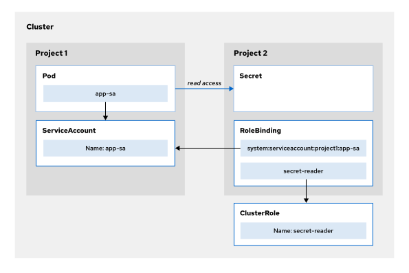

Quản trị Red Hat OpenShift II: Cấu hình Cụm Môi trường Sản xuất
---------------------------------------------------------------

# Chương 8. Bảo mật ứng dụng
## Kiểm soát quyền ứng dụng bằng các Ràng buộc Ngữ cảnh Bảo mật (Security Context Constraints - SCC)
### Các Ràng buộc Ngữ cảnh Bảo mật (SCC)
Red Hat OpenShift cung cấp các ràng buộc ngữ cảnh bảo mật, một cơ chế bảo mật giúp giới hạn quyền truy cập từ một pod đang chạy trong OpenShift vào môi trường máy chủ (host). Tương tự như cách các tài nguyên RBAC kiểm soát quyền truy cập của người dùng, quản trị viên có thể sử dụng SCC để kiểm soát các quyền hạn dành cho pod. SCC xác định tập hợp các điều kiện mà một pod phải tuân thủ để được hệ thống chấp nhận. SCC kiểm soát các tài nguyên máy chủ sau đây:

* Chạy các container có đặc quyền (privileged containers)
* Yêu cầu các khả năng (capabilities) bổ sung cho container
* Sử dụng các thư mục trên máy chủ làm volume
* Thay đổi ngữ cảnh SELinux của container
* Thay đổi ID người dùng (user ID)
* Sử dụng các namespace và hệ thống mạng của máy chủ

> **Lưu ý:** Các ràng buộc ngữ cảnh bảo mật (Security Context Constraints) hỗ trợ các sáng kiến về chủ quyền kỹ thuật số bằng cách áp dụng nguyên tắc đặc quyền tối thiểu ở cấp độ máy chủ (host), nhằm đảm bảo rằng các khối lượng công việc (workload) không thể truy cập vào các tài nguyên nhạy cảm của nút (node) và hạn chế phạm vi ảnh hưởng nếu khối lượng công việc đó bị xâm nhập.

Một số container do cộng đồng phát triển có thể yêu cầu nới lỏng các ràng buộc ngữ cảnh bảo mật (SCC) để truy cập các tài nguyên bị hạn chế theo mặc định—chẳng hạn như hệ thống tệp hoặc socket—hoặc để truy cập ngữ cảnh SELinux. Quản trị viên cụm có thể chạy lệnh sau để liệt kê các SCC do OpenShift định nghĩa:

```console
[user@host ~]$ oc get scc
```

OpenShift cung cấp các SCC mặc định sau:

* anyuid
* hostaccess
* hostmount-anyuid
* hostmount-anyuid-v2
* hostnetwork
* hostnetwork-v2
* nested-container
* node-exporter
* nonroot
* nonroot-v2
* privileged
* restricted
* restricted-v2
* restricted-v3

Các SCC bổ sung có thể được cài đặt khi bạn triển khai các Operator hoặc các thành phần khác trên OpenShift. Ví dụ: LVMS Operator sẽ cài đặt SCC lvms-vgmanager.

> **Quan trọng:** Không sửa đổi các SCC mặc định. Việc tùy chỉnh các SCC mặc định có thể gây lỗi triển khai pod trên nền tảng và dẫn đến sự cố trong quá trình nâng cấp OpenShift. Một số quy trình nâng cấp cụm sẽ khôi phục các giá trị SCC về thiết lập ban đầu, làm mất toàn bộ các tùy chỉnh của bạn. Thay vào đó, hãy tạo các SCC riêng nếu cần.

Lệnh sau đây hiển thị thông tin chi tiết về một SCC cụ thể:

```console
[user@host ~]$ oc describe scc anyuid
Name:           anyuid
Priority:         10
Access:
  Users:          <none>
  Groups:         system:cluster-admins
Settings:
...output omitted...
```

Hầu hết các pod do OpenShift tạo ra đều sử dụng SCC `restricted-v2`; SCC này cung cấp quyền truy cập hạn chế vào các tài nguyên nằm bên ngoài OpenShift. Theo mặc định, SCC `restricted-v2` khả dụng cho tất cả người dùng đã xác thực. Lệnh sau đây hiển thị Security Context Constraint (SCC) mà một pod đang sử dụng:

```console
[user@host ~]$ oc describe pod console-fdfd56fb-ggw6s \
-n openshift-console | grep scc
                      openshift.io/required-scc: restricted-v2 (1)
                      openshift.io/scc: restricted-v2 (2)
```

1. SCC mà khối lượng công việc yêu cầu
2. SCC đã được áp dụng cho pod

Các image container được tải xuống từ các registry công khai (như Docker Hub) có thể không chạy được khi sử dụng SCC `restricted-v2`. Ví dụ, một image container yêu cầu chạy với một ID người dùng cụ thể có thể gặp lỗi vì SCC `restricted-v2` thực thi container bằng một ID người dùng ngẫu nhiên. Image container lắng nghe trên cổng 80 hoặc 443 cũng có thể gặp lỗi vì lý do tương tự; ID người dùng ngẫu nhiên mà SCC `restricted-v2` sử dụng không thể khởi động dịch vụ lắng nghe trên cổng mạng đặc quyền (các cổng có số hiệu nhỏ hơn 1024). Lệnh sau đây liệt kê tất cả các ràng buộc ngữ cảnh bảo mật (SCC) có thể khắc phục những hạn chế đang gây trở ngại cho container:

```console
[user@host ~]$ oc get deployment deployment-name -o yaml | \
oc adm policy scc-subject-review -f -
```

SCC `anyuid` xác định chiến lược chạy dưới quyền người dùng là `RunAsAny`; điều này có nghĩa là pod có thể chạy với bất kỳ ID người dùng nào có sẵn trong container. Với chiến lược này, các container yêu cầu một người dùng cụ thể có thể thực thi lệnh bằng cách sử dụng ID người dùng đó. Để chuyển đổi container sang chạy với một SCC khác, bạn cần tạo một service account và gán nó cho deployment. Lệnh sau đây sẽ tạo một service account, trong đó tùy chọn `-n` được sử dụng để tạo service account tại một namespace khác:

```console
[user@host ~]$ oc create serviceaccount service-account-name
```

Để liên kết tài khoản dịch vụ với một SCC, hãy sử dụng lệnh `oc adm policy`. Chỉ quản trị viên cụm mới có thể gán SCC cho tài khoản dịch vụ hoặc xóa SCC khỏi tài khoản dịch vụ. Lệnh sau đây cấp SCC cho một tài khoản dịch vụ bằng cách sử dụng tùy chọn `-z`:

```console
[user@host ~]$ oc adm policy add-scc-to-user SCC -z service-account
```

Hãy sử dụng tùy chọn `-n` nếu tài khoản dịch vụ nằm trong một namespace khác.

> **Quan trọng:** Hãy thận trọng khi cấp cho các pod quyền SCC ít hạn chế hơn, vì hành động này có thể làm giảm tính bảo mật của cụm (cluster) của bạn.

#### Cấp quyền truy cập SCC dựa trên vai trò
Lệnh `oc adm policy add-scc-to-user` gán SCC bằng cách tạo một `cluster role binding` (ràng buộc vai trò cấp cụm) – một loại tài nguyên có phạm vi toàn cụm. Thay vào đó, bạn có thể sử dụng các vai trò (role) và ràng buộc vai trò (role binding) thuộc cơ chế RBAC để giới hạn phạm vi truy cập SCC trong một dự án cụ thể. Lệnh dưới đây tạo ra một vai trò cấp quyền truy cập vào một SCC cụ thể:

```console
[user@host ~]$ oc create role role-name \
--verb use --resource scc \
--resource-name scc-name -n namespace
```

Lệnh sau đây gán vai trò cho một tài khoản dịch vụ bằng cách tạo một liên kết vai trò (role binding):

```console
[user@host ~]$ oc create rolebinding binding-name \
--role role-name \
--serviceaccount namespace:service-account -n namespace
```

#### Cấu hình khối lượng công việc với SCC
Lệnh sau đây thay đổi một deployment hiện có để sử dụng service account:

```console
[user@host ~]$ oc set serviceaccount deployment/deployment-name \
service-account-name
```

Nếu lệnh thực thi thành công, các pod liên kết với deployment đó sẽ được triển khai lại.

Bạn cũng có thể cấu hình để một workload bắt buộc sử dụng một SCC cụ thể bằng cách thiết lập annotation `openshift.io/required-scc` trên deployment. Annotation này hữu ích khi cần cố định một SCC cụ thể cho workload hoặc ngăn chặn việc SCC bắt buộc đó bị thay thế bởi một SCC khác trong cụm. SCC này phải tồn tại trong cụm và bạn cần gán một service account có quyền truy cập SCC đó cho deployment; nếu không, quá trình chấp nhận pod (pod admission) sẽ thất bại.

```yaml
apiVersion: apps/v1
kind: Deployment
spec:
  ...output omitted...
  template:
    metadata:
      annotations:
        openshift.io/required-scc: "my-scc"
    ...output omitted...
```

> **Cảnh báo:** Không được thay đổi trực tiếp chú thích `openshift.io/required-scc` trên một pod đang chạy. Việc thay đổi chú thích này trên pod đang chạy sẽ khiến quá trình chấp nhận pod (pod admission) bị thất bại. Thay vào đó, hãy cập nhật chú thích trong deployment; hành động này sẽ tự động tạo lại pod.

#### Container Đặc quyền (Privileged Containers)
Một số container có thể cần truy cập vào môi trường thực thi của máy chủ (host). SCC loại `anyuid` là cơ chế nới lỏng phổ biến nhất mà các khối lượng công việc (workload) thường yêu cầu, do nhiều image container được thiết kế để chạy dưới quyền của một người dùng cụ thể, chẳng hạn như `root`. Tuy nhiên, một số khối lượng công việc khác—ví dụ như các tác nhân giám sát (monitoring agent) hoặc công cụ thu thập nhật ký (log collector)—có thể cần truy cập vào các đường dẫn trên máy chủ, không gian tên mạng (network namespace) hoặc các tiến trình nằm ngoài phạm vi cô lập của chính container đó. Các khối lượng công việc này thường sử dụng SCC loại `privileged` (đặc quyền); loại này giúp loại bỏ hầu hết các hạn chế mà OpenShift áp dụng đối với các pod.

> **Quan trọng:** Chỉ cấp quyền SCC loại `privileged` khi thực sự cần thiết, vì các pod có đặc quyền này có thể truy cập vào bất kỳ tài nguyên nào trên node.

## Cho phép ứng dụng truy cập các API Kubernetes
### Bảo mật các API Kubernetes
Thông qua việc sử dụng các API Kubernetes, người dùng hoặc ứng dụng có thể truy vấn và thay đổi trạng thái của cụm (cluster). Để bảo vệ cụm khỏi các tương tác độc hại, bạn cần cấp quyền truy cập vào các API Kubernetes khác nhau.

Cơ chế ủy quyền kiểm soát truy cập dựa trên vai trò (RBAC) được cấu hình sẵn trong OpenShift. Một ứng dụng cần có quyền RBAC cụ thể để truy cập các API Kubernetes bị hạn chế.

### Ủy quyền ứng dụng sử dụng Service Account
Service account là một đối tượng Kubernetes nằm trong một dự án (project). Service account đại diện cho danh tính của một ứng dụng đang chạy trong pod.

Để cấp quyền truy cập Kubernetes API cho ứng dụng, hãy thực hiện các bước sau:

* Tạo một service account cho ứng dụng. 
* Cấp quyền truy cập vào Kubernetes API thích hợp cho service account đó. 
* Gán service account cho các pod của ứng dụng.

Nếu định nghĩa pod không chỉ định service account, pod sẽ sử dụng service account mặc định. OpenShift không cấp bất kỳ quyền nào cho service account mặc định. Do các khối lượng công việc nghiệp vụ (business workloads) thường không cần thêm quyền hạn đặc biệt, service account mặc định là đủ dùng cho hầu hết các ứng dụng. Red Hat không khuyến nghị cấp thêm quyền cho service account mặc định, vì việc này sẽ cấp các quyền đó cho tất cả các pod trong dự án—một điều có thể không nằm trong dự định ban đầu.

### Các trường hợp sử dụng quyền truy cập Kubernetes API
Các ứng dụng nghiệp vụ thông thường có thể hoạt động hiệu quả với tài khoản dịch vụ (service account) mặc định mà không cần truy cập vào Kubernetes API. Tuy nhiên, các ứng dụng thuộc nhóm hạ tầng có thể cần quyền truy cập để giám sát hoặc sửa đổi tài nguyên của cụm (cluster). Các ứng dụng hạ tầng này có thể được phân loại theo những trường hợp sử dụng sau:

* **Ứng dụng giám sát:** Các ứng dụng thuộc nhóm này cần quyền đọc để theo dõi tài nguyên cụm hoặc kiểm tra tình trạng sức khỏe của cụm. Ví dụ: một dịch vụ như Red Hat Advanced Cluster Security cần quyền đọc để quét các container trong cụm nhằm phát hiện lỗ hổng bảo mật.
* **Bộ điều khiển (Controllers):** Bộ điều khiển là các ứng dụng liên tục theo dõi và cố gắng đưa tài nguyên về trạng thái mong muốn. Ví dụ: các công cụ GitOps như Argo CD có các bộ điều khiển giám sát tài nguyên cụm được lưu trữ trong kho mã nguồn (repository), và chúng sẽ cập nhật cụm để phản hồi lại các thay đổi trong kho mã nguồn đó.
* **Operator:** Operator giúp tự động hóa việc tạo, cấu hình và quản lý các instance của các ứng dụng thuần Kubernetes (Kubernetes-native). Do đó, Operator cần có quyền thực hiện các tác vụ cấu hình và bảo trì. Ví dụ: một database operator có thể tạo một deployment khi phát hiện một tài nguyên tùy chỉnh (custom resource) định nghĩa một cơ sở dữ liệu mới.

#### Ủy quyền Kubernetes API cho ứng dụng bằng Roles
Để cấp cho ứng dụng các quyền cần thiết, bạn có thể tạo các Role hoặc ClusterRole mô tả các yêu cầu của ứng dụng. Role cấp quyền đối với các tài nguyên Kubernetes API trong phạm vi một namespace duy nhất. ClusterRole cấp quyền trong các namespace cụ thể hoặc trên toàn bộ cluster.

Ví dụ: bạn có thể tạo một ClusterRole cho phép ứng dụng đọc các secret.

```yaml
apiVersion: rbac.authorization.k8s.io/v1
kind: ClusterRole
metadata:
  name: secret-reader
rules:
- apiGroups: [""] # (1)
  resources: ["secrets"] # (2)
  verbs: ["get", "watch", "list"] # (3)
```

1. Các nhóm API, trong đó chuỗi rỗng đại diện cho API cốt lõi
2. Các tài nguyên mà vai trò (role) tham chiếu đến
3. Các động từ hoặc hành động mà vai trò cho phép ứng dụng thực hiện trên tài nguyên

Bạn cũng có thể sử dụng các cluster role mặc định do OpenShift định nghĩa; các vai trò này có phạm vi quyền hạn rộng hơn. Ví dụ: bạn có thể sử dụng cluster role `edit` để có quyền đọc các secret, tương tự như với cluster role `secret-reader` đã đề cập trước đó.

Cluster role `edit` có ít hạn chế hơn và cho phép ứng dụng tạo hoặc cập nhật hầu hết các đối tượng.

#### Gán Role cho Service Account
Để một ứng dụng có thể sử dụng các quyền của Role, bạn cần gán Role hoặc ClusterRole cho Service Account của ứng dụng đó.

Để gán một Role hoặc ClusterRole cho một Service Account trong một namespace, bạn có thể sử dụng lệnh `oc adm policy` kết hợp với lệnh con `add-role-to-user`.

Lệnh sau đây gán một ClusterRole cho một Service Account trong dự án hiện tại:

```console
[user@host ~]$ oc adm policy add-role-to-user cluster-role -z service-account
```

Tùy chọn `-z` là một cách viết tắt giúp tự động thêm tiền tố `system:serviceaccount:_project_` vào tên tài khoản dịch vụ. Nếu không sử dụng tùy chọn `-z`, bạn phải chỉ định đầy đủ thông tin tham chiếu đến tài khoản dịch vụ như sau:

```console
[user@host ~]$ oc adm policy add-role-to-user cluster-role \
system:serviceaccount:project:service-account
```

Để tạo một cluster role binding, bạn có thể sử dụng lệnh `oc adm policy` với lệnh con `add-cluster-role-to-user`.

Lệnh sau đây gán một cluster role cho một service account ở phạm vi cluster:

```console
[user@host ~]$ oc adm policy add-cluster-role-to-user cluster-role -z service-account
```

#### Gán Tài khoản Dịch vụ Ứng dụng cho các Pod
OpenShift sử dụng cơ chế ủy quyền RBAC, dựa vào các vai trò được liên kết với tài khoản dịch vụ để cấp hoặc từ chối quyền truy cập vào tài nguyên. Bạn chỉ định tên tài khoản dịch vụ trong trường `spec.serviceAccountName` thuộc định nghĩa của Pod.

Các ứng dụng phải sử dụng token của tài khoản dịch vụ ở bên trong khi truy cập Kubernetes API. Bạn cần sử dụng TokenRequest API để tạo token cho tài khoản dịch vụ, đồng thời phải mount (gắn) token này dưới dạng một volume của Pod để ứng dụng có thể truy cập được.

#### Yêu cầu Token cho Service Account
Đối với các tiến trình chạy bên ngoài cụm (cluster), chẳng hạn như quy trình CI/CD hoặc các tập lệnh (script) cục bộ, bạn cần yêu cầu token theo cách thủ công bằng cách sử dụng TokenRequest API. Bạn có thể sử dụng lệnh `oc create token` để tạo một token có thời hạn ngắn cho service account.

Lệnh sau đây yêu cầu một token cho service account của pipeline trong dự án hiện tại:

```console
[user@host ~]$ oc create token pipeline
eyJhbGciOiJSUzI1NiIsImtpZCI6Ikl...
```

Theo mặc định, các token này có hiệu lực trong một giờ. Bạn có thể chỉ định thời hạn khác bằng cách sử dụng tùy chọn `--duration`.

OpenShift tự động xử lý các token cho những ứng dụng chạy bên trong pod. Kubelet (thành phần chạy trên node) sẽ yêu cầu cấp token cho service account của pod thông qua API `TokenRequest`.

Sau đó, OpenShift tự động gắn (mount) token này vào pod tại đường dẫn `/var/run/secrets/kubernetes.io/serviceaccount/token`, nơi ứng dụng có thể đọc token để xác thực với API server.

> **Lưu ý:** Trên các dịch vụ đám mây được quản lý, các pod cũng có thể xác thực với API của nhà cung cấp dịch vụ đám mây bằng cơ chế liên kết token OIDC (OIDC token federation) thay vì sử dụng thông tin xác thực tĩnh. Red Hat OpenShift Service on AWS sử dụng IAM Roles for Service Accounts (IRSA), Microsoft Azure Red Hat OpenShift sử dụng Workload Identity, và Red Hat OpenShift Dedicated sử dụng Workload Identity Federation (WIF). Các cơ chế này cho phép pod đổi các token service account được cấp (projected service account tokens) lấy thông tin xác thực IAM tạm thời của dịch vụ đám mây.

### Xác định phạm vi truy cập của ứng dụng vào các tài nguyên API Kubernetes
Một ứng dụng có thể cần truy cập vào một tài nguyên nằm trong cùng namespace, trong một namespace khác, hoặc trong tất cả các namespace.

#### Truy cập các tài nguyên API trong cùng một Namespace
Để cấp quyền cho một ứng dụng truy cập các tài nguyên trong cùng một namespace, bạn cần có một Role (hoặc ClusterRole) và một ServiceAccount trong namespace đó. Sau đó, bạn tạo một RoleBinding để cấp cho ServiceAccount các quyền thực hiện những thao tác mà Role đã định nghĩa đối với tài nguyên. Việc sử dụng RoleBinding kết hợp với ClusterRole chỉ cấp quyền truy cập vào tài nguyên nằm trong phạm vi namespace đó.

#### Truy cập tài nguyên API ở một namespace khác
Để cấp cho ứng dụng quyền truy cập vào một tài nguyên nằm trong namespace khác, bạn cần tạo một role binding (liên kết vai trò) tại dự án chứa tài nguyên đó. Đối tượng (subject) của liên kết này sẽ tham chiếu đến service account của ứng dụng – vốn nằm ở một namespace khác so với chính liên kết đó.

Bạn có thể sử dụng cú pháp sau để tham chiếu đến các service account từ những dự án khác:

```
system:serviceaccount:project:service-account
```

Ví dụ: nếu bạn có một pod ứng dụng trong dự án `project-1` cần truy cập vào các secret của dự án `project-2`, bạn phải thực hiện các bước sau:

* Tạo một service account có tên `app-sa` trong dự án `project-1`. 
* Gán service account `app-sa` cho pod ứng dụng của bạn. 
* Tạo một role binding trong dự án `project-2` để liên kết service account `app-sa` với role (hoặc cluster role) có tên `secret-reader`.

**Hình 8.1: Cấp quyền truy cập cho tài khoản dịch vụ trong một dự án khác**  


Bằng cách này, bạn giới hạn quyền truy cập của ứng dụng vào Kubernetes API ở các namespace cụ thể.

#### Truy cập tài nguyên API trên tất cả các namespace
Hãy cấp ClusterRole cho tài khoản dịch vụ (service account) của ứng dụng bằng cách sử dụng ClusterRoleBinding. ClusterRoleBinding này cấp cho ứng dụng quyền truy cập vào API trên phạm vi toàn cụm (cluster-wide).

## Bảo trì Cluster và Node bằng Kubernetes Cron Job
### Các tác vụ bảo trì
Quản trị viên cụm có thể sử dụng các tác vụ được lập lịch để tự động hóa các công việc bảo trì trong cụm. Những người dùng khác cũng có thể tạo các tác vụ được lập lịch để bảo trì ứng dụng định kỳ.

Các tác vụ bảo trì đòi hỏi những mức đặc quyền khác nhau. Mặc dù các tác vụ bảo trì cụm cần đến các pod có đặc quyền cao, nhưng hầu hết các ứng dụng lại không yêu cầu các đặc quyền nâng cao như vậy.

### Các tài nguyên Batch API của Kubernetes
Bạn có thể tự động hóa các tác vụ trong OpenShift bằng cách sử dụng các Job và CronJob tiêu chuẩn của Kubernetes. Các tác vụ tự động này có thể được cấu hình để chạy một lần hoặc theo lịch trình định kỳ.

* **Job:** Job trong Kubernetes xác định một tác vụ được thực thi một lần duy nhất.
* **Cron Job:**: CronJob trong Kubernetes xác định lịch trình để thực thi một tác vụ.

Khi đến thời điểm thực thi CronJob, Kubernetes sẽ tạo ra một tài nguyên Job. Kubernetes tạo các Job này dựa trên một mẫu (template) có trong định nghĩa của CronJob. Ngoài mối quan hệ này, Job và CronJob là các tài nguyên Kubernetes tiêu chuẩn.

#### Kubernetes Job
Tài nguyên Job bao gồm một mẫu pod mô tả tác vụ cần thực thi. Bạn có thể sử dụng lệnh `oc create job --dry-run=client` để lấy định dạng YAML của tài nguyên Kubernetes Job:

```console
[user@host ~]$ oc create job --dry-run=client -o yaml test \
--image=registry.access.redhat.com/ubi9/ubi:9 \
-- curl https://example.com
```

Một Job bao gồm một pod template, và pod template này phải chỉ định ít nhất một container. Bạn có thể thêm các siêu dữ liệu (metadata) như nhãn (label) hoặc chú thích (annotation) vào định nghĩa Job và pod template.

```yaml
apiVersion: batch/v1
kind: Job
metadata:
  name: test
spec: # (1)
  template: # (2)
    spec: # (3)
      containers: # (4)
      - command: # (5)
        - curl
        - https://example.com
        image: registry.access.redhat.com/ubi9/ubi:9 # (6)
        name: test
        resources: {}
      restartPolicy: Never
```

1. Đặc tả Job
2. Mẫu Pod
3. Đặc tả Pod
4. Các container của Pod
5. Lệnh
6. Ảnh container (Container image)

#### Kubernetes Cron Job
Tài nguyên cron job xác định lịch trình để thực thi một mẫu job cụ thể. Lịch trình này được thiết lập dựa trên quy cách cron job của Linux. Bạn có thể sử dụng lệnh `oc create cronjob --dry-run=client` để lấy định dạng YAML của tài nguyên Kubernetes cron job:

```console
[user@host ~]$ oc create cronjob --dry-run=client -o yaml test \
--image=registry.access.redhat.com/ubi9/ubi:9 \
--schedule='0 0 * * *' \
-- curl https://example.com
```

Trong Kubernetes, các tài nguyên CronJob tương tự như các tài nguyên Job. Khóa `jobTemplate` tuân theo cấu trúc giống như của một Job, còn khóa `schedule` mô tả thời điểm tác vụ được thực thi.

```yaml
apiVersion: batch/v1
kind: CronJob
metadata:
  name: test
spec:
  jobTemplate: # (1)
    metadata:
      name: test
    spec: # (2)
      template: # (3)
        spec: # (4)
          containers:
          - command: # (5)
            - curl
            - https://example.com
            image: registry.access.redhat.com/ubi9/ubi:9 # (6)
            name: test
            resources: {}
          restartPolicy: OnFailure
  schedule: 0 0 * * * # (7)
  timeZone: Etc/UTC # (8)
```

1. Mẫu Job
2. Đặc tả Job
3. Mẫu Pod
4. Đặc tả Pod
5. Lệnh
6. Ảnh container (Container image)
7. Lịch trình Cron job
8. Múi giờ tùy chọn cho lịch trình. Nếu không được chỉ định, controller manager sẽ diễn giải lịch trình dựa trên múi giờ cục bộ của nó.

#### Linux Cron Job
Quy cách lập lịch cho Kubernetes cron job được kế thừa từ quy cách của Linux cron job. Tệp crontab xác định các tác vụ được lên lịch cho người dùng hiện tại. Quy cách lập lịch bao gồm năm trường để xác định ngày và giờ thực thi tác vụ. Phần chú thích trong tệp /etc/crontab có chứa sơ đồ cú pháp:

```
# Example cron job definition:
# ┌───────────────── minute (0 - 59)
# │  ┌────────────── hour (0 - 23)
# │  │   ┌────────── day of month (1 - 31)
# │  │   │   ┌────── month (1 - 12) or jan,feb,mar,apr ...
# │  │   │   │   ┌── day of week (0 - 7) or sun,mon,tue,wed,thu,fri,sat
# │  │   │   │   │     (Sunday is 0 or 7)
# m  h  dom mon dow  command
  0 */2  *   *   *   /path/to/task_executable arguments
```

Dưới đây là một số ví dụ về các thông số kỹ thuật của cron job:

| Thông số kỹ thuật lịch trình | Mô tả                                                         |
|------------------------------|---------------------------------------------------------------|
| 0 0 * * *                    | Chạy tác vụ được chỉ định vào lúc nửa đêm mỗi ngày.           |
| 0 0 * * 7                    | Chạy tác vụ được chỉ định vào lúc nửa đêm Chủ Nhật hàng tuần. |
| 0 * * * *                    | Chạy tác vụ được chỉ định mỗi giờ.                            |
| 0 \*/4 * * *                 | Chạy tác vụ được chỉ định bốn giờ một lần.                    |

### Tự động hóa các tác vụ bảo trì bằng Cron Job
Bạn có thể tự động hóa các tác vụ bảo trì cho các ứng dụng trong cụm. Ngoài ra, bạn có thể thực thi các lệnh cấp thấp bên trong các pod gỡ lỗi có đặc quyền để thực hiện các tác vụ bảo trì cụm.

#### Tự động hóa các tác vụ bảo trì ứng dụng
Các ứng dụng trong cụm có thể cần thực hiện các tác vụ bảo trì định kỳ.

Ví dụ, hãy xem xét việc tạo bản sao lưu định kỳ cho một ứng dụng đòi hỏi các bước sau để thực hiện sao lưu:

* Kích hoạt chế độ bảo trì. 
* Tạo bản sao lưu cơ sở dữ liệu đã nén. 
* Hủy kích hoạt chế độ bảo trì. 
* Sao chép bản sao lưu cơ sở dữ liệu sang một vị trí bên ngoài.

Định nghĩa cron job dưới đây minh họa một cách triển khai khả thi cho các bước này:

```yaml
apiVersion: batch/v1
kind: CronJob
metadata:
  name: wordpress-backup
spec:
  schedule: 0 2 * * 7 # (1)
  jobTemplate: # (2)
    spec:
      template: # (3)
        spec: # (4)
          dnsPolicy: ClusterFirst
          restartPolicy: Never
          containers: # (5)
          - name: wp-cli
            image: registry.io/wp-maintenance/wp-cli:2.7 # (6)
            resources: {}
            command: # (7)
            - bash
            - -xc
            args: # (8)
            - >
              wp maintenance-mode activate ;
              wp db export | gzip > database.sql.gz ;
              wp maintenance-mode deactivate ;
              rclone copy database.sql.gz s3://bucket/backups/ ;
              rm -v database.sql.gz ;
```

1. Lịch trình chạy vào lúc 2 giờ sáng Chủ Nhật hàng tuần.
2. Mẫu job Kubernetes
3. Mẫu pod Kubernetes
4. Đặc tả pod Kubernetes
5. Cấu hình container của pod
6. Container image thực hiện tác vụ bảo trì
7. Lệnh thực thi bên trong pod
8. Các lệnh bảo trì cần thực hiện

> **Lưu ý:** Ký hiệu `>` sử dụng kiểu "folded" (gộp dòng) của YAML; kiểu này sẽ chuyển đổi tất cả các ký tự xuống dòng thành dấu cách khi phân tích cú pháp. Các lệnh được phân tách bằng dấu chấm phẩy (`;`) vì chuỗi trong khóa `args` được truyền dưới dạng một đối số duy nhất cho lệnh `bash -xc`.  
> Sự kết hợp giữa các khóa `command` và `args` này mang lại kết quả tương đương với việc thực thi các lệnh trên một dòng duy nhất bên trong container:
> 
> ```
> [user@host ~]$ bash -xc 'wp maintenance-mode activate ; wp db export | gzip > database.sql.gz ; wp maintenance-mode deactivate ; rclone copy database.sql.gz s3://bucket/backups/ ; rm -v database.sql.gz ;'
> ```
> 
> Để biết thêm thông tin về kiểu "folded" (gấp) trong YAML, hãy tham khảo [Đặc tả YAML: Kiểu Folded](https://yaml.org/spec/1.2.2/#folded-style)

#### Tự động hóa các tác vụ bảo trì cụm
Việc bảo trì cụm có thể đòi hỏi phải thực thi các tập lệnh (script) phức tạp bên trong các pod có đặc quyền. Bạn có thể tạo một shell script chứa các lệnh cần thiết để thực hiện tác vụ bảo trì, sau đó gắn (mount) script này vào pod thông qua một ConfigMap.

Ví dụ: khi các image được cập nhật, cụm có thể tích tụ những image không còn được sử dụng. Nếu không được xử lý, chúng có thể chiếm dụng một lượng lớn dung lượng lưu trữ. Việc thực thi lệnh `crictl rmi --prune` trên tất cả các node của cụm sẽ giúp giải phóng không gian này.

ConfigMap dưới đây chứa một shell script giúp dọn dẹp các image trên tất cả các node của cụm; script này hoạt động bằng cách triển khai một pod gỡ lỗi (debug pod) và chạy lệnh `crictl` kết hợp với lệnh `chroot` để truy cập vào hệ thống tệp gốc (root file system) của node:

```yaml
apiVersion: v1
kind: ConfigMap
metadata:
  name: maintenance
  app: crictl
data:
  maintenance.sh: |
    #!/bin/bash
    NODES=$(oc get nodes -o=name) (1)
    for NODE in ${NODES} (2)
    do
      echo ${NODE}
      oc debug ${NODE} -- \ (3)
        chroot /host \
          /bin/bash -xc 'crictl images ; crictl rmi --prune' (4)
      echo $?
    done
```

1. Liệt kê các node trong cụm.
2. Duyệt qua các node.
3. Chạy một pod gỡ lỗi (debug pod) trên node.
4. Dọn dẹp các image.

Tác vụ này có thể được lên lịch chạy định kỳ bằng cách sử dụng cron job. Container `quay.io/openshift/origin-cli:4.22` cung cấp lệnh `oc` để chạy pod gỡ lỗi (debug pod). Pod này sẽ gắn (mount) cấu hình (config map) và thực thi tập lệnh bảo trì.

```yaml
apiVersion: batch/v1
kind: CronJob
metadata:
  name: image-pruner
spec:
  schedule: 0 * * * *
  jobTemplate:
    spec:
      template:
        spec:
          dnsPolicy: ClusterFirst
          restartPolicy: Never
          containers:
          - name: image-pruner
            image: quay.io/openshift/origin-cli:4.22
            resources: {}
            command:
            - /opt/maintenance.sh # (1)
            volumeMounts: # (2)
            - name: scripts
              mountPath: /opt
          volumes: # (3)
          - name: scripts
            configMap:
              name: maintenance
              defaultMode: 0555
```

1. Đường dẫn đến tập lệnh
2. Gắn configuration map dưới dạng volume
3. Gắn configuration map dưới dạng volume

Các tác vụ bảo trì cụm thường yêu cầu quyền hạn cao. Quản trị viên có thể gán tài khoản dịch vụ (service account) cho bất kỳ khối lượng công việc (workload) nào, bao gồm cả các job và cron job trong Kubernetes.

Bạn có thể tạo một tài khoản dịch vụ với các quyền cần thiết và chỉ định tài khoản đó bằng cách sử dụng khóa `serviceAccountName` trong phần định nghĩa pod. Ngoài ra, bạn cũng có thể sử dụng lệnh `oc set serviceaccount` để thay đổi tài khoản dịch vụ của một khối lượng công việc hiện có.
