Quản trị Red Hat OpenShift II: Cấu hình Cụm Môi trường Sản xuất
---------------------------------------------------------------

# Chương 9. Các bản cập nhật OpenShift
## Cập nhật các cụm
### Cập nhật Cluster
Red Hat OpenShift Container Platform 4 bổ sung nhiều tính năng nhờ sử dụng Red Hat Enterprise Linux CoreOS. Trong số đó, Red Hat đã phát hành một hệ thống phân phối phần mềm cung cấp lộ trình nâng cấp để cập nhật cluster và hệ điều hành nền tảng của bạn. Với hệ thống này, các cluster OpenShift có thể thực hiện cập nhật qua mạng (Over-the-Air - OTA).

Hệ thống phân phối phần mềm OTA này quản lý các tệp manifest của bộ điều khiển (controller manifests), vai trò cluster (cluster roles) và các tài nguyên khác cần thiết để cập nhật cluster lên một phiên bản cụ thể. Nhờ tính năng này, cluster có thể vận hành phiên bản 4.22.x một cách liền mạch. Với OTA, cluster có thể tận dụng các tính năng mới ngay khi chúng được phát hành, bao gồm cả các bản sửa lỗi và bản vá bảo mật mới nhất. OTA giúp giảm thiểu thời gian ngừng hoạt động bằng cách áp dụng cơ chế cập nhật cuốn chiếu (rolling updates), cho phép cluster duy trì hoạt động trong suốt quá trình nâng cấp.

Red Hat lưu trữ và quản lý dịch vụ này thông qua bảng điều khiển đám mây lai (hybrid cloud console) tại https://console.redhat.com/openshift, đồng thời lưu trữ các image của cluster tại https://quay.io. Bạn có thể quản lý vòng đời của tất cả các cluster OpenShift thông qua một giao diện duy nhất. Với OTA, bạn có thể cập nhật nhanh hơn bằng cách bỏ qua các phiên bản trung gian; chẳng hạn, bạn có thể cập nhật trực tiếp từ phiên bản 4.22.1 lên 4.22.3 mà không cần qua phiên bản 4.22.2.

Hình ảnh dưới đây hiển thị trang danh sách cluster trên bảng điều khiển đám mây lai của Red Hat.

**Hình 9.1: Bảng điều khiển đám mây lai Red Hat**  
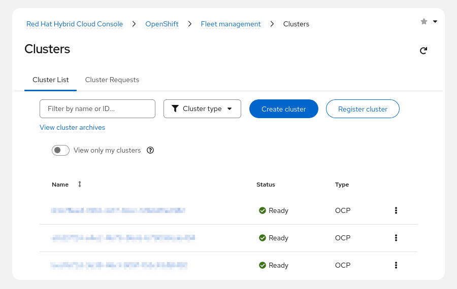

> **Quan trọng:** Bắt đầu từ phiên bản OpenShift 4.10, hệ thống OTA yêu cầu phải có kết nối Internet liên tục. Đối với các môi trường không kết nối Internet (còn gọi là môi trường "air-gapped"), OpenShift hỗ trợ quy trình cập nhật riêng sử dụng registry được sao chép cục bộ (locally mirrored registry) thay vì OTA. Phương thức này cho phép các tổ chức có yêu cầu nghiêm ngặt về chủ quyền kỹ thuật số hoặc tuân thủ quy định có thể kiểm soát toàn bộ vòng đời của các cụm (cluster) mà không cần phụ thuộc vào kết nối Internet bên ngoài. Để biết thêm thông tin, vui lòng tham khảo chương "Cập nhật cụm trong môi trường không kết nối Internet" (Updating a Cluster in a Disconnected Environment) trong phần tài liệu tham khảo.

Đối với các cụm (cluster) được kết nối, dịch vụ OTA sử dụng các kênh và lộ trình nâng cấp để kiểm soát những bản cập nhật nào khả dụng. Dịch vụ này xác định các lộ trình nâng cấp tương ứng với khả năng đáp ứng điều kiện của cụm đối với những bản cập nhật nhất định. Các lộ trình nâng cấp thuộc về các kênh cập nhật; mỗi kênh đại diện cho một lộ trình nâng cấp và kiểm soát tần suất cũng như độ ổn định của các bản cập nhật. Công cụ quản lý chính sách OTA thể hiện các kênh dưới dạng một chuỗi các con trỏ trỏ đến những phiên bản cụ thể trong lộ trình nâng cấp.

Tên kênh bao gồm các thành phần sau: cấp độ (release candidate, fast, stable và extended update support), phiên bản chính (4) và phiên bản phụ (.22). Các ví dụ về tên kênh bao gồm: candidate-4.22, fast-4.22, stable-4.22 và eus-4.22. Mỗi kênh cung cấp các bản vá cho một phiên bản cụm nhất định.

#### Kênh Ứng viên - Candidate Channel
Kênh Ứng viên cung cấp các bản cập nhật nhằm kiểm thử việc chấp nhận tính năng cho phiên bản tiếp theo của OpenShift Container Platform. Các phiên bản ứng viên phát hành (release candidate) này sẽ trải qua các bước kiểm tra bổ sung. Red Hat sẽ chuyển các bản phát hành này sang kênh Fast hoặc Stable khi chúng đáp ứng được các tiêu chuẩn về chất lượng.

> **Quan trọng:** Red Hat không hỗ trợ các bản cập nhật chỉ có trong kênh candidate.

### Kênh Nhanh - Fast Channel
Kênh Nhanh cung cấp các bản cập nhật ngay khi Red Hat công bố phiên bản cụ thể là bản phát hành chính thức (General Availability). Red Hat hỗ trợ các bản cập nhật được phát hành trên kênh này; đây là lựa chọn phù hợp nhất cho các môi trường phát triển và QA.

> **Lưu ý:** Khách hàng có thể góp phần cải thiện OpenShift bằng cách tham gia chương trình "Red Hat connected customers". Khi tham gia chương trình này, cụm (cluster) của bạn sẽ được đăng ký vào kênh cập nhật nhanh (fast channel).

#### Kênh Ổn định (Stable Channel)
Các nhóm hỗ trợ và kỹ thuật độ tin cậy hệ thống (site reliability engineering - SRE) của Red Hat sẽ giám sát các cụm (cluster) đang vận hành sử dụng các bản cập nhật từ kênh nhanh (fast channel). Nếu các cụm này vượt qua quy trình kiểm thử và xác thực bổ sung, Red Hat sẽ triển khai các bản cập nhật đó trên kênh ổn định. Red Hat cung cấp dịch vụ hỗ trợ cho các bản cập nhật được phát hành qua kênh này, và đây là lựa chọn phù hợp nhất cho các môi trường sản xuất. Nếu phát hiện sự cố vận hành liên quan đến bản cập nhật từ kênh nhanh, Red Hat sẽ bỏ qua bản cập nhật đó đối với kênh ổn định. Khoảng thời gian trễ của kênh ổn định giúp tạo điều kiện phát hiện các vấn đề mà quá trình kiểm thử trước đó chưa bộc lộ.

### Kênh Hỗ trợ Cập nhật Mở rộng (EUS)
Bắt đầu từ OpenShift Container Platform 4.8, Red Hat chỉ định tất cả các bản phát hành phụ có số hiệu chẵn là các bản phát hành Hỗ trợ Cập nhật Mở rộng (EUS). Các phiên bản EUS bao gồm 4.8, 4.10, 4.12, 4.14, 4.16, 4.18, 4.20 và 4.22.

Không có sự khác biệt giữa kênh `stable-4.x` và kênh `eus-4.x` (trong đó x là số hiệu bản phát hành phụ chẵn) đối với các bản phát hành EUS cho đến khi OpenShift Container Platform chuyển sang giai đoạn EUS. Bạn có thể chuyển sang kênh EUS ngay khi kênh này khả dụng.

#### Tình trạng hỗ trợ cho các kênh cập nhật
Red Hat cung cấp dịch vụ hỗ trợ cho tất cả các bản cập nhật đã phát hành thuộc các kênh fast, stable và eus. Đối với các bản cập nhật trong kênh candidate, Red Hat chỉ hỗ trợ nếu chúng cũng có tên trong danh sách của kênh fast hoặc stable.

| Kênh cập nhật  | Trạng thái hỗ trợ                                                 |
|----------------|-------------------------------------------------------------------|
|  candidate-4.x | Được hỗ trợ nếu bản cập nhật cũng có trong kênh Fast hoặc Stable. |
|  fast-4.x      | Được hỗ trợ                                                       |
|  stable-4.x    | Được hỗ trợ                                                       |
|  eus-4.x       | Được hỗ trợ                                                       |

### Các lộ trình nâng cấp
Bạn có thể áp dụng từng kênh nâng cấp cho cụm Red Hat OpenShift Container Platform 4.22 trong các môi trường khác nhau. Các đoạn dưới đây mô tả một kịch bản ví dụ trong đó phiên bản 4.22.3 gặp lỗi.

**Kênh Stable (Ổn định):** Khi sử dụng kênh stable-4.22, bạn có thể nâng cấp cụm của mình từ 4.22.0 lên 4.22.1 hoặc 4.22.4. Nếu phát hiện sự cố trong bản phát hành 4.22.3, bạn sẽ không thể nâng cấp lên phiên bản đó. Khi có bản vá trong bản phát hành 4.22.4, bạn có thể cập nhật cụm của mình lên phiên bản đó. 

Kênh này phù hợp với môi trường sản xuất (production), vì các nhóm SRE và dịch vụ hỗ trợ của Red Hat đã kiểm thử các bản phát hành trong kênh này.

**Kênh Fast (Nhanh):** Kênh fast-4.22 có thể cung cấp các bản cập nhật 4.22.1 và 4.22.4 nhưng không bao gồm 4.22.3. Red Hat cũng hỗ trợ kênh này và bạn có thể áp dụng nó cho môi trường phát triển (development), QA hoặc sản xuất. 

Quản trị viên phải chủ động chọn một kênh phiên bản phụ (minor version) khác, chẳng hạn như fast-4.22, để nâng cấp lên bản phát hành mới thuộc phiên bản phụ mới khi nó được ra mắt.

**Kênh Candidate (Ứng viên):** Bạn có thể sử dụng kênh candidate-4.22 để cài đặt các tính năng mới nhất của OpenShift. Với kênh này, bạn có thể nâng cấp lên tất cả các bản phát hành z-stream (bản vá), chẳng hạn như 4.22.1, 4.22.4 và 4.22.3. 

Bạn sử dụng kênh này để tiếp cận các tính năng mới nhất của sản phẩm ngay khi chúng được phát hành. Kênh này phù hợp với môi trường phát triển và môi trường tiền sản xuất (pre-production).

**Kênh EUS:** OpenShift Container Platform 4.22 là một bản phát hành EUS (Hỗ trợ mở rộng). Khi chuyển sang kênh eus-4.22, bạn chỉ nhận được các bản cập nhật bảo mật và sửa lỗi nghiêm trọng, cùng với vòng đời hỗ trợ mở rộng, cho đến khi phiên bản EUS tiếp theo được phát hành. Hình ảnh dưới đây mô tả các biểu đồ cập nhật cho kênh ổn định (stable) và kênh ứng viên (candidate):

**Hình 9.2: Các biểu đồ cập nhật cho kênh ổn định và kênh ứng viên**  
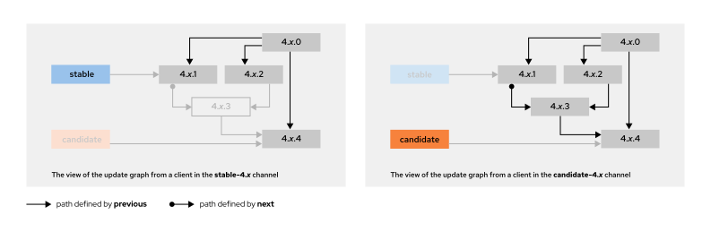

Red Hat cung cấp hỗ trợ cho các bản cập nhật thuộc diện General Availability (phát hành chính thức) được tung ra trên các kênh "stable" (ổn định) và "fast" (nhanh). Red Hat không hỗ trợ các bản cập nhật chỉ có trên kênh "candidate" (ứng viên).

Để đảm bảo tính ổn định của cụm (cluster) và mức độ hỗ trợ phù hợp, bạn chỉ nên chuyển đổi từ kênh "stable" sang kênh "fast". Mặc dù bạn có thể chuyển đổi từ kênh "stable" hoặc "fast" sang kênh "candidate", Red Hat không khuyến nghị thực hiện việc này. Kênh "candidate" phù hợp nhất cho việc kiểm thử tính năng và hỗ trợ đánh giá chất lượng cho phiên bản tiếp theo của OpenShift Container Platform.

> **Lưu ý:** Thời gian phát hành các bản cập nhật sửa lỗi (patch) và vá lỗ hổng bảo mật có thể dao động từ vài giờ đến một ngày. Khoảng thời gian này cho phép đánh giá các tác động vận hành có thể xảy ra đối với các cụm OpenShift.

### Thay đổi kênh cập nhật
Bạn có thể thay đổi kênh cập nhật thành eus-4.22, stable-4.22, fast-4.22 hoặc candidate-4.22 bằng cách sử dụng bảng điều khiển web hoặc ứng dụng khách CLI của OpenShift:

**Bảng điều khiển web:** Truy cập trang **Administration** → **Cluster Settings** (Quản trị → Cài đặt cụm), chọn thẻ **Details** (Chi tiết) và nhấp vào biểu tượng hình cây bút.

**Hình 9.3: Kênh cập nhật hiện tại trong bảng điều khiển web**  
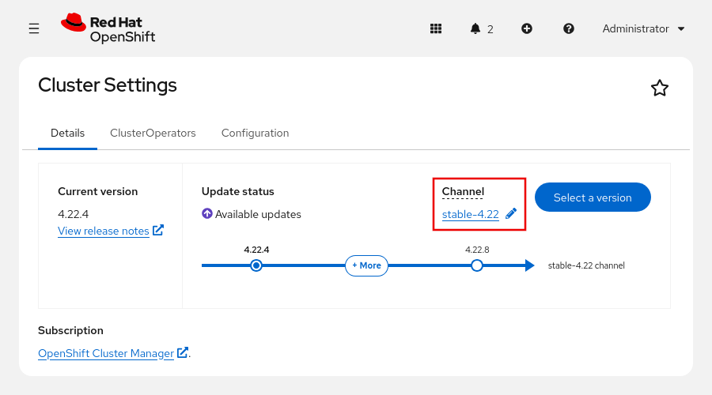

Một cửa sổ hiển thị các tùy chọn để chọn kênh cập nhật.

**Hình 9.4: Thay đổi kênh cập nhật trong bảng điều khiển web**  
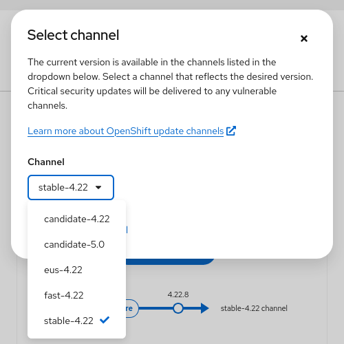

**Dòng lệnh:** Thực thi lệnh sau để chuyển sang kênh cập nhật khác, chẳng hạn như fast-4.22, bằng cách sử dụng ứng dụng khách oc:

```bash
$ oc patch clusterversion version --type="merge" \
--patch '{"spec":{"channel":"fast-4.22"}}'
clusterversion.config.openshift.io/version patched
```

### Tạm dừng tài nguyên kiểm tra tình trạng máy (Machine Health Check)
Trong quá trình nâng cấp, các nút trong cụm có thể tạm thời không khả dụng. Đối với các nút tính toán (compute node), cơ chế kiểm tra tình trạng máy có thể xác định các nút này là không ổn định và thực hiện khởi động lại chúng. Để tránh việc khởi động lại các nút này, hãy tạm dừng tất cả các tài nguyên kiểm tra tình trạng máy trước khi cập nhật cụm.

> **Lưu ý:** Việc tạm dừng các tài nguyên kiểm tra tình trạng máy là không bắt buộc đối với các hệ thống cài đặt trên một nút duy nhất.

Hãy chạy lệnh sau để liệt kê tất cả các tài nguyên kiểm tra tình trạng máy hiện có.

```bash
$ oc get machinehealthcheck -n openshift-machine-api
NAME                             MAXUNHEALTHY  EXPECTEDMACHINES  CURRENTHEALTHY
machine-api-termination-handler  100%
```

Thêm chú thích `cluster.x-k8s.io/paused` vào tài nguyên kiểm tra tình trạng máy (machine health check) để tạm dừng nó trước khi cập nhật cụm.

```bash
$ oc annotate machinehealthcheck -n openshift-machine-api \
machine-api-termination-handler cluster.x-k8s.io/paused=""
machinehealthcheck.machine.openshift.io/machine-api-termination-handler annotated
```

Xóa chú thích sau khi cụm được cập nhật.

```bash
$ oc annotate machinehealthcheck -n openshift-machine-api \
machine-api-termination-handler cluster.x-k8s.io/paused-
machinehealthcheck.machine.openshift.io/machine-api-termination-handler annotated
```

### Cập nhật qua mạng (OTA)
OTA hoạt động theo mô hình máy khách - máy chủ (client-server). Red Hat lưu trữ các image của cụm (cluster images) và cơ sở hạ tầng phục vụ cập nhật. OTA tạo ra tất cả các lộ trình cập nhật khả thi cho cụm của bạn, đồng thời thu thập thông tin về cụm và quyền sử dụng dịch vụ của bạn để xác định các lộ trình nâng cấp có sẵn. Bảng điều khiển web sẽ gửi thông báo khi có bản cập nhật mới.

Sơ đồ sau đây mô tả kiến trúc cập nhật: Red Hat lưu trữ cả các image của cụm lẫn một thành phần "watcher" (bộ giám sát) có chức năng tự động phát hiện các image mới được đẩy lên Quay. Cluster Version Operator (CVO) nhận trạng thái cập nhật từ watcher này. CVO bắt đầu quy trình bằng cách cập nhật các thành phần của cụm thông qua các operator tương ứng, sau đó cập nhật bất kỳ thành phần bổ sung nào do Operator Lifecycle Manager (OLM) quản lý.

**Hình 9.5: Kiến trúc cập nhật của OpenShift Container Platform**  
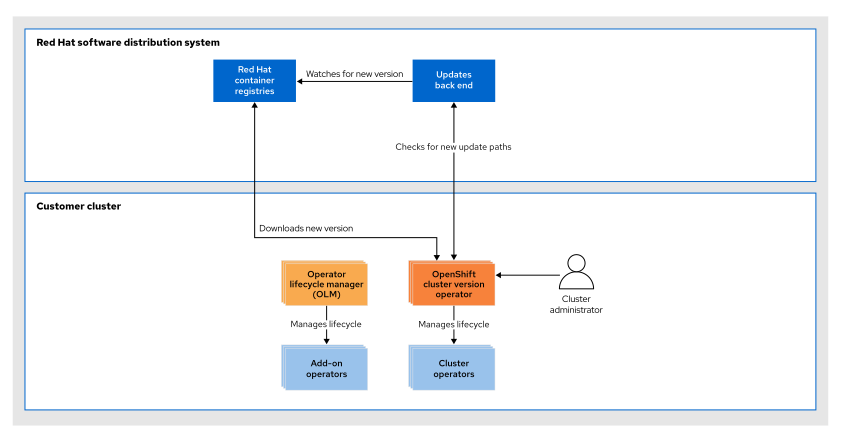

Thông qua cơ chế đo từ xa (telemetry), Red Hat có thể xác định lộ trình cập nhật. Cụm (cluster) sử dụng thành phần Telemeter dựa trên Prometheus để báo cáo trạng thái của từng cluster operator. Dữ liệu được ẩn danh và gửi về các máy chủ của Red Hat; từ đó, Red Hat sẽ thông báo cho quản trị viên cụm về các bản phát hành mới tiềm năng.

> **Lưu ý:** Red Hat coi trọng quyền riêng tư của khách hàng. Để biết danh sách đầy đủ các dữ liệu mà Telemeter thu thập, vui lòng tham khảo các tài liệu "Data Collection" (Thu thập dữ liệu) và "Telemeter Sample Metrics" (Các chỉ số mẫu của Telemeter) trong phần tài liệu tham khảo.

Trong tương lai, Red Hat dự định mở rộng danh sách các operator được cập nhật để bao gồm cả các operator từ nhà cung cấp phần mềm độc lập (ISV) trong lộ trình nâng cấp.

**Hình 9.6: Quản lý các bản cập nhật cụm bằng cách sử dụng dữ liệu đo từ xa (telemetry)**  
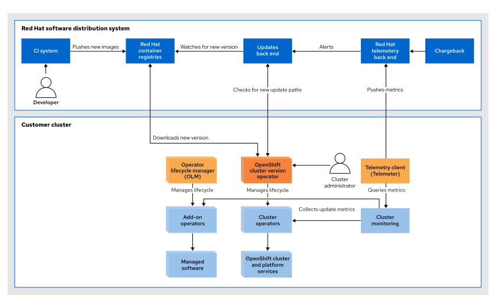

### Quy trình Cập nhật
Các thành phần sau đây tham gia vào quy trình cập nhật cụm (cluster):

**Machine Config Operator (MCO):** MCO áp dụng trạng thái máy mong muốn cho từng node. Thành phần này cũng đảm nhiệm việc nâng cấp cuốn chiếu (rolling upgrade) các node trong cụm và sử dụng CoreOS Ignition làm định dạng cấu hình.

**Operator Lifecycle Manager (OLM):** OLM điều phối việc cập nhật các operator đang chạy trong cụm.

#### Cơ chế kiểm soát độ lệch phiên bản boot image
MCO sử dụng boot image để tạo các node Red Hat Enterprise Linux CoreOS trên các nền tảng tương thích. Theo mặc định, khi OpenShift cập nhật cụm (cluster), boot image sẽ không tự động được cập nhật. Điều này có nghĩa là nếu một cụm được cài đặt ở phiên bản OpenShift 4.14, thì các node tính toán (compute node) sau đó có thể vẫn sử dụng boot image của phiên bản 4.14 ngay cả khi cụm đã được cập nhật lên phiên bản 4.22.

Bắt đầu từ OpenShift Container Platform 4.22, MCO áp dụng các giới hạn về độ lệch phiên bản boot image. Nếu phiên bản boot image thấp hơn phiên bản tối thiểu được hỗ trợ, MCO sẽ đặt trạng thái `Upgradeable` thành `False` cho cluster operator `machine-config`, qua đó ngăn chặn việc cập nhật cụm cho đến khi boot image được cập nhật.

Ngưỡng phiên bản tối thiểu hiện tại đối với boot image tương ứng với OpenShift Container Platform 4.13.0 (RHEL 9.2) – thời điểm OpenShift chuyển đổi hệ điều hành nền tảng từ RHEL 8 sang RHEL 9. Bất kỳ boot image nào có phiên bản cũ hơn ngưỡng này đều sẽ gây ra lỗi vi phạm quy định về độ lệch phiên bản.

MCO hỗ trợ các chế độ kiểm soát độ lệch phiên bản boot image sau đây:

| Chế độ    | Mô tả                                                                                                                                                         |
|-----------|---------------------------------------------------------------------------------------------------------------------------------------------------------------|
| Automatic | MCO quản lý các ảnh khởi động và tự động theo dõi các phiên bản. Chế độ này là mặc định trên các nền tảng AWS, Google Cloud Platform (GCP), Azure và vSphere. |
| Manual    | Quản trị viên theo dõi các phiên bản ảnh khởi động và cập nhật chúng theo cách thủ công. MCO vẫn kiểm tra sự sai lệch so với phiên bản đã được khai báo.      |
| None      | Tính năng thực thi kiểm tra độ lệch (skew enforcement) bị vô hiệu hóa. Điều kiện "Có thể nâng cấp" (Upgradeable) luôn được đặt là True.                       |

Bạn có thể kiểm tra trạng thái thực thi độ lệch bằng cách sử dụng lệnh sau:

```bash
$ oc get machineconfiguration cluster \
-o jsonpath='{.status.bootImageSkewEnforcementStatus}{"\n"}'
{"mode":"None"}
```

Khi MCO phát hiện vi phạm độ lệch (skew violation), machine-config cluster operator sẽ báo cáo một thông báo tương tự như sau:

```
Upgrades have been disabled because the cluster is using
OCP boot image version 4.12.84, which is below the minimum
required version 4.13.0.
```

> **Lưu ý:** Các cụm OpenShift đơn nút (single-node) không áp dụng quy tắc kiểm soát sự sai lệch về ảnh khởi động (boot image skew) do các cụm này không mở rộng quy mô. Việc kiểm soát sự sai lệch về ảnh khởi động cũng không áp dụng cho các nền tảng bare-metal, vì MCO không quản lý ảnh khởi động trên các nền tảng đó.

Quy trình cập nhật được mô tả trong phần này áp dụng cho các cụm OpenShift Container Platform do người dùng tự quản lý. Các dịch vụ đám mây của Red Hat sử dụng quy trình cập nhật khác so với các cụm tự quản lý:

* **Azure Red Hat OpenShift** sử dụng các cơ chế vòng đời OpenShift tiêu chuẩn (CVO, lệnh `oc adm upgrade` hoặc bảng điều khiển web) dưới sự giám sát của đội ngũ SRE từ Microsoft và Red Hat. 
* Việc nâng cấp **Red Hat OpenShift Service on AWS (ROSA) và OpenShift Dedicated (OSD)** phải được kích hoạt thông qua Red Hat Hybrid Cloud Console, công cụ dòng lệnh `rosa` hoặc `ocm`. Cơ chế đồng bộ trạng thái (reconciliation) của dịch vụ được quản lý sẽ chặn lệnh `oc adm upgrade` trên các nền tảng này. ROSA và OSD hỗ trợ thiết lập khung thời gian bảo trì định kỳ cũng như tự động cập nhật phiên bản phụ (minor version). 
* **ROSA với Hosted Control Planes** hỗ trợ nâng cấp độc lập giữa mặt phẳng điều khiển (control plane) và các nút tính toán (compute node), cho phép chênh lệch phiên bản ở mức n-2 giữa hai thành phần này.

### Cập nhật cụm
Bạn có thể cập nhật cụm bằng cách sử dụng bảng điều khiển web hoặc dòng lệnh.

#### Cập nhật cụm thông qua Web Console
Trên Web Console, hãy truy cập **Administration** → **Cluster Settings**. Trang cài đặt cụm sẽ hiển thị trạng thái các bản cập nhật khả dụng khi có bản cập nhật mới. Tại trang này, hãy nhấp vào **Select a version**, sau đó chọn phiên bản và tùy chọn cập nhật cụm để cài đặt. Nhấp vào **Update** và chờ cho đến khi quá trình cập nhật hoàn tất.

**Hình 9.7: Cập nhật cụm bằng cách sử dụng bảng điều khiển web**  
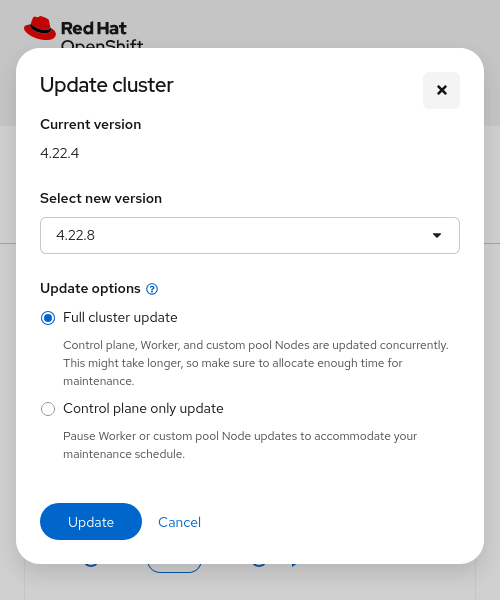

Trang cài đặt cụm hiển thị trạng thái cập nhật.

**Hình 9.8: Cập nhật trạng thái cụm**  
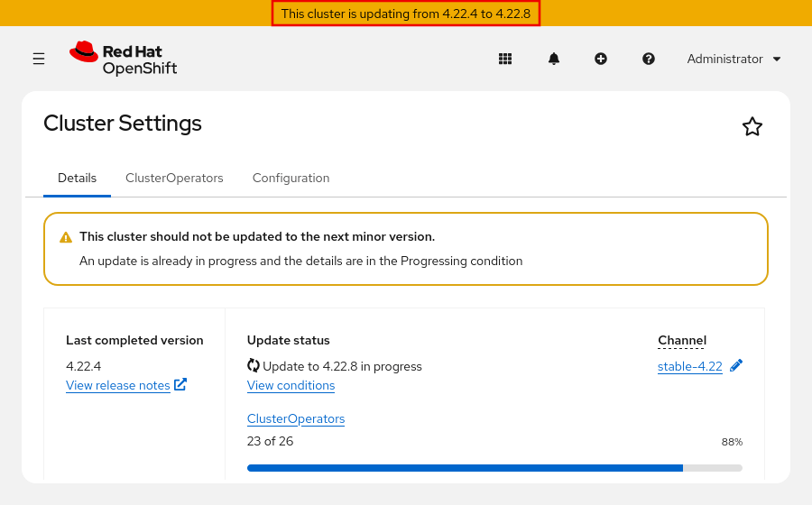

> **Quan trọng:** Việc hoàn nguyên cụm (cluster) về phiên bản cũ hơn không được hỗ trợ. Nếu quá trình cập nhật không hoàn tất, hãy liên hệ với bộ phận hỗ trợ của Red Hat.

Quá trình cập nhật cũng sẽ cập nhật hệ điều hành nền tảng khi có bản cập nhật mới. Các bản cập nhật này sử dụng công nghệ rpm-ostree để quản lý việc nâng cấp theo cơ chế giao dịch (transactional upgrades). OpenShift cung cấp các bản cập nhật dưới dạng image container như một phần của quy trình cập nhật. Khi quá trình cập nhật được triển khai, các node sẽ tải image mới về, giải nén, ghi các gói phần mềm vào đĩa, sau đó sửa đổi bộ nạp khởi động (bootloader) để khởi động vào phiên bản mới. Máy sẽ khởi động lại như một phần của quy trình cập nhật cuốn chiếu (rolling update) nhằm đảm bảo giảm thiểu tác động đến năng lực hoạt động của cụm.

Khi quá trình cập nhật cụm hoàn tất, trang cài đặt cụm sẽ hiển thị phiên bản cụm mới và xác nhận rằng cụm đã được cập nhật lên phiên bản mới nhất. Nếu phiên bản phụ (minor version) tiếp theo loại bỏ một số API, trang này sẽ hiển thị thông báo cảnh báo: `This cluster should not be updated to the next minor version.`

**Hình 9.9: Hoàn tất cập nhật cụm**  
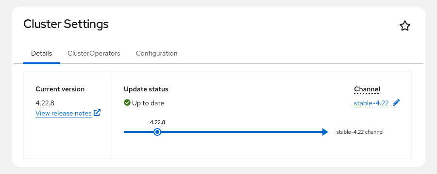

#### Cập nhật cụm bằng giao diện dòng lệnh
> **Quan trọng:** Trước khi cập nhật cụm, hãy cập nhật tất cả các operator được cài đặt thông qua OLM lên phiên bản tương thích với phiên bản cụm đích.

Các bước sau đây mô tả quy trình cập nhật cụm với tư cách là quản trị viên cụm, sử dụng giao diện dòng lệnh:

1. Lấy thông tin phiên bản cụm. Nếu bạn đang vận hành cụm trong môi trường sản xuất, hãy đảm bảo rằng kênh được hiển thị là ổn định (stable).

```bash
$ oc get clusterversion
NAME      VERSION   AVAILABLE   PROGRESSING   SINCE   STATUS
version   4.22.4    True        False         16d     Cluster version is 4.22.4
```

2. Xem lại thông tin kênh cập nhật hiện tại.

```bash
$ oc get clusterversion -o jsonpath='{.items[0].spec.channel}{"\n"}'
stable-4.22
```

3. Xem các bản cập nhật hiện có và ghi lại số phiên bản của bản cập nhật cần áp dụng.

```bash
$ oc adm upgrade
Cluster version is 4.22.4

Upstream is unset, so the cluster will use an appropriate default.
Channel: stable-4.22 (available channels: candidate-4.22, candidate-5.0, eus-4.22, fast-4.22, stable-4.22)

Recommended updates:

  VERSION     IMAGE
  4.22.8      quay.io/openshift-release-dev/ocp-release@sha256:dcd...
  4.22.7      quay.io/openshift-release-dev/ocp-release@sha256:ba6...
...output omitted...
```

4. Bạn có thể áp dụng bản cập nhật mới nhất cho cụm của mình hoặc cập nhật lên một phiên bản cụ thể:
  * a. Chạy lệnh sau để cài đặt bản cập nhật mới nhất cho cụm của bạn:

  ```bash
  $ oc adm upgrade --to-latest=true
  Requested update to 4.22.8
  ```

  * b. Hãy chạy lệnh sau để cài đặt một phiên bản cụ thể: VERSION tương ứng với một trong các phiên bản khả dụng do lệnh `oc adm upgrade` trả về.

  ```
  $ oc adm upgrade --to=VERSION
  ```

5. Lệnh trước đó khởi tạo quy trình cập nhật. Bạn có thể chạy lệnh sau để kiểm tra trạng thái của CVO và các cluster operator đã được cài đặt:

```bash
$ watch oc get clusterversion,clusteroperators
NAME      VERSION   AVAILABLE   PROGRESSING   SINCE   STATUS
version   4.22.4    True        True          36s     Working towards 4.22.8...

NAME                         VERSION   AVAILABLE   PROGRESSING   DEGRADED   ...
...authentication            4.22.8    True        False         False
...config-operator           4.22.8    True        False         False
...output omitted...
```

Phiên bản dịch vụ cụm cho thấy quá trình cập nhật cụm đang tiến tới phiên bản 4.22.8. Các toán tử cụm (cluster operators) đang cập nhật phiên bản của chúng lên 4.22.8.

> **Quan trọng:** Trong quá trình cập nhật, cụm (cluster) có thể không truy cập được trong vài giây. Nếu bạn bị đăng xuất, hãy đợi vài giây rồi đăng nhập lại.

Quá trình cập nhật cụm hoàn tất khi phiên bản dịch vụ cụm báo cáo rằng phiên bản 4.22.8 đã có sẵn và cột PROGRESSING hiển thị giá trị False.

```
NAME      VERSION   AVAILABLE   PROGRESSING   SINCE   STATUS
version   4.22.8    True        False         66s     Cluster version is 4.22.8
```

6. Bạn có thể sử dụng lệnh sau để xem lịch sử phiên bản cụm và theo dõi trạng thái cập nhật. Quá trình cập nhật toàn bộ các đối tượng có thể sẽ mất một khoảng thời gian.

Lịch sử này bao gồm danh sách các phiên bản gần đây nhất đã được áp dụng cho cụm. Danh sách này được cập nhật khi CVO thực hiện cập nhật. Các mục trong danh sách được sắp xếp theo ngày, với bản cập nhật mới nhất nằm ở vị trí đầu tiên.

Nếu quá trình triển khai hoàn tất thành công, các bản cập nhật trong lịch sử sẽ có trạng thái "Completed" (Đã hoàn tất). Ngược lại, nếu bản cập nhật thất bại hoặc không hoàn tất, nó sẽ có trạng thái "Partial" (Một phần).

```bash
$ oc describe clusterversion
...output omitted...
  History:
    Completion Time:    2026-08-06T12:31:09Z
    Image:              quay.io/openshift-release-dev/ocp-release@sha256:a961...027b
    Started Time:       2026-08-06T11:39:50Z
    State:              Completed
    Verified:           true
    Version:            4.22.8
    Completion Time:    2026-07-20T23:09:15Z
    Image:              quay.io/openshift-release-dev/ocp-release@sha256:b5fd...6e42
    Started Time:       2026-07-20T22:45:42Z
    State:              Completed
    Verified:           false
    Version:            4.22.4
...output omitted...
```

Đối với các cụm (cluster) đóng vai trò quan trọng trong hoạt động kinh doanh, Red Hat khuyến nghị mở yêu cầu hỗ trợ trước khi bắt đầu cập nhật để đảm bảo các kỹ sư hỗ trợ có thể trợ giúp kịp thời nếu phát sinh sự cố.

> **Quan trọng:** Khi quá trình cập nhật không thể hoàn tất, CVO sẽ báo cáo trạng thái của các thành phần gây cản trở và cố gắng đồng bộ hóa lại quá trình cập nhật. Việc hoàn nguyên cụm về phiên bản trước đó không được hỗ trợ. Nếu quá trình cập nhật không thể hoàn tất, hãy liên hệ với bộ phận hỗ trợ của Red Hat.

## Phát hiện việc sử dụng các API Kubernetes đã bị loại bỏ
### Các phiên bản OpenShift
Kubernetes là một công cụ điều phối container mã nguồn mở dùng để tự động hóa việc triển khai, mở rộng quy mô và quản lý các ứng dụng chạy trong container. Nền tảng OpenShift Container Platform được xây dựng dựa trên Kubernetes, do đó kế thừa công nghệ cốt lõi của hệ thống này. Bảng dưới đây liệt kê các phiên bản OpenShift cùng với phiên bản Kubernetes tương ứng mà chúng dựa vào:

| Phiên bản OpenShift | Phiên bản Kubernetes |
|---------------------|----------------------|
| 4.19                | 1.32                 |
| 4.20                | 1.33                 |
| 4.21                | 1.34                 |
| 4.22                | 1.35                 |

### Chính sách ngừng hỗ trợ API Kubernetes
Các phiên bản API Kubernetes được phân loại dựa trên mức độ hoàn thiện của tính năng (thử nghiệm, tiền phát hành và ổn định).

| Phiên bản API | Danh mục | Mô tả                                        |
|---------------|----------|----------------------------------------------|
| v1alpha1      | Alpha    | Các tính năng thử nghiệm                     |
| v1beta1       | Beta     | Tính năng trước khi phát hành                |
| v1            | Stable   | Các tính năng ổn định, đã phát hành rộng rãi |

Sử dụng lệnh sau để xem phiên bản hiện tại của tài nguyên:

```bash
$ oc api-resources | grep -E '^NAME|cronjobs'
NAME      SHORTNAMES  APIVERSION  NAMESPACED  KIND
cronjobs  cj          batch/v1    true        CronJob
```

Khi một phiên bản ổn định của tính năng được phát hành, các phiên bản beta sẽ bị đánh dấu là lỗi thời (deprecated) và bị loại bỏ sau ít nhất ba đợt phát hành Kubernetes. Thời điểm loại bỏ cụ thể sẽ khác nhau tùy theo từng API. Nếu một yêu cầu sử dụng phiên bản API đã lỗi thời, API server sẽ trả về cảnh báo lỗi thời kèm theo tên phiên bản hiện tại của cụm (cluster). Ví dụ dưới đây minh họa cảnh báo lỗi thời do API `flowcontrol.apiserver.k8s.io/v1beta3` trả về từ một phiên bản cụm trước đó.

```bash
$ grep -E 'kind|apiVersion' plc-beta3.yaml
kind: PriorityLevelConfiguration
apiVersion: flowcontrol.apiserver.k8s.io/v1beta3

$ oc create -f plc-beta3.yaml
Warning: flowcontrol.apiserver.k8s.io/v1beta3 PriorityLevelConfiguration is deprecated in v1.29+, unavailable in v1.32+; use flowcontrol.apiserver.k8s.io/v1 PriorityLevelConfiguration prioritylevelconfiguration.flowcontrol.apiserver.k8s.io/beta3-example created
```

Nếu một yêu cầu sử dụng phiên bản API đã bị Kubernetes loại bỏ, API server sẽ trả về lỗi do cụm (cluster) không còn hỗ trợ phiên bản API đó nữa. Phiên bản API `flowcontrol.apiserver.k8s.io/v1beta3` đã bị loại bỏ trong Kubernetes 1.32 (RHOCP 4.19). Trên cụm RHOCP 4.22, API server sẽ trả về lỗi sau:

```bash
$ oc create -f plc-beta3.yaml
error: resource mapping not found for name: "beta3-example" namespace: "" from "plc-beta3.yaml": no matches for kind "PriorityLevelConfiguration" in version "flowcontrol.apiserver.k8s.io/v1beta3"
ensure CRDs are installed first
```

#### Các tính năng đã bị loại bỏ và ngừng hỗ trợ trong Kubernetes
Bảng dưới đây liệt kê tóm tắt các phiên bản API đã bị ngừng hỗ trợ và loại bỏ trong các bản phát hành Kubernetes gần đây:
Lưu ý

Các phiên bản Kubernetes 1.33, 1.34 và 1.35 không loại bỏ bất kỳ phiên bản nhóm API nào.

| Tài nguyên                             | Nhóm API đã xóa                                                              | Nhóm API hiện tại               |
|----------------------------------------|------------------------------------------------------------------------------|---------------------------------|
| FlowSchema, PriorityLevelConfiguration | flowcontrol.apiserver.k8s.io/v1beta2 và flowcontrol.apiserver.k8s.io/v1beta3 | flowcontrol.apiserver.k8s.io/v1 |
| In-tree Volume Plug-in                 | kubernetes.io/cephfs                                                         | cephfs.csi.ceph.com             |
| In-tree Volume Plug-in                 | kubernetes.io/rbd                                                            | rbd.csi.ceph.com                |


#### Xác định các API đã bị loại bỏ (deprecated)
Bạn có thể xác định xem một workload (khối lượng công việc) có đang sử dụng phiên bản API đã bị loại bỏ hay không dựa trên số lượng yêu cầu API. Kết quả thống kê số lượng yêu cầu API sẽ liệt kê các API đã bị loại bỏ mà cụm (cluster) của bạn đang sử dụng. Cột REMOVEDINRELEASE cho biết phiên bản Kubernetes mà tại đó API này bị loại bỏ.

Nếu không có API nào bị loại bỏ đang được sử dụng, lệnh sẽ trả về kết quả trống. Nếu một workload sử dụng API đã bị loại bỏ, kết quả đầu ra sẽ bao gồm các mục tương tự như ví dụ sau:

```bash
$ oc get apirequestcounts
NAME                                             REMOVEDINRELEASE
resourceclaims.v1beta1.resource.k8s.io           1.38         ...
resourceslices.v1beta1.resource.k8s.io           1.38         ...
```

Nếu đang sử dụng một API đã bị loại bỏ (deprecated), bạn có thể dùng bộ lọc JSONPath để liệt kê các hành động liên quan đến tài nguyên đó cũng như thông tin về người thực hiện các hành động này. Ví dụ dưới đây minh họa kết quả đầu ra mẫu cho API `resource.k8s.io/v1beta1` đã bị loại bỏ:

```bash
$ FILTER='{range .status.currentHour..byUser[*]}{..byVerb[*].verb}{","}{.username}{","}{.userAgent}{"\n"}{end}'
$ TYPE=resourceclaims.v1beta1.resource.k8s.io
$ echo ${TYPE} ; oc get apirequestcount ${TYPE} \
-o jsonpath="${FILTER}" | column -t -s ',' -N "Verbs,Username,UserAgent"

resourceclaims.v1beta1.resource.k8s.io
Verbs     Username  UserAgent
get list  admin     oc/4.22.0
```

### Các tính năng bị loại bỏ và ngừng hỗ trợ trong OpenShift
Red Hat OpenShift Container Platform (RHOCP) là tập hợp các thành phần và dịch vụ dạng mô-đun, được xây dựng trên nền tảng cơ sở hạ tầng container Kubernetes.

Một số tính năng từng có trong các phiên bản OpenShift trước đây hiện đã bị loại bỏ hoặc ngừng hỗ trợ. Các tính năng bị ngừng hỗ trợ không được khuyến nghị sử dụng cho các triển khai mới, do chúng sẽ bị loại bỏ trong các phiên bản tương lai. Bảng dưới đây liệt kê tóm tắt các tính năng bị ngừng hỗ trợ và bị loại bỏ trong OpenShift.

| Tính năng                                                                   | OpenShift 4.20                                     | OpenShift 4.21                                     | OpenShift 4.22 |
|-----------------------------------------------------------------------------|----------------------------------------------------|----------------------------------------------------|----------------|
| Các đối tượng DeploymentConfig                                              | Đã lỗi thời                                        | Đã lỗi thời                                        | Đã lỗi thời    |
| Môi trường thực thi container runC (các cụm mới mặc định sử dụng crun)      | Được hỗ trợ (crun là môi trường thực thi mặc định) | Được hỗ trợ (crun là môi trường thực thi mặc định) | Đã lỗi thời    |
| Các đối tượng Builds v1 và BuildConfig (chuyển sang Builds v2 / Shipwright) | Đã lỗi thời                                        | Đã lỗi thời                                        | Đã lỗi thời    |
| Chợ Red Hat                                                                 | Đã lỗi thời                                        | Đã lỗi thời                                        | Đã loại bỏ     |

#### Các cảnh báo về API đã lỗi thời trong OpenShift
OpenShift bao gồm hai cảnh báo được kích hoạt khi một workload sử dụng phiên bản API đã lỗi thời:

**APIRemovedInNextReleaseInUse** Cảnh báo này được kích hoạt đối với các API mà OpenShift Container Platform sẽ loại bỏ trong bản phát hành tiếp theo.

**APIRemovedInNextEUSReleaseInUse** Cảnh báo này được kích hoạt đối với các API mà OpenShift Container Platform Extended Update Support (EUS) sẽ loại bỏ trong bản phát hành tiếp theo.

Cảnh báo mô tả tình trạng kèm theo thông tin ngữ cảnh để xác định workload bị ảnh hưởng.

**Hình 9.10: Cảnh báo về API đã lỗi thời**  
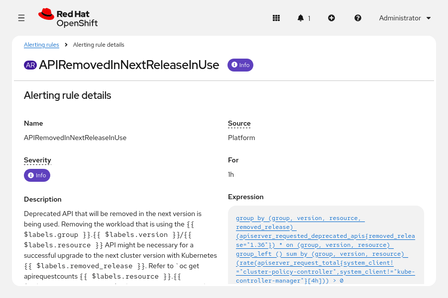

Bạn có thể trích xuất các cảnh báo ở định dạng JSON từ StatefulSet của Prometheus, sau đó lọc kết quả để lấy ra các cảnh báo về API đã bị loại bỏ (deprecated).

```bash
$ oc exec -it statefulset/prometheus-k8s -c prometheus \
-n openshift-monitoring -- \
curl -fsSL 'http://localhost:9090/api/v1/alerts' | jq . > alerts.json

$ jq '[.data.alerts[] |
select(.labels.alertname=="APIRemovedInNextReleaseInUse" or
.labels.alertname=="APIRemovedInNextEUSReleaseInUse")]' < alerts.json
[
  {
    "labels": {
      "alertname": "APIRemovedInNextReleaseInUse",
...output omitted...
    },
    "state": "firing",
...output omitted...
  },
  {
    "labels": {
      "alertname": "APIRemovedInNextEUSReleaseInUse",
...output omitted...
    },
    "state": "firing",
...output omitted...
  }
]
```

> **Lưu ý:** Nếu kết quả đầu ra của lệnh `jq` là một mảng JSON trống `[]`, thì các cảnh báo đã không được báo cáo.

## Cập nhật các Operator bằng OLM
### Cập nhật Operator
Các nhà cung cấp Operator có thể phát hành phiên bản mới cho những Operator đã được cài đặt trong cụm OpenShift. Các phiên bản mới này có thể bao gồm các bản sửa lỗi và tính năng mới. Operator Lifecycle Manager (OLM) sẽ thực hiện việc cập nhật các Operator này.

Tuy nhiên, các phiên bản Operator mới cũng có thể phát sinh lỗi hoặc gây ra vấn đề không tương thích.

Quản trị viên cụm cần thiết lập các chính sách cập nhật Operator để đảm bảo việc áp dụng các bản sửa lỗi và tính năng mới, đồng thời duy trì sự vận hành ổn định và chính xác của cụm.

OpenShift cung cấp các tính năng hỗ trợ triển khai những chính sách cập nhật Operator như vậy. 

* Đối với mỗi Operator đã cài đặt, bạn có thể quyết định xem OLM sẽ tự động áp dụng các bản cập nhật hay yêu cầu sự phê duyệt từ quản trị viên. 
* Nhà cung cấp Operator có thể tạo nhiều kênh (channel) cho một Operator. Họ có thể áp dụng các chính sách khác nhau để đẩy bản cập nhật vào từng kênh, khiến mỗi kênh chứa các phiên bản Operator khác nhau. Khi cài đặt Operator, bạn sẽ chọn kênh theo dõi để nhận các bản cập nhật. 
* Bạn có thể tạo các danh mục (catalog) tùy chỉnh và quyết định phiên bản Operator nào sẽ được đưa vào danh mục đó. Ví dụ, trong môi trường đa cụm, bạn có thể cấu hình để Operator tự động cập nhật nhưng chỉ đưa các phiên bản đã được kiểm thử vào danh mục.

Các nhà cung cấp có thể phát hành Operator thông qua những phương thức khác ngoài OLM và danh mục Operator. Ví dụ, nhà cung cấp có thể phát hành Operator dưới dạng Helm chart hoặc tệp tài nguyên YAML. OLM không quản lý các Operator được cài đặt bằng những phương thức khác này. Các Operator được cài đặt thủ công sẽ không được cập nhật trong quá trình nâng cấp cụm hoặc thông qua OLM.

### Các Kênh Cập nhật Operator
Các nhà cung cấp Operator có thể tạo nhiều kênh cho một Operator.

Ví dụ, nhà cung cấp có thể tạo các kênh "stable" (ổn định) và "candidate" (ứng viên/thử nghiệm) cho một Operator. Nhà cung cấp sẽ phát hành mỗi phiên bản mới của Operator vào kênh "candidate". Bạn có thể sử dụng kênh này để thử nghiệm các tính năng mới và xác nhận rằng phiên bản mới đã khắc phục được các lỗi. Nếu nhà cung cấp nhận được phản hồi về các phiên bản "candidate" và không phát hiện vấn đề nghiêm trọng nào ở phiên bản mới nhất, họ sẽ phát hành phiên bản đó sang kênh "stable". Bạn có thể sử dụng kênh "stable" cho các môi trường đòi hỏi độ tin cậy cao hơn, chấp nhận việc cập nhật tính năng mới chậm hơn để đổi lấy sự ổn định tốt hơn.

Ngoài ra, Operator có thể sở hữu các tính năng mới mang lại những thay đổi lớn hoặc gây ra sự không tương thích với các phiên bản trước đó. Nhà cung cấp Operator có thể áp dụng cơ chế đánh số phiên bản giúp phân biệt giữa các bản cập nhật lớn (major updates) và bản cập nhật nhỏ (minor updates), tùy thuộc vào mức độ phức tạp hoặc chi phí khi chuyển đổi sang phiên bản mới. Trong trường hợp này, nhà cung cấp có thể tạo các kênh riêng cho những phiên bản chính (major version) khác nhau của Operator.

Ví dụ, một nhà cung cấp tạo ra Operator dùng để cài đặt một ứng dụng. Họ tạo ra các kênh v1 và v2 tương ứng với các phiên bản chính khác nhau của ứng dụng đó. Người dùng Operator có thể tiếp tục sử dụng kênh v1 trong môi trường sản xuất (production), đồng thời thử nghiệm và thiết kế quy trình cập nhật để chuyển sang kênh v2 trong môi trường thử nghiệm (staging).

Cách đặt tên kênh và tần suất cập nhật có thể rất khác nhau tùy thuộc vào từng Operator. Ví dụ, các Operator của Red Hat thường sử dụng các tên kênh như "stable", "fast", "candidate" hoặc các kênh có kèm số phiên bản như "stable-4.22"; trong khi đó, các Operator do cộng đồng phát triển có thể sử dụng các tên như "alpha", "beta", "preview" hoặc "latest".

Khi cài đặt một Operator, hãy xác định kênh phù hợp nhất với nhu cầu của bạn. Các cụm (cluster) có yêu cầu về độ tin cậy khác nhau có thể sẽ sử dụng các kênh khác nhau.

Bạn có thể chỉnh sửa đăng ký (subscription) của Operator để chuyển đổi kênh. Việc chuyển đổi kênh sẽ không tự động kích hoạt cập nhật Operator, trừ khi việc chuyển đổi đó làm xuất hiện một phiên bản mới hơn và Operator đã được cấu hình để tự động cập nhật. Việc chuyển đổi kênh có thể dẫn đến những kết quả không mong muốn; do đó, hãy luôn tham khảo tài liệu của Operator để nắm bắt các vấn đề có thể xảy ra.

### Cập nhật Tự động và Thủ công

Khi cài đặt một Operator, bạn có thể quyết định xem OLM sẽ tự động áp dụng các bản cập nhật hay yêu cầu quản trị viên phải phê duyệt bản cập nhật đó. Trên trình hướng dẫn cài đặt Operator, bạn có thể chọn giữa chế độ phê duyệt tự động hoặc thủ công. Khi tạo đăng ký (subscription) bằng lệnh `oc`, phần đặc tả tài nguyên sẽ bao gồm thuộc tính `installPlanApproval` với giá trị bắt buộc là `Automatic` (Tự động) hoặc `Manual` (Thủ công).

Nếu các chính sách phát hành của Operator phù hợp với yêu cầu của bạn, bạn có thể cấu hình chế độ phê duyệt tự động. Hãy truy cập mục **Ecosystem** → **Installed Operators** trên giao diện web (web console) hoặc kiểm tra các phiên bản dịch vụ cụm (CSV) bằng lệnh `oc get csv` để xem phiên bản của các Operator đã cài đặt.

Nếu bạn cài đặt Operator và cấu hình chế độ phê duyệt thủ công, bạn sẽ cần phê duyệt các bản cập nhật trước khi OLM tiến hành cập nhật Operator đó.

Trang **Installed Operators** trên giao diện web sẽ hiển thị các bản nâng cấp khả dụng.

**Hình 9.11: Trang Installed Operators với bản nâng cấp khả dụng**  
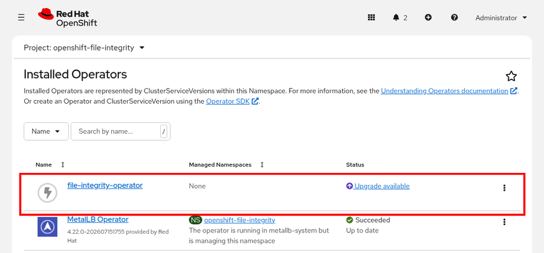

Các tài nguyên đăng ký (subscription resources) và tài nguyên kế hoạch cài đặt (install plan resources) có chứa thông tin về các bản nâng cấp. Bạn có thể sử dụng lệnh `oc` để kiểm tra các tài nguyên này và tìm các bản nâng cấp khả dụng.

```bash
$ oc get sub web-terminal -n openshift-operators -o yaml
...output omitted...
spec:
  channel: fast
  installPlanApproval: Manual
  name: web-terminal
  source: do280-catalog-redhat
  sourceNamespace: openshift-marketplace
  startingCSV: web-terminal.v1.5.1
status:
...output omitted...
  conditions:
...output omitted...
  - lastTransitionTime: "2022-11-24T13:46:21Z"
    reason: RequiresApproval
    status: "True"
    type: InstallPlanPending
  currentCSV: web-terminal.v1.6.0 (1)
  installPlanGeneration: 2
  installPlanRef:
    apiVersion: operators.coreos.com/v1alpha1
    kind: InstallPlan
    name: install-72vnw (2)
    namespace: openshift-operators
    resourceVersion: "194989"
    uid: 8dc979fe-936f-475a-8977-36d210c4da98
  installedCSV: web-terminal.v1.5.1 (3)
...output omitted...
  state: UpgradePending
```

1. Khóa `currentCSV` hiển thị phiên bản mới nhất hiện có trong kênh.
2. Phần `installPlanRef` chứa tham chiếu đến tài nguyên kế hoạch cài đặt (install plan).
3. Khóa `installedCSV` hiển thị phiên bản hiện tại.

OLM cũng tạo một tài nguyên kế hoạch cài đặt khi kênh Operator chứa một phiên bản mới hơn của Operator đó.

```bash
$ oc get installplan install-72vnw -n openshift-operators -o yaml
apiVersion: operators.coreos.com/v1alpha1
kind: InstallPlan
...output omitted...
spec:
  approval: Manual (1)
  approved: false (2)
  clusterServiceVersionNames:
  - web-terminal.v1.6.0 (3)
  generation: 2
status:
...output omitted...
  phase: RequiresApproval
...output omitted...
```

1. Khóa `approval` cho biết liệu các bản cập nhật có bắt buộc phải được phê duyệt hay không.
2. Khóa `approved` cho biết liệu bản cập nhật đã được phê duyệt hay chưa.
3. `clusterServiceVersionNames` hiển thị phiên bản đã được cập nhật.

Để cài đặt bản cập nhật, hãy chỉnh sửa đặc tả của kế hoạch cài đặt (install plan) để thay đổi giá trị của khóa `approved` thành `true`.

```bash
$ oc patch installplan install-72vnw --type merge \
--patch '{"spec":{"approved":true}}'
installplan.operators.coreos.com/install-72vnw patched
```

Bạn cũng có thể sử dụng bảng điều khiển web để phê duyệt bản cập nhật. Hãy truy cập **Ecosystem → Installed Operators**, nhấp vào **Upgrade available**, rồi nhấp vào **Preview InstallPlan**. Hãy xem xét kế hoạch cài đặt và nhấp vào **Approve** để cập nhật operator.

**Hình 9.12: Xem xét kế hoạch cài đặt**  
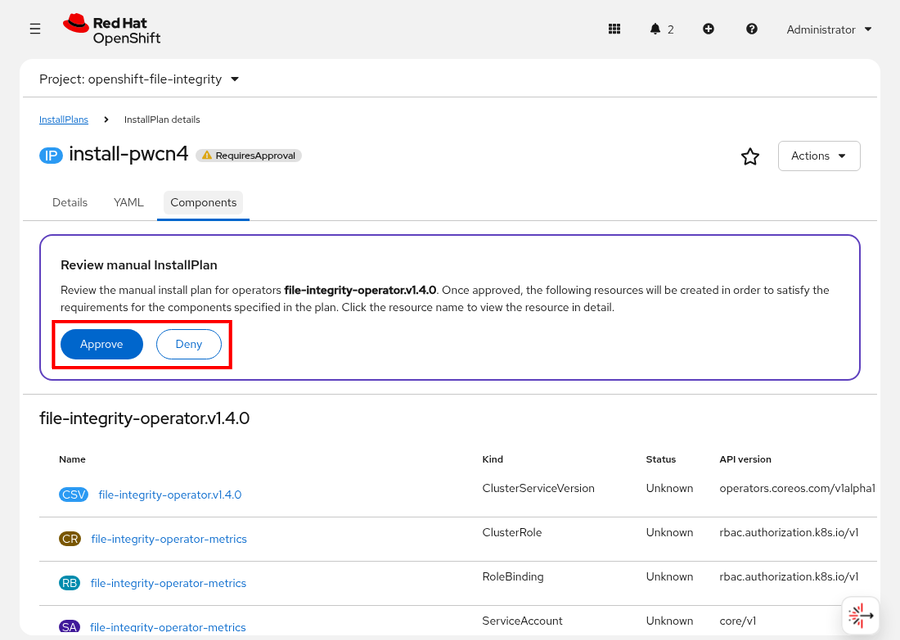

### Cập nhật Operator và Cập nhật Cluster
Các Operator có thể không tương thích với các phiên bản OpenShift về sau. Ví dụ, một Operator sử dụng API đã bị loại bỏ trong các phiên bản OpenShift mới hơn sẽ không hoạt động chính xác khi cluster được cập nhật. Các Operator có thể xác định danh sách các phiên bản OpenShift tương thích.

> **Cảnh báo:** Cluster Version Operator (CVO) sẽ chặn quá trình nâng cấp cụm nếu có bất kỳ Operator đã cài đặt nào không tương thích với phiên bản OpenShift đích. Cụm sẽ chuyển sang trạng thái không thể nâng cấp với điều kiện: `Upgradeable=False`, lý do: `IncompatibleOperatorsInstalled`. Bạn cần cập nhật Operator đó lên phiên bản tương thích, hoặc gỡ cài đặt Operator không tương thích và cài đặt lại sau khi hoàn tất nâng cấp cụm.

Trước khi cập nhật cụm, hãy xem xét và cài đặt các bản cập nhật operator cần thiết để đảm bảo tính tương thích. Nếu không có bản cập nhật tương thích nào, bạn phải cập nhật cụm bằng cách gỡ cài đặt các operator không tương thích.

#### Gỡ cài đặt Operator
Bạn có thể gỡ cài đặt các Operator bằng cách sử dụng bảng điều khiển web hoặc lệnh `oc`. Trên bảng điều khiển, hãy truy cập **Ecosystem** → **Installed Operators** và tìm Operator đó. Nhấp vào menu dấu ba chấm dọc (⋮) rồi chọn **Uninstall Operator**.

**Hình 9.13: Nút gỡ cài đặt Operator**  
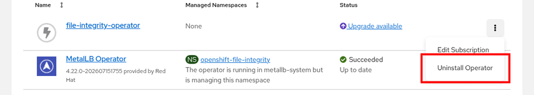

Sau khi xác nhận thao tác bằng cách nhấp vào **Uninstall** (Gỡ cài đặt), OLM sẽ gỡ cài đặt operator.

Ngoài ra, bạn có thể xóa subscription (đăng ký) và cluster service version (phiên bản dịch vụ cụm) bằng cách sử dụng lệnh `oc`.

> **Quan trọng:** Việc gỡ cài đặt một operator có thể để lại các tài nguyên của operator đó trên cụm. Hãy luôn tham khảo tài liệu về operator để nắm được quy trình dọn dẹp cần thiết nhằm loại bỏ hoàn toàn operator.

### Cập nhật Operator với OLM v1
RHOCP 4.22 bao gồm OLM v1 như một tính năng đã sẵn sàng sử dụng rộng rãi (GA). OLM v1 giới thiệu mô hình khai báo (declarative model) được xây dựng dựa trên API ClusterExtension, đồng thời thay thế các tài nguyên Subscription và InstallPlan mà OLM Classic sử dụng.
Lưu ý

Trong RHOCP 4.22, các thao tác với OLM v1 chỉ được thực hiện qua giao diện dòng lệnh (CLI). Các trang "Installed Operators" (Operator đã cài đặt) và "Software Catalog" (Danh mục phần mềm) trên bảng điều khiển web không hiển thị các thành phần của OLM v1. Bạn có thể tạo và xem các tài nguyên ClusterExtension bằng cách sử dụng các trang "Import YAML" và "Search".

Để cập nhật một Operator do OLM v1 quản lý, hãy chỉnh sửa tài nguyên tùy chỉnh (CR) ClusterExtension để chỉ định phiên bản hoặc kênh (channel) mới.

* OLM v1 hỗ trợ một số phương thức chỉ định phiên bản:
* Cố định (pin) một phiên bản cụ thể bằng `spec.source.catalog.version`
* Xác định phạm vi phiên bản, chẳng hạn như ">=1.14, <1.16"
* Theo dõi một kênh bằng cách chỉ định `spec.source.catalog.channels`

Sau khi chỉnh sửa CR ClusterExtension, hãy áp dụng các thay đổi bằng lệnh `oc apply`. OLM v1 sẽ xác định lộ trình cập nhật và tiến hành cài đặt phiên bản mới.

```bash
$ oc get clusterextension operator-name -o yaml
```

```yaml
...output omitted...
status:
  install:
    bundle:
      version: "1.15.0" # (1)
  conditions:
  - type: Installed
    status: "True"
    reason: Succeeded # (2)
...output omitted...
```

1. Trường phiên bản hiển thị phiên bản hiện đang được cài đặt.
2. Lý do "Succeeded" (Thành công) xác nhận rằng quá trình cập nhật đã hoàn tất thành công.
