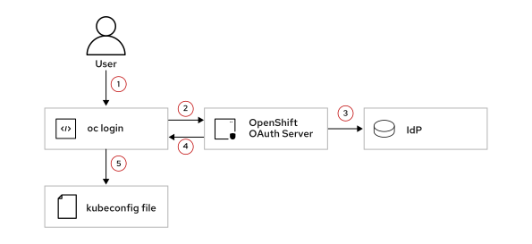
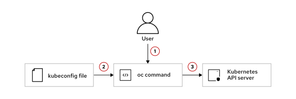
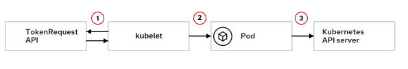

Quản trị Red Hat OpenShift III: Mở rộng quy mô triển khai trong doanh nghiệp
----------------------------------------------------------------------------

# Chương 1. Xác thực và Quản lý danh tính
## Máy chủ OAuth và Trình cung cấp danh tính của OpenShift
### Xác thực các yêu cầu API
Quá trình xác thực đảm bảo rằng chỉ những người dùng đã được xác thực mới có thể truy cập vào cụm OpenShift. Để tương tác với cụm OpenShift, người dùng phải thực hiện xác thực với Kubernetes API. Sau khi người dùng xác thực thành công với cụm, lớp ủy quyền sẽ chấp nhận hoặc từ chối yêu cầu API tùy thuộc vào quyền truy cập của người dùng đó.

#### Xác thực trong Kubernetes
Quá trình xác thực trong Kubernetes kiểm tra tính hợp lệ của chữ ký trên token hoặc chứng chỉ máy khách (client certificate) do người dùng cung cấp. Kubernetes hỗ trợ mọi phương thức xác thực, miễn là kết quả cuối cùng của phương thức đó là một token hoặc chứng chỉ máy khách. Do Kubernetes không thể tự thực hiện quy trình đăng nhập, bạn cần các công cụ bổ sung để triển khai các phương thức xác thực bên ngoài. Các thành phần cốt lõi trong cơ chế xác thực của Kubernetes bao gồm API server và các plugin xác thực. API server là thành phần trung tâm của mặt phẳng điều khiển (control plane), chịu trách nhiệm xử lý các yêu cầu gửi đến. Khi một yêu cầu đến API server, nó sẽ chuyển tiếp yêu cầu đó tới plugin xác thực phù hợp. Plugin xác thực sẽ kiểm tra tính hợp lệ của thông tin xác thực được cung cấp và xác định xem máy khách đã được xác thực hay chưa.

Ví dụ: Kubernetes coi là đã xác thực đối với bất kỳ người dùng nào xuất trình được chứng chỉ hợp lệ do một cơ quan cấp chứng chỉ (CA) đáng tin cậy ký. Kubernetes đọc trường "subject" (chủ thể) từ chứng chỉ, sau đó gán tên người dùng (username) và các nhóm (groups) tương ứng dựa trên các trường "Common Name" (CN) và "Organization" (O). Kubernetes sẽ chấp nhận hoặc từ chối yêu cầu API của người dùng tùy thuộc vào các quy tắc kiểm soát truy cập dựa trên vai trò (RBAC) được cấu hình cho tên người dùng và nhóm đó.

Kubernetes từ chối mọi yêu cầu có token truy cập hoặc chứng chỉ không hợp lệ bằng cách trả về lỗi 401 Unauthorized (Không được phép truy cập).

Nếu yêu cầu không cung cấp token truy cập hoặc chứng chỉ, Kubernetes sẽ gán cho yêu cầu đó người dùng hệ thống `system:anonymous` và nhóm hệ thống `system:unauthenticated`. Sau khi gán người dùng ẩn danh (anonymous user) cho yêu cầu, Kubernetes sử dụng các chính sách RBAC để xác định xem người dùng ẩn danh đó có quyền truy cập phù hợp để thực hiện hành động được yêu cầu hay không. Các nhóm hệ thống sẽ được giải thích chi tiết hơn ở phần sau của mục này.

#### Xác thực trong OpenShift
OpenShift mở rộng các cơ chế xác thực của Kubernetes để cung cấp thêm các tính năng và khả năng tích hợp với các hệ thống bên ngoài. OpenShift bao gồm máy chủ OAuth tích hợp sẵn—thành phần không có trong Kubernetes. Máy chủ OAuth của OpenShift đảm nhiệm việc xác thực người dùng và cấp các mã thông báo (token) OAuth cho phép truy cập vào các tài nguyên cụ thể.

Bạn có thể xác thực với OpenShift bằng các phương thức sau:

**Chứng chỉ máy khách X.509**  
Sử dụng chứng chỉ máy khách X.509 để xác thực với máy chủ API. Máy chủ API sẽ kiểm tra tính hợp lệ của chứng chỉ máy khách dựa trên một cơ quan cấp chứng chỉ (CA) đáng tin cậy. Phương thức xác thực này yêu cầu kết nối HTTPS tới máy chủ API. Cơ chế xác thực bằng chứng chỉ máy khách trong OpenShift tương tự như trong Kubernetes. Chứng chỉ máy khách sẽ được giải thích chi tiết hơn ở phần sau của khóa học này.

**Token truy cập OAuth**  
Trong OpenShift, mặt phẳng điều khiển (control plane) bao gồm một máy chủ OAuth tích hợp sẵn có chức năng tạo ra các mã thông báo truy cập OAuth. OpenShift cấu hình sẵn để Kubernetes tin cậy các mã thông báo do máy chủ OAuth nội bộ của chính nó cấp. Do đó, sau khi bạn đăng nhập vào máy chủ OAuth của OpenShift, Kubernetes sẽ xác thực các yêu cầu bằng cách tin cậy các mã thông báo mà máy chủ OAuth nội bộ đã cấp.

#### Máy chủ OpenShift OAuth
Theo mặc định, OpenShift cung cấp một "authentication operator" (toán tử xác thực) có nhiệm vụ vận hành máy chủ OAuth nội bộ. Máy chủ OAuth này cấp các token truy cập OAuth cho người dùng để thực hiện xác thực thông qua API. Để cấu hình xác thực, máy chủ OpenShift OAuth hỗ trợ nhiều nhà cung cấp danh tính (IdP) khác nhau, cho phép tích hợp với các hệ thống quản lý danh tính như OpenID Connect và máy chủ LDAP. Một số IdP được cung cấp còn hỗ trợ các quy trình OAuth tùy chỉnh từ các dịch vụ internet, chẳng hạn như GitHub. Máy chủ OpenShift OAuth chỉ hoạt động với các IdP được hỗ trợ cụ thể và bạn không thể thêm các IdP khác.

Cách phổ biến nhất để xác thực với cụm OpenShift là sử dụng lệnh `oc login` trong giao diện dòng lệnh (CLI). Lệnh `oc login` sử dụng máy chủ OpenShift OAuth để xác thực người dùng thông qua một IdP. Sau đó, máy chủ OpenShift OAuth sẽ tạo ra một token truy cập OAuth để người dùng sử dụng cho việc xác thực các yêu cầu API của họ.

Sơ đồ dưới đây tóm tắt quy trình xác thực khi bạn sử dụng lệnh `oc login`:



*Quy trình xác thực cho lệnh `oc login`*

1. Người dùng thực thi lệnh `oc login` và cung cấp tên người dùng cùng mật khẩu.
2. OpenShift gửi thông tin xác thực từ lệnh `oc login` đến máy chủ OAuth nội bộ.
3. Máy chủ OAuth nội bộ xác thực thông tin đăng nhập với IdP.
4. Máy chủ OAuth nội bộ tạo mã truy cập (access token) OAuth cho người dùng.
5. OpenShift lưu trữ mã truy cập OAuth trong tệp `kubeconfig` (mặc định nằm tại `~/.kube/config`).

Bạn có thể xác minh hai điểm cuối mà lệnh `oc login` sử dụng—cụ thể là các route của máy chủ API và máy chủ OAuth—bằng cách tăng mức độ ghi nhật ký:

```console
[user@host ~]$ oc login -u user -p password https://api.lab.example.com:6443 \
--loglevel 7
I0929 ...] HEAD https://api.lab.example.com:6443/
I0929 ...] Request Headers:
I0929 ...] Response Status: 403 Forbidden in 20 milliseconds
...output omitted...
I0929 ...] GSSAPI Enabled
I0929 ...] GET https://api.lab.example.com:6443/.well-known/oauth-authorization-server
I0929 ...] Request Headers:
I0929 ...]     X-Csrf-Token: 1
I0929 ...] Response Status: 200 OK in 0 milliseconds
I0929 ...] using system roots as no error was encountered
I0929 ...] GET https://oauth-openshift.apps.lab.example.com/oauth/authorize?client_id=openshift-challenging-client&code_challenge=B8RP...aCtk&code_challenge_method=S256&redirect_uri=https%3A%2F%2Foauth-openshift.apps.lab.example.com%2Foauth%2Ftoken%2Fimplicit&response_type=code
...output omitted...
```

> **Lưu ý:** Bạn có thể lấy token từ bảng điều khiển web, sau đó sử dụng lệnh `oc login --token TOKEN` để đăng nhập vào cụm (cluster) từ CLI. Khi bạn chỉ định tùy chọn `--token`, lệnh sẽ sử dụng token mà bạn cung cấp và không kết nối với máy chủ OAuth.

Quy trình xác thực này cũng tương tự khi sử dụng giao diện web (web console) của OpenShift thay vì CLI, ngoại trừ việc giao diện web lưu trữ token trong bộ nhớ trình duyệt thay vì trong tệp kubeconfig. Hai điểm cuối (endpoint) phục vụ việc đăng nhập—bao gồm máy chủ API và máy chủ OAuth—là lý do khiến bạn phải chấp nhận hai chứng chỉ máy chủ trong lần đầu tiên đăng nhập vào giao diện web OpenShift.

Sau khi nhận được token truy cập OAuth, mỗi khi người dùng thực thi lệnh OpenShift CLI, hệ thống sẽ sử dụng thông tin xác thực được lưu trong tệp kubeconfig để xác thực người dùng với máy chủ API Kubernetes. Chi tiết về tệp kubeconfig sẽ được giải thích ở phần sau của khóa học này.

Sơ đồ dưới đây tóm tắt quy trình hoạt động khi bạn sử dụng OpenShift CLI sau khi đã xác thực bằng lệnh `oc login`:



Xác thực API sử dụng thông tin xác thực được lưu trong tệp kubeconfig

1. Người dùng truy cập Kubernetes API bằng lệnh `oc`.
2. OpenShift đọc thông tin xác thực từ tệp kubeconfig.
3. OpenShift sử dụng thông tin xác thực từ tệp kubeconfig để xác thực với máy chủ Kubernetes API.

Bạn cũng có thể lấy mã truy cập người dùng OAuth từ máy chủ OpenShift OAuth bằng cách sử dụng các endpoint `namespace_route/oauth/authorize` và `namespace_route/oauth/token`.

#### Cấu hình OpenShift OAuth Server
Để IdP có thể xác thực danh tính của người yêu cầu, bạn cần cấu hình và kích hoạt ít nhất một IdP trong OAuth server. Khi người dùng yêu cầu một OAuth access token mới, OAuth server sẽ sử dụng các IdP đã được cấu hình để xác định danh tính của người đó. Sau khi người dùng đăng nhập thành công vào cluster, OAuth server sẽ tạo OAuth access token cho người dùng, đồng thời OpenShift sẽ tạo các tài nguyên định danh (identity) và người dùng (user).

Đối với các cluster trong môi trường sản xuất (production), việc cấu hình nhiều IdP trong OAuth server nội bộ là điều phổ biến. Ví dụ dưới đây trình bày các tham số cho tài nguyên tùy chỉnh (CR) dùng để cấu hình hai IdP trong OAuth server. Ví dụ này sử dụng htpasswd và LDAP làm các IdP.

```yaml
apiVersion: config.openshift.io/v1
kind: OAuth
metadata:
  name: cluster
spec:
  identityProviders: (1)
  - name: htpasswd-idp-name (2)
    mappingMethod: claim (3)
    type: HTPasswd
    htpasswd:
      fileData:
        name: htpasswd-secret (4)
  - name: ldap-idp-name
    mappingMethod: claim
    type: LDAP
    ldap:
...output omitted...
```

1. Mảng `identityProviders` chứa thông tin của tất cả các IdP được cấu hình trong cụm (cluster) của bạn.
2. OpenShift thêm tên nhà cung cấp vào trước giá trị của `identity claim` để tạo thành tên định danh (identity name), đồng thời sử dụng `identity claim` này để xây dựng URL chuyển hướng.
3. Tham số `mappingMethod` kiểm soát cách OpenShift thiết lập mối liên kết giữa các định danh IdP và các tài nguyên User.
4. Tài nguyên secret của OpenShift chứa thông tin người dùng và mật khẩu.

#### Xác thực trực tiếp qua OIDC bên ngoài
Red Hat OpenShift Container Platform (RHOCP) phiên bản 4.20 đã bổ sung tính năng cho phép cấu hình Kubernetes API server để tin cậy trực tiếp một nhà cung cấp danh tính (IdP) OIDC bên ngoài, thay vì thông qua máy chủ OAuth tích hợp sẵn. Chế độ xác thực trực tiếp qua OIDC bên ngoài này là một giải pháp thay thế cho quy trình truyền thống, trong đó máy chủ OAuth nội bộ đóng vai trò trung gian thực hiện xác thực với IdP đã được cấu hình.

Với cơ chế xác thực trực tiếp, các client sẽ lấy token từ nhà cung cấp OIDC bên ngoài (ví dụ: Red Hat build of Keycloak) và trình các token đó trực tiếp cho API server. API server sẽ xác thực các token này thông qua nhà cung cấp bên ngoài và không tự cấp phát token truy cập OAuth riêng. Chế độ này loại bỏ máy chủ OAuth nội bộ khỏi quy trình xác thực, giúp giảm số lượng thành phần cần quản lý và đưa OpenShift về đúng chuẩn cơ chế xác thực OIDC của Kubernetes. Việc tích hợp trực tiếp cũng mang lại các tính năng nâng cao từ nhà cung cấp OIDC của bạn, đồng thời tập trung hóa việc quản lý người dùng và nhóm trên nhiều cụm (cluster) thông qua một giao diện duy nhất.

Để kích hoạt chế độ này, bạn cần cấu hình nhà cung cấp bên ngoài trong tài nguyên tùy chỉnh (custom resource) `Authentication` với thiết lập loại là `OIDC`, thay vì cấu hình IdP trong tài nguyên tùy chỉnh `OAuth`. Khi bạn kích hoạt xác thực trực tiếp qua OIDC bên ngoài, toán tử xác thực cụm (cluster authentication operator) sẽ vô hiệu hóa máy chủ OAuth nội bộ, và cấu hình IdP trong tài nguyên tùy chỉnh `OAuth` sẽ không còn hiệu lực.

> **Quan trọng:** Trước khi kích hoạt xác thực trực tiếp OIDC bên ngoài, hãy sao lưu cấu hình xác thực hiện tại và duy trì một phương thức truy cập quản trị thay thế, chẳng hạn như chứng chỉ máy khách `system:admin`. Nếu nhà cung cấp danh tính bên ngoài không khả dụng, bạn sẽ cần phương thức truy cập thay thế này để khôi phục cụm (cluster).

Việc cấu hình xác thực trực tiếp qua OIDC bên ngoài sẽ được giải thích ở phần sau của khóa học này, trong mục xác thực OIDC.

### Người dùng, Nhóm và Danh tính
Người dùng, nhóm và danh tính đóng vai trò quan trọng trong việc quản lý quyền truy cập và quyền hạn trong cụm (cluster).

#### Người dùng, Nhóm và Danh tính trong Kubernetes
Kubernetes không có các tài nguyên đại diện cho tài khoản người dùng, nhóm hay danh tính. Trong Kubernetes, người dùng và nhóm chỉ là các chuỗi ký tự được hệ thống đọc từ chứng chỉ máy khách (client certificate) hoặc từ các token.

Ví dụ: nếu bạn sử dụng chứng chỉ máy khách, Kubernetes sẽ lấy trường "Common Name" (CN) để làm tên người dùng và các trường "Organization" (O) để xác định nhóm. Sau đó, Kubernetes sử dụng tên người dùng và thông tin nhóm này để cho phép hoặc từ chối yêu cầu API dựa trên các chính sách RBAC.

Đối với service account (tài khoản dịch vụ) — loại tài khoản mà Kubernetes chủ yếu dùng để cấp quyền cho các pod và các tài nguyên khác tương tác với API server — hệ thống chỉ thêm chuỗi định danh service account vào chứng chỉ hoặc token của tài khoản đó để khớp với các chính sách RBAC. Service account sẽ được giải thích chi tiết hơn ở phần sau của khóa học này.

#### Các nhóm hệ thống (System Groups)

Các nhóm hệ thống hay nhóm ảo là những nhóm được định nghĩa sẵn, tích hợp trong hệ thống nhằm cấp các quyền hạn và quyền truy cập cụ thể cho những nhóm người dùng nhất định. Kubernetes tạo ra các nhóm này trong quá trình thiết lập để kiểm soát quyền truy cập vào các thành phần và tài nguyên quan trọng bên trong cụm (cluster). Các nhóm này là một phần của ClusterRole và ClusterRoleBinding; do đó, chúng thuộc hệ thống RBAC trong Kubernetes.

**system:authenticated:** Tất cả người dùng đã xác thực trong cụm, bất kể vai trò hay namespace của họ.

**system:authenticated:oauth:** Tất cả người dùng đã xác thực và có mã thông báo truy cập (access token) OAuth trong cụm.

**system:unauthenticated:** Người dùng chưa xác thực, tức là những người chưa vượt qua bất kỳ quy trình xác thực nào.

**system:masters:** Người dùng có quyền quản trị đối với cụm. Các thành viên của nhóm này có toàn quyền kiểm soát mọi tài nguyên và hành động trong cụm, bao gồm cả các hoạt động và công tác quản lý ở cấp độ cụm.

Kubernetes API server sẽ bổ sung các chuỗi định danh của nhóm hệ thống vào các chuỗi định danh người dùng và nhóm lấy từ chứng chỉ máy khách (client certificate) hoặc mã thông báo (token) khi các thông tin này hiện diện. Sau đó, Kubernetes sử dụng các quy tắc RBAC để chấp thuận hoặc từ chối yêu cầu dựa trên thông tin người dùng và nhóm đó.

Ví dụ: nếu người dùng không cung cấp mã thông báo truy cập hoặc chứng chỉ, Kubernetes sẽ gán chuỗi định danh nhóm `system:unauthenticated` cho yêu cầu đó, và các chính sách RBAC sẽ cho phép hoặc từ chối yêu cầu tùy thuộc vào cấu hình quy tắc RBAC.

#### Người dùng, Nhóm và Danh tính trong OpenShift

OpenShift bao gồm tài nguyên User (Người dùng), dùng để định nghĩa các người dùng thông thường trong cụm (cluster). Người dùng thông thường thường là các cá nhân tương tác với cụm OpenShift. Máy chủ OAuth nội bộ của OpenShift sẽ tự động tạo tài nguyên người dùng khi họ đăng nhập vào cụm lần đầu tiên thông qua một IdP (Nhà cung cấp danh tính). Bạn cũng có thể thêm người dùng vào cụm theo cách thủ công bằng cách sử dụng Kubernetes API.

OpenShift bao gồm tài nguyên Group (Nhóm), dùng để định nghĩa các nhóm trong cụm. Nhóm là tập hợp logic các người dùng có chung yêu cầu về quyền truy cập. OpenShift cho phép người dùng là thành viên của một hoặc nhiều nhóm, giúp việc định nghĩa các chính sách kiểm soát truy cập trở nên linh hoạt. Việc sử dụng nhóm giúp đơn giản hóa hệ thống phân quyền trong cụm, cho phép cấp quyền cho nhiều người dùng cùng lúc thay vì thực hiện riêng lẻ cho từng người. Máy chủ OAuth nội bộ của OpenShift sẽ tự động tạo tài nguyên nhóm khi người dùng đăng nhập vào cụm lần đầu tiên thông qua IdP hỗ trợ OpenID Connect (OIDC). Tuy nhiên, đối với hầu hết các IdP được hỗ trợ khác (chẳng hạn như LDAP), bạn phải tự quản lý tài nguyên nhóm trong OpenShift.

OpenShift bao gồm tài nguyên Identity (Danh tính), dùng để định nghĩa các danh tính trong cụm. Tài nguyên danh tính lưu lại thông tin về các lần xác thực thành công của một người dùng cụ thể thông qua một IdP nhất định. Các danh tính trong OpenShift tương ứng với danh tính bên ngoài của người dùng. OpenShift thực hiện ánh xạ danh tính người dùng từ các IdP sang tài nguyên người dùng tương ứng. Nhờ có danh tính, người dùng có thể đăng nhập vào OpenShift bằng chính thông tin xác thực hiện có của họ tại các IdP.

### Các phương thức ánh xạ của máy chủ OAuth
Khi người dùng đăng nhập vào cụm (cluster) lần đầu tiên thông qua một IdP (Nhà cung cấp danh tính), OpenShift sẽ tạo ra tài nguyên người dùng (user resource) và tài nguyên danh tính (identity resource), sau đó thực hiện ánh xạ chúng. OpenShift tạo tài nguyên người dùng bằng cách sử dụng tên người dùng ưu tiên (preferred username) từ IdP.

Khi nhiều IdP khác nhau được cấu hình trong máy chủ OAuth của OpenShift, có thể xảy ra trường hợp nhiều IdP cung cấp cùng một tên người dùng cho một người dùng, dẫn đến xung đột. Với tham số `mappingMethod` trong máy chủ OAuth, bạn có thể kiểm soát cách OpenShift thiết lập ánh xạ giữa danh tính từ nhà cung cấp và tài nguyên người dùng, qua đó tránh được các xung đột này.

Bạn có thể sử dụng một trong các giá trị sau:

**claim:** OpenShift tạo mới một người dùng với tên người dùng ưu tiên từ danh tính đó. Tuy nhiên, thao tác này sẽ thất bại nếu đã có một người dùng mang tên đó được ánh xạ với một danh tính khác. Đây là giá trị mặc định cho tham số `mappingMethod`.

**add:** OpenShift tạo mới một người dùng với tên người dùng ưu tiên từ danh tính đó. Nếu đã tồn tại người dùng mang tên đó trong OpenShift, hệ thống sẽ ánh xạ danh tính mới vào người dùng hiện có và bổ sung danh tính mới này vào các ánh xạ danh tính hiện có của người dùng đó. Hãy sử dụng phương thức này khi bạn cấu hình nhiều IdP cùng xác định một tập hợp người dùng và ánh xạ tới cùng các tên người dùng.

**lookup:** OpenShift tìm kiếm danh tính, ánh xạ danh tính-người dùng và người dùng hiện có, nhưng không tự động tạo mới người dùng hay danh tính. Do đó, với phương thức này, bạn phải tạo người dùng theo cách thủ công. Phương thức này cho phép quản trị viên cụm thiết lập danh tính và người dùng bằng tay hoặc thông qua một quy trình bên ngoài.

### Xác thực trên cụm OpenShift mới
Trong quá trình cài đặt ban đầu của cụm, OpenShift tạo ra hai phương thức xác thực có quyền quản trị: sử dụng người dùng `kubeadmin` và sử dụng chứng chỉ máy khách (client certificate) cho người dùng `system:admin` trong tệp `kubeconfig`.

> **Lưu ý:** Tài khoản người dùng `kubeadmin` chỉ tồn tại trong các cụm OpenShift do người dùng tự quản lý. Các dịch vụ đám mây, chẳng hạn như Red Hat OpenShift Dedicated và Red Hat OpenShift Service on AWS (ROSA), không sử dụng người dùng `kubeadmin`. Các dịch vụ đám mây cung cấp thông tin xác thực người dùng ban đầu thông qua bảng điều khiển và API của nhà cung cấp dịch vụ đám mây theo những cách khác nhau.

Các người dùng `kubeadmin` và `system:admin` đều có vai trò `cluster-admin`, do đó OpenShift cấp quyền truy cập quản trị cho các tài khoản này theo mặc định. Chỉ nên sử dụng tài khoản người dùng `kubeadmin` trong giai đoạn thiết lập và khởi tạo cụm. Red Hat khuyến nghị xóa người dùng `kubeadmin` hiện có sau khi bạn đã tạo một người dùng quản trị với vai trò `cluster-admin` để tăng cường tính bảo mật cho cụm. Vì vậy, hãy cấu hình IdP trên máy chủ OAuth và tạo người dùng quản trị có vai trò `cluster-admin` trước khi xóa người dùng `kubeadmin`. Hãy lưu trữ chứng chỉ máy khách (client certificate) của `system:admin` ở nơi an toàn để có thể sử dụng cho các tác vụ khôi phục.

Mật khẩu của người dùng `kubeadmin` có trong phần thông tin đầu ra được tạo ra khi cụm OpenShift hoàn tất quá trình cài đặt, cũng như trong các tệp nhật ký (log file) tương ứng. Tệp nhật ký này cũng cung cấp đường dẫn đến tệp `kubeconfig` đã được tạo, trong đó chứa chứng chỉ máy khách dành cho người dùng `system:admin`. Ví dụ sau đây hiển thị thông tin đầu ra của cụm OpenShift bao gồm chi tiết về người dùng `kubeadmin`:

```
...output omitted...
INFO Install complete!
INFO To access the cluster as the system:admin user when using 'oc', run 'export KUBECONFIG=/home/lab/lab/auth/kubeconfig' (1)
INFO Access the OpenShift web-console here: https://console-openshift-console.apps.lab.example.com
INFO Login to the console with user: "kubeadmin", and password: "iMcm5-eCy2Q-PH66E-NkyPN" (2)
INFO Time elapsed: 10m52s
...output omitted...
```

1. Đường dẫn đến tệp `kubeconfig` được tạo có chứa chứng chỉ máy khách
2. Mật khẩu duy nhất của người dùng `kubeadmin`

> **Cảnh báo:** Việc xóa người dùng kubeadmin là thao tác không thể hoàn tác. Nếu bạn xóa người dùng kubeadmin trước khi tạo một người dùng quản trị khác, bạn sẽ mất quyền truy cập quản trị vào cụm OpenShift và buộc phải cài đặt lại cụm này.

Để xóa người dùng kubeadmin khỏi cụm của bạn, hãy đăng nhập với tư cách quản trị viên và chạy lệnh sau:

```console
[user@host ~]$ oc delete secrets kubeadmin -n kube-system
```

## Xác thực LDAP
### Dịch vụ LDAP
Sau khi bạn cài đặt cụm Red Hat OpenShift Container Platform (RHOCP) mới, chỉ tồn tại một người dùng kubeadmin. Tiếp theo, quản trị viên cụm phải tạo người dùng và nhóm hoặc phổ biến hơn là tích hợp một hệ thống kinh doanh vừa cung cấp các thực thể này vừa quản lý xác thực. Khi làm như vậy, cụm OpenShift áp dụng phương pháp xác thực mạng công ty nhất quán với các hệ thống kinh doanh khác và kế thừa các triển khai bảo mật hiện có tại chỗ, chẳng hạn như các hạn chế truy cập của công ty có sẵn thông qua kết nối dựa trên VPN.

Tích hợp phương thức xác thực hiện có cũng như những người dùng và nhóm có sẵn trong tổ chức của bạn bằng cách sử dụng máy chủ Giao thức truy cập thư mục hạng nhẹ (LDAP) là một cách tiếp cận phổ biến đối với nhiều doanh nghiệp. Máy chủ thư mục LDAP xác định giao thức ứng dụng tiêu chuẩn để truy vấn hệ thống nhằm xác thực người dùng và nhóm. Ngoài ra, tích hợp LDAP hỗ trợ các dịch vụ Red Hat Identity Management (IdM) và Microsoft Active Directory (AD), được nhiều tổ chức sử dụng để quản lý xác thực. IdM là giải pháp quản lý chính sách và danh tính của Red Hat, giải pháp này quản lý các miền Linux và thực thi kiểm soát truy cập dựa trên máy chủ.

Bạn có thể định cấu hình máy chủ LDAP làm Nhà cung cấp danh tính (IdP) để liên kết xác thực giữa các mục nhận dạng LDAP và người dùng cụm thông qua máy chủ OpenShift OAuth. Khi người dùng nhập thông tin xác thực cho cụm, máy chủ OAuth sẽ bắt đầu kết nối và truy vấn tương ứng với máy chủ LDAP, đồng thời tạo liên kết khi tìm kiếm trả về một mục nhập trùng khớp duy nhất.

Mặc dù việc triển khai này đủ để xác thực người dùng nhưng bạn vẫn phải xác định quyền truy cập cho người dùng dựa trên tư cách thành viên và vai trò của nhóm. Hơn nữa, bạn phải định cấu hình cụm OpenShift để đồng bộ hóa các nhóm từ thư mục LDAP và xác định quyền truy cập và quyền thích hợp cho từng nhóm.

> **Lưu ý:** Phần này không đi sâu vào việc quản trị LDAP mà chỉ cung cấp các thông tin cần thiết để cấu hình tích hợp LDAP trong cụm RHOCP.

### Xác thực sử dụng LDAP
Giao thức LDAP định nghĩa một ngôn ngữ truy vấn để lấy các mục dữ liệu từ máy chủ LDAP từ xa; các mục này có thể chứa thông tin về người dùng và nhóm trong tổ chức.

Khi triển khai máy chủ LDAP làm OpenShift OAuth IdP, cụm (cluster) có thể dựa vào máy chủ LDAP để xác thực thông tin đăng nhập do người dùng cung cấp.

#### Cấu trúc thư mục LDAP
Thư mục LDAP sử dụng cấu trúc cây phân cấp, tương tự như hệ thống tập tin hoặc hệ thống phân cấp DNS, nhưng thư mục này thường lưu trữ dữ liệu tổ chức, chẳng hạn như tài khoản người dùng và thông tin thành viên nhóm.

Trong hệ thống tập tin, bạn đặt các tập tin vào trong các thư mục. Tương tự như vậy, trong thư mục LDAP, bạn tổ chức các mục dữ liệu (entry) theo dạng cây.

Một cách nhìn khác về LDAP là so sánh nó với DNS. Ví dụ, bạn đọc tên DNS `front-server.it.example.com` theo chiều từ phải sang trái: cấp `example.com` quản lý miền `it`, và miền này lại quản lý máy chủ `front-server`. Hãy xem xét mục dữ liệu sau trong thư mục LDAP: `uid=wlombardo,ou=people,dc=example,dc=com`. Mục cấp cao nhất `dc=example,dc=com` chứa nhánh `ou=people` dùng để nhóm các tài khoản người dùng lại với nhau. Cuối cùng, mục `uid=wlombardo` cung cấp thông tin chi tiết về người dùng.

Một mục dữ liệu (entry) lưu trữ thông tin về một đối tượng thư mục, chẳng hạn như tài khoản người dùng. Mỗi mục bao gồm các thuộc tính mô tả đặc điểm của đối tượng đó. Ví dụ, thuộc tính `uid` cung cấp mã định danh của tài khoản, còn thuộc tính `cn` cung cấp tên thông dụng (common name) hay tên đầy đủ của người dùng.

Tên phân biệt (Distinguished Name - DN) định danh duy nhất một mục dữ liệu trong cấu trúc cây. DN bao gồm ít nhất một thuộc tính của mục dữ liệu đó, cùng với đường dẫn đến gốc của cây thư mục. Ví dụ, DN `uid=wlombardo,ou=people,dc=example,dc=com` xác định mục dữ liệu dành cho tài khoản người dùng `wlombardo`.

Hầu hết các hệ thống triển khai LDAP không cho phép truy cập ẩn danh vào dữ liệu. Thay vào đó, bạn phải thực hiện thao tác "bind" (kết nối và xác thực) với máy chủ LDAP trước khi có thể truy vấn nội dung của thư mục. Trong LDAP, thao tác "bind" là quá trình mà máy khách (client) thực hiện xác thực danh tính của chính nó.

Để OpenShift có thể xác thực người dùng trong LDAP, các quản trị viên LDAP cần chuẩn bị một tài khoản LDAP mà OpenShift có thể sử dụng để truy vấn thư mục. OpenShift gọi tài khoản này là "bind DN".

#### Truy vấn LDAP qua CLI
Để kiểm tra, xác thực và khắc phục sự cố kết nối LDAP trước khi cấu hình OpenShift, bạn có thể sử dụng lệnh `ldapsearch`.

Lệnh `ldapsearch` có sẵn trong gói RPM `openldap-clients` và cung cấp một tiện ích truy vấn dòng lệnh để thực hiện các thao tác với LDAP. Ví dụ sau đây minh họa định dạng của một truy vấn LDAP sử dụng lệnh `ldapsearch`:

```console
[user@host ~]$ ldapsearch -x -W -D bind_dn -H ldap_host_URI \
-b search_base filter attributes
```

Ví dụ này sử dụng các tham số sau:

* Tùy chọn `-x` chỉ định sử dụng phương thức xác thực đơn giản. 
* Tùy chọn `-W` yêu cầu bạn nhập mật khẩu cho bind DN được khai báo bằng tùy chọn -D. 
* Tùy chọn `-b search_base` xác định DN của nhánh mà tại đó quá trình tìm kiếm bắt đầu. 
* Tham số `filter` cho phép bạn giới hạn các mục dữ liệu mà lệnh trả về. Bạn có thể giới hạn kết quả chỉ bao gồm các mục thuộc một loại cụ thể, chẳng hạn như các mục tài khoản người dùng. 
* Tham số `attributes` liệt kê các thuộc tính sẽ được trả về trong kết quả đầu ra.

Bạn có thể sử dụng phương pháp này để kiểm tra thông tin xác thực cho máy chủ LDAP và truy xuất các mục LDAP khác nhau, chẳng hạn như người dùng và nhóm đã được định nghĩa.

Ví dụ sau đây sử dụng bộ lọc (uid=wlombardo) để giới hạn phạm vi tìm kiếm cho một tài khoản người dùng cụ thể. Lệnh này trả về các thuộc tính uid và cn:

```console
[user@host ~]$ ldapsearch -x -W -D "cn=administrator,dc=example,dc=com" \
-H ldap://ldap.example.com -b "ou=people,dc=example,dc=com" \
"(uid=wlombardo)" uid cn
Enter LDAP Password:
# extended LDIF
#
# LDAPv3
# base <ou=people,dc=example,dc=com> with scope subtree
# filter: (uid=wlombardo)
# requesting: uid cn
#

# wlombardo, people, example.com
dn: uid=wlombardo,ou=people,dc=example,dc=com
uid: wlombardo
cn: Wilhelm Lombardo

# search result
search: 2
result: 0 Success

# numResponses: 2
# numEntries: 1
```

#### LDAP URI
Việc cấu hình OpenShift để xác thực qua LDAP đòi hỏi bạn phải chuẩn bị một LDAP URI (Uniform Resource Identifier). Tương tự như các tùy chọn của lệnh `ldapsearch`, LDAP URI này cung cấp các tham số cần thiết để tìm kiếm bản ghi tài khoản người dùng trong thư mục.

LDAP URI được tạo thành theo cú pháp chuẩn hóa sau đây:

```
ldap://host:port/basedn?attributes?scope?filter
```

**ldap**  
Tên giao thức LDAP. Đối với LDAP qua SSL, hãy sử dụng giao thức ldaps. Red Hat khuyến nghị sử dụng StartTLS kết hợp với giao thức ldap thông thường.

**host:port**  
Tên máy chủ LDAP và cổng lắng nghe. Giá trị mặc định cho ldap là localhost:389 và cho ldaps là localhost:636.

**basedn**  
DN của nhánh nơi bắt đầu quá trình tìm kiếm.

**attributes**  
Danh sách các thuộc tính cần trả về, được phân tách bằng dấu phẩy.

**scope**  
Độ sâu tìm kiếm, có thể là base (đối tượng gốc), one (một cấp) hoặc sub (toàn bộ cây con). Giá trị mặc định là sub.

**filter**  
Bộ lọc LDAP giúp tinh chỉnh kết quả truy vấn. Nếu bạn không cung cấp bộ lọc, máy chủ sẽ trả về tất cả các mục.

Bảng dưới đây cung cấp thông tin tra cứu LDAP mẫu cho một tên người dùng cụ thể:

| Đối tượng URL       | Giá trị                     |
|---------------------|-----------------------------|
| Giao thức kết nối   | ldap                        |
| Tên máy chủ và cổng | ldap.example.com:389        |
| DN cơ sở - Base DN  | ou=people,dc=example,dc=com |
| Thuộc tính          | uid,cn                      |
| Bộ lọc truy vấn     | uid=wlombardo               |

Thông tin nêu trên sẽ dẫn đến URI sau đây cho việc tra cứu LDAP:

```
ldap://ldap.example.com:389/ou=people,dc=example,dc=com?uid,cn?(uid=wlombardo)
```

Thao tác tra cứu này trả về mục tên người dùng khớp với giá trị uid được cung cấp.

### Cấu hình máy chủ LDAP làm IdP cho OpenShift
Trong một cụm OpenShift, khi người dùng đăng nhập, OAuth LDAP IdP sẽ sử dụng bind DN và mật khẩu để kết nối với thư mục (directory) và tìm kiếm bản ghi người dùng.

Khi tìm thấy một kết quả khớp duy nhất, OpenShift sẽ gửi thông tin xác thực do người dùng cung cấp tới máy chủ LDAP trong một bước tương tác thứ hai, đồng thời tạo ra một liên kết xác thực giữa tài nguyên người dùng OpenShift với các giá trị LDAP ID và preferredUsername nhận được từ máy chủ.

Nếu yêu cầu xác thực không tìm thấy kết quả khớp, truy vấn sẽ thất bại và quá trình liên kết (bind) sẽ không diễn ra.

Mặc dù máy chủ LDAP thực hiện xác thực danh tính để tạo liên kết xác thực, quản trị viên cụm vẫn cần cấp các vai trò cụm (cluster role) phù hợp cho danh tính đó thông qua các thiết lập kiểm soát truy cập dựa trên vai trò (RBAC) của OpenShift. Quá trình cấu hình người dùng mới chỉ hoàn tất khi cả liên kết xác thực và vai trò đều đã được thiết lập.

Quản trị viên cần đồng bộ hóa các nhóm từ máy chủ LDAP như một bước cấu hình bổ sung ở phía cụm trước khi hoàn tất toàn bộ cấu hình LDAP IdP. Bạn cần tạo một cluster cron job để định kỳ truy vấn máy chủ LDAP và cập nhật các nhóm trong OpenShift, nhằm đảm bảo tính nhất quán giữa cụm và mọi thay đổi về các mục nhóm LDAP trong tổ chức.

Việc tích hợp máy chủ LDAP làm IdP cho cụm OpenShift đòi hỏi quy trình sau:

* Tạo một tài nguyên Secret trong OpenShift để lưu trữ mật khẩu dùng cho các truy vấn LDAP. Tài nguyên Secret này chứa thông tin bí mật đã được mã hóa Base64 trong trường `bindPassword`. 
* Tạo một tài nguyên ConfigMap trong OpenShift chứa bộ chứng chỉ của cơ quan cấp chứng chỉ (Certificate Authority bundle) (nếu máy chủ LDAP có sử dụng mã hóa).

> **Lưu ý:** Chỉ tạo tài nguyên bản đồ cấu hình (configuration map) này nếu LDAP IdP của bạn có chứng chỉ CA không có sẵn trong kho khóa (keystore) mặc định của hệ thống.

Tài nguyên OpenShift ConfigMap này thuộc về namespace openshift-config.

* Cập nhật tài nguyên OAuth của cụm để thêm cấu hình LDAP vào các mục IdP OAuth hiện có trên OpenShift.

#### Tạo tài nguyên Secret bindPassword
bindPassword cho cấu hình IdP được lưu trữ trong một tài nguyên Secret của OpenShift. Ví dụ sau đây là tệp YAML dùng để tạo Secret bindPassword cho một LDAP IdP:

```yaml
apiVersion: v1
kind: Secret
metadata:
  name: ldap-secret
  namespace: openshift-config
type: Opaque
data:
  bindPassword: base64-encoded-bind-password
```

> **Lưu ý:** Cần lưu ý rằng các quản trị viên cụm (cluster administrator) có thể đọc được mật khẩu được lưu trữ trong secret. Red Hat khuyến nghị sử dụng tài khoản LDAP có quyền hạn hạn chế cho bind DN.

#### Tạo Config Map cho Chứng chỉ
Các cấu hình LDAP dành cho OAuth IdP sử dụng tài nguyên Config Map của OpenShift trong namespace `openshift-config` để định nghĩa các bộ chứng chỉ của cơ quan cấp chứng chỉ (CA).

Hãy tạo một tài nguyên Config Map của OpenShift chứa chứng chỉ của cơ quan cấp chứng chỉ (CA). Bạn phải lưu trữ chứng chỉ này trong khóa `ca.crt` của tài nguyên Config Map.

Ví dụ sau đây là tệp YAML định nghĩa cách tạo tài nguyên Config Map cho bộ chứng chỉ:

```yaml
apiVersion: v1
kind: ConfigMap
metadata:
  name: ca-config-map
  namespace: openshift-config
data:
  ca.crt: |
    CA_certificate_PEM
```

#### Cập nhật tài nguyên OAuth
Ví dụ sau đây minh họa cấu hình để định nghĩa một LDAP IdP trong tệp YAML của tài nguyên OAuth:

```yaml
apiVersion: config.openshift.io/v1
kind: OAuth
metadata:
  name: cluster
spec:
  identityProviders:
  - name: LDAP Authentication (1)
    mappingMethod: claim (2)
    type: LDAP
    ldap:
      attributes:
        id: (3)
        - dn
        email: (4)
        - mail
        name: (5)
        - cn
        preferredUsername: (6)
        - uid
      bindDN: cn=administrator,dc=example,dc=com (7)
      bindPassword: (8)
        name: ldap-secret
      ca: (9)
        name: ca-config-map
      insecure: false (10)
      url: ldaps://ldap.example.com/dc=example,dc=com?uid (11)
```

1. Tên nhà cung cấp được hiển thị trên màn hình đăng nhập của bảng điều khiển web và trong danh sách các IdP đã được cấu hình.
2. Kiểm soát cách thiết lập ánh xạ giữa các danh tính của nhà cung cấp này và các đối tượng người dùng.
3. Danh sách các thuộc tính, trong đó thuộc tính đầu tiên có giá trị (không rỗng) sẽ được sử dụng. Yêu cầu phải có ít nhất một thuộc tính. Nếu không có thuộc tính nào trong danh sách có giá trị, quá trình xác thực sẽ thất bại.
4. Danh sách các thuộc tính được sử dụng làm địa chỉ email. Thuộc tính đầu tiên có giá trị sẽ được sử dụng.
5. Danh sách các thuộc tính được sử dụng làm tên hiển thị. Thuộc tính đầu tiên có giá trị sẽ được sử dụng.
6. Danh sách các thuộc tính được sử dụng làm tên người dùng ưu tiên khi cấp quyền (provisioning) cho người dùng ứng với danh tính này. Thuộc tính đầu tiên có giá trị sẽ được sử dụng.
7. DN (Distinguished Name) bắt buộc được sử dụng trong giai đoạn tìm kiếm, trừ khi tính năng tìm kiếm ẩn danh (anonymous search) đã được bật. Phải được thiết lập nếu tham số bindPassword đã được định nghĩa.
8. Tài nguyên secret của OpenShift bắt buộc chứa mật khẩu bind (bind password), trừ khi tính năng tìm kiếm ẩn danh đã được bật. Phải được thiết lập nếu tham số bindDN đã được định nghĩa.
9. Tùy chọn: Tham chiếu đến tài nguyên config map của OpenShift chứa bộ chứng chỉ (certificate authority bundle) được mã hóa theo định dạng PEM (Privacy-Enhanced Mail) để xác thực chứng chỉ máy chủ cho URL đã cấu hình. Chỉ được sử dụng khi trường insecure được đặt là false.
10. Khi được đặt là true, kết nối TLS tới máy chủ sẽ không được thực hiện. Khi được đặt là false, các URL ldaps:// sẽ kết nối sử dụng TLS, và các URL ldap:// sẽ được nâng cấp lên TLS. Trường insecure phải được đặt là false khi sử dụng các URL ldaps://, vì các URL này luôn cố gắng kết nối bằng TLS.
11. Một URL tuân theo chuẩn RFC 2255, xác định máy chủ LDAP và ánh xạ các tham số danh tính trong lược đồ thư mục LDAP. Giá trị URL này liên kết thông tin đăng nhập do người dùng cung cấp với các mục cụ thể trên máy chủ LDAP để thực hiện tra cứu danh tính.

> **Lưu ý:** Tài nguyên OAuth chứa tất cả các IdP đã được cấu hình. Bất kỳ IdP nào được cấu hình thêm sẽ được bổ sung vào tài nguyên này. Việc thay thế hoặc xóa bỏ bất kỳ mục nào có thể khiến bạn mất quyền truy cập vào cụm (cluster) của mình.

### Đăng nhập bằng LDAP IdP đã được thêm
Sau khi bạn cập nhật tài nguyên OAuth, LDAP IdP mới sẽ khả dụng cho cụm (cluster). Tên của IdP này sẽ xuất hiện cùng với các IdP đã cấu hình khác trên trang đăng nhập của bảng điều khiển web và trong danh sách các OAuth IdP đã cấu hình.

Hãy đăng nhập bằng LDAP IdP này thông qua lệnh `oc login` hoặc tùy chọn tương ứng trên bảng điều khiển web OpenShift, đồng thời cung cấp tên người dùng và mật khẩu hợp lệ trên máy chủ LDAP. Trong quá trình xác thực, OpenShift tạo một bộ lọc tìm kiếm bằng cách kết hợp thuộc tính và bộ lọc (được định nghĩa trong trường URL của tài nguyên OAuth đã cấu hình) với tên người dùng được cung cấp. Sau đó, OpenShift áp dụng bộ lọc này vào thư mục LDAP để tìm kiếm một bản ghi duy nhất.

Dựa trên ví dụ cấu hình trước đó, nếu người dùng nhập `wlombardo` làm tên đăng nhập, OpenShift sẽ gửi truy vấn chứa giá trị này đến máy chủ LDAP. Do trường URL (`ldaps://ldap.example.com/dc=example,dc=com?uid`) trong tài nguyên OAuth chỉ định thuộc tính LDAP là `uid`, nên truy vấn sẽ sử dụng thuộc tính này để tìm kiếm kết quả khớp duy nhất cho tên người dùng đó.

Nếu bạn cấu hình tham số `mappingMethod` là `claim` hoặc `add` cho mục LDAP IdP trong tài nguyên OAuth, OpenShift sẽ sử dụng danh tính LDAP thu được để tạo tài nguyên User (người dùng) trong cụm ngay khi có nỗ lực truy cập cụm lần đầu tiên.

Quá trình xác thực sẽ thất bại nếu việc tra cứu LDAP không trả về kết quả khớp duy nhất. Trong trường hợp này, không có liên kết nào được tạo, không có người dùng nào được thêm vào cụm và quyền truy cập sẽ bị từ chối.

## Đồng bộ hóa nhóm LDAP
### Đồng bộ hóa nhóm OpenShift với LDAP

Việc cấu hình OAuth IdP cho máy chủ LDAP chỉ cung cấp cơ chế xác thực và tạo người dùng trong cụm (cluster) dựa trên các mục nhập do LDAP cung cấp. Bạn cũng có thể tận dụng LDAP để quản lý các nhóm được sử dụng trong toàn bộ tổ chức và xác định các cấu hình RBAC. Bằng cách cấu hình đồng bộ hóa nhóm LDAP, bạn có thể quản lý tư cách thành viên nhóm tại một vị trí tập trung, và OpenShift có thể sử dụng các nhóm này bên trong cụm.

OpenShift có khả năng đồng bộ hóa các nhóm từ máy chủ LDAP, cho phép bạn sao chép (mirror) các nhóm LDAP hiện có vào trong cụm. Quá trình đồng bộ hóa nhóm LDAP yêu cầu một tệp cấu hình bao gồm cấu hình máy khách (client configuration) và định nghĩa truy vấn. Ngoài ra, các ánh xạ do người dùng định nghĩa có thể cung cấp thông tin chi tiết để thiết lập mối quan hệ tùy chỉnh giữa các mục nhập nhóm trên máy chủ LDAP và các nhóm tương ứng trong OpenShift.

Việc đồng bộ hóa nhóm đòi hỏi phải có một dự án (project) để chạy các pod, một tài khoản dịch vụ (service account) để thực hiện tác vụ, một vai trò cụm (cluster role) với các quyền phù hợp, và một liên kết vai trò cụm (cluster role binding) để gắn vai trò cụm đó với tài khoản dịch vụ. Khi cấu hình đồng bộ hóa đã được thiết lập, một cron job sẽ tự động thực hiện việc đồng bộ hóa nhóm theo lịch trình định kỳ.

OpenShift hỗ trợ đồng bộ hóa nhóm với máy chủ LDAP thông qua việc sử dụng các lược đồ (schema) phổ biến sau đây để xác định tư cách thành viên nhóm:

* **RFC 2307**: Các nhóm và người dùng là những mục nhập riêng biệt trong thư mục LDAP. Các mục nhập nhóm có thuộc tính thành viên (ví dụ: `member`) liệt kê các tên phân biệt (DN) của các mục nhập người dùng. 
* **Active Directory**: Các mục nhập người dùng lưu trữ thông tin thành viên nhóm trong thuộc tính `memberOf`; cách này đặt dữ liệu thành viên vào mục nhập người dùng thay vì mục nhập nhóm. 
* **Augmented Active Directory**: Mở rộng phương pháp Active Directory bằng cách bổ sung các truy vấn đối tượng nhóm cụ thể. Lược đồ này cung cấp siêu dữ liệu nhóm chi tiết trực tiếp từ các mục nhập nhóm và vẫn duy trì thuộc tính `memberOf` để xác định tư cách thành viên.

Tệp cấu hình đồng bộ hóa LDAP sử dụng một khóa cấp cao nhất (ví dụ: `rfc2307`, `activeDirectory`, hoặc `augmentedActiveDirectory`) để chỉ định lược đồ sẽ được sử dụng.

#### Tệp Cấu hình Đồng bộ hóa LDAP
Để đồng bộ hóa các nhóm LDAP, hãy tạo một tài nguyên `LDAPSyncConfig` bao gồm các chi tiết cấu hình máy khách (client) LDAP và định nghĩa truy vấn cho các thực thể nhóm LDAP cần thiết trong OpenShift.

Phần cấu hình máy khách LDAP xác định các tham số kết nối tới máy chủ LDAP, cũng như tài khoản `bindDN` và bí mật (secret) `bindPassword` để thực hiện các truy vấn. Cấu hình này sử dụng cùng thông tin kết nối và thông tin xác thực như cấu hình dành cho OAuth LDAP IdP.

Đoạn mã YAML sau đây là ví dụ về các chi tiết cấu hình máy khách LDAP:

```yaml
url: ldap://1.2.3.4:389 (1)
bindDN: cn=administrator,dc=example,dc=com (2)
bindPassword: password (3)
insecure: false (4)
ca: /path/to/ca-bundle.crt (5)
```

1. URL của máy chủ LDAP.
2. Tài khoản của người dùng LDAP mà OpenShift sử dụng để truy xuất thông tin nhóm từ máy chủ LDAP.
3. Mật khẩu của người dùng LDAP mà OpenShift sử dụng để truy xuất thông tin nhóm từ máy chủ LDAP.
4. Khi được đặt là `true`, kết nối TLS tới máy chủ sẽ không được thiết lập. Khi được đặt là `false`, các URL `ldaps://` sẽ kết nối sử dụng TLS, còn các URL `ldap://` sẽ được nâng cấp lên TLS. Tùy chọn không bảo mật (insecure option) phải được đặt là `false` khi sử dụng các URL `ldaps://`, vì các URL này luôn cố gắng kết nối bằng TLS.
5. Theo mặc định, OpenShift sử dụng bộ CA tin cậy của nền tảng để xác thực chứng chỉ máy chủ LDAP. Nếu bộ CA này không tin cậy chứng chỉ máy chủ LDAP, bạn phải cung cấp đường dẫn đến bộ CA trong trường `ca`.

Phần định nghĩa truy vấn LDAP mô tả định dạng của các mục nhập trên máy chủ LDAP—những mục nhập cung cấp các nhóm sẽ được sao chép sang cụm OpenShift.

Đoạn mã YAML sau đây là một ví dụ về định nghĩa truy vấn LDAP:

```yaml
baseDN: ou=groups,dc=example,dc=com (1)
scope: sub (2)
derefAliases: never (3)
timeout: 0 (4)
filter: (objectClass=group) (5)
pageSize: 0 (6)
```

1. Base DN của máy chủ LDAP nơi lưu trữ các nhóm.
2. Phạm vi tìm kiếm. Phạm vi "sub" (cấp con) có nghĩa là việc tìm kiếm sẽ bao gồm toàn bộ cây con (subtree) của Base DN.
3. Chế độ giải quyết bí danh (alias dereferencing). Chế độ "never" có nghĩa là không truy xuất theo các bí danh, giúp đẩy nhanh tốc độ tìm kiếm.
4. Thời gian chờ (timeout) cho quá trình tìm kiếm. Nếu được đặt là 0, sẽ không áp dụng giới hạn thời gian chờ.
5. Bộ lọc tìm kiếm. Nếu không được chỉ định, kết quả tìm kiếm sẽ bao gồm tất cả các mục (entry). Trong ví dụ này, tìm kiếm chỉ trả về các mục có thuộc tính `objectClass` được thiết lập là `group`.
6. Số lượng mục được trả về trong mỗi phản hồi từ máy chủ LDAP. Nếu được đặt là 0, máy chủ LDAP sẽ trả về tất cả các mục.

##### Ví dụ về cấu hình RFC 2307
Lược đồ RFC 2307 lưu trữ thông tin thành viên nhóm ngay tại mục nhập (entry) của nhóm đó. Các mục nhập nhóm chứa một thuộc tính thành viên (ví dụ: `member`) liệt kê các DN (Distinguished Name) của những người dùng thuộc nhóm này. Quá trình đồng bộ hóa sẽ truy vấn cả mục nhập nhóm và mục nhập người dùng để xây dựng các định nghĩa nhóm cho OpenShift.

Đoạn mã YAML dưới đây là ví dụ về cấu hình đồng bộ hóa LDAP dành cho lược đồ RFC 2307:

```yaml
kind: LDAPSyncConfig
apiVersion: v1
url: ldap://example.com:389
insecure: false
rfc2307:
    groupsQuery:
        baseDN: "ou=groups,dc=example,dc=com"
        scope: sub
        derefAliases: never
        pageSize: 0
    groupUIDAttribute: dn (1)
    groupNameAttributes: [ cn ] (2)
    groupMembershipAttributes: [ member ]
    usersQuery:
        baseDN: "ou=users,dc=example,dc=com"
        scope: sub
        derefAliases: never
        pageSize: 0
    userUIDAttribute: dn (3)
    userNameAttributes: [ mail ] (4)
    tolerateMemberNotFoundErrors: false
    tolerateMemberOutOfScopeErrors: false
```

1. Thuộc tính định danh duy nhất một nhóm trên máy chủ LDAP.
2. Thuộc tính dùng cho tên nhóm.
3. Thuộc tính định danh duy nhất một người dùng trên máy chủ LDAP.
4. Thuộc tính dùng cho tên người dùng.

##### Ví dụ về cấu hình Active Directory
Active Directory là một nguồn khác cung cấp các định nghĩa nhóm cho cụm OpenShift. Cấu hình Active Directory đòi hỏi phải có định nghĩa truy vấn LDAP và các thuộc tính để đại diện cho người dùng trong các định nghĩa nhóm của OpenShift.

Đoạn mã YAML dưới đây là ví dụ về cấu hình đồng bộ hóa LDAP dành cho lược đồ Active Directory:

```yaml
kind: LDAPSyncConfig
apiVersion: v1
url: ldap://ad.example.com:389
activeDirectory:
    usersQuery:
        baseDN: "ou=users,dc=example,dc=com"
        scope: sub
        derefAliases: never
        filter: (objectclass=person)
        pageSize: 0
    userNameAttributes: [ mail ] (1)
    groupMembershipAttributes: [ memberOf ] (2)
```

1. Thuộc tính được sử dụng làm tên người dùng trong bản ghi nhóm OpenShift.
2. Thuộc tính trên đối tượng người dùng dùng để lưu trữ thông tin về tư cách thành viên nhóm.

Hãy lưu ý lược đồ mà Active Directory sử dụng để ánh xạ người dùng tới tư cách thành viên nhóm tương ứng thông qua thuộc tính `memberOf`.

##### Ví dụ về cấu hình Active Directory mở rộng
Lược đồ Active Directory mở rộng kết hợp phương thức của Active Directory với các mục nhập nhóm độc lập. Các mục nhập người dùng lưu trữ thông tin thành viên nhóm trong thuộc tính `memberOf` (tương tự như lược đồ Active Directory), trong khi quá trình đồng bộ hóa truy vấn trực tiếp các mục nhập nhóm để lấy dữ liệu bổ trợ (metadata) của nhóm, chẳng hạn như tên nhóm.

Đoạn mã YAML dưới đây là ví dụ về cấu hình đồng bộ hóa LDAP cho lược đồ Active Directory mở rộng:

```yaml
kind: LDAPSyncConfig
apiVersion: v1
url: ldaps://ad.example.com:636
augmentedActiveDirectory:
    groupsQuery:
        baseDN: "ou=groups,dc=example,dc=com"
        scope: sub
        derefAliases: never
        pageSize: 0
    groupUIDAttribute: dn (1)
    groupNameAttributes: [ cn ] (2)
    usersQuery:
        baseDN: "ou=users,dc=example,dc=com"
        scope: sub
        derefAliases: never
        filter: (objectclass=person)
        pageSize: 0
    userNameAttributes: [ uid ] (3)
    groupMembershipAttributes: [ memberOf ] (4)
```

1. Thuộc tính định danh duy nhất cho một nhóm trên máy chủ LDAP
2. Thuộc tính dành cho tên nhóm
3. Thuộc tính dành cho tên người dùng
4. Thuộc tính LDAP trên các bản ghi người dùng, liệt kê các nhóm mà mỗi người dùng là thành viên

Lược đồ Active Directory đã được mở rộng khác với lược đồ Active Directory tiêu chuẩn ở chỗ nó bao gồm một phần `groupsQuery`. Phần này cho phép quá trình đồng bộ hóa truy vấn trực tiếp các bản ghi nhóm, từ đó cung cấp thêm dữ liệu bổ sung (metadata) về nhóm mà không cần thực hiện tra cứu riêng cho từng nhóm được tham chiếu bởi thuộc tính `memberOf`.

### Thực hiện đồng bộ hóa LDAP
Bạn có thể tạo và sử dụng tệp LDAPSyncConfig để đồng bộ hóa các nhóm từ máy chủ LDAP sang cụm OpenShift. Ví dụ sau đây sử dụng lệnh `oc adm groups sync` để đồng bộ hóa tất cả các nhóm từ máy chủ LDAP sang cụm, thông qua tệp `config.yaml` chứa các thông tin cấu hình LDAPSyncConfig:

```console
[user@host ~]$ oc adm groups sync --sync-config config.yaml --confirm
```

Nếu bỏ qua tham số --confirm, lệnh sẽ thực hiện chạy thử (dry run) thao tác đó. Red Hat khuyến nghị thực hiện chạy thử ban đầu để kiểm tra cấu hình mới và xem xét các nhóm kết quả mà cụm sẽ kế thừa.

### Tự động hóa việc đồng bộ hóa nhóm LDAP
Bạn có thể tự động hóa quá trình đồng bộ hóa nhóm LDAP bằng cách sử dụng cron job. Hãy cấu hình cron job này trong một dự án OpenShift được chỉ định. Job này sử dụng một tài khoản dịch vụ (service account) có quyền quản trị để quản lý các nhóm trong cụm (cluster).

Trước tiên, hãy tạo dự án để chạy cron job. Lệnh sau đây sẽ tạo một dự án có tên là ldap-group-sync cho mục đích này:

```console
[user@host ~]$ oc new-project ldap-group-sync
```

Tài nguyên bí mật (secret) `bindPassword` của client và tài nguyên ConfigMap được sử dụng trong quá trình cấu hình LDAP IdP cũng cần thiết cho tác vụ này. Ngoài ra, hãy tạo một tài khoản dịch vụ (service account) với ClusterRole và ClusterRoleBinding phù hợp để thực hiện việc đồng bộ hóa. Đoạn mã YAML dưới đây minh họa ví dụ về định nghĩa để tạo tài khoản dịch vụ `ldap-group-sync-acct`:

```yaml
kind: ServiceAccount
apiVersion: v1
metadata:
  name: ldap-group-sync-acct  (1)
  namespace: ldap-group-sync  (2)
```

1. Tên của tài khoản dịch vụ mà cron job sử dụng để thực hiện quá trình đồng bộ hóa.
2. Tài khoản dịch vụ phải nằm trong cùng namespace với cron job.

Tiếp theo, hãy định nghĩa một cluster role như trong ví dụ dưới đây:

```yaml
apiVersion: rbac.authorization.k8s.io/v1
kind: ClusterRole
metadata:
  name: ldap-group-sync-acct
rules:
  - apiGroups:
      - ''  (1)
      - user.openshift.io
    resources:
      - groups
    verbs:
      - get
      - list
      - create
      - update
```

1. Nhóm API cốt lõi được xác định bởi một chuỗi rỗng.

Sau đó, hãy định nghĩa một ClusterRoleBinding để liên kết ClusterRole đã tạo trước đó với ServiceAccount hiện có.

```yaml
kind: ClusterRoleBinding
apiVersion: rbac.authorization.k8s.io/v1
metadata:
  name: ldap-group-sync-acct
subjects:
  - kind: ServiceAccount  (1)
    name: ldap-group-sync-acct  (2)
    namespace: ldap-group-sync  (3)
roleRef:
  apiGroup: rbac.authorization.k8s.io
  kind: ClusterRole  (4)
  name: ldap-group-sync-acct  (5)
```

1. Trường `subjects` tham chiếu đến tài khoản dịch vụ (service account) sẽ được cấp các quyền.
2. Tên của tài khoản dịch vụ cần được liên kết với cluster role.
3. Namespace nơi tài khoản dịch vụ được định nghĩa.
4. Trường `roleRef` xác định cluster role cần liên kết.
5. Tên của cluster role cấp các quyền đồng bộ hóa nhóm cần thiết.

Cụm (cluster) được cấu hình để giao tiếp với LDAP IdP, và một tài khoản dịch vụ đã sẵn sàng để cấu hình các nhóm OpenShift từ các thực thể nhóm LDAP. Đoạn mã YAML dưới đây là ví dụ về tệp cấu hình (config map) dùng để xác định cấu hình đồng bộ hóa:

```yaml
kind: ConfigMap
apiVersion: v1
metadata:
  name: ldap-group-sync-acct
  namespace: ldap-group-sync
data:
  sync.yaml: | (1)
    kind: LDAPSyncConfig
    apiVersion: v1
    url: ldaps://1.2.3.4:636  (2)
    insecure: false
    bindDN: cn=administrator,dc=example,dc=com  (3)
    bindPassword:
      file: "/etc/secrets/bindPassword"  (4)
    ca: /etc/ldap-ca/ca.crt  (5)
    rfc2307:
      groupsQuery:
        baseDN: "ou=groups,dc=example,dc=com"
        scope: sub
        filter: "(objectClass=groupOfMembers)"
        derefAliases: never
        pageSize: 0
      groupUIDAttribute: dn
      groupNameAttributes: [ cn ]
      groupMembershipAttributes: [ member ]
      usersQuery:
        baseDN: "ou=users,dc=example,dc=com"
        scope: sub
        derefAliases: never
        pageSize: 0
      userUIDAttribute: dn
      userNameAttributes: [ uid ]
      tolerateMemberNotFoundErrors: false
      tolerateMemberOutOfScopeErrors: false
```

1. Trường dữ liệu này nhúng tài nguyên LDAPSyncConfig dưới dạng tệp YAML nội dòng (inline YAML) để sử dụng với lệnh `oc adm groups sync`.
2. URL của máy chủ LDAP. Hãy sử dụng `ldaps://` để thiết lập kết nối bảo mật.
3. DN (Distinguished Name) của tài khoản LDAP mà OpenShift sử dụng để truy vấn thông tin nhóm.
4. Đường dẫn đến tệp chứa mật khẩu bind bên trong container đồng bộ hóa. Thay vì lưu trữ mật khẩu trong configuration map, cron job sẽ mount secret `ldap-secret` dưới dạng một volume tại đường dẫn `/etc/secrets`.
5. Đường dẫn đến tệp chứng chỉ CA bên trong container đồng bộ hóa. Cron job sẽ mount configuration map `ca-config-map` (chứa chứng chỉ CA của máy chủ LDAP) dưới dạng một volume tại đường dẫn `/etc/ldap-ca`.

Cuối cùng, hãy định nghĩa và triển khai một cron job để thực hiện đồng bộ hóa nhóm LDAP. Đoạn mã YAML dưới đây là ví dụ về định nghĩa cron job mà bạn có thể tùy chỉnh, chẳng hạn như thay đổi tần suất thực thi:

```yaml
kind: CronJob
apiVersion: batch/v1
metadata:
  name: ldap-group-sync-acct
  namespace: ldap-group-sync
spec:
  schedule: "*/30 * * * *" (1)
  concurrencyPolicy: Forbid
  jobTemplate:
    spec:
      backoffLimit: 0
      ttlSecondsAfterFinished: 1800 (2)
      template:
        spec:
          containers:
            - name: ldap-group-sync
              image: "registry.redhat.io/openshift4/ose-cli-rhel9:v4.22"
              command:
                - "/bin/bash"
                - "-c"
                - "oc adm groups sync --sync-config=/etc/config/sync.yaml --confirm" (3)
              volumeMounts:
                - mountPath: "/etc/config"
                  name: "ldap-sync-volume"
                - mountPath: "/etc/secrets"
                  name: "ldap-bind-password"
                - mountPath: "/etc/ldap-ca"
                  name: "ldap-ca"
          volumes:
            - name: "ldap-sync-volume"
              configMap:
                name: "ldap-group-sync-acct"
            - name: "ldap-bind-password"
              secret:
                secretName: "ldap-secret" (4)
            - name: "ldap-ca"
              configMap:
                name: "ca-config-map"
          restartPolicy: "Never"
          terminationGracePeriodSeconds: 30
          activeDeadlineSeconds: 500
          dnsPolicy: "ClusterFirst"
          serviceAccountName: "ldap-group-sync-acct"
```

1. Lịch trình được xác định cho tác vụ theo định dạng cron, thiết lập để chạy mỗi 30 phút.
2. Thời gian (tính bằng giây) lưu giữ thông tin đồng bộ hóa đã hoàn tất, tương ứng với lịch trình cron đã nêu ở trên.
3. Lệnh đồng bộ hóa nhóm LDAP được thực thi bằng cách sử dụng tệp cấu hình đồng bộ hóa đã được định nghĩa trong configuration map. Lệnh `oc adm groups sync` được viết trên một dòng duy nhất.
4. Thông tin bindDN và bindPassword của LDAP IdP.

Sau khi bạn tạo tệp, tác vụ cron sẽ thực thi lệnh đồng bộ hóa nhóm theo lịch trình đã định. Tác vụ này đảm bảo rằng các cấu hình nhóm từ LDAP IdP luôn đồng bộ trong cụm OpenShift. Tác vụ chạy trong namespace `ldap-group-sync`, sử dụng service account và lặp lại theo khoảng thời gian được quy định bởi lịch trình cron trong tài nguyên CronJob.

## Xác thực OIDC và các Claim nhóm
### OpenID Connect
Bạn có thể sử dụng OpenShift để cấu hình các nhà cung cấp danh tính (IdP) OpenID Connect (OIDC) nhằm đồng bộ hóa người dùng và nhóm.

OIDC là một tập hợp các tiêu chuẩn dùng để ủy quyền xác thực cho người dùng khi họ truy cập vào một tài nguyên được bảo vệ. OIDC cung cấp phương thức để các ứng dụng xác minh danh tính người dùng và lấy thông tin hồ sơ người dùng.

OIDC là tiêu chuẩn cho xác thực trên nền tảng đám mây, xác thực qua mạng xã hội, đăng nhập một lần (SSO) và xác thực hai yếu tố (2FA). OIDC loại bỏ gánh nặng về việc thiết lập, lưu trữ và quản lý mật khẩu cục bộ. Cách tiếp cận này giúp giảm thiểu các vụ rò rỉ dữ liệu liên quan đến thông tin xác thực và tiết kiệm nguồn lực quản trị.

Các ví dụ về nhà cung cấp OIDC đã được kiểm thử và hỗ trợ trên OpenShift bao gồm Google, Microsoft Entra ID và Keycloak. Red Hat cung cấp "Red Hat build of Keycloak" để mở rộng khả năng của cơ chế OAuth nội bộ trên OpenShift và đóng vai trò là giải pháp cho cơ sở hạ tầng danh tính OIDC. "Red Hat build of Keycloak" thay thế cho Red Hat SSO. Hiện tại, Red Hat SSO đang trong giai đoạn Hỗ trợ Bảo trì (Maintenance Support). "Red Hat build of Keycloak" có thể chạy trên môi trường máy chủ vật lý (bare-metal), môi trường ảo hóa hoặc dưới dạng các pod trên OpenShift.

#### Token OIDC
OIDC dựa trên bộ tiêu chuẩn JOSE (JavaScript Object Signing and Encryption). Tiêu chuẩn chính trong JOSE là JWT (JSON Web Token), đóng vai trò là định dạng chuẩn hóa để biểu diễn thông tin dưới dạng dữ liệu văn bản có thể đọc được. Dưới đây là một số ưu điểm của JWT:

* Có thể được phân tích cú pháp bằng nhiều ngôn ngữ lập trình
* Có thể truyền tải qua mạng
* Xác thực tính toàn vẹn của thông điệp mà không cần dựa vào các bộ xác thực bên ngoài hay các quy trình kiểm tra tiêu tốn nhiều tài nguyên

Một token JWT được cấu thành từ ba phần ngăn cách nhau bằng dấu chấm: phần tiêu đề (header), phần nội dung (payload) và chữ ký băm (hash signature).

Phần tiêu đề chứa thông tin về loại token và thuật toán ký.

Phần nội dung chứa các "claim" (khai báo) của người dùng. Đây là các thuộc tính người dùng bao gồm thông tin chi tiết về danh tính, hồ sơ, quyền hạn và tư cách thành viên nhóm của họ. Ví dụ về các claim bao gồm các tham số như `sub`, `iat`, `exp` hoặc `iss` — tương ứng với định danh người dùng, ngày phát hành, ngày hết hạn và đơn vị phát hành token.

Cuối cùng, chữ ký được tạo thành bằng cách ghép nối phần tiêu đề đã mã hóa, phần nội dung đã mã hóa và kết quả thu được từ việc áp dụng thuật toán ký.

#### OIDC trong OpenShift
Identity broker (trung gian định danh) là dịch vụ kết nối các client với các IdP (nhà cung cấp danh tính). Identity broker ủy quyền việc xác thực người dùng cho IdP bên ngoài. OpenShift tích hợp sẵn một máy chủ OAuth mà bạn có thể cấu hình để xác định danh tính người dùng thông qua các IdP đã được thiết lập. Do đó, máy chủ OAuth tích hợp của OpenShift đóng vai trò như một identity broker.

Khi người dùng cố gắng đăng nhập vào OpenShift, máy chủ OAuth tích hợp sẽ chuyển hướng họ đến màn hình đăng nhập để chọn một trong các IdP đã được cấu hình. Đối với các IdP sử dụng giao thức OIDC, trước tiên bạn cần cấu hình OIDC client trên IdP chịu trách nhiệm xác thực người dùng cho OpenShift. Sau đó, sử dụng các tham số kết nối và thông tin xác thực từ OIDC client đó để cấu hình IdP OIDC trên máy chủ OAuth tích hợp của OpenShift. Sau khi người dùng được xác thực tại IdP đã cấu hình, máy chủ OAuth nội bộ sẽ tạo và trả về một access token cho yêu cầu đó. Tương tự như với bất kỳ IdP nào khác, máy chủ OAuth tích hợp cũng sẽ tạo hoặc cập nhật các tài nguyên người dùng. Nếu bạn định nghĩa các OIDC group claim, máy chủ OAuth cũng sẽ tạo hoặc cập nhật các nhóm tương ứng.

Đây là phương thức tích hợp OIDC mặc định trong OpenShift. Bắt đầu từ phiên bản OpenShift 4.20, bạn có thể chọn phương án khác là sử dụng xác thực trực tiếp với một nhà cung cấp OIDC bên ngoài.

#### Xác thực bên ngoài cho OpenShift
Bạn có thể cấu hình máy chủ API Kubernetes để xác thực các mã thông báo JWT do nhà cung cấp OIDC bên ngoài cấp, qua đó bỏ qua máy chủ OAuth tích hợp sẵn. Ở chế độ này, nhà cung cấp OIDC bên ngoài đóng vai trò là đơn vị duy nhất cấp mã thông báo, và máy chủ API sẽ trực tiếp xác thực các mã thông báo đó.

Việc sử dụng phương thức xác thực chuẩn của Kubernetes cho phép bạn áp dụng cùng một mô hình xác thực và các quy trình bảo mật trên tất cả các môi trường Kubernetes của mình.

Xác thực trực tiếp với nhà cung cấp OIDC bên ngoài mang lại những lợi ích sau:

**Quy trình làm việc được chuẩn hóa**  
Đồng bộ hóa cơ chế truy cập OpenShift với các mô hình xác thực chuẩn của Kubernetes, giúp đội ngũ vận hành làm quen nhanh chóng.

**Khả năng tương thích với công cụ**  
Các giao diện dòng lệnh (CLI) như `oc` và `kubectl` hoạt động trực tiếp với mã thông báo bên ngoài mà không cần thêm các lớp chuyển đổi trung gian.

**Quản trị thống nhất**  
Tập trung hóa việc quản lý danh tính tại một nhà cung cấp duy nhất cho toàn bộ hệ thống Kubernetes lai (hybrid).

**Đồng bộ hóa mô hình lai**  
Đảm bảo tính nhất quán trong các quy trình bảo mật trên các môi trường Kubernetes đa dạng và đến từ nhiều nhà cung cấp khác nhau.

**Linh hoạt về nhà cung cấp**  
Hỗ trợ mọi nhà cung cấp danh tính sử dụng giao thức OIDC.

Khi bạn kích hoạt xác thực trực tiếp, cụm (cluster) sẽ vô hiệu hóa máy chủ OAuth tích hợp, máy chủ API OAuth của OpenShift, cũng như các API `user.openshift.io` và `oauth.openshift.io`. Đồng thời, cụm sẽ xóa bỏ tất cả các tài nguyên hiện có thuộc các loại User, Group, Identity và OAuthClient.

Bạn cấu hình xác thực trực tiếp qua OIDC bên ngoài bằng cách thiết lập trường `spec.type` thành `OIDC` trong tài nguyên tùy chỉnh (CR) Authentication, thay vì cấu hình mục `identityProviders` trong CR OAuth.

> **Quan trọng:** Trước khi kích hoạt xác thực trực tiếp OIDC bên ngoài, hãy đảm bảo bạn có phương thức xác thực dự phòng, chẳng hạn như tệp kubeconfig sử dụng chứng chỉ (từ quá trình cài đặt cụm) hoặc mã thông báo (token) tài khoản dịch vụ có thời hạn sử dụng dài. Hãy sao lưu cấu hình nhà cung cấp danh tính hiện có trước khi thực hiện chuyển đổi.

Red Hat OpenShift Service on AWS với các mặt phẳng điều khiển được lưu trữ (hosted control planes) hỗ trợ xác thực bên ngoài theo cơ chế tích hợp sẵn. Thay vì cấu hình xác thực trực tiếp thông qua đối tượng Authentication CR, bạn thực hiện cấu hình bằng lệnh `rosa create external-auth-provider`.

Khác với Red Hat OpenShift Container Platform, Red Hat OpenShift Service on AWS với các mặt phẳng điều khiển được lưu trữ không bao gồm tài khoản quản trị viên mặc định. Thay vào đó, bạn tạo thông tin xác thực khẩn cấp (break-glass credentials) để có quyền truy cập `cluster-admin` tạm thời bằng cách sử dụng lệnh `rosa create break-glass-credential`. Sau đó, bạn sử dụng thông tin xác thực này cho các tác vụ quản trị, chẳng hạn như gán các chính sách RBAC ban đầu cho người dùng hoặc nhóm từ nhà cung cấp dịch vụ xác thực bên ngoài.

#### Các Claim OIDC
Các claim OIDC là các cặp khóa/giá trị chứa thông tin về người dùng. OpenShift đọc các claim người dùng từ token JWT do IdP (Nhà cung cấp danh tính) cấp và sử dụng chúng để thiết lập các tài nguyên người dùng (user), danh tính (identity) và nhóm (group). Bạn cần cấu hình một claim để làm danh tính của người dùng. Claim danh tính mặc định là `sub` (viết tắt của *subject identifier* - định danh chủ thể).

Bạn có thể cấu hình thêm các tham số người dùng trong các claim tiêu chuẩn khác, chẳng hạn như tên người dùng ưu tiên (preferred username), tên hiển thị (display name) hoặc địa chỉ email. Đối với mỗi tham số người dùng, bạn có thể chỉ định nhiều claim; OpenShift sẽ sử dụng claim đầu tiên có giá trị không rỗng.

Danh sách dưới đây bao gồm một số claim tiêu chuẩn được định nghĩa trong OIDC:

**sub**  
Danh tính từ xa của người dùng tại IdP

**preferred_username**  
Tên người dùng ưu tiên khi khởi tạo tài khoản người dùng; thường tương ứng với tên người dùng trong hệ thống xác thực của người dùng đó

**email**  
Địa chỉ email

**name**  
Tên hiển thị

#### Claim Nhóm trong OIDC
Bạn cũng có thể định nghĩa thêm các claim cho những tham số không thuộc danh mục claim tiêu chuẩn của OIDC. Một claim bổ sung quan trọng đối với người dùng là claim về nhóm (group claim). OpenShift sử dụng claim này để ánh xạ tư cách thành viên nhóm của người dùng trong IdP sang một đối tượng nhóm. Sau đó, bạn có thể sử dụng các đối tượng kiểm soát truy cập dựa trên vai trò (RBAC) trong OpenShift để gán quyền cho nhóm đó, thay vì gán quyền cho từng người dùng riêng lẻ.

### Cấu hình OIDC IdP
Để tích hợp OIDC IdP vào cụm OpenShift, hãy thực hiện các bước sau:

1. Lấy client ID và client secret từ client OIDC IdP dành cho việc tích hợp với OpenShift. 
2. Tạo một đối tượng secret trong OpenShift tại namespace `openshift-config`; đối tượng này chứa client secret đã lấy từ cấu hình client OIDC. 
3. Tạo một đối tượng config map trong OpenShift tại namespace `openshift-config`; đối tượng này chứa bộ chứng chỉ CA (certificate authority bundle) trong tham số tệp `ca.crt` (bước này chỉ bắt buộc nếu chứng chỉ CA không được cấu hình là CA cấp hệ thống). 
4. Tạo tệp YAML cho OAuth CR để bao gồm OIDC IdP. 
5. Áp dụng tệp cấu hình vào OAuth CR.

#### Tạo tệp YAML cho OAuth CR
Sau khi tạo đối tượng secret (bí mật) trong OpenShift chứa client secret và đối tượng cấu hình chứa bộ chứng chỉ CA (nếu cần), bạn có thể tạo tệp YAML cho OAuth CR để cấu hình OIDC IdP. Nếu thêm OIDC IdP vào OAuth CR, bạn bắt buộc phải đưa thông tin của OIDC IdP đó vào mảng `identityProviders`. Bạn có thể thêm nhiều OIDC IdP vào tệp YAML của OAuth CR.

> **Quan trọng:** Mảng `identityProviders` trong OAuth CR không được để trống. Nếu bạn loại bỏ các IdP khác khi thêm OIDC IdP của mình, bạn sẽ không thể đăng nhập vào cụm (cluster) thông qua các IdP đó nữa.

Ví dụ dưới đây minh họa một tệp cấu hình tối giản để tích hợp OIDC vào OpenShift. Các thiết lập có thể khác nhau tùy theo nhà cung cấp OIDC; do đó, bạn cần làm việc với nhà cung cấp hoặc quản trị viên hệ thống định danh để xác định tất cả các thuộc tính cần thiết cho cấu hình cụ thể của mình.

```yaml
apiVersion: config.openshift.io/v1
kind: OAuth
metadata:
  name: cluster
spec:
  identityProviders:
  - name: oidc_provider_name (1)
    mappingMethod: claim
    type: OpenID
    openID:
      clientID: oidc_clientid (2)
      clientSecret: (3)
        name: secret_name
      ca: (4)
        name: config_map_name
      claims: (5)
        preferredUsername:
        - preferred_username
        - email
        name:
        - nickname
        - given_name
        - name
        email:
        - custom_email_claim
        - email
        groups:
        - groups
      issuer: https://external_idp_url.com (6)
```

1. OpenShift thêm tên nhà cung cấp vào trước giá trị của claim định danh để tạo thành tên định danh, và sử dụng tên định danh này để xây dựng URL chuyển hướng.
2. ID khách (client ID) của ứng dụng khách hiện có trong IdP. Bạn phải cấu hình để ứng dụng khách có thể chuyển hướng đến địa chỉ https://oauth-openshift.apps.cluster_name.cluster_domain/oauth2callback/idp_provider_name.
3. Tên của đối tượng secret trong OpenShift chứa client secret.
4. (Tùy chọn) Tên của đối tượng config map trong OpenShift chứa bộ chứng chỉ của cơ quan cấp chứng chỉ (CA bundle).
5. Danh sách các claim được sử dụng làm định danh, chẳng hạn như tên người dùng ưu tiên, địa chỉ email hoặc các nhóm.
6. URL của IdP. OpenShift chỉ chấp nhận các URL sử dụng giao thức HTTPS.

#### Đăng nhập vào Cluster thông qua OIDC IdP
Sau khi thêm OIDC IdP vào cluster, bạn có thể đăng nhập thông qua IdP bằng cách sử dụng giao diện web (web console) của OpenShift và cung cấp tên người dùng cùng mật khẩu.

Nếu OIDC IdP của bạn hỗ trợ quy trình cấp quyền (grant flow) dựa trên thông tin xác thực mật khẩu của chủ sở hữu tài nguyên (ROPC), bạn cũng có thể đăng nhập thông qua IdP bằng lệnh `oc login` với tên người dùng và mật khẩu.

Nếu OIDC IdP không hỗ trợ quy trình cấp quyền ROPC, bạn sẽ gặp lỗi đăng nhập "You must obtain an API token" (Bạn phải lấy mã thông báo API) khi sử dụng lệnh `oc login` với tên người dùng và mật khẩu. Khi đó, bạn cần lấy mã thông báo truy cập OAuth (OAuth access token) và sử dụng nó để đăng nhập bằng lệnh `oc login --token=access_token`. Bạn có thể lấy mã thông báo truy cập OAuth bằng cách đăng nhập vào giao diện web OpenShift, sau đó chọn **Help** (Trợ giúp) → **Command line tools** (Công cụ dòng lệnh) → **Copy login command** (Sao chép lệnh đăng nhập). Bạn cũng có thể yêu cầu cấp mã thông báo truy cập OAuth thông qua REST API của OpenShift.

#### Các phương thức ánh xạ IdP
Các phương thức ánh xạ IdP áp dụng cho mọi IdP. Nếu bạn cấu hình tham số `mappingMethod` cho OIDC IdP là `claim` hoặc `add`, OpenShift sẽ thiết lập ánh xạ giữa danh tính từ nhà cung cấp và đối tượng User ngay khi người dùng đăng nhập vào cụm lần đầu tiên.

#### Token truy cập OAuth
Trong lần đầu tiên người dùng đăng nhập vào cụm (cluster), máy chủ OAuth tích hợp sẵn của OpenShift sẽ tạo một token OAuth để xác thực với API. Token truy cập OAuth là thành phần phổ biến đối với bất kỳ Nhà cung cấp danh tính (IdP) nào. OpenShift sẽ làm mới token xác thực API mỗi khi người dùng đăng nhập vào cụm. Với tư cách là người dùng, bạn có thể liệt kê tất cả các token truy cập OAuth thuộc sở hữu của mình bằng cách sử dụng lệnh sau. Lệnh này liệt kê toàn bộ các token truy cập OAuth của người dùng từ bất kỳ IdP nào đã được cấu hình trong máy chủ OAuth tích hợp sẵn của OpenShift.

```console
[user@host ~]$ oc get useroauthaccesstokens
NAME            CLIENT NAME    CREATED   EXPIRES                        ...
sha256~9BZ3...  openshift-...  6m        2025-12-17 13:24:42 +0000 UTC  ...
sha256~lm1O...  console        7m        2025-12-17 13:19:20 +0000 UTC  ...
sha256~xmpC...  openshift-...  8m        2025-12-17 13:11:24 +0000 UTC  ...
```

Nếu bạn thay đổi tham số người dùng trong OIDC IdP, các thay đổi đó sẽ không tự động đồng bộ hóa với OpenShift. Ví dụ: nếu bạn xóa tài khoản người dùng khỏi OIDC IdP trong khi người dùng đó đang đăng nhập vào OpenShift, họ vẫn có thể thực hiện các tác vụ trên OpenShift cho đến khi đăng xuất, do họ vẫn sở hữu mã thông báo (token) hợp lệ được cấp bởi máy chủ OAuth tích hợp sẵn của OpenShift.

Vì lý do này, sau khi sửa đổi tham số trong OIDC IdP, bạn cần xóa tất cả mã thông báo truy cập của người dùng đó khỏi OpenShift để buộc họ phải đăng xuất. Sau đó, khi người dùng đăng nhập lại, OpenShift sẽ đồng bộ hóa các tham số người dùng mới.

Bạn có thể sử dụng lệnh sau để xóa tất cả mã thông báo truy cập của người dùng đó khỏi OpenShift:

```console
[user@host ~]$ oc delete oauthaccesstoken $(oc get oauthaccesstoken -o \
jsonpath='{.items[?(@.userName=="username")].metadata.name}')
```

### Cấu hình xác thực trực tiếp với nhà cung cấp OIDC bên ngoài
Để cấu hình xác thực trực tiếp, bạn cần chỉnh sửa CR (Custom Resource) Authentication thay vì CR OAuth. Trước khi kích hoạt xác thực trực tiếp, hãy cấu hình hai client OAuth trên nhà cung cấp OIDC: một client bảo mật (confidential client) dành cho giao diện web console của OpenShift và một client công khai (public client) dành cho CLI.

Việc kích hoạt xác thực trực tiếp đòi hỏi thực hiện các bước sau trên cụm OpenShift:

* Đảm bảo bạn có phương thức xác thực dự phòng, chẳng hạn như tệp kubeconfig sử dụng chứng chỉ. 
* Tạo một secret OpenShift chứa client secret của web console trong namespace `openshift-config`. 
* Tạo một config map OpenShift chứa bộ chứng chỉ CA (certificate authority bundle) trong namespace `openshift-config` (nếu cụm chưa tin cậy chứng chỉ CA này). 
* Chỉnh sửa CR Authentication để cấu hình xác thực trực tiếp với nhà cung cấp OIDC bên ngoài.

#### Tạo Authentication CR
Ví dụ sau đây minh họa cấu hình xác thực trực tiếp với nhà cung cấp OIDC bên ngoài sử dụng Red Hat build of Keycloak. Các thiết lập có thể khác biệt đối với các nhà cung cấp OIDC khác; do đó, bạn cần làm việc với nhà cung cấp hoặc quản trị viên danh tính để có được tất cả các thuộc tính cần thiết cho cấu hình cụ thể của mình.

```yaml
apiVersion: config.openshift.io/v1
kind: Authentication
metadata:
  name: cluster
spec:
  type: OIDC (1)
  webhookTokenAuthenticator: null (2)
  oidcProviders:
  - name: oidc_provider_name (3)
    issuer:
      issuerURL: https://keycloak.apps.example.com/realms/openshift (4)
      audiences: (5)
      - console_client_id
      - cli_client_id
      issuerCertificateAuthority: (6)
        name: config_map_name
    claimMappings: (7)
      username:
        claim: preferred_username
        prefixPolicy: Prefix
        prefix:
          prefixString: 'oidc-user:'
      groups:
        claim: groups
        prefix: 'oidc-groups:'
    oidcClients: (8)
    - clientID: cli_client_id
      componentName: cli
      componentNamespace: openshift-console
    - clientID: console_client_id
      clientSecret:
        name: console_secret_name
      componentName: console
      componentNamespace: openshift-console
      extraScopes:
      - email
      - profile
```

1. Thiết lập là OIDC để kích hoạt xác thực trực tiếp qua OIDC bên ngoài.
2. Thiết lập là null khi loại (type) được đặt là OIDC.
3. Tên mô tả cho nhà cung cấp OIDC.
4. URL của bên phát hành (issuer URL) thuộc nhà cung cấp OIDC. OpenShift chỉ chấp nhận các URL HTTPS.
5. Danh sách các đối tượng (audience) được chấp nhận trong trường `aud` của JWT. Phải bao gồm các ID máy khách (client ID) cho cả giao diện web (web console) và CLI.
6. (Tùy chọn) Tên của ConfigMap chứa bộ chứng chỉ của cơ quan cấp chứng chỉ (CA bundle), nếu nhà cung cấp sử dụng chứng chỉ TLS không được tin cậy.
7. Các cấu hình ánh xạ claim cho tên người dùng và nhóm. Các trường `prefixPolicy` và `prefix` giúp ngăn ngừa xung đột tên với người dùng cục bộ.
8. Cấu hình máy khách OAuth cho giao diện web OpenShift và CLI.

Sau khi áp dụng cấu hình, cụm (cluster) sẽ triển khai một phiên bản mới của Kubernetes API server trên tất cả các nút control plane. Quá trình này có thể mất khoảng 20 phút để hoàn tất. Hãy theo dõi tiến trình triển khai bằng lệnh sau:

```console
[user@host ~]$ oc get co kube-apiserver
NAME             VERSION   AVAILABLE   PROGRESSING   DEGRADED   SINCE
kube-apiserver   4.22.8    True        False         False      58m
```

Khi cột `AVAILABLE` hiển thị `True` và cả hai cột `PROGRESSING` và `DEGRADED` đều hiển thị `False`, tính năng xác thực bên ngoài đang hoạt động trên cụm.

#### Đăng nhập vào cụm thông qua OIDC bên ngoài
Sau khi quá trình triển khai API server hoàn tất, hãy đăng nhập vào cụm bằng lệnh `oc login` kết hợp với plugin OIDC exec:

```console
[user@host ~]$ oc login --exec-plugin=oc-oidc \
--issuer-url=https://keycloak.apps.example.com/realms/master \
--client-id=cli_client_id \
https://api.example.com:6443
```

Lệnh này mở một cửa sổ trình duyệt để thực hiện xác thực với nhà cung cấp OIDC. Sau khi xác thực thành công, cửa sổ dòng lệnh sẽ xác nhận việc đăng nhập. Bạn cũng có thể đăng nhập thông qua giao diện web (web console) của OpenShift; giao diện này sẽ chuyển hướng bạn đến nhà cung cấp OIDC để thực hiện xác thực.

## Xác thực bằng Token và Chứng chỉ Client với tệp kubeconfig
### Xác thực Client bên ngoài
Trong một số trường hợp, bạn có thể cần xác thực các client bên ngoài—chẳng hạn như các pipeline CI/CD hoặc công cụ giám sát—để chúng kết nối với cụm Kubernetes. Kubernetes cho phép các client bên ngoài xác thực với Kubernetes API bằng cách nhúng chứng chỉ client hoặc token xác thực vào tệp cấu hình kubeconfig. Tính năng này đảm bảo rằng chỉ những client bên ngoài được ủy quyền mới có thể truy cập vào cụm Kubernetes.

### Tài khoản dịch vụ (Service Account)
Tài khoản dịch vụ (Service Account - SA) là một tài nguyên Kubernetes cung cấp danh tính để một thành phần có thể xác thực với API server của Kubernetes. SA mang lại phương thức linh hoạt để kiểm soát quyền truy cập API mà không cần chia sẻ thông tin xác thực của người dùng thông thường. Các SA sử dụng JSON Web Token (JWT) đã được ký để xác thực với API server cũng như với các tài nguyên bên ngoài.

Ví dụ, bạn có thể sử dụng SA trong các trường hợp sau:

* Một replication controller thực hiện các lệnh gọi API để tạo hoặc xóa pod. 
* Một pod thu thập nhật ký (log) có thể cần quyền truy cập vào các tài nguyên lưu trữ nhật ký cụ thể. 
* Một công cụ sao lưu và khôi phục có thể cần quyền truy cập vào cấu hình và dữ liệu của cụm (cluster) để thực hiện sao lưu và khôi phục dữ liệu. 
* Một ứng dụng bên ngoài thực hiện các lệnh gọi API để giám sát hoặc tích hợp hệ thống.

Các SA gắn liền với một dự án cụ thể và không thể chia sẻ trực tiếp giữa các dự án. Tên người dùng của mỗi SA được xác định dựa trên dự án và tên của nó; ví dụ, SA có tên `test-sa` dưới đây thuộc về dự án `test`:

```
system:serviceaccount:test:test-sa
```

Mỗi SA cũng là thành viên của hai nhóm sau:

**system:serviceaccounts**  
Nhóm này bao gồm tất cả các tài khoản dịch vụ trong hệ thống.

**system:serviceaccounts:project**  
Nhóm này bao gồm tất cả các tài khoản dịch vụ trong dự án được chỉ định.

#### Quản lý SA
Để quản lý các SA (Service Account), bạn sử dụng các lệnh `oc` tiêu chuẩn như `create`, `get` hoặc `describe`. Bạn có thể gán vai trò cho các SA tương tự như đối với người dùng thông thường. Ngoài ra, bạn có thể sử dụng tùy chọn `-z` để tránh phải dùng tên SA đầy đủ dạng `system:serviceaccount:project:name` và thay vào đó sử dụng tên SA rút gọn là `name`.

#### Các Tài khoản Dịch vụ Mặc định
OpenShift bao gồm các tài khoản dịch vụ mặc định phục vụ việc quản lý cụm (cluster), đồng thời tự động tạo các tài khoản dịch vụ sau cho mỗi dự án:

**builder**  
OpenShift sử dụng tài khoản dịch vụ (SA) này để xây dựng các pod. Theo mặc định, SA này được gán vai trò `system:image-builder`, cho phép nó đẩy các image vào bất kỳ image stream nào trong dự án thông qua registry nội bộ.

**deployer**  
OpenShift sử dụng SA này trong các pod triển khai (deployment pod). Theo mặc định, SA này được gán vai trò `system:deployer`, cho phép nó xem và sửa đổi các replication controller cũng như các pod trong dự án. SA này chỉ tồn tại đối với các ứng dụng sử dụng tài nguyên cấu hình triển khai (deployment configuration) của OpenShift.

**default**  
OpenShift sẽ gán SA mặc định này cho các pod nếu bạn không chỉ định một SA khác khi tạo chúng.

#### Token tài khoản dịch vụ được liên kết (Bound service account tokens)
Token tài khoản dịch vụ được liên kết là một loại JWT an toàn hơn. Khác với các loại token dựa trên secret (bí mật) kiểu cũ vốn không bao giờ hết hạn, token được liên kết có thời hạn sử dụng và gắn liền với một đối tượng cụ thể như pod, secret hoặc node. Token này sẽ mất hiệu lực nếu đối tượng mà nó liên kết bị xóa. Bạn có thể yêu cầu cấp các token này bằng cách sử dụng cơ chế volume projection và API TokenRequest.

Bắt đầu từ phiên bản OpenShift 4.19, tính năng ServiceAccountTokenNodeBinding được kích hoạt mặc định nhằm tăng cường bảo mật cho token. Với tính năng này, token được liên kết (khi được mount vào pod) sẽ chứa thông tin định danh của node nơi pod đang chạy. API server sẽ từ chối token nếu nó được trình diện từ một node khác; cơ chế này ngăn chặn kẻ tấn công tái sử dụng token bị đánh cắp trên một node khác. Token cũng sẽ mất hiệu lực nếu node mà nó liên kết bị xóa.

> **Cảnh báo:** Bạn vẫn có thể tạo thủ công các token API dạng cũ có thời hạn sử dụng dài cho các SA (Service Account). Tuy nhiên, Red Hat khuyến nghị chỉ sử dụng các token API có thời hạn dài nếu bạn không thể dùng TokenRequest API và nếu bạn chấp nhận được các rủi ro bảo mật liên quan đến loại token không hết hạn này. Để tạo thủ công các token API có thời hạn dài cho SA, vui lòng tham khảo: https://docs.redhat.com/en/documentation/openshift_container_platform/4.22/html-single/nodes/index#nodes-pods-secrets-creating-sa_nodes-pods-secrets

##### Cấu hình Token Tài khoản Dịch vụ được Ràng buộc bằng cách sử dụng Volume Projection
Bạn có thể cấu hình các pod để yêu cầu token tài khoản dịch vụ được ràng buộc (bound service account tokens) bằng cách sử dụng cơ chế volume projection. Sơ đồ dưới đây tóm tắt quy trình xác thực sử dụng TokenRequest API:

**Hình 1.8: Quy trình xác thực cho các token tài khoản dịch vụ được liên kết**  


Các bước được đánh số trong sơ đồ tương ứng với các hành động sau:

1. Thay mặt cho một pod cần xác thực với Kubernetes API, tác nhân kubelet yêu cầu một token SA (Service Account) có ràng buộc (bound SA token) từ TokenRequest API; API này sau đó trả về token cho tác nhân kubelet. 
2. Tác nhân kubelet gắn (mount) token SA vào pod. 
3. Ứng dụng chạy trong pod đọc token SA và sử dụng nó để xác thực với Kubernetes API server.

Định nghĩa YAML của pod dưới đây minh họa cách gắn một token SA có ràng buộc bằng phương pháp volume projection:

```yaml
apiVersion: v1
kind: Pod
metadata:
  name: nginx
spec:
...output omitted...
  containers:
  - image: nginx
    name: nginx
    volumeMounts:
    - mountPath: /var/run/secrets/tokens
      name: vault-token
...output omitted...
  serviceAccountName: build-robot (1)
  volumes:
  - name: vault-token
    projected:
      sources:
      - serviceAccountToken:
          path: vault-token  (2)
          expirationSeconds: 7200  (3)
          audience: vault  (4)
```

1. Tên của tài khoản dịch vụ (service account).
2. Đường dẫn (tương đối so với điểm gắn kết - mount point) tới tệp tin sẽ chứa token được ánh xạ (projected token).
3. Tùy chọn: thời gian hết hạn (tính bằng giây) của token tài khoản dịch vụ. Giá trị mặc định là 3600 giây. Kubelet sẽ bắt đầu thực hiện quy trình xoay vòng token (rotate) nếu token đã tồn tại quá 80% thời gian sống (TTL) của nó, hoặc nếu token đã cũ hơn 24 giờ.
4. Tùy chọn: định danh của bên nhận dự kiến ​​cho token này. Kubernetes lưu trữ định danh này trong trường `aud` (audience) của token. Bên nhận sẽ chỉ chấp nhận token nếu giá trị này khớp với định danh "audience" đã được cấu hình tại phía họ; nếu không, token sẽ bị từ chối. Trong ví dụ này, bên nhận có thể là dịch vụ HashiCorp Vault được cấu hình để chấp nhận chuỗi "vault" làm định danh. Giá trị mặc định là định danh của Kubernetes API server.

##### Tạo Token Tài khoản Dịch vụ (SA) có ràng buộc bên ngoài Pod
Đối với các ứng dụng bên ngoài, bạn có thể tạo thủ công một token SA có ràng buộc bằng cách sử dụng API TokenRequest và dùng nó làm token xác thực (bearer token) để xác thực với Kubernetes API. Client sẽ gửi kèm header `Authorization: Bearer <token>` trong yêu cầu HTTP.

Lệnh sau đây tạo một token SA có ràng buộc cho tài khoản dịch vụ `my-sa` bằng cách sử dụng API TokenRequest:

```console
[user@host ~]$ oc create token my-sa
```

Bạn có thể thiết lập thời hạn cho token SA bằng cách sử dụng tùy chọn `--duration`. Thời hạn mặc định của token SA là một giờ. Do token không tự động được xoay vòng (rotate), bạn cần làm mới nó trước khi hết hạn để ứng dụng có thể tiếp tục xác thực với Kubernetes API.

Ví dụ sau đây hiển thị một token SA (dạng JWT) đã được giải mã:

```json
{
  "aud": [
    "https://kubernetes.default.svc"
  ],
  "exp": 1765671322, // (1)
  "iat": 1765667722, // (2)
  "iss": "https://kubernetes.default.svc",
  "jti": "516a902a-c59c-4f3b-a24c-329dde511782",
  "kubernetes.io": {
    "namespace": "test", // (3)
    "serviceaccount": {
      "name": "my-sa", // (4)
      "uid": "e0dda498-399b-470c-84df-3813ac469fb2"
    }
  },
  "nbf": 1765667722,
  "sub": "system:serviceaccount:test:my-sa"
}
```

1. Ngày hết hạn của token SA ở định dạng Unix epoch
2. Ngày cấp token SA ở định dạng Unix epoch
3. Dự án dành cho token SA
4. Tên của SA

### Xác thực bằng chứng chỉ máy khách (Client Certificate Authentication)
Cơ chế xác thực bằng chứng chỉ máy khách trong các cụm Kubernetes giúp xác minh danh tính của người dùng hoặc dịch vụ khi truy cập vào cụm Kubernetes thông qua việc sử dụng chứng chỉ máy khách TLS.

Theo mặc định, OpenShift cung cấp một cơ quan cấp chứng chỉ (CA) nội bộ. CA nội bộ của OpenShift là một thành phần tích hợp sẵn trong cụm OpenShift, có chức năng quản lý và cấp phát các chứng chỉ kỹ thuật số bên trong cụm. CA nội bộ đóng vai trò là nguồn tin cậy để tạo ra các chứng chỉ X.509 phục vụ cho việc giao tiếp an toàn, xác thực và mã hóa dữ liệu trong cụm OpenShift.

Kubernetes API server có thể thực hiện xác thực máy khách bằng cách chấp nhận các chứng chỉ máy khách X.509. OpenShift được cấu hình sẵn để tin cậy các chứng chỉ máy khách do CA nội bộ của OpenShift ký.

Bạn có thể sử dụng CA nội bộ để tạo chứng chỉ máy khách cho người dùng quản trị, chẳng hạn như người dùng `system:admin` đã được định nghĩa sẵn. Chứng chỉ này đóng vai trò như một lối vào dự phòng (backdoor) cho quản trị viên cụm trong trường hợp hệ thống cung cấp thông tin xác thực quản trị viên (IdP) gặp sự cố.

Mặc dù Red Hat không khuyến nghị thực hiện điều này, bạn vẫn có thể sử dụng chứng chỉ máy khách trong một số tình huống nhất định khi vận hành bên ngoài cụm, chẳng hạn như trong các quy trình CI/CD, các playbook tự động hóa hoặc các công cụ giám sát. Các máy khách này cần xuất trình chứng chỉ máy khách hợp lệ trong quá trình bắt tay TLS (TLS handshake) để thiết lập kết nối an toàn với API server. Cơ chế này đảm bảo rằng chỉ những máy khách được cấp quyền mới có thể truy cập vào API server từ bên ngoài cụm.

> **Cảnh báo:** Red Hat khuyến nghị sử dụng các tài khoản dịch vụ (SA) để thực thi tự động hóa bên ngoài cụm (cluster) bất cứ khi nào có thể, thay vì sử dụng chứng chỉ máy khách (client certificate), do chứng chỉ không thể bị thu hồi trong OpenShift. Việc thu hồi một chứng chỉ máy khách sẽ đòi hỏi phải vô hiệu hóa tất cả các chứng chỉ máy khách từng được ký bởi CA hiện tại, đồng thời tạo chứng chỉ thay thế cho toàn bộ người dùng và ứng dụng sử dụng máy khách đó. Để biết thêm thông tin về chủ đề này, vui lòng tham khảo https://github.com/kubernetes/kubernetes/issues/18982

#### Tạo Chứng chỉ Client

OpenShift xác định tên người dùng dựa trên trường Common Name (CN) của chứng chỉ và xác định các nhóm của người dùng dựa trên các trường Organization (O). Bạn có thể sử dụng các quy tắc kiểm soát truy cập dựa trên vai trò (RBAC) để cấp quyền tối thiểu cần thiết cho tài khoản client nhằm thực hiện công việc. Ví dụ: bạn có thể cấp quyền xem toàn bộ cụm (cluster) cho một công cụ giám sát, hoặc cấp quyền chỉnh sửa trên các dự án cụ thể cho một quy trình CI/CD.

Để tạo chứng chỉ client sử dụng CA nội bộ của OpenShift, bạn cần thực hiện các bước sau:

1. Tạo yêu cầu ký chứng chỉ (CSR): Bước đầu tiên là tạo CSR cho client. Bạn có thể sử dụng công cụ OpenSSL để tạo CSR này. Yêu cầu này bao gồm thông tin của client và khóa công khai (public key). Bạn có thể gán nhiều nhóm cho người dùng nếu cần thiết.

```console
[user@host ~]$ openssl req -noenc -newkey rsa:4096 -keyout key_filename \
-subj "/O=group1/O=group2/CN=username" -out csr_filename
```

2. Tạo tệp manifest tài nguyên YAML cho CSR. Ví dụ sau đây hiển thị các tham số cho một CSR:

```yaml
apiVersion: certificates.k8s.io/v1
kind: CertificateSigningRequest
metadata:
  name: csr_name (1)
spec:
  signerName: kubernetes.io/kube-apiserver-client (2)
  expirationSeconds: 604800 # one week (3)
  request: $(base64 -w0 csr_filename) (4)
  usages: (5)
  - client auth
```

  * (1) Tên CSR.
  * (2) Bộ ký chứng chỉ tích hợp `kube-apiserver-client` mà API server chấp nhận. OpenShift cung cấp các bộ ký tích hợp khác nhau để bạn sử dụng cho việc ký chứng chỉ. Để biết thêm thông tin, hãy tham khảo https://kubernetes.io/docs/reference/access-authn-authz/certificate-signing-requests/#kubernetes-signers
  * (3) Thời hạn hiệu lực của chứng chỉ (tính bằng giây). Nếu bạn không chỉ định giá trị, giá trị mặc định sẽ là 30 ngày.
  * (4) CSR OpenSSL X.509 được mã hóa ở định dạng Base64.
  * (5) Các trường hợp sử dụng cho chứng chỉ client. Nó phải bao gồm mục đích sử dụng xác thực client (client auth), cho biết rằng chứng chỉ này dành cho việc xác thực client.

3. Gửi CSR tới Kubernetes API server. API server tương tác với CA nội bộ để xử lý CSR.

```console
[user@host ~]$ oc apply -f csr.yaml
```

4. Xem xét, phê duyệt và ký CSR: Bạn có thể xem chi tiết CSR bằng cách sử dụng lệnh `oc describe csr csr_name`. Sau khi xem xét chi tiết CSR, hãy sử dụng lệnh sau để CA nội bộ ký vào CSR và tạo chứng chỉ máy khách:

```console
[user@host ~]$ oc adm certificate approve csr_name
```

5. Lấy chứng chỉ khách (client certificate): Sau khi bạn phê duyệt CSR và CA nội bộ của OpenShift tạo chứng chỉ, bạn có thể lấy chứng chỉ đã được ký từ máy chủ API.

```console
[user@host ~]$ oc get csr csr_name -o jsonpath='{.status.certificate}' \
| base64 -d > certificate_filename
```

6. Phân phối chứng chỉ: Chứng chỉ đã được ký, cùng với khóa riêng (private key) dùng để tạo CSR, cho phép máy khách xác thực với cụm (cluster).

### Các tệp cấu hình CLI của OpenShift
Bạn có thể sử dụng tệp kubeconfig làm tệp cấu hình CLI để thiết lập các cấu hình (profile) phục vụ việc sử dụng các công cụ CLI `kubectl` của Kubernetes và `oc` của OpenShift. Hơn nữa, hầu hết các thư viện client của Kubernetes đều sử dụng tệp kubeconfig theo cách tương tự như các công cụ CLI `kubectl` và `oc`. Hãy sử dụng tệp kubeconfig để xác thực các ứng dụng bên ngoài với cụm (cluster) bằng cách lưu trữ các token và chứng chỉ client bên trong các tệp này.

Tệp kubeconfig được định nghĩa là một tệp YAML chứa các thành phần: cụm (clusters), người dùng (users) và ngữ cảnh (contexts).

**clusters (cụm)**  
Tham số `clusters` trong tệp kubeconfig chứa thông tin về các cụm OpenShift, chẳng hạn như địa chỉ IP, tên miền đầy đủ (FQDN) hoặc CA (Cơ quan cấp chứng chỉ).

**users (người dùng)**  
Tham số `users` chứa thông tin xác thực người dùng để tương tác với Kubernetes API. Tham số này bao gồm các thông tin như tên người dùng, mật khẩu hoặc token của người dùng.

**contexts (ngữ cảnh)**  
Tham số `contexts` chứa thông tin về sự kết hợp giữa cụm và người dùng để tương tác với Kubernetes API. Mỗi khi chạy lệnh `oc`, bạn sẽ tham chiếu đến một ngữ cảnh bên trong tệp kubeconfig.

#### Chi tiết về tệp kubeconfig
Khi bạn chạy bất kỳ lệnh `oc` nào, OpenShift sẽ đọc tệp kubeconfig theo thứ tự ưu tiên sau:

1. Tệp được chỉ định trong tùy chọn `--kubeconfig` (nếu bạn sử dụng tùy chọn này)
2. Tệp được chỉ định trong biến môi trường `KUBECONFIG` (nếu biến này đã được thiết lập)
3. Tệp mặc định `~/.kube/config`

Khi bạn đăng nhập vào cụm OpenShift bằng lệnh `oc login` lần đầu tiên, OpenShift sẽ tạo tệp kubeconfig tại vị trí mặc định `~/.kube/config` nếu tệp này chưa tồn tại. Bạn có thể tự động thêm thông tin xác thực và kết nối vào tệp kubeconfig bằng cách sử dụng các lệnh `oc login` và `oc project`, hoặc bằng cách chỉnh sửa thủ công tệp kubeconfig.

Bạn có thể xem chi tiết nội dung tệp kubeconfig bằng lệnh `oc config view` hoặc bằng cách mở tệp đó bằng trình soạn thảo văn bản. Ví dụ dưới đây hiển thị các tham số của một tệp kubeconfig từ cụm OpenShift:

```yaml
apiVersion: v1
clusters: (1)
- cluster:
    server: https://api.lab.prod.com:6443
  name: production
- cluster:
    server: https://api.lab.stage.com:6443
    certificate-authority: ocp-apiserver-cert.crt
  name: stage
users: (2)
- name: admin-production
  user:
    token: REDACTED
- name: admin-stage
  user:
    client-certificate: admin-stage.crt
    client-key: tls.key
contexts: (3)
- context:
    cluster: production
    namespace: prod-app
    user: admin-production
  name: prod-app/api-lab-prod-com:6443/admin-production
- context:
    cluster: stage
    namespace: demo-app
    user: admin-stage
  name: demo-app/api-lab-stage-com:6443/admin-stage
current-context: demo-app/api-lab-stage-com:6443/admin-stage
kind: Config
preferences: {}
```

1. Danh sách tất cả các cụm (cluster) mà bạn đã kết nối.
2. Danh sách tất cả người dùng mà bạn đã kết nối với cụm.
3. Danh sách các ngữ cảnh (context) mà bạn có thể tham chiếu khi sử dụng lệnh `oc`.

Ví dụ về tệp `kubeconfig` trước đó định nghĩa hai cụm là `production` và `stage`, với các FQDN được xác định trong tham số `server`. Định nghĩa cho cụm `stage` cũng bao gồm chứng chỉ công khai (public certificate) từ API server trong tham số `certificate-authority`.

Tệp này cũng định nghĩa hai người dùng: `admin-production` và `admin-stage`. Định nghĩa người dùng `admin-production` sử dụng token được xác định trong tham số `token` để xác thực với API server. OpenShift rút gọn thông tin token để tránh việc tệp cấu hình trở nên quá dài.

Bạn có thể sử dụng tùy chọn `--raw` trong lệnh `oc config view` để hiển thị thông tin token. Người dùng `admin-stage` xác thực với cụm bằng cách sử dụng chứng chỉ máy khách (client certificate) đã được CA nội bộ của OpenShift ký trước đó (được xác định trong tham số `client-certificate`) cùng với khóa dùng để ký chứng chỉ máy khách đó (được xác định trong tham số `client-key`).

Mỗi ngữ cảnh trong tệp `kubeconfig` xác định sự kết hợp giữa một người dùng và một cụm (đã được định nghĩa trong tệp `kubeconfig` thông qua các tham số `cluster` và `user`) cùng với một dự án (thông qua tham số `namespace`).

#### Cấu hình các hồ sơ CLI
Mặc dù bạn có thể thiết lập hầu hết các tham số của tệp kubeconfig bằng cách sử dụng các lệnh OpenShift là `oc login` và `oc project`, bạn vẫn có thể dùng lệnh `oc config` để cấu hình thủ công các tham số này khi cần thiết, thay vì sửa đổi trực tiếp tệp tin. Bạn có thể sử dụng lệnh `oc config` kết hợp với tùy chọn `--kubeconfig=file` để tạo và lưu trữ các tệp kubeconfig với những tham số khác nhau, sẵn sàng để sử dụng khi cần. Lệnh `oc config` có nguồn gốc từ công cụ CLI `kubectl` của Kubernetes và không có sự sửa đổi nào từ phía OpenShift.

Hãy sử dụng các lệnh con sau đây của `oc config` để cấu hình thủ công các tệp kubeconfig của bạn:

**set-cluster**  
Tạo một mục nhập cụm (cluster entry) trong tệp kubeconfig. Lệnh con này chấp nhận các tham số cụm khác nhau, chẳng hạn như địa chỉ IP của máy chủ hoặc tệp CA.

**set-credentials**  
Tạo một mục nhập người dùng (user entry) trong tệp kubeconfig. Lệnh con này chấp nhận các tham số người dùng khác nhau, chẳng hạn như tên người dùng, mật khẩu hoặc token.

**set-context**  
Tạo một mục nhập ngữ cảnh (context entry) trong tệp kubeconfig. Sử dụng lệnh con này để định nghĩa một ngữ cảnh nhằm xác định sự kết hợp giữa người dùng và cụm. Bạn cũng có thể thiết lập dự án OpenShift tại đây.

**use-context**  
Thiết lập ngữ cảnh hiện tại.

Ví dụ: tệp kubeconfig trong ví dụ trước sử dụng ngữ cảnh cụm `stage` làm mặc định. Để chuyển sang cụm `production`, hãy thiết lập ngữ cảnh hiện tại thành tên ngữ cảnh tương ứng:

```console
[user@host ~]$ oc config use-context prod-app/api-lab-prod-com:6443/admin-production
Switched to context "prod-app/api-lab-prod-com:6443/admin-production".
```

Các lệnh `oc` tiếp theo được thực thi với tư cách người dùng `admin-production`, trên cụm production và trong dự án `prod-app`.

### Mạo danh người dùng
Tính năng mạo danh người dùng trong OpenShift cho phép một số người dùng hoặc tài khoản dịch vụ (SA) thực hiện các thao tác thay mặt cho những người dùng hoặc SA khác với các quyền và vai trò khác nhau. Tính năng này hữu ích khi quản trị viên hoặc người dùng có đặc quyền thực hiện hành động thay mặt cho người dùng thông thường, khi các SA thực thi tác vụ thay mặt cho các SA khác, hoặc khi người dùng thông thường thực hiện hành động với quyền quản trị. Ví dụ, quản trị viên hệ thống có thể gỡ lỗi quy tắc RBAC bằng cách mạo danh một người dùng khác và kiểm tra xem OpenShift chấp nhận hay từ chối yêu cầu đó. Một ví dụ khác là khi bạn muốn quản trị viên hệ thống nâng cao đặc quyền khi cần thiết thay vì phải đăng nhập với tư cách là quản trị viên cụm (cluster administrator).

#### Quản trị viên hệ thống mạo danh người dùng thông thường
Với tư cách là quản trị viên hệ thống, hãy sử dụng các tùy chọn `--as` và `--as-group` khi dùng lệnh `oc` để mạo danh một người dùng hoặc nhóm. Sử dụng lệnh `oc auth can-i` để kiểm tra quyền truy cập của người dùng vào một tài nguyên cụ thể trong cụm (cluster). Sử dụng tùy chọn `-n` để chỉ định dự án cho yêu cầu, hoặc sử dụng tùy chọn `-A` để xác minh hành động trên tất cả các dự án. Theo đó, hãy sử dụng lệnh sau để kiểm tra các quy tắc RBAC đối với một người dùng hoặc nhóm cụ thể bằng cách mạo danh họ:

```console
[user@host ~]$ oc auth can-i command --as user_to_impersonate \
--as-group group_to_impersonate
```

Bạn cũng có thể liệt kê tất cả các quyền của một người dùng hoặc nhóm cụ thể bằng cách sử dụng lệnh `oc auth can-i --list`.

#### Người dùng thường mạo danh người dùng khác
Để cấp quyền cho một người dùng thường mạo danh người dùng khác, bạn cần tạo một vai trò tùy chỉnh (custom role) với các quyền thích hợp, sau đó tạo một liên kết vai trò (role binding) để gán vai trò đó cho người dùng.

Ví dụ: để cho phép một người dùng thường thực thi các lệnh với tư cách là quản trị viên, bạn có thể tạo vai trò cụm (cluster role) sau đây; vai trò này cho phép bất kỳ ai cũng có thể mạo danh người dùng quản trị viên:

```yaml
apiVersion: rbac.authorization.k8s.io/v1
kind: ClusterRole
metadata:
  name: sudo-admin
rules:
- apiGroups: [""]  (1)
  resources: ["users"]
  verbs: ["impersonate"]
  resourceNames: ["admin"]
```

1. Nhóm API cốt lõi được xác định bằng một chuỗi rỗng.

Sau đó, gán vai trò cho người dùng:

```console
[user@host ~]$ oc create clusterrolebinding binding_name \
--clusterrole sudo-admin --user regularuser
```

> **Lưu ý:** OpenShift cung cấp một cluster role `sudoer` mặc định, cho phép người dùng mạo danh người dùng `system:admin` và nhóm `system:masters`. Red Hat khuyến nghị bạn nên sử dụng cluster role `sudoer` có sẵn này.

Người dùng có thể mạo danh người dùng quản trị (admin) bằng cách sử dụng tùy chọn `--as=admin`. Ví dụ sau đây cho thấy người dùng không thể truy xuất thông tin nút (node) khi sử dụng tài khoản của chính mình, nhưng lại có thể truy xuất thông tin đó khi mạo danh người dùng quản trị:

```console
[user@host ~]$ oc get nodes
Error from server (Forbidden): nodes is forbidden:
User "regularuser" cannot list resource "nodes" in API group "" at the cluster scope

[user@host ~]$ oc get nodes --as admin
NAME       STATUS   ROLES                         AGE     VERSION
master01   Ready    control-plane,master,worker   201d    v1.35.5
master02   Ready    control-plane,master,worker   201d    v1.35.5
master03   Ready    control-plane,master,worker   201d    v1.35.5
worker01   Ready    worker                        2d12h   v1.35.5
worker02   Ready    worker                        2d12h   v1.35.5
worker03   Ready    worker                        2d12h   v1.35.5
```
