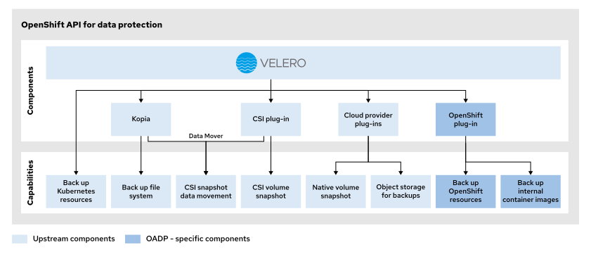
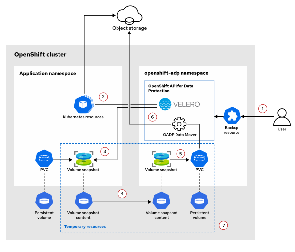
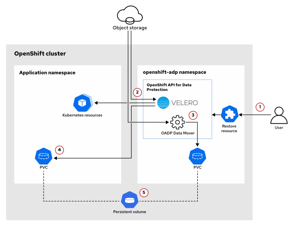
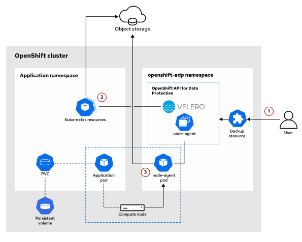
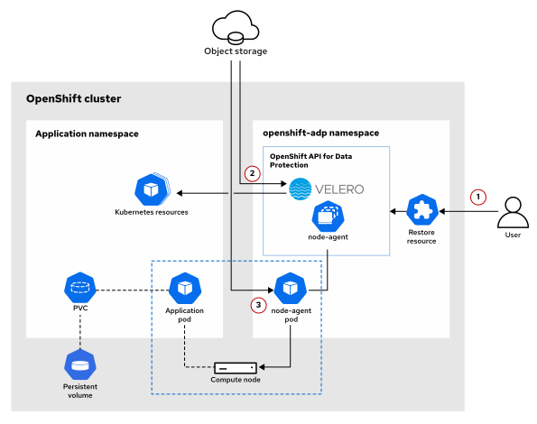

Quản trị Red Hat OpenShift III: Mở rộng quy mô triển khai trong doanh nghiệp
----------------------------------------------------------------------------

# Chương 2. Sao lưu, Khôi phục và Di chuyển Ứng dụng với OADP
## Xuất và nhập dữ liệu ứng dụng cùng các thiết lập
### Xuất và Nhập Ứng dụng Kubernetes
Khả năng xuất và nhập ứng dụng Kubernetes rất hữu ích trong nhiều tình huống. Danh sách dưới đây mô tả một số tình huống đó:

* Khôi phục một phần hoặc toàn bộ về trạng thái hoạt động trước đó
* Khôi phục sau sự cố và duy trì hoạt động kinh doanh
* Di chuyển từ cụm (cluster) này sang cụm khác
* Sao chép ứng dụng trên nhiều môi trường

Các quy trình sao lưu và khôi phục đóng vai trò quan trọng giúp tổ chức phục hồi sau khi dữ liệu bị mất hoặc hỏng. Các tình huống mất dữ liệu phổ biến nhất bao gồm lỗi phần cứng, tấn công mạng, lỗi phần mềm hoặc sai sót do con người.

Bản sao lưu ứng dụng Kubernetes bao gồm tất cả các tài nguyên cần thiết để khôi phục ứng dụng đó về trạng thái hoạt động trước đó. Bản sao lưu này phải bao gồm các thành phần sau:

* Các tài nguyên Kubernetes định nghĩa ứng dụng và các thiết lập của nó
* Các image container (được lưu trong registry nội bộ) mà các container của ứng dụng này sử dụng
* Dữ liệu được lưu trữ trong các persistent volume (ổ đĩa bền vững) hoặc bộ lưu trữ đối tượng (object storage) đối với ứng dụng có trạng thái (stateful application)

Red Hat OpenShift và các đối tác của Red Hat cung cấp các giải pháp bảo vệ dữ liệu nhằm hỗ trợ kế hoạch khôi phục nhanh hơn. Danh sách dưới đây bao gồm các ví dụ về giải pháp bảo vệ dữ liệu:

* OpenShift API for Data Protection
* Veeam Kasten for Kubernetes
* Storware Backup and Recovery
* IBM Storage Protect Plus
* Pure Storage Portworx Backup

### Sao lưu các tài nguyên ứng dụng
Một ứng dụng Kubernetes bao gồm nhiều tài nguyên. Quy trình xuất và nhập dữ liệu bao gồm các bước sau:

* Liệt kê tất cả các tài nguyên cần thiết cho ứng dụng. 
* Xuất các tài nguyên đã liệt kê. 
* Làm sạch các tệp tài nguyên đã xuất. 
* Triển khai các tệp tài nguyên đã được làm sạch.

Bước đầu tiên để xuất một ứng dụng là liệt kê tất cả các tài nguyên của ứng dụng đó.

> **Lưu ý:** Lệnh `oc get all` chỉ liệt kê một tập hợp con các tài nguyên trong dự án và không hiển thị các tài nguyên như secret hoặc config map.

Bạn không cần phải liệt kê tất cả các tài nguyên trong dự án. Ví dụ, một ứng dụng MySQL có thể yêu cầu các tài nguyên sau:

* Một deployment (triển khai) để chạy các pod cơ sở dữ liệu
* Một service (dịch vụ) để cung cấp quyền truy cập cơ sở dữ liệu cho các ứng dụng khác
* Một secret để lưu trữ thông tin xác thực cơ sở dữ liệu

Bạn có thể liệt kê các tài nguyên này bằng cách sử dụng lệnh `oc get`.

```console
[user@host ~]$ oc get deployment,svc,secret
NAME                        READY   UP-TO-DATE   AVAILABLE   AGE
deployment.apps/mysql       1/1     1            1           112s

NAME            TYPE          CLUSTER-IP        EXTERNAL-IP   PORT(S)    AGE
service/mysql   ClusterIP     172.30.210.241    <none>        9001/TCP   115s

NAME                            TYPE                                  DATA   AGE
secret/builder-dockercfg-skqdg  kubernetes.io/dockercfg               1      2m16s
secret/builder-token-cpmxf      kubernetes.io/service-account-token   4      2m16s
...output omitted...
secret/mysql-credentials        Opaque                                3      60s
```

Một ứng dụng MySQL có thể sử dụng yêu cầu volume bền vững (PVC) để lưu trữ dữ liệu. Các tài nguyên cần thiết cho việc xuất ứng dụng sẽ phụ thuộc vào chính ứng dụng đó.

#### Xuất tài nguyên ứng dụng
Bạn có thể xuất một đối tượng ứng dụng sang tệp YAML bằng cách sử dụng lệnh `oc get`.

```console
[user@host ~]$ oc -n prod get deployment/mysql -o yaml > backup_deployment.yaml
```

Tệp `backup_deployment.yaml` chứa tất cả các chi tiết triển khai, chẳng hạn như thông số kỹ thuật, siêu dữ liệu và trạng thái.

```yaml
apiVersion: apps/v1
kind: Deployment
metadata:
  annotations:
    deployment.kubernetes.io/revision: "2"
  labels:
    app: mysql
  name: mysql
  namespace: prod
...output omitted...
spec:
  progressDeadlineSeconds: 600
  replicas: 1
  selector:
    matchLabels:
      app: mysql
      ...output omitted...
status:
  availableReplicas: 1
...output omitted...
```

Bạn có thể xuất tất cả các tài nguyên ứng dụng khác bằng cách sử dụng cùng lệnh `oc get`.

#### Nhập tài nguyên ứng dụng
Bạn có thể tạo các tài nguyên ứng dụng trong một dự án mới bằng cách sử dụng các tệp YAML sao lưu. Bạn có thể loại bỏ trường `metadata.namespace` và sử dụng lệnh `oc create -f` để tạo từng tài nguyên trong dự án mới.

Ngoài trường `metadata.namespace`, tất cả các tệp tài nguyên sao lưu đều chứa thông tin về thời gian chạy (runtime) và trạng thái (status), chẳng hạn như `metadata.annotations`, `metadata.creationTimestamp`, `metadata.resourceVersion`, `metadata.generation` và `status`. Bạn có thể loại bỏ các trường này và giữ lại các tệp tài nguyên sao lưu đã được làm sạch để tạo tài nguyên trong dự án mới.

Ví dụ sau đây minh họa việc nhập tài nguyên deployment cho một ứng dụng:

```console
[user@host ~]$ oc create -f clean_backup_deployment.yaml -n prod-backup
deployment.apps/mysql created
```

Việc triển khai MySQL đã được thực hiện thành công trong dự án `prod-backup` bằng cách sử dụng tệp YAML sao lưu.

Tuy nhiên, thao tác loại bỏ metadata và status không có tác dụng đối với tất cả các tài nguyên. Một số tài nguyên đòi hỏi phải có các chỉnh sửa bổ sung.

Ví dụ sau đây minh họa việc nhập một tài nguyên service cho ứng dụng:

```console
[user@host ~]$ oc create -f service-mysql.yaml -n prod-backup
The Service "mysql" is invalid: spec.clusterIPs: Invalid value: []string{"172.30.210.241"}: failed to allocate IP 172.30.210.241: provided IP is already allocated
```

Việc tạo tài nguyên service bị lỗi do địa chỉ IP đã được cấp cho service mysql trong dự án prod. Tệp YAML sao lưu service cần được chỉnh sửa thêm để quá trình tạo diễn ra thành công.

Việc chỉnh sửa tùy thuộc vào loại tài nguyên. Để tạo tài nguyên service, bạn cần loại bỏ không chỉ các trường `metadata` và `status` mà cả trường `spec.clusterIP` khỏi tệp YAML.

Bạn có thể sử dụng trình soạn thảo văn bản hoặc các công cụ khác để loại bỏ những trường này. Ví dụ: bạn có thể dùng công cụ `yq` để xử lý tệp YAML và xóa một trường cụ thể.

```console
[user@host ~]$ yq 'del(.metadata.namespace) | del(.spec.clusterIP*)' \
service-mysql.yaml > clean-service-mysql.yaml
```

> **Lưu ý:** Công cụ `yq` là một trình xử lý YAML dòng lệnh, tương tự như công cụ `jq` dành cho các tệp JSON. Hàm `del` giúp loại bỏ trường được chỉ định khỏi kết quả đầu ra. Hãy xem phần tài liệu tham khảo để biết thêm thông tin về công cụ `yq`.

Tương tự như tài nguyên service, việc tạo tài nguyên route đòi hỏi phải loại bỏ các trường `metadata.namespace` và `spec.host` khỏi tệp YAML.

```console
[user@host ~]$ yq 'del(.metadata.namespace) | del(.spec.host)' \
route-frontend.yaml > clean-route-frontend.yaml
```

Bạn không cần phải tạo tất cả các tài nguyên đã được xuất ra. Dự án mới sẽ tạo ra một số tài nguyên, chẳng hạn như tài khoản dịch vụ (service account), bí mật (secret) và các liên kết vai trò (role binding). Bản thân ứng dụng cũng tạo ra một số tài nguyên; cụ thể là tài nguyên Deployment tạo ra tài nguyên ReplicaSet, còn tài nguyên DeploymentConfig tạo ra tài nguyên ReplicationController.

### Sao lưu các Container Image
Bạn có thể xuất các container image bằng cách sử dụng các công cụ container như podman hoặc skopeo để sao chép image từ registry này sang registry khác. Để biết thêm chi tiết về Podman và Skopeo, hãy tham khảo khóa đào tạo Red Hat OpenShift Development I: Introduction to Containers with Podman (DO188).

Do registry nội bộ của OpenShift mặc định chỉ có thể truy cập được từ bên trong cụm (cluster), bạn có thể sử dụng Kubernetes job để xuất các image ra một vị trí từ xa. Để truy cập registry từ bên ngoài cụm hoặc xuất image từ máy cục bộ, quản trị viên OpenShift cần phải cấu hình để registry có thể truy cập được từ bên ngoài.

#### Phơi bày Registry nội bộ của OpenShift
Bạn có thể cấu hình operator của registry nội bộ OpenShift để công khai registry ra bên ngoài bằng lệnh sau:

```console
[user@host ~]$ oc patch configs.imageregistry.operator.openshift.io/cluster \
--patch '{"spec":{"defaultRoute":true}}' --type merge
config.imageregistry.operator.openshift.io/cluster patched
```

> **Lưu ý:** Thao tác này yêu cầu quyền `cluster-admin`. Việc sửa đổi image registry operator sẽ kích hoạt quá trình triển khai lại OpenShift API server. Cụm có thể mất tới 10 phút để ổn định.

Operator tạo một route mặc định để công khai registry ra bên ngoài. URL của route có định dạng sau:

```
default-route-openshift-image-registry.apps-domain
```

> **Lưu ý:** Bạn có thể sử dụng tên máy chủ (hostname) tùy chỉnh cho registry nếu cần. Hãy xem phần tham khảo để biết thêm thông tin về việc công khai registry nội bộ.

Bạn có thể sử dụng lệnh sau để lấy URL registry từ route đã tạo và lưu nó vào một biến môi trường để sử dụng sau:

```console
[user@host ~]$ REGISTRY=$(oc get route default-route \
-n openshift-image-registry --template '{{.spec.host}}')
```

Người dùng OpenShift không có quyền truy cập vào namespace `openshift-image-registry` có thể lấy URL của registry từ bất kỳ image stream nào:

```console
[user@host ~]$ oc -n openshift get is/cli -o jsonpath="{.status.publicDockerImageRepository}{'\n'}"
default-route-openshift-image-registry.apps.lab.example.com/openshift/cli
```

Sau đó, bạn có thể đăng nhập vào registry nội bộ bằng cách sử dụng tên người dùng OpenShift và mã thông báo xác thực với lệnh sau:

```console
[user@host ~]$ podman login -u $(oc whoami) -p $(oc whoami -t) --tls-verify=false $REGISTRY
```

> **Lưu ý:** Nếu chứng chỉ Ingress mặc định của cụm không được tin cậy, bạn phải sử dụng tùy chọn `--tls-verify=false` để bỏ qua bước xác thực chứng chỉ. Hãy tham khảo phần tài liệu tham khảo để biết cách cấu hình chứng chỉ tin cậy với Ingress operator.

Ngoài ra, bạn có thể sử dụng lệnh `oc registry login` để đăng nhập vào registry nội bộ mà không cần chỉ định thông tin xác thực hay URL của registry. Lệnh này sẽ tự động sử dụng token xác thực và URL registry nội bộ từ cụm OpenShift.

Theo mặc định, lệnh `oc` lưu trữ thông tin xác thực dưới định dạng Base64 tại vị trí lưu trữ xác thực chuẩn của Docker, cụ thể là tệp `${XDG_RUNTIME_DIR}/containers/auth.json` hoặc `/run/user/{UID}/containers/auth.json`. Các client như Podman, Skopeo và Docker có thể sử dụng thông tin xác thực từ tệp này để truy cập vào image registry.

```console
[user@host ~]$ oc registry login
info: Using registry public hostname default-route-openshift-image-registry.apps.lab.example.com
Saved credentials for default-route-openshift-image-registry.apps.lab.example.com into /run/user/1000/containers/auth.json
```

#### Xuất Container Image
Để xuất ảnh từ bên ngoài cụm, hãy công khai registry nội bộ và sử dụng lệnh skopeo để sao chép ảnh sang một registry từ xa:

```console
[user@host ~]$ skopeo copy \
docker://${REGISTRY}/project_name/imagestream:tag \ (1)
docker://remote-registry.example.com/path/to/image:remotetag (2)
```

1. Hình ảnh nguồn hợp lệ nằm trong registry nội bộ của OpenShift
2. URL của registry đích kèm thông tin về hình ảnh và thẻ (tag)

Skopeo có thể sao chép hình ảnh sang các vị trí khác, chẳng hạn như thư mục cục bộ hoặc tệp lưu trữ .tar. Hãy tham khảo phần tài liệu tham khảo để biết chi tiết về cách sử dụng lệnh `skopeo copy`.

> **Lưu ý:** Bạn có thể sử dụng lệnh `skopeo sync` để sao chép tất cả các thẻ (tag) có sẵn của một image. Hãy xem phần tham khảo để biết thêm thông tin về lệnh `skopeo sync`.

Nếu Skopeo không có sẵn trên hệ thống của bạn, bạn có thể sử dụng Podman hoặc Docker để tải image về registry container cục bộ như sau:

```console
[user@host ~]$ podman pull ${REGISTRY}/project_name/imagestream:tag
...output omitted...
```

Sau đó, bạn có thể xuất image dưới dạng tệp .tar bằng lệnh `podman save` hoặc đẩy image lên một registry từ xa.

```console
[user@host ~]$ podman save ${REGISTRY}/project_name/imagestream:tag \
| bzip2 > image_backup.tar.bz2
```

Ngoài ra, bạn có thể sử dụng lệnh `oc image mirror` để sao chép các image sang một vị trí cục bộ hoặc từ xa, tương tự như lệnh `skopeo copy`:

```console
[user@host ~]$ oc image mirror ${REGISTRY}/project_name/imagestream:* \ (1)
remote-registry.example.com/path/to/image
```

1. Bạn có thể sử dụng ký tự đại diện (`*`) để sao chép tất cả các thẻ sang registry đích.

> **Lưu ý:** Công cụ dòng lệnh `oc` tương thích với phiên bản OpenShift của bạn có sẵn trong image container `openshift/cli:latest` nằm trong registry nội bộ của OpenShift. Hãy tham khảo phần tài liệu tham khảo để xem thêm các ví dụ về lệnh sao chép image (mirror) cho `oc`.

Bạn có thể xuất image container từ bên trong cụm bằng cách sử dụng các công cụ container trong một pod. Hãy sao chép image đến vị trí bạn chọn, chẳng hạn như persistent volume NFS, bộ lưu trữ S3 hoặc registry từ xa.

Bạn có thể sử dụng tệp YAML dưới đây làm ví dụ để tạo một Kubernetes job thực hiện xuất image container sang persistent volume bằng cách sử dụng client OpenShift:

```yaml
apiVersion: batch/v1
kind: Job
metadata:
  name: backup-image
  namespace: application
  labels:
    app: backup
spec:
  backoffLimit: 1
  template:
    metadata:
      labels:
        app: backup
    spec:
      containers:
      - name: backup
        image: image-registry.openshift-image-registry.svc:5000/openshift/cli:latest
        env:
        - name: REGISTRY_AUTH_FILE
          value: /tmp/dockercfg.json
        command: ["/bin/bash", "-c"]
        args:
        - | (1)
          oc registry login
          oc image mirror \
            image-registry.openshift-image-registry.svc:5000/application/myapp:* \
            file://myapp --dir /backup
        volumeMounts: (2)
          - mountPath: /backup
            name: backup
      ...output omitted...
      volumes: (3)
      - name: backup
        persistentVolumeClaim:
          claimName: backup-volume
```

1. Đăng nhập vào registry nội bộ và xuất tất cả các tag của image stream `myapp` sang đường dẫn `/backup`.
2. Định nghĩa mount volume cho vị trí lưu trữ bản sao lưu.
3. Định nghĩa volume cho các Persistent Volume Claim (PVC) dùng để lưu trữ bản sao lưu.

> **Lưu ý:** Bạn cần có vai trò `system:image-puller` trong dự án OpenShift để có thể kéo (pull) các image từ bất kỳ image stream nào thuộc dự án đó. Người dùng và quản trị viên của dự án, cũng như tài khoản dịch vụ (service account) mặc định, đều đã có quyền này.

#### Nhập container image
Bạn có thể nhập một ảnh vào image stream trong bất kỳ dự án nào của mình bằng cách sử dụng các công cụ container tương tự như khi xuất ảnh. Tương tự như thao tác xuất, bạn có thể sử dụng lệnh `skopeo` sau đây để nhập ảnh từ một kho lưu trữ từ xa:

```console
[user@host ~]$ skopeo copy \
docker://remote-registry.example.com/myimage:latest \
docker://${REGISTRY}/project_name/mynewimagestream:latest
```

> **Lưu ý:** Nếu image stream chưa tồn tại, OpenShift sẽ tạo nó khi image được đẩy lên.

Bạn cũng có thể sử dụng lệnh `oc image mirror` để sao chép các image theo cách tương tự như lệnh `skopeo copy`:

```console
[user@host ~]$ oc image mirror \
remote-registry.example.com/myimage:latest \
${REGISTRY}/project_name/mynewimagestream:latest
```

Bạn có thể sử dụng Podman hoặc Docker để nhập (import) một image; tuy nhiên, quy trình này bao gồm nhiều bước hơn vì bạn phải nhập image vào registry của công cụ container cục bộ và đổi tên image để sử dụng tên registry mới.

Các lệnh sau đây thực hiện việc nhập một image từ tệp lưu trữ nén vào registry cục bộ của Podman và đẩy (push) nó lên registry nội bộ của OpenShift:

```console
[user@host ~]$ podman load -i image_backup.tar.bz2
...output omitted...
Storing signatures
Loaded image(s): registry.apps.lab.example.com/application/myapp:1.2.3
```

Nếu cần, hãy đổi tên hình ảnh bằng lệnh `podman tag` để khớp với dự án OpenShift và image stream mới:

```console
[user@host ~]$ podman tag \
registry.apps.lab.example.com/application/myapp:1.2.3 \
${REGISTRY}/newproject/myapp:1.2.3
```

Sau đó, hãy gửi image đến registry nội bộ của OpenShift:

```console
[user@host ~]$ podman push ${REGISTRY}/newproject/myapp:1.2.3
...output omitted...
Writing manifest to image destination
Storing signatures
```

> **Lưu ý:** Bạn cần có vai trò `system:image-pusher` trong dự án OpenShift để đẩy (push) các image vào bất kỳ image stream nào thuộc dự án đó. Người dùng và quản trị viên của dự án, cũng như tài khoản dịch vụ `builder`, đều đã có quyền này.

### Sao lưu dữ liệu ứng dụng
Có nhiều phương pháp sao lưu dữ liệu khác nhau tùy thuộc vào từng ứng dụng. Một số ứng dụng cung cấp các công cụ hoặc quy trình chuyên dụng để đạt được mức độ bảo vệ và tính nhất quán của dữ liệu cao nhất. Tùy thuộc vào phương pháp sao lưu, bạn có thể đạt được các mức độ nhất quán khác nhau.

**Sao lưu không nhất quán (Inconsistent backup)**  
Bản sao lưu được coi là không nhất quán khi ứng dụng thay đổi dữ liệu trong quá trình sao lưu. Việc sao chép dữ liệu theo cách truyền thống khi ứng dụng đang chạy sẽ tạo ra các bản sao lưu không nhất quán.

**Sao lưu nhất quán khi gặp sự cố (Crash-consistent backup)**  
Bản sao lưu nhất quán khi gặp sự cố được tạo ra bằng cách tạm dừng hoạt động nhập/xuất (I/O) của đĩa trong quá trình sao lưu—sử dụng công nghệ snapshot hoặc các công cụ chuyên dụng—để đảm bảo tính nhất quán của dữ liệu trên đĩa. Dữ liệu ứng dụng trong bộ nhớ hoặc các thao tác I/O đang chờ xử lý sẽ không được ghi lại. Trạng thái của ứng dụng được giữ nguyên như thể ứng dụng bị tắt đột ngột do mất điện hoặc bị treo (crash).

**Sao lưu nhất quán ở cấp độ ứng dụng (Application-consistent backup)**  
Sao lưu nhất quán ở cấp độ ứng dụng là loại hình sao lưu đáng tin cậy nhất vì nó đảm bảo rằng tất cả dữ liệu trong bộ nhớ và các thao tác I/O đang chờ xử lý đều được ghi vào đĩa trước khi tạo bản sao lưu.

Một số ứng dụng cung cấp các bộ công cụ để đẩy (flush) dữ liệu từ bộ nhớ xuống đĩa và tạm dừng các hoạt động của hệ thống tập tin theo yêu cầu. Các công cụ này cho phép tạo bản sao lưu nhất quán ở cấp độ ứng dụng mà không gây gián đoạn dịch vụ (downtime), thông qua việc sử dụng snapshot. Phương pháp này còn được gọi là sao lưu nóng (hot backup).

Ví dụ: cơ sở dữ liệu MySQL cung cấp lệnh `FLUSH TABLES WITH READ LOCK` để đẩy tất cả các thao tác xuống đĩa và khóa tất cả các bảng trước khi thực hiện snapshot. Sau đó, bạn có thể mở khóa các bảng bằng lệnh `UNLOCK TABLES` sau khi snapshot đã được tạo.

Các ứng dụng cơ sở dữ liệu thường đi kèm với các công cụ chuyên dụng để tạo và khôi phục bản sao lưu mà không cần dừng ứng dụng hoặc sử dụng snapshot ở cấp độ volume. Danh sách dưới đây bao gồm các ví dụ về công cụ chuyên dụng:

* `mysqldump` cho MySQL và MariaDB
* `pg_dump` cho PostgreSQL

> **Lưu ý:** Việc tạo bản sao lưu bằng các công cụ chuyên dụng nằm ngoài phạm vi của khóa học này.

Một phương pháp phổ biến để tạo bản sao lưu nhất quán ở cấp độ ứng dụng là dừng ứng dụng, sao chép dữ liệu sang vị trí khác, rồi khởi động lại ứng dụng. Phương pháp này còn được gọi là sao lưu nguội (cold backup) vì ứng dụng sẽ ngừng hoạt động trong quá trình thực hiện.

Tùy thuộc vào khối lượng dữ liệu, ứng dụng có thể không khả dụng trong một khoảng thời gian dài trong quá trình sao lưu. Bằng cách sử dụng bản chụp nhanh (snapshot) của ổ đĩa, bạn có thể rút ngắn thời gian ngừng hoạt động này xuống chỉ còn vài phút và sử dụng ổ đĩa đã sao chép để thực hiện sao lưu trong khi ứng dụng đã hoạt động trở lại.

#### Ảnh chụp nhanh Volume
Tính năng chụp nhanh volume chỉ khả dụng với các trình điều khiển Container Storage Interface (CSI). Tuy nhiên, chức năng chụp nhanh không được triển khai cho tất cả các trình điều khiển CSI. Bảng dưới đây liệt kê các ví dụ về trình điều khiển CSI có hỗ trợ tính năng chụp nhanh:

| Trình cung cấp dịch vụ lưu trữ | Trình điều khiển CSI  |
|--------------------------------|-----------------------|
| AWS Elastic Block Store        | ebs.csi.aws.com       |
| Azure Disk                     | disk.csi.azure.com    |
| CephFS                         | cephfs.csi.ceph.com   |
| Ceph RBD                       | rbd.csi.ceph.com      |
| NetApp                         | csi.trident.netapp.io |

Kubernetes cung cấp các tài nguyên API tương tự như PersistentVolume và PersistentVolumeClaim để tạo và quản lý các bản sao lưu nhanh (snapshot) của volume.

**VolumeSnapshotClass**  
Tương tự như StorageClass dành cho PersistentVolumeClaim, VolumeSnapshotClass mô tả trình điều khiển CSI và các thiết lập liên quan để tạo bản sao lưu nhanh cho volume. 

> **Lưu ý:** Trình điều khiển (driver) của VolumeSnapshotClass phải khớp với trình cung cấp (provisioner) của StorageClass thuộc PVC nguồn. 

Lệnh sau đây liệt kê tất cả các VolumeSnapshotClass hiện có:

```console
[user@host ~]$ oc get volumesnapshotclasses
NAME                                        DRIVER
ocs-storagecluster-cephfsplugin-snapclass   openshift-storage.cephfs.csi.ceph.com
ocs-storagecluster-rbdplugin-snapclass      openshift-storage.rbd.csi.ceph.com
```

Lệnh sau đây liệt kê tất cả các lớp lưu trữ khả dụng:

```console
[user@host ~]$ oc get storageclasses | grep -E "^NAME|csi"
NAME                                   PROVISIONER
ocs-external-storagecluster-cephfs     openshift-storage.cephfs.csi.ceph.com
ocs-external-storagecluster-ceph-rbd   openshift-storage.rbd.csi.ceph.com
```

**VolumeSnapshot**  
Tương tự như tài nguyên `PersistentVolumeClaim`, tài nguyên `VolumeSnapshot` yêu cầu tạo một bản snapshot. 

Ví dụ sau đây là tệp YAML dùng để tạo một bản snapshot cho volume:

```yaml
apiVersion: snapshot.storage.k8s.io/v1
kind: VolumeSnapshot
metadata:
  name: my-snapshot # (1)
  namespace: application # (2)
spec:
  volumeSnapshotClassName: ocs-storagecluster-rbdplugin-snapclass # (3)
  source:
    persistentVolumeClaimName: application-data # (4)
```

1. Tên của volume snapshot.
2. Namespace của volume snapshot. Namespace này phải trùng với namespace của PVC nguồn.
3. Tên của snapshot class dành cho volume snapshot.
4. Tên của PVC nguồn được sử dụng để tạo snapshot.

Lệnh sau đây liệt kê các volume snapshot. Một snapshot được tạo thành công khi thuộc tính READYTOUSE được đặt là true và tài nguyên VolumeSnapshotContent được tạo ra:

```console
[user@host ~]$ oc get volumesnapshot
NAME         READYTOUSE   SOURCEPVC          ...  SNAPSHOTCONTENT
my-snapshot  true         application-data   ...  snapcontent-798...cf6
```

> **Lưu ý:** Khi tạo bản sao lưu đảm bảo tính nhất quán của ứng dụng (application-consistent backup), ứng dụng cần được tạm dừng hoạt động (quiesce) hoặc giảm quy mô (scale down) trước khi tạo bản snapshot. Ứng dụng có thể được khôi phục hoạt động hoặc tăng quy mô trở lại một cách an toàn sau khi bản snapshot đã được tạo và sẵn sàng để sử dụng.

**VolumeSnapshotContent**  
Tương tự như tài nguyên `PersistentVolume`, tài nguyên `VolumeSnapshotContent` đại diện cho một bản snapshot được tạo ra bởi tài nguyên `VolumeSnapshot`.

Sau đó, bạn có thể sử dụng bản snapshot này để tạo một PVC mà pod có thể mount (gắn) vào. Ví dụ dưới đây là tệp YAML dùng để tạo một persistent volume từ bản snapshot:

```yaml
apiVersion: v1
kind: PersistentVolumeClaim
metadata:
  name: my-snapshot-volume # (1)
  namespace: application # (2)
spec:
  storageClassName: ocs-external-storagecluster-ceph-rbd # (3)
  accessModes:
  - ReadWriteOnce
  dataSource:
    apiGroup: snapshot.storage.k8s.io
    kind: VolumeSnapshot
    name: my-snapshot # (4)
  resources:
    requests:
      storage: 1Gi # (5)
```

1. Tên của PVC.
2. Namespace của PVC. Namespace này phải trùng với namespace của snapshot.
3. Tên StorageClass cho PVC.
4. Tên của snapshot.
5. Dung lượng của volume mới. Dung lượng này phải bằng hoặc lớn hơn dung lượng của snapshot.

#### Xuất dữ liệu ứng dụng
Nếu ứng dụng của bạn cung cấp các công cụ sao lưu chuyên dụng, bạn có thể sử dụng chúng để xuất dữ liệu đến vị trí mong muốn. Ví dụ dưới đây là định nghĩa cron job để sao lưu cơ sở dữ liệu MariaDB và lưu trữ tệp sao lưu trên dịch vụ lưu trữ AWS S3:

```yaml
apiVersion: batch/v1
kind: CronJob
metadata:
  name: backup-db
spec:
  schedule: "0 0 * * *"
  jobTemplate:
    spec:
      template:
        spec:
          initContainers:
            - envFrom:
              - secretRef:
                  name: mariadb
              image: quay.io/redhattraining/mariadb:10.5
              command: ["/bin/bash", "-c"]
              args: # (1)
                - >
                  mariadb-dump -u "${MARIADB_USER}" -p"${MARIADB_PASSWORD}"
                  -h mariadb "${MARIADB_DATABASE}"
                  | bzip2 > /backup/backup-$(date '+%Y%m%d-%H%M').sql.bz2;
                  ls -al /backup
              name: backup
              volumeMounts:
                - mountPath: /backup
                  name: backup
          containers:
            - image: docker.io/amazon/aws-cli:latest
              command: ["/bin/bash", "-c"]
              args: # (2)
                - >
                  aws s3 cp --no-progress /backup/backup* s3://backup/
              name: s3cli
              volumeMounts:
                - mountPath: /backup
                  name: backup
                - mountPath: /root/.aws
                  name: aws-creds
          volumes:
            - name: backup
              emptyDir: {}
            - name: aws-creds
              secret:
                secretName: s3config
```

1. Sử dụng công cụ mariadb-dump để xuất cơ sở dữ liệu sang một tệp nén nằm trong volume tạm thời (ephemeral volume).
2. Sử dụng công cụ AWS CLI để chuyển tệp sao lưu đến bộ lưu trữ tương thích với AWS S3.

Nếu ứng dụng không cung cấp sẵn các công cụ sao lưu, bạn có thể sử dụng tính năng snapshot của volume để sao lưu dữ liệu ứng dụng. Tùy thuộc vào nhà cung cấp dịch vụ lưu trữ hiện có trong cụm OpenShift, bạn có thể muốn xuất nội dung snapshot sang một vị trí lưu trữ bên ngoài.

Ví dụ dưới đây là định nghĩa job sử dụng một volume snapshot có sẵn để lưu trữ nội dung snapshot, đồng thời xuất tệp sao lưu sang một S3 bucket từ xa:

```yaml
apiVersion: batch/v1
kind: Job
metadata:
  name: backup
  namespace: application
  labels:
    app: backup
spec:
  backoffLimit: 1
  template:
    metadata:
      labels:
        app: backup
    spec:
      containers:
      - name: backup
        image: docker.io/d3fk/s3cmd:latest
        command: ["/bin/sh", "-c"]
        args:
        - | # (1)
          tar czf -C /snapshot /tmp/mybackup.tar.gz .
          s3cmd cp /tmp/mybackup.tar.gz s3://backup/
        volumeMounts: # (2)
          - mountPath: /snapshot
            name: snapshot
      ...output omitted...
      volumes: # (3)
      - name: snapshot
        persistentVolumeClaim:
          claimName: my-snapshot-volume
```

1. Lưu trữ nội dung snapshot và sao chép bản lưu trữ đó sang một S3 bucket từ xa.
2. Định nghĩa mount volume cho dữ liệu snapshot trong container.
3. Định nghĩa volume cho PVC của snapshot.

> **Quan trọng:** Nếu storage class của volume không hỗ trợ snapshot volume, bạn có thể mount volume của ứng dụng để thay thế nhằm xuất dữ liệu. Trong trường hợp này, bạn phải đảm bảo không có pod nào khác đang sử dụng volume đó trong quá trình sao lưu để tránh tình trạng dữ liệu không nhất quán.

Một tùy chọn khác là xuất nội dung snapshot cục bộ từ một pod bằng cách sử dụng lệnh `oc cp`. Ví dụ dưới đây là định nghĩa pod có mount dữ liệu snapshot; bạn có thể sử dụng pod này để xuất dữ liệu về máy trạm của mình:

```yaml
apiVersion: v1
kind: Pod
metadata:
  name: export
spec:
  containers:
  - image: registry.access.redhat.com/ubi10:latest
    command: ["/bin/bash", "-c"]
    args:
    - sleep infinity # (1)
    ...output omitted...
    volumeMounts: # (2)
      - mountPath: /snapshot
        name: snapshot
  volumes: # (3)
  - name: snapshot
    persistentVolumeClaim:
      claimName: my-snapshot-volume
```

1. Lệnh `sleep infinity` đảm bảo pod tiếp tục chạy trong quá trình xuất dữ liệu thủ công.
2. Định nghĩa gắn volume cho dữ liệu snapshot trong container.
3. Định nghĩa volume cho PVC snapshot.

Bạn có thể sử dụng lệnh `oc` sau đây để sao chép dữ liệu snapshot từ pod xuất dữ liệu về máy cục bộ của mình:

```console
[user@host ~]$ oc cp export:/snapshot /tmp/backup
```

> **Lưu ý:** Công cụ nhị phân `tar` phải được cài đặt trong container từ xa để lệnh `oc cp` có thể hoạt động.

Sau khi nội dung snapshot được xuất sang vị trí từ xa, bạn có thể xóa PVC snapshot và volume snapshot một cách an toàn để giải phóng dung lượng trên hệ thống lưu trữ (storage back-end).

> **Quan trọng:** Nếu ứng dụng của bạn sử dụng nhiều hơn một persistent volume, bạn cần theo dõi tên các bản sao lưu và các volume tương ứng. Bạn sẽ cần thông tin này để khôi phục từng bản sao lưu về đúng persistent volume.

#### Nhập dữ liệu ứng dụng
Để nhập dữ liệu vào một cụm (cluster) hoặc namespace khác, hãy tạo một pod hoặc job có gắn (mount) volume của ứng dụng, sau đó sao chép dữ liệu đã xuất vào pod đó.

Ví dụ dưới đây là tệp YAML dùng để tạo một job giúp lấy bản sao lưu từ xa từ S3 bucket và giải nén dữ liệu vào volume của ứng dụng:

```yaml
apiVersion: batch/v1
kind: Job
metadata:
  name: restore
  namespace: application
  labels:
    app: restore
spec:
  backoffLimit: 1
  template:
    metadata:
      labels:
        app: restore
    spec:
      containers:
      - name: restore
        image: docker.io/d3fk/s3cmd:latest
        command: ["/bin/bash", "-c"]
        args: # (1)
        - |
          s3cmd cp s3://backup/mybackup.tar.gz /tmp/
          tar xvzf /tmp/mybackup.tar.gz -C /data
        volumeMounts: # (2)
          - mountPath: /data
            name: application-data
      ...output omitted...
      volumes: # (3)
      - name: application-data
        persistentVolumeClaim:
          claimName: application-data
```

1. Tải bản sao lưu từ S3 bucket bằng công cụ s3cmd và giải nén tệp lưu trữ vào bên trong volume chứa dữ liệu ứng dụng.
2. Định nghĩa mount volume cho dữ liệu ứng dụng trong container.
3. Định nghĩa volume cho PVC của ứng dụng.

Bạn có thể khôi phục dữ liệu vào một volume hiện có hoặc tạo mới một volume. Nếu sử dụng volume mới, bạn phải cập nhật ứng dụng để sử dụng volume đó.

> **Quan trọng:** Để tránh hỏng dữ liệu, hãy đảm bảo rằng ứng dụng sử dụng volume này không đang chạy trong quá trình khôi phục.

## Triển khai và các tính năng của OADP Operator
### Các API OpenShift dành cho Bảo vệ Dữ liệu
OpenShift APIs for Data Protection (OADP) cung cấp giải pháp sao lưu tích hợp sẵn (native) cho các ứng dụng chạy trên OpenShift. OADP mang lại khả năng bảo vệ toàn diện để phục hồi sau thảm họa, bao gồm các ứng dụng OpenShift, các tài nguyên cụm (cluster resources) liên quan đến ứng dụng, các volume bền vững (persistent volumes) và các image nội bộ. OADP cũng có thể sao lưu cả ứng dụng dạng container và máy ảo. Tuy nhiên, OADP không đóng vai trò là giải pháp phục hồi sau thảm họa cho etcd hay cho các OpenShift Operator.

OADP sử dụng một số thành phần như Velero và Kopia để sao lưu toàn bộ tài nguyên Kubernetes, image container từ registry nội bộ và các volume bền vững gắn liền với ứng dụng. Sơ đồ dưới đây cung cấp cái nhìn tổng quan về các thành phần và khả năng của OADP:



Danh sách dưới đây mô tả các thành phần chính mà OADP sử dụng:

**Velero**  
Velero là thành phần nguồn (upstream) chính của OADP. Nó cung cấp API sao lưu cho người dùng và sử dụng các plugin để bổ sung các tính năng mở rộng cho OADP.

**Data Mover**  
Tính năng này cho phép xuất nội dung snapshot sang bộ lưu trữ đối tượng (object storage) bằng cách sử dụng Kopia và plugin CSI.

**Kopia**  
Kopia là một công cụ sao lưu mã nguồn mở được Velero và Data Mover sử dụng để sao lưu các volume bền vững (persistent volumes).

Các thành phần này sẽ được thảo luận chi tiết hơn ở phần sau của chương này. Vui lòng tham khảo mục tài liệu tham khảo để biết thêm thông tin về các thành phần đó.

Ban đầu, Red Hat thiết kế framework OADP để các nhà cung cấp có thể xây dựng cơ sở hạ tầng cần thiết cho một giải pháp sao lưu toàn diện. Các quản trị viên OpenShift có thể sử dụng OADP như một giải pháp sao lưu cơ bản, mặc dù nó có thể thiếu một số tính năng cần thiết như giao diện người dùng đồ họa hoặc hỗ trợ đa người thuê (multitenancy). Dưới đây là các ví dụ về những giải pháp sao lưu sử dụng OADP:

* Catalogic CloudCasa
* IBM Spectrum Protect Plus
* Dell PowerProtect Data Manager

> **Lưu ý:** Chiến lược khôi phục sau thảm họa đảm bảo chủ quyền dữ liệu (sovereign disaster recovery) yêu cầu tất cả dữ liệu sao lưu, siêu dữ liệu (metadata) và cơ sở hạ tầng dự phòng (failover) phải nằm hoàn toàn trong phạm vi pháp lý được phê duyệt. OADP cho phép các tổ chức duy trì quyền kiểm soát toàn diện và cục bộ đối với quá trình khôi phục dữ liệu bằng cách lưu trữ các tệp tin sao lưu trong bộ lưu trữ đối tượng do khách hàng tự quản lý. Cơ chế này đảm bảo tính liên tục của hoạt động kinh doanh mà không cần phụ thuộc vào việc truyền tải dữ liệu xuyên biên giới hoặc xuyên phạm vi pháp lý.

#### Sao lưu tài nguyên Kubernetes
OADP sử dụng Velero để sao lưu toàn bộ tài nguyên Kubernetes vào hệ thống lưu trữ đối tượng (object storage) trên đám mây. Bạn có thể lọc các đối tượng cần sao lưu và khôi phục dựa trên namespace, loại tài nguyên hoặc nhãn (label).

Velero không chỉ thực hiện xuất và nhập tài nguyên mà còn thực hiện các quy trình xử lý bổ sung trên các tài nguyên đó. Danh sách dưới đây mô tả một số quy trình xử lý bổ sung này:

* Xác định thứ tự khôi phục chính xác cho từng tài nguyên. 
* Áp dụng các bộ lọc do người dùng cung cấp. 
* Thay đổi namespace đích nếu nó khác với namespace ban đầu của bản sao lưu. 
* Loại bỏ hoặc sửa đổi các thuộc tính tài nguyên như node port được gán tự động, địa chỉ IP hoặc hostname. 
* Bỏ qua các tài nguyên được quản lý bởi tài nguyên khác (ví dụ: bỏ qua ReplicaSet thuộc quyền quản lý của Deployment).

Bạn có thể bổ sung logic sao lưu và xuất dữ liệu bằng cách sử dụng các plugin của Velero.

#### Ảnh chụp nhanh (Snapshot) khối dữ liệu
OADP có thể sao lưu các khối dữ liệu (volume) bằng cách sử dụng API snapshot chuẩn cloud-native hoặc API snapshot của Kubernetes Container Storage Interface (CSI).

Red Hat khuyến nghị sử dụng snapshot bất cứ khi nào có thể, vì tính năng này cho phép thực hiện sao lưu nhanh chóng và đảm bảo tính nhất quán.

#### Sao lưu hệ thống tập tin (File System Backup - FSB)
Đối với các khối lượng mà cả API ảnh chụp nhanh gốc trên nền tảng đám mây và API ảnh chụp nhanh CSI đều không hỗ trợ, OADP cung cấp giải pháp sao lưu hệ thống tệp.

Sao lưu hệ thống tệp hoặc Sao lưu ổ đĩa Pod, cho phép sao lưu hầu hết mọi loại ổ đĩa Kubernetes không hỗ trợ khả năng chụp nhanh, chẳng hạn như NFS và bộ nhớ cục bộ.

> **Cảnh báo:** FSB không hỗ trợ ổ đĩa HostPath.

OADP sử dụng công cụ Kopia mã nguồn mở để sao lưu hệ thống tệp ổ đĩa ứng dụng.

Kopia truy cập hệ thống tệp ổ đĩa từ điểm gắn ổ đĩa trên nút cụm. Vì lý do đó, nhóm ứng dụng phải chạy trong quá trình sao lưu.

Trong quá trình sao lưu hệ thống tệp, ứng dụng vẫn có thể thay đổi hệ thống tệp và làm hỏng bản sao lưu. Để ngăn chặn tình huống như vậy, bạn phải tắt ứng dụng để ngăn mọi hoạt động ghi trong khi quá trình sao lưu đang diễn ra.

#### Sao lưu đảm bảo tính nhất quán của ứng dụng
Bạn có thể sử dụng các hook (cơ chế kích hoạt lệnh) cho quá trình sao lưu và khôi phục để thực thi các lệnh trước và sau các thao tác này. Việc sử dụng hook tiền xử lý (pre-hook) cho phép tạm dừng hoạt động ghi của ứng dụng—ví dụ như cơ sở dữ liệu giao dịch—nhằm đẩy (flush) các thao tác I/O đang chờ xử lý xuống hệ thống lưu trữ và tạm ngưng các thao tác ghi mới, từ đó ngăn ngừa nguy cơ mất mát hoặc hỏng hóc dữ liệu trong quá trình sao lưu. Khi quá trình sao lưu hoàn tất, hook hậu xử lý (post-hook) sẽ được sử dụng để khôi phục hoạt động bình thường của ứng dụng.

Nếu sử dụng tính năng chụp nhanh ổ đĩa (volume snapshot), các hook này sẽ được thực thi ngay trước và sau thời điểm tạo bản chụp nhanh; điều này giúp giảm đáng kể khoảng thời gian ứng dụng phải hoạt động ở chế độ chỉ đọc.

#### OADP Data Mover
OADP tích hợp sẵn tính năng Data Mover để di chuyển các bản snapshot của volume CSI sang một kho lưu trữ đối tượng (object store) từ xa.

Một số trình điều khiển CSI có thể lưu trữ bản snapshot tại cùng vị trí với volume gốc, khiến dữ liệu có nguy cơ bị mất mát khi xảy ra sự cố nghiêm trọng. Giải pháp lưu trữ được sử dụng cùng với OpenShift có thể không đảm bảo tính bền vững cho các bản snapshot này.

Trong những trường hợp như vậy, bạn có thể kích hoạt tính năng Data Mover tích hợp sẵn để sao chép nội dung snapshot sang một vị trí lưu trữ sao lưu từ xa và xóa bản snapshot khỏi hệ thống lưu trữ gốc (storage back-end). Data Mover cho phép bạn khôi phục các ứng dụng có trạng thái (stateful applications) từ kho lưu trữ đối tượng từ xa nếu xảy ra lỗi, sự cố xóa nhầm hoặc hỏng hóc cụm (cluster).

Data Mover sử dụng Kopia để tải lên và mã hóa nội dung snapshot vào một kho lưu trữ sao lưu thống nhất trên hệ thống lưu trữ đối tượng. Kho lưu trữ sao lưu thống nhất Kopia sẽ được giải thích chi tiết hơn ở phần sau của chương này.

#### Các plugin Velero
Bạn có thể mở rộng các khả năng và logic sao lưu của OADP bằng cách sử dụng hệ thống plugin của Velero. Hỗ trợ cho nhiều nhà cung cấp đám mây, giải pháp lưu trữ và các CRD bổ sung được cung cấp thông qua các plugin tích hợp sẵn.

OADP bao gồm các plugin sau mà bạn có thể kích hoạt trong quá trình cài đặt:

**aws**  
Lưu trữ và truy xuất các bản sao lưu trên bộ lưu trữ tương thích với AWS S3. Quản lý các bản chụp nhanh (snapshot) ổ đĩa trên các ổ đĩa AWS EBS.

**azure**  
Lưu trữ và truy xuất các bản sao lưu trên Azure Blob Storage. Quản lý các bản chụp nhanh ổ đĩa trên Azure Managed Disks.

**csi**  
Cung cấp khả năng hỗ trợ chụp nhanh ổ đĩa bằng cách sử dụng Kubernetes CSI Snapshot API.

**gcp**  
Lưu trữ và truy xuất các bản sao lưu trên Google Cloud Storage. Quản lý các bản chụp nhanh ổ đĩa trên Google Compute Engine Disks.

**hypershift**  
Sao lưu và khôi phục các tài nguyên cụm (cluster) được quản lý bởi HyperShift. Chỉ sử dụng plugin này nếu bạn đang sử dụng các cụm HyperShift.

**kubevirt**  
Cung cấp logic bổ sung để sao lưu và khôi phục các máy ảo cũng như các tài nguyên OpenShift Virtualization khác.

**openshift**  
Cung cấp logic bổ sung để sao lưu và khôi phục các tài nguyên OpenShift, bao gồm cả các image container từ registry nội bộ.

OADP cũng có thể sử dụng các plugin của bên thứ ba (ví dụ như dưới đây) để mở rộng hỗ trợ cho các giải pháp lưu trữ bổ sung và các tài nguyên Kubernetes tùy chỉnh:

* Plugin OpenStack cho lưu trữ đối tượng (object storage) trên Swift và chụp nhanh ổ đĩa trên Cinder
* Plugin HPE cho chụp nhanh ổ đĩa trên HPE Nimble Storage
* Plugin DigitalOcean cho chụp nhanh ổ đĩa trên DigitalOcean Volumes Block Storage

> **Quan trọng:** Red Hat không hỗ trợ các plugin của bên thứ ba.

#### Các tài nguyên API của OADP
OADP operator cung cấp các tài nguyên API sau:

**DataProtectionApplication**  
Tài nguyên `DataProtectionApplication` chứa cấu hình cho OADP operator và các thành phần của nó.

**BackupStorageLocation**  
OADP operator tạo và quản lý tài nguyên `BackupStorageLocation` cho mỗi vị trí lưu trữ được định nghĩa trong cấu hình `DataProtectionApplication`.

**VolumeSnapshotLocation**  
OADP operator tạo và quản lý tài nguyên `VolumeSnapshotLocation` cho mỗi vị trí lưu trữ bản sao nhanh (snapshot) được định nghĩa trong cấu hình `DataProtectionApplication`.

**Backup**  
Tài nguyên `Backup` yêu cầu máy chủ `Velero` thực hiện tạo bản sao lưu.

**Restore**  
Tài nguyên `Restore` yêu cầu máy chủ `Velero` thực hiện khôi phục từ bản sao lưu.

**Schedule**  
Tài nguyên `Schedule` tạo bản sao lưu định kỳ theo lịch trình được thiết lập bằng định dạng `Cron`.

**BackupRepository**  
Tài nguyên `BackupRepository` theo dõi vòng đời của các kho lưu trữ bản sao lưu (backup repository).

**CloudStorage**  
Tài nguyên `CloudStorage` cho phép OADP tự động tạo một bucket lưu trữ đám mây trên nhà cung cấp dịch vụ đám mây, chẳng hạn như AWS S3, Microsoft Azure hoặc Google Cloud. Khi đó, cấu hình `DataProtectionApplication` sẽ tham chiếu đến tài nguyên `CloudStorage` thay vì định nghĩa trực tiếp các chi tiết của bucket trong cấu hình.

**DataProtectionTest**  
Tài nguyên `DataProtectionTest` (DPT) dùng để kiểm tra tính hợp lệ của cấu hình OADP. DPT kiểm tra hiệu suất tải dữ liệu lên bộ lưu trữ đối tượng (object storage), trạng thái sẵn sàng của tính năng snapshot CSI đối với các yêu cầu volume bền vững (PVC), cũng như các thiết lập của bucket lưu trữ như mã hóa và quản lý phiên bản (versioning).

### Yêu cầu đối với OADP
OADP yêu cầu các tài nguyên sau:

#### Quyền người dùng OpenShift
Việc cấu hình OADP yêu cầu người dùng có vai trò `cluster-admin`. Các thao tác sao lưu và khôi phục đòi hỏi quyền quản trị trong namespace của OADP (mặc định là `openshift-adp`).

> **Quan trọng:** Quá trình triển khai OADP sở hữu quyền quản trị trên cụm để thực hiện sao lưu và khôi phục tất cả các tài nguyên trong bất kỳ namespace nào.

#### Object Storage
OADP yêu cầu một vị trí lưu trữ đối tượng để lưu trữ các bản sao lưu. Danh sách dưới đây là ví dụ về các nhà cung cấp dịch vụ lưu trữ đối tượng có thể được sử dụng để lưu trữ các bản sao lưu:

* Amazon Web Services
* Microsoft Azure
* Google Cloud Platform

Bất kỳ nhà cung cấp nào tương thích với AWS S3, chẳng hạn như MinIO hoặc Red Hat OpenShift Data Foundation

#### Object Storage với OpenShift Data Foundation
OpenShift Data Foundation cung cấp hai dịch vụ lưu trữ đối tượng: MultiCloud Object Gateway (NooBaa MCG) và Ceph RADOS Object Gateway (Ceph RGW). Cả hai dịch vụ này đều hoàn toàn tương thích với OADP thông qua việc sử dụng plugin nhà cung cấp AWS. OpenShift Data Foundation là giải pháp lưu trữ được sử dụng trong môi trường lớp học này.

> **Lưu ý:** Để biết thêm chi tiết về OpenShift Data Foundation, hãy tham khảo khóa đào tạo "Enterprise Kubernetes Storage with Red Hat OpenShift Data Foundation" (DO370).

Tương tự như Persistent Volume Claim (yêu cầu về volume bền vững), bạn có thể sử dụng Object Bucket Claim (yêu cầu về bucket đối tượng) để yêu cầu một bucket tương thích với S3. OpenShift Data Foundation sẽ tạo ra một Secret và một ConfigMap có cùng tên với Object Bucket Claim, chứa thông tin xác thực và các thông tin cần thiết để truy cập vào bucket đó.

Dưới đây là ví dụ về định nghĩa Object Bucket Claim (OBC):

```yaml
apiVersion: objectbucket.io/v1alpha1
kind: ObjectBucketClaim
metadata:
  name: my-bucket-claim
  namespace: my-namespace
spec:
  storageClassName: storage-class-name # (1)
  generateBucketName: my-bucket # (2)
```

1. Tên lớp lưu trữ (storage class) cho bucket đối tượng. Để sử dụng NooBaa MCG, hãy đặt giá trị là `openshift-storage.noobaa.io`. Để sử dụng Ceph RGW, hãy đặt giá trị là `ocs-external-storagecluster-ceph-rgw`.
2. Tiền tố được thêm vào tên bucket được tạo.

Vài phút sau khi OBC được tạo, trạng thái (phase) sẽ chuyển thành `Bound` khi bucket đã được tạo và sẵn sàng để sử dụng.

```console
[user@host ~]$ oc get obc
NAME             STORAGE-CLASS                 PHASE   AGE
my-bucket-claim  openshift-storage.noobaa.io   Bound   5m
```

OpenShift Data Foundation tạo một config map mang tên của OBC (chứa thông tin về bucket) trong cùng namespace với object bucket claim:

```console
[user@host ~]$ oc get configmap/my-bucket-claim -o yaml
apiVersion: v1
data:
  BUCKET_HOST: s3.openshift-storage.svc (1)
  BUCKET_NAME: my-bucket-9ce46e22-2fb8-4a46-af95-f6949d87c3fd (2)
  BUCKET_PORT: "443" (3)
  BUCKET_REGION: "" (4)
  BUCKET_SUBREGION: ""
kind: ConfigMap
...output omitted...
```

1. URL của S3 API, chỉ dành cho việc sử dụng nội bộ trong cụm (cluster).
2. Tên bucket đã được tạo.
3. Cổng TCP cho điểm cuối (endpoint) S3. Cổng 443 dành cho giao thức https.
4. Tên khu vực (region), nếu lớp lưu trữ (storage class) có sử dụng thông tin này.

Nếu BUCKET_HOST sử dụng URL dịch vụ nội bộ có đuôi .svc, thì URL đó chỉ có thể được truy cập từ một workload đang chạy bên trong cụm (cluster). Tuyến đường (route) S3 trong namespace openshift-storage cung cấp URL điểm cuối (endpoint) bên ngoài.

```console
[user@host ~]$ oc get route/s3 -n openshift-storage \
-o jsonpath='{.spec.host}{"\n"}'
s3-openshift-storage.apps.lab.example.com
```

Thông tin xác thực cho S3 bucket được lưu trữ trong một secret có tên trùng với tên của OBC, nằm cùng namespace với object bucket claim:

```console
[user@host ~]$ oc extract secret/my-bucket-claim --to -
# AWS_ACCESS_KEY_ID
YEAsbMJnG3o1bGANZprt
# AWS_SECRET_ACCESS_KEY
xjaeCDhskn7lfrdA7WqzoUxpiRYuyjc9uDaWlMw3
```

#### Ảnh chụp nhanh CSI
OADP sử dụng Kubernetes Container Storage Interface (CSI) để tạo các ảnh chụp nhanh ổ đĩa (volume snapshot). Kể từ phiên bản OADP 1.6, bạn không còn cần phải tạo hoặc gắn nhãn thủ công tài nguyên `VolumeSnapshotClass` cho Velero nữa. OADP sử dụng lớp ảnh chụp nhanh ổ đĩa mặc định do trình điều khiển CSI cung cấp.

Trình điều khiển CSI mà lớp lưu trữ (storage class) sử dụng phải hỗ trợ tính năng ảnh chụp nhanh ổ đĩa. Bạn có thể liệt kê các lớp lưu trữ trong cụm của mình bằng cách chạy lệnh sau:

```console
[user@host ~]$ oc get storageclasses
NAME                                    PROVISIONER                                  ...
nfs-storage                             k8s-sigs.io/nfs-subdir-external-provisioner  ...
ocs-external-storagecluster-ceph-rbd    openshift-storage.rbd.csi.ceph.com           ...
ocs-external-....-virtualization        openshift-storage.rbd.csi.ceph.com           ...
ocs-external-storagecluster-ceph-rgw    openshift-storage.ceph.rook.io/bucket        ...
ocs-external-storagecluster-cephfs      openshift-storage.cephfs.csi.ceph.com        ...
openshift-storage.noobaa.io             openshift-storage.noobaa.io/obc              ...
```

> **Lưu ý:** Đối với các lớp lưu trữ không hỗ trợ snapshot, chẳng hạn như nfs-storage trong ví dụ trước, bạn có thể sử dụng phương thức sao lưu hệ thống tệp (file-system backup).

### Cài đặt và Cấu hình OADP
Bạn có thể cài đặt OADP operator từ OperatorHub bằng cách sử dụng giao diện web (web console) hoặc CLI. Hãy tham khảo phần tài liệu tham khảo để biết hướng dẫn cài đặt operator từ OperatorHub thông qua giao diện web hoặc CLI.

Tài nguyên tùy chỉnh (custom resource) DataProtectionApplication xác định cấu hình và các thành phần mà OADP operator quản lý. Tệp YAML dưới đây là ví dụ về tài nguyên DataProtectionApplication dùng để lưu trữ các bản sao lưu trên dịch vụ lưu trữ AWS S3. Cấu hình OADP bao gồm một số phần sau:

```yaml
apiVersion: oadp.openshift.io/v1alpha1
kind: DataProtectionApplication
metadata:
  name: oadp-backup
  namespace: openshift-adp
spec:
  configuration: # (1)
    velero:
      defaultPlugins:
        - aws
        - openshift
        - csi
      defaultSnapshotMoveData: true
    nodeAgent:
      enable: true
      uploaderType: kopia
  backupLocations: # (2)
    - velero:
        config:
          profile: "default"
          region: "us-east-1"
        provider: aws
        default: true
        credential:
          key: cloud
          name: cloud-credentials
        objectStorage:
          bucket: my-bucket
          prefix: oadp
```

1. Phần cấu hình thành phần
2. Phần các vị trí sao lưu

#### Cấu hình thành phần
Phần cấu hình mô tả việc thiết lập các thành phần OADP, chẳng hạn như Velero và Kopia.

```yaml
  configuration:
    velero:
      defaultPlugins: # (1)
        - aws
        - openshift
        - csi
      defaultSnapshotMoveData: true # (2)
    nodeAgent: # (3)
      enable: true # (4)
      uploaderType: kopia # (5)
      podConfig: # (6)
        resourceAllocations:
          limits:
            cpu: "1"
            memory: 8Gi
          requests:
            cpu: 500m
            memory: 256Mi
```

1. Danh sách các plugin Velero cần kích hoạt. Plugin openshift là bắt buộc. Plugin csi là cần thiết cho các bản snapshot và Data Mover.
2. Tham số để kích hoạt hoặc vô hiệu hóa Data Mover tích hợp sẵn. Các giá trị hợp lệ là true hoặc false.
3. Phần node agent quản lý việc sao lưu volume.
4. Tham số để kích hoạt hoặc vô hiệu hóa node agent. Các giá trị hợp lệ là true hoặc false. Hãy kích hoạt node agent nếu bạn sử dụng FSB hoặc Data Mover.
5. Loại trình tải lên (uploader). Kopia là trình tải lên mặc định và được khuyến nghị sử dụng trong OADP 1.6. Restic đã bị ngừng phát triển và chỉ còn khả dụng để khôi phục các bản sao lưu Restic hiện có.
6. Tùy chọn: cấu hình pod, chẳng hạn như node selector, nhãn (labels) hoặc phân bổ tài nguyên cho từng thành phần.

#### Vị trí lưu trữ bản sao lưu
Phần `backupLocations` mô tả vị trí lưu trữ đối tượng (object storage) dành cho các bản sao lưu. Bạn có thể định nghĩa nhiều vị trí sao lưu. Ví dụ dưới đây sử dụng plugin nhà cung cấp AWS:

```yaml
  backupLocations:
    - velero:
        config: # (1)
          profile: "default" # (2)
          region: "us-east-1"
          s3Url: https://s3.openshift-storage.svc
          s3ForcePathStyle: "true"
          insecureSkipTLSVerify: "true"
        provider: aws # (3)
        default: true # (4)
        credential: # (5)
          key: cloud
          name: cloud-credentials
        objectStorage:
          bucket: my-bucket # (6)
          prefix: oadp # (7)
          caCert: LLS0S0...LS0tLS0K # (8)
```

1. Cấu hình dành riêng cho nhà cung cấp dịch vụ lưu trữ. Trong ví dụ này, cấu hình dành cho nhà cung cấp AWS.
2. Tên hồ sơ thông tin xác thực (credentials profile) được định nghĩa trong secret của Velero.
3. Tên plugin của nhà cung cấp dịch vụ lưu trữ.
4. Thiết lập là `true` sẽ đặt vị trí sao lưu này làm mặc định nếu không có vị trí nào khác được chỉ định trong các tài nguyên sao lưu và khôi phục.
5. Secret của Velero chứa thông tin xác thực của nhà cung cấp dịch vụ lưu trữ.
6. Tên bucket từ nhà cung cấp dịch vụ lưu trữ.
7. Tùy chọn: thư mục con trong bucket để lưu trữ các bản sao lưu. Nếu không được chỉ định, các bản sao lưu sẽ được lưu tại thư mục gốc của bucket.
8. Tùy chọn: bộ chứng chỉ CA (CA bundle) ở định dạng Base64 để xác thực các kết nối TLS tới nhà cung cấp dịch vụ lưu trữ.

Với plugin nhà cung cấp AWS, bạn có thể cấu hình bất kỳ hệ thống lưu trữ đối tượng (object storage) nào tương thích với S3 bằng cách thiết lập thuộc tính `s3Url` với một URL điểm cuối (endpoint) S3 tùy chỉnh. OADP có thể truy cập điểm cuối S3 bằng một trong các mô hình định địa chỉ sau:

* Mô hình kiểu đường dẫn (path-style), ví dụ: https://s3.mydomain.com/bucket-name/myfile.txt
* Mô hình kiểu DNS (còn gọi là kiểu virtual-hosted), ví dụ: https://bucket-name.s3.mydomain.com/myfile.txt. Đây là phương thức mặc định.

Nếu giải pháp lưu trữ đối tượng không hỗ trợ phương thức kiểu DNS, bạn có thể cấu hình OADP sử dụng mô hình kiểu đường dẫn thay thế bằng tùy chọn `s3ForcePathStyle`.

Thuộc tính `region` phải được thiết lập ngay cả khi giải pháp lưu trữ không sử dụng khái niệm vùng (region). Khi đó, bạn có thể đặt thuộc tính này thành một vùng AWS tiêu chuẩn, chẳng hạn như `us-east-1`.

> **Lưu ý:** Tính năng sao lưu ImageStream không hoạt động với tùy chọn `caCert`. Nếu chứng chỉ của điểm cuối S3 không được tin cậy, thuộc tính `insecureSkipTLSVerify` là bắt buộc để thực hiện sao lưu các image container.

Secret của Velero chứa thông tin xác thực để truy cập hệ thống lưu trữ đối tượng. Nếu bạn không chỉ định tên secret trong cấu hình, Velero sẽ sử dụng tên secret mặc định là `cloud-credentials`. Bạn có thể tạo secret cho Velero bằng tệp cấu hình dành riêng cho plugin của nhà cung cấp. Tệp cấu hình Velero dưới đây dành cho plugin nhà cung cấp AWS:

```ini
[myProfile] # (1)
aws_access_key_id=AWS_ACCESS_KEY_ID
aws_secret_access_key=AWS_SECRET_ACCESS_KEY
```

1. Tên hồ sơ cho thông tin xác thực. Tên này phải khớp với tên hồ sơ trong cấu hình của vị trí lưu trữ bản sao lưu.

Để tạo secret cho Velero, hãy sử dụng lệnh `oc create secret` sau đây:

```console
[user@host ~]$ oc create secret generic cloud-credentials \
--from-file cloud=credentials-velero
secret/cloud-credentials created
```

> **Lưu ý:** Secret của Velero phải được tạo trước đối tượng DataProtectionApplication, nếu không quá trình cài đặt sẽ thất bại.

> **Lưu ý:** Khi cấu hình OADP để ghi dữ liệu vào bộ lưu trữ đối tượng (object storage) trên đám mây trên các nền tảng OpenShift được quản lý, hãy tránh việc mã cứng (hardcode) các thông tin xác thực đám mây tĩnh. Các nền tảng đám mây được quản lý tích hợp với cơ chế trao đổi token OIDC để cung cấp các vai trò IAM tạm thời, có phạm vi giới hạn cho các workload. Hãy sử dụng IAM Roles for Service Accounts (IRSA) cho ROSA, Managed Identity và Workload Identity cho Microsoft Azure Red Hat OpenShift, hoặc Workload Identity Federation (WIF) cho OSD trên GCP.

#### Tự động tạo bucket với CloudStorage
OADP cung cấp tài nguyên API CloudStorage để tự động hóa việc tạo các bucket lưu trữ đám mây. Thay vì phải tạo bucket theo cách thủ công và tham chiếu đến nó trong cấu hình DataProtectionApplication, bạn có thể định nghĩa một tài nguyên CloudStorage và để OADP operator thực hiện việc tạo cũng như quản lý bucket đó trên nền tảng của nhà cung cấp dịch vụ đám mây.

Ví dụ dưới đây minh họa cách tạo một tài nguyên CloudStorage cho AWS:

```yaml
apiVersion: oadp.openshift.io/v1alpha1
kind: CloudStorage
metadata:
  name: my-cloud-storage
  namespace: openshift-adp
spec:
  creationSecret: # (1)
    key: credentials
    name: cloud-credentials
  enableSharedConfig: true
  name: my-bucket # (2)
  provider: aws # (3)
  region: us-east-1 # (4)
```

1. Bí mật chứa thông tin xác thực của nhà cung cấp dịch vụ đám mây để tạo và quản lý bucket.
2. Tên của bucket cần tạo trên nhà cung cấp dịch vụ đám mây.
3. Nhà cung cấp dịch vụ đám mây. Các giá trị hợp lệ là aws, azure và gcp.
4. Khu vực (region) của nhà cung cấp dịch vụ đám mây dành cho bucket.

Sau khi tạo tài nguyên CloudStorage, bạn tham chiếu đến nó trong cấu hình DataProtectionApplication bằng cách sử dụng thuộc tính cloudStorageRef trong phần backupLocations:

```yaml
  backupLocations:
    - bucket:
        cloudStorageRef: # (1)
          name: my-cloud-storage # (2)
        credential:
          key: credentials
          name: cloud-credentials
        prefix: velero
        default: true
        config:
          region: us-east-1
```

1. Tham chiếu đến tài nguyên CloudStorage, thay vì định nghĩa chi tiết về bucket ngay trong phần velero.
2. Tên của tài nguyên CloudStorage.

> **Quan trọng:** Trong phần backupLocations, bạn phải sử dụng cấu hình velero hoặc cấu hình bucket với cloudStorageRef. Bạn không được phép định nghĩa cả hai trong cùng một tài nguyên DataProtectionApplication.

#### Vị trí lưu trữ snapshot
Phần `snapshotLocations` mô tả cấu hình lưu trữ được sử dụng cho các snapshot của volume khi dùng tính năng snapshot tích hợp sẵn của nhà cung cấp dịch vụ đám mây. Đối với snapshot CSI, phần này là không cần thiết vì thay vào đó sẽ sử dụng các lớp snapshot volume (volume snapshot classes). Khi sử dụng Data Mover và FSB, các bản sao lưu được lưu trữ tại vị trí lưu trữ đối tượng (object storage) đã được xác định trong phần `backupLocations`.

Bạn có thể cấu hình nhiều vị trí lưu trữ snapshot cho mỗi nhà cung cấp. Ví dụ dưới đây xác định một vị trí lưu trữ snapshot sử dụng plugin của nhà cung cấp AWS:

```yaml
  snapshotLocations:
    - name: default
      velero:
        provider: aws
        config:
          region: us-west-2 # (1)
          profile: "default" # (2)
        credential: # (3)
          key: cloud
          name: cloud-credentials
```

1. Khu vực (region) AWS được sử dụng để tạo các bản snapshot.
2. Tên hồ sơ thông tin xác thực (credentials profile) được định nghĩa trong secret của Velero.
3. Tùy chọn: secret của Velero chứa thông tin xác thực của nhà cung cấp dịch vụ lưu trữ.

Nếu tên secret không được chỉ định trong cấu hình, Velero sẽ sử dụng tên secret mặc định là `cloud-credentials`. Cùng một secret có thể được sử dụng chung cho cả vị trí lưu trữ snapshot và vị trí lưu trữ bản sao lưu (backup).
Lưu ý

Tùy thuộc vào nhà cung cấp dịch vụ lưu trữ, khu vực lưu trữ snapshot có thể bị giới hạn trong cùng khu vực với ổ đĩa (volume) gốc. Trong trường hợp này, tính năng tạo snapshot giữa các nhà cung cấp khác nhau (cross-provider snapshots) sẽ không được hỗ trợ.

### Xác minh và Khắc phục sự cố
Khi quá trình cấu hình OADP hoàn tất, OADP sẽ tạo ra một số thành phần tùy thuộc vào các tính năng đã được kích hoạt.

```console
[user@host ~]$ oc get deployment -n openshift-adp
NAME                               READY   UP-TO-DATE   AVAILABLE   AGE
openshift-adp-controller-manager   1/1     1            1           5m21s (1)
openshift-adp-oadp-cli-server      1/1     1            1           5m11s (2)
openshift-adp-oadp-vmdp-server     1/1     1            1           5m11s (3)
velero                             1/1     1            1           30s   (4)
```

1. Bộ điều khiển OADP được triển khai trong quá trình cài đặt OADP operator
2. Máy chủ OADP CLI cung cấp plugin CLI `oc` cho các thao tác với Velero
3. Máy chủ OADP VM Data Protection hỗ trợ bảo vệ dữ liệu máy ảo
4. Triển khai Velero quản lý các thao tác sao lưu và khôi phục

Nếu Node Agent quản lý việc sao lưu volume được kích hoạt, thì daemon set sau đây sẽ được tạo:

```console
[user@host ~]$ oc get daemonset -n openshift-adp
NAME         DESIRED   CURRENT   READY   UP-TO-DATE   AVAILABLE   NODE SELECTOR   AGE
node-agent   6         6         6       6            6           <none>          2m10s (1)
```

1. Node agent được triển khai trên tất cả các node tính toán để sao lưu hệ thống tệp của volume.

Bộ điều khiển OADP tạo và xác thực từng vị trí lưu trữ bản sao lưu được định nghĩa trong đối tượng DataProtectionApplication. OADP cố gắng kết nối với hệ thống lưu trữ đối tượng (object storage) bằng thông tin xác thực được cung cấp và xác thực cấu hình. Nếu cấu hình hợp lệ, vị trí lưu trữ bản sao lưu sẽ chuyển sang trạng thái Available (Sẵn sàng).

```console
[user@host ~]$ oc get backupstoragelocation -n openshift-adp
NAME           PHASE       LAST VALIDATED   AGE     DEFAULT
oadp-backup-1  Available   46s              3m8s    true
```

Nếu vị trí lưu trữ bản sao lưu vẫn ở trạng thái Unavailable (Không khả dụng), bạn có thể sử dụng lệnh `oc describe` để xem thêm thông tin và các thông báo lỗi từ trường Status:

```console
[user@host ~]$ oc describe backupstoragelocation oadp-backup-1 -n openshift-adp
...output omitted...
Status:
  Last Synced Time:      2025-12-19T10:27:27Z
  Last Validation Time:  2025-12-19T12:03:27Z
  Message:               BackupStorageLocation "oadp-backup-1" is unavailable: rpc error: code = Unknown desc = InvalidAccessKeyId: The AWS access key Id you provided does not exist in our records.
  Phase:                 Unavailable
...output omitted...
```

Trong ví dụ này, thông tin xác thực S3 được cấu hình trong secret của Velero không chính xác.

> **Lưu ý:** OADP operator kiểm tra tính hợp lệ của cấu hình vị trí lưu trữ bản sao lưu (backup storage location) mỗi phút một lần. Hãy xem trường xác thực gần nhất (last validated) của vị trí lưu trữ bản sao lưu để xác định thời điểm thực hiện lần kiểm tra gần nhất.

Để xác thực cấu hình S3 và duyệt nội dung của S3 bucket, hãy sử dụng AWS CLI hoặc công cụ s3cmd.

Để cấu hình công cụ AWS CLI, hãy chạy lệnh sau:

```console
[user@host ~]$ aws configure
AWS Access Key ID [None]: bucket-access-key
AWS Secret Access Key [None]: bucket-secret-key
Default region name [None]: us-east-1
Default output format [None]:
```

Để xác thực cấu hình, hãy sử dụng lệnh `aws s3 ls` để liệt kê tất cả các bucket hiện có. Bạn cần chỉ định URL điểm cuối (endpoint URL) của bucket.

```console
[user@host ~]$ aws s3 ls s3:// \
--endpoint-url https://s3.my-domain.com \
--no-verify-ssl
...output omitted...
2026-08-27 12:33  s3://my-bucket
```

Để liệt kê các đối tượng trong một bucket, hãy sử dụng lệnh `aws s3 ls` cùng với tên bucket.

```console
[user@host ~]$ aws s3 ls s3://my-bucket \
--endpoint-url https://s3.my-domain.com \
--no-verify-ssl
...output omitted...
2026-08-27 12:33        5 another-file
2026-08-27 12:33        5 test-file
```

#### Xác thực OADP bằng DataProtectionTest
Bạn có thể tạo tài nguyên DPT để xác thực cấu hình OADP trước khi thực hiện sao lưu cho môi trường sản xuất. DPT kiểm tra hiệu suất tải dữ liệu lên bộ lưu trữ đối tượng (object storage), trạng thái sẵn sàng của ảnh chụp nhanh (snapshot) CSI, cũng như các thiết lập của bucket như mã hóa và quản lý phiên bản (versioning).

Tệp manifest dưới đây là một ví dụ về tài nguyên DPT:

```yaml
apiVersion: oadp.openshift.io/v1alpha1
kind: DataProtectionTest
metadata:
  name: dpt-sample
  namespace: openshift-adp
spec:
  backupLocationName: bsl-name # (1)
  csiVolumeSnapshotTestConfigs: # (2)
    - snapshotClassName: snapshot-class-name
      timeout: 90s
      volumeSnapshotSource:
        persistentVolumeClaimName: pvc-name
        persistentVolumeClaimNamespace: pvc-namespace
```

1. Tên của vị trí lưu trữ bản sao lưu cần xác thực
2. Tùy chọn: danh sách các yêu cầu về volume bền vững (persistent volume claims) để kiểm tra khả năng sẵn sàng cho tính năng chụp nhanh (snapshot) CSI

Để xem kết quả, hãy sử dụng lệnh `oc get dpt`:

```console
[user@host ~]$ oc get dpt -n openshift-adp
NAME         PHASE      UPLOAD SPEED   ENCRYPTION   VERSIONING   CSI SNAPSHOTS   AGE
dpt-sample   Complete   17m            546 AES256   Enabled      2/2 passed      17m
```

#### Plugin OADP CLI
OADP 1.6 giới thiệu plugin CLI `oc oadp` như một giải pháp thay thế cho bí danh (alias) CLI của Velero. Bạn có thể tải xuống plugin CLI `oc oadp` từ bảng điều khiển web. Trên bảng điều khiển web Red Hat OpenShift, hãy truy cập **Help** (Trợ giúp) → **Command Line Tools** (Công cụ dòng lệnh). Menu **Help** được biểu thị bằng biểu tượng dấu chấm hỏi (?).

Hãy sử dụng lệnh `oc oadp` để thực hiện các thao tác tạo, xóa, xem thông tin chi tiết (describe) và lấy nhật ký (log) cho các quy trình sao lưu và khôi phục.

Ví dụ: để tạo bản sao lưu, hãy sử dụng lệnh sau:

```console
[user@host ~]$ oc oadp backup create backup-name \
--include-namespaces namespace
Backup request "backup-name" submitted successfully.
Run `oc oadp backup describe backup-name` or `oc oadp backup logs backup-name` for more details.
```

Để xem lại các bản ghi sao lưu, hãy sử dụng lệnh sau:

```console
[user@host ~]$ oc oadp backup logs backup-name
...output omitted...
```

Để khôi phục bản sao lưu, hãy sử dụng lệnh sau:

```console
[user@host ~]$ oc oadp restore create --from-backup backup-name
Restore request "backup-name-20260831101333" submitted successfully.
Run oc oadp restore describe backup-name-20260831101333 or oc oadp restore logs backup-name-20260831101333 for more details.
```

Plugin `oc oadp` cũng hỗ trợ các thao tác sao lưu không yêu cầu quyền quản trị viên. Các quản trị viên namespace có thể quản lý việc sao lưu trong phạm vi namespace được cấp quyền của mình mà không cần đến đặc quyền `cluster-admin`.

## Sao lưu và Khôi phục với OADP
### Các Tài nguyên Tùy chỉnh OADP
Các thao tác sao lưu và khôi phục bắt đầu bằng việc tạo các tài nguyên Kubernetes tương ứng trong namespace `openshift-adp`. Cần có quyền quản trị đối với namespace `openshift-adp` hoặc vai trò `cluster-admin` để tạo các tài nguyên này.

Ngoài ra, người dùng không phải quản trị viên nhưng có quyền quản trị namespace có thể tự quản lý việc sao lưu và khôi phục cho namespace của riêng họ khi tính năng sao lưu tự phục vụ (self-service backup) được kích hoạt.

OADP cung cấp các tài nguyên tùy chỉnh sau đây cho việc sao lưu và khôi phục:

**Backup (Sao lưu)**  
Tài nguyên backup khởi tạo một lần thực hiện sao lưu. Tài nguyên này xác định các namespace và tài nguyên cần đưa vào bản sao lưu, đồng thời có thể bao gồm danh sách các lệnh cần chạy trước hoặc sau khi sao lưu. 

Định nghĩa tài nguyên backup và thông tin sao lưu (chẳng hạn như nhật ký sao lưu và danh sách các tài nguyên được đưa vào bản sao lưu) được lưu trữ trong bộ lưu trữ đối tượng (object storage) cùng với bản sao lưu. 

OADP đồng bộ hóa các định nghĩa sao lưu giữa bộ lưu trữ đối tượng và cụm OpenShift để cho phép khôi phục bản sao lưu sang một cụm khác sử dụng cùng vị trí lưu trữ sao lưu. 

Nếu một tài nguyên backup tồn tại trong cụm OpenShift nhưng bị xóa khỏi bộ lưu trữ đối tượng, OADP sẽ xóa tài nguyên Kubernetes đó. Ngược lại, nếu một bản sao lưu tồn tại trong bộ lưu trữ đối tượng nhưng không có trong OpenShift, OADP sẽ tạo tài nguyên backup tương ứng trong cụm. 

> **Lưu ý:** Chỉ các bản sao lưu ở trạng thái `Completed` (Hoàn tất) mới được đồng bộ hóa đến vị trí lưu trữ. Quá trình đồng bộ hóa bộ lưu trữ đối tượng không tự động tạo hoặc xóa các tài nguyên backup ở trạng thái `Failed` (Thất bại) hoặc `PartiallyFailed` (Thất bại một phần).

**Restore (Khôi phục)**  
Tài nguyên restore bắt đầu quá trình khôi phục một tài nguyên backup hiện có. Kết quả khôi phục, danh sách các tài nguyên đã được khôi phục và nhật ký khôi phục được lưu trữ trong bộ lưu trữ đối tượng.

**Schedule (Lịch trình)**  
Tài nguyên schedule khởi tạo việc sao lưu theo một lịch trình cụ thể được thiết lập bằng định dạng Cron. Tài nguyên schedule tương tự như tài nguyên cron job. Một schedule xác định mẫu sao lưu để tạo tài nguyên backup theo các khoảng thời gian lặp lại.

### Sao lưu và Khôi phục Ứng dụng OpenShift
OADP thực hiện sao lưu các ứng dụng OpenShift theo quy trình sau:



1. Quản trị viên tạo tài nguyên sao lưu trong namespace `openshift-adp`, hành động này kích hoạt quy trình sao lưu.
2. Velero xuất tất cả các tài nguyên Kubernetes từ namespace của ứng dụng sang vị trí lưu trữ bản sao lưu.
3. Plugin CSI của Velero tạo một bản snapshot CSI cho volume của ứng dụng.
4. Data Mover sao chép các tài nguyên `volumeSnapshotContent` và `volumeSnapshot` sang namespace `openshift-adp`.
5. Data Mover tạo một PVC từ bản snapshot volume.
6. Data Mover sử dụng Kopia để chuyển dữ liệu volume đến vị trí lưu trữ bản sao lưu.
7. Sau khi quá trình sao lưu hoàn tất, Data Mover xóa tất cả các bản snapshot volume và các PVC đã được tạo trong quá trình sao lưu.

Đối với việc khôi phục bản sao lưu, OADP sử dụng quy trình sau:



1. Quản trị viên tạo tài nguyên khôi phục (restore resource) trong namespace `openshift-adp`, hành động này kích hoạt quy trình khôi phục.
2. Velero nhập các tài nguyên Kubernetes từ vị trí lưu trữ bản sao lưu vào namespace của ứng dụng.
3. Data Mover tạo một PVC tạm thời trong namespace `openshift-adp` và chuyển dữ liệu ứng dụng từ vị trí lưu trữ bản sao lưu sang volume mới.
4. Velero tạo PVC trong namespace của ứng dụng, sử dụng cùng PV với PV mà Data Mover đang khôi phục. PVC này sẽ ở trạng thái chờ (pending) cho đến khi Data Mover hoàn tất quá trình khôi phục.
5. Sau khi quá trình chuyển dữ liệu hoàn tất, Data Mover giải phóng PV khỏi PVC tạm thời trong namespace `openshift-adp` và gắn (bind) PV đó vào PVC chính thức trong namespace của ứng dụng.

> **Lưu ý:** OADP hỗ trợ xử lý song song các tác vụ sao lưu. Nhiều yêu cầu sao lưu có thể chạy đồng thời, miễn là chúng không cùng nhắm đến các namespace đích giống nhau. Nếu một tác vụ sao lưu nhắm đến namespace đang được xử lý bởi một tác vụ sao lưu khác, OADP sẽ đưa tác vụ sao lưu thứ hai vào hàng đợi cho đến khi tác vụ ban đầu hoàn tất.

#### Sao lưu ứng dụng không lưu trạng thái (stateless application)
Bạn bắt đầu sao lưu một namespace bằng cách sử dụng định nghĩa sao lưu mẫu sau đây:

```yaml
apiVersion: velero.io/v1
kind: Backup
metadata:
  name: my-app-backup # (1)
  namespace: openshift-adp
spec:
  includedNamespaces: # (2)
  - my-app-project
  ttl: 720h0m0s  # (3)
  labelSelector:
    matchLabels: # (4)
      app: my-app
  includedResources: # (5)
  - deployments
  - configmaps
  - secrets
  - services
  - routes
```

1. Tên của bản sao lưu
2. Danh sách các namespace cần sao lưu (hỗ trợ tên chính xác hoặc mẫu ký tự đại diện như `app-*`)
3. Thời gian trước khi bản sao lưu tự động bị xóa. Nếu bạn không chỉ định giá trị TTL, giá trị mặc định sẽ là 30 ngày.
4. Các nhãn (label) xác định những tài nguyên sẽ được đưa vào bản sao lưu
5. Danh sách các loại tài nguyên cần sao lưu

Ví dụ sau đây mô tả một ứng dụng không lưu trạng thái (stateless application), kèm theo định nghĩa cần thiết để sao lưu ứng dụng đó trong namespace có tên là "website". Ứng dụng này là một trang web tĩnh được xây dựng bằng Hugo và sử dụng image container dạng Source-to-Image (S2I). Ứng dụng sử dụng các tài nguyên sau đây được tạo với nhãn `app=hugo`:

* Image Stream
* Build Configuration
* Deployment
* Service
* Route

Bạn có thể sao lưu ứng dụng này bằng định nghĩa sao lưu sau đây:

```yaml
apiVersion: velero.io/v1
kind: Backup
metadata:
  name: website
  namespace: openshift-adp
spec:
  includedNamespaces:
  - website
  labelSelector:
    matchLabels:
      app: hugo
  includedResources:
  - imagestreams
  - buildconfigs
  - deployments
  - services
  - routes
```

Bạn có thể xem lại cấu hình và trạng thái sao lưu bằng lệnh `oc describe`:

```console
[user@host ~]$ oc -n openshift-adp describe backup/website
Name:         website
Namespace:    openshift-adp
...output omitted...
Spec:
  Csi Snapshot Timeout:          10m0s
  Default Volumes To Fs Backup:  false
  Included Namespaces:
    website
  Included Resources:
    imagestreams
    buildconfigs
    deployments
    services
    routes
  Item Operation Timeout:  1h0m0s
  Label Selector:
    Match Labels:
      App:            hugo
  Snapshot Move Data: true
  Storage Location:   oadp-config-1
  Ttl:                720h0m0s
Status:
  Backup Item Operations Attempted:  1
  Backup Item Operations Completed:  1
  Completion Timestamp:              2026-08-11T14:01:42Z (1)
  Expiration:                        2026-01-10T14:01:27Z (2)
  Format Version:                    1.1.0
  Hook Status:
  Phase:                             Completed (3)
  Progress: (4)
    Items Backed Up:     7
    Total Items:         7
  Start Timestamp:       2026-08-11T14:01:27Z (5)
  Version:               1
Events:               <none>
```

1. Thời gian hoàn tất sao lưu.
2. Ngày hết hạn sao lưu được xác định bởi thiết lập TTL (thời gian tồn tại). OADP sẽ tự động xóa bản sao lưu khỏi cả cụm OpenShift và bộ lưu trữ đối tượng (object storage) sau ngày này.
3. Trạng thái của bản sao lưu.
4. Tiến trình sao lưu, bao gồm số lượng mục đã được sao lưu tính đến thời điểm hiện tại và tổng số mục cần sao lưu.
5. Thời gian bắt đầu sao lưu.

Tài nguyên sao lưu có thể có các trạng thái sau trong suốt vòng đời của nó:

**New (Mới)**  
Trạng thái ban đầu khi bạn tạo một bản sao lưu. Nếu định nghĩa sao lưu không chính xác, quy trình sao lưu sẽ kết thúc và trạng thái chuyển thành FailedValidation (Lỗi xác thực). Bạn có thể xem trường trạng thái `validationErrors` để biết thêm thông tin về lỗi. 

Nếu định nghĩa sao lưu hợp lệ, trạng thái sẽ chuyển thành InProgress (Đang thực hiện).

**InProgress (Đang thực hiện)**  
Trạng thái khi quá trình sao lưu đang diễn ra. Trong giai đoạn này, OADP sao lưu các tài nguyên được chỉ định trong định nghĩa sao lưu và thực thi các hook sao lưu. 

Khi OADP sử dụng các plugin bổ sung, chẳng hạn như OADP Data Mover, bản sao lưu sẽ chuyển sang trạng thái WaitingForPluginOperations (Đang chờ thao tác plugin). Sau khi các quy trình của plugin hoàn tất, bản sao lưu chuyển sang trạng thái Finalizing (Đang hoàn thiện), tại đó OADP lưu tất cả các mục sao lưu còn lại (như nhật ký sao lưu và siêu dữ liệu) vào bộ lưu trữ đối tượng. 

Nếu việc sao lưu một số tài nguyên gặp lỗi, trạng thái sẽ lần lượt chuyển thành WaitingForPluginOperationsPartiallyFailed, FinalizingPartiallyFailed và cuối cùng là PartiallyFailed (Lỗi một phần).

**PartiallyFailed (Lỗi một phần) và Failed (Lỗi)**  
Trạng thái cuối cùng của bản sao lưu khi có một số tài nguyên bị thiếu do lỗi sao lưu. Bản sao lưu bị lỗi một phần vẫn có thể khôi phục dự án, nhưng không đầy đủ. Bạn không thể khôi phục từ bản sao lưu có trạng thái Failed. 

Bạn có thể xem trường trạng thái `failureReason` để biết thêm thông tin về lỗi.

**Completed (Hoàn tất)**  
Trạng thái cuối cùng của bản sao lưu đã hoàn tất thành công. Tất cả dữ liệu nằm trong bộ lưu trữ đối tượng và bản sao lưu đã sẵn sàng để sử dụng cho việc khôi phục.

#### Khôi phục ứng dụng không lưu trạng thái
Bạn có thể bắt đầu quá trình khôi phục bằng cách tạo định nghĩa tài nguyên khôi phục, như trong ví dụ sau:

```yaml
apiVersion: velero.io/v1
kind: Restore
metadata:
  name: my-app-restore # (1)
  namespace: openshift-adp
spec:
  backupName: my-app-backup # (2)
```

1. Tên của tài nguyên khôi phục
2. Tên của tài nguyên sao lưu cần khôi phục

OADP chỉ khôi phục các tài nguyên chưa tồn tại trong namespace đích. Namespace đích sẽ giống như trong bản sao lưu, trừ khi bạn sử dụng trường `namespaceMapping` để chỉ định một namespace khác.

Ví dụ: bạn có thể sử dụng định nghĩa khôi phục dưới đây để khôi phục dự án trang web từ ví dụ trước sang một dự án mới có tên là `website-stage`:

```yaml
apiVersion: velero.io/v1
kind: Restore
metadata:
  name: website-stage
  namespace: openshift-adp
spec:
  backupName: website
  namespaceMapping:
    website: website-stage
```

Sau khi tạo tài nguyên khôi phục, hãy xem lại cấu hình và theo dõi tiến trình khôi phục bằng lệnh `oc describe`:

```console
[user@host ~]$ oc -n openshift-adp describe restore/website-stage
```

```yaml
Name:         website-stage
Namespace:    openshift-adp
...output omitted...
Spec:
  Backup Name:  website
  Excluded Resources: # (1)
    nodes
    events
    events.events.k8s.io
    backups.velero.io
    restores.velero.io
...output omitted...
  Item Operation Timeout:  1h0m0s
  Namespace Mapping:
    Website:  website-stage
Status:
  Completion Timestamp:  2026-08-12T09:36:23Z # (2)
  Phase:                 Completed # (3)
  Progress: # (4)
    Items Restored:                   7
    Total Items:                      7
  Restore Item Operations Attempted:  1
  Restore Item Operations Completed:  1
  Start Timestamp:                    2026-08-12T09:36:14Z # (5)
```

1. OADP tự động loại trừ một số tài nguyên khỏi quá trình khôi phục, chẳng hạn như các sự kiện Kubernetes và tài nguyên tùy chỉnh (custom resources) của OADP. Bạn có thể sửa đổi danh sách này bằng trường `excludedResources` trong định nghĩa khôi phục.
2. Thời gian hoàn tất khôi phục.
3. Trạng thái của quá trình khôi phục.
4. Tiến trình khôi phục, bao gồm số lượng mục đã được khôi phục tính đến thời điểm hiện tại và tổng số mục cần khôi phục.
5. Thời gian bắt đầu khôi phục.

Các trạng thái có thể có của quá trình khôi phục cũng giống như đối với tài nguyên sao lưu. Một quá trình khôi phục thành công sẽ trải qua các trạng thái sau trong suốt vòng đời của nó:

* New (Mới)
* InProgress (Đang thực hiện)
* WaitingForPluginOperations (Đang chờ thao tác plugin)
* Completed (Hoàn tất)

Trong quá trình khôi phục, OADP thêm hai nhãn vào các tài nguyên được nhập: nhãn `velero.io/restore-name` chứa tên của quá trình khôi phục và nhãn `velero.io/backup-name` chứa tên của bản sao lưu mà tài nguyên đó bắt nguồn. Hãy sử dụng các nhãn này để xác định những tài nguyên đã được khôi phục từ một bản sao lưu hoặc tên quá trình khôi phục cụ thể.

Ví dụ: bạn có thể liệt kê các tài nguyên có nhãn `velero.io/restore-name=website-stage` được tạo ra bởi quá trình khôi phục trong ví dụ trước:

```console
[user@host ~]$ oc -n website-stage get all \
-l velero.io/restore-name=website-stage
NAME           TYPE        CLUSTER-IP      EXTERNAL-IP  PORT(S)             AGE
service/hugo   ClusterIP   172.30.61.176   <none>       8080/TCP,8443/TCP   65m

NAME                   READY   UP-TO-DATE   AVAILABLE   AGE
deployment.apps/hugo   1/1     1            1           65m

NAME                                  TYPE     FROM   LATEST
buildconfig.build.openshift.io/hugo   Source   Git    0

NAME                            HOST/PORT                                  ...
route.route.openshift.io/hugo   hugo-website-stage.apps.lab.example.com   ...
```

OADP lưu trữ thông tin chi tiết về từng lần sao lưu và khôi phục trong bộ lưu trữ đối tượng (object storage), chẳng hạn như nhật ký (log), danh sách các tài nguyên đã được sao lưu hoặc khôi phục, cùng bản tóm tắt các lỗi hoặc cảnh báo phát sinh trong quá trình này. Thông tin này không được lưu trữ trong các tài nguyên tùy chỉnh (custom resources) Kubernetes của OADP; hệ thống chỉ cung cấp một số thông tin hạn chế, ví dụ như trạng thái thực thi của quá trình sao lưu và khôi phục.

Đoạn trích dưới đây minh họa cấu trúc của bộ lưu trữ đối tượng sau khi thực hiện các thao tác sao lưu và khôi phục từ những ví dụ trước đó:

```
s3
├── docker (1)
│   └── registry
│       └── v2
│           ├── blobs
│           └── repositories
│               └── website
│                   └── hugo
└── oadp
    ├── backups (2)
    │   └── website
    │       ├── website-logs.gz
    │       ├── website-results.gz
    │       └── website.tar.gz
    └── restores (3)
        └── website-stage
            ├── restore-website-stage-logs.gz
            └── restore-website-stage-results.gz
```

1. Đường dẫn `/docker/registry/v2` chứa Docker registry lưu trữ các image container có trong tất cả các bản sao lưu.
2. Đường dẫn `/oadp/backups` chứa toàn bộ thông tin về từng bản sao lưu, bao gồm các tài nguyên Kubernetes đã được sao lưu và các nhật ký sao lưu. Mỗi thư mục con tương ứng với một lần thực hiện sao lưu duy nhất và liên kết với tài nguyên sao lưu tương ứng trong cụm (cluster).
3. Đường dẫn `/oadp/restores` chứa toàn bộ thông tin về từng lần khôi phục, bao gồm các nhật ký khôi phục. Mỗi thư mục con tương ứng với một lần thực hiện khôi phục duy nhất và liên kết với tài nguyên khôi phục tương ứng trong cụm (cluster).

#### Công cụ Velero
OADP cung cấp công cụ dòng lệnh Velero giúp truy xuất thông tin sao lưu và khôi phục từ cả bộ lưu trữ đối tượng (object storage) lẫn cụm OpenShift. Công cụ CLI Velero có sẵn thông qua triển khai (deployment) Velero trong namespace `openshift-adp`. Việc thiết lập một bí danh (alias) để truy cập tệp thực thi Velero bằng lệnh sau đây sẽ rất hữu ích:

```console
[user@host ~]$ alias velero='\
oc -n openshift-adp exec deployment/velero -c velero -it -- ./velero'
```

Ngoài ra, bạn có thể sử dụng trực tiếp plugin CLI `oc oadp` để thực hiện các thao tác Velero mà không cần tạo bí danh (alias) thực thi.

> Lưu ý: Phần còn lại của mục này sử dụng bí danh `velero` trên dòng lệnh để chỉ công cụ CLI Velero, song song với các lệnh plugin `oc oadp` tương đương.

Lệnh `velero` sử dụng cú pháp giống như lệnh `kubectl` hoặc `oc`, nhưng chỉ giới hạn ở các tài nguyên tùy chỉnh (custom resources) Kubernetes của OADP, chẳng hạn như các tài nguyên backup (sao lưu), restore (khôi phục) và schedule (lịch trình).

Lệnh `oc get` hiển thị thông tin hạn chế về các tài nguyên OADP. Tuy nhiên, các lệnh `velero get` và `oc oadp get` cung cấp thông tin thời gian thực về các tài nguyên Kubernetes giống như lệnh `oc describe`:

```console
[user@host ~]$ oc -n openshift-adp get backup,restore
NAME                             AGE
backup.velero.io/website         24h

NAME                              AGE
restore.velero.io/website-stage   4h27m

[user@host ~]$ velero get backup
NAME     STATUS     ERRORS WARNINGS CREATED  EXPIRES STORAGE LOCATION  SELECTOR
website  Completed  0      0        ...      29d     oadp-config-1     app=hugo

[user@host ~]$ velero get restore
NAME           BACKUP  STATUS     STARTED  COMPLETED  ERRORS  WARNINGS  ...
website-stage  website Completed  ...      ...        0       0         ...
```

Công cụ Velero và plugin `oc oadp` cung cấp lệnh `describe` tương tự như lệnh `oc describe`, đồng thời bổ sung tùy chọn `--details` để truy xuất thêm thông tin về tài nguyên từ bộ lưu trữ đối tượng (object storage):

```console
[user@host ~]$ velero describe backup website --details
Name:         website
Namespace:    openshift-adp
...output omitted...

Phase:  Completed (1)

Namespaces: (2)
  Included:  website
  Excluded:  <none>

Resources:
  Included:        imagestreams, buildconfigs, deployments, services, routes
  Excluded:        <none>
  Cluster-scoped:  auto

Label selector:  app=hugo

...output omitted...

Started:    2026-08-11 14:01:27 +0000 UTC
Completed:  2026-08-11 14:01:42 +0000 UTC

Expiration: 2027-01-10 14:01:27 +0000 UTC

Total items to be backed up:  7
Items backed up:              7

Resource List: (3)
  apps/v1/Deployment:
    - website/hugo
  build.openshift.io/v1/BuildConfig:
    - website/hugo
  image.openshift.io/v1/ImageStream:
    - website/hugo
    - website/nginx-122
  route.openshift.io/v1/Route:
    - website/hugo
  v1/Service:
    - website/hugo

Velero-Native Snapshots: <none included>
```

1. Trạng thái của bản sao lưu.
2. Định nghĩa về các namespace và tài nguyên cần sao lưu.
3. Các tài nguyên có trong bản sao lưu. Tùy chọn `--details` sẽ bổ sung thông tin này, vốn được lấy từ bộ lưu trữ đối tượng (object storage).

Nếu tài nguyên được sao lưu hoặc khôi phục gặp lỗi hay cảnh báo, tùy chọn `--details` sẽ hiển thị các thông tin đó trong kết quả đầu ra của lệnh.

Trong ví dụ dưới đây, dự án website được sao lưu mà không áp dụng bộ lọc theo loại tài nguyên. OADP sẽ sao lưu tất cả các tài nguyên có nhãn `app=hugo` nằm trong namespace `website`.

```yaml
apiVersion: velero.io/v1
kind: Backup
metadata:
  name: website-label
  namespace: openshift-adp
spec:
  includedNamespaces:
  - website
  labelSelector:
    matchLabels:
      app: hugo
```

Sử dụng lệnh `velero create restore` hoặc `oc oadp restore create` để khôi phục bản sao lưu trước đó vào một namespace `website-dev` mới, như sau:

```console
[user@host ~]$ velero create restore website-dev \
--from-backup website-label --namespace-mappings website:website-dev
Restore request "website-dev" submitted successfully.
Run 'velero restore describe website-dev' or 'velero restore logs website-dev' for more details.
```

Quá trình khôi phục hoàn tất với một cảnh báo về tài nguyên hiện có trong namespace đích:

```console
[user@host ~]$ velero describe restore website-dev --details
Name:         website-dev
Namespace:    openshift-adp
...output omitted...

Phase:                       Completed
Total items to be restored:  11
Items restored:              11

Started:    2026-08-12 10:21:21 +0000 UTC
Completed:  2026-08-12 10:21:27 +0000 UTC

Warnings:
  Velero:     <none>
  Cluster:    <none>
  Namespaces:
    website-dev:  could not restore, Endpoints "hugo" already exists. Warning: the in-cluster version is different than the backed-up version.

Backup:  website-label

...output omitted...

Resource List:
  apps/v1/Deployment:
    - website-dev/hugo(created)
  build.openshift.io/v1/Build:
    - website-dev/hugo-1(skipped)
  build.openshift.io/v1/BuildConfig:
    - website-dev/hugo(created)
  discovery.k8s.io/v1/EndpointSlice:
    - website-dev/hugo-5hq2x(created)
  image.openshift.io/v1/ImageStream:
    - website-dev/hugo(skipped)
  image.openshift.io/v1/ImageStreamTag:
    - website-dev/hugo:latest(skipped)
  image.openshift.io/v1/ImageTag:
    - website-dev/hugo:latest(skipped)
  route.route.openshift.io/v1/Route:
    - website-dev/hugo(created)
  v1/Endpoints:
    - website-dev/hugo(failed)
  v1/Namespace:
    - website-dev(created)
  v1/Service:
    - website-dev/hugo(created)
```

Trong ví dụ này, OADP không thể khôi phục thành công endpoint `hugo`. Dịch vụ `hugo` trong bản sao lưu sẽ tự động tạo tài nguyên này.

Hãy tránh đưa vào các tài nguyên do những tài nguyên khác quản lý, chẳng hạn như bản dựng (build), endpoint hoặc replica set. Việc đưa các tài nguyên đó vào là không cần thiết và có thể gây ra sự cố trong quá trình khôi phục. Hãy lọc và chỉ đưa vào bản sao lưu những tài nguyên mà ứng dụng của bạn cần để triển khai thành công.

#### Sao lưu ứng dụng có trạng thái (Stateful Application) bằng Backup Hook
OADP tạo các bản sao lưu đảm bảo tính nhất quán khi xảy ra sự cố (crash-consistent) cho ứng dụng của bạn bằng cách sử dụng các bản chụp nhanh (snapshot) của volume. Để sao lưu các persistent volume (ổ đĩa bền vững), hãy đưa các loại tài nguyên `persistentvolumeclaims` và `persistentvolumes` vào định nghĩa sao lưu.

OpenShift gán cho mỗi namespace một UID và GID duy nhất mà pod ứng dụng sử dụng để ghi dữ liệu vào các persistent volume. Nếu bạn khôi phục ứng dụng sang một namespace mới, OpenShift sẽ gán một bộ UID và GID mới, điều này có thể ngăn ứng dụng truy cập vào dữ liệu của chính nó.

Để OADP có thể khôi phục UID và GID, hãy đưa loại tài nguyên namespace vào định nghĩa sao lưu. Nếu bạn sử dụng bộ chọn nhãn (label selector) trong định nghĩa sao lưu, hãy thêm nhãn tương ứng vào namespace đó. Ngoài ra, bạn có thể sử dụng nhãn `kubernetes.io/metadata.name` mà Kubernetes tự động thiết lập cho tất cả các namespace.

Để cải thiện tính nhất quán của bản sao lưu, hãy sử dụng backup hook để chỉ định danh sách các lệnh cần thực thi trong pod ứng dụng trước và sau khi tạo bản sao lưu. Sử dụng các hook này để tạm dừng hoạt động ứng dụng (quiesce) và thực hiện sao lưu đảm bảo tính nhất quán ở cấp độ ứng dụng (application-consistent).

Một số ứng dụng yêu cầu các bước bổ sung khi sử dụng snapshot volume để tạo bản sao lưu có thể sử dụng được. Để biết thêm chi tiết về quy trình sao lưu, hãy tham khảo tài liệu của ứng dụng. Để cấu hình backup hook, hãy chỉ định pod đích (bằng cách sử dụng nhãn), tên container và các lệnh cần chạy trên container đó.

Cấu hình các loại hook sau tùy theo nhu cầu của bạn:

**Hook trước khi sao lưu (Pre-backup hook)**  
Hook này được thực thi trước bất kỳ hành động sao lưu nào khác trên pod. Nếu lệnh thất bại, quá trình sao lưu sẽ dừng ngay lập tức với trạng thái `Failed`. 

Ví dụ: sử dụng loại hook này để tạm dừng hoạt động và chuẩn bị ứng dụng cho quá trình sao lưu.

**Hook sau khi sao lưu (Post-backup hook)**  
Hook này được thực thi sau khi hoàn tất sao lưu pod và các volume được gắn kèm. Nếu lệnh thất bại, quá trình sao lưu sẽ dừng ngay lập tức với trạng thái `PartiallyFailed`. 

Ví dụ: sử dụng loại hook này để khôi phục hoạt động hoặc mở khóa ứng dụng sau khi quá trình sao lưu hoàn tất.

**Hook khôi phục khởi tạo (Init restore hook)**  
Hook khôi phục khởi tạo được thực thi sau khi khôi phục pod cùng các volume đi kèm, nhưng trước khi bất kỳ container nào trong pod đó khởi động. Hook này định nghĩa một hoặc nhiều init container tuân theo cùng quy cách kỹ thuật như init container trong định nghĩa pod. 

OADP không giám sát trạng thái của init container. Do đó, nếu lệnh thực thi thất bại, quá trình khôi phục vẫn tiếp tục mà không báo lỗi hay cảnh báo, nhưng pod ứng dụng sẽ bị lỗi và duy trì ở trạng thái `Init:Error`. 

Ví dụ: bạn có thể sử dụng loại hook này để khôi phục một cơ sở dữ liệu nằm bên ngoài cụm OpenShift mà ứng dụng cần sử dụng.

**Hook sau khôi phục (Post restore hook)**  
Hook sau khôi phục được thực thi khi pod ứng dụng đã được khôi phục và đang chạy. Nếu lệnh thực thi thất bại, OADP sẽ ghi lại lỗi nhưng quá trình khôi phục vẫn tiếp tục. 

Ví dụ: bạn có thể sử dụng loại hook này để thực hiện kiểm tra tính toàn vẹn của cơ sở dữ liệu vừa được khôi phục.

Ví dụ dưới đây minh họa định nghĩa sao lưu cho cơ sở dữ liệu MongoDB. Định nghĩa này sử dụng các hook sao lưu để đẩy (flush) toàn bộ dữ liệu đang chờ ghi xuống đĩa và khóa cơ sở dữ liệu nhằm ngăn chặn mọi thao tác ghi trong quá trình sao lưu.

```yaml
apiVersion: velero.io/v1
kind: Backup
metadata:
  name: mongodb
  namespace: openshift-adp
spec:
  includedNamespaces:
  - mongodb
  orLabelSelectors: # (1)
  - matchLabels:
      app: mongodb
  - matchLabels:
      kubernetes.io/metadata.name: mongodb
  includedResources: # (2)
  - deployments
  - services
  - secret
  - pvc
  - pv
  - pods
  - namespace
  hooks:
    resources:
    - name: mongodb-lock
      labelSelector: # (3)
        matchLabels:
          app: mongodb
      pre: # (4)
      - exec:
          container: mongodb
          command:
          - /usr/bin/mongosh
          - --eval
          - db.fsyncLock();
      post: # (5)
      - exec:
          container: mongodb
          command:
          - /usr/bin/mongosh
          - --eval
          - db.fsyncUnlock();
```

1. Các tài nguyên có nhãn `app: mongodb` hoặc `kubernetes.io/metadata.name: mongodb` sẽ được đưa vào bản sao lưu.
2. Chỉ định các loại tài nguyên `pvc` và `pv` trong khóa `includedResources` để sao lưu volume của ứng dụng. Chỉ định loại tài nguyên `pod` để thực thi các hook sao lưu. Chỉ định loại tài nguyên `namespace` để bảo toàn UID và GID được sử dụng trong volume của ứng dụng.
3. Hook sẽ chạy trên tất cả các pod khớp với bộ chọn nhãn (label selector).
4. Hook tiền sao lưu (pre-backup hook) thực thi lệnh MongoDB `db.fsyncLock()` trong container `mongodb` để khóa cơ sở dữ liệu trước khi thực hiện snapshot volume.
5. Hook hậu sao lưu (post-backup hook) thực thi lệnh MongoDB `db.fsyncUnlock()` để mở khóa cơ sở dữ liệu sau khi quá trình sao lưu hoàn tất.
Quan trọng

Vì các hook sao lưu và khôi phục chỉ thực thi trên các pod có trong bản sao lưu, bạn bắt buộc phải đưa loại tài nguyên `pod` vào bản sao lưu. Nếu bạn cấu hình hook chạy trên một pod không có trong bản sao lưu, OADP sẽ bỏ qua các hook đó mà không báo lỗi hay đưa ra cảnh báo.

Định nghĩa tài nguyên khôi phục dưới đây thực hiện khôi phục bản sao lưu MongoDB từ ví dụ trước:

```yaml
apiVersion: velero.io/v1
kind: Restore
metadata:
  name: mongodb
  namespace: openshift-adp
spec:
  backupName: mongodb
  hooks:
    resources:
    - name: mongodb-unlock
      labelSelector:
        matchLabels:
          app: mongodb
      postHooks:
      - init: # (1)
          initContainers:
          - name: remove-lock
            image: mongodb/mongodb-community-server:7.0-ubi9
            volumeMounts:
            - name: mongodb-data
              mountPath: /data/db
            command:
            - /usr/bin/rm
            - /data/db/mongod.lock
```

1. Hook khôi phục khởi tạo (init restore hook) sẽ loại bỏ khóa cơ sở dữ liệu khỏi bản sao lưu trước khi cơ sở dữ liệu khởi động.

OADP Data Mover lưu trữ bản sao lưu volume trong bộ lưu trữ đối tượng (object storage) bên trong một kho lưu trữ hợp nhất Kopia.

Kho lưu trữ hợp nhất Kopia là kho lưu trữ sao lưu do Kopia quản lý để lưu trữ các bản sao lưu volume. Kopia thực hiện mã hóa, khử trùng lặp và nén dữ liệu trong kho lưu trữ sao lưu này. OADP sử dụng một kho lưu trữ sao lưu riêng biệt cho mỗi namespace để lưu trữ tất cả các bản sao lưu volume của namespace đó. OADP sử dụng kho lưu trữ hợp nhất này để lưu trữ các bản sao lưu từ cả snapshot volume lẫn sao lưu hệ thống tệp.

Khi bạn tạo bản sao lưu đầu tiên cho một namespace, OADP sẽ khởi tạo một kho lưu trữ Kopia trong bộ lưu trữ đối tượng và tạo một tài nguyên BackupRepository tương ứng trong namespace `openshift-adp`.

OADP sử dụng tài nguyên tùy chỉnh BackupRepository để lưu trữ thông tin về kho lưu trữ sao lưu, chẳng hạn như khóa mã hóa kho lưu trữ và các chi tiết về bộ lưu trữ đối tượng.

Đoạn trích sau đây hiển thị cấu trúc của bộ lưu trữ đối tượng sau khi thực hiện các ví dụ về sao lưu và khôi phục trước đó:

```
s3
└── oadp
    ├── backups
    │   └── mongodb
    │       ├── mongodb-logs.gz
    │       └── ...
    ├── kopia (1)
    │   └── mongodb
    │       ├── kopia.repository
    │       └── ...
    └── restores
        └── mongodb
            ├── restore-mongodb-logs.gz
            └── ...
```

1. Đường dẫn `/oadp/kopia` chứa các kho lưu trữ bản sao lưu (backup repositories) bao gồm dữ liệu từ các bản sao lưu volume. Mỗi thư mục con là một kho lưu trữ Kopia riêng biệt dành cho một namespace trong cụm (cluster) và chứa tất cả các bản sao lưu từ mọi volume thuộc namespace đó.

### Thiết lập lịch sao lưu định kỳ
Bạn có thể sao lưu ứng dụng theo chu kỳ bằng cách sử dụng tài nguyên lịch trình (schedule resource). Tài nguyên lịch trình tương tự như tài nguyên cron job. Nó yêu cầu một lịch trình định dạng Cron và một mẫu định nghĩa cho tài nguyên sao lưu sẽ được tạo vào thời điểm đã chỉ định.

Ví dụ sau đây minh họa định nghĩa lịch trình sao lưu hàng ngày cho một trang web tĩnh mẫu:

```yaml
apiVersion: velero.io/v1
kind: Schedule
metadata:
  name: website-daily
  namespace: openshift-adp
  labels: # (1)
    app: hugo
spec:
  schedule: "0 7 * * *" # (2)
  paused: false # (3)
  template: # (4)
    includedNamespaces:
    - website
    labelSelector:
      matchLabels:
        app: hugo
    includedResources:
    - imagestreams
    - buildconfigs
    - deployments
    - services
    - routes
    ttl: 720h0m0s
```

1. Các nhãn được thiết lập trên tài nguyên lịch trình (schedule resource) sẽ tự động được sao chép sang các tài nguyên sao lưu do lịch trình đó tạo ra.
2. Xác định lịch trình cho tác vụ (job) theo định dạng Cron.
3. Bạn có thể vô hiệu hóa lịch trình bằng cách đặt tham số `paused` thành `true`.
4. Thiết lập mẫu định nghĩa sao lưu (backup definition template) bằng cách sử dụng các cài đặt tương tự như trong tài nguyên sao lưu.

Hãy xem phần tham khảo để biết thêm thông tin về định nghĩa API của lịch trình.

Để biết thông tin chi tiết về một lịch trình, hãy sử dụng lệnh `velero get schedule` hoặc `oc oadp schedule get`:

```console
[user@host ~]$ velero get schedule
NAME          STATUS  CREATED SCHEDULE  BACKUP TTL LAST BACKUP  SELECTOR PAUSED
website-daily Enabled ...     0 7 * * * 720h0m0s   ...          app=hugo false
```

Trạng thái của một lịch trình đã được kích hoạt là *Enabled* (Đã bật). Nếu bạn vô hiệu hóa lịch trình bằng tham số *paused* (tạm dừng), trạng thái của nó sẽ chuyển thành *New* (Mới). Cột *LAST BACKUP* hiển thị thời điểm thực hiện bản sao lưu gần nhất do lịch trình đó tạo ra.

Sử dụng công cụ Velero hoặc plugin CLI *oc oadp*, bạn có thể tạo một bản sao lưu chạy một lần dựa trên cùng định nghĩa với một lịch trình hiện có. Để sao lưu ứng dụng theo yêu cầu, hãy tạo một lịch trình ở trạng thái vô hiệu hóa để dùng làm mẫu sao lưu; sau đó, bạn có thể bắt đầu một bản sao lưu mới dựa trên lịch trình này khi cần thiết.

Trong ví dụ này, bạn tạo bản sao lưu có tên *pre-upgrade-1.1* từ lịch trình *website-daily*:

```console
[user@host ~]$ velero create backup pre-upgrade-1.1 \
--from-schedule website-daily
Creating backup from schedule, all other filters are ignored.
Backup request "pre-upgrade-1.1" submitted successfully.
...output omitted...
```

Các bản sao lưu được tạo theo lịch trình sẽ kế thừa các nhãn của lịch trình đó. Ngoài ra, OADP còn gán nhãn `velero.io/schedule-name` cho các tài nguyên sao lưu với giá trị là tên của lịch trình. Hãy sử dụng các nhãn này để xác định lịch trình và bản sao lưu cho ứng dụng của bạn trong namespace `openshift-adp`:

```console
[user@host ~]$ velero get backup -l app=hugo
NAME                          STATUS      ERRORS WARNINGS ...
post-upgrade-1.1              Finalizing  0      0        ...
pre-upgrade-1.1               Completed   0      0        ...
website-daily-20261215100856  Completed   0      0        ...
website-daily-20261215091728  Completed   0      0        ...
```

Do namespace `openshift-adp` chứa các tài nguyên sao lưu và khôi phục cho tất cả các ứng dụng đang chạy trên cụm, hãy sử dụng nhãn (label) để xác định các tài nguyên OADP dành cho ứng dụng của bạn.

### Dọn dẹp các bản sao lưu
Do OADP đồng bộ hóa các định nghĩa sao lưu với bộ lưu trữ đối tượng (object storage), OADP sẽ tự động tạo lại bất kỳ bản sao lưu nào bị xóa bằng lệnh `oc`. Để xóa vĩnh viễn một bản sao lưu, hãy xóa nó khỏi bộ lưu trữ đối tượng.

Sử dụng lệnh `velero` hoặc plugin CLI `oc oadp` để xóa thông tin sao lưu và khôi phục khỏi bộ lưu trữ đối tượng, cũng như xóa tất cả các tài nguyên liên quan khỏi cụm (cluster):

```console
[user@host ~]$ velero delete backup my-app-backup
Are you sure you want to continue (Y/N)? y
Request to delete backup "my-app-backup" submitted successfully.
The backup is fully deleted after all associated data (disk snapshots, backup files, restores) are removed.
```

Trạng thái bản sao lưu chuyển sang *Deleting* (Đang xóa), và OADP sẽ xóa tất cả các tài nguyên khôi phục gắn liền với bản sao lưu này khỏi cả cụm OpenShift lẫn bộ lưu trữ đối tượng (object storage). Sau đó, OADP sẽ xóa chính bản sao lưu đó khỏi cụm và bộ lưu trữ đối tượng.

Bạn có thể thiết lập để OADP tự động xóa bản sao lưu sau một khoảng thời gian nhất định bằng cách sử dụng tùy chọn TTL (Time To Live - Thời gian tồn tại) trong phần định nghĩa bản sao lưu và lịch trình. Theo mặc định, OADP sẽ xóa các bản sao lưu sau 30 ngày. Thời gian tồn tại tối thiểu của một bản sao lưu là 1 giờ.

> **Quan trọng:** OADP không xóa ngay lập tức dữ liệu khỏi kho lưu trữ bản sao lưu (repository) trên bộ lưu trữ đối tượng. OADP sẽ định kỳ thực hiện các tác vụ bảo trì kho lưu trữ, chẳng hạn như xóa dữ liệu mà các bản sao lưu không còn cần đến nữa. Quá trình xóa dữ liệu khỏi bộ lưu trữ đối tượng có thể bắt đầu sau khi bản sao lưu đã bị xóa tới 24 giờ.

### Sao lưu các volume bằng File System Backup
Với tính năng File System Backup (FSB), bạn có thể sao lưu các volume không tương thích với snapshot.

OADP sử dụng quy trình sau để sao lưu các ứng dụng OpenShift bằng FSB:



1. Quản trị viên tạo một tài nguyên sao lưu trong namespace `openshift-adp`, hành động này sẽ kích hoạt quy trình sao lưu.
2. Velero xuất tất cả các tài nguyên Kubernetes từ namespace của ứng dụng sang vị trí lưu trữ bản sao lưu.
3. DaemonSet `node-agent` (đang chạy trên cùng node với pod ứng dụng) sẽ xuất dữ liệu volume từ điểm gắn kết (mount point) trên node của cụm sang vị trí lưu trữ bản sao lưu.
Quan trọng

OADP sao chép dữ liệu từ hệ thống tệp của ứng dụng trong khi ứng dụng vẫn đang hoạt động. Hãy sử dụng các hook sao lưu (backup hooks) để đảm bảo dữ liệu ứng dụng không bị thay đổi trong quá trình sao lưu.

Quy trình khôi phục FSB diễn ra như sau:



1. Quản trị viên tạo tài nguyên khôi phục trong namespace `openshift-adp`, hành động này kích hoạt quy trình khôi phục.
2. Velero nhập các tài nguyên Kubernetes từ vị trí lưu trữ bản sao lưu vào namespace của ứng dụng.
3. DaemonSet `node-agent` (đang chạy trên cùng node với pod ứng dụng) sẽ nhập dữ liệu ứng dụng từ vị trí lưu trữ bản sao lưu vào điểm gắn kết (mount point) dành cho volume của ứng dụng trên node của cụm.

Cấu hình OADP để sao lưu tất cả các volume trong một định nghĩa sao lưu bằng phương thức FSB, sử dụng tùy chọn `defaultVolumesToFsBackup`:

```yaml
apiVersion: velero.io/v1
kind: Backup
metadata:
  name: my-fsb-backup
  namespace: openshift-adp
spec:
  defaultVolumesToFsBackup: true
```

Bạn có thể thêm chú thích (annotation) vào pod của ứng dụng để chỉ định các volume cần sao lưu bằng phương thức FSB thông qua chú thích `backup.velero.io/backup-volumes`. Nếu ứng dụng của bạn sử dụng nhiều volume từ các storage class khác nhau, OADP sẽ sao lưu các volume được liệt kê trong chú thích bằng FSB, trong khi các volume còn lại sẽ được sao lưu bằng phương thức snapshot.

Trong ví dụ dưới đây, ứng dụng cần sao lưu là một máy chủ web Nginx phục vụ trang web từ Amazon Elastic File System (AWS EFS). Do trình điều khiển AWS EFS CSI không hỗ trợ tính năng snapshot volume, bạn bắt buộc phải sao lưu volume này bằng FSB.

Để kích hoạt FSB cho volume `wwwdata`, hãy thiết lập chú thích `backup.velero.io/backup-volumes` trong deployment như sau:

```yaml
apiVersion: apps/v1
kind: Deployment
metadata:
  name: website-nginx
  namespace: org-website
spec:
  template:
    metadata:
      annotations:
        backup.velero.io/backup-volumes: wwwdata # (1)
    spec:
      containers:
        name: web
        image: registry.access.redhat.com/ubi9/nginx-126
        ...output omitted...
        volumeMounts:
        - mountPath: /opt/app-root/src
          name: wwwdata
      ...output omitted...
      volumes:
      - name: wwwdata
        persistentVolumeClaim:
          claimName: nginx-wwwdata
...output omitted...
```

1. Liệt kê các volume cần sao lưu bằng FSB. Hãy sử dụng tên volume giống như tên đã được định nghĩa trong định nghĩa pod.
Lưu ý

Chỉ định nhiều volume bằng cách sử dụng annotation `backup.velero.io/backup-volumes` và phân tách các volume bằng dấu phẩy. Ví dụ: `backup.velero.io/backup-volumes: volume1,volume2,volume3`
Quan trọng

Theo mặc định, chỉ những volume tương thích với tính năng snapshot volume mới được đưa vào bản sao lưu. Bạn có thể kích hoạt FSB để đưa cả những volume không tương thích với snapshot volume vào bản sao lưu của mình.

OADP lưu trữ các bản sao lưu hệ thống tệp (file-system backup) trong cùng một kho lưu trữ sao lưu thống nhất trên bộ lưu trữ đối tượng (object storage) mà Data Mover sử dụng cho các snapshot volume.

### Khắc phục sự cố sao lưu và khôi phục
Nếu quá trình sao lưu hoặc khôi phục thất bại, bạn có thể lấy thêm thông tin về lỗi này bằng lệnh `velero` hoặc `oc oadp`:

```console
[user@host ~]$ velero get backup mybackup
NAME        STATUS            ERRORS   WARNINGS   ...
mybackup    PartiallyFailed   1        0          ...
```

Sử dụng lệnh `velero describe` hoặc `oc oadp describe` để biết thêm chi tiết về các lỗi và cảnh báo:

```console
[user@host ~]$ velero describe backup mybackup
Name:         mybackup
Namespace:    openshift-adp
Labels:       velero.io/storage-location=oadp-backup-1
Annotations:
  velero.io/resource-timeout=10m0s
  velero.io/source-cluster-k8s-gitversion=v1.31.6
  velero.io/source-cluster-k8s-major-version=1
  velero.io/source-cluster-k8s-minor-version=31

Phase:  PartiallyFailed (run `velero backup logs mybackup` for more information)

Errors:
  Velero:     <none>
  Cluster:    <none>
  Namespaces:
    database:   resource: /pods name: /mariadb-757c5bdc88-mrwhb error: /command terminated with exit code 1
...output omitted...
```

Xem nhật ký sao lưu bằng lệnh `velero backup logs` hoặc `oc oadp backup logs`:

```console
[user@host ~]$ velero backup logs mybackup
...output omitted...
```

Do các tệp nhật ký (log) được lưu trữ trong bộ lưu trữ đối tượng (object storage), bạn cần tải chúng xuống bằng lệnh `s3cmd` và xem bằng bất kỳ trình soạn thảo văn bản nào.

Các tệp nhật ký nằm tại đường dẫn `s3://bucket-name/oadp/backups/backup-name/backup-name-logs.gz` đối với các bản sao lưu và `s3://bucket-name/oadp/restores/restore-name/restore-name-logs.gz` đối với các thao tác khôi phục.

Sử dụng lệnh sau để tải tệp nhật ký về thư mục hiện tại bằng `s3cmd`:

```console
[user@host ~]$ s3cmd get \
s3://backup-bucket/oadp/backups/mybackup/mybackup-logs.gz
download: 's3://backup-bucket/oadp/backups/mybackup/mybackup-logs.gz' ...
 7454 of 7454   100% in    0s    96.14 KB/s  done
```

Đối với tác vụ sao lưu có sử dụng hook, hãy tìm kiếm trong nhật ký với từ khóa `hookPhase` để xem trạng thái của hook. Trong quá trình thực thi lệnh hook, đầu ra tiêu chuẩn (standard output) được chuyển hướng đến dòng `stdout`, còn đầu ra lỗi (error output) của lệnh được chuyển hướng đến dòng `stderr`.

```console
[user@host ~]$ velero backup logs mybackup | grep hookPhase
... msg="running exec hook" hookCommand="[/bin/bash -c mariadb -u root -e \"set global read_only=1;flush tables\"]" ... hookPhase=pre

... msg="stdout: " ... hookPhase=pre

... msg="stderr: ERROR 1045 (28000): Access denied for user 'root'@'localhost' (using password: NO)\n" ... hookPhase=pre

... msg="Error executing hook" error="command terminated with exit code 1" ... hookPhase=pre
```

Trong ví dụ trước, hook sao lưu đã bị cấu hình sai và thiếu mật khẩu để kết nối với cơ sở dữ liệu. Trong môi trường thực tế (production), thông tin này hướng dẫn bạn khắc phục sự cố bằng cách cung cấp mật khẩu chính xác.
