Quản trị Red Hat OpenShift III: Mở rộng quy mô triển khai trong doanh nghiệp
----------------------------------------------------------------------------

# Chương 3. Lập lịch Pod
## Các khái niệm về lập lịch Pod
### Lập lịch Pod
Lập lịch Pod là quá trình xác định node (nút) sẽ chứa một pod trong cụm OpenShift.

Bộ lập lịch tích hợp sẵn của OpenShift sẽ xác định node phù hợp nhất cho các pod khi bạn tạo chúng. Bộ lập lịch mặc định này đáp ứng nhu cầu của hầu hết người dùng OpenShift.

Tuy nhiên, trong một số trường hợp, quản trị viên OpenShift có thể muốn kiểm soát chặt chẽ hơn việc chọn node để đặt pod. Bạn có thể sử dụng các tính năng lập lịch nâng cao của OpenShift để cấu hình cho pod chạy trên một node cụ thể hoặc chạy cùng với một pod nhất định.

OpenShift bao gồm các tính năng lập lịch nâng cao sau:

**Cấu hình bộ lập lịch (Scheduler profiles):** Kiểm soát cách OpenShift lập lịch cho các pod trên các node.

**Quy tắc Pod affinity (Ái lực Pod):** Giữ các nhóm pod gần nhau, trên cùng một node. Ví dụ: bạn có thể chạy một dịch vụ REST và cơ sở dữ liệu của nó trên cùng một node để giảm thiểu độ trễ mạng.

**Quy tắc Pod anti-affinity (Kháng ái lực Pod):** Giữ các nhóm pod tách biệt nhau, trên các node khác nhau. Ví dụ: bạn có thể chạy các pod bản sao (replica) của cùng một deployment trên các node khác nhau, để nếu một node gặp sự cố, bạn sẽ không bị mất toàn bộ pod phục vụ khối lượng công việc đó.

**Node affinity (Ái lực Node):** Giữ các nhóm pod chạy trên cùng một nhóm node. Ví dụ: bạn có thể cấu hình pod chạy trên các node có loại CPU cụ thể.

**Node selectors (Bộ chọn Node):** Lập lịch pod vào một nhóm node cụ thể. Ví dụ: bạn có thể lập lịch pod vào một node cung cấp phần cứng đặc biệt mà pod đó cần.

**Taints và Tolerations:** Tránh lập lịch pod vào một nhóm node cụ thể. Ví dụ: bạn có thể ngăn pod chạy trên node dành riêng cho các dịch vụ của cụm OpenShift hoặc các dịch vụ control plane.

OpenShift cũng bao gồm tài nguyên "pod disruption budget" (ngân sách gián đoạn pod), giúp kiểm soát số lượng instance (bản sao) có thể ngừng hoạt động cùng lúc trong các đợt gián đoạn chủ động, chẳng hạn như khi giảm quy mô (scaling down), cập nhật ứng dụng hoặc giải phóng node để bảo trì.

Trong môi trường sản xuất (production), việc sử dụng kết hợp nhiều tính năng lập lịch nâng cao cùng lúc là điều phổ biến. Ví dụ: cụm của bạn có một khối lượng công việc sử dụng bộ chọn node để chọn các node có hỗ trợ GPU, đồng thời áp dụng quy tắc pod anti-affinity để tránh gián đoạn dịch vụ trong trường hợp một node gặp sự cố. Cùng khối lượng công việc đó cũng có thiết lập "pod disruption budget" (ngân sách gián đoạn pod) để quy định mức độ suy giảm hiệu năng chấp nhận được trong quá trình nâng cấp cụm; nhờ vậy, khối lượng công việc có thể chạy chậm hơn nhưng vẫn đảm bảo khả năng phục vụ người dùng.

> **Lưu ý: Xem xét chủ quyền kỹ thuật số**  
> Nơi lưu trữ dữ liệu nghiêm ngặt yêu cầu khối lượng công việc nhạy cảm và dữ liệu mà chúng xử lý phải được giới hạn về mặt vật lý ở các vị trí địa lý đã được phê duyệt. Bằng cách sử dụng các quy tắc lập lịch nhóm nâng cao, bộ chọn nút và dấu vết, quản trị viên có thể ghim khối lượng công việc vào các nút cụ thể theo chương trình để đáp ứng các mục tiêu hạn chế dữ liệu nghiêm ngặt và ngăn chặn các luồng dữ liệu xuyên biên giới vô tình.  
> Ví dụ: các tổ chức hoạt động theo yêu cầu về chủ quyền kỹ thuật số có thể gắn nhãn các nút theo khu vực pháp lý hoặc vị trí trung tâm dữ liệu, sau đó sử dụng bộ chọn nút và dấu hiệu để đảm bảo rằng khối lượng công việc xử lý dữ liệu được quản lý chỉ được lên lịch trên các nút trong ranh giới khu vực pháp lý đã được phê duyệt.

### Bộ lập lịch Pod mặc định
Bộ lập lịch pod mặc định của OpenShift xác định vị trí đặt các pod lên các node trong cụm (cluster). Bộ lập lịch đọc dữ liệu từ pod và xác định một node phù hợp dựa trên các cấu hình đã thiết lập. Sau khi xác định được node phù hợp nhất, bộ lập lịch tạo ra một liên kết (binding) gắn pod với node cụ thể đó mà không làm thay đổi bản thân pod.

Bộ lập lịch pod mặc định của OpenShift xác định vị trí đặt pod lên một node cụ thể theo quy trình sau:

1. Lọc các node: Bộ lập lịch OpenShift lọc các node dựa trên các ràng buộc hoặc yêu cầu đã cấu hình thông qua các hàm được gọi là "predicate" (điều kiện lọc). Các điều kiện này bao gồm: dung lượng CPU khả dụng trên node để đáp ứng yêu cầu tài nguyên CPU của pod, các cổng (port) còn trống, hoặc sự sẵn có của volume (ổ đĩa), v.v. 
2. Ưu tiên danh sách các node đã lọc: Ở bước này, bộ lập lịch đánh giá từng node bằng cách sử dụng một tập hợp các hàm ưu tiên hoặc hàm chấm điểm, và gán cho mỗi node một điểm số từ 0 đến 10. Điểm 0 biểu thị mức độ phù hợp kém, còn điểm 10 biểu thị mức độ phù hợp tuyệt vời để chứa pod. Ngoài ra, quản trị viên OpenShift có thể gán trọng số (dưới dạng số) cho từng hàm chấm điểm trong cấu hình của bộ lập lịch. Với thuộc tính trọng số này, quản trị viên có thể ưu tiên các hàm chấm điểm cụ thể. 
3. Chọn node tốt nhất: OpenShift sắp xếp các node dựa trên điểm số của chúng và chọn node có điểm cao nhất. Nếu có nhiều node cùng đạt điểm số cao nhất, OpenShift sẽ chọn ngẫu nhiên một node trong số đó.

Nếu một pod không chỉ định các yêu cầu về tài nguyên, bộ lập lịch có thể đặt nó lên một node đã đầy tải; điều này có thể dẫn đến hiệu năng kém hoặc thậm chí khiến pod bị chấm dứt (bị kill) nếu node đó cạn kiệt bộ nhớ.

#### Các cấu hình bộ lập lịch (Scheduler Profiles)
Cấu hình bộ lập lịch trong OpenShift kiểm soát cách thức OpenShift lập lịch các pod trên các node. Bạn có thể thiết lập cấu hình bộ lập lịch bằng cách sử dụng lệnh `oc edit scheduler cluster` và sửa đổi tham số `spec.profile`.

Các cấu hình bộ lập lịch sau đây hiện có sẵn:

**LowNodeUtilization:** Với cấu hình này, OpenShift phân bổ các pod đồng đều trên các node nhằm đảm bảo mức sử dụng tài nguyên trên mỗi node ở mức thấp. Đây là cấu hình mặc định của bộ lập lịch.

**HighNodeUtilization:** Với cấu hình này, OpenShift đặt càng nhiều pod càng tốt lên số lượng node ít nhất có thể. Cấu hình này giúp giảm thiểu số lượng node nhưng lại làm tăng mức sử dụng tài nguyên trên mỗi node.

**NoScoring:** Cấu hình này hướng tới các chu kỳ lập lịch nhanh chóng bằng cách vô hiệu hóa tất cả các plugin chấm điểm (score plug-ins). Như vậy, khi sử dụng cấu hình này, bạn chấp nhận hy sinh các quyết định lập lịch tối ưu hơn để đổi lấy tốc độ lập lịch nhanh hơn.

### Lập lịch Pod nâng cao
Trong một số trường hợp, bạn có thể muốn kiểm soát chặt chẽ hơn việc chọn node nào để đặt pod. Bạn có thể sử dụng các tính năng lập lịch nâng cao sau đây của OpenShift để cấu hình cho các pod chạy trên một node cụ thể hoặc chạy cùng với một pod nhất định.

#### Node Selector
Vì node selector chỉ định các nhãn (label) của node đích cho pod, nên OpenShift chỉ lập lịch triển khai pod trên những node khớp với các nhãn đích đó. Do đó, khi sử dụng node selector, bạn cần định nghĩa các nhãn đích trong tệp cấu hình pod và gán các nhãn tương ứng cho các node.

Bạn có thể sử dụng node selector để đặt pod lên các node cụ thể. Ngoài ra, bạn có thể định nghĩa node selector ở cấp độ cụm (cluster-wide) để đặt pod lên các node cụ thể ở bất kỳ đâu trong cụm, hoặc định nghĩa node selector ở cấp độ dự án (project) để đặt pod của dự án đó lên các node cụ thể.

**Hình 3.1: Lên lịch cho một pod trên một node cụ thể bằng cách sử dụng node selector**  
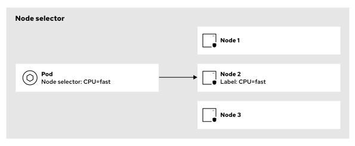

Trong sơ đồ trước đó, pod có bộ chọn nút (node selector) cho nhãn `CPU=fast` chỉ có thể được đặt trên nút thứ hai – nút duy nhất chứa nhãn đó.

Trong một ví dụ khác, bạn có thể gắn nhãn cho các nút trong cụm (cluster) của mình dựa trên vị trí địa lý. Sau đó, các nhà phát triển ứng dụng có thể sử dụng bộ chọn nút để triển khai các pod trên những nút thuộc một khu vực địa lý cụ thể, nhằm tối ưu hóa tính khả dụng và độ trễ.

#### Các quy tắc Affinity (ái lực) và Anti-affinity (phản ái lực)
**Affinity (Ái lực)**  
Affinity là một thuộc tính của pod, dùng để kiểm soát tùy chọn ưu tiên của pod đối với một node (nút).

**Anti-affinity (Phản ái lực)**  
Anti-affinity là một thuộc tính của pod, dùng để hạn chế việc đặt pod đó trên một node cụ thể.

Bạn có thể sử dụng các quy tắc affinity và anti-affinity để kiểm soát các tình huống sau:

* Xác định node để đặt pod (được gọi là node affinity). 
* Xác định node để đặt pod dựa trên mối quan hệ với các pod khác (được gọi là pod affinity).

**Node affinity (Ái lực với node)**  
Với node affinity, bạn có thể chỉ định mối quan hệ giữa một pod và một nhóm các node. Ví dụ: bạn có thể cấu hình để một pod chạy trên các node có loại CPU cụ thể hoặc nằm trong một vùng khả dụng (availability zone) nhất định. 

Node affinity có khái niệm tương tự như node selector (bộ chọn node), nhưng cung cấp cách thức linh hoạt hơn để thiết lập các ràng buộc khi chọn node. Trong khi node selector xác định các node mục tiêu thông qua tập hợp các cặp khóa-giá trị (key-value pairs) của nhãn (label), thì node affinity cho phép áp dụng cách tiếp cận có điều kiện thông qua các toán tử logic trong quá trình so khớp. 

Với node affinity, bạn có thể định nghĩa các quy tắc bắt buộc (required) và các quy tắc ưu tiên (preferred). Các quy tắc bắt buộc hoạt động tương tự như node selector: bộ lập lịch (scheduler) của OpenShift sẽ chỉ lên lịch cho pod nếu các điều kiện đó được đáp ứng. Đối với các quy tắc ưu tiên, bộ lập lịch của OpenShift sẽ cố gắng đặt pod vào một node thỏa mãn các quy tắc này; nếu không tìm thấy node nào như vậy, nó vẫn sẽ đặt pod vào một node khác, ngay cả khi node đó không đáp ứng các quy tắc ưu tiên đã đặt ra. 

Ví dụ trong sơ đồ dưới đây, một pod có quy tắc node affinity ưu tiên cho nhãn `CPU=fast`. OpenShift trước tiên sẽ cố gắng lên lịch cho pod đó trên node có nhãn `CPU=fast`. Nếu không thể đặt pod vào node đó, OpenShift sẽ chuyển sang đặt pod trên một node khác.

**Hình 3.2: Lập lịch pod trên các node cụ thể bằng cách sử dụng node affinity**  
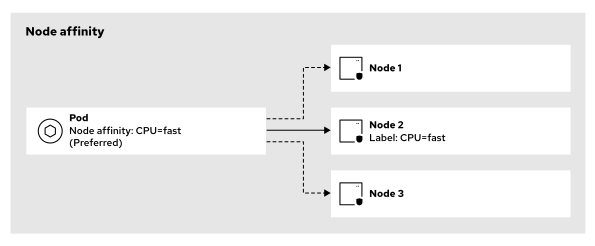

**Pod affinity (ái lực pod) và pod anti-affinity (phản ái lực pod)**  
Với pod affinity và pod anti-affinity, bạn có thể kiểm soát các node (nút) được chọn cho pod của mình dựa trên nhãn (label) của các pod khác. 

Thông qua các quy tắc pod affinity, bạn có thể đặt một pod vào cùng nhóm node với các pod khác dựa trên bộ chọn nhãn (label selector) của chúng. Ví dụ: bạn có thể cấu hình bộ lập lịch (scheduler) để đặt các pod của hai dịch vụ khác nhau vào cùng một nhóm node, trong trường hợp các dịch vụ này thường xuyên giao tiếp với nhau. 

Ngược lại, với các quy tắc pod anti-affinity, bạn có thể ngăn bộ lập lịch đặt một pod vào cùng nhóm node với các pod khác dựa trên bộ chọn nhãn của chúng. Chẳng hạn, bạn có thể cấu hình để ngăn pod của một dịch vụ cụ thể nằm cùng node với pod của một dịch vụ khác, nếu hai dịch vụ này gây cản trở lẫn nhau và làm giảm hiệu năng. Một trường hợp phổ biến khác là sử dụng các nhãn cấu trúc liên kết node (node topology labels) — chẳng hạn như các vùng khả dụng (availability zone) trên nền tảng đám mây hoặc các tủ rack trong trung tâm dữ liệu — kết hợp với các quy tắc anti-affinity để tránh đặt các pod cùng một khối lượng công việc (workload) vào cùng một miền lỗi (failure domain). 

Như minh họa trong sơ đồ dưới đây, nếu bạn tạo một deployment với nhãn `app=custom` cùng một quy tắc pod anti-affinity cho chính nhãn đó, OpenShift sẽ đặt các bản sao (replica) của deployment này trên các node khác nhau.

**Hình 3.3: Lên lịch các pod trên các node riêng biệt bằng cách sử dụng tính năng chống đồng vị pod (pod anti-affinity)**  
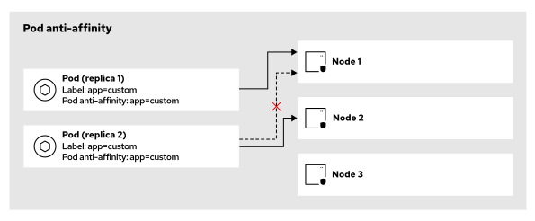

Các quy tắc về sự tương đồng (affinity) và sự khác biệt (anti-affinity) giữa các pod, cũng như các quy tắc về sự tương đồng với node, đều có hai loại: quy tắc bắt buộc (required) và quy tắc ưu tiên (preferred).

Các quy tắc bắt buộc phải được đáp ứng trước khi bộ lập lịch (scheduler) đặt một pod lên một node. Nếu bạn sử dụng các quy tắc bắt buộc mà các quy tắc đó không được đáp ứng, bộ lập lịch sẽ không thể tìm thấy node phù hợp để đặt pod.

Các quy tắc ưu tiên xác định những điều kiện mà bộ lập lịch sẽ cố gắng thực hiện; tuy nhiên, ngay cả khi không tìm thấy node nào thỏa mãn các điều kiện này, bộ lập lịch vẫn sẽ tiến hành đặt pod lên một node khác.

Bạn có thể cấu hình các quy tắc về sự tương đồng và khác biệt giữa các pod hoặc với các node trong tệp YAML định nghĩa pod thông qua tham số `spec.affinity`. Trong tham số này, bạn có thể thiết lập các thuộc tính `nodeAffinity`, `podAffinity` và `podAntiAffinity`, đồng thời chỉ định quy tắc bắt buộc, quy tắc ưu tiên, hoặc cả hai. Nếu bạn chỉ định cả quy tắc bắt buộc và quy tắc ưu tiên, thì node đó trước hết phải đáp ứng các quy tắc bắt buộc, sau đó bộ lập lịch mới cố gắng đáp ứng các quy tắc ưu tiên.

#### Taint và Toleration
Bạn có thể cấu hình các taint (vết bẩn/điều kiện hạn chế) trên các node sao cho chúng chỉ lập lịch (schedule) một pod nếu pod đó có toleration (cơ chế chấp nhận/cho phép) tương ứng. Node mang taint sẽ từ chối tất cả các pod, ngoại trừ những pod có toleration đối với taint đó. Ví dụ, OpenShift tự động gán taint cho các node control plane để các pod quản lý control plane có thể được lập lịch trên đó; tuy nhiên, các node control plane này sẽ từ chối bất kỳ pod data plane nào khác do người dùng triển khai.

Ví dụ: nếu bạn gán taint cho một node với nhãn `type=mission-critical`, thì OpenShift chỉ có thể lập lịch một pod trên node đó nếu pod này có toleration phù hợp với taint nói trên.

**Hình 3.4: Một node có vết (taint), có tác dụng đẩy các pod không có cơ chế chấp nhận (toleration) tương ứng.**  
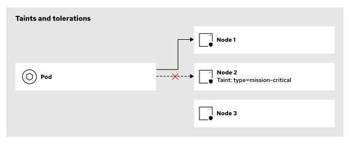

Bạn có thể áp dụng các "taint" (vết nhơ) cho một node trong tệp YAML đặc tả node bằng cách thiết lập tham số `spec.taints`, đồng thời áp dụng các "toleration" (cơ chế dung nạp) cho một pod trong tệp YAML đặc tả pod bằng cách thiết lập tham số `spec.tolerations`.

Các taint và toleration bao gồm ba thành phần: khóa (key), giá trị (value) và hiệu ứng (effect). 

* Khóa (key) là một chuỗi ký tự với độ dài tối đa 253 ký tự. 
* Giá trị (value) là một chuỗi ký tự với độ dài tối đa 63 ký tự. 
* Hiệu ứng (effect) có thể là một trong các tùy chọn sau:
  * **NoSchedule:** Nếu pod không khớp với taint, node sẽ ngăn chặn việc lập lịch (scheduling) cho pod đó. Các pod hiện đang chạy trên node vẫn sẽ tiếp tục chạy.
  * **PreferNoSchedule:** Nếu pod không khớp với taint, bộ lập lịch (scheduler) sẽ cố gắng tránh đặt pod đó lên node. Các pod hiện đang chạy trên node vẫn sẽ tiếp tục chạy.
  * **NoExecute:** Nếu pod không khớp với taint, node sẽ ngăn chặn việc lập lịch cho pod đó. Ngoài ra, bộ lập lịch sẽ loại bỏ các pod hiện đang chạy trên node nếu chúng không có toleration tương ứng.

Các toleration còn bao gồm tham số `operator`. Tham số này có thể nhận các giá trị sau:

**Equal:** Toleration khớp với taint nếu các tham số key, value và effect đều trùng khớp. Đây là hành vi mặc định.

**Exists:** Toleration khớp với taint nếu các tham số key và effect trùng khớp. Trong trường hợp này, tham số value phải để trống.

#### Pod Disruption Budget (Ngân sách gián đoạn Pod)
Pod Disruption Budget là một tài nguyên chính sách được sử dụng để kiểm soát sự gián đoạn của các Pod trong các tình huống gián đoạn chủ động (voluntary disruptions) — chẳng hạn như khi thu nhỏ quy mô (scaling down), cập nhật ứng dụng, hoặc giải phóng một node để bảo trì. Pod Disruption Budget không áp dụng cho các trường hợp lỗi node (node ​​failures).

Bằng cách thiết lập Pod Disruption Budget, bạn có thể quản lý tính khả dụng và độ ổn định của các ứng dụng trong suốt quá trình xảy ra gián đoạn, từ đó giảm thiểu rủi ro suy giảm chất lượng dịch vụ hoặc thời gian ngừng hoạt động (downtime) khi thực hiện bảo trì hoặc cập nhật cụm (cluster) của mình.

Cấu hình cho một Pod Disruption Budget bao gồm các thành phần sau:
* Bộ chọn nhãn (label selector): Dùng để xác định một tập hợp các Pod cụ thể. Thông qua bộ chọn nhãn này, bạn chỉ định những Pod nào sẽ được bảo vệ bởi Pod Disruption Budget. Chỉ những Pod khớp với bộ chọn nhãn mới chịu sự ràng buộc của chính sách này. Thông thường, bộ chọn nhãn trong một Pod Disruption Budget sẽ nhắm đến các Pod thuộc cùng một deployment. 
* Mức độ khả dụng (availability level): Xác định số lượng tối thiểu các Pod phải luôn ở trạng thái khả dụng cùng một lúc. Bạn có thể thiết lập các mức độ khả dụng sau:
  * **minAvailable:** Xác định số lượng tối thiểu các Pod phải luôn khả dụng, ngay cả khi xảy ra gián đoạn. Một Pod được coi là khả dụng khi nó có trạng thái (condition) là "Ready" với giá trị là "True". 
  * **maxUnavailable:** Xác định số lượng tối đa các Pod được phép không khả dụng trong suốt quá trình xảy ra gián đoạn.

## Bộ chọn nút (Node Selectors) và Taints
### Đảm bảo và ngăn chặn việc triển khai các workload trên các node
Các tính năng lập lịch nâng cao của OpenShift bao gồm bộ chọn node (node selector) – giúp đảm bảo pod được đặt tại các node cụ thể – cũng như cơ chế taint và toleration – giúp ngăn chặn việc chạy một số workload nhất định trên các node cụ thể.

Sử dụng bộ chọn node để lập lịch cho pod trên một nhóm node chuyên dụng. Ví dụ: lập lịch cho pod trên một node cung cấp phần cứng đặc thù mà pod đó yêu cầu.

Sử dụng taint và toleration để tránh lập lịch cho pod trên một nhóm node chuyên dụng. Ví dụ: ngăn chặn pod chạy trên node dành riêng cho các dịch vụ cụm OpenShift hoặc các dịch vụ control plane.

### Bộ chọn nút (Node Selectors)
Bằng cách sử dụng bộ chọn nút, bạn có thể chỉ định các nhãn nút (node labels) mục tiêu trên pod của mình, nhờ đó bộ lập lịch OpenShift sẽ cố gắng đặt pod đó vào các nút khớp với các nhãn mục tiêu này. Nếu bộ lập lịch OpenShift không tìm thấy nút nào khớp với các nhãn mục tiêu, pod của bạn sẽ không thể triển khai (không khả dụng).

Bạn có thể sử dụng bộ chọn nút ở cấp độ pod để đặt các pod vào những nút chuyên biệt. Bạn định nghĩa các bộ chọn nút này dưới dạng các thuộc tính trong mẫu pod (pod template).

Bạn có thể sử dụng bộ chọn nút ở cấp độ dự án (project) để đặt các pod trong một dự án vào những nút chuyên biệt. Bạn định nghĩa các bộ chọn nút này dưới dạng các chú thích (annotations) trong tài nguyên tùy chỉnh (CR) của dự án.

Bạn có thể sử dụng bộ chọn nút ở cấp độ cụm (cluster-wide) để đặt các pod vào những nút chuyên biệt ở bất kỳ đâu trong cụm. Bạn định nghĩa các bộ chọn nút này dưới dạng các thuộc tính trong tài nguyên tùy chỉnh (CR) của bộ lập lịch OpenShift.

Các chi tiết cụ thể về cú pháp cho bộ chọn nút sẽ được giải thích ở phần sau trong chương này.

**Hình 3.5: Bộ chọn nút (Node selectors)**  
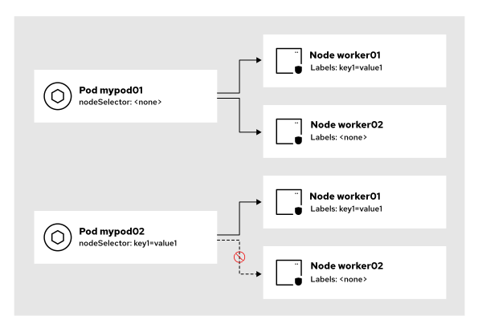

Sơ đồ trước đó minh họa cách thức hoạt động của các bộ chọn nút (node ​​selector) cho pod. Trong hình, nút worker01 có nhãn key1=value1, trong khi nút worker02 thì không có nhãn này. Đối với pod thứ nhất, OpenShift có thể lập lịch cho nó trên bất kỳ nút nào, vì pod này không có bộ chọn nút.

Pod thứ hai có một bộ chọn nút được định nghĩa dưới dạng thuộc tính trong mẫu pod (pod template). Khi đó, OpenShift chỉ có thể lập lịch cho pod này trên các nút có nhãn khớp với bộ chọn nút đó. Do vậy, bộ lập lịch (scheduler) của OpenShift chỉ có thể đặt pod này trên nút worker01.

#### Nhãn nút (Node Labels)
Để đảm bảo bộ lập lịch (scheduler) của OpenShift tìm được nút khớp với các nhãn mục tiêu, trước tiên bạn cần gắn nhãn cho các nút của mình. Bạn có thể thêm nhãn trực tiếp vào tài nguyên nút (node ​​resource) hoặc gián tiếp thông qua tài nguyên tập hợp máy (machine set resource).

Nếu cụm (cluster) của bạn hỗ trợ tài nguyên tập hợp máy, bạn bắt buộc phải sử dụng các tập hợp máy này để thiết lập nhãn cho các nút; trong trường hợp đó, không nên gắn nhãn trực tiếp cho các nút. Nếu cụm của bạn không hỗ trợ tài nguyên tập hợp máy (ví dụ: trong trường hợp cụm được cài đặt bằng phương pháp hạ tầng do người dùng cung cấp - user-provisioned infrastructure), thì bạn phải gắn nhãn trực tiếp cho các nút.

> **Lưu ý:** Nếu cụm của bạn hỗ trợ tài nguyên tập hợp máy, OpenShift có thể xóa và tạo lại các nút bất kỳ lúc nào. Do đó, nếu bạn gắn nhãn trực tiếp cho một nút, nút đó sẽ mất nhãn này khi OpenShift tạo lại nó (vì nhãn đó không nằm trong cấu hình của tập hợp máy).

Bạn có thể thêm một hoặc nhiều nhãn vào một nút bằng cách sử dụng lệnh sau:

```console
[user@host ~]$ oc label node node1 key1=value1 ... keyN=valueN
node/node1 labeled
```

Bạn có thể xóa các nhãn khỏi một nút bằng cách sử dụng lệnh sau:

```console
[user@host ~]$ oc label node node1 key1- ... keyN-
node/node1 unlabeled
```

#### Bộ chọn nút (Node Selector) cho Pod
Sử dụng các bộ chọn nút trên một pod để chỉ định các nhãn nút (node label) đích, nơi bộ lập lịch OpenShift sẽ cố gắng đặt pod đó vào.

Bạn có thể thêm một hoặc nhiều bộ chọn nút vào một pod bằng cách sử dụng cú pháp sau:

```yaml
apiVersion: v1
kind: Pod
metadata:
  name: my-pod
  ...output omitted...
spec:
  nodeSelector:
    key1: value1
    key2: value2
...output omitted...
```

Trong ví dụ trước, bộ lập lịch (scheduler) của OpenShift chỉ đặt pod vào các node có cả hai nhãn key1=value1 và key2=value2.

Bạn có thể xem các bộ chọn node (node selector) của một pod bằng cách kiểm tra tham số Node-Selectors của nó như sau:

```console
[user@host ~]$ oc describe pod myapp-95664666d-5l22c
...output omitted...
Node-Selectors:     key1:value1
                    key2:value2
...output omitted...
```

#### Bộ chọn nút (node selector) trên toàn cụm

Theo mặc định, bộ lập lịch (scheduler) của OpenShift cố gắng đặt các pod lên bất kỳ nút khả dụng nào trong cụm của bạn. Tuy nhiên, bạn có thể sửa đổi hành vi mặc định của bộ lập lịch OpenShift để thêm các bộ chọn nút mặc định vào bất kỳ pod mới nào được tạo trong cụm. Bằng cách sử dụng các bộ chọn nút trên toàn cụm, bạn có thể chỉ định các bộ chọn nút mặc định mà OpenShift sẽ tự động thêm vào các pod. Bạn cần có quyền quản trị để có thể thiết lập các bộ chọn nút trên toàn cụm.

Để xác định các bộ chọn nút trên toàn cụm, bạn có thể chỉnh sửa tài nguyên tùy chỉnh (CR) của bộ lập lịch OpenShift như sau:

```console
[user@host ~]$ oc edit scheduler cluster
```

Sau đó, hãy chỉ định tham số defaultNodeSelector.

```yaml
apiVersion: config.openshift.io/v1
kind: Scheduler
metadata:
  name: cluster
...output omitted...
spec:
  defaultNodeSelector: key1=value1,key2=value2
...output omitted...
```

Sau khi chỉnh sửa CR của bộ lập lịch OpenShift (OpenShift scheduler CR), hãy đợi các pod trong dự án openshift-kube-apiserver được triển khai lại.

Trong ví dụ trước, bất kỳ pod mới nào mà bạn tạo trong cụm (cluster) đều sẽ có các bộ chọn nút (node selector) là key1=value1 và key2=value2 theo mặc định.

#### Bộ chọn nút (node selector) cho dự án
Bạn có thể chỉ định các bộ chọn nút cho một dự án, nhờ đó OpenShift sẽ áp dụng các bộ chọn nút này cho mọi pod mới được tạo trong dự án đó. Bạn cần có quyền quản trị để thực hiện việc chỉ định các bộ chọn nút cho dự án.

Để xác định các bộ chọn nút cho dự án, bạn có thể tạo một tệp YAML cho tệp cấu hình (manifest) của dự án OpenShift, sau đó định nghĩa các bộ chọn nút trong phần `metadata.annotations` như sau:

```yaml
apiVersion: project.openshift.io/v1
kind: Project
metadata:
  name: myproject
  annotations:
    openshift.io/node-selector: key3=value3,key4=value4
...output omitted...
```

Trong ví dụ trước, bất kỳ pod mới nào mà bạn tạo trong dự án đều có sẵn các bộ chọn nút (node ​​selector) là key3=value3 và key4=value4 theo mặc định.

#### Các cấp độ của bộ chọn node (node selector)
Bạn có thể định nghĩa các bộ chọn node ở các cấp độ sau: pod, project (dự án) và toàn bộ cluster (cụm).

Bộ chọn node cấp project có độ ưu tiên cao hơn bộ chọn node cấp cluster. Do đó, nếu bạn định nghĩa cả bộ chọn node cấp project và cấp cluster, OpenShift sẽ chỉ áp dụng bộ chọn node cấp project cho các pod mới chứ không áp dụng bộ chọn node cấp cluster.

Bộ chọn node cấp pod hoạt động bổ sung cho các bộ chọn node cấp cluster và cấp project. Vì vậy, nếu bạn định nghĩa cả bộ chọn node cấp pod và cấp project, OpenShift sẽ tạo pod với cả hai bộ chọn này. Tương tự, nếu bạn định nghĩa cả bộ chọn node cấp pod và cấp cluster, OpenShift sẽ tạo pod với cả hai bộ chọn này.

> **Quan trọng:** Việc tạo một bộ chọn node cấp pod có cùng chuỗi khóa (key string) nhưng khác chuỗi giá trị (value string) so với bộ chọn node cấp project hoặc cấp cluster sẽ gây ra xung đột, khiến OpenShift không thể tạo pod của bạn.

### Taint và Toleration
Bạn có thể sử dụng taint trên các node để ngăn chặn việc chạy một số workload nhất định trên các node đó. Bộ lập lịch (scheduler) của OpenShift sẽ chỉ lập lịch triển khai pod lên các node này nếu pod có toleration tương ứng.

**Hình 3.6: Các cơ chế taint trên node và toleration trên pod**  
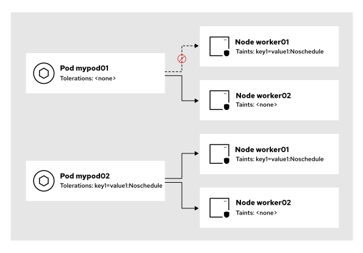

Trong hình trước, nút worker01 có một vết (taint), trong khi nút worker02 thì không. Bộ lập lịch (scheduler) của OpenShift không thể đặt pod đầu tiên vào nút worker01; nút này từ chối pod đó vì cơ chế dung thứ (toleration) không khớp với vết (taint). Do đó, OpenShift chỉ có thể lập lịch cho pod này trên nút worker02.

OpenShift có thể lập lịch cho pod thứ hai trên cả hai nút, vì cơ chế dung thứ (toleration) khớp với vết (taint).

#### Taint (Vết) trên Node
Một taint bao gồm khóa (key), giá trị (value) và hiệu ứng (effect). 

* Khóa (key) là một chuỗi ký tự với độ dài tối đa 253 ký tự. 
* Giá trị (value) là một chuỗi ký tự với độ dài tối đa 63 ký tự. 
* Hiệu ứng (effect) có thể là một trong các tùy chọn sau:
  * **NoSchedule:** Nếu pod không khớp với taint, node sẽ ngăn chặn việc lập lịch (scheduling) cho pod đó. Các pod hiện đang chạy trên node vẫn tiếp tục hoạt động bình thường. 
  * **PreferNoSchedule:** Nếu pod không khớp với taint, bộ lập lịch (scheduler) sẽ cố gắng tránh đặt pod đó lên node này. Các pod hiện đang chạy trên node vẫn tiếp tục hoạt động bình thường. 
NoExecute

Nếu pod không khớp với taint, node sẽ ngăn chặn việc lập lịch cho pod đó. Đồng thời, bộ lập lịch sẽ loại bỏ các pod hiện đang chạy trên node nếu chúng không có toleration (cơ chế cho phép pod chấp nhận taint) tương ứng.

Bạn có thể áp dụng taint cho một node thông qua tệp YAML đặc tả node (node specification) bằng cách thiết lập tham số `spec.taints`, hoặc sử dụng lệnh sau:

```console
[user@host ~]$ oc adm taint nodes node1 key1=value1:NoSchedule
node/node1 tainted
```

Sau khi áp dụng một taint cho một node, bạn có thể xác minh taint đó bằng cách sử dụng lệnh sau:

```console
[user@host ~]$ oc describe nodes node1
Name:               node1
Roles:              worker
...output omitted...
Taints:             key1=value1:NoSchedule
...output omitted...
```

Để loại bỏ taint khỏi một node, hãy sử dụng lệnh sau:

```console
[user@host ~]$ oc adm taint nodes node1 key1=value1:NoSchedule-
node/node1 untainted
```

#### Pod Tolerations
Các toleration bao gồm một khóa (key), một giá trị (value) và một hiệu ứng (effect), tương tự như các taint trên node. Toleration cũng bao gồm tham số toán tử (operator). Tham số operator có thể nhận các giá trị sau:

Equal

Toleration khớp với taint nếu các tham số key, value và effect đều trùng khớp. Đây là hành vi mặc định.

Exists

Toleration khớp với taint nếu các tham số key và effect trùng khớp. Trong trường hợp này, tham số value phải để trống.

Khi định nghĩa một toleration với hiệu ứng NoExecute, bạn có thể chỉ định thêm tham số tolerationSeconds. Tham số tolerationSeconds xác định khoảng thời gian một pod được phép duy trì trên node trước khi bị node đó loại bỏ (evict).

Bạn có thể áp dụng toleration cho một pod trong tệp YAML định nghĩa pod bằng cách thiết lập tham số spec.tolerations như sau:

```yaml
apiVersion: v1
kind: Pod
metadata:
  name: my-pod
  ...output omitted...
spec:
  tolerations:
  - key: "key1"
    operator: "Equal"
    value: "value1"
    effect: "NoExecute"
    tolerationSeconds: 3600
...output omitted...
```

Trong ví dụ trước, OpenShift có thể lập lịch cho pod trên các node có chứa taint `key1=value1:NoExecute`. Nếu OpenShift lập lịch cho pod trên một node có taint này, pod đó sẽ chạy trên node đó trong 3600 giây trước khi bị node này loại bỏ (evict), sau đó OpenShift sẽ lập lịch lại pod đó sang một node khác.

#### Lập lịch Pod và các trạng thái Node
Theo mặc định, OpenShift áp dụng các "taint" (vết bẩn/ràng buộc) lên các node và loại bỏ (evict) các pod dựa trên trạng thái của node đó. Ví dụ, OpenShift sẽ tự động áp dụng các taint lên node trong một số trường hợp nhất định, chẳng hạn như khi node gặp tình trạng quá tải bộ nhớ (memory pressure) hoặc quá tải ổ đĩa (disk pressure).

Các taint sau đây được tích hợp sẵn trong OpenShift:

**node.kubernetes.io/not-ready:** Node không ở trạng thái sẵn sàng (not ready). Taint này tương ứng với trạng thái node là Ready=False.

**node.kubernetes.io/unreachable:** Node không thể truy cập được từ bộ điều khiển node (node controller). Taint này tương ứng với trạng thái node là Ready=Unknown.

**node.kubernetes.io/memory-pressure:** Node đang gặp vấn đề quá tải bộ nhớ. Taint này tương ứng với trạng thái node là MemoryPressure=True.

**node.kubernetes.io/disk-pressure:** Node đang gặp vấn đề quá tải ổ đĩa. Taint này tương ứng với trạng thái node là DiskPressure=True.

**node.kubernetes.io/network-unavailable:** Mạng của node không khả dụng.

**node.kubernetes.io/unschedulable:** Node không thể tiếp nhận các pod mới (unschedulable).

**node.cloudprovider.kubernetes.io/uninitialized:** Taint này đánh dấu node là không thể sử dụng khi bạn khởi chạy bộ điều khiển node trong môi trường nhà cung cấp dịch vụ đám mây (cloud provider) bên ngoài. Sau khi trình quản lý bộ điều khiển đám mây (cloud controller manager) khởi tạo node, kubelet sẽ tự động loại bỏ taint này.

**node.kubernetes.io/pid-pressure:** Node đang gặp tình trạng quá tải định danh tiến trình (PID pressure). Taint này tương ứng với trạng thái node là PIDPressure=True.

Nếu một node báo cáo bất kỳ trạng thái nào nêu trên, OpenShift sẽ áp dụng taint tương ứng lên node đó cho đến khi trạng thái đó không còn nữa.

Ví dụ, bạn có thể kiểm tra cách OpenShift tự động áp dụng taint `node.kubernetes.io/unschedulable` lên một node không thể tiếp nhận pod bằng cách thực hiện theo ví dụ dưới đây. Trước tiên, hãy kiểm tra các taint trên một node bằng lệnh sau:

```console
[user@host ~]$ oc describe nodes node1 | grep Taints
Taints:     <none>
```

Sau đó, đánh dấu nút là không thể lập lịch.

```console
[user@host ~]$ oc adm cordon node1
node/node1 cordoned
```

Cuối cùng, hãy xác minh rằng OpenShift tự động áp dụng taint `node.kubernetes.io/unschedulable` với hiệu ứng `NoSchedule` lên node đó.

```console
[user@host ~]$ oc describe nodes node1 | grep Taints
Taints:     node.kubernetes.io/unschedulable:NoSchedule
```

OpenShift áp dụng các taint (vết bẩn) từ bảng trước đó với hiệu ứng `NoSchedule`, ngoại trừ các taint `node.kubernetes.io/not-ready` và `node.kubernetes.io/unreachable` mà OpenShift sử dụng hiệu ứng `NoExecute`.

Đối với các taint có hiệu ứng `NoSchedule`, bộ lập lịch (scheduler) của OpenShift sẽ xếp lịch cho pod vào node nếu pod có toleration (cơ chế chấp nhận taint) tương ứng, hoặc nếu node trở lại trạng thái bình thường; tuy nhiên, các pod đang chạy vẫn được giữ nguyên.

Đối với các taint có hiệu ứng `NoExecute`, bộ lập lịch của OpenShift sẽ xếp lịch cho pod vào node nếu pod có toleration tương ứng hoặc nếu node trở lại trạng thái bình thường, đồng thời bắt đầu di dời và xếp lịch lại các pod đang chạy sang những node khác. Với các pod không chấp nhận taint (không có toleration phù hợp) và đang chạy trên node, OpenShift sẽ di dời chúng ngay lập tức. Với các pod có toleration phù hợp, OpenShift chỉ di dời chúng nếu tham số `tolerationSeconds` được định nghĩa trên pod đó. Tham số `tolerationSeconds` xác định khoảng thời gian (tính bằng giây) mà pod được phép duy trì trên node trước khi bị node di dời.

Tham số `tolerationSeconds` rất hữu ích trong một số tình huống nhất định, chẳng hạn như khi ứng dụng cần tạo các tệp tin cục bộ trong lần chạy đầu tiên. Trong trường hợp này, việc chờ vài giây để pod phục hồi có thể tốt hơn so với việc tạo lại pod ngay lập tức trên một node khác. Nếu bạn định nghĩa tham số `tolerationSeconds` cho ứng dụng, node sẽ chờ khoảng thời gian đã định trước khi thực hiện di dời các pod.

#### Cơ chế dung thứ (tolerations) dự án
Bạn có thể chỉ định các cơ chế dung thứ (tolerations) cho một dự án, nhờ đó OpenShift sẽ áp dụng các cơ chế này cho mọi pod mới được tạo trong dự án đó. Bạn cần có quyền quản trị để thực hiện việc chỉ định các cơ chế dung thứ cấp dự án. Nếu bạn định nghĩa cả cơ chế dung thứ cấp dự án lẫn cấp pod, OpenShift sẽ tạo pod với đầy đủ các cơ chế dung thứ từ cả hai nguồn này.

Để định nghĩa các cơ chế dung thứ cấp dự án, bạn có thể tạo một tệp YAML cho tài nguyên tùy chỉnh (CR) của dự án OpenShift và khai báo cơ chế dung thứ trong phần `metadata.annotations` như sau:

```yaml
kind: Project
apiVersion: project.openshift.io/v1
metadata:
  name: myproject
  annotations:
    scheduler.alpha.kubernetes.io/defaultTolerations: >-
      [{"operator":"Equal","effect":"NoSchedule","key":"key1","value":"value1"}]
```

Trong ví dụ trước, bất kỳ pod mới nào mà bạn tạo trong dự án đều có sẵn cơ chế dung thứ (toleration) với thiết lập key1=value1:NoSchedule theo mặc định.

#### Chấp nhận mọi vết nhơ (Tolerating All Taints)
Bạn có thể cấu hình một pod để chấp nhận tất cả các vết nhơ (taint) trên node bằng cách sử dụng cơ chế chấp nhận (toleration) với toán tử "Exists" mà không cần chỉ định tham số khóa (key) hay giá trị (value).

```yaml
apiVersion: v1
kind: Pod
metadata:
  name: my-pod
...output omitted...
spec:
  tolerations:
  - operator: "Exists"
```

> **Lưu ý:** OpenShift không loại bỏ các pod có thiết lập dung thứ (toleration) `operator="Exists"` khỏi một node đang có các vết (taint).

## Tính sẵn sàng cao với các quy tắc ái lực (affinity rules) và ngân sách gián đoạn pod (pod disruption budgets)
### Cơ chế Affinity trong lập lịch (Scheduling Affinity)

Bạn có thể hướng dẫn bộ lập lịch Kubernetes (Kubernetes scheduler) cách phân bổ các pod trên các nút tính toán (compute node) trong cụm (cluster). Các quy tắc affinity cho phép bộ lập lịch Kubernetes thiết lập ưu tiên để chạy các pod trên một nút cụ thể, hoặc tránh chạy pod trên một nút đang có các pod khác hoạt động.

Các quản trị viên cụm có thể thiết lập các nhãn cấu trúc liên kết (topology label) trên các nút để biểu thị miền lỗi (failure domain) mà chúng thuộc về. Các nhà phát triển ứng dụng có thể cấu hình các tài nguyên triển khai (deployment resource) để sử dụng thiết lập "anti-affinity" (phản affinity) cho pod, kết hợp với các nhãn cấu trúc liên kết tùy chỉnh, nhằm phân bổ khối lượng công việc trên các miền lỗi khác nhau.

Đôi khi, các ứng dụng yêu cầu phải có nhiều bản sao (replica) khả dụng trong trường hợp xảy ra sự cố gián đoạn cụm. Yêu cầu này thường xuất phát từ quá trình kiểm thử tải (load testing) – vốn có thể chỉ ra rằng cần một số lượng bản sao nhất định để đảm bảo thời gian phản hồi phù hợp cho người dùng. Các tài nguyên "Pod Disruption Budget" (PDB) cho phép thiết lập những ràng buộc về tính khả dụng tối thiểu, đảm bảo rằng một số lượng hoặc tỷ lệ phần trăm nhất định các pod vẫn tiếp tục chạy ngay cả khi một nút bị rút khỏi cụm (drained).

#### Pod Affinity và Anti-affinity
Pod affinity (ái lực Pod) và anti-affinity (phản ái lực Pod) là các quy tắc lập lịch được thiết lập trong phần đặc tả (specification) của Pod. Bộ lập lịch (scheduler) sử dụng các quy tắc này để đặt các Pod vào cùng một node trong cụm (cluster node) nơi đang có một workload khác hoạt động, hoặc để tránh đặt chúng vào cùng node đang chạy các Pod thuộc workload khác.

Các quy tắc pod affinity và anti-affinity định nghĩa một tập hợp các bộ chọn (selector) để khớp với nhãn (label) của các Pod khác đang chạy trên các node của cụm. Bộ lập lịch có thể đánh giá các quy tắc này theo cơ chế "nỗ lực tối đa" (best-effort) nếu thiết lập affinity ở dạng ưu tiên (preferred), hoặc yêu cầu các điều kiện phải được đáp ứng mới tiến hành lập lịch cho Pod.

Kubernetes triển khai hai loại quy tắc affinity cho Pod: pod affinity và pod anti-affinity.

Pod affinity

Thiết lập pod affinity cho phép lập lịch để đặt các Pod vào cùng một node đang chạy các Pod thuộc một workload khác. Phần đặc tả của Pod chứa thiết lập pod affinity; thiết lập này sử dụng một bộ chọn (selector) để khớp với nhãn của các Pod khác thông qua một toán tử (operator). 

Pod affinity giúp giảm độ trễ mạng giữa các Pod cụ thể. Nó cũng giúp cải thiện hiệu năng của các workload đòi hỏi sự giao tiếp lớn giữa các Pod. 

Trong các hình ảnh dưới đây, các Pod có thiết lập pod affinity nhằm chỉ dẫn bộ lập lịch đặt chúng vào cùng một node. Deployment này được cấu hình để chạy hai bản sao (replica).

**Hình 3.7: Lên lịch cho pod đầu tiên trên node có thiết lập pod affinity**  
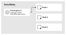

Bộ lập lịch đặt pod đầu tiên vào node đầu tiên. Không có ưu tiên nào được đặt ra, vì không có pod nào khớp với bộ chọn nhãn `app=custom`.

**Hình 3.8: Lên lịch cho pod thứ hai trên cùng một node bằng cách sử dụng tính năng pod affinity**  
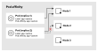

Bộ lập lịch (scheduler) tìm kiếm các pod khớp với bộ chọn nhãn `app=custom` và thiết lập ưu tiên chạy pod thứ hai trên cùng một node với pod thứ nhất. Sau đó, pod thứ hai được lập lịch để chạy trên node đầu tiên.

**Tính năng chống ái lực pod (Pod anti-affinity)**  
Cấu hình chống ái lực pod ngăn chặn việc lập lịch các pod trên cùng một node đang chạy các pod thuộc một khối lượng công việc (workload) khác. Bạn có thể sử dụng bộ chọn (selector) để khớp với các nhãn của những pod khác. Đặc tả của pod bao gồm cấu hình chống ái lực pod, trong đó sử dụng bộ chọn để khớp với nhãn của các pod khác. 

Tính năng chống ái lực pod ngăn cản một số khối lượng công việc chạy trên cùng một node. Nó có thể giúp phân bổ khối lượng công việc trên các miền lỗi (failure domains) nhằm tăng cường độ tin cậy hoặc ngăn ngừa sự xung đột giữa các khối lượng công việc. 

Trong các hình ảnh dưới đây, các pod được thiết lập chế độ chống ái lực, yêu cầu bộ lập lịch không đặt chúng trên cùng một node. Deployment này được cấu hình để chạy hai bản sao (replica).

**Hình 3.9: Lên lịch cho pod đầu tiên trên node có thiết lập chống ái lực pod (pod anti-affinity)**  
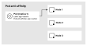

Bộ lập lịch đặt pod đầu tiên vào node đầu tiên. Không có ưu tiên nào được đặt ra, vì không có pod nào khớp với bộ chọn nhãn `app=custom`.

**Hình 3.10: Lên lịch cho pod thứ hai trên một node riêng biệt bằng cách sử dụng tính năng chống ái lực pod (pod anti-affinity)**  
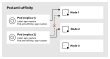

Bộ lập lịch (scheduler) tìm kiếm các pod khớp với bộ chọn nhãn (label selector) `app=custom` và thiết lập tùy chọn ưu tiên để tránh đặt pod thứ hai trên cùng một node với pod thứ nhất. Kết quả là pod thứ hai được lập lịch trên một node khác.

Tương tự như cơ chế affinity (ái lực) với node, bạn có thể áp dụng các điều kiện bắt buộc (required) hoặc ưu tiên (preferred) cho các thiết lập affinity hoặc anti-affinity giữa các pod.
Lưu ý

Bộ lập lịch chỉ đánh giá các điều kiện affinity tại thời điểm pod được tạo.

**Bắt buộc (Required)**  
Các điều kiện affinity được áp dụng nghiêm ngặt khi pod được tạo; bộ lập lịch sẽ không di chuyển pod sang node khác nếu các điều kiện này thay đổi sau đó. 

Các quy tắc affinity bao gồm danh sách các bộ chọn (selector) dùng để khớp với nhãn của các pod đang chạy trên một node trong cụm (cluster).

**Ưu tiên (Preferred)**  
Bộ lập lịch đánh giá các điều kiện affinity theo nguyên tắc "nỗ lực tối đa" (best-effort). Điều này có nghĩa là nếu không có node nào thỏa mãn tất cả các điều kiện, bộ lập lịch vẫn có thể chọn một node không đáp ứng đầy đủ các yêu cầu đó. Bộ lập lịch sẽ không di chuyển pod nếu các điều kiện thay đổi sau đó. 

Các điều kiện lập lịch ưu tiên bao gồm một danh sách các bộ chọn pod kèm theo trọng số. Mỗi bộ chọn có thể khớp với nhãn của các pod đang chạy. Mỗi quy tắc được gán một giá trị trọng số nằm trong khoảng từ 1 đến 100.

```yaml
apiVersion: v1
kind: Pod
metadata:
  name: my-pod
  labels:
    app: custom
spec:
  affinity:
    podAntiAffinity:
      preferredDuringSchedulingIgnoredDuringExecution: # (1)
        - weight: 100 # (2)
          podAffinityTerm:
            labelSelector:
              matchExpressions: # (3)
                - key: app
                  operator: In # (4)
                  values:
                    - custom
            topologyKey: rack # (5)
...output omitted...
```

1. Các biểu thức được đánh giá theo nguyên tắc "nỗ lực tối đa" (best-effort); pod vẫn sẽ được lập lịch trên một node ngay cả khi các ràng buộc không được đáp ứng.
2. Giá trị trọng số nằm trong khoảng từ 1 đến 100 (bao gồm cả 1 và 100).
3. Biểu thức khớp với nhãn (label) của pod.
4. Toán tử dùng để so khớp các nhãn.
5. Khóa cấu trúc liên kết (topology key) mà bộ lập lịch (scheduler) sử dụng để phân bổ các pod trên các miền lỗi (failure domain).

#### Khóa cấu trúc liên kết (Topology Keys)
Bộ lập lịch Kubernetes có thể sử dụng các nhãn nút (node labels) để biểu thị miền lỗi (failure domain) mà mỗi nút thuộc về. Miền lỗi có thể là một tủ rack được kết nối với nguồn điện hoặc thiết bị mạng riêng biệt, hoặc là dấu hiệu cho thấy nút đó nằm ở một tòa nhà khác.

Kubernetes sử dụng các nhãn nút (node label) sau đây làm khóa cấu trúc liên kết (topology key) mặc định để phân bổ khối lượng công việc (workload) trên các nút trong cụm (cluster):

**kubernetes.io/hostname**  
Nhãn này được thiết lập để khớp với giá trị tên máy chủ (hostname) của từng nút trong cụm.

**topology.kubernetes.io/zone**  
Đại diện cho vùng khả dụng (availability zone) của nút. Nhãn này do nhà cung cấp dịch vụ đám mây thiết lập và có thể không xuất hiện trong các môi trường triển khai tại chỗ (on-premise).

**topology.kubernetes.io/region**  
Đại diện cho khu vực (region) của nút. Nhãn này do nhà cung cấp dịch vụ đám mây thiết lập và có thể không xuất hiện trong các môi trường triển khai tại chỗ (on-premise).

Khóa cấu trúc liên kết giúp bộ lập lịch (scheduler) phân bổ các pod trên các miền lỗi (failure domain). Quản trị viên cụm phải gắn nhãn cho tất cả các nút để chỉ rõ miền lỗi tương ứng của chúng. Các nhà phát triển ứng dụng có thể sử dụng nhãn nút làm khóa cấu trúc liên kết tùy chỉnh trong các điều kiện liên kết pod (pod affinity), nhằm hướng dẫn bộ lập lịch cách đặt các pod lên các nút trong cụm.

Kịch bản sau đây mô tả một cụm được phân bổ trên hai tủ rack. Mỗi tủ rack được kết nối với một nguồn điện riêng biệt. Các nút được phân bổ theo tủ rack như bảng dưới đây:

| Khóa cấu trúc liên kết | Control plane nodes  | Compute nodes    |
|------------------------|----------------------|------------------|
| rack=rack-1            |  master02, master03  | node01           |
| rack=rack-2            | master01             |  node02, node03  |

Người quản trị đã thêm nhãn rack (tủ máy) để biểu thị vị trí và miền lỗi (failure domain) của từng nút (node). Nhãn này đóng vai trò như một khóa cấu trúc liên kết (topology key) tùy chỉnh, cho phép bộ lập lịch (scheduler) phân bổ các pod một cách đồng đều trên các nút tính toán nằm trong những tủ máy khác nhau.

**Khi không có khóa cấu trúc liên kết tùy chỉnh:**  
Giá trị của khóa cấu trúc liên kết `kubernetes.io/hostname` khác nhau trên mỗi nút, và bộ lập lịch coi mỗi nút là một miền lỗi riêng biệt. Bộ lập lịch sử dụng các khóa cấu trúc liên kết mặc định để phân bổ các pod một cách đồng đều trên tất cả các nút tính toán.

**Hình 3.11: Phân bổ Pod bằng cách sử dụng các miền lỗi (failure domains) dựa trên tên máy chủ mặc định**  
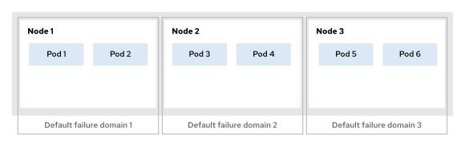

**Với khóa cấu trúc liên kết tùy chỉnh**  
Khóa cấu trúc liên kết tủ rack (rack topology key) xác định miền lỗi (failure domain) mà mỗi nút thuộc về. Bộ lập lịch sẽ phân bổ các pod một cách đồng đều trên các miền lỗi đó.

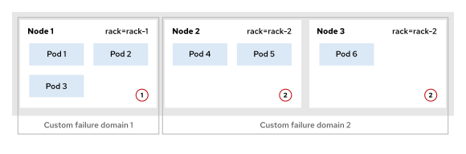

*Phân bổ Pod trên các miền lỗi tùy chỉnh bằng cách sử dụng các khóa cấu trúc liên kết (topology keys)*

1. Ba pod được đặt tại nút tính toán node01 trong miền lỗi rack-1.
2. Ba pod còn lại được đặt tại các nút trong miền lỗi rack-2.

### Pod Disruption Budget (Ngân sách gián đoạn Pod)
Pod Disruption Budget (PDB) là một đối tượng chính sách cho phép bạn chỉ định tỷ lệ phần trăm hoặc số lượng Pod cần duy trì hoạt động khi xảy ra tình trạng gián đoạn chủ động (voluntary disruption) trong cụm (cluster). Tài nguyên PDB thuộc nhóm API `policy/v1`.

Các cụm Kubernetes có hai loại gián đoạn: gián đoạn ngoài ý muốn (involuntary disruption) và gián đoạn chủ động (voluntary disruption).

**Gián đoạn ngoài ý muốn (Involuntary disruptions)**  
Gián đoạn ngoài ý muốn xảy ra khi một node gặp sự cố và bị ngắt kết nối khỏi cụm. Các sự cố này có thể liên quan đến lỗi phần cứng, vấn đề mạng trong một vùng (zone), hoặc sự cố nguồn điện tại một tủ rack. Cụm Kubernetes sẽ phát hiện node không còn phản hồi, tạo các Pod thay thế trên một node khác, và cuối cùng xóa bỏ tất cả các Pod đang được lập lịch trên node bị lỗi đó.

**Gián đoạn chủ động (Voluntary disruptions)**  
Gián đoạn chủ động xảy ra khi các node bị đặt ở trạng thái "cordon" (không nhận thêm Pod mới) hoặc bị đưa ra khỏi hệ thống để bảo trì. Khi tình trạng này xảy ra, tất cả các Pod trên node bị ảnh hưởng sẽ bị loại bỏ (evicted) cùng lúc, và bộ lập lịch (scheduler) sẽ tạo các Pod thay thế trên một node khác. Nếu tất cả các Pod của một khối lượng công việc (workload) đều đang chạy trên cùng một node và node đó bị giải phóng (drained), thì các ràng buộc về tính khả dụng tối thiểu của ứng dụng sẽ không được đáp ứng.

Bạn có thể định nghĩa tài nguyên PDB thông qua thuộc tính `minAvailable` hoặc `maxUnavailable`. Các giá trị cho những thiết lập này thường được xác định sau khi thực hiện kiểm thử tải (load testing) trên ứng dụng. Chẳng hạn, đôi khi cần duy trì một số lượng Pod nhất định để đảm bảo ứng dụng không rơi vào tình trạng xếp hàng chờ xử lý các yêu cầu từ người dùng. Một ví dụ khác là ứng dụng vẫn có thể duy trì thời gian phản hồi chấp nhận được đối với người dùng ngay cả khi chỉ còn 60% số lượng Pod đang hoạt động.

**minAvailable**  
Số lượng Pod tối thiểu cần duy trì khả dụng, ngay cả trong trường hợp xảy ra gián đoạn chủ động. Bạn có thể thiết lập thuộc tính này dưới dạng tỷ lệ phần trăm hoặc một giá trị số nguyên để chỉ định số lượng Pod bản sao (replica) tối thiểu cần phải khả dụng.

```yaml
apiVersion: policy/v1
kind: PodDisruptionBudget
metadata:
  name: nginx-min
spec:
  minAvailable: 80% # (1)
  selector: # (2)
    matchLabels:
      app: nginx
```

1. Tỷ lệ phần trăm hoặc số lượng pod tối thiểu cần phải khả dụng. 
2. Bộ chọn nhãn (label selector) cho các pod bị ảnh hưởng.

**maxUnavailable**  
Số lượng pod tối đa được phép không khả dụng trong quá trình gián đoạn có chủ đích (voluntary disruption). Bạn có thể thiết lập thuộc tính này dưới dạng tỷ lệ phần trăm hoặc một giá trị số nguyên để quy định số lượng pod bản sao (replica pod) tối đa được phép không khả dụng.

```yaml
apiVersion: policy/v1
kind: PodDisruptionBudget
metadata:
  name: nginx-max
spec:
  maxUnavailable: 33%  1
  selector:  2
    matchLabels:
      app: nginx
```

1. Tỷ lệ phần trăm hoặc số lượng pod tối đa được phép không khả dụng. 
2. Bộ chọn nhãn (label selector) cho các pod bị ảnh hưởng.

Bạn có thể liệt kê hoặc mô tả các tài nguyên PDB để kiểm tra các thuộc tính của chúng.

```console
[user@host ~]$ oc get pdb nginx-min
NAME       MIN AVAILABLE  MAX UNAVAILABLE  ALLOWED DISRUPTIONS  AGE
nginx-min  80%            N/A              2                    45s  (1)
```

1. Tỷ lệ tối thiểu hoặc số lượng pod cần phải khả dụng.

Bạn cũng có thể mô tả tài nguyên để xem bộ chọn nhãn (label selector) áp dụng cho các pod đó.

```console
[user@host ~]$ oc describe pdb nginx-max
Name:             nginx-max
Namespace:        scheduling-pdb
Max unavailable:  33%  (1)
Selector:         app=nginx  (2)
Status:
    Allowed disruptions:  4
    Current:              10
    Desired:              6
    Total:                10
Events:                   <none>
```

1. Tỷ lệ phần trăm hoặc số lượng pod tối đa được phép không khả dụng.
2. Bộ chọn nhãn (label selector) cho các pod bị ảnh hưởng.

#### Giải phóng node (node drain) mà không có ngân sách gián đoạn pod (Pod Disruption Budget)
Trong kịch bản dưới đây, một deployment được cấu hình để chạy sáu pod bản sao (replica pod), phân bổ trên các node tính toán. Ứng dụng sẽ duy trì thời gian phản hồi phù hợp nếu có từ năm pod trở lên đang hoạt động.

**Hình 3.12: Mức tải cơ sở với sáu bản sao được phân bổ trên các nút hiện có**  
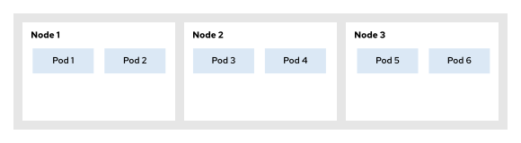

Nút đầu tiên được giải phóng bằng cách sử dụng lệnh `oc adm drain`. Nút này sẽ bị đặt vào trạng thái "cordon" (cấm lập lịch) và được đánh dấu là không thể lập lịch tác vụ.

**Hình 3.13: Trạng thái nút (node) đã được đặt ở chế độ cordon trước khi thực hiện di dời pod**  
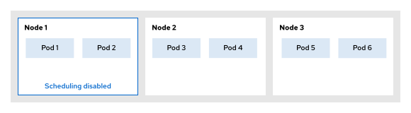

```console
[user@host ~]$ oc adm drain node/node01 --ignore-daemonsets --delete-emptydir-data
node/node01 cordoned
Warning: ignoring DaemonSet-managed Pods: ...
... "Waited before sending request" delay="1.156068852s" reason="client-side throttling ...
...output omitted...
```

> **Lưu ý:** Bạn có thể yên tâm bỏ qua mọi cảnh báo liên quan đến các pod được quản lý (managed pods) hoặc cơ chế điều tiết phía máy khách (client-side throttling).

Tất cả các pod đang chạy trên node được giải phóng (drained node) đều được đánh dấu để loại bỏ (eviction). Bộ lập lịch (scheduler) sẽ tạo các pod thay thế trên một node khác. Cho đến khi các pod thay thế này sẵn sàng, hệ thống sẽ chỉ còn bốn pod đang hoạt động, dẫn đến việc ứng dụng bắt đầu phản hồi chậm hơn.

**Hình 3.14: Loại bỏ Pod trong kịch bản giải phóng node không được quản lý**  
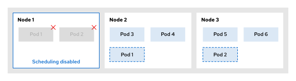

```
...output omitted...
evicting pod scheduling-pdb/nginx-56bdf7d8c6-kf98k
evicting pod scheduling-pdb/nginx-56bdf7d8c6-8kk2b
pod/nginx-56bdf7d8c6-kf98k evicted
pod/nginx-56bdf7d8c6-8kk2b evicted
...output omitted...
```

Nút tính toán cuối cùng được đánh dấu là đã rút hết các pod (drained). Các pod thay thế được đánh dấu là đã sẵn sàng (ready). Hiện tại, ứng dụng đang chạy cả sáu pod và thời gian phản hồi nằm trong phạm vi kỳ vọng của người dùng.

**Hình 3.15: Di dời nút thành công mà không có các ràng buộc gây gián đoạn**  
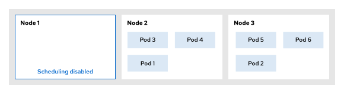

```
...output omitted...
node/node01 drained
```

Kết quả đầy đủ của lệnh oc adm drain như sau:

```console
[user@host ~]$ oc adm drain node/node01 --ignore-daemonsets --delete-emptydir-data
node/node01 cordoned
...output omitted...
evicting pod scheduling-pdb/nginx-56bdf7d8c6-kf98k  (1)
evicting pod scheduling-pdb/nginx-56bdf7d8c6-8kk2b
...output omitted...
pod/nginx-56bdf7d8c6-kf98k evicted  (2)
pod/nginx-56bdf7d8c6-8kk2b evicted
...output omitted...
node/node01 drained
```

1. Tất cả các pod đều được đánh dấu để loại bỏ khi node được giải phóng (drain).
2. Tất cả các pod đều bị loại bỏ khỏi node cùng một lúc, dẫn đến việc không đáp ứng được các ràng buộc về tính sẵn sàng của ứng dụng.

#### Giải phóng nút (Node Drain) với Ngân sách gián đoạn Pod (Pod Disruption Budget - PDB)

Với tài nguyên PDB, bạn có thể xác định các ràng buộc về tính khả dụng tối thiểu cho ứng dụng. Quá trình giải phóng nút sẽ bị chặn cho đến khi các pod thay thế cho ứng dụng được lập lịch trên một nút khác và chuyển sang trạng thái sẵn sàng. Việc loại bỏ pod (pod eviction) sẽ bị chặn cho đến khi các ràng buộc về tính khả dụng theo PDB được đáp ứng. Thao tác loại bỏ pod sẽ được thử lại sau mỗi năm giây.

Deployment được cấu hình để chạy sáu pod bản sao (replica pods), phân bổ trên các nút tính toán (compute nodes). Ứng dụng sẽ duy trì thời gian phản hồi phù hợp nếu có từ năm pod trở lên đang hoạt động. Nhà phát triển tạo một tài nguyên PDB, trong đó tham số `spec.minAvailable` được đặt là năm, đồng thời chỉ định bộ chọn (selector) khớp với các nhãn (labels) của các pod thuộc Deployment đó.

**Hình 3.16: Phân bổ khối lượng công việc có tính sẵn sàng cao trước khi áp dụng PDB**  


Nút đầu tiên được giải phóng bằng cách sử dụng lệnh `oc adm drain`. Nút này sẽ bị đặt vào trạng thái "cordon" (cấm lập lịch) và được đánh dấu là không thể lập lịch tác vụ.

**Hình 3.17: Kích hoạt lệnh rút (drain command) trên một khối lượng công việc được bảo vệ bởi PDB**  


```console
[user@host ~]$ oc adm drain node/node01 --ignore-daemonsets --delete-emptydir-data
node/node01 cordoned
...output omitted...
```

Tất cả các pod đang chạy trên node được giải phóng (drained node) đều được đánh dấu để loại bỏ (eviction). Bộ lập lịch (scheduler) sẽ tạo một pod thay thế trên một node khác và chờ cho đến khi pod mới này sẵn sàng. Pod thứ hai không thể bị loại bỏ vì ràng buộc về tính sẵn sàng quy định rằng phải có năm trong tổng số sáu pod đang hoạt động. Thao tác loại bỏ đối với pod thứ hai sẽ được thử lại sau năm giây.

**Hình 3.18: Can thiệp bằng ngân sách gián đoạn giúp ngăn ngừa vi phạm về tính khả dụng**  
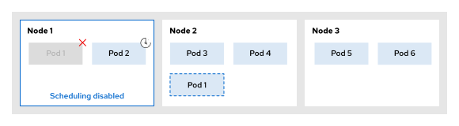

```
...output omitted...
evicting pod scheduling-pdb/nginx-647b4c98f5-nqvs6
evicting pod scheduling-pdb/nginx-647b4c98f5-98ptm
error when evicting pods/"nginx-647b4c98f5-98ptm" -n "scheduling-pdb" (will retry after 5s): Cannot evict pod as it would violate the pod's disruption budget.
...output omitted...
```

> **Quan trọng:** Quá trình giải phóng nút (drain process) sẽ bị chặn cho đến khi tất cả các pod được di dời khỏi nút đó.

Pod thay thế đầu tiên được đánh dấu là sẵn sàng, và pod ban đầu được di dời khỏi nút đang được giải phóng. Bộ lập lịch (scheduler) tạo ra một pod thay thế thứ hai trên một nút khác và chờ đợi cho đến khi pod này sẵn sàng.

**Hình 3.19: Di chuyển các bản sao một cách có kiểm soát nhằm duy trì thời gian hoạt động của ứng dụng**  
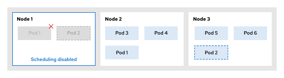

```
...output omitted...
pod/nginx-647b4c98f5-nqvs6 evicted
evicting pod scheduling-pdb/nginx-647b4c98f5-98ptm
...output omitted...
```

Pod thay thế thứ hai được đánh dấu là đã sẵn sàng, và pod thứ hai bị loại bỏ khỏi nút (node) đang được giải phóng (drained).

**Hình 3.20: Loại bỏ pod thành công sau khi các yêu cầu về tính sẵn sàng đã được đáp ứng**  
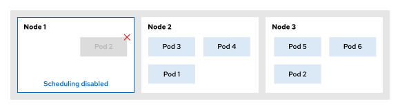

```
...output omitted...
pod/nginx-647b4c98f5-98ptm evicted
...output omitted...
```

Nút tính toán cuối cùng được đánh dấu là đã rút hết tác vụ (drained).

**Hình 3.21: Trạng thái nút đã được rút hết tác vụ (drained) với mức độ sẵn sàng tối thiểu được duy trì**  


```
...output omitted...
node/node01 drained
```

Kết quả đầy đủ của lệnh `oc adm drain` như sau:

```console
[user@host ~]$ oc adm drain node/node01 --ignore-daemonsets --delete-emptydir-data
node/node01 cordoned
...output omitted...
evicting pod scheduling-pdb/nginx-647b4c98f5-nqvs6
evicting pod scheduling-pdb/nginx-647b4c98f5-98ptm  (1)
error when evicting pods/"nginx-647b4c98f5-98ptm" -n "scheduling-pdb" (will retry after 5s): Cannot evict pod as it would violate the pod's disruption budget.  (2)
...output omitted...
error when evicting pods/"nginx-647b4c98f5-98ptm" -n "scheduling-pdb" (will retry after 5s): Cannot evict pod as it would violate the pod's disruption budget.
pod/nginx-647b4c98f5-nqvs6 evicted
evicting pod scheduling-pdb/nginx-647b4c98f5-98ptm
...output omitted...
pod/nginx-647b4c98f5-98ptm evicted  (3)
...output omitted...
node/node01 drained
```
1. Pod được đánh dấu để loại bỏ (eviction).
2. Quá trình loại bỏ pod bị chặn lại cho đến khi các ràng buộc về tính sẵn sàng từ PDB được đáp ứng.
3. Cuối cùng, pod được loại bỏ khỏi node đang được giải phóng (drained node).
