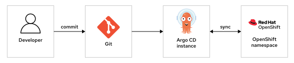
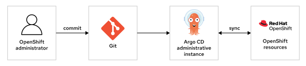
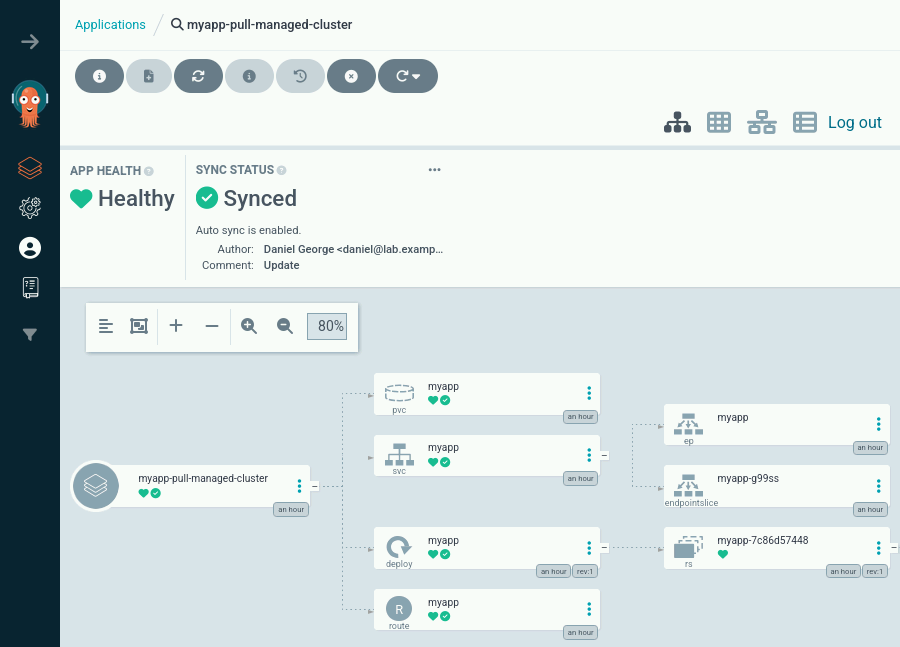
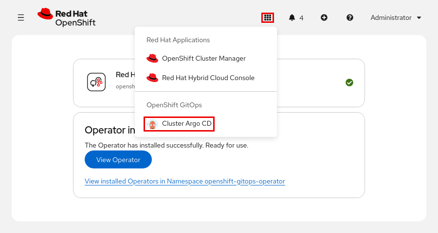
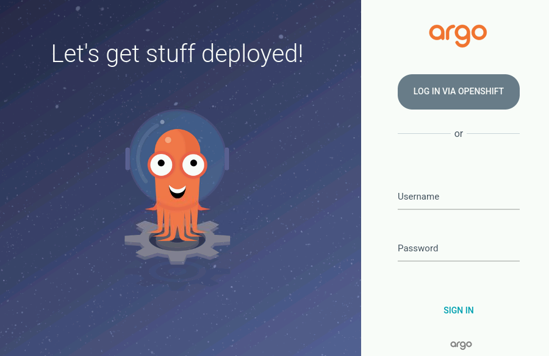
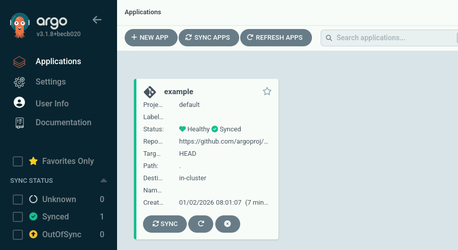
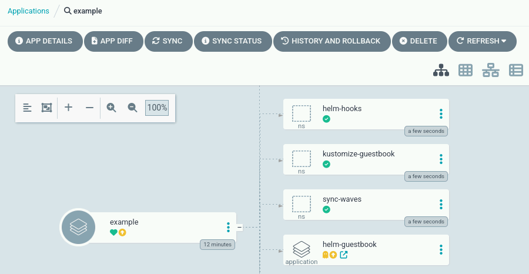
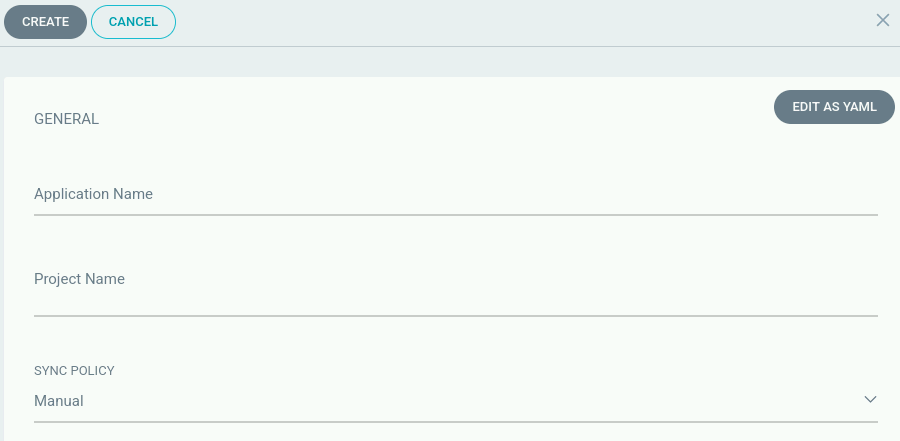
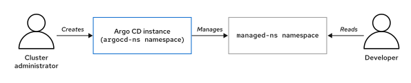

Quản trị Red Hat OpenShift III: Mở rộng quy mô triển khai trong doanh nghiệp
----------------------------------------------------------------------------

# Chương 4. OpenShift GitOps
## GitOps cho Kubernetes
### GitOps Operator
Red Hat OpenShift GitOps là một operator hỗ trợ triển khai các phương pháp GitOps để quản lý các cụm (cluster) OpenShift.

Kubernetes cho phép nhập và xuất các định nghĩa tài nguyên dưới dạng tệp văn bản. Bằng cách làm việc với các định nghĩa tài nguyên trong tệp văn bản, người quản trị có thể mô tả các khối lượng công việc (workload) thay vì phải thực hiện một chuỗi các thao tác để tạo ra chúng. Phương pháp này được gọi là quản lý tài nguyên theo kiểu khai báo (declarative resource management).

Khi lưu trữ các định nghĩa tài nguyên trong tệp văn bản, người quản trị Kubernetes có thể tận dụng bất kỳ công cụ hoặc quy trình nào dành cho tệp văn bản. Chẳng hạn, bằng cách lưu trữ các định nghĩa tài nguyên cụm trong một hệ thống kiểm soát phiên bản (version control system), người quản trị có thể theo dõi mọi thay đổi đối với các tài nguyên đó.

GitOps hoặc "Cơ sở hạ tầng dưới dạng mã" (Infrastructure as Code) là những thuật ngữ mô tả các phương pháp liên quan đến những khái niệm này.

Bằng cách cho phép người dùng quản lý các tài nguyên Kubernetes thông qua kho lưu trữ Git (Git repository), người quản trị có thể hạn chế quyền truy cập trực tiếp vào cụm. Nếu người dùng chỉ có thể sửa đổi tài nguyên Kubernetes thông qua kho lưu trữ Git, thì người quản trị có thể sử dụng các tính năng của Git để thiết lập các cơ chế kiểm soát, chẳng hạn như quy trình xem xét và phê duyệt. Ví dụ, nhiều tổ chức sử dụng quy trình "pull request" để cập nhật các kho lưu trữ.

Ngoài ra, việc quản lý cụm sẽ trở nên rất thách thức khi có nhiều quy trình cùng cập nhật các tài nguyên trong cụm. Người quản trị cụm có thể gặp khó khăn nếu không thể hình dung rõ ràng trạng thái mong muốn (intended state) của cụm. Khi nhiều người dùng và quy trình cùng thay đổi trạng thái cụm, trạng thái mong muốn ban đầu có thể trở nên không còn rõ ràng. Thuật ngữ "drift" (sự sai lệch) được dùng để mô tả khoảng cách giữa trạng thái mong muốn và trạng thái thực tế hiện tại của một cụm.

Với GitOps, chỉ một quy trình duy nhất thực hiện thay đổi trên cụm dựa trên định nghĩa về trạng thái mong muốn. Nhờ đó, người quản trị có thể tham chiếu đến một định nghĩa cụm duy nhất để theo dõi các diễn biến trong cụm. Hơn nữa, việc ghi lại các thay đổi giúp người quản trị nắm giữ thông tin đáng tin cậy về từng thay đổi đã thực hiện trên cụm.

Đối với các sáng kiến ​​về chủ quyền kỹ thuật số (digital sovereignty), GitOps thiết lập một "nguồn sự thật" (source of truth) đáng tin cậy, trong đó trạng thái mong muốn của cơ sở hạ tầng được bảo mật bên trong một kho lưu trữ Git nội bộ, được bảo vệ nghiêm ngặt. Các cơ chế tự động phát hiện và khắc phục sự sai lệch (drift) đóng vai trò là những biện pháp kiểm soát bảo mật quan trọng, giúp ngăn chặn các thay đổi thủ công trái phép, đồng thời cung cấp dấu vết kiểm toán (audit trail) không thể bị can thiệp, từ đó duy trì chủ quyền vận hành liên tục.

Ngoài ra, với một định nghĩa cụm duy nhất, người quản trị có thể tái tạo các triển khai từ cụm này sang các cụm khác. Chẳng hạn, người quản trị có thể tạo một cụm thử nghiệm dựa trên chính định nghĩa của cụm sản xuất (production cluster). Sau đó, các quản trị viên có thể thử nghiệm các bản cập nhật cụm (cluster) cùng những thay đổi khác — ngay cả những thay đổi tiềm ẩn rủi ro hoặc khó hoàn tác trong môi trường thực tế (production) — với sự đảm bảo tương đối rằng kết quả từ cụm thử nghiệm sẽ có giá trị tham chiếu cho cụm thực tế. Do các cụm thực tế thường chịu tải khác biệt và có tương tác với các dịch vụ bên ngoài, nên cụm thử nghiệm không thể tái lập chính xác mọi điều kiện vận hành. Tuy nhiên, các thử nghiệm này vẫn có thể mang lại sự an tâm cho tổ chức của bạn khi thực hiện những thay đổi đó.

### GitOps và Kubernetes
Mặc dù mô hình tài nguyên của Kubernetes rất phù hợp với GitOps, nhưng một số đặc thù của Kubernetes đòi hỏi sự lưu tâm kỹ lưỡng hơn.

Các tài nguyên trong Kubernetes chứa thông tin về cả định nghĩa lẫn trạng thái của chính tài nguyên đó.

Hãy xem xét đoạn trích sau đây từ một đối tượng triển khai (deployment) trong Kubernetes:

```yaml
apiVersion: apps/v1
kind: Deployment
metadata:
  creationTimestamp: "2026-08-27T18:42:53Z"
  generation: 1
  name: hello-node
  namespace: test
  ...output omitted...
spec:
  replicas: 1
  selector:
    matchLabels:
      app: hello-node
  strategy:
    rollingUpdate:
      maxSurge: 25%
      maxUnavailable: 25%
    type: RollingUpdate
  template:
    metadata:
      creationTimestamp: null
      labels:
        app: hello-node
    spec:
      containers:
      - command:
        - /agnhost
        - serve-hostname
        image: registry.k8s.io/e2e-test-images/agnhost:2.43
        name: agnhost
      restartPolicy: Always
      schedulerName: default-scheduler
status:
  availableReplicas: 1
  conditions:
  - lastTransitionTime: "2026-08-27T18:42:53Z"
    lastUpdateTime: "2026-08-27T18:44:24Z"
    message: Deployment has minimum availability.
    reason: MinimumReplicasAvailable
    status: "True"
    type: Available
  ...output omitted...
  observedGeneration: 1
  readyReplicas: 1
  replicas: 1
  updatedReplicas: 1
```

Khóa `status` chứa thông tin về số lượng bản sao (replica) khả dụng; thông tin này có thể thay đổi trong suốt vòng đời của một deployment. Mặc dù nội dung của các khóa `metadata` và `spec` chủ yếu bao gồm định nghĩa về deployment, Kubernetes vẫn bổ sung thêm một số trường—ví dụ như `creationTimestamp`—vốn không cần thiết để tái tạo deployment đó. Ngoài ra, bạn có thể chọn không đưa vào định nghĩa tài nguyên một số trường trong khóa `spec` nếu chúng đã có giá trị mặc định (chẳng hạn như khóa `strategy`).

Lệnh `kubectl` cung cấp các lệnh con như `apply`, `edit` và `patch` để thao tác với các định nghĩa tài nguyên. Những lệnh này giúp xử lý một số vấn đề phức tạp phát sinh trong quá trình cập nhật tài nguyên.

Các tính năng khác của Kubernetes, chẳng hạn như "mutating admission webhook", cũng có thể sửa đổi tài nguyên, làm tăng thêm độ phức tạp khi thực hiện cập nhật.

Cuối cùng, mặc dù thông thường bạn có thể tạo các tài nguyên theo bất kỳ thứ tự nào và cuối cùng chúng vẫn sẽ đạt đến trạng thái mong muốn, nhưng trong một số trường hợp, trình tự tạo tài nguyên có thể gây ra nhiều phức tạp hơn. Ví dụ: bạn bắt buộc phải tạo namespace trước khi tạo các tài nguyên nằm bên trong namespace đó. Tương tự, bạn chỉ có thể tạo các tài nguyên tùy chỉnh (custom resource) sau khi operator đã được cài đặt và triển khai các định nghĩa tài nguyên tùy chỉnh (custom resource definition).

Chính vì những yếu tố này, việc triển khai GitOps đòi hỏi sự tinh tế và phức tạp hơn. Các mô hình GitOps đơn giản — dựa trên những tính năng tích hợp sẵn như lệnh `kubectl apply` — có thể bộc lộ vấn đề khi các tài nguyên trở nên phức tạp hơn.

Các quản trị viên hệ thống có thể sử dụng những công cụ khác như Terraform hoặc Ansible để triển khai các quy trình GitOps. Mỗi công cụ có thể khác nhau về phương pháp tiếp cận và phạm vi hoạt động. Chẳng hạn, Argo CD tập trung vào việc đồng bộ hóa các tài nguyên Kubernetes từ các kho lưu trữ Git vào cụm (cluster).

### OpenShift GitOps và Argo CD
OpenShift GitOps là một operator giúp quản lý Argo CD trong các cụm OpenShift. Argo CD là một công cụ có khả năng đồng bộ hóa các tài nguyên Kubernetes dựa trên các định nghĩa được lưu trữ trong các kho lưu trữ Git (Git repositories).

Các quản trị viên cụm (cluster administrators) có thể sử dụng OpenShift GitOps để tạo các phiên bản (instance) Argo CD với những quyền truy cập cụ thể. Quản trị viên có thể tạo một phiên bản Argo CD chuyên quản lý các namespace nhất định, đồng thời cấp quyền truy cập vào phiên bản đó cho những người dùng cụ thể. Thông qua các phiên bản này, các nhóm có thể chủ động triển khai ứng dụng vào những namespace được chỉ định.

**Hình 4.1: Kiến trúc OpenShift GitOps dành cho các nhà phát triển**  


OpenShift GitOps operator tạo một phiên bản Argo CD mặc định trong namespace `openshift-gitops`. Phiên bản mặc định này sở hữu các quyền hạn hỗ trợ công tác quản trị cụm, đồng thời có khả năng quản lý những tài nguyên Kubernetes đòi hỏi quyền truy cập quản trị — chẳng hạn như các tài nguyên không thuộc phạm vi namespace (non-namespaced resources) hoặc các tài nguyên liên quan đến xác thực. Các quản trị viên OpenShift có thể sử dụng phiên bản Argo CD này để thực hiện quản trị chính cụm đó.

**Hình 4.2: Kiến trúc OpenShift GitOps dành cho quản trị viên cụm**  


Argo CD sử dụng khái niệm "ứng dụng" (application). Một ứng dụng là một tài nguyên trong Argo CD, tham chiếu đến một kho lưu trữ Git (Git repository) chứa các định nghĩa về tài nguyên Kubernetes. Người dùng có thể tạo và quản lý các ứng dụng Argo CD thông qua giao diện web của Argo CD hoặc sử dụng Kubernetes API.

Các ứng dụng xác định một chính sách đồng bộ hóa. Argo CD có thể tự động phát hiện và đồng bộ hóa các thay đổi, hoặc người dùng có thể kích hoạt quá trình đồng bộ hóa theo nhu cầu.

Giao diện web của Argo CD hiển thị trạng thái các tài nguyên của ứng dụng dưới dạng đồ họa. Cách hiển thị này bao gồm cả các tài nguyên được định nghĩa trực tiếp trong ứng dụng lẫn các tài nguyên có liên quan đến ứng dụng đó. Chẳng hạn, đối với một ứng dụng chứa tài nguyên "deployment", giao diện web của Argo CD sẽ hiển thị thêm các "replica set" cùng những tài nguyên liên quan khác.

**Hình 4.3: Các tài nguyên ứng dụng Argo CD**  


Trong giao diện này, bạn có thể xem liệu các tài nguyên đã được đồng bộ hóa với định nghĩa ứng dụng hay chưa, đồng thời kiểm tra trạng thái của chúng.

Với OpenShift GitOps, các quản trị viên cụm có thể giới hạn quyền hạn sao cho chỉ các phiên bản Argo CD mới có thể cập nhật tài nguyên cụm, trong khi các kho lưu trữ Git sẽ mô tả đầy đủ trạng thái mong muốn của cụm. Ngay cả khi các tiến trình khác thực hiện thay đổi đối với trạng thái cụm, Argo CD vẫn có thể phát hiện và xử lý các vấn đề phát sinh do sự sai lệch (drift). Ngoài ra, quản trị viên cụm có thể sử dụng Argo CD để quản lý nhiều cụm khác nhau dựa trên cùng một định nghĩa cụm.

### Tích hợp liên tục (Continuous Integration), Chuyển giao liên tục (Continuous Delivery) và Triển khai liên tục (Continuous Deployment)
Tên gọi Argo CD đề cập đến các phương pháp chuyển giao liên tục và triển khai liên tục. Thuật ngữ viết tắt CI/CD bao gồm các phương pháp này cùng với tích hợp liên tục.

**Tích hợp liên tục (Continuous Integration - CI)**  
Ban đầu, tích hợp liên tục đề cập đến việc thường xuyên hợp nhất các thay đổi nhằm giảm thiểu xung đột phát sinh khi thực hiện thay đổi một cách biệt lập trong thời gian dài. Ngày nay, tích hợp liên tục thường bao hàm việc tự động chạy các bài kiểm thử (test), cũng như các quy trình yêu cầu các bài kiểm thử phải đạt yêu cầu trước khi hợp nhất các thay đổi.

**Chuyển giao liên tục (Continuous Delivery - CD)**  
Chuyển giao liên tục là phương pháp đảm bảo mỗi thay đổi đều có khả năng trở thành một phiên bản phát hành của dự án. Với phương pháp này, nhóm phát triển có thể triển khai dự án vào bất kỳ thời điểm nào.

**Triển khai liên tục (Continuous Deployment - CD)**  
Triển khai liên tục là một biến thể của chuyển giao liên tục, trong đó mọi thay đổi đều kích hoạt quá trình triển khai tự động. Phương pháp này giúp tối đa hóa tần suất phát hành dự án và rút ngắn vòng lặp phản hồi.

Các phương pháp CI/CD hướng tới việc giảm thời gian cần thiết để đưa một sản phẩm hoặc tính năng mới đến tay người dùng. Khi phát hiện sự cố trong môi trường thực tế (production), bạn có thể hoàn tác (roll back) các thay đổi nhỏ để đưa hệ thống trở về trạng thái ổn định đã biết trước đó.

Mặc dù OpenShift GitOps hỗ trợ triển khai quy trình chuyển giao liên tục và triển khai liên tục, nhưng nó không bao gồm tích hợp liên tục. Red Hat cung cấp các sản phẩm khác hỗ trợ thực hiện CI/CD, bao gồm:

**Red Hat OpenShift Pipelines**  
OpenShift Pipelines được xây dựng dựa trên dự án mã nguồn mở Tekton, cho phép thực thi các quy trình khi có thay đổi trong kho lưu trữ Git (Git repository). OpenShift Pipelines có thể hiện thực hóa khái niệm CI hiện đại thông qua việc xác thực các thay đổi. Ngoài ra, công cụ này còn có khả năng cập nhật các hình ảnh container (container images) dựa trên những thay đổi trong kho lưu trữ mã nguồn. 

Đối với các ứng dụng từ bên thứ ba, nhà cung cấp thường cung cấp sẵn các hình ảnh container đã cập nhật để bạn có thể triển khai thông qua Argo CD. Trong khi đó, đối với các ứng dụng tự phát triển nội bộ, bạn có thể tạo các hình ảnh đã cập nhật bằng cách sử dụng OpenShift Pipelines.

**Jenkins**  
Jenkins là một công cụ tự động hóa đa năng, có thể được sử dụng để thiết lập bất kỳ quy trình CI/CD nào.

Đối với nhu cầu tự động hóa trên OpenShift, Red Hat khuyến nghị sử dụng OpenShift Pipelines và OpenShift GitOps thay vì Jenkins. Việc triển khai các chức năng tương tự bằng Jenkins thường đòi hỏi nhiều công sức hơn. Tài liệu của OpenShift có hướng dẫn chi tiết về cách chuyển đổi từ Jenkins sang OpenShift Pipelines.

Bằng cách kết hợp các sản phẩm này để triển khai các quy trình CI/CD, các tổ chức có thể xây dựng những quy trình làm việc được tự động hóa cao, giúp tăng tốc độ phát triển đồng thời đảm bảo tuân thủ các tiêu chuẩn cần thiết về chất lượng và bảo mật.

#### Quy trình làm việc GitOps
Các bước dưới đây mô tả một ví dụ về quy trình làm việc như vậy:

* Một nhà phát triển cập nhật mã nguồn của ứng dụng. 
* Nhà phát triển đẩy (push) thay đổi đó lên một nhánh trong kho lưu trữ Git (Git repository) chứa mã nguồn của ứng dụng, đồng thời tạo một yêu cầu hợp nhất (pull request). 
* OpenShift Pipelines phát hiện yêu cầu hợp nhất mới và thực hiện các kiểm tra tự động:
  * Mã nguồn ứng dụng được kiểm tra để phát hiện các lỗi kỹ thuật và định dạng không chính xác. OpenShift Pipelines gửi thông báo cập nhật tới kho lưu trữ Git, cho biết liệu yêu cầu hợp nhất đã vượt qua các bước kiểm tra hay chứa lỗi. 
  * OpenShift Pipelines kích hoạt một tác vụ (job) trên Argo CD để triển khai ứng dụng với thay đổi đã nêu vào môi trường thử nghiệm. Các thành viên trong nhóm có thể truy cập vào bản triển khai này để xác thực thay đổi. Nếu ứng dụng không thể triển khai thành công, Argo CD có thể đánh dấu thay đổi đó là thất bại. 
* Sau khi các thay đổi được xác thực, những thành viên khác trong nhóm có thể xem xét yêu cầu hợp nhất. Nếu quá trình xác thực thất bại, một thành viên trong nhóm có thể khắc phục các vấn đề và gửi lại yêu cầu. Với quy trình này, người đánh giá chỉ cần xem xét những thay đổi đã vượt qua bước kiểm tra tự động. 
* Nếu người đánh giá phát hiện bất kỳ vấn đề nào trong thay đổi đó, họ có thể yêu cầu nhà phát triển ban đầu thực hiện các điều chỉnh để giải quyết các vấn đề này. 
* Các thay đổi sau khi được phê duyệt sẽ được hợp nhất (merge). 
* OpenShift Pipelines phát hiện thay đổi đã được hợp nhất, xây dựng một hình ảnh container (container image) cập nhật từ mã nguồn ứng dụng, đồng thời kích hoạt quá trình đồng bộ hóa trên Argo CD cho môi trường sản xuất (production environment). 
* Argo CD triển khai hình ảnh đã được cập nhật.

Để đảm bảo tốc độ triển khai phù hợp, tổ chức cần đảm bảo rằng các quy trình tự động có thể hoàn tất nhanh chóng, đồng thời giới hạn các bước phê duyệt thủ công ở mức thực sự cần thiết. Ví dụ: các thay đổi nhỏ có thể không cần đánh giá; các thay đổi thông thường có thể chỉ cần một người phê duyệt; trong khi các thay đổi quan trọng có thể yêu cầu sự phê duyệt từ nhiều bên liên quan cụ thể. Các quy trình này nhằm mục đích tự động hóa và tăng tốc độ bàn giao thay đổi, đồng thời chỉ áp dụng những bước xác thực thực sự cần thiết. Các tổ chức có thể cân nhắc sự đánh đổi giữa tốc độ và chất lượng tùy theo nhu cầu riêng của mình.

> **Cảnh báo:** Việc tuân thủ các quy trình GitOps có thể giúp giảm thiểu rủi ro bảo mật thông qua việc bổ sung các bước xác thực. Tuy nhiên, bản thân các hệ thống kiểm soát phiên bản như Git cũng có thể tiềm ẩn những rủi ro bảo mật.  
> Chẳng hạn, nếu bạn đẩy (push) dữ liệu nhạy cảm lên một kho lưu trữ (repository), thì dù quy trình của bạn có thể ngăn chặn việc đưa dữ liệu đó vào môi trường sản xuất (production), những người không được phép vẫn có khả năng truy cập vào dữ liệu nhạy cảm này. Hơn nữa, việc xóa vĩnh viễn thông tin khỏi kho lưu trữ Git thường đòi hỏi rất nhiều công sức. Thay vì cố gắng xóa sạch dữ liệu nhạy cảm khỏi kho lưu trữ, việc vô hiệu hóa dữ liệu đó (ví dụ: tạo một mã xác thực mới và hủy mã xác thực đã bị lộ) có thể là giải pháp hiệu quả hơn.  
> Bạn có thể sử dụng các cơ chế như Git hook để tăng cường bảo mật cho các hệ thống kiểm soát phiên bản. Git hook có thể ngăn người dùng đẩy thông tin nhạy cảm từ máy trạm cá nhân của họ lên một môi trường có phạm vi truy cập rộng hơn.

Danh sách dưới đây mô tả một số cải tiến đối với các quy trình làm việc GitOps mà Argo CD có thể thực hiện:

* Lan truyền các thay đổi qua nhiều môi trường tĩnh, chẳng hạn như môi trường thử nghiệm (testing), môi trường tiền sản xuất (pre-production) và môi trường sản xuất (production). 
* Giới hạn việc đồng bộ hóa vào những ngày cụ thể trong tuần hoặc các khoảng thời gian nhất định trong ngày. 
* Thêm các điểm kích hoạt (hooks) cho các quy trình bổ sung, ví dụ như gửi thông báo, tạm dừng giám sát hoặc thực hiện sao lưu trước khi quá trình đồng bộ hóa của Argo CD diễn ra.

## GitOps trong quản trị cụm
### Red Hat OpenShift GitOps Operator
Red Hat OpenShift GitOps là một operator nằm trong danh mục phần mềm (software catalog) của Red Hat. Trên giao diện điều khiển web (web console), bạn có thể truy cập danh mục phần mềm này thông qua menu Ecosystem → Software Catalog. Danh mục phần mềm cung cấp kênh (channel) mới nhất, bao gồm phiên bản ổn định gần đây nhất của operator. Ngoài ra, danh mục này còn cung cấp các kênh theo phiên bản GitOps (ví dụ: kênh gitops-1.21) để bạn có thể cài đặt các phiên bản cụ thể của operator.

Bạn có thể cài đặt operator này tương tự như bất kỳ operator nào khác, chẳng hạn như thông qua trình hướng dẫn cài đặt (installation wizard) trên giao diện điều khiển web. Bạn có thể sử dụng các tùy chọn cài đặt mặc định, mặc dù hầu hết các triển khai thực tế đều yêu cầu tùy chỉnh thêm sau khi quá trình cài đặt operator hoàn tất.

Operator này tạo các workload (khối lượng công việc) của mình trong namespace `openshift-gitops-operator`. Các workload này bao gồm một deployment có nhiệm vụ giám sát các tài nguyên tùy chỉnh (custom resources) của Argo CD và quản lý các workload tương ứng của chúng.

### Các tài nguyên tùy chỉnh (Custom Resources) của Argo CD
OpenShift GitOps operator cài đặt định nghĩa tài nguyên tùy chỉnh (Custom Resource Definition - CRD) cho Argo CD. Các quản trị viên cụm có thể sử dụng định nghĩa này để tạo nhiều phiên bản Argo CD trong cụm theo phương thức khai báo (declarative). Operator sẽ quản lý các khối lượng công việc (workload) cần thiết để vận hành các phiên bản Argo CD đó.

Nhờ khả năng này, quản trị viên có thể thiết lập các phiên bản Argo CD với những cấp độ quyền hạn khác nhau. Vì các ứng dụng Argo CD có thể tạo và sửa đổi bất kỳ loại tài nguyên OpenShift nào, nên việc giới hạn quyền hạn của các phiên bản Argo CD sẽ giúp giảm thiểu rủi ro. Với OpenShift GitOps operator, bạn có thể tạo các phiên bản Argo CD bằng cách định nghĩa một tài nguyên tùy chỉnh mô tả phiên bản đó (bao gồm cả cấu hình RBAC), sau đó operator sẽ đảm nhận việc quản lý phiên bản Argo CD đó. Quy trình này hỗ trợ quản trị viên áp dụng nguyên tắc "quyền hạn tối thiểu" (principle of least privilege) bằng cách tạo ra các phiên bản Argo CD với phạm vi quyền hạn được kiểm soát chặt chẽ và chi tiết.

> **Cảnh báo:** Bất kỳ người dùng nào có quyền đẩy tài nguyên vào kho lưu trữ Git của ứng dụng đều có thể thực hiện các thao tác với quyền hạn của thực thể Argo CD, ngay cả khi họ không có quyền truy cập trực tiếp vào Kubernetes API hoặc Argo CD. Chẳng hạn, các thao tác này có thể dẫn đến việc xóa dữ liệu hoặc ghi đè lên các thiết lập kiểm soát truy cập, dù là do vô ý hay cố ý với mục đích xấu. Mặc dù Argo CD có cơ chế kiểm soát truy cập dựa trên vai trò (RBAC) đối với các tài nguyên của mình, nhưng hệ thống này vẫn tin tưởng vào nội dung chứa trong các kho lưu trữ Git của ứng dụng. Do đó, bạn cần áp dụng các tiêu chuẩn kiểm soát truy cập cho các kho lưu trữ Git nghiêm ngặt tương tự như khi cấp quyền truy cập vào cụm (cluster). Ngoài ra, bạn cũng có thể thiết lập các kho lưu trữ ở chế độ riêng tư (private) và cấu hình để Argo CD sử dụng thông tin xác thực khi truy cập vào các kho lưu trữ đó.

OpenShift GitOps bao gồm các tài nguyên bổ sung. Chẳng hạn, Argo CD sử dụng tài nguyên tùy chỉnh (custom resource) có tên là Application để quản lý các ứng dụng. Khi bạn tạo một ứng dụng thông qua giao diện web của Argo CD, Argo CD sẽ tạo ra tài nguyên tùy chỉnh Application đó.

### Phiên bản Argo CD mặc định
Theo mặc định, OpenShift GitOps operator sẽ tạo một phiên bản Argo CD mặc định với tên là `openshift-gitops` (áp dụng cho cả tên phiên bản lẫn tên namespace). Phiên bản mặc định này sở hữu các quyền hạn cần thiết để hỗ trợ công tác quản trị cụm (cluster). Red Hat khuyến nghị chỉ nên sử dụng phiên bản này cho mục đích quản trị cụm, hoặc dùng để tạo các phiên bản khác phục vụ việc triển khai ứng dụng thông thường với các đặc quyền tối thiểu.

Phiên bản mặc định này có cấu hình hạn chế, do đó có thể cần được thiết lập thêm để đáp ứng các yêu cầu cụ thể của tổ chức.

Thông qua route `openshift-gitops-server` nằm trong namespace `openshift-gitops`, người dùng có thể truy cập giao diện web của Argo CD từ bên ngoài cụm OpenShift. Bạn có thể truy cập giao diện này qua URL `openshift-gitops-server-openshift-gitops.apps.cluster_domain`, hoặc thông qua menu ứng dụng (application menu) trên giao diện web của OpenShift.



#### Cấu hình phiên bản Argo CD mặc định
Bạn có thể cấu hình các phiên bản Argo CD bằng cách tạo hoặc chỉnh sửa tài nguyên thuộc loại ArgoCD cho phiên bản đó. Đối với phiên bản mặc định, operator sẽ tự động tạo tài nguyên có tên `openshift-gitops` trong namespace `openshift-gitops` trong quá trình cài đặt operator.

Bạn có thể chỉnh sửa tài nguyên này để cấu hình phiên bản đó. Chẳng hạn, bạn có thể thay đổi chính sách RBAC để cấp đặc quyền quản trị viên cho một nhóm người dùng. Bạn cũng có thể cài đặt các chứng chỉ từ cơ quan cấp chứng chỉ (CA) tùy chỉnh vào phiên bản Argo CD, nhờ đó Argo CD có thể truy xuất các kho lưu trữ Git từ các hệ thống Git riêng tư.

### Cấu hình RBAC cho Argo CD
Người dùng có thể tương tác với Argo CD trực tiếp thông qua Kubernetes API, hoặc thông qua các giao diện của Argo CD: Argo CD API, giao diện web, hay công cụ dòng lệnh. Mỗi phiên bản Argo CD đều có hệ thống kiểm soát truy cập dựa trên vai trò (RBAC) để quản lý các quyền hạn trên các giao diện của Argo CD.

Argo CD có thể sử dụng cả người dùng cục bộ (được định nghĩa ngay trong Argo CD) lẫn người dùng từ các hệ thống xác thực bên ngoài. OpenShift GitOps operator cung cấp các tính năng giúp tự động hóa việc tích hợp với hệ thống xác thực của cụm OpenShift.

Phiên bản Argo CD mặc định bao gồm một người dùng quản trị (admin) cục bộ. Người dùng này có toàn quyền trên các giao diện của Argo CD. Mật khẩu cho người dùng quản trị cục bộ này được lưu trữ trong secret có tên `openshift-gitops-cluster` nằm tại namespace `openshift-gitops`. Mặc dù tài khoản này có thể phù hợp với các môi trường quy mô nhỏ hoặc các thử nghiệm trong cụm kiểm thử, nhưng thông thường, các quản trị viên sẽ tích hợp Argo CD với các nguồn xác thực khác, chẳng hạn như hệ thống xác thực của cụm OpenShift.

Argo CD thực hiện cập nhật cụm thông qua một tài khoản dịch vụ (service account) của Kubernetes. Ngay cả những người dùng có toàn quyền trong Argo CD cũng vẫn bị giới hạn phạm vi cập nhật cụm, tùy thuộc vào các quyền hạn được gán cho tài khoản dịch vụ của Argo CD.

Đoạn trích dưới đây từ phiên bản Argo CD mặc định cho thấy cấu hình xác thực mặc định:

```yaml
apiVersion: argoproj.io/v1beta1
kind: ArgoCD
metadata:
  name: openshift-gitops
  namespace: openshift-gitops
  ...output omitted...
spec:
  ...output omitted...
  rbac:  1
    defaultPolicy: "" # (2)
    policy: |
      g, system:cluster-admins, role:admin # (3)
      g, cluster-admins, role:admin # (4)
    scopes: '[groups]'
  ...output omitted...
  sso: # (5)
    provider: dex
    dex:
      openShiftOAuth: true
...output omitted...
```

1. Khóa rbac chứa cấu hình kiểm soát truy cập dựa trên vai trò (RBAC) của Argo CD.
2. Trường defaultPolicy chỉ định vai trò Argo CD mà người dùng đã xác thực sẽ nhận được theo mặc định. Mặc dù tất cả người dùng OpenShift đều có thể đăng nhập vào giao diện web của Argo CD, họ lại không có bất kỳ quyền hạn nào vì trường defaultPolicy đang để trống.
3. Quy tắc chính sách này cấp vai trò quản trị viên Argo CD cho người dùng kube-admin. Do bạn thường không sử dụng thông tin xác thực kube-admin này, nên bạn có thể bỏ qua quy tắc đó.
4. Quy tắc chính sách cấp vai trò quản trị viên (admin) Argo CD cho các thành viên thuộc nhóm `cluster-admins` trong cụm OpenShift. Với vai trò quản trị viên, người dùng có toàn quyền kiểm soát thực thể (instance) này.  
Bạn có thể tạo nhóm `cluster-admins` trong cụm và thêm người dùng vào nhóm đó để họ có đặc quyền quản trị đối với thực thể Argo CD. Ngoài ra, bạn cũng có thể cấp vai trò quản trị viên cho các nhóm khác bằng cách thêm một quy tắc chính sách vào phần chính sách (policy section).

> **Cảnh báo:** Các tài nguyên trong Argo CD, chẳng hạn như các ứng dụng, đều là các tài nguyên Kubernetes. Cơ chế kiểm soát truy cập dựa trên vai trò (RBAC) của Argo CD quản lý việc sử dụng các tài nguyên này thông qua chính Argo CD, chứ không phải thông qua API của Kubernetes. Hãy sử dụng cơ chế kiểm soát truy cập dựa trên vai trò (RBAC) của Kubernetes để ngăn chặn việc truy cập vào các tài nguyên Kubernetes của Argo CD thông qua API Kubernetes.

5. Khóa `sso` chứa cấu hình xác thực. Trong phiên bản Argo CD mặc định, khóa `provider` được đặt thành giá trị `dex`, và khóa `openShiftOAuth` nằm trong `dex` được đặt thành giá trị `true`. Dex là nhà cung cấp dịch vụ đăng nhập một lần (single sign-on - SSO) mặc định cho Argo CD. Dex đóng vai trò là dịch vụ định danh trung gian giữa Argo CD và hệ thống xác thực bên ngoài; nhờ đó, Argo CD chỉ cần tích hợp với Dex thay vì phải kết nối trực tiếp với từng hệ thống xác thực riêng lẻ. Với cấu hình này, operator sẽ triển khai một phiên bản Dex đóng vai trò cầu nối tới máy chủ OpenShift OAuth, cho phép người dùng OpenShift đăng nhập vào giao diện web của Argo CD bằng cách chọn tùy chọn "Log in via OpenShift" (Đăng nhập qua OpenShift).  
Trong khi các phiên bản OpenShift GitOps trước đây có thể triển khai kèm theo một phiên bản Keycloak để phục vụ đăng nhập một lần, thì bắt đầu từ phiên bản OpenShift GitOps 1.18, operator không còn bao gồm Keycloak tích hợp sẵn nữa. Để sử dụng một nhà cung cấp định danh bên ngoài đầy đủ tính năng (ví dụ: Red Hat build of Keycloak), bạn cần cấu hình trường `.spec.oidcConfig` để Argo CD có thể kết nối với nhà cung cấp đó thông qua giao thức OpenID Connect (OIDC). Operator sẽ không thực hiện triển khai hay quản lý nhà cung cấp bên ngoài này.

> **Quan trọng:** Operator chỉ có thể tự động tích hợp Argo CD với máy chủ OAuth tích hợp sẵn của OpenShift khi máy chủ OAuth đó đang hoạt động. Các phiên bản OpenShift 4.20 trở lên hỗ trợ chế độ xác thực trực tiếp qua OIDC bên ngoài, cho phép bỏ qua máy chủ OAuth tích hợp sẵn. Khi bạn kích hoạt xác thực trực tiếp qua OIDC bên ngoài ở cấp độ cụm (cluster), cấu hình `.spec.sso` có thể không hoạt động như mong đợi, do máy chủ OAuth tích hợp sẵn không nằm trong quy trình xác thực. Trong trường hợp này, hãy cấu hình trường `.spec.oidcConfig` trên tài nguyên ArgoCD để trỏ Argo CD trực tiếp đến cùng nhà cung cấp OIDC bên ngoài mà cụm đang sử dụng.  
> Bạn không thể thiết lập đồng thời cả hai trường `.spec.sso` và `.spec.oidcConfig`; nếu thực hiện, hệ thống sẽ báo lỗi xác thực. Hãy đặt trường `.spec.sso` thành `null` hoặc xóa bỏ trường này khi sử dụng trường `.spec.oidcConfig`.

### Cấu hình chứng chỉ tin cậy để truy cập kho lưu trữ Git
Argo CD thực hiện xác thực các chứng chỉ HTTPS khi truy cập vào các kho lưu trữ Git và chỉ có thể truy cập các kho lưu trữ được tin cậy.

Thành phần "repo server" của Argo CD đảm nhận việc giao tiếp với các kho lưu trữ Git. Để thay đổi các cơ quan cấp chứng chỉ (CA) tin cậy, bạn cần sửa đổi tập hợp chứng chỉ (certificate bundle) tại đường dẫn `/etc/pki/ca-trust/extracted/pem/tls-ca-bundle.pem` trên "repo server".

Tài nguyên tùy chỉnh (custom resource) của Argo CD bao gồm các trường cho phép tùy chỉnh "repo server", tương tự như các khóa `volumes` và `volumeMounts` trong một mẫu pod (pod template). Ví dụ dưới đây minh họa cách thay thế tập hợp chứng chỉ hiện tại bằng một tập hợp khác được lưu trữ trong một ConfigMap:

```yaml
apiVersion: argoproj.io/v1beta1
kind: ArgoCD
metadata:
  name: openshift-gitops
  namespace: openshift-gitops
  ...output omitted...
spec:
  ...output omitted...
  repo:
    volumeMounts:
    - mountPath: /etc/pki/ca-trust/extracted/pem/tls-ca-bundle.pem
      name: volume_name
      subPath: key_name
    volumes:
    - configMap:
        name: configuration_map_name
      name: volume_name
...output omitted...
```

Trường subPath chỉ định khóa trong bản đồ cấu hình (configuration map) chứa tập hợp chứng chỉ.

#### Cấu hình Cơ quan cấp chứng chỉ (CA) của cụm
Các chứng chỉ CA cho các kho lưu trữ Git riêng tư của bạn có thể đã được tích hợp sẵn vào gói CA (CA bundle) của OpenShift. Ví dụ: nếu bạn sử dụng CA của tổ chức mình để cấp chứng chỉ cho các kho lưu trữ Git riêng tư và CA này đã được cấu hình trong OpenShift, hoặc nếu bạn lưu trữ các kho lưu trữ Git riêng tư ngay trên cụm và hiển thị chúng thông qua các tuyến đường (routes) của OpenShift, thì các chứng chỉ đó đã nằm trong hệ thống.

Trong những trường hợp này, bạn có thể sử dụng cơ chế "chèn chứng chỉ" (certificate injection) để cấu hình cho Argo CD tin tưởng các kho lưu trữ đó.

Hãy tạo một đối tượng ConfigMap trống trong namespace `openshift-gitops`. Sau đó, thêm nhãn (label) `config.openshift.io/inject-trusted-cabundle` với giá trị là `true` vào ConfigMap này. OpenShift sẽ phát hiện nhãn đó và tự động thêm gói CA của cụm vào ConfigMap, tại khóa (key) có tên là `ca-bundle.crt`. Tiếp theo, bạn có thể thực hiện theo hướng dẫn ở ví dụ trước để cấu hình cho máy chủ kho lưu trữ (repo server) tin tưởng gói CA này.

### Giao diện web của Argo CD
Theo mặc định, bảng điều khiển web cho một phiên bản Argo CD nằm tại URL: `argo_cd_instance-server-namespace.apps.cluster_domain`. Hãy truy cập URL này để đăng nhập vào Argo CD.

**Hình 4.5: Trang đăng nhập Argo CD**  


Nếu phiên bản Argo CD được cấu hình với khóa `openShiftOAuth`, bạn có thể nhấp vào "Log in via OpenShift" (Đăng nhập qua OpenShift) để đăng nhập bằng cơ chế xác thực của cụm (cluster).

Ngoài ra, bạn cũng có thể sử dụng các trường "Username" (Tên người dùng) và "Password" (Mật khẩu) cùng nút "Sign In" (Đăng nhập) để truy cập bằng tài khoản người dùng cục bộ của Argo CD.

Sau khi đăng nhập, giao diện web sẽ hiển thị trang "Applications" (Ứng dụng), nơi bạn có thể xem và tạo các ứng dụng Argo CD.

Bạn có thể truy cập trang "User Info" (Thông tin người dùng) để xem chi tiết về người dùng hiện đang đăng nhập. Những thông tin này có thể hữu ích khi cần khắc phục các sự cố liên quan đến xác thực.

**Hình 4.6: Trang ứng dụng Argo CD**  


**Hình 4.7: Chi tiết ứng dụng**  


Trang chi tiết ứng dụng hiển thị các tài nguyên Kubernetes gắn liền với một ứng dụng Argo CD. Đối với mỗi tài nguyên, bạn có thể xem trạng thái đồng bộ hóa và các thông tin chi tiết về tài nguyên đó.

> **Lưu ý quan trọng:** Khi Argo CD hiển thị một lượng lớn tài nguyên, giao diện web có thể trở nên khó sử dụng. Do Argo CD hiển thị cả các tài nguyên trong ứng dụng của bạn lẫn các tài nguyên liên quan, nên số lượng tài nguyên hiển thị có thể nhiều hơn dự kiến. Để giảm bớt số lượng tài nguyên được hiển thị, bạn có thể thu gọn các tài nguyên để ẩn đi những tài nguyên phụ thuộc. Đối với các ứng dụng quy mô lớn, bạn có thể cần sử dụng các phương thức khác để kiểm tra tài nguyên, chẳng hạn như các lệnh `kubectl` và `oc`, hoặc thông qua Kubernetes API.

#### Tạo ứng dụng
Bạn có thể tạo các ứng dụng Argo CD bằng cách sử dụng Kubernetes API, ứng dụng dòng lệnh `argocd` hoặc giao diện điều khiển web (web console).

Theo mặc định, giao diện điều khiển web của Argo CD hiển thị một biểu mẫu để tùy chỉnh ứng dụng. Giao diện này cũng cung cấp trình chỉnh sửa tài nguyên YAML, tương tự như giao diện điều khiển web của OpenShift.

**Hình 4.8: Biểu mẫu tạo ứng dụng**  


Sử dụng các trường sau để tạo ứng dụng của bạn:

**Tên ứng dụng (Application Name):** Tên tài nguyên ứng dụng.

**Tên dự án (Project Name):** Argo CD sử dụng các dự án để nhóm các ứng dụng lại với nhau và áp dụng các biện pháp kiểm soát truy cập bổ sung. Các dự án không nằm trong phạm vi của khóa học này. Bạn có thể tạo ứng dụng trong dự án mặc định mà Argo CD cung cấp.

**Chính sách đồng bộ hóa (Sync Policy):** Chính sách tự động (Automatic) thực hiện đồng bộ hóa định kỳ. Với chính sách thủ công (Manual), quản trị viên phải là người kích hoạt quá trình đồng bộ hóa.

**Thử lại (Retry):** Như sẽ được đề cập chi tiết hơn ở phần sau của bài học này, bạn có thể sử dụng các trường này để thiết lập cơ chế thử lại cho quá trình đồng bộ hóa. Việc cấu hình thử lại có thể cần thiết khi làm việc với các ứng dụng phức tạp.

**URL kho lưu trữ (Repository URL):** URL của kho lưu trữ chứa định nghĩa ứng dụng. Nếu bạn sử dụng giao thức HTTPS để truy cập kho lưu trữ, máy chủ kho lưu trữ (repo server) phải tin tưởng chứng chỉ HTTPS đó.

**Đường dẫn (Path):** Đường dẫn trong kho lưu trữ Git chứa các định nghĩa tài nguyên. Bạn có thể định nghĩa nhiều ứng dụng từ các đường dẫn khác nhau trong cùng một kho lưu trữ. Một kho lưu trữ cũng có thể chứa các nội dung khác.

**URL cụm (Cluster URL):** URL của Kubernetes API dành cho cụm (cluster) nơi ứng dụng sẽ được triển khai. Hãy sử dụng URL `https://kubernetes.default.svc` để triển khai ứng dụng vào chính cụm nơi Argo CD đang chạy. Trong Kubernetes, `kubernetes.default.svc` là tên DNS của máy chủ API cục bộ.

Khi bạn tạo một ứng dụng, Argo CD sẽ truy xuất nội dung từ kho lưu trữ. Trong các bài tập của khóa học này, các ứng dụng được định nghĩa dưới dạng tệp YAML mô tả các tài nguyên ứng dụng. Argo CD cũng hỗ trợ các phương thức khác để định nghĩa ứng dụng, bao gồm:

* Kustomize
* Helm chart
* Jsonnet
* Các công cụ quản lý cấu hình khác được hỗ trợ thông qua các tiện ích mở rộng (plug-in) bổ sung

### Triển khai các tài nguyên phức tạp bằng cách sử dụng "sync wave" (đợt đồng bộ) và cơ chế thử lại (retry)
Mặc dù thông thường bạn có thể tạo các tài nguyên Kubernetes theo bất kỳ thứ tự nào và cuối cùng chúng vẫn sẽ đạt được trạng thái mong muốn, nhưng trong một số trường hợp, việc tạo tài nguyên có thể đòi hỏi các bước bổ sung. Ví dụ: bạn phải tạo namespace (không gian tên) trước khi tạo các tài nguyên nằm trong namespace đó. Đối với các tài nguyên tùy chỉnh (custom resource), bạn thường cần đợi cho đến khi operator tương ứng cài đặt xong các định nghĩa tài nguyên tùy chỉnh (custom resource definition - CRD).

Bạn có thể sử dụng chú thích (annotation) `argocd.argoproj.io/sync-wave` trên các tài nguyên để quản lý sự phụ thuộc. Giá trị của chú thích này phải là một số nguyên (dương, âm hoặc bằng 0). Các tài nguyên không có chú thích này sẽ mặc định nhận giá trị là 0.

Một nhóm các tài nguyên có cùng giá trị chú thích được gọi là một "sync wave" (đợt đồng bộ). Argo CD sẽ thực hiện đồng bộ hóa các đợt này theo thứ tự, bắt đầu từ các đợt có giá trị số thấp hơn. Argo CD chỉ tiến hành đồng bộ một đợt khi tất cả các đợt có giá trị số thấp hơn đã đạt trạng thái "healthy" (khỏe mạnh/ổn định).

Argo CD thực hiện một bước chạy thử (dry run) trước khi tiến hành đồng bộ hóa thực tế. Khi triển khai các tài nguyên tùy chỉnh, quá trình đồng bộ hóa sẽ chỉ tiếp tục nếu các định nghĩa tài nguyên tùy chỉnh (CRD) tương ứng đã tồn tại tại thời điểm Argo CD thực hiện chạy thử. Chẳng hạn, bước chạy thử sẽ thất bại đối với một tài nguyên phụ thuộc vào một operator chưa được cài đặt. Để ngăn chặn vấn đề này, bạn có thể thêm chú thích `argocd.argoproj.io/sync-options` vào các tài nguyên đó với tùy chọn `SkipDryRunOnMissingResource=true`.

Ví dụ, tệp manifest dưới đây định nghĩa một "operator subscription" (đăng ký operator) và một tài nguyên tùy chỉnh:

```yaml
---
apiVersion: operators.coreos.com/v1alpha1
kind: Subscription
metadata:
  name: example-operator
...output omitted...
---
kind: ExampleCustomResource
metadata:
  name: example
  annotations:
    argocd.argoproj.io/sync-options: SkipDryRunOnMissingResource=true
    argocd.argoproj.io/sync-wave: "1"
...output omitted...
```

Do subscription không có giai đoạn đồng bộ (sync wave) được chỉ định rõ ràng, Argo CD coi subscription đó thuộc giai đoạn đồng bộ 0. Vì tài nguyên tùy chỉnh (custom resource) thuộc giai đoạn đồng bộ 1, Argo CD chỉ tạo tài nguyên này khi subscription ở trạng thái ổn định (healthy). Các tùy chọn đồng bộ cũng loại trừ tài nguyên tùy chỉnh này khỏi quá trình chạy thử (dry run).

Tuy nhiên, ví dụ trước đó vẫn có thể thất bại. Phần tiếp theo sẽ mô tả các vấn đề khác phát sinh khi triển khai những ứng dụng phức tạp.

#### Tính nhất quán cuối cùng (Eventual Consistency) trong Kubernetes
Kubernetes là một hệ thống phân tán có khả năng phục hồi cao, được thiết kế để đóng vai trò là nền tảng cho việc vận hành các hệ thống phân tán một cách bền bỉ. Việc xây dựng các hệ thống phân tán có khả năng phục hồi thường đi kèm với độ phức tạp đáng kể.

Kubernetes sử dụng mô hình "nhất quán cuối cùng" (eventual consistency) để đảm bảo độ tin cậy đồng thời duy trì khả năng mở rộng. Trong các hệ thống phân tán, các thay đổi cần được lan truyền đến tất cả các nút (node). Do các hệ thống áp dụng mô hình này không thực hiện cập nhật ngay lập tức, nên có thể mất một khoảng thời gian nhất định để các thay đổi có hiệu lực trên toàn cụm (cluster) hoặc thậm chí trên một nút đơn lẻ.

Mô hình nhất quán cuối cùng giúp tránh được một số vấn đề về khả năng mở rộng và độ tin cậy. Tuy nhiên, việc cập nhật không tức thời cũng làm tăng độ phức tạp cho nhiều quy trình, vì một số thao tác có thể cần phải chờ đợi cho đến khi các thao tác khác đã thực sự có hiệu lực. Đối với các thay đổi không có hiệu lực ngay lập tức, một giải pháp là thực hiện thử lại (retry) cho đến khi thao tác thành công sau khi các thao tác phụ thuộc đã hoàn tất. Các phần mềm hoạt động trên Kubernetes thường sử dụng cơ chế thử lại để đảm bảo vận hành chính xác.

Các "đợt đồng bộ" (sync waves) đôi khi là chưa đủ khi làm việc với các ứng dụng phức tạp, chẳng hạn như các "operator". Nếu bạn gặp khó khăn trong quá trình triển khai ứng dụng, hãy cân nhắc cấu hình cơ chế thử lại trong các ứng dụng Argo CD của mình để đạt được sự đồng bộ đáng tin cậy hơn.

Mặc dù vậy, việc thử lại quá nhiều có thể làm nhiễu nhật ký (log), làm chậm các vòng lặp phản hồi (feedback loops) và che khuất các vấn đề thực sự. Để hạn chế những rắc rối phát sinh từ việc thử lại quá mức, bạn nên dành thời gian tìm kiếm một cấu hình thử lại phù hợp và tối ưu.

### Quản trị các cụm (cluster) bằng OpenShift GitOps
Mặc dù các tổ chức thường sử dụng Argo CD để triển khai ứng dụng, nhưng các quản trị viên cụm cũng có thể tận dụng phiên bản Argo CD mặc định để quản trị cụm. Thông qua Argo CD, quản trị viên có thể tùy chỉnh cơ chế xác thực hoặc triển khai các operator, đồng thời hưởng trọn những lợi ích mà phương pháp GitOps mang lại.

Khi quản trị cụm bằng Argo CD, đôi khi bạn cần thực hiện thao tác "vá" (patch) các tài nguyên hiện có – một tình huống ít phổ biến hơn so với việc triển khai ứng dụng thông thường.

Chẳng hạn, cơ chế xác thực của cụm sử dụng một tài nguyên cụm (cluster resource) thuộc loại OAuth. Trong trường hợp này, thay vì tạo mới các tài nguyên khác, bạn cần chỉnh sửa tài nguyên hiện có đó.

Argo CD cho phép sử dụng quy trình "áp dụng phía máy chủ" (server-side apply) để chỉnh sửa các tài nguyên đã tồn tại. Đây là phương thức thay thế cho quy trình "áp dụng phía máy khách" (client-side apply) – cơ chế mặc định được sử dụng bởi lệnh `kubectl apply` và các tiến trình khác.

Với cơ chế áp dụng phía máy khách, các lệnh như `kubectl apply` sẽ bắt đầu bằng việc truy xuất định nghĩa tài nguyên từ API server. Nếu tài nguyên đã tồn tại, phía máy khách sẽ so sánh định nghĩa vừa truy xuất được với định nghĩa mà bạn cung cấp, sau đó gửi yêu cầu PATCH tới API server kèm theo các phần đã được cập nhật.

Ngược lại, khi sử dụng cơ chế áp dụng phía máy chủ để chỉnh sửa tài nguyên, định nghĩa tài nguyên của bạn chỉ cần bao gồm những thay đổi cần thiết, trong khi các phần không muốn cập nhật có thể được lược bỏ. Phía máy khách sẽ gửi định nghĩa tài nguyên một phần này lên, và API server sẽ chỉ cập nhật những thành phần được gửi đến.

Để thực hiện thao tác vá tài nguyên, hãy sử dụng tùy chọn đồng bộ (sync option) `ServerSideApply=true`. Ngoài ra, bạn cũng nên thêm tùy chọn `Validate=false` để vô hiệu hóa quá trình kiểm tra tính hợp lệ (validation), vì định nghĩa tài nguyên một phần có thể không phải là một định nghĩa tài nguyên hoàn chỉnh và hợp lệ theo tiêu chuẩn.

Tệp manifest dưới đây minh họa cách thực hiện vá một tài nguyên:

```yaml
apiVersion: operator.openshift.io/v1
kind: Console
metadata:
  name: cluster
  annotations:
    argocd.argoproj.io/sync-options: ServerSideApply=true,Validate=false
spec:
  customization:
    customProductName: Production
```

Thông số kỹ thuật này không bao gồm tất cả các trường cần thiết cho một thông số kỹ thuật đầy đủ trên bảng điều khiển (console). Tùy chọn đồng bộ `Validate=false` đảm bảo rằng ngay cả khi định nghĩa không đầy đủ còn thiếu các trường bắt buộc, Argo CD vẫn sẽ gửi thay đổi đó đi.

Thay đổi này ít có khả năng gây ảnh hưởng đến các thay đổi khác trong cụm (cluster), chẳng hạn như các bản cập nhật cụm.

#### Quản lý nhiều cụm (cluster) với Argo CD Agent
Các tổ chức lớn thường phải quản trị nhiều cụm OpenShift. Trong mô hình truyền thống dựa trên cơ chế "đẩy" (push-based), một thực thể Argo CD trung tâm sẽ kết nối trực tiếp với máy chủ API (API server) của từng cụm được quản lý để áp dụng các tài nguyên, thông qua việc sử dụng các thông tin xác thực (credentials) đã được lưu trữ. Với mô hình này, thực thể trung tâm cần có khả năng truy cập và lưu giữ thông tin xác thực cho mọi cụm mà nó quản lý.

Để thay thế, Argo CD Agent cung cấp một mô hình dựa trên cơ chế "kéo" (pull-based) dành cho việc quản trị đa cụm. Trong mô hình này, một tác nhân (agent) gọn nhẹ sẽ chạy trên mỗi cụm được quản lý và chủ động thiết lập các kết nối hướng ra ngoài (outbound connections) tới thực thể Argo CD trung tâm — được gọi là "principal" (thực thể chính). Thực thể chính này sẽ gửi trạng thái mong muốn (intended state) đến từng tác nhân, và tác nhân đó sẽ thực hiện áp dụng các tài nguyên trên cụm cục bộ của nó.

Mô hình dựa trên cơ chế "kéo" đặc biệt hữu ích trong các trường hợp sau:

* Các cụm được quản lý nằm sau tường lửa và chỉ có thể thiết lập các kết nối hướng ra ngoài. 
* Thực thể trung tâm không được phép lưu giữ trực tiếp thông tin xác thực API cho từng cụm được quản lý. 
* Số lượng các cụm được quản lý quá lớn, khiến việc duy trì các kết nối trực tiếp từ thực thể trung tâm trở nên không khả thi.

## GitOps trong quản lý ứng dụng
### Các phiên bản (instance) Argo CD
Theo mặc định, toán tử (operator) Red Hat OpenShift GitOps sẽ tạo một instance Argo CD trong namespace `openshift-gitops`. Phiên bản Argo CD này có quyền quản lý các tài nguyên trên toàn cụm (cluster-wide). Do đó, Red Hat khuyến nghị bạn chỉ nên sử dụng instance này cho các mục đích quản trị, đồng thời tạo các instance khác với quyền hạn hạn chế hơn để phục vụ việc triển khai ứng dụng thông thường.

Để triển khai các ứng dụng thông thường, bạn có thể tạo mới các instance Argo CD. Theo mặc định, các instance Argo CD mới này chỉ có quyền quản lý tài nguyên trong chính namespace nơi chúng được triển khai.

Để tạo một instance Argo CD, bạn có thể tạo một tệp YAML như sau:

```yaml
apiVersion: argoproj.io/v1beta1
kind: ArgoCD
metadata:
  name: argocd-name
  namespace: argocd-ns
spec:
...output omitted...
```

Bạn có thể cho phép một instance Argo CD quản lý các tài nguyên nằm ngoài namespace nơi nó được triển khai bằng cách thêm nhãn `argocd.argoproj.io/managed-by` vào namespace đó. Ví dụ dưới đây cho phép instance Argo CD trong namespace `argocd-ns` quản lý các tài nguyên thuộc namespace `managed-ns`:

```bash
$ oc label namespace managed-ns \
argocd.argoproj.io/managed-by=argocd-ns
```

Sơ đồ dưới đây minh họa một ví dụ về việc sử dụng một instance Argo CD để quản lý các tài nguyên trong những namespace khác:

**Hình 4.9: Một instance Argo CD quản lý các tài nguyên trong nhiều namespace**  


Trong sơ đồ này, quản trị viên cụm tạo một phiên bản Argo CD trong namespace `argocd-ns`. Do đó, phiên bản Argo CD này chỉ có quyền quản lý các tài nguyên nằm trong namespace `argocd-ns`.

Quản trị viên cụm thêm nhãn `argocd.argoproj.io/managed-by` vào namespace `managed-ns`. Nhờ vậy, phiên bản Argo CD có thể quản lý các tài nguyên bên trong namespace `managed-ns`.

Theo nguyên tắc đặc quyền tối thiểu (principle of least privilege), các nhà phát triển chỉ cần có quyền đọc trong namespace `managed-ns` để phục vụ mục đích khắc phục sự cố, vì họ thực hiện quản lý các tài nguyên ứng dụng trong dự án của mình thông qua Git.

#### Tài nguyên Quản lý Namespace (Namespace Management Resource)
Việc thêm nhãn `argocd.argoproj.io/managed-by` vào một namespace đòi hỏi quyền quản trị viên cụm (cluster administrator). Yêu cầu này hạn chế khả năng tự phục vụ (self-service) đối với các đối tượng người dùng (tenant) muốn tự quản lý namespace của họ thông qua Argo CD.

Thay vì sử dụng nhãn `argocd.argoproj.io/managed-by`, tài nguyên tùy chỉnh (custom resource) `NamespaceManagement` cho phép các đối tượng người dùng ủy quyền kiểm soát namespace của họ cho các instance Argo CD mà không cần sự can thiệp trực tiếp từ quản trị viên cụm. Khi một người dùng tạo tài nguyên `NamespaceManagement`, operator sẽ tự động thiết lập các vai trò (role) và liên kết vai trò (role binding) cần thiết trong namespace đó, nhằm cấp cho instance Argo CD các quyền hạn mà nó yêu cầu.

> **Lưu ý:** Tính năng tài nguyên tùy chỉnh `NamespaceManagement` bị vô hiệu hóa theo mặc định vì lý do bảo mật. Quản trị viên cụm cần phải thực hiện thao tác kích hoạt tính năng này.

Để sử dụng tính năng tài nguyên tùy chỉnh `NamespaceManagement`, hãy thực hiện các bước sau:

1. Với tư cách là quản trị viên cụm, hãy kích hoạt tính năng này trong tài nguyên Subscription của Red Hat OpenShift GitOps operator bằng cách thêm biến môi trường ALLOW_NAMESPACE_MANAGEMENT_IN_NAMESPACE_SCOPED_INSTANCES:

```yaml
apiVersion: operators.coreos.com/v1alpha1
kind: Subscription
metadata:
  name: openshift-gitops-operator
  namespace: openshift-gitops-operator
spec:
  config:
    env:
      - name: ALLOW_NAMESPACE_MANAGEMENT_IN_NAMESPACE_SCOPED_INSTANCES
        value: "true"
...output omitted...
```

2. Với tư cách là người thuê (tenant), hãy cấu hình instance Argo CD để kích hoạt tính năng quản lý namespace bằng cách thêm trường `spec.namespaceManagement`. Trường `name` hỗ trợ các mẫu khớp kiểu glob (glob patterns) để áp dụng cho nhiều namespace cùng lúc. Ví dụ dưới đây cho phép instance Argo CD quản lý các namespace bắt đầu bằng chuỗi `frontend-`:

```yaml
apiVersion: argoproj.io/v1beta1
kind: ArgoCD
metadata:
  name: argocd-name
  namespace: argocd-ns
spec:
  namespaceManagement:
    - name: frontend-*
      allowManagedBy: true
```

3. Với tư cách là người thuê (tenant), hãy tạo một tài nguyên NamespaceManagement trong namespace mà instance Argo CD cần quản lý. Trường spec.managedBy xác định namespace nơi bạn đã triển khai instance Argo CD đó:

```yaml
apiVersion: argoproj.io/v1beta1
kind: NamespaceManagement
metadata:
  name: namespacemanagement-name
  namespace: frontend-ns
spec:
  managedBy: argocd-ns
```

#### Argo CD Image Updater
Argo CD Image Updater là một công cụ giúp tự động cập nhật các image container cho các workload trên Kubernetes được quản lý bởi Argo CD. Công cụ này theo dõi các registry chứa container để phát hiện các phiên bản image mới, đồng thời tự động cập nhật các ứng dụng Argo CD khi có phiên bản mới hơn đáp ứng được các ràng buộc đã thiết lập.

Bạn có thể cấu hình Argo CD Image Updater bằng cách tạo các tài nguyên ImageUpdater. Trong một tài nguyên ImageUpdater, bạn xác định các ứng dụng Argo CD cần theo dõi và các image container cần kiểm tra để cập nhật.

#### Plugin cho giao diện web OpenShift
Red Hat OpenShift GitOps 1.21 bao gồm một plugin giao diện web giúp tích hợp Argo CD vào giao diện web OpenShift. Với plugin này, bạn có thể xem và giám sát các tài nguyên Application và ApplicationSet ngay từ giao diện web OpenShift mà không cần phải chuyển sang giao diện web của Argo CD.

> **Cảnh báo:** Plugin bảng điều khiển web OpenShift dành cho Red Hat OpenShift GitOps là một tính năng ở giai đoạn "Xem trước Công nghệ" (Technology Preview). Red Hat không hỗ trợ tính năng này; ngoài ra, tính năng này có thể chưa hoàn thiện về mặt chức năng.

### Xác thực trong Argo CD
Argo CD có thể sử dụng người dùng cục bộ hoặc tích hợp với các nhà cung cấp danh tính (identity provider) khác.

Operator OpenShift GitOps cấu hình phiên bản Argo CD mặc định để sử dụng Dex. Dex là một dịch vụ định danh sử dụng giao thức OpenID Connect (OIDC) để kết nối Argo CD với nhà cung cấp danh tính.

Phiên bản Argo CD mặc định trong namespace `openshift-gitops` có quyền quản lý các tài nguyên trên toàn cụm (cluster). Bạn chỉ có thể đăng nhập với quyền ghi (write permission) vào phiên bản này bằng cách sử dụng tài khoản quản trị viên cục bộ (local admin) với thông tin xác thực nằm trong secret `openshift-gitops-cluster` (thuộc namespace `openshift-gitops`), hoặc bằng cách sử dụng một người dùng OpenShift thuộc nhóm `cluster-admins` trong OpenShift.

> **Quan trọng:** Operator Red Hat OpenShift GitOps 1.18 không hỗ trợ xác thực tích hợp dựa trên Keycloak. Để sử dụng Keycloak, bạn phải tự thiết lập và quản lý một phiên bản Red Hat build of Keycloak, sau đó cấu hình nó như một nhà cung cấp OIDC chung (generic OIDC provider).

#### Dex
OpenShift GitOps operator định cấu hình Dex để ủy quyền xác thực cho máy chủ OAuth tích hợp sẵn trong OpenShift. Nhờ đó, Dex cung cấp các người dùng và nhóm được định nghĩa trong OpenShift.

Bạn có thể định cấu hình thủ công Dex làm nhà cung cấp xác thực đăng nhập một lần (SSO) và sử dụng máy chủ OAuth của OpenShift bằng cách thiết lập trường `.spec.sso` như trong ví dụ sau:

```yaml
...output omitted...
spec:
  sso:
    provider: dex
    dex:
      openShiftOAuth: true
...output omitted...
```

### Quyền truy cập Argo CD
Theo mặc định, chỉ người dùng quản trị (admin) cục bộ của Argo CD và các người dùng OpenShift thuộc nhóm `cluster-admins` mới có thể đăng nhập vào phiên bản Argo CD mặc định với quyền ghi (write permission). Các người dùng OpenShift khác chỉ có quyền đọc (read permission). Tuy nhiên, bạn có thể thay đổi quyền truy cập ở cấp độ người dùng và nhóm bằng cách cấu hình phần kiểm soát truy cập dựa trên vai trò (RBAC) trong tài nguyên tùy chỉnh (custom resource) của Argo CD.

> **Quan trọng:** Cơ chế kiểm soát truy cập dựa trên vai trò (RBAC) của Argo CD quản lý việc sử dụng các tài nguyên thông qua Argo CD, chứ không phải thông qua API của Kubernetes. Những người dùng có quyền truy cập vào API Kubernetes có thể sửa đổi các tài nguyên đó cũng như thay đổi cấu hình RBAC của Argo CD. Bạn cần thiết lập cơ chế kiểm soát truy cập dựa trên vai trò (RBAC) của Kubernetes để ngăn chặn quyền truy cập vào các tài nguyên Kubernetes của Argo CD.

Argo CD đi kèm với các vai trò được xác định trước sau đây:

* role:readonly: dành cho quyền truy cập chỉ đọc đối với tất cả các tài nguyên. 
* role:admin: dành cho quyền truy cập đọc và ghi đối với tất cả các tài nguyên.

Ví dụ, một phiên bản Argo CD mặc định bao gồm cấu hình RBAC như sau:

```yaml
...output omitted...
spec:
  ...output omitted...
  rbac:
    defaultPolicy: ""
    policy: |
      g, system:cluster-admins, role:admin
      g, cluster-admins, role:admin
    scopes: '[groups]'
...output omitted...
```

Do đó, đối với người dùng OpenShift thuộc các nhóm `system:cluster-admins` và `cluster-admins`, vai trò `role:admin` (được định nghĩa sẵn) sẽ được gán theo mặc định.

> **Lưu ý:** Các nhóm hệ thống, chẳng hạn như nhóm `system:cluster-admins`, là những nhóm được định nghĩa sẵn, tích hợp trong hệ thống nhằm cấp các quyền cụ thể cho những nhóm người dùng nhất định. Kubernetes tạo ra các nhóm này trong quá trình thiết lập để kiểm soát quyền truy cập vào các thành phần và tài nguyên quan trọng bên trong cụm (cluster). Các nhóm này là một phần của các vai trò cụm (cluster roles) và các liên kết vai trò cụm (cluster role bindings).

Để cấu hình thực thể (instance) Argo CD sao cho gán vai trò `role:readonly` (được định nghĩa sẵn) cho người dùng thuộc nhóm `cluster-readers`, bạn có thể sử dụng cấu hình RBAC sau đây:

```yaml
...output omitted...
spec:
  ...output omitted...
  rbac:
    defaultPolicy: ""
    policy: |
      g, system:cluster-admins, role:admin
      g, cluster-admins, role:admin
      g, cluster-readers, role:readonly
    scopes: '[groups]'
...output omitted...
```

Bạn có thể sử dụng trường defaultPolicy để xác định một chính sách cho những người dùng khác không tuân theo bất kỳ chính sách hiện có nào.

#### RBAC chi tiết (Fine-grained RBAC)
Để sử dụng cơ chế kiểm soát truy cập dựa trên vai trò (RBAC) chi tiết hơn cho phiên bản Argo CD của mình, bạn có thể phân tách các quyền hạn đối với tất cả các tài nguyên trong Argo CD. Các tài nguyên trong Argo CD bao gồm: accounts (tài khoản), applications (ứng dụng), applicationsets (tập hợp ứng dụng), certificates (chứng chỉ), clusters (cụm), exec (thực thi lệnh), extensions (tiện ích mở rộng), gpgkeys (khóa GPG), logs (nhật ký), projects (dự án) và repositories (kho lưu trữ).

Đối với tất cả các tài nguyên này, các thao tác (actions) trong Argo CD bao gồm: create (tạo), delete (xóa), get (lấy thông tin) và update (cập nhật). Riêng đối với tài nguyên applications, Argo CD còn hỗ trợ các thao tác như: action/group/kind/action-name, override (ghi đè) và sync (đồng bộ hóa).

Bạn có thể xác định các quyền RBAC chi tiết cụ thể bằng cách sử dụng cú pháp dưới đây trong tham số `spec.rbac.policy`:

```
p, role/user/group, resource, action, target
```

Trường đích (target field) có sự khác biệt giữa các tài nguyên ứng dụng (application resources) và các tài nguyên khác:

* Đối với các tài nguyên thuộc một dự án (project) — bao gồm applications, applicationsets, logs và exec — trường đích được xác định là project/object. 
* Đối với các tài nguyên khác, trường đích là object.

Ví dụ, đoạn mã dưới đây tạo ra các vai trò (role) là project-devs và project-admin, đồng thời gán các vai trò này cho những người dùng nằm trong các nhóm (group) tương ứng trên OpenShift.

```yaml
...output omitted...
spec:
  ...output omitted...
  rbac:
    defaultPolicy: ''
    policy: |
      g, project-devs, role:project-devs
      p, role:project-devs, applications, get, */*, allow # (1)
      p, role:project-devs, projects, get, *, allow # (2)
      p, role:project-devs, clusters, get, *, allow # (3)
      g, project-admins, role:project-admins
      p, role:project-admins, applications, *, */*, allow # (4)
      p, role:project-admins, projects, get, *, allow # (5)
      p, role:project-admins, clusters, get, *, allow # (6)
    scopes: '[groups]'
...output omitted...
```

* (1) Người dùng thuộc nhóm `project-devs` có thể đọc tất cả các tài nguyên ứng dụng trong bất kỳ dự án nào.
* (2), (3) Người dùng thuộc nhóm `project-devs` có thể đọc các tài nguyên cụm (cluster) và dự án (project) trong Argo CD.
* (4) Người dùng thuộc nhóm `project-admins` có thể thực hiện mọi thao tác đối với các tài nguyên ứng dụng trong bất kỳ dự án nào.
* (5), (6) Người dùng thuộc nhóm `project-admins` có thể đọc các tài nguyên cụm (cluster) và dự án (project) trong Argo CD.

### Môi trường Monorepo và Polyrepo
Khi bạn cấp quyền truy cập vào một kho lưu trữ (repository) Git cho người dùng, họ sẽ có quyền truy cập vào tất cả các tệp tin bên trong kho lưu trữ đó. Bạn không thể giới hạn người dùng chỉ được đọc hoặc ghi tại các đường dẫn (path) cụ thể trong cùng một kho lưu trữ. Tuy nhiên, một số sản phẩm xây dựng dựa trên Git, chẳng hạn như GitHub hoặc GitLab, cung cấp thêm các tính năng giúp bảo vệ tốt hơn những đường dẫn cụ thể bên trong kho lưu trữ.

Khi thiết lập quy trình làm việc Git cho GitOps, bạn có thể chọn tạo một kho lưu trữ duy nhất cho tất cả các tệp tin (gọi là môi trường monorepo) hoặc tạo nhiều kho lưu trữ riêng biệt cho các mục đích khác nhau (gọi là môi trường polyrepo).

Trong môi trường monorepo, toàn bộ mã nguồn ứng dụng, các tệp tin liên quan đến container, các tệp cấu hình Kubernetes (manifests) và các tệp chính sách (policy manifests) đều nằm trong một kho lưu trữ Git duy nhất.

Môi trường monorepo cung cấp một vị trí tập trung cho mọi thay đổi cấu hình. Nhờ đó, các quy trình theo dõi, kiểm thử và phát hành đều được gói gọn trong một kho lưu trữ Git duy nhất. Hơn nữa, việc đặt toàn bộ mã nguồn vào một kho lưu trữ giúp đơn giản hóa công tác quản lý các phụ thuộc (dependencies) giữa các ứng dụng. Tuy nhiên, bất kỳ ai có quyền truy cập vào kho lưu trữ Git này đều có thể tiếp cận toàn bộ mã nguồn của các dự án, điều này có thể dẫn đến các vấn đề về bảo mật.

Xét từ góc độ Argo CD, bạn có thể coi toàn bộ monorepo là một ứng dụng duy nhất để triển khai các thay đổi trên nhiều dịch vụ hoặc thành phần cùng lúc; hoặc bạn có thể sử dụng các đường dẫn khác nhau để tạo ra nhiều ứng dụng từ cùng một kho lưu trữ. Với cách thứ hai, bạn có thể tách biệt các tệp tin ứng dụng và các tệp cấu hình ứng dụng (như chính sách mạng hoặc hạn mức tài nguyên). Sự phân tách này giúp ngăn chặn việc các thay đổi trong cấu hình ứng dụng vô tình kích hoạt quá trình xây dựng lại (rebuild) ứng dụng không cần thiết.

Một lựa chọn khác khi thiết lập quy trình làm việc Git cho GitOps là phân tách các thành phần theo từng kho lưu trữ riêng biệt. Môi trường polyrepo cho phép xây dựng các cấu trúc linh hoạt tùy theo nhu cầu cụ thể của doanh nghiệp.

Ví dụ, trong môi trường polyrepo, bạn có thể sử dụng nhiều kho lưu trữ Git khác nhau cho các ứng dụng và cấu hình. Red Hat khuyến nghị nên tách biệt kho lưu trữ chứa mã nguồn ứng dụng và kho lưu trữ chứa cấu hình ứng dụng để tránh việc phải xây dựng lại ứng dụng một cách không cần thiết. Việc tách biệt vòng đời của mã nguồn và cấu hình, kết hợp với các quy trình phê duyệt riêng biệt, sẽ giúp quá trình tích hợp liên tục (CI) diễn ra suôn sẻ hơn. Tuy nhiên, việc phối hợp các phụ thuộc giữa các kho lưu trữ khác nhau sẽ đòi hỏi nhiều nỗ lực hơn.

Xét từ góc độ Argo CD, bạn có thể tạo các ứng dụng từ nhiều kho lưu trữ khác nhau trong một môi trường polyrepo. Tuy nhiên, môi trường đa kho lưu trữ (polyrepo) đòi hỏi cấu hình phức tạp hơn so với môi trường đơn kho lưu trữ (monorepo) để quản lý các phụ thuộc giữa các kho lưu trữ.

#### Tổ chức các ứng dụng theo môi trường
Một phương pháp thực hành trong GitOps là tách biệt các môi trường thử nghiệm (test) và sản xuất (production) bằng cách sử dụng các thư mục bên trong một kho lưu trữ Git (Git repository), thay vì tạo các nhánh (branch) riêng biệt cho từng môi trường. Cách tiếp cận này giúp tránh sự phức tạp trong việc quản lý các nhánh cho nhiều môi trường khác nhau — nơi mà việc hợp nhất (merge) các thay đổi có thể trở nên khó khăn do sự khác biệt về cấu hình.

Mục tiêu đặt ra là tránh tình trạng trùng lặp tài nguyên giữa các môi trường. Vì các tổ chức thường duy trì nhiều môi trường khác nhau, từ giai đoạn phát triển (development) đến giai đoạn sản xuất (production), nên việc sao chép toàn bộ các tài nguyên triển khai sang từng môi trường có thể dẫn đến sự thiếu nhất quán.

Các công cụ như Kustomize hoặc Helm cho phép tạo ra các cấu hình có tính mô-đun và có thể tái sử dụng, giúp tách biệt các tệp cấu hình cơ sở (base manifests) khỏi những điều chỉnh dành riêng cho từng môi trường. Với cơ chế quản lý cấu hình mang tính khai báo (declarative) và có khả năng mở rộng của Kustomize, bạn có thể tạo một bộ tệp tài nguyên cơ sở để triển khai ứng dụng, sau đó tạo thêm các tệp bổ sung (overlay files) để tùy chỉnh ứng dụng cho phù hợp với từng môi trường cụ thể. Đối với Helm, bạn có thể lưu trữ một "Helm chart" (chứa tất cả các tài nguyên cần thiết để triển khai ứng dụng) trong Git, đồng thời sử dụng các kho lưu trữ Git khác nhau để lưu trữ các tùy chỉnh ứng dụng cho từng môi trường. Sau đó, Argo CD sẽ sử dụng Helm chart này, và bạn có thể chỉ định tệp giá trị (values ​​file) tương ứng cho mỗi môi trường ngay trong Argo CD.

### Quản lý dữ liệu nhạy cảm trong GitOps
Để ngăn ngừa các vấn đề bảo mật, bạn phải đảm bảo rằng dữ liệu nhạy cảm hoặc các thông tin bí mật (secrets) được mã hóa hoặc bảo vệ bằng các biện pháp khác. Dữ liệu nhạy cảm và thông tin bí mật bao gồm mật khẩu, khóa API, khóa mã hóa, khóa SSH, mã thông báo (token) hoặc các thông tin xác thực kỹ thuật số khác cho phép người dùng và ứng dụng truy cập vào các dữ liệu, hệ thống và dịch vụ nhạy cảm khác.

Vì bất kỳ người dùng Git nào có quyền truy cập vào kho lưu trữ (repository) đều có thể truy cập vào tất cả các tệp tin bên trong đó, nên họ cũng có thể tiếp cận mọi dữ liệu nhạy cảm lưu trữ tại đây. Do đó, việc lưu trữ dữ liệu nhạy cảm trong các kho lưu trữ Git có thể dẫn đến những rủi ro về bảo mật.

Bạn có thể lưu trữ dữ liệu nhạy cảm theo cách thủ công trong các đối tượng "secret" (đối tượng lưu trữ thông tin bí mật) nằm bên ngoài kho lưu trữ Git. Tuy nhiên, nếu các quy tắc kiểm soát truy cập dựa trên vai trò (RBAC) trên cụm (cluster) không được cấu hình đúng cách, bất kỳ ai có quyền truy cập vào API hoặc etcd đều có thể lấy hoặc sửa đổi các thông tin bí mật này. Hơn nữa, người dùng có quyền tạo pod trong một namespace (không gian tên) có thể đọc bất kỳ thông tin bí mật nào nằm trong namespace đó. Theo mặc định, các quản trị viên cụm (cluster administrators) có thể xem thông tin bí mật của tất cả người dùng.

Một giải pháp giảm thiểu rủi ro là sử dụng các công cụ quản lý thông tin bí mật của bên thứ ba. Red Hat khuyến nghị sử dụng các công cụ này để giải quyết các vấn đề bảo mật thông qua các tính năng như mã hóa thông tin xác thực, xoay vòng thông tin xác thực và sử dụng các mã thông báo có thời hạn ngắn. Hiện có cả các giải pháp thương mại lẫn mã nguồn mở phục vụ cho mục đích này.

Ví dụ, bạn có thể sử dụng "Secrets Store CSI Driver Operator" để quản lý nhiều thông tin bí mật, khóa và chứng chỉ. Trình điều khiển (driver) này cho phép các pod trong Kubernetes gắn (mount) các thông tin bí mật từ các hệ thống quản lý bên ngoài — chẳng hạn như Azure Key Vault, Amazon Web Services (AWS) Secrets Manager hoặc HashiCorp Vault — dưới dạng các volume (phân vùng lưu trữ). Giải pháp này tăng cường bảo mật bằng cách tập trung việc quản lý thông tin bí mật bên ngoài cụm, đồng thời cho phép các ứng dụng truy cập vào những thông tin này một cách liền mạch thông qua Kubernetes API. Operator này giúp đơn giản hóa quá trình tích hợp và quản lý các thông tin bí mật từ bên ngoài vào trong các triển khai Kubernetes, từ đó giúp xử lý dữ liệu nhạy cảm một cách an toàn và hiệu quả hơn.

### Xác thực và hoàn tác (rollback) ứng dụng
Khi triển khai ứng dụng vào môi trường thực tế (production), ngay cả khi đã kiểm thử kỹ lưỡng, bạn vẫn không thể dự đoán hoặc ngăn chặn tất cả các vấn đề tiềm ẩn. Hơn nữa, quá trình triển khai ứng dụng đòi hỏi các thao tác thực hiện trước, trong và sau khi đồng bộ hóa ứng dụng; nếu quy trình này gặp lỗi, bạn sẽ cần xử lý kịp thời.

Đối với bất kỳ sự cố nào phát sinh trong môi trường thực tế, bạn có thể hoàn tác (rollback) các thay đổi nhỏ — vốn được thực hiện thông qua các phương pháp tích hợp liên tục và phân phối liên tục (CI/CD) — để đưa ứng dụng trở về trạng thái ổn định đã biết. Quy mô bản phát hành càng lớn thì phạm vi hoàn tác càng rộng, đồng nghĩa với rủi ro càng cao.

Argo CD cung cấp một số tính năng hỗ trợ cho việc triển khai ứng dụng của bạn.

#### Các Resource Hook trong Argo CD
Argo CD cung cấp các "resource hook" (điểm kích hoạt tài nguyên) – những cơ chế kích hoạt có thể tùy chỉnh trong vòng đời triển khai. Với các resource hook này, bạn có thể định nghĩa và thực thi các hành động trong suốt quá trình đồng bộ hóa ứng dụng.

Argo CD cho phép thực thi các resource hook trước, trong và sau quá trình đồng bộ hóa ứng dụng, cũng như trong trường hợp quá trình này gặp lỗi. Chẳng hạn, bạn có thể thiết lập một resource hook chạy trước quá trình đồng bộ hóa để thực hiện di chuyển dữ liệu (database migration) trước khi triển khai phiên bản ứng dụng mới. Bạn cũng có thể thiết lập một resource hook chạy sau quá trình đồng bộ hóa để thực hiện kiểm thử nhanh (smoke test) bằng cách xác minh trạng thái hoạt động (health) của ứng dụng.

Argo CD định nghĩa các loại resource hook sau:

**PreSync:** Argo CD thực thi các hook này trước khi áp dụng các tệp manifest.

**Sync:**: Argo CD chỉ thực thi các hook này sau khi đã hoàn tất thành công tất cả các hook thuộc loại PreSync. Argo CD áp dụng các hook này cùng thời điểm với việc áp dụng các tệp manifest.

**Skip:** Hook này yêu cầu Argo CD bỏ qua việc áp dụng các tệp manifest. Hãy sử dụng hook này cho các tài nguyên mà Argo CD cần tạo ra, nhưng lại bị sửa đổi bởi các tài nguyên khác và cần được loại trừ khỏi quá trình đồng bộ hóa của Argo CD.

**PostSync:** Argo CD chỉ thực thi các hook này sau khi đã hoàn tất thành công tất cả các hook thuộc loại Sync, đồng thời ứng dụng cùng các tài nguyên của nó đều ở trạng thái hoạt động ổn định (healthy).

**SyncFail:** Argo CD thực thi các hook này bất cứ khi nào thao tác đồng bộ hóa gặp lỗi.

Các resource hook trong Argo CD thực chất là các tài nguyên Kubernetes có chứa chú thích (annotation) `argocd.argoproj.io/hook`. Thông thường, các resource hook này được triển khai thông qua các Kubernetes Job.

Ví dụ dưới đây minh họa chú thích dành cho một hook loại PreSync, được sử dụng để di chuyển dữ liệu trước khi triển khai phiên bản ứng dụng mới:

```yaml
apiVersion: batch/v1
kind: Job
metadata:
  generateName: schema-migrate-database
  annotations:
    argocd.argoproj.io/hook: PreSync
...output omitted...
```

Bạn có thể thêm chú thích (annotation) `argocd.argoproj.io/hook-delete-policy` cho các hook của mình, nhờ đó Argo CD sẽ tự động xóa chúng dựa trên một trong các chính sách sau:

**HookSucceeded:** Argo CD xóa tài nguyên hook sau khi hook đó thực thi thành công.

**HookFailed:** Argo CD xóa tài nguyên hook sau khi hook đó thực thi thất bại.

**BeforeHookCreation:** Argo CD xóa bất kỳ tài nguyên hook nào hiện có trước khi tạo một hook mới.

Đoạn mã dưới đây minh họa cách sử dụng chú thích này cho một hook loại `PostSync` — hook thực hiện kiểm tra ứng dụng sau quá trình đồng bộ hóa và sẽ tự động bị xóa nếu quá trình kiểm tra thành công:

```yaml
apiVersion: batch/v1
kind: Job
metadata:
  generateName: integration-test-app
  annotations:
    argocd.argoproj.io/hook: PostSync
    argocd.argoproj.io/hook-delete-policy: HookSucceeded
...output omitted...
```

#### Hoàn tác (Rollback) trong Argo CD
Argo CD cho phép bạn hoàn tác ứng dụng về một trạng thái ổn định đã biết nếu phiên bản mới gặp lỗi.

Bạn có thể thực hiện hoàn tác ứng dụng theo cách thủ công bằng cách nhấp vào mục "History and Rollback" (Lịch sử và Hoàn tác). Tại đây, bạn có thể truy cập các lần triển khai ứng dụng trước đó và khôi phục ứng dụng về một phiên bản cũ hơn. Ví dụ: tính năng này cho phép bạn khôi phục ứng dụng về phiên bản đang hoạt động ổn định trong thời gian chờ bạn đẩy (push) bản sửa lỗi lên kho lưu trữ (repository) ứng dụng của mình.

Argo CD cũng có thể tự động thực hiện hoàn tác trong một số điều kiện nhất định, chẳng hạn như khi các "resource hook" (điểm móc tài nguyên) gặp lỗi.

> **Lưu ý:** Việc bật tính năng đồng bộ hóa tự động (automatic synchronization) cho ứng dụng sẽ vô hiệu hóa tính năng hoàn tác của Argo CD, vì khi đó Argo CD sẽ tự động đồng bộ hóa ứng dụng theo phiên bản mới nhất từ Git commit. Để hoàn tác ứng dụng, bạn có thể tạm thời tắt tính năng đồng bộ hóa tự động trong Argo CD, hoặc hoàn tác (revert) commit gần nhất trong kho lưu trữ Git của mình.

#### Argo Rollouts
Argo Rollouts là một bộ điều khiển (controller) Kubernetes cùng các định nghĩa tài nguyên tùy chỉnh (custom resource definitions), cung cấp các khả năng triển khai nâng cao. Các khả năng này bao gồm những chiến lược cập nhật như triển khai dần dần (progressive rollouts), cũng như các cơ chế tự động hoàn tác (rollback) và thúc đẩy triển khai (promotion).

Bạn có thể tích hợp Argo Rollouts với các bộ điều khiển ingress (ingress controller) và service mesh để chuyển dần lưu lượng truy cập từ phiên bản ứng dụng cũ sang phiên bản mới.

Chẳng hạn, bạn có thể sử dụng Argo Rollouts để triển khai phiên bản ứng dụng mới cho một phần nhỏ lưu lượng truy cập thực tế (production traffic), sau đó phân tích xem mọi thứ có hoạt động đúng như mong đợi hay không. Nếu quá trình triển khai gặp lỗi, Argo Rollouts có thể tự động hoàn tác về phiên bản ổn định trước đó.
