Quản trị Red Hat OpenShift III: Mở rộng quy mô triển khai trong doanh nghiệp
----------------------------------------------------------------------------

# Chương 5. Giám sát OpenShift
## Giám sát cụm
### Khả năng quan sát (Observability) trong OpenShift
Trong kỷ nguyên điện toán đám mây, các hệ thống ngày càng trở nên phức tạp. Mọi tổ chức đều hướng tới việc xây dựng các ứng dụng và cơ sở hạ tầng đáng tin cậy, hiệu quả và bảo mật. Khả năng quan sát (observability) đóng vai trò then chốt để đạt được mục tiêu này. Đây là năng lực nắm bắt trạng thái của một hệ thống hoặc ứng dụng thông qua việc thu thập và phân tích các dữ liệu đầu ra cũng như nhật ký (logs) của chúng.

Red Hat OpenShift Observability thực hiện thu thập nhật ký, dấu vết (traces), sự kiện (events) và các chỉ số hệ thống (metrics) để cung cấp khả năng giám sát theo thời gian thực. Việc giám sát theo thời gian thực giúp xác định và khắc phục các sự cố phát sinh trong các ứng dụng và cụm (cluster) OpenShift.

Dưới đây là một số tính năng chính trong danh mục giải pháp Red Hat OpenShift Observability:

**Ghi nhật ký (Logging) cho Red Hat OpenShift**  
Tính năng này tập hợp tất cả nhật ký từ các pod và node trong một cụm OpenShift về một vị trí trung tâm. Việc tập trung hóa nhật ký giúp cải thiện hiệu quả tìm kiếm, trực quan hóa và lập báo cáo dữ liệu.

**Giám sát (Monitoring) OpenShift**  
Red Hat OpenShift Monitoring cung cấp khả năng quan sát các tài nguyên trong cụm và các thành phần cốt lõi.

**Quan sát mạng (Network Observability)**  
Tính năng này giám sát và phân tích lưu lượng mạng, hỗ trợ giải quyết các vấn đề về kết nối, đồng thời cho phép tương quan các tín hiệu quan sát—bao gồm các chỉ số, nhật ký, cảnh báo, luồng mạng (network flows) cùng nhiều tín hiệu và tài nguyên khác.

**Nền tảng truy vết phân tán (Distributed Tracing Platform)**  
Red Hat OpenShift Distributed Tracing Platform thu thập dữ liệu quan sát trong các hệ thống phân tán. Thành phần này được xây dựng dựa trên dự án mã nguồn mở Grafana Tempo.

**Red Hat build of OpenTelemetry**  
Red Hat build of OpenTelemetry cung cấp cơ chế thu thập dữ liệu đo lường (telemetry data) thống nhất, chuẩn hóa và không phụ thuộc vào nhà cung cấp cụ thể (vendor-neutral) dành cho các phần mềm cloud-native. Bạn có thể kết hợp Red Hat build of OpenTelemetry với nền tảng truy vết phân tán để tạo thành một giải pháp quan sát toàn diện.

**Giám sát tiêu thụ năng lượng (Power Monitoring)**  
Tính năng này thu thập và phân tích dữ liệu tiêu thụ năng lượng trong cụm, giúp xác định các dự án (projects) tiêu tốn nhiều năng lượng nhất khi vận hành. Thành phần này được xây dựng dựa trên dự án mã nguồn mở Kepler.

Bạn có thể sử dụng các tính năng này với bất kỳ cụm OpenShift độc lập nào. Ngoài ra, Red Hat Advanced Cluster Management for Kubernetes (RHACM) còn cung cấp các tính năng quan sát trên nhiều cụm (multicluster observability).

### Giám sát OpenShift
Red Hat OpenShift Container Platform đi kèm với một hệ thống giám sát (monitoring stack). Cluster Monitoring Operator chịu trách nhiệm quản lý các thành phần giám sát, đảm bảo chúng luôn sẵn sàng và được cập nhật. Hệ thống giám sát mặc định thu thập các chỉ số (metrics) và tạo cảnh báo cho toàn bộ cụm (cluster), bao gồm cả các thành phần cốt lõi của nền tảng và tất cả các dự án (projects). Tuy nhiên, theo mặc định, hệ thống này không hỗ trợ các chỉ số tùy chỉnh cho các dự án do người dùng định nghĩa. Bạn có thể kích hoạt tính năng giám sát cho các dự án này để thu thập các chỉ số tùy chỉnh và tạo cảnh báo.

Bạn có thể cấu hình lưu trữ bền vững (persistent storage) cho hệ thống giám sát OpenShift. Với cấu hình này, bạn có thể lưu giữ hồ sơ về trạng thái cụm trong quá khứ, từ đó điều tra và tìm mối liên hệ giữa các vấn đề hiện tại và trước đây trong cụm. Bảng điều khiển giám sát (monitoring dashboard) cung cấp các hình ảnh trực quan về các chỉ số của cụm.

> **Lưu ý:** Tính chủ quyền trong việc đảm bảo hệ thống (assurance sovereignty) dựa trên quá trình xác thực liên tục rằng các hệ thống đang vận hành chính xác như dự kiến mà không có sự can thiệp từ bên ngoài. Việc giám sát mạnh mẽ và được bản địa hóa giúp các đội ngũ vận hành trong phạm vi thẩm quyền có thể theo dõi tình trạng hệ thống mà không cần phụ thuộc vào dữ liệu đo từ xa (telemetry) từ bên ngoài phạm vi thẩm quyền hoặc các dịch vụ giám sát từ bên thứ ba.

### Bộ công cụ giám sát (Monitoring Stack)
Bộ công cụ giám sát này dựa trên dự án mã nguồn mở Prometheus. Bộ công cụ bao gồm các thành phần được hiển thị trong hình dưới đây và được mô tả trong các phần tiếp theo:

**Hình 5.1: Kiến trúc giám sát OpenShift**  
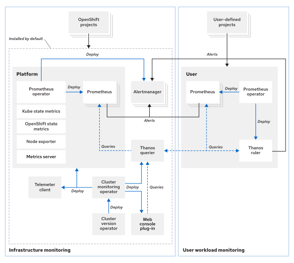

#### Các thành phần của ngăn xếp giám sát mặc định
Ngăn xếp giám sát mặc định được tích hợp sẵn trong OpenShift Container Platform. Tất cả các thành phần của ngăn xếp này đều được cài đặt trong dự án `openshift-monitoring` và cung cấp các tính năng giám sát cho những thành phần cốt lõi của nền tảng.

Việc sửa đổi các tài nguyên hiện có hoặc tạo thêm các tài nguyên `ServiceMonitor`, `PodMonitor`, hay `PrometheusRule` trong dự án `openshift-monitoring` là không được hỗ trợ. Ngăn xếp giám sát sẽ tự động khôi phục các tài nguyên đã bị sửa đổi về trạng thái ban đầu, đảm bảo rằng mọi tài nguyên luôn duy trì ở trạng thái dự kiến.

Ngăn xếp giám sát bao gồm các thành phần sau đây để theo dõi cơ sở hạ tầng, tiếp nhận cảnh báo và hiển thị các biểu đồ hiệu năng:

**Cluster Monitoring Operator (CMO)**  
CMO là thành phần trung tâm của ngăn xếp giám sát. CMO kiểm soát các thành phần giám sát đã được triển khai và đảm bảo chúng luôn đồng bộ với phiên bản mới nhất của chính CMO.

**Prometheus Operator**  
Prometheus Operator thực hiện triển khai và cấu hình Prometheus cũng như Alertmanager. Thành phần này cũng quản lý việc tạo các mục tiêu cấu hình (thông qua `ServiceMonitor` và `PodMonitor`).

**Prometheus**  
Prometheus đóng vai trò là máy chủ giám sát (monitoring server).

**Metrics Server**  
Metrics Server thu thập các chỉ số (metrics) và cung cấp chúng thông qua dịch vụ API để các công cụ và API khác có thể sử dụng.

**Prometheus Alertmanager**  
Alertmanager xử lý các cảnh báo từ máy chủ Prometheus. Một cảnh báo là một quy tắc được đánh giá là đúng (true) hoặc sai (false), thường dựa trên các quan sát về cụm (cluster), chẳng hạn như mức độ sử dụng CPU của cụm. Cảnh báo sẽ được kích hoạt khi quy tắc cảnh báo đó thỏa mãn điều kiện "đúng". Bạn có thể cấu hình Prometheus Alertmanager để nhóm và định tuyến các cảnh báo đến các bộ tiếp nhận (receiver) phù hợp.

**Kube-state-metrics**  
Tác nhân (agent) `kube-state-metrics` chuyển đổi các đối tượng Kubernetes thành các chỉ số mà Prometheus có thể phân tích được.

**OpenShift-state-metrics**  
Tác nhân `openshift-state-metrics` được phát triển dựa trên `kube-state-metrics`, bổ sung khả năng giám sát cho các tài nguyên đặc thù của OpenShift (ví dụ: các chỉ số liên quan đến registry hình ảnh - image registry).

**Node exporter**  
Tác nhân `node-exporter` xuất các chỉ số cấp thấp (low-level metrics) từ các nút tính toán (compute nodes).

**Thanos Querier**  
Thanos Querier cung cấp một giao diện duy nhất, hỗ trợ đa người dùng (multitenant), cho phép tổng hợp và loại bỏ các dữ liệu trùng lặp từ các chỉ số của cụm cũng như các khối lượng công việc (workload) của người dùng.

**Telemeter Client**  
Telemeter Client gửi một phần dữ liệu từ các phiên bản Prometheus đến Red Hat nhằm phục vụ mục đích giám sát tình trạng hệ thống từ xa. Bảng điều khiển web dành cho giám sát

Bảng điều khiển web của OpenShift Container Platform cung cấp mục "Observe" (Quan sát) để truy cập và quản lý các tính năng giám sát. Tại mục "Observe", bạn có thể truy cập vào các bảng điều khiển giám sát (dashboards), số liệu (metrics), cảnh báo (alerts) và các mục tiêu thu thập số liệu (metrics targets).

#### Các thành phần giám sát cho các dự án do người dùng định nghĩa
Bạn có thể bật tính năng giám sát cho các dự án do người dùng định nghĩa. Với hệ thống giám sát này, bạn có thể thu thập các chỉ số tùy chỉnh dành riêng cho ứng dụng, đồng thời tạo các cảnh báo dựa trên những chỉ số đó. Các thành phần giám sát dành cho các dự án do người dùng định nghĩa được cài đặt trong dự án `openshift-user-workload-monitoring`.

Hệ thống giám sát cho các dự án do người dùng định nghĩa bao gồm các thành phần sau:

* Prometheus Operator
* Prometheus
* Thanos Ruler
* Alertmanager

#### Các cấu hình thu thập chỉ số (Metrics Collection Profiles)
Thông qua các cấu hình thu thập chỉ số, quản trị viên có thể kiểm soát những chỉ số nào được hệ thống giám sát nền tảng thu thập. OpenShift hỗ trợ hai cấu hình thu thập:

**Full (đầy đủ) – mặc định**  
Thu thập tất cả các chỉ số từ mọi đối tượng giám sát trên nền tảng.

**Minimal (tối thiểu)**  
Chỉ thu thập các chỉ số cần thiết cho việc cảnh báo nền tảng, bảng điều khiển (dashboard), đo từ xa (telemetry) và tự động điều chỉnh quy mô pod (pod autoscaling). Cấu hình tối thiểu giúp giảm đáng kể mức tiêu thụ tài nguyên của Prometheus.

Bạn có thể thiết lập cấu hình thu thập chỉ số thông qua đối tượng cấu hình (configuration map) có tên là `cluster-monitoring-config` nằm trong namespace `openshift-monitoring`.

### Prometheus
Prometheus là một dự án mã nguồn mở dành cho việc giám sát và cảnh báo hệ thống.

Cả Red Hat OpenShift Container Platform và Kubernetes đều tích hợp Prometheus để cung cấp các tính năng theo dõi số liệu (metrics), giám sát và cảnh báo cho cụm (cluster).

Prometheus thu thập và lưu trữ các luồng dữ liệu từ cụm dưới dạng dữ liệu chuỗi thời gian (time-series data). Dữ liệu chuỗi thời gian bao gồm một chuỗi các mẫu (samples), trong đó mỗi mẫu chứa các thành phần sau:

* Một dấu thời gian (timestamp) với độ chính xác đến mili giây.
* Một giá trị số (kiểu float64 hoặc giá trị biểu đồ tần suất - histogram).
* Một tập hợp các nhãn (labels) dưới dạng các cặp khóa-giá trị (key-value pairs).

Các cặp khóa-giá trị (key-value pairs) này giúp phân tách các nhóm giá trị có liên quan để phục vụ cho việc lọc dữ liệu.

Ví dụ, chỉ số `machine_cpu_cores` trong Prometheus chứa một chuỗi các mẫu đo lường về số lượng lõi CPU trên mỗi máy.

### Bảng điều khiển web giám sát OpenShift
Bạn có thể truy cập và quản lý các tính năng giám sát thông qua bảng điều khiển web. Bảng điều khiển web của OpenShift Container Platform cung cấp mục "Quan sát" (Observe), bao gồm các tiểu mục sau:

* Cảnh báo (Alerting)
* Số liệu (Metrics)
* Bảng điều khiển (Dashboards)
* Mục tiêu (Targets)

#### Cảnh báo giám sát cụm (Cluster Monitoring Alerting)
Bạn có thể truy cập các cảnh báo cụm từ bảng điều khiển web OpenShift tại mục **Observe → Alerting**. Đối với mỗi cảnh báo, tab **Alerts** sẽ hiển thị tên, mức độ nghiêm trọng, trạng thái của cảnh báo và số lần cảnh báo đó xuất hiện.

**Hình 5.2: Cảnh báo giám sát cụm**  
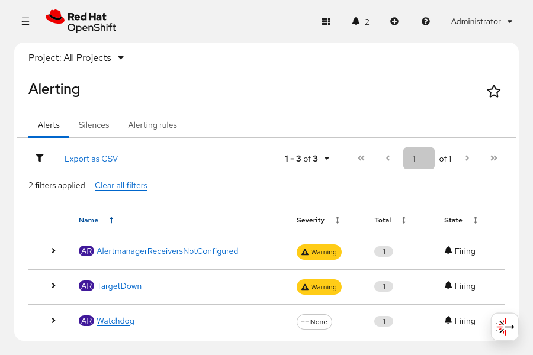

Bạn có thể xem chi tiết cảnh báo bằng cách nhấp vào tên cảnh báo đó. Trang này cũng hiển thị một biểu đồ chuỗi thời gian.

**Hình 5.3: Chi tiết cảnh báo**  
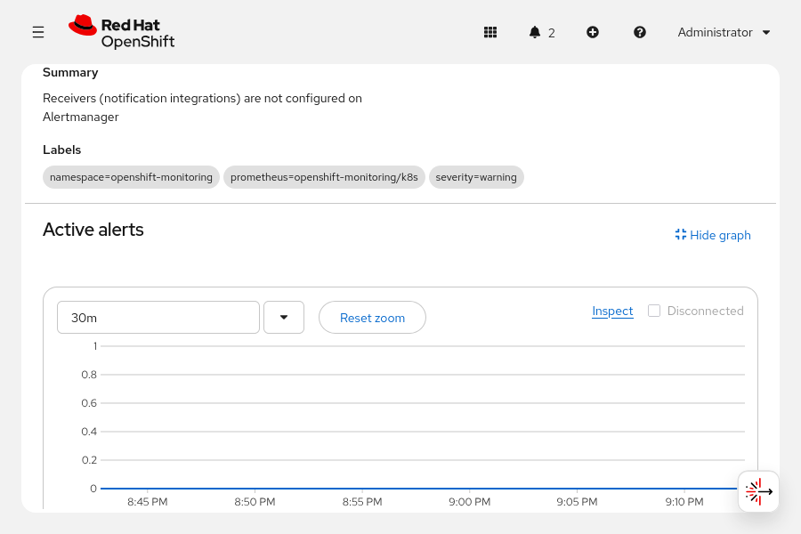

#### Các chỉ số giám sát cụm (Cluster Monitoring Metrics)
OpenShift tích hợp các chỉ số Prometheus tại mục **Observe → Metrics**.

Từ trang Metrics, bạn có thể nhập một biểu thức — chẳng hạn như tên của một chỉ số — rồi nhấp vào Run Queries (Chạy truy vấn) để truy xuất mẫu dữ liệu mới nhất cho chỉ số đó. Bạn cũng có thể chọn một trong các truy vấn được định nghĩa sẵn, ví dụ như mức sử dụng CPU hoặc mức sử dụng bộ nhớ, từ menu thả xuống Queries.

Ví dụ dưới đây hiển thị chỉ số `instance:node_cpu_utilisation:rate1m` theo thời gian.

**Hình 5.4: Các chỉ số giám sát**  
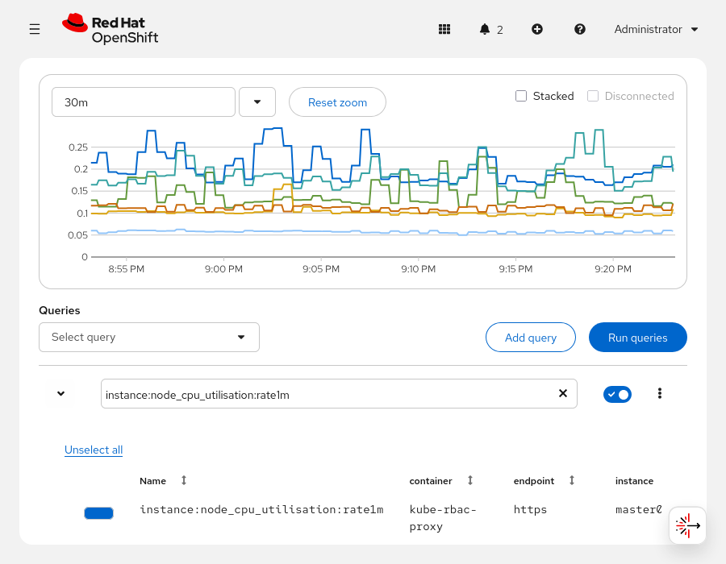

Số liệu này chứa dữ liệu cho từng nút (node) trong cụm (cluster).

OpenShift có ba thành phần trong hệ thống giám sát để thu thập các số liệu từ Kubernetes API, bao gồm: kube-state-metrics, openshift-state-metrics và các tác nhân (agent) node-exporter.

Các bảng điều khiển (dashboard) trong hệ thống giám sát cụm OpenShift kết hợp các số liệu từ ba thành phần này.

Hãy tham khảo mục Tài liệu tham khảo (References) để biết danh sách đầy đủ các số liệu được cung cấp.

Prometheus cung cấp một ngôn ngữ truy vấn gọi là PromQL, dùng để chọn lọc và tổng hợp dữ liệu chuỗi thời gian (time-series data).

Bạn có thể lọc một số liệu để chỉ bao gồm các cặp khóa-giá trị (key-value pairs) nhất định. Ví dụ: bạn có thể sửa đổi truy vấn trước đó để chỉ hiển thị các số liệu cho nút worker02 bằng cách sử dụng biểu thức sau:

```
instance:node_cpu_utilisation:rate1m{instance="worker02"}
```

**Hình 5.5: Các chỉ số giám sát cho nút worker02**  
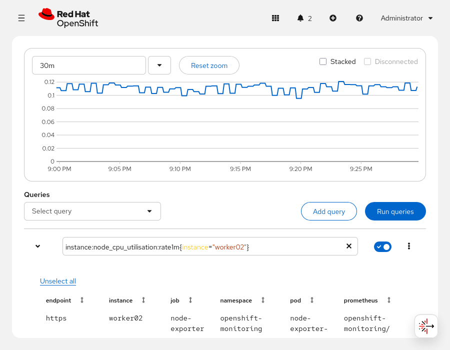

Prometheus Query Language (PromQL) cung cấp một số toán tử để tính toán các chỉ số chuỗi thời gian (time-series metrics) mới. PromQL bao gồm các toán tử số học như cộng, trừ, nhân và chia; đồng thời cũng bao gồm các toán tử so sánh như bằng, lớn hơn và nhỏ hơn.

PromQL có sẵn các hàm tích hợp mà bạn có thể sử dụng trong các biểu thức của mình, chẳng hạn như:

**sum():** Tính tổng giá trị của tất cả các mục dữ liệu tại một thời điểm nhất định.

**rate():** Tính giá trị trung bình trên mỗi giây của một chuỗi thời gian trong một khoảng thời gian nhất định.

**count():** Đếm số lượng các mục dữ liệu tại một thời điểm nhất định.

**max():** Chọn giá trị lớn nhất từ các mục dữ liệu.

Các ví dụ về biểu thức PromQL dưới đây sử dụng một chỉ số từ tác nhân (agent) `node-exporter` và một chỉ số khác từ tác nhân `kube-state-metrics`:

**node_memory_MemAvailable_bytes/node_memory_MemTotal_bytes\*100<50**  
Hiển thị các nút (node) có dung lượng bộ nhớ khả dụng dưới 50%.

**kube_persistentvolumeclaim_status_phase{phase="Pending"} == 1**  
Hiển thị các yêu cầu lưu trữ bền vững (persistent volume claims) đang ở trạng thái chờ xử lý (pending).

Các toán tử bổ sung (add-on operators) của Red Hat có thể định nghĩa thêm các chỉ số và cảnh báo. Ví dụ, toán tử tuân thủ (compliance operator) cung cấp các chỉ số bổ sung cho Prometheus. Bạn có thể lấy danh sách các chỉ số này bằng cách sử dụng truy vấn sau:

```
{name=~"compliance.*"}
```

#### Các bảng điều khiển giám sát cụm (Cluster Monitoring Dashboards)
Bảng điều khiển OpenShift tích hợp sẵn các bảng điều khiển (dashboard) dựa trên các số liệu (metrics) được thu thập, nằm tại mục Observe → Dashboards (Quan sát → Bảng điều khiển). Các bảng điều khiển này tự động làm mới định kỳ để hiển thị các số liệu tóm tắt và biểu đồ hiện tại.

Các biểu đồ này có tính tương tác, cho phép bạn khám phá sâu hơn các đặc điểm và thuộc tính của dữ liệu mà bạn đang quan sát.

Các bảng điều khiển giám sát cụm là điểm khởi đầu hữu ích để theo dõi trạng thái và các số liệu của cụm theo thời gian thực (hoặc gần như thời gian thực).

Khi nhận được cảnh báo, quản trị viên có thể sử dụng các bảng điều khiển này để điều tra vấn đề. Quá trình điều tra có thể bao gồm việc xác định xem sự cố có nằm ở một nút (node) hoặc dự án (project) cụ thể nào đó hay không. Ngoài ra, các bảng điều khiển giám sát cụm còn giúp xác định xem vấn đề chỉ là tạm thời hay có dấu hiệu kéo dài.

Hệ thống giám sát cụm của OpenShift bao gồm một số bảng điều khiển mặc định.

Dưới đây là một số bảng điều khiển giám sát mặc định:

**Kubernetes / Compute Resources / Cluster (Kubernetes / Tài nguyên tính toán / Cụm)**

Bảng điều khiển này cung cấp cái nhìn tổng quan về các tài nguyên trong cụm. Trang bảng điều khiển "Kubernetes / Compute Resources / Cluster" hiển thị các giá trị phần trăm liên quan đến CPU, chẳng hạn như mức sử dụng CPU (CPU Utilisation), cam kết yêu cầu CPU (CPU Requests Commitment) và giới hạn CPU (CPU Limits Commitment). Các giá trị tương tự cũng được cung cấp cho bộ nhớ (memory).

**Hình 5.6: Bảng điều khiển Kubernetes / Tài nguyên tính toán / Cụm (Cluster)**  
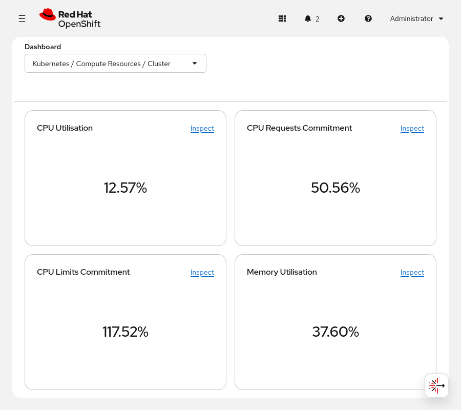

Bạn có thể xem các chỉ số bằng cách nhấp vào Inspect (Kiểm tra) cho từng tham số.

Ví dụ: tham số CPU Utilisation (Mức sử dụng CPU) hiển thị biểu đồ và các giá trị cho những chỉ số sau:

```
cluster:node_cpu:ratio_rate5m{}
```

**Hình 5.7: Các chỉ số về mức độ sử dụng CPU**  
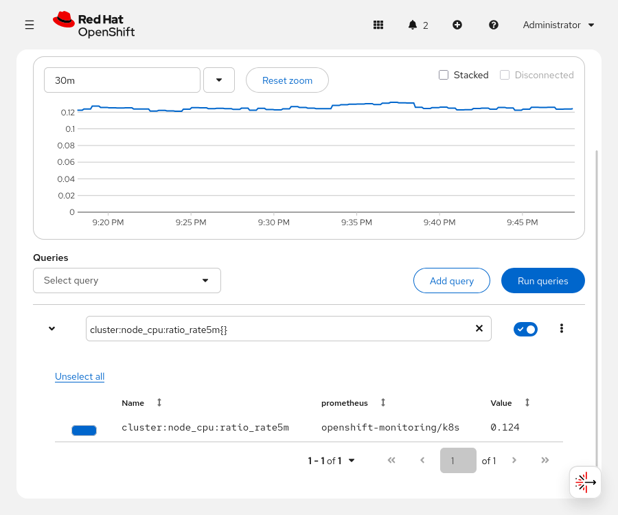

Trang **bảng điều khiển (dashboard) Kubernetes / Compute Resources / Cluster** hiển thị các biểu đồ về CPU, bộ nhớ và mạng, chẳng hạn như các biểu đồ về mức sử dụng CPU (CPU Usage), hạn ngạch CPU (CPU Quota), mức sử dụng bộ nhớ (không bao gồm bộ nhớ đệm - Memory Usage w/o cache) và yêu cầu bộ nhớ (Memory Requests).

Các biểu đồ này xuất hiện trên nhiều trang bảng điều khiển khác nhau; điểm khác biệt duy nhất nằm ở cách lọc dữ liệu. Ví dụ, bảng điều khiển Kubernetes / Compute Resources / Namespace (Workloads) lọc dữ liệu sử dụng tài nguyên theo namespace (không gian tên), sau đó tiếp tục lọc theo loại workload (khối lượng công việc) như Deployment, DaemonSet và StatefulSet.

**Node Exporter / Phương pháp USE / Cluster**  
USE là viết tắt của Utilization (Mức sử dụng), Saturation (Mức bão hòa) và Errors (Lỗi). Bảng điều khiển này hiển thị các biểu đồ giúp xác định xem cụm (cluster) có đang bị sử dụng quá mức, rơi vào trạng thái bão hòa hay gặp phải nhiều lỗi hay không. Vì bảng điều khiển hiển thị tất cả các node (nút) trong cụm, bạn có thể dễ dàng nhận diện được node nào đang hoạt động khác biệt so với các node còn lại.

Biểu đồ dưới đây cho thấy node `worker02` đang gặp tình trạng bão hòa bộ nhớ (memory saturation) cao hơn so với các node khác trong cụm:

**Hình 5.8: Node Exporter / Phương pháp USE / Cụm - Độ bão hòa bộ nhớ**  
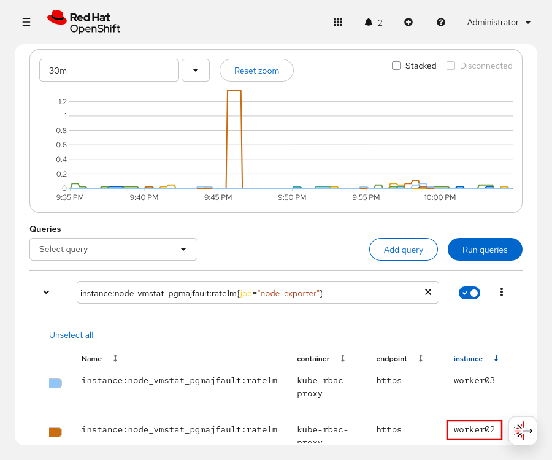

## Cảnh báo và Thông báo
### Cảnh báo trong OpenShift
Giao diện web của OpenShift tích hợp sẵn tính năng cảnh báo (Alerting UI), cho phép bạn quản lý các cảnh báo, trạng thái tạm dừng cảnh báo (silences) và các quy tắc cảnh báo.

**Các quy tắc cảnh báo**  
Các quy tắc cảnh báo cho phép bạn thiết lập điều kiện kích hoạt cảnh báo dựa trên các biểu thức Prometheus, đồng thời nhận thông báo khi các điều kiện này được đáp ứng. Hệ thống giám sát của OpenShift cung cấp sẵn một tập hợp lớn các quy tắc cảnh báo mặc định dành cho các chỉ số (metrics) của nền tảng. 

Một quy tắc cảnh báo bao gồm trường `alert`, trường `expr` (chứa biểu thức PromQL), cùng các tùy chọn bổ sung như `keep_firing_for` và `labels`. Ví dụ YAML dưới đây định nghĩa quy tắc cảnh báo `HighRequestLatency` (độ trễ yêu cầu cao):

```yaml
- alert: HighRequestLatency
  expr: job:request_latency_seconds:mean5m{job="myjob"} > 0.5
  for: 10m
  keep_firing_for: 5m
  labels:
    severity: page
  annotations:
    summary: High request latency
```

**Cảnh báo**  
Cảnh báo được kích hoạt khi các điều kiện được xác định trong quy tắc cảnh báo trở thành sự thật. Cảnh báo thông báo rằng một tập hợp các điều kiện đang xảy ra trong cụm OpenShift.

**Bộ tiếp nhận cảnh báo**  
Bạn có thể cấu hình hệ thống cảnh báo để chuyển hướng các cảnh báo đến một bộ tiếp nhận, từ đó gửi thông báo qua email, gửi thông báo đến thiết bị nhắn tin (pager), hoặc chuyển tiếp cảnh báo sang một hệ thống khác thông qua webhook.

**Tính năng tắt thông báo (Silence)**  
Bạn có thể áp dụng tính năng tắt thông báo cho một cảnh báo để ngăn việc gửi thông báo khi các điều kiện của cảnh báo đó trở thành sự thật. Bạn có thể tạm tắt thông báo sau khi nhận được thông báo ban đầu, trong khi đang tiến hành xử lý vấn đề gốc rễ.

#### Xem các quy tắc cảnh báo
Trong bảng điều khiển web OpenShift, hãy truy cập **Observe → Alerting** rồi nhấp vào tab Alerting rules (Quy tắc cảnh báo) để liệt kê các quy tắc cảnh báo trong cụm OpenShift. Bạn có thể áp dụng các bộ lọc tùy chỉnh để tìm kiếm một quy tắc cảnh báo cụ thể. Bộ lọc theo nền tảng nguồn (source platform) được chọn theo mặc định. Cột trạng thái cảnh báo (alert state) cho biết liệu cảnh báo đó hiện đang kích hoạt (firing), im lặng (silenced), đang chờ xử lý (pending) hay không hoạt động (inactive). Trạng thái không hoạt động được biểu thị bằng dấu gạch ngang.

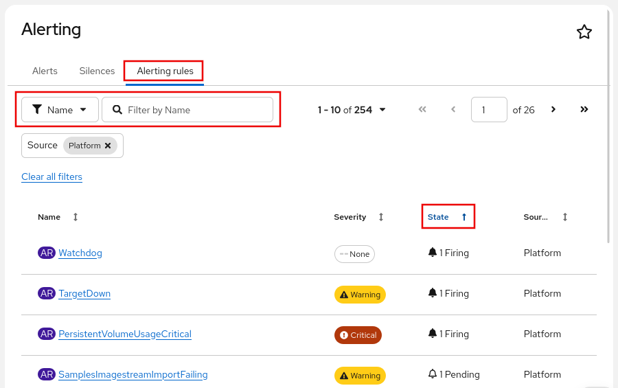

Hãy nhấp vào tên quy tắc cảnh báo, chẳng hạn như PersistentVolumeUsageCritical, để xem các thông tin chi tiết như mức độ nghiêm trọng, mô tả và thông báo của quy tắc đó. Bạn cũng có thể xem biểu thức PromQL được dùng để kiểm tra cảnh báo này.

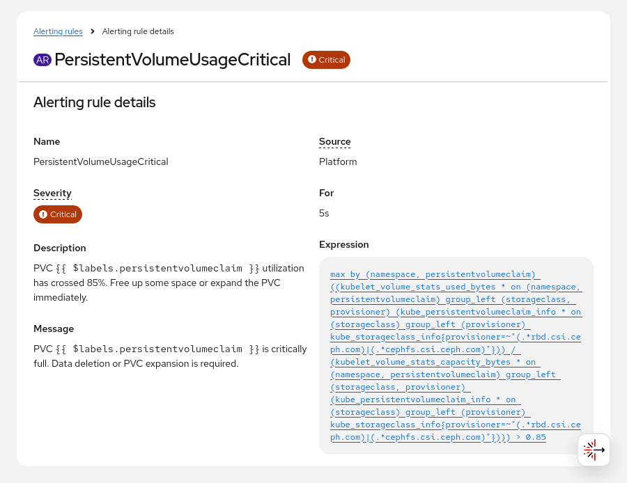

Cuộn xuống phần Cảnh báo đang hoạt động để xem biểu đồ cảnh báo; biểu đồ này hiển thị khoảng thời gian kể từ khi cảnh báo bắt đầu có hiệu lực.

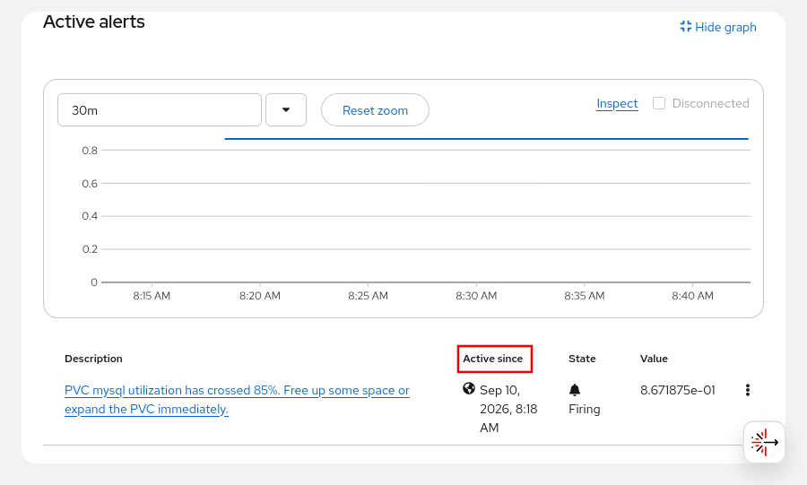

#### Xem các cảnh báo đang kích hoạt
Để xem các cảnh báo ở trạng thái kích hoạt (firing), hãy truy cập **Observe → Alerting**. Trang **Alerts** sẽ tự động áp dụng các bộ lọc theo Nền tảng nguồn (Source Platform) và Trạng thái cảnh báo (Alert State) là "Firing". Bạn có thể áp dụng các bộ lọc tùy chỉnh để tìm một cảnh báo cụ thể. Ngoài ra, bạn có thể nhấp vào tên cảnh báo để xem thông tin chi tiết về cảnh báo đó.

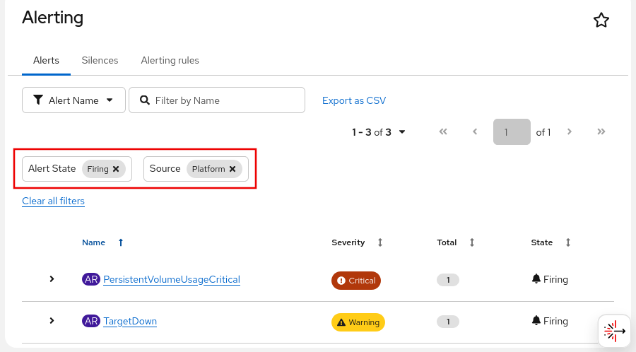

#### Tạm dừng cảnh báo (Silencing Alerts)
Bạn có thể tạm dừng một cảnh báo trong một khoảng thời gian nhất định để ngăn việc gửi các thông báo mới đến người nhận. Ví dụ, bạn có thể tạm dừng cảnh báo trong khi đang khắc phục sự cố để tránh việc gửi thêm email thông báo, hoặc tạm dừng các cảnh báo dự kiến sẽ xuất hiện trong khoảng thời gian bảo trì hệ thống đã lên lịch.

Để tạm dừng một cảnh báo, hãy truy cập mục Observe → Alerting (Quan sát → Cảnh báo) để hiển thị các cảnh báo đang kích hoạt. Nhấp vào biểu tượng mở rộng > nằm bên trái tên cảnh báo. Cảnh báo sẽ mở rộng để hiển thị phiên bản cụ thể đang kích hoạt, cùng với các thông tin chi tiết như không gian tên (namespace) và trạng thái hiện tại. Sau đó, nhấp vào biểu tượng dấu ba chấm dọc ⋮ ở phía bên phải cảnh báo và chọn Silence alert (Tạm dừng cảnh báo).

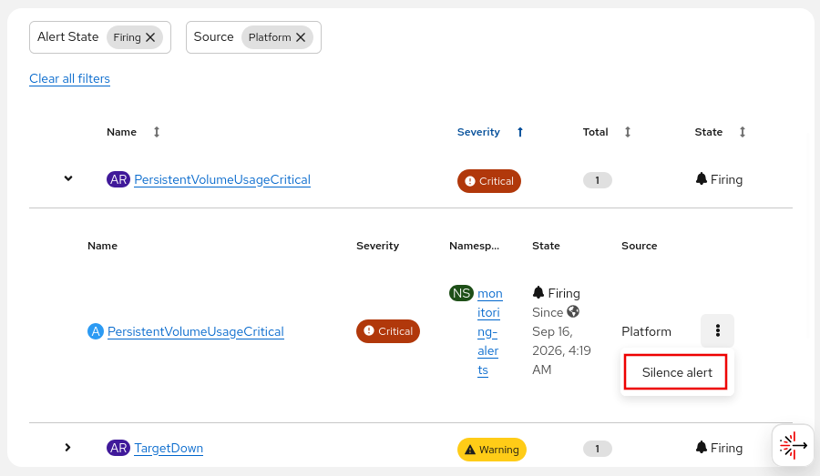

Trên trang Cảnh báo im lặng (Silent alert), bạn xác định thời điểm bắt đầu và thời lượng cho trạng thái im lặng. Theo mặc định, trạng thái im lặng sẽ bắt đầu ngay sau khi được tạo và kéo dài trong hai giờ. Bạn có thể bỏ chọn ô "Bắt đầu ngay" (Start immediately) để thiết lập thời điểm bắt đầu và kết thúc cụ thể.

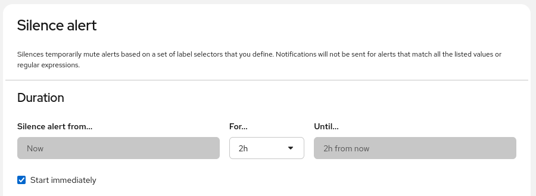

Phần nhãn cảnh báo cho phép bạn cập nhật hoặc tạo các nhãn để khớp với các cảnh báo.

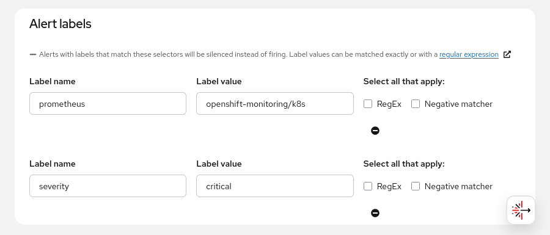

Cuộn xuống phần Thông tin (Info). Các trường Người tạo (Creator) và Bình luận (Comment) là bắt buộc. Bình luận sẽ được lưu trong thông tin chi tiết về việc tắt cảnh báo. Nhấp vào Tắt cảnh báo (Silence).

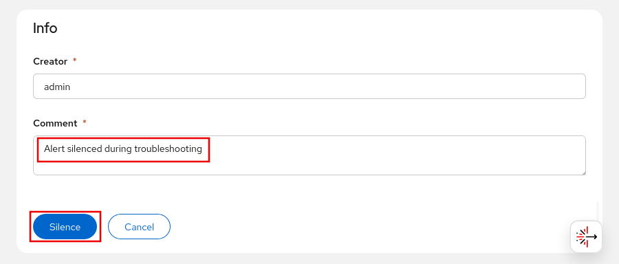

#### Xem các thiết lập tạm dừng cảnh báo (Alert Silences)
Truy cập **Observe → Alerting** và nhấp vào tab **Silences** để xem các thiết lập tạm dừng cảnh báo trong cụm (cluster).

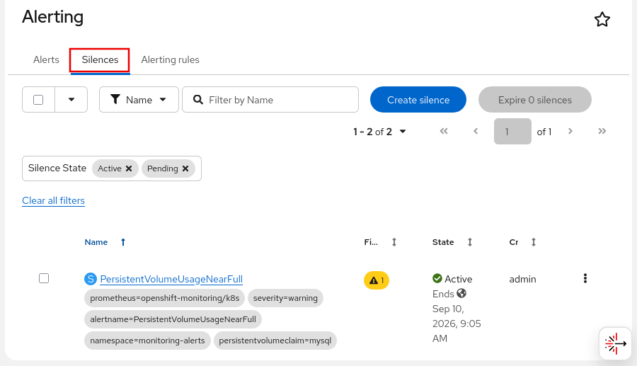

Để xem thông tin chi tiết về trạng thái im lặng (silence), hãy nhấp vào tên của trạng thái đó. Trang chi tiết về trạng thái im lặng hiển thị các thông tin như tên trạng thái, thời gian bắt đầu, thời gian kết thúc, các nhãn khớp, trạng thái hiện tại và bình luận.

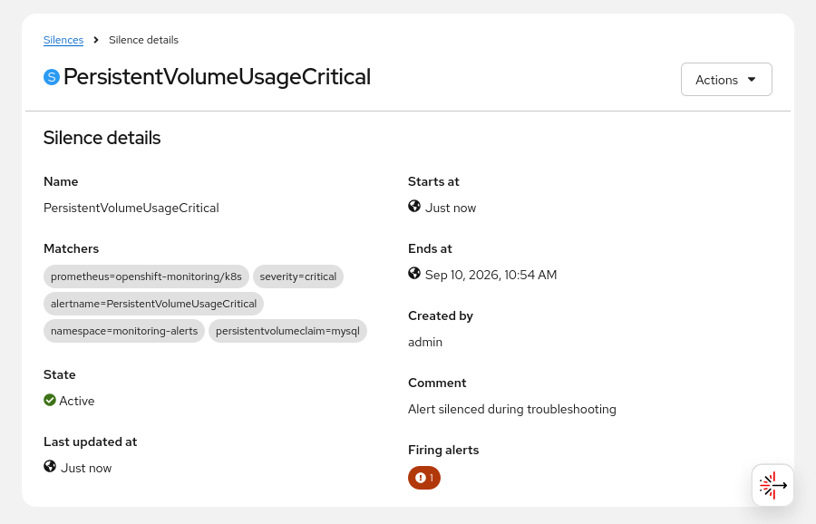

Mục Cảnh báo Kích hoạt (Firing Alerts) ở cuối trang hiển thị các cảnh báo khớp với thiết lập im lặng (silence). Hãy nhấp vào biểu tượng `⋮` ở bên phải cảnh báo để xem quy tắc cảnh báo áp dụng cho cảnh báo đó.

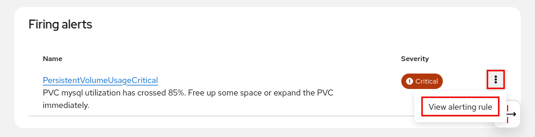

#### Xem các cảnh báo im lặng
Truy cập Observe → Alerting để quay lại trang Alerting. Cảnh báo PersistentVolumeUsageCritical không xuất hiện trong danh sách vì nó đang im lặng, đồng thời bộ lọc "Alert State: Firing" (Trạng thái cảnh báo: Đang kích hoạt) được áp dụng theo mặc định. Hãy xóa bộ lọc "Alert State: Firing" bằng cách nhấp vào dấu "x" để hiển thị tất cả các cảnh báo.

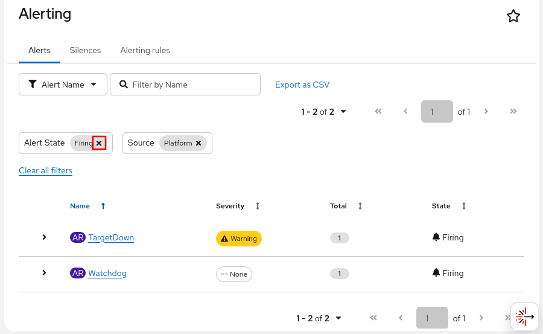

Nếu không có bộ lọc, các thông báo đã bị tắt sẽ được liệt kê.

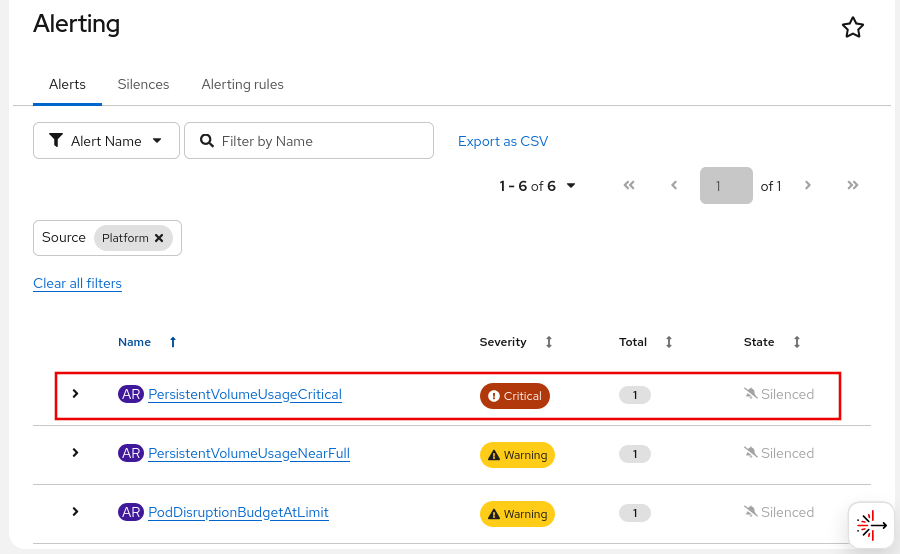

#### Nhóm các cảnh báo thông qua tính năng phát hiện sự cố (Incident Detection)
Một vấn đề cơ bản duy nhất trong cụm (cluster) có thể kích hoạt đồng thời nhiều cảnh báo liên quan, tạo ra một "cơn bão cảnh báo" (alert storm) khiến việc xác định nguyên nhân gốc rễ trở nên khó khăn. Tính năng phát hiện sự cố giúp giảm bớt tình trạng quá tải cảnh báo này bằng cách liên kết các cảnh báo có liên quan thành một sự cố duy nhất, cho phép các nhóm vận hành tập trung xử lý những vấn đề nghiêm trọng nhất trước tiên.

Tính năng phát hiện sự cố hiện đã khả dụng cho Red Hat OpenShift Container Platform phiên bản 4.19 trở lên. Tính năng này được cung cấp thông qua tiện ích mở rộng giao diện người dùng (UI plug-in) của Cluster Observability Operator và không nằm trong ngăn xếp giám sát mặc định bên trong cụm. Để kích hoạt tính năng này, bạn cần cài đặt Cluster Observability Operator và thiết lập trường `spec.monitoring.clusterHealthAnalyzer.enabled: true` trong tài nguyên `monitoring UIPlugin`.

Sau khi kích hoạt tính năng phát hiện sự cố, hãy truy cập vào mục **Observe → Alerting** (Quan sát → Cảnh báo) và chọn tab **Incidents** (Sự cố) để xem dòng thời gian các sự cố. Dòng thời gian này sẽ nhóm các cảnh báo liên quan thành từng sự cố và phân loại chúng theo màu sắc dựa trên mức độ nghiêm trọng; bạn có thể đi sâu vào từng sự cố để kiểm tra các cảnh báo cụ thể bên trong đó.

### Cấu hình thông báo cảnh báo
Trong OpenShift, bạn có thể xem các cảnh báo đang kích hoạt thông qua giao diện người dùng (UI) cảnh báo tích hợp sẵn. Theo mặc định, hệ thống giám sát không gửi cảnh báo đến bất kỳ hệ thống thông báo nào. Bạn có thể cấu hình hệ thống giám sát của OpenShift để chuyển tiếp các thông báo về những cảnh báo nền tảng mặc định đến các loại kênh tiếp nhận sau:

* Email
* PagerDuty
* Slack
* Webhook

Bằng cách chuyển tiếp cảnh báo đến các kênh tiếp nhận, bạn có thể gửi thông báo kịp thời cho các nhóm phụ trách khi xảy ra sự cố. Ví dụ, các cảnh báo nghiêm trọng đòi hỏi sự chú ý ngay lập tức và thường được gửi thông báo trực tiếp cho một cá nhân hoặc một nhóm phản ứng nhanh. Các cảnh báo ở mức độ ít nghiêm trọng hơn có thể được chuyển đến hệ thống quản lý yêu cầu (ticketing system) để xem xét sau.

Hệ thống cảnh báo sử dụng Alertmanager, một thành phần thuộc hệ thống giám sát Prometheus. Bạn có thể tùy chỉnh nơi gửi và cách thức Alertmanager gửi thông báo về các cảnh báo nền tảng mặc định bằng cách chỉnh sửa cấu hình mặc định trong đối tượng `secret` có tên `alertmanager-main` nằm tại namespace `openshift-monitoring`. Bạn cần có quyền quản trị cụm (cluster administrator) để thực hiện chỉnh sửa cấu hình Alertmanager.

Bạn có thể cấu hình Alertmanager thông qua giao diện web (web console) hoặc dòng lệnh.

#### Cấu hình Alertmanager thông qua bảng điều khiển web
Trong bảng điều khiển web của OpenShift, hãy truy cập **Administration → Cluster Settings** rồi nhấp vào tab **Configuration**. Sau đó, chọn **Alertmanager** trong danh sách các tài nguyên cấu hình để mở trang chi tiết về **Alertmanager**. Ngoài ra, bạn có thể nhấp vào biểu tượng ⋮ ở bên phải mục **Alertmanager** trong tab **Configuration** để tạo bộ tiếp nhận cảnh báo (alert receiver) hoặc chỉnh sửa tệp cấu hình **Alertmanager**.

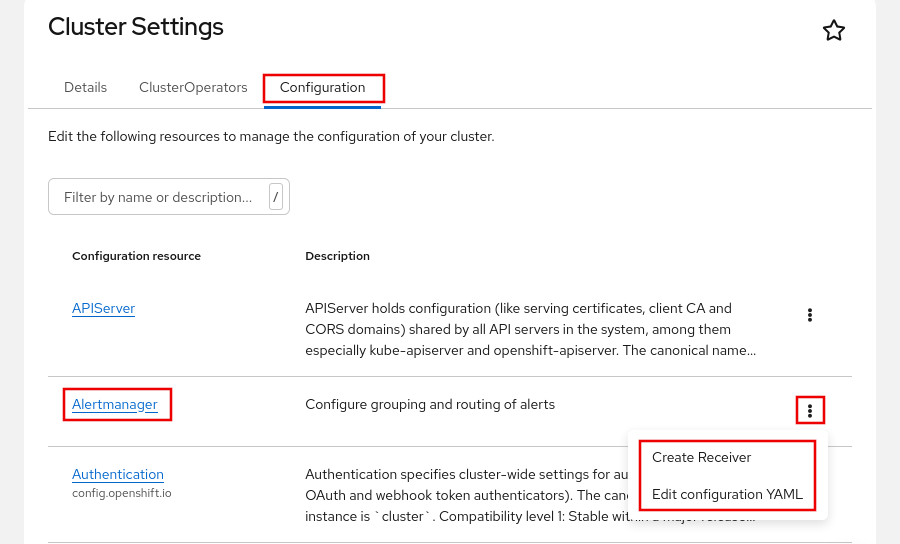

Phần **Alert routing** trên trang chi tiết của **Alertmanager** hiển thị cấu hình định tuyến cảnh báo hiện tại. Để tạo một bộ nhận (receiver), hãy nhấp vào **Create Receiver** trong mục **Receivers**.

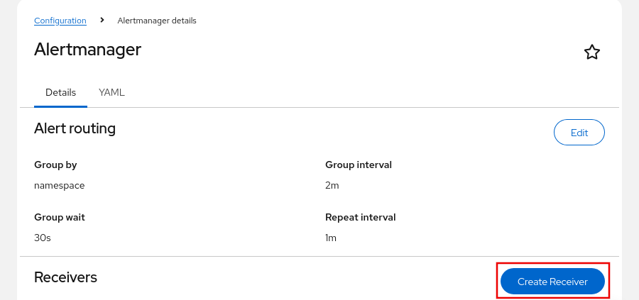

Trong biểu mẫu tạo người nhận (receiver), hãy nhập tên người nhận và chọn loại người nhận từ danh sách. Ví dụ dưới đây cho thấy một biểu mẫu tạo người nhận qua email, với tên là "email", dùng để gửi thông báo đến địa chỉ email ocp-admins@example.com.

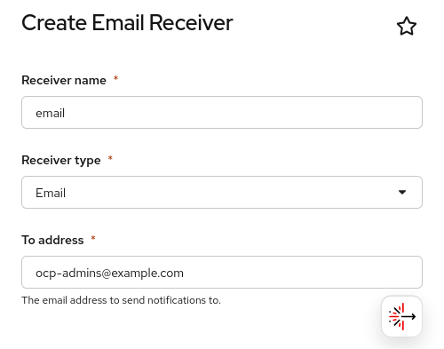

Trong phần cấu hình SMTP, hãy điền vào biểu mẫu các thông tin sau:

* Địa chỉ email dùng để gửi thông báo. 
* Máy chủ trung gian (smart host) và số cổng (port) để gửi email. 
* Tên máy chủ (hostname) của máy chủ SMTP. 
* Thông tin xác thực, chẳng hạn như tên người dùng và mật khẩu. 
* Yêu cầu về việc sử dụng TLS. 
* Các tùy chọn cấu hình nâng cao, chẳng hạn như thay đổi thiết lập mặc định (không gửi thông báo về các cảnh báo đã được giải quyết cho người nhận) hoặc chỉnh sửa nội dung của thông báo qua email.

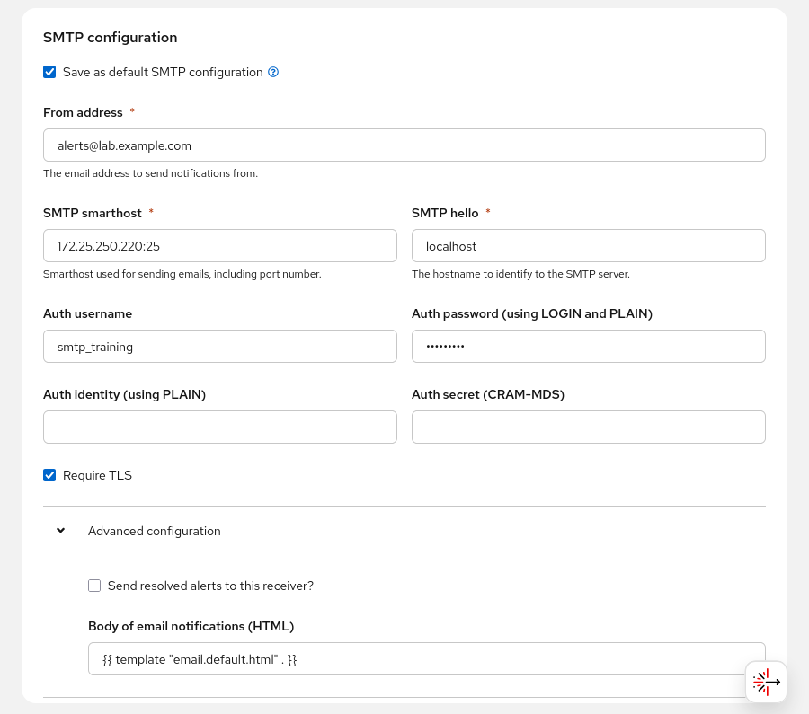

Phần **Routing labels** cho phép bạn thêm các nhãn để khớp các cảnh báo với bên nhận. Trong ví dụ dưới đây, bên nhận được cấu hình để gửi thông báo cho cảnh báo `PersistentVolumeUsageNearFull`. Hãy nhấp vào **Create**.

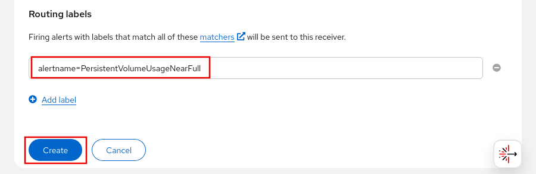

Phần Receivers (Người nhận) trên trang chi tiết của Alertmanager hiển thị người nhận qua email.

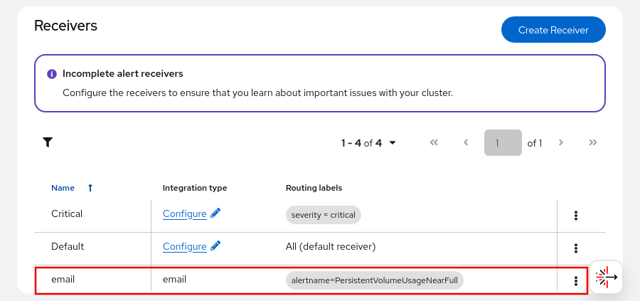

> **Lưu ý:** Bạn có thể yên tâm bỏ qua thông báo "Thông tin về các bộ tiếp nhận cảnh báo chưa hoàn chỉnh" (Incomplete alert receivers information) hiển thị trong phần **Receivers**.

#### Cấu hình Alertmanager thông qua dòng lệnh
Cấu hình Alertmanager được lưu trong secret có tên `alertmanager-main` nằm trong namespace `openshift-monitoring`.

```bash
$ oc get secret/alertmanager-main -n openshift-monitoring
NAME                TYPE     DATA   AGE
alertmanager-main   Opaque   1      22d
```

Bạn có thể trích xuất cấu hình Alertmanager hiện tại từ secret có tên là alertmanager-main và lưu nó cục bộ dưới dạng tệp alertmanager.yaml:

```bash
$ oc extract secret/alertmanager-main \
-n openshift-monitoring --to . --confirm
alertmanager.yaml
```

Lần đầu tiên chỉnh sửa tệp alertmanager.yaml, bạn sẽ thấy trong tệp có các dấu ngoặc kép không cần thiết gây khó đọc. Bạn có thể loại bỏ các dấu ngoặc kép này bằng cách sử dụng lệnh sed.

```bash
$ sed -i 's/"//g' alertmanager.yaml
```

##### Phần Cấu hình Chung (Global Configuration)
Phần cấu hình chung trong tệp alertmanager.yaml xác định các tham số có hiệu lực trong tất cả các ngữ cảnh cấu hình khác, đồng thời đóng vai trò là các giá trị mặc định cho những phần cấu hình khác.

```yaml
global:
  http_config:
    proxy_from_environment: true # (1)
  smtp_from: alerts@lab.example.com # (2)
  smtp_smarthost: 'smtp.example.org:587' # (3)
  smtp_hello: localhost # (4)
  smtp_auth_username: alertmanager@example.com # (5)
  smtp_auth_password: password # (6)
  smtp_require_tls: false # (7)
```

1. Nếu bạn đã định cấu hình proxy HTTP cho toàn bộ cụm (cluster-wide proxy), hãy đặt tham số này thành `true` để kích hoạt tính năng proxy cho tất cả các bên nhận thông báo (alert receiver). Giá trị mặc định là `false`.
2. Địa chỉ email mặc định được sử dụng để gửi thông báo.
3. Máy chủ thông minh (smart host) SMTP và số cổng mặc định để gửi email.
4. Tên máy chủ (hostname) mặc định dùng để xác định danh tính với máy chủ SMTP.
5. Tên người dùng xác thực mặc định.
6. Mật khẩu xác thực mặc định.
7. Yêu cầu TLS mặc định đối với SMTP.

##### Phần Cấu hình Bộ nhận thông báo (Receivers)

Phần này định nghĩa các bộ nhận thông báo (receivers) mà Alertmanager có thể sử dụng để gửi thông báo.

Ví dụ dưới đây cập nhật tệp `alertmanager.yaml` để tạo một bộ nhận thông báo qua email có tên là `team-admins`, dùng để gửi thông báo đến địa chỉ email `ocp-admins@example.com`.

Bộ nhận thông báo `team-admins` tự thiết lập các cấu hình SMTP riêng thông qua phần `email_configs`, qua đó ghi đè lên các cấu hình SMTP toàn cục (global).

```yaml
receivers:
- name: Default
- name: Watchdog
- name: Critical
- name: team-admins # (1)
  email_configs: # (2)
    - to: ocp-admins@example.com # (3)
      from: alerts@lab.example.com # (4)
      smarthost: 'smtp.example.com:587' # (5)
      auth_username: alertmanager@example.com # (6)
      auth_password: password # (7)
      hello: alertmanager # (8)
      require_tls: false # (9)
      send_resolved: true # (10)
```

1. Tên của bên nhận.
2. Cấu hình SMTP cho bên nhận.
3. Địa chỉ email dùng để nhận thông báo.
4. Địa chỉ email dùng để gửi thông báo.
5. Máy chủ thông minh (smart host) và số cổng để gửi email.
6. Thông tin xác thực: tên người dùng.
7. Thông tin xác thực: mật khẩu.
8. Tên máy chủ (hostname) dùng để định danh với máy chủ SMTP. Tên máy chủ mặc định là localhost.
9. Yêu cầu về việc sử dụng TLS cho SMTP.
10. Tùy chọn gửi các cảnh báo đã được giải quyết (resolved alerts) cho bên nhận.

##### Phần Cấu hình định tuyến (Route Configuration)
Một khối định tuyến (route block) xác định một nút trong cây định tuyến cùng các nút con của nó. Mọi cảnh báo đều đi vào cây định tuyến tại nút gốc đã được cấu hình, sau đó di chuyển qua các nút con. Nếu tham số `continue` được đặt là `false`, cảnh báo sẽ dừng lại ngay sau khi khớp với nút con đầu tiên. Nếu `continue` được đặt là `true` tại một nút khớp với cảnh báo, thì cảnh báo đó sẽ tiếp tục được kiểm tra đối với các nút anh em (siblings) tiếp theo.

Đoạn cấu hình dưới đây trong tệp `alertmanager.yaml` thiết lập quy tắc định tuyến để gửi các cảnh báo `PersistentVolumeUsageNearFull` tới bộ nhận (receiver) `team-admins`, đồng thời cho phép tiếp tục kiểm tra đối với các nút anh em kế tiếp.

```yaml
route:
  group_by:
  - namespace
  group_interval: 5m # (1)
  group_wait: 30s # (2)
  receiver: Default
  repeat_interval: 12h # (3)
  routes:
  - matchers: # (4)
    - alertname = PersistentVolumeUsageNearFull # (5)
    receiver: team-admins # (6)
    continue: true # (7)
  - matchers:
    - alertname = Watchdog
    receiver: Watchdog
  - matchers:
    - severity = critical
    receiver: Critical
```

1. Khoảng thời gian cần trôi qua trước khi Alertmanager gửi thông báo về các cảnh báo mới được thêm vào một nhóm cảnh báo mà trước đó đã có thông báo ban đầu được gửi đi.
2. Khoảng thời gian Alertmanager chờ đợi trong khi thu thập các cảnh báo ban đầu cho một nhóm cảnh báo trước khi gửi thông báo.
3. Khoảng thời gian tối thiểu cần trôi qua trước khi một thông báo cảnh báo được lặp lại.
4. Các quy tắc khớp mà một cảnh báo phải đáp ứng để khớp với một nút (node).
5. Các nhãn (label) dùng để khớp với một tên cảnh báo cụ thể.
6. Tên của bộ nhận (receiver) sẽ được sử dụng cho các cảnh báo đó.
7. Xác định xem có tiếp tục thực hiện so khớp với các nút ngang hàng (sibling nodes) tiếp theo trong cây định tuyến (routing tree) hay không. Giá trị mặc định là false.

##### Cập nhật cấu hình Alertmanager
Bạn có thể cập nhật cấu hình Alertmanager bằng cách thiết lập dữ liệu cho secret có tên `alertmanager-main` trong namespace `openshift-monitoring` với nội dung từ tệp `alertmanager.yaml`.

```bash
$ oc set data secret/alertmanager-main -n openshift-monitoring \
--from-file alertmanager.yaml
secret/alertmanager-main updated
```

Bạn có thể theo dõi quá trình này trong các bản ghi (log) của Alertmanager stateful set. Khi cập nhật thành công, một thông báo với nội dung "Completed loading of configuration file" sẽ xuất hiện trong các bản ghi đó.

```bash
$ oc logs -f statefulset.apps/alertmanager-main -c alertmanager \
-n openshift-monitoring
Found 2 pods, using pod/alertmanager-main-0
time=2026-09-15T04:39:34.831Z level=INFO source=main.go:191 msg="Starting Alertmanager" version="(version=0.31.1, branch=HEAD, revision=e73ba...383eb)"
...output omitted...
time=2026-09-15T04:39:35.001Z level=INFO source=coordinator.go:111 msg="Loading configuration file" component=configuration file=/etc/alertmanager/config_out/alertmanager.env.yaml
time=2026-09-15T04:39:35.003Z level=INFO source=coordinator.go:124 msg="Completed loading of configuration file" component=configuration file=/etc/alertmanager/config_out/alertmanager.env.yaml
...output omitted...
```

Cấu hình không chính xác sẽ tạo ra thông báo nhật ký (log) báo lỗi. Nếu các tệp nhật ký cho thấy có lỗi cấu hình, hãy sửa đổi tệp `alertmanager.yaml` rồi áp dụng lại các thay đổi đó vào đối tượng `secret` có tên `alertmanager-main` trong namespace `openshift-monitoring`. Ví dụ dưới đây cho thấy một thông báo nhật ký lỗi khi Alertmanager không thể kết nối với máy chủ SMTP.

```bash
$ oc logs -f statefulset.apps/alertmanager-main -c alertmanager \
-n openshift-monitoring
...output omitted...
time=2026-09-15T17:46:33.210Z level=WARN source=notify.go:848 component=dispatcher receiver=team-admins integration=email[0] aggrGroup="{}/{alertname=\"PersistentVolumeUsageNearFull\"}:{namespace=\"monitoring-alerts\"}" msg="Notify attempt failed, will retry later" attempts=1 err="establish connection to server: dial tcp: lookup smtp.example.com on 172.30.0.10:53: no such host"
time=2026-09-15T17:51:33.207Z level=ERROR source=dispatch.go:353 component=dispatcher msg="Notify for alerts failed" num_alerts=1 err="team-admins/email[0]: notify retry canceled after 16 attempts  : establish connection to server: dial tcp: lookup smtp.example.com on 172.30.0.10:53: no such host"
...output omitted...
```

##### Xác minh cấu hình định tuyến
Bạn có thể xác minh cấu hình định tuyến bằng cách trực quan hóa cây định tuyến. Hãy chạy lệnh sau để hiển thị cây định tuyến. Lệnh này thực thi công cụ `amtool` bên trong pod `alertmanager-main-0` thuộc namespace `openshift-monitoring`.

```bash
$ oc exec alertmanager-main-0 \
-n openshift-monitoring -- amtool config routes show \
--alertmanager.url http://localhost:9093
Routing tree:
.
└── default-route  receiver: Default
    ├── {alertname="PersistentVolumeUsageNearFull"}  continue: true  receiver: team-admins
    ├── {alertname="Watchdog"}  receiver: Watchdog
    └── {severity="critical"}  receiver: Critical
```
