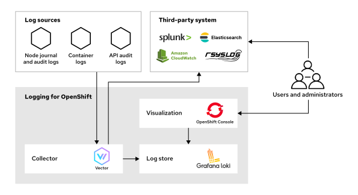
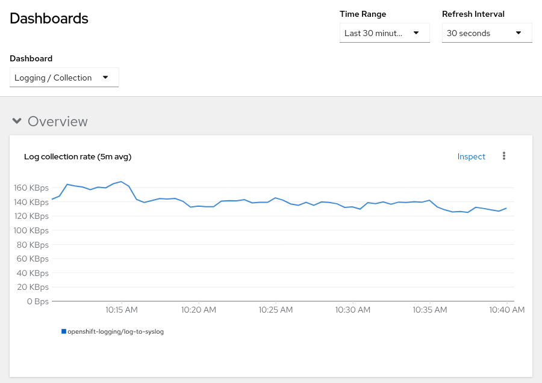
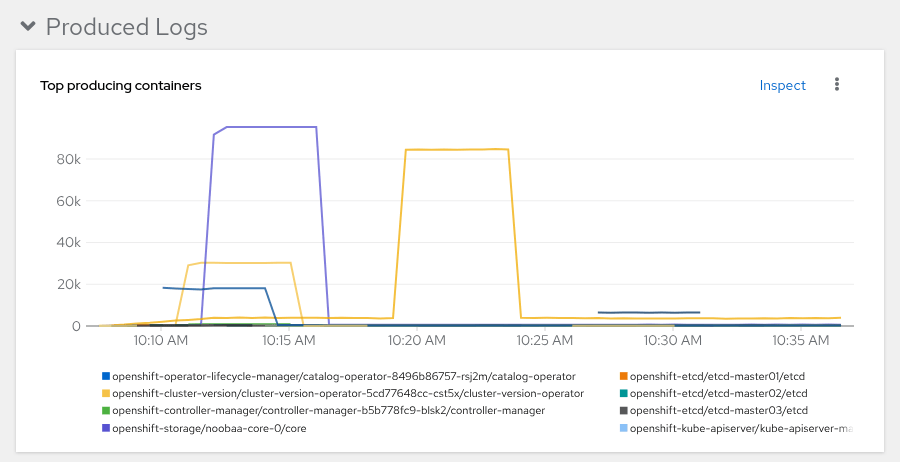
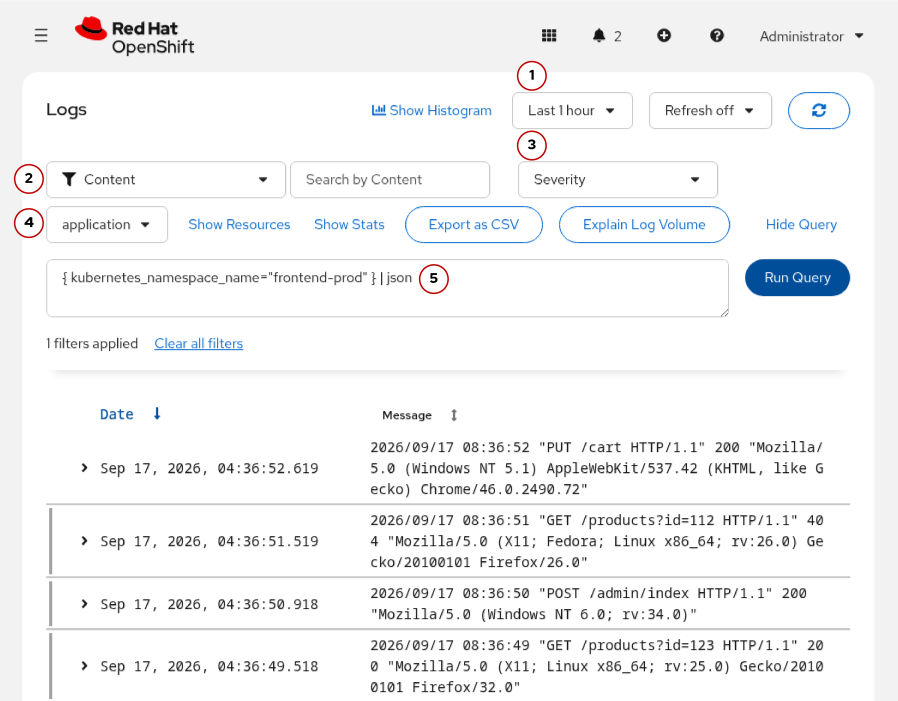

Quản trị Red Hat OpenShift III: Mở rộng quy mô triển khai trong doanh nghiệp
----------------------------------------------------------------------------

# Chương 6. Ghi nhật ký cho Red Hat OpenShift
## Chuyển tiếp nhật ký (Log Forwarding)
### Ghi nhật ký (Logging) cho OpenShift
Tính năng ghi nhật ký cho Red Hat OpenShift thu thập và tổng hợp các thông điệp nhật ký từ tất cả các pod và node trong cụm (cluster) của bạn. Người dùng và quản trị viên có thể sử dụng bảng điều khiển web (web console) của OpenShift để tìm kiếm và xem các mục nhật ký.

Tùy thuộc vào khối lượng công việc và quy mô cụm, việc xử lý một lượng lớn nhật ký có thể tiêu tốn đáng kể dung lượng đĩa và tài nguyên tính toán—những tài nguyên vốn dĩ có thể được dành cho các khối lượng công việc ứng dụng của bạn. Trong trường hợp này, bạn có thể cần triển khai thêm các node tính toán và tăng dung lượng lưu trữ để đáp ứng khối lượng công việc tăng thêm đó.

Bạn có thể cấu hình tính năng ghi nhật ký cho OpenShift để chuyển tiếp các nhật ký đến một hệ thống tổng hợp nhật ký của bên thứ ba nhằm lưu trữ lâu dài, hoặc đến một nền tảng quan sát (observability platform) để phân tích sâu hơn, từ đó giảm thiểu nhu cầu sử dụng tài nguyên trên cụm của bạn.

Dưới đây là một số ví dụ về các giải pháp ghi nhật ký của bên thứ ba có thể tiếp nhận nhật ký từ hệ thống ghi nhật ký của OpenShift:

* Elasticsearch
* Grafana Loki
* Splunk
* Amazon CloudWatch
* Google Cloud Logging

### Các thành phần ghi nhật ký (Logging)
Hệ thống ghi nhật ký cho OpenShift dựa trên các thành phần sau: bộ thu thập (collector), kho lưu trữ nhật ký (log store) và một thành phần bổ trợ (plug-in) cho giao diện trực quan hóa. Bạn có thể triển khai các thành phần này cùng nhau như một giải pháp ghi nhật ký hoàn chỉnh, hoặc chỉ triển khai riêng bộ thu thập và lưu trữ nhật ký vào một giải pháp bên ngoài.

**Hình 6.1: Ghi nhật ký cho kiến trúc OpenShift**  


#### Bộ thu thập nhật ký (Log Collector)
Bộ thu thập là thành phần chính trong hệ thống ghi nhật ký của OpenShift. Hệ thống này sử dụng Vector để thu thập nhật ký từ tất cả các container và node trong cụm (cluster) đang hoạt động. Vector thay thế cho Fluentd – công cụ thu thập từng được sử dụng trong các phiên bản trước đây của hệ thống ghi nhật ký OpenShift.

Vector thu thập nhiều loại nhật ký khác nhau từ cụm của bạn, sau đó phân loại chúng vào các nhóm sau:

**Cơ sở hạ tầng (Infrastructure)**  
Nhật ký cơ sở hạ tầng bao gồm nhật ký từ các container nằm trong các namespace như `openshift-*`, `kube*` và `default`, cùng với nhật ký hệ thống từ các node trong cụm.

**Kiểm toán (Audit)**  
Nhật ký kiểm toán bao gồm nhật ký kiểm toán từ Kubernetes API và OpenShift API, cũng như nhật ký kiểm toán Linux từ các node trong cụm. Các loại nhật ký này có thể chứa thông tin bảo mật nhạy cảm, do đó, hệ thống ghi nhật ký của OpenShift sẽ không lưu trữ chúng theo mặc định.

**Ứng dụng (Application)**  
Nhật ký ứng dụng bao gồm tất cả nhật ký từ các container thuộc các dự án của người dùng.

Để thu thập các nhật ký này, Vector chạy dưới dạng một "daemon set" trong cụm, nghĩa là nó sẽ hoạt động trên tất cả các node.

> **Lưu ý:** Daemon set này có thiết lập "toleration" (cơ chế cho phép chạy trên các node bị đánh dấu hạn chế) đối với "taint" (dấu hiệu hạn chế) có tên là `node-role.kubernetes.io/master:NoSchedule`. Nhờ đó, nó có thể chạy trên cả các node thuộc mặt phẳng điều khiển (control plane nodes) lẫn các node tính toán (compute nodes).

Bạn có thể thêm các "toleration" khác vào daemon set khi định cấu hình bộ thu thập nhật ký.

Ngoài việc thu thập nhật ký, Vector còn bổ sung siêu dữ liệu (metadata) để mô tả nguồn gốc của các nhật ký đó, sau đó chuyển tiếp chúng đến nơi lưu trữ nhật ký (log store) – có thể nằm bên trong hoặc bên ngoài cụm.

#### Kho lưu trữ nhật ký (Log Store)
Kho lưu trữ nhật ký sử dụng Grafana Loki để tập hợp nhật ký từ toàn bộ cụm vào một vị trí trung tâm, đồng thời cung cấp cơ chế kiểm soát truy cập đối với các nhật ký này.

Loki thay thế cho Elasticsearch – thành phần từng đảm nhận vai trò lưu trữ nhật ký trong các phiên bản trước của hệ thống con ghi nhật ký (logging subsystem).

Kho lưu trữ nhật ký nội bộ là một thành phần tùy chọn trong hệ thống ghi nhật ký của OpenShift.

#### Trực quan hóa (Visualization)
Cluster Observability Operator cung cấp một trình cắm (plug-in) tích hợp sẵn cho bảng điều khiển OpenShift, cho phép xem và truy vấn nhật ký (log) trong kho lưu trữ nhật ký nội bộ.

Việc cấu hình kho lưu trữ nhật ký và trình cắm giao diện người dùng (UI) cho nhật ký sẽ được thảo luận chi tiết trong một phần khác.

### Cài đặt và cấu hình tính năng ghi nhật ký (logging) cho OpenShift
Bạn có thể triển khai tính năng ghi nhật ký cho OpenShift bằng cách cài đặt "cluster logging operator" thông qua Operator Lifecycle Manager (OLM) từ Software Catalog trên bảng điều khiển web (web console), hoặc sử dụng lệnh `oc` để tạo các tài nguyên OLM. Cluster logging operator sẽ quản lý việc triển khai và cấu hình bộ thu thập nhật ký (log collector) cùng các tài nguyên khác nhằm hỗ trợ hoạt động ghi nhật ký cho OpenShift.

Vui lòng tham khảo phần tài liệu tham khảo để biết hướng dẫn cài đặt một operator thông qua Software Catalog hoặc lệnh `oc`.

> **Lưu ý:** "OpenShift Logging" là tên gọi trước đây của tính năng ghi nhật ký dành cho Red Hat OpenShift. Trong tài liệu và tại Software Catalog, đôi khi tính năng này hoặc "cluster logging operator" vẫn có thể được gọi là "Red Hat OpenShift Logging" hoặc "OpenShift Logging Operator".

Sau khi cài đặt, bạn cần tạo một tài khoản dịch vụ (service account) với các quyền phù hợp để thu thập và ghi nhật ký vào kho lưu trữ nhật ký (log store), sau đó cấu hình bộ thu thập nhật ký bằng cách sử dụng tài nguyên tùy chỉnh (CR) `ClusterLogForwarder`.

### Cấu hình thu thập và chuyển tiếp nhật ký (log)
Bộ thu thập nhật ký có thể chuyển tiếp các nhật ký kiểm toán (audit), ứng dụng và cơ sở hạ tầng đến một hệ thống lưu trữ nhật ký của bên thứ ba hoặc đến kho lưu trữ nhật ký nội bộ.

Ngoài việc triển khai Loki nội bộ, Vector còn có thể chuyển tiếp nhật ký đến nhiều kho lưu trữ khác nhau, chẳng hạn như Splunk, Amazon CloudWatch hoặc bất kỳ giải pháp lưu trữ nhật ký nào sử dụng giao thức syslog.

Vector cũng có thể chuyển tiếp nhật ký thông qua giao thức OpenTelemetry (OTLP) qua HTTP hoặc HTTPS. Khác với các phương thức chuyển tiếp khác vốn sử dụng mô hình dữ liệu ViaQ, phương thức chuyển tiếp qua OTLP sử dụng mô hình dữ liệu OpenTelemetry. Các mô hình dữ liệu này quy định cách OpenShift cấu trúc, phân tích cú pháp và làm phong phú thêm dữ liệu nhật ký trước khi chuyển tiếp chúng đến hệ thống lưu trữ phía sau (back-end).

Vui lòng tham khảo phần tài liệu tham khảo để xem danh sách các kho lưu trữ nhật ký bên ngoài mà hệ thống lưu trữ nhật ký của OpenShift có thể sử dụng.

> **Lưu ý:** Một yêu cầu nền tảng để đảm bảo tính tuân thủ có thể kiểm chứng và chủ quyền dữ liệu là thiết lập một hệ thống nhật ký kiểm toán chống giả mạo (tamper-evident). Bằng cách tập hợp nhật ký về một nơi và chuyển tiếp chúng đến hệ thống lưu trữ an toàn theo cơ chế "ghi một lần, đọc nhiều lần" (WORM - Write-Once-Read-Many) nằm trong phạm vi thẩm quyền pháp lý, các tổ chức có thể cung cấp bằng chứng xác thực cho các cơ quan quản lý rằng không có hành vi truy cập trái phép xuyên biên giới nào xảy ra.

Bộ thu thập nhật ký cần một tài khoản dịch vụ (service account) với các quyền phù hợp để thực hiện thu thập nhật ký. Cluster Logging Operator sẽ tạo ra các vai trò cụm (cluster role) mà bạn có thể gán cho tài khoản dịch vụ này.

Cluster Logging Operator cung cấp các vai trò cụm sau đây phục vụ cho việc thu thập nhật ký:

* `collect-audit-logs`: để thu thập nhật ký kiểm toán
* `collect-application-logs`: để thu thập nhật ký ứng dụng
* `collect-infrastructure-logs`: để thu thập nhật ký cơ sở hạ tầng

Trước tiên, hãy tạo một tài khoản dịch vụ trong namespace `openshift-logging`:

```console
[user@host ~]$ oc create serviceaccount log-collector -n openshift-logging
serviceaccount/log-collector created
```

Sau đó, hãy gán các vai trò cụm (cluster role) phù hợp cho tài khoản dịch vụ (service account). Ví dụ, lệnh sau đây cấp quyền thu thập nhật ký kiểm toán (audit log):

```console
[user@host ~]$ oc adm policy add-cluster-role-to-user \
collect-audit-logs -z log-collector -n openshift-logging
clusterrole.rbac.authorization.k8s.io/collect-audit-logs added: "log-collector"
```

Tài nguyên tùy chỉnh ClusterLogForwarder thực hiện cấu hình bộ thu thập nhật ký, đồng thời xác định những loại nhật ký nào cần thu thập và nơi gửi chúng. Ví dụ dưới đây là một tài nguyên ClusterLogForwarder giúp cấu hình Vector để chuyển tiếp các nhật ký kiểm toán (audit logs) và nhật ký hạ tầng (infrastructure logs) đến một thực thể Splunk bên ngoài:

```yaml
apiVersion: observability.openshift.io/v1
kind: ClusterLogForwarder
metadata:
  name: log-to-splunk
  namespace: openshift-logging
spec:
  serviceAccount:
    name: log-collector # (1)
  outputs:
    - name: splunk-receiver # (2)
      type: splunk # (3)
      splunk:
        url: https://mysplunkserver.example.com:8088 # (4)
        authentication:
          token: # (5)
            secretName: splunk-auth-token
            key: hecToken
  pipelines:
    - name: to-splunk # (6)
      inputRefs:
        - audit
        - infrastructure
      outputRefs:
        - splunk-receiver
```

1. Tên của tài khoản dịch vụ (service account) được sử dụng cho bộ thu thập nhật ký (log collector).
2. Tên của đầu ra nhật ký (log output). Bạn sử dụng tên này trong đường ống nhật ký (log pipeline) để tham chiếu đến đích đến của nhật ký đó.
3. Loại kho lưu trữ nhật ký bên ngoài.
4. URL của kho lưu trữ nhật ký bên ngoài.
5. Bí mật (secret) chứa mã thông báo xác thực (authentication token) cho phiên bản Splunk.
6. Cấu hình đường ống nhật ký giúp chuyển tiếp các nhật ký kiểm toán (audit logs) và nhật ký cơ sở hạ tầng (infrastructure logs) đến phiên bản Splunk.

Cấu hình bộ chuyển tiếp nhật ký cụm (cluster log forwarder) bao gồm các thành phần: đầu vào (inputs), đầu ra (outputs) và đường ống (pipelines).

**inputs**  
Đầu vào xác định loại nhật ký cần thu thập. Hệ thống ghi nhật ký cho OpenShift cung cấp các đầu vào được xác định trước cho từng danh mục nhật ký: kiểm toán (audit), ứng dụng (application) và cơ sở hạ tầng (infrastructure).

**outputs**  
Đầu ra xác định đích đến cho các nhật ký. Bạn có thể cấu hình nhiều đầu ra nhật ký để gửi dữ liệu đến một hoặc nhiều kho lưu trữ nhật ký.

**pipelines**  
Đường ống xác định lộ trình truyền dữ liệu từ một hoặc nhiều đầu vào nhật ký đến một hoặc nhiều đầu ra nhật ký. Bạn có thể tạo nhiều đường ống nhật ký và kết hợp các đầu vào và đầu ra theo nhu cầu của mình để chuyển tiếp nhật ký.

Mỗi đầu ra cũng hỗ trợ một phần tùy chỉnh (tuning) nằm trong khối cấu hình của loại đầu ra đó, cho phép kiểm soát độ bền vững (durability) và lưu lượng (throughput) của quá trình truyền nhật ký. Ví dụ: bạn có thể thiết lập trường `spec.outputs[].syslog.tuning.deliveryMode` cho một đầu ra syslog. Trường `deliveryMode` (được giới thiệu từ phiên bản Logging 6.1) xác định cách bộ thu thập xử lý nhật ký khi một đầu ra tạm thời không khả dụng:

**AtLeastOnce**  
Bộ thu thập sẽ gửi lại các nhật ký sau khi xảy ra sự cố (crash). Điều này đảm bảo nhật ký được truyền đi nhưng có thể dẫn đến việc xuất hiện các bản ghi trùng lặp.

**AtMostOnce**  
Bộ thu thập không cố gắng khôi phục các nhật ký sau khi xảy ra sự cố. Cách này mang lại lưu lượng xử lý tốt hơn nhưng có thể dẫn đến tình trạng mất nhật ký.

Khi trường `deliveryMode` không được thiết lập, bộ thu thập sẽ lưu trữ nhật ký trong bộ nhớ (memory) mà không có bất kỳ đảm bảo nào về độ bền vững dữ liệu. Chế độ truyền (delivery mode) này áp dụng cho tất cả các loại đầu ra.

Trong ví dụ cấu hình dưới đây, bộ thu thập chuyển tiếp nhật ký đến nhiều hệ thống tổng hợp nhật ký (log aggregators):

* Nhật ký kiểm toán được gửi đến một máy chủ syslog từ xa để lưu trữ lâu dài và tuân thủ các yêu cầu bảo mật.
* Cả nhật ký kiểm toán và nhật ký cơ sở hạ tầng đều được gửi đến kho lưu trữ nhật ký nội bộ dành cho các quản trị viên cụm.
* Nhật ký ứng dụng được gửi đến một phiên bản Splunk bên ngoài dành cho các nhà phát triển.

```yaml
apiVersion: observability.openshift.io/v1
kind: ClusterLogForwarder
metadata:
  name: log-forwarder
  namespace: openshift-logging
spec:
  serviceAccount:
    name: log-collector
  outputs:
  - name: audit-rsyslog # (1)
    type: syslog
    syslog: # (2)
      url: tcp://audit-store.example.com:5514
      appName: ocp-prod
      facility: local0
      msgId: audit-msg
      procId: audit-proc
      severity: informational
      rfc: RFC5424
  - name: splunk-receiver # (3)
    type: splunk
    splunk:
      url: https://mysplunkserver.example.com:8088
      authentication:
        token:
          secretName: splunk-auth-token
          key: hecToken
  - name: internal-log-store # (4)
    type: lokiStack
    lokiStack:
      target:
        name: logging-loki
        namespace: openshift-logging
      authentication:
        token:
          from: serviceAccount
    tls:
      ca:
        key: service-ca.crt
        configMapName: openshift-service-ca.crt
  pipelines:
    - name: audit-to-syslog # (5)
      inputRefs:
        - audit
      outputRefs:
        - audit-rsyslog
    - name: admin-logs # (6)
      inputRefs:
        - audit
        - infrastructure
      outputRefs:
        - internal-log-store
    - name: app-logs # (7)
      inputRefs:
        - application
      outputRefs:
        - splunk-receiver
```

1. Cấu hình xuất nhật ký (log) tới hệ thống syslog từ xa
2. Cấu hình cụ thể cho syslog để định dạng các thông điệp nhật ký
3. Cấu hình xuất nhật ký tới instance Splunk
4. Cấu hình xuất nhật ký tới kho lưu trữ nhật ký nội bộ
5. Đường ống xử lý nhật ký (log pipeline) chuyển tiếp các nhật ký kiểm toán (audit log) tới hệ thống syslog từ xa
6. Đường ống xử lý nhật ký chuyển tiếp các nhật ký kiểm toán và nhật ký hạ tầng tới kho lưu trữ nhật ký nội bộ
7. Đường ống xử lý nhật ký chuyển tiếp các nhật ký ứng dụng tới instance Splunk

Bạn cũng có thể điều chỉnh cấu hình của tập hợp daemon (daemon set) thu thập nhật ký, chẳng hạn như các giới hạn và yêu cầu tài nguyên (resource limits and requests), hoặc các quy tắc dung thứ (tolerations). Ví dụ, nếu cụm (cluster) của bạn có các nút hạ tầng chuyên dụng, bạn có thể thêm các quy tắc dung thứ vào daemon set thu thập nhật ký để cho phép nó chạy trên các nút đó, như sau:

```yaml
apiVersion: observability.openshift.io/v1
kind: ClusterLogForwarder
metadata:
  name: log-forwarder
  namespace: openshift-logging
spec:
  collector:
    tolerations: # (1)
    - effect: NoSchedule
      key: node-role.kubernetes.io/infra
      value: reserved
    - effect: NoExecute
      key: node-role.kubernetes.io/infra
      value: reserved
...output omitted...
```

1. Danh sách các toleration cần thêm vào daemon set thu thập nhật ký (log collector).

#### Thu thập các sự kiện Kubernetes
Event Router là một thành phần ghi nhật ký tùy chọn mà bạn có thể triển khai để ghi lại các sự kiện Kubernetes. Event Router giám sát API sự kiện của OpenShift và gửi các sự kiện đó đến đầu ra tiêu chuẩn (standard output) của container. Trình thu thập nhật ký (log collector) sẽ thu thập các nhật ký từ container Event Router và chuyển tiếp chúng đến kho lưu trữ nhật ký thông qua danh mục cơ sở hạ tầng (infrastructure category).

Vì toán tử ghi nhật ký cụm (cluster logging operator) không quản lý thành phần này, nên bạn phải tự triển khai và cập nhật nó theo cách thủ công. Bạn có thể triển khai Event Router bằng cách sử dụng mẫu (template) OpenShift có trong tài liệu hướng dẫn.

Hãy tham khảo phần tài liệu tham khảo để biết thêm thông tin về Event Router và cách triển khai thành phần này.

#### Lọc nhật ký (Log)
Tính năng ghi nhật ký cho OpenShift cung cấp các khả năng lọc nhằm giới hạn số lượng nhật ký được chuyển tiếp đến kho lưu trữ nhật ký. Chẳng hạn, bạn có thể giới hạn việc thu thập nhật ký trong một tập hợp các dự án (project) hoặc pod ứng dụng cụ thể trên OpenShift bằng cách tạo một đầu vào nhật ký (log input) tùy chỉnh trong tài nguyên chuyển tiếp nhật ký cụm (cluster log forwarder), như sau:

```yaml
apiVersion: observability.openshift.io/v1
kind: ClusterLogForwarder
metadata:
  name: log-forwarder
  namespace: openshift-logging
spec:
  inputs:
  - name: production-apps # (1)
    type: application
    application:
      selector:
        matchLabels:
          environment: production
  - name: qa-chain # (2)
    type: application
    application:
      selector:
        matchLabels:
          environment: development
      includes:
      - namespace: qa-testing
      - namespace: builders
  ...output omitted...
  pipelines:
  - name: to-splunk # (3)
    inputRefs:
      - qa-chain
      - production-apps
    outputRefs:
      - splunk-receiver
```

1. Đầu vào nhật ký `production-apps` thu thập nhật ký ứng dụng từ các pod có gắn nhãn `environment: production`.
2. Đầu vào nhật ký `qa-chain` thu thập nhật ký ứng dụng từ các pod có gắn nhãn `environment: development` trong các dự án `qa-testing` và `builders`.
3. Đường ống nhật ký (log pipeline) chuyển tiếp cả hai đầu vào nhật ký `qa-chain` và `production-apps` đến thực thể Splunk.

Ngoài nhật ký ứng dụng, bạn còn có thể lọc các sự kiện kiểm tra (audit events) từ API của Kubernetes.

Mỗi lệnh gọi đến các API của Kubernetes và OpenShift đều tạo ra một sự kiện kiểm tra, sự kiện này sau đó được chuyển tiếp đến kho lưu trữ nhật ký. Mặc dù các sự kiện này rất hữu ích cho việc kiểm tra bảo mật, nhưng chúng tạo ra khối lượng dữ liệu lớn, làm tăng yêu cầu về dung lượng lưu trữ và mức sử dụng băng thông mạng, từ đó làm tăng chi phí cho giải pháp ghi nhật ký của bạn.

Để giảm thiểu tác động này, bạn có thể thiết lập các bộ lọc kiểm tra (audit filters) nhằm loại bỏ những sự kiện không mong muốn hoặc ít giá trị khỏi nhật ký kiểm tra, qua đó giảm lượng dữ liệu gửi đến kho lưu trữ nhật ký.

Các bộ lọc kiểm tra được định nghĩa trong tài nguyên `cluster log forwarder` (bộ chuyển tiếp nhật ký cụm), bao gồm một tập hợp các quy tắc để xác định những sự kiện cần loại bỏ. Sau đó, bạn có thể áp dụng các bộ lọc này cho đường ống nhật ký đã chọn.

Trong ví dụ dưới đây, một bộ lọc kiểm tra được tạo để loại bỏ tất cả các sự kiện kiểm tra từ các tài khoản dịch vụ hạ tầng (infrastructure service accounts), đồng thời loại bỏ các sự kiện kiểm tra liên quan đến việc cập nhật tài nguyên `leases` (cho thuê) bởi những người dùng hệ thống Kubernetes:

```yaml
...output omitted...
spec:
  filters:
  - name: unwanted-events # (1)
    type: kubeAPIAudit
    kubeAPIAudit:
      rules:
      - level: None # (2)
        namespaces:
        - openshift-*
        - kube*
        userGroups:
        - system:serviceaccounts:openshift-*
        - system:nodes
      - level: None # (3)
        resources:
        - group: coordination.k8s.io
          resources:
          - leases
        users:
        - system:kube*
        - system:apiserver
        verbs:
        - update
  ...output omitted...
  pipelines:
  - name: audit-to-syslog
    inputRefs:
    - audit
    filterRefs: # (4)
    - unwanted-events
    outputRefs:
    - audit-rsyslog
```

1. Tên của bộ lọc. Bạn sử dụng tên này trong đường ống xử lý nhật ký (log pipeline) để tham chiếu đến cấu hình bộ lọc đó.
2. Quy tắc đầu tiên loại bỏ tất cả các sự kiện kiểm toán (audit events) được tạo ra bởi người dùng thuộc các nhóm `system:serviceaccounts:openshift-*` và `system:nodes`, áp dụng cho các tài nguyên nằm trong các không gian tên (namespace) có dạng `openshift-*` và `kube*`.
3. Quy tắc thứ hai loại bỏ các sự kiện kiểm toán được tạo ra bởi người dùng thuộc nhóm `system:kube*` và `system:apiserver` khi họ thực hiện cập nhật các tài nguyên dạng `leases` trong nhóm API `coordination.k8s.io`.
4. Trường `filterRefs` liệt kê tất cả các bộ lọc sẽ được áp dụng cho đường ống xử lý nhật ký.

Trường `kubeAPIAudit` sử dụng cú pháp tương tự như các tài nguyên chính sách kiểm toán (audit policy) của Kubernetes. Vui lòng tham khảo phần tài liệu tham khảo để biết thêm thông tin về chính sách kiểm toán của Kubernetes cũng như cú pháp của nó.

### Khắc phục sự cố chuyển tiếp nhật ký (log forwarding)
Bạn có thể xác minh cấu hình của bộ chuyển tiếp nhật ký cụm (cluster log forwarder) bằng cách xem xét trạng thái của tài nguyên. Trình vận hành ghi nhật ký cụm (cluster logging operator) sẽ kiểm tra từng đầu vào, đầu ra và quy trình xử lý nhật ký để phát hiện các lỗi cấu hình cũng như các vấn đề về quyền của tài khoản dịch vụ (service account):

```console
[user@host ~]$ oc -n openshift-logging describe clusterlogforwarder/log-forwarder
...output omitted...
Status:
  Conditions:
    Message:               collector not ready
    Reason:                ValidationFailure
    Status:                False
    Type:                  Ready
  Input Conditions:
...output omitted...
  Output Conditions:
...output omitted...
  Pipeline Conditions:
    Last Transition Time:  2026-02-02T13:27:20Z
    Message:               refs not found: outputs[infra-syslog]
    Reason:                ValidationFailure
    Status:                False
    Type:                  observability.openshift.io/ValidPipeline-infra-syslog
    Last Transition Time:  2026-02-02T13:27:20Z
    Message:               pipeline "audit-syslog" is valid
    Reason:                ValidationSuccess
    Status:                True
    Type:                  observability.openshift.io/ValidPipeline-audit-syslog
...output omitted...
```

In this example, one of the configured log pipelines refers to an unknown log output (infra-syslog).

Another example of a validation error is when the service account does not have the necessary permissions to collect logs. In the following example, the service account does not have the permissions to collect audit logs:

```yaml
...output omitted...
Status:
  Conditions:
    Last Transition Time:  2026-02-02T13:35:06Z
    Message:               insufficient permissions on service account, not authorized to collect ["audit"] logs
    Reason:                ClusterRoleMissing
    Status:                False
    Type:                  observability.openshift.io/Authorized
...output omitted...
```

Sau khi cấu hình được sửa lỗi và tài khoản dịch vụ (service account) đã có đủ các quyền cần thiết, tài nguyên chuyển tiếp nhật ký cụm (cluster log forwarder) sẽ chuyển sang trạng thái sẵn sàng (ready).

Mỗi khi cấu hình chuyển tiếp nhật ký được cập nhật, toán tử ghi nhật ký cụm (cluster logging operator) sẽ triển khai lại các pod thu thập (collector pods) thông qua một daemon set có cùng tên với tài nguyên chuyển tiếp nhật ký cụm đó.

Nếu cấu hình chuyển tiếp nhật ký cụm đã chính xác nhưng nhật ký vẫn không được chuyển tiếp đến kho lưu trữ nhật ký bên ngoài, bạn có thể kiểm tra các nhật ký của thành phần thu thập (collector logs) để tìm lỗi:

```console
[user@host ~]$ oc -n openshift-logging logs daemonset/log-forwarder

...output omitted...

... ERROR vector::topology::builder: msg="Healthcheck failed." error=Connect error: Connection refused (os error 111) component_kind="sink" component_type="socket" component_id=infra_syslog component_name=infra_syslog
```

Trong ví dụ này, Vector không thể kết nối với kho lưu trữ nhật ký (log store) bên ngoài đã được cấu hình trong đầu ra nhật ký `infra_syslog`. Hãy xác minh rằng máy chủ từ xa có thể truy cập được từ cụm OpenShift và cấu hình chuyển tiếp nhật ký (log forwarder) đã chính xác.

### Giám sát ghi nhật ký cụm (Cluster Logging)
Nếu bạn bật tính năng giám sát cụm trên namespace `openshift-logging` trong quá trình cài đặt operator hoặc bằng cách thêm nhãn `openshift.io/cluster-monitoring: true` vào namespace đó, bạn có thể sử dụng bảng điều khiển giám sát (monitoring dashboard) để kiểm tra trạng thái của bộ thu thập nhật ký (collector).

Từ bảng điều khiển giám sát ghi nhật ký/thu thập dữ liệu (Logging / Collection monitoring dashboard), bạn có thể xác định số lượng nhật ký được chuyển tiếp đến từng kho lưu trữ nhật ký đã cấu hình, tốc độ tạo nhật ký của mỗi ứng dụng đang chạy trong cụm, cũng như mức độ sử dụng tài nguyên của các pod thu thập nhật ký.

**Hình 6.2: Bảng điều khiển giám sát nhật ký**  


Tính năng ghi nhật ký (logging) cho OpenShift cung cấp một thành phần tùy chọn có tên là "log-file-metric-exporter" (bộ xuất số liệu tệp nhật ký), dùng để thu thập các số liệu về nhật ký do các container tạo ra. Thông qua các số liệu này, bạn có thể xác định những ứng dụng đang tạo ra quá nhiều nhật ký, từ đó điều chỉnh cấu hình ghi nhật ký để giảm khối lượng nhật ký hoặc chuyển hướng chúng sang một kho lưu trữ nhật ký khác.

Để triển khai thành phần này, bạn cần tạo một đối tượng tùy chỉnh (Custom Resource - CR) có tên là `LogFileMetricExporter` trong namespace `openshift-logging`, cụ thể như sau:

```yaml
apiVersion: logging.openshift.io/v1alpha1
kind: LogFileMetricExporter
metadata:
  name: instance
  namespace: openshift-logging
```

Cluster logging operator triển khai thành phần xuất số liệu tệp nhật ký (log file metric exporter) dưới dạng một daemon set, chạy trên cả các nút điều khiển (control plane) và các nút tính toán (compute nodes). Sau khi quá trình triển khai hoàn tất, bạn có thể xem các số liệu này trên bảng điều khiển giám sát (monitoring dashboard), tại mục Produced Logs:

**Hình 6.3: Các chỉ số nhật ký đã tạo**  


## Ghi nhật ký tập trung
### Lưu giữ nhật ký (Log Retention)
Theo mặc định, Kubernetes lưu trữ nhật ký từ các pod trên đĩa cục bộ của các node. Các nhật ký này mang tính tạm thời; thông tin sẽ bị mất khi pod bị xóa. Bạn có thể giữ lại các pod trong cụm thay vì xóa chúng để duy trì quyền truy cập vào nhật ký. Tuy nhiên, cơ chế thu gom rác (garbage collector) của Kubernetes sẽ xóa các pod khi cần giải phóng không gian đĩa, dẫn đến việc mất quyền truy cập vào nhật ký. Ngoài ra, Kubernetes cũng xóa nhật ký khi một node khởi động lại, chẳng hạn như sau khi áp dụng bản cập nhật.

Các quản trị viên và nhà phát triển cần truy cập vào nhật ký để gỡ lỗi ứng dụng khi xảy ra sự cố, phân tích hiệu năng ứng dụng hoặc xem xét các thay đổi về trạng thái đối tượng. Thời gian lưu giữ một tuần thường là đủ để người dùng và quản trị viên xem xét các nhật ký này.

Với hệ thống ghi nhật ký (logging) trên Red Hat OpenShift, bạn có thể cấu hình Grafana Loki làm kho lưu trữ nhật ký nội bộ để tập hợp nhật ký từ toàn bộ cụm về một vị trí trung tâm, đồng thời thiết lập kiểm soát truy cập đối với các nhật ký đó. Loki là kho lưu trữ nhật ký nội bộ duy nhất được hỗ trợ; nó thay thế cho Elasticsearch (thành phần đã bị loại bỏ trong các phiên bản logging hiện tại). Hệ thống ghi nhật ký cũng có thể sử dụng các kho lưu trữ bên ngoài khác, chẳng hạn như Splunk, Amazon CloudWatch hoặc Google Cloud Logging.

### Loki Log Store
Loki là một hệ thống tập hợp nhật ký (log) có khả năng mở rộng theo chiều ngang, tính sẵn sàng cao và hỗ trợ đa người thuê (multitenant). Trong quá trình tiếp nhận dữ liệu, Loki chỉ lập chỉ mục một số nhãn cố định, sau đó nén và lưu trữ dữ liệu nhật ký thành các khối (chunks) trong các hệ thống lưu trữ đối tượng (object stores). Loki Operator hỗ trợ các hệ thống lưu trữ đối tượng như Amazon S3, Azure và OpenShift Data Foundation. Loki Operator bao gồm LokiStack CR để quản lý việc triển khai Loki.

Các bước để sử dụng Loki làm kho lưu trữ nhật ký như sau:

1. Cài đặt Loki Operator. 
2. Chuẩn bị hệ thống lưu trữ đối tượng cho Loki. 
3. Tạo LokiStack CR với thông tin xác thực của hệ thống lưu trữ đối tượng. 
4. Cấu hình ClusterLogForwarder CR từ hệ thống ghi nhật ký (logging) để sử dụng Loki làm kho lưu trữ nhật ký.

#### Cài đặt Loki Operator
Operator ghi nhật ký cụm (cluster logging operator) không tự động triển khai Loki. Bạn phải triển khai Loki bằng cách cài đặt Loki Operator từ Danh mục phần mềm (Software Catalog) hoặc sử dụng giao diện dòng lệnh (CLI).

#### Chuẩn bị lưu trữ đối tượng (Object Storage) cho Loki
Việc lưu trữ nhật ký (log) cho cụm (cluster) của bạn có thể đòi hỏi dung lượng ổ đĩa rất lớn. Do dung lượng cần thiết phụ thuộc vào quy mô cụm và khối lượng công việc của ứng dụng, bạn có thể cần phối hợp với các nhà phát triển ứng dụng để lập kế hoạch cho giải pháp lưu trữ của mình.

Hãy tham khảo mục Tài liệu tham khảo (References) ở cuối bài học này để biết thêm chi tiết về cách xác định quy mô (sizing) cho Loki.

> **Lưu ý:** Phần này chỉ tập trung vào cách sử dụng OpenShift Data Foundation làm giải pháp lưu trữ đối tượng cho Loki. Để biết thêm thông tin về OpenShift Data Foundation, vui lòng tham khảo khóa đào tạo "Enterprise Kubernetes Storage with Red Hat OpenShift Data Foundation (DO370)". Hãy xem mục Tài liệu tham khảo ở cuối bài học này để biết thêm chi tiết về việc cấu hình các hệ thống lưu trữ đối tượng tương thích với S3 khác cho Loki.

Tương tự như yêu cầu về volume bền vững (persistent volume claim), bạn có thể sử dụng yêu cầu về bucket đối tượng (object bucket claim) để yêu cầu một bucket tương thích với S3. OpenShift Data Foundation sẽ tạo ra một secret (bí mật) và một config map (bản đồ cấu hình) có cùng tên với object bucket claim đó; cả hai thành phần này cung cấp thông tin xác thực và các dữ liệu cần thiết để truy cập vào bucket.

Đoạn trích dưới đây là ví dụ về định nghĩa của một object bucket claim trong namespace `openshift-logging`:

```yaml
---
apiVersion: objectbucket.io/v1alpha1
kind: ObjectBucketClaim
metadata:
  name: loki-bucket-odf
  namespace: openshift-logging
spec:
  generateBucketName: loki-bucket-odf
  storageClassName: openshift-storage.noobaa.io
```

OpenShift Data Foundation tạo một bản đồ cấu hình (configuration map) chứa thông tin về bucket trong namespace `openshift-logging`. Bạn có thể truy xuất một phần thông tin xác thực cho bucket đó từ bản đồ cấu hình này như sau:

```console
[user@host ~]$ oc get configmap/loki-bucket-odf -o yaml -n openshift-logging
apiVersion: v1
data:
  BUCKET_HOST: s3.openshift-storage.svc
  BUCKET_NAME: loki-bucket-odf-69d9...ab91
  BUCKET_PORT: "443"
  BUCKET_REGION: ""
  BUCKET_SUBREGION: ""
kind: ConfigMap
...output omitted...
```

Bạn có thể truy xuất phần còn lại của thông tin xác thực bucket từ secret như sau:

```console
[user@host ~]$ oc extract secret/loki-bucket-odf --to - -n openshift-logging
# AWS_ACCESS_KEY_ID
o0sOY8oaZtPfP18DRjSa
# AWS_SECRET_ACCESS_KEY
z1QtDH37lUvLnkjpE3E4aS8yQI56CLPozGJOt31e
```

Sau khi lấy được thông tin xác thực, hãy tạo một secret chứa các thông tin đó trong namespace openshift-logging để Loki có thể sử dụng chúng:

```console
[user@host ~]$ oc create secret generic logging-loki-odf \
-n openshift-logging \
--from-literal=access_key_id=o0sOY8oaZtPfP18DRjSa \
--from-literal=access_key_secret=z1QtDH37lUvLnkjpE3E4aS8yQI56CLPozGJOt31e \
--from-literal=bucketnames=loki-bucket-odf-69d9...ab91 \
--from-literal=endpoint=https://s3.openshift-storage.svc:443
```

#### Tạo một phiên bản LokiStack
Sau khi cài đặt Loki Operator và tạo bucket đối tượng (object bucket), bạn tiến hành tạo và cấu hình phiên bản LokiStack bằng cách sử dụng thông tin xác thực của bucket đó.

Ví dụ dưới đây là một tài nguyên LokiStack sử dụng secret có tên là `logging-loki-odf`, trong đó chứa thông tin xác thực của bucket:

```yaml
---
apiVersion: loki.grafana.com/v1
kind: LokiStack
metadata:
  name: logging-loki
  namespace: openshift-logging
spec:
  limits: # (1)
    global:
      retention: # (2)
        days: 20
        streams: # (3)
          - days: 4
            priority: 1
            selector: '{kubernetes_namespace_name=~"test.+"}'
  size: 1x.small # (4)
  storage:
    secret:
      name: logging-loki-odf # (5)
      type: s3 # (6)
    tls:
      caName: openshift-service-ca.crt # (7)
  storageClassName: ocs-external-storagecluster-ceph-rbd # (8)
  tenants:
    mode: openshift-logging
```

1. Xác định các giới hạn mà Loki áp dụng cho các luồng nhật ký (log stream).
2. Giới hạn này quy định thời gian lưu giữ nhật ký là 20 ngày.
3. Chính sách lưu giữ dựa trên luồng nhật ký. Các chính sách loại này rất hữu ích khi bạn muốn rút ngắn thời hạn lưu giữ cho một luồng nhật ký cụ thể.  
Ví dụ: Bạn có thể tạm thời chuyển sang chế độ gỡ lỗi (debug mode) trong một dự án để khắc phục sự cố nghiêm trọng. Tuy nhiên, nếu thời hạn lưu giữ quá dài, các nhật ký gỡ lỗi có thể nhanh chóng làm đầy không gian lưu trữ của bạn. Trong trường hợp đó, bạn có thể giảm thời hạn lưu giữ cho dự án đó xuống còn vài ngày. Bộ chọn (selector) cho chính sách lưu giữ dựa trên luồng nhật ký được chỉ định bằng ngôn ngữ truy vấn LogQL, nội dung này sẽ được giải thích chi tiết hơn ở phần sau.
4. Quy mô của phiên bản LokiStack. Để điều chỉnh việc cài đặt Loki phù hợp với lưu lượng nhật ký dự kiến, Loki cung cấp các tùy chọn quy mô khác nhau như 1x.demo, 1x.small và 1x.medium. Các quy mô này xác định tài nguyên được phân bổ cho các pod Loki (như bộ nhớ và CPU) cũng như số lượng bản sao (replica) cho mỗi thành phần.
5. Tên của đối tượng secret chứa thông tin xác thực cho bucket lưu trữ.
6. Loại lưu trữ tương ứng.
7. Nếu chứng chỉ của điểm cuối lưu trữ đối tượng (object storage endpoint) không được tin cậy, Loki cần được cấu hình với Cơ quan cấp chứng chỉ (Certificate Authority - CA). Đối với OpenShift Data Foundation, bạn có thể sử dụng CA dịch vụ của OpenShift thông qua config map có tên `openshift-service-ca.crt`. Đối với các hệ thống lưu trữ đối tượng khác, bạn cần tạo một config map chứa chứng chỉ CA đó.
8. Tên của lớp lưu trữ (storage class) được sử dụng cho lưu trữ tạm thời. Bạn có thể liệt kê các lớp lưu trữ trong cụm (cluster) của mình bằng cách sử dụng lệnh `oc get storageclasses`.

> **Quan trọng:** Theo mặc định, Loki không tự động xóa (dọn dẹp) các bản ghi (log) khỏi hệ thống lưu trữ phụ trợ. Bạn có hai tùy chọn để tự động xóa các bản ghi này:
> 
> * Thiết lập trường `spec.limits.global.retention` trong tài nguyên `LokiStack`. 
> * Cấu hình chính sách lưu giữ (retention) toàn cục ở cấp độ hệ thống lưu trữ đối tượng (object storage). Ví dụ, đối với Amazon S3, tài liệu hướng dẫn về cách thiết lập cấu hình vòng đời (Lifecycle Configuration) cho một bucket sẽ cung cấp các chi tiết cấu hình cần thiết.
> 
> Red Hat khuyến nghị nên thiết lập chính sách lưu giữ toàn cục ở cấp độ hệ thống lưu trữ đối tượng, vì phương pháp này hiệu quả hơn về mặt chi phí và tài nguyên tính toán. Ngoài ra, Red Hat hỗ trợ Loki với thời gian lưu giữ bản ghi tối đa là 30 ngày.

Sau khi bạn tạo thực thể LokiStack, Loki Operator sẽ bắt đầu lập lịch các pod cho các thành phần. Bạn có thể xác minh quá trình cài đặt bằng cách liệt kê các pod trong dự án openshift-logging và kiểm tra xem các pod Loki có đang chạy hay không.

### Cấu hình Log Store cho OpenShift Logging
Bạn chuyển tiếp các bản ghi (log) tới Loki bằng cách tạo tài nguyên ClusterLogForwarder trong namespace openshift-logging. Tài nguyên này tham chiếu đến một tài khoản dịch vụ (service account), cung cấp cho Vector các quyền cần thiết để thu thập log và gửi chúng tới Loki.

#### Tài khoản dịch vụ thu thập (Collector Service Account)
Tạo một tài khoản dịch vụ trong namespace `openshift-logging`. Ví dụ, lệnh sau đây tạo tài khoản dịch vụ `log-collector`:

```console
[user@host ~]$ oc create serviceaccount log-collector -n openshift-logging
```

Thêm các vai trò cụm (cluster role) sau đây vào tài khoản dịch vụ (service account):

* `collect-infrastructure-logs`, `collect-audit-logs` và `collect-application-logs` để cho phép Vector thu thập nhật ký (log)
* `logging-collector-logs-writer` để cho phép Vector gửi nhật ký đến Loki

Bạn có thể thêm các vai trò cụm này vào tài khoản dịch vụ log-collector bằng các lệnh sau:

```console
[user@host ~]$ oc adm policy add-cluster-role-to-user \
collect-application-logs -z log-collector -n openshift-logging

[user@host ~]$ oc adm policy add-cluster-role-to-user \
collect-infrastructure-logs -z log-collector -n openshift-logging

[user@host ~]$ oc adm policy add-cluster-role-to-user \
collect-audit-logs -z log-collector -n openshift-logging

[user@host ~]$ oc adm policy add-cluster-role-to-user \
logging-collector-logs-writer -z log-collector -n openshift-logging
```

#### Chuyển tiếp nhật ký (logs) tới Loki
Ví dụ dưới đây cho thấy cấu hình tối thiểu để kích hoạt Loki làm nơi lưu trữ nhật ký:

```yaml
---
apiVersion: observability.openshift.io/v1
kind: ClusterLogForwarder
metadata:
  name: to-loki
  namespace: openshift-logging
spec:
  serviceAccount: # (1)
    name: log-collector
  outputs:
    - name: loki
      type: lokiStack
      lokiStack: # (2)
        authentication:
          token:
            from: serviceAccount
        target:
          name: logging-loki # (3)
          namespace: openshift-logging
      tls: # (4)
        ca:
          configMapName: openshift-service-ca.crt
          key: service-ca.crt
  pipelines:
    - name: to-loki
      inputRefs:
        - infrastructure
        - audit
        - application
      outputRefs: # (5)
        - loki
```

1. Tham chiếu đến tài khoản dịch vụ (service account)
2. Cấu hình chuyển tiếp nhật ký (log) tới Loki
3. Tham chiếu đến tài nguyên LokiStack
4. Tham chiếu đến bản đồ cấu hình (config map) lưu trữ chứng chỉ CA dùng để xác thực điểm cuối (endpoint) của Loki
5. Đích đến cho các nhật ký, tham chiếu đến mục tương ứng trong phần outputs

Sau khi bạn tạo thực thể ClusterLogForwarder, toán tử ghi nhật ký cụm (cluster logging operator) sẽ bắt đầu lập lịch cho các pod của các thành phần. Bạn có thể kiểm tra quá trình cài đặt bằng cách liệt kê các pod trong dự án openshift-logging và xác nhận rằng các pod thu thập dữ liệu (collector pod) đang chạy.

### Xem, Tìm kiếm và Truy vấn Nhật ký (Logs)
Theo mặc định, giao diện web (web console) của OpenShift không có chức năng xem các nhật ký đã thu thập. Tuy nhiên, Cluster Observability Operator cung cấp một tiện ích mở rộng (plug-in) cho giao diện này, cho phép người dùng xem, tìm kiếm và truy vấn nhật ký từ kho lưu trữ nhật ký nội bộ.

Cluster Observability Operator là một hệ thống giám sát khác mà bạn có thể cài đặt song song với Cluster Monitoring Operator (CMO) – thành phần vốn được cài đặt sẵn trên OpenShift. Đây là một thành phần tùy chọn, cho phép tạo các hệ thống giám sát tùy chỉnh dành riêng cho các khối lượng công việc (workloads), không gian tên (namespaces) và các nhóm làm việc (teams). Nó cung cấp các tính năng nâng cao như dự báo xu hướng và phát hiện bất thường.

Sau khi cài đặt Cluster Observability Operator, bạn có thể cấu hình tiện ích mở rộng này bằng cách tạo một tài nguyên (resource) có tên là UIPlugin:

```yaml
---
apiVersion: observability.openshift.io/v1alpha1
kind: UIPlugin
metadata:
  name: logging
spec:
  type: Logging # (1)
  logging: # (2)
    lokiStack:
      name: logging-loki # (3)
    logsLimit: 50 # (4)
    timeout: 30s # (5)
```

1. Tên của trình cắm (plug-in) bảng điều khiển cần cài đặt. Operator cung cấp các trình cắm khác để hỗ trợ những tính năng đa dạng trong việc quan sát cụm (cluster observability).
2. Cấu hình cho trình cắm bảng điều khiển ghi nhật ký (logging console plug-in).
3. Tham chiếu đến tài nguyên LokiStack.
4. Số lượng mục tối đa được trả về cho một truy vấn.
5. Thời lượng tối đa trước khi một truy vấn hết thời gian chờ (timeout).

Sau khi bật bảng điều khiển web để trực quan hóa, bạn có thể xem nhật ký của mình tại menu Quan sát → Nhật ký (Observe → Logs). Hình ảnh dưới đây hiển thị menu Nhật ký cùng các bộ lọc mà bạn có thể áp dụng cho nhật ký của mình thông qua bảng điều khiển web:



1. Phạm vi thời gian cho các bản ghi nhật ký (log)
2. Lọc theo nội dung, namespace, pod hoặc container
3. Mức độ nghiêm trọng của bản ghi nhật ký. Các giá trị khả dụng (theo thứ tự mức độ nghiêm trọng giảm dần) bao gồm: critical (nghiêm trọng), error (lỗi), warning (cảnh báo), info (thông tin), debug (gỡ lỗi), trace (truy vết) và unknown (không xác định).
4. Loại bản ghi nhật ký. Các giá trị khả dụng bao gồm: application (ứng dụng), infrastructure (hạ tầng) hoặc audit (kiểm toán).
5. Truy vấn nhật ký sử dụng ngôn ngữ truy vấn LogQL. Bạn có thể hiển thị trường này bằng cách nhấp vào "Show Query" (Hiển thị truy vấn).

#### Các truy vấn LogQL
Loki tổ chức các bản ghi (log) thành các luồng (stream) – hay còn gọi là các khối (chunk). Một khối là một chuỗi các mục log có cùng tập hợp các nhãn (label). Nhãn là các cặp khóa-giá trị giúp xác định và lọc các mục log. Nhãn có thể bao gồm các thông tin như tên ứng dụng, môi trường, mức độ nghiêm trọng hoặc bất kỳ siêu dữ liệu (metadata) liên quan nào khác. Loki sử dụng LogQL làm ngôn ngữ truy vấn để lọc và tìm kiếm log dựa trên các nhãn và những tiêu chí khác.

Bằng cách sử dụng LogQL trong giao diện web (web console) của OpenShift, bạn có thể trích xuất và lọc các thông tin cụ thể từ các bản ghi log.

Một truy vấn LogQL bao gồm các tham số sau:

* Bộ chọn luồng log (log stream selector): hỗ trợ các toán tử bao gồm: `=` (bằng), `!=` (không bằng), `=~` (khớp với mẫu biểu thức chính quy - regex), và `!~` (không khớp với mẫu biểu thức chính quy). Hãy sử dụng dấu ngoặc nhọn `{}` để khai báo các bộ chọn luồng log trong truy vấn của bạn, chẳng hạn như: `{ log_type="infrastructure" }`.
* Biểu thức lọc (filter expression): hỗ trợ các toán tử bao gồm: `|=` (dòng chứa nội dung), `!=` (dòng không chứa nội dung), `|~` (dòng khớp với mẫu biểu thức chính quy), và `!~` (dòng không khớp với mẫu biểu thức chính quy).

Ví dụ, truy vấn LogQL dưới đây hiển thị các bản ghi log của các ứng dụng nằm trong namespace `intranet-front`:

```
{ log_type="application", kubernetes_namespace_name="intranet-front" } | json
```

Việc thêm biểu thức bộ lọc `| json` vào truy vấn sẽ trích xuất tất cả các thuộc tính JSON dưới dạng nhãn, giúp bạn dễ dàng quan sát hơn. Sau khi nhập truy vấn LogQL, hãy nhấp vào **Run Query** (Chạy truy vấn) để áp dụng truy vấn đó cho các bản ghi nhật ký (log) của bạn.

Với LogQL, bạn có thể lọc các bản ghi nhật ký bằng những biểu thức nâng cao hơn. Chẳng hạn, truy vấn LogQL dưới đây giúp lọc các bản ghi nhật ký kiểm toán (audit log) từ những nút (node) có tên máy chủ (hostname) bắt đầu bằng từ "worker":

```
{ log_type="audit" } | json | hostname=~"worker.*"
```

Bạn có thể sử dụng nhiều bộ chọn luồng nhật ký (log stream selector) và biểu thức lọc để tăng độ chi tiết cho bộ lọc. Ví dụ dưới đây cho thấy một truy vấn LogQL áp dụng cho các nhật ký kiểm tra (audit log) chứa chuỗi "error" nhưng không chứa chuỗi "warning", đồng thời trả về trạng thái 403 hoặc 503.

```
{ log_type="audit" } | json |= "error" != "warning" |~ "status [45]03"
```

Hãy tham khảo phần Tài liệu tham khảo (References) ở cuối bài giảng này để biết thêm chi tiết về cách truy vấn Loki.

Vector bổ sung siêu dữ liệu (metadata) của OpenShift vào các bản ghi (log) của pod, cung cấp các trường dữ liệu phục vụ cho việc truy vấn và lọc. Bạn có thể sử dụng các trường này trong các truy vấn LogQL của mình để thực hiện việc lọc một cách chính xác hơn.

Một số trường mà bạn có thể sử dụng trong các truy vấn của mình bao gồm:

**hostname**  
Tên máy chủ (hostname) của node OpenShift chứa pod tạo ra bản ghi đó.

**kubernetes_container_name**  
Tên của container tạo ra bản ghi đó.

**kubernetes_namespace_name**  
Tên của dự án (project) chứa pod tạo ra bản ghi đó.

**kubernetes_pod_name**  
Tên của pod tạo ra bản ghi đó.

**level**  
Cấp độ của bản ghi (log level).

**message**  
Nội dung thông điệp của bản ghi (log message).

### Quyền truy cập nhật ký (log)
Theo mặc định, hệ thống ghi nhật ký chỉ cấp quyền truy cập vào các tệp nhật ký cho người dùng có vai trò quản trị viên. Do đó, người dùng thông thường không thể truy cập vào các tệp nhật ký này. Với tư cách là quản trị viên, bạn có thể định cấu hình quyền truy cập vào nhật ký cho người dùng và các nhóm người dùng thông qua các quy tắc RBAC (Kiểm soát truy cập dựa trên vai trò).

Hệ thống ghi nhật ký cung cấp các vai trò cụm (cluster role) sau đây để đơn giản hóa việc thiết lập các quy tắc RBAC:

**cluster-logging-application-view**  
Cấp quyền đọc đối với nhật ký ứng dụng (application logs).

**cluster-logging-infrastructure-view**  
Cấp quyền đọc đối với nhật ký cơ sở hạ tầng (infrastructure logs).

**cluster-logging-audit-view**  
Cấp quyền đọc đối với nhật ký kiểm toán (audit logs).
