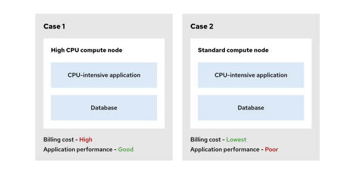
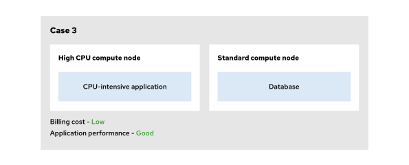
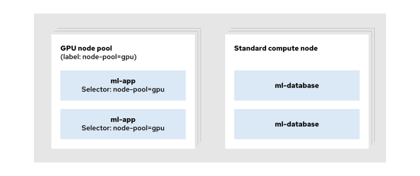
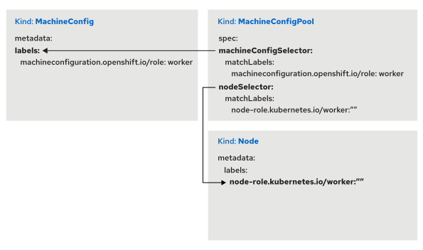
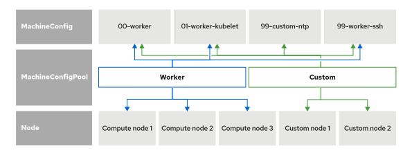

Quản trị Red Hat OpenShift III: Mở rộng quy mô triển khai trong doanh nghiệp
----------------------------------------------------------------------------

# Chương 7. Phân hoạch cụm
## Các nhóm nút (Node Pools)
### Giới thiệu
Cụm OpenShift bao gồm các nút mặt phẳng điều khiển (control plane nodes) và các nút tính toán (compute nodes). Các nút tính toán còn được gọi là nút worker (worker nodes). Các nút mặt phẳng điều khiển quản lý cụm Red Hat OpenShift Container Platform và điều phối việc phân bổ khối lượng công việc (workload) trên các nút tính toán.

Các ứng dụng chạy trong cụm OpenShift có những thông số kỹ thuật và yêu cầu khác nhau. Một số ứng dụng có thể đòi hỏi các nút tính toán được trang bị bộ xử lý đồ họa (GPU) để phục vụ các ứng dụng đồ họa, các tính toán về trí tuệ nhân tạo (AI) hoặc các khối lượng công việc liên quan đến học máy (ML). Một số ứng dụng khác, chẳng hạn như các trang web đơn giản, có thể không yêu cầu phần cứng hay thông số kỹ thuật đặc thù nào và vẫn có thể vận hành ổn định trên các nút tính toán có cấu hình nhỏ.

Ví dụ, bạn có thể chạy một ứng dụng bao gồm nhiều dịch vụ siêu nhỏ (microservice) đòi hỏi năng lực CPU cao, cùng với một cơ sở dữ liệu không có yêu cầu khắt khe như vậy.

**Hình 7.1: Tác động của việc bố trí ứng dụng đối với chi phí thanh toán và hiệu năng**  


Bạn có thể chạy cả ứng dụng đòi hỏi nhiều tài nguyên CPU lẫn các instance cơ sở dữ liệu trên các nút tính toán (compute node) có năng lực CPU cao. Trong trường hợp này, ứng dụng đòi hỏi nhiều CPU sẽ chạy mượt mà, nhưng cơ sở dữ liệu lại không tận dụng hết năng lực của nút tính toán đó, đồng thời chi phí thanh toán cũng tăng lên.

Trong OpenShift, bạn có thể triển khai cả ứng dụng đòi hỏi nhiều tài nguyên CPU và các instance cơ sở dữ liệu trên các nút tính toán có năng lực CPU thấp. Với cách này, chi phí thanh toán sẽ giảm xuống, nhưng ứng dụng sẽ không hoạt động đúng cách do nút tính toán có năng lực CPU quá thấp.

**Hình 7.2: Bố trí khối lượng công việc tối ưu thông qua việc phân chia nút**  


Giải pháp tối ưu là triển khai các phiên bản ứng dụng đòi hỏi nhiều tài nguyên CPU trên các nút tính toán (compute node) có năng lực CPU cao, đồng thời triển khai ứng dụng cơ sở dữ liệu trên các nút tính toán có năng lực CPU thấp hơn.

Bạn cần các nút tính toán với cấu hình phần cứng và năng lực khác nhau để đáp ứng nhu cầu của từng ứng dụng, đồng thời phân chia các nút này để phục vụ việc triển khai ứng dụng. Bạn có thể triển khai các ứng dụng trên những nút cụ thể bằng cách sử dụng các nhóm nút (node pool).

Trong một số trường hợp, bạn có thể gặp phải vấn đề "hàng xóm ồn ào" (noisy neighbor) — tình trạng một ứng dụng bị suy giảm hiệu năng và có độ trễ cao do chịu ảnh hưởng từ các ứng dụng khác. Để tránh vấn đề này, bạn có thể cấu hình các nút tính toán vào những nhóm nút riêng biệt dành cho các ứng dụng quan trọng.

### Nhóm nút (Node Pool)
Nhóm nút là một tập hợp logic các nút tính toán (compute node) trong OpenShift. Các nút tính toán có cấu hình phần cứng tương tự nhau có thể được tổ chức thành một nhóm nút. Việc tập hợp các nút tương đồng này vào các nhóm nút giúp kiểm soát vị trí triển khai cho các khối lượng công việc (workload).

> **Lưu ý:** Trong các cụm OpenShift tiêu chuẩn, nhóm nút là một tập hợp logic mà bạn quản lý thông qua các tài nguyên MachineSet và nhãn (label). Trong các cụm có mặt phẳng điều khiển được lưu trữ (hosted control plane cluster), NodePool là một tài nguyên API cụ thể dùng để quản lý các nhóm nút tính toán; tài nguyên này thay thế cho các MachineSet trong các môi trường đó.

Bạn có thể cấu hình nhiều nhóm nút cho các khối lượng công việc của mình để đảm bảo rằng các ứng dụng chạy trên phần cứng phù hợp với yêu cầu.

Một thực thể (instance) thường đòi hỏi một cấu hình cụ thể cho nút tính toán để có thể vận hành một cách ổn định.

**Hình 7.3: Nhắm mục tiêu các khối lượng công việc dành riêng cho phần cứng bằng cách sử dụng nhãn cho nhóm nút (node pool)**  


Trong kịch bản này, bạn có một ứng dụng sử dụng công nghệ học máy (ML) và một ứng dụng cơ sở dữ liệu. Ứng dụng ML cần các nút (node) có GPU để vận hành trơn tru, trong khi cơ sở dữ liệu có thể chạy trên các nút tính toán tiêu chuẩn.

Trong trường hợp này, hãy cung cấp các nút tính toán được trang bị phần cứng GPU và cấu hình chúng thành một nhóm nút (node ​​pool) dành riêng cho GPU bằng cách sử dụng nhãn `node-pool=gpu`. Bạn có thể lập lịch để các pod của ứng dụng ML chạy trên nhóm nút GPU này, trong khi các pod của cơ sở dữ liệu sẽ được triển khai trên các nút tính toán khác.

Bạn có thể có những ứng dụng quan trọng không yêu cầu phần cứng đặc thù và có thể chạy trên các nút tính toán tiêu chuẩn. Tuy nhiên, các ứng dụng quan trọng này có nguy cơ gặp phải vấn đề "hàng xóm ồn ào" (noisy neighbor).

Ví dụ, hãy xét một ứng dụng nhắn tin. Ứng dụng này không yêu cầu phần cứng chuyên biệt và có thể chạy trên bất kỳ nút tiêu chuẩn nào, nhưng lại rất nhạy cảm với độ trễ mạng cao. Các ứng dụng khác (không quan trọng) có thể chạy trên cùng một nút trong cụm (cluster), làm tăng lưu lượng mạng và gây ra độ trễ cho ứng dụng nhắn tin.

Mặc dù ứng dụng nhắn tin thường có thể vận hành ổn định trên nút đó, nhưng các ứng dụng không quan trọng khác vẫn có khả năng ảnh hưởng đến hiệu suất mạng của nút này. Đây chính là một ví dụ khác về vấn đề "hàng xóm ồn ào". Để tránh tình trạng này, bạn có thể sử dụng các nhóm nút (node ​​pool) để tổ chức các nút tính toán dành riêng cho việc chạy các ứng dụng quan trọng.

Việc xác định các nhóm nút cho phần cứng trong cụm phụ thuộc vào phương pháp triển khai ứng dụng tại tổ chức của bạn. Trong các kịch bản triển khai hạ tầng phân tầng — chẳng hạn như các tầng dành cho phát triển (development), thử nghiệm (staging) hoặc sản xuất (production) — quản trị viên có thể tổ chức các nhóm nút tương ứng với từng tầng này. Phần cứng cũ hơn có thể được đưa vào nhóm nút "phát triển", trong khi hạ tầng mới hơn có thể được dành riêng cho các khối lượng công việc (workload) sản xuất thông qua nhóm nút "sản xuất". Với cách tiếp cận này, các nhà phát triển có thể hướng ứng dụng của mình vào các nhóm nút phù hợp, giúp tách biệt các ứng dụng thuộc giai đoạn phát triển, thử nghiệm và sản xuất đang chạy trong cùng một cụm.

> **Lưu ý:** Việc thiết kế hạ tầng với các nhóm nút chuyên biệt, được phân tách rõ ràng sẽ tạo ra sự cô lập mạnh mẽ ở cấp độ phần cứng cho các khối lượng công việc nhạy cảm, đồng thời cải thiện kiến trúc về chủ quyền kỹ thuật số (digital sovereignty). Việc phân tách cụm giúp thiết lập các "bức tường ngăn cách" (glass wall) trong kiến trúc, đảm bảo rằng các đối tượng sử dụng (tenant) khác nhau hoặc các khối lượng công việc thuộc các phạm vi pháp lý khác nhau không chia sẻ chung các tài nguyên tính toán bên dưới.

#### Cung cấp nút (Node Provisioning)
Việc cung cấp các nút tính toán (compute node) phụ thuộc vào phương pháp cài đặt cụm (cluster).

Trong cơ sở hạ tầng do người dùng cung cấp (User-Provisioned Infrastructure - UPI), bạn phải tự tay cung cấp các thực thể (instance) mới. Chiến lược cung cấp nút sẽ tùy thuộc vào trung tâm dữ liệu và các quy trình CNTT của riêng bạn. Tuy nhiên, các bước cơ bản vẫn không thay đổi, bao gồm:

1. Cập nhật tệp Ignition của nút tính toán bằng chứng chỉ TLS mới. 
2. Cài đặt Red Hat Enterprise Linux CoreOS (RHCOS) từ tệp ảnh ISO hoặc thông qua phương thức khởi động PXE (Preboot eXecution Environment). 
3. Thêm thực thể mới vào bộ cân bằng tải (load balancer) cho lưu lượng truy cập vào (ingress). 
4. Phê duyệt các yêu cầu ký chứng chỉ (Certificate Signing Requests - CSR).

Trong cơ sở hạ tầng do trình cài đặt cung cấp (Installer-Provisioned Infrastructure - IPI), API máy (machine API) sẽ tự động thực hiện các thao tác mở rộng quy mô (scaling) đối với các nhà cung cấp dịch vụ đám mây được hỗ trợ. Nhờ đó, bạn có thể thay đổi số lượng bản sao (replica) được chỉ định trong tài nguyên "machine set", và OpenShift sẽ phối hợp với nhà cung cấp đám mây để tạo mới hoặc loại bỏ các thực thể. Bạn có thể mở rộng quy mô (scale up) hoặc thu hẹp quy mô (scale down) thông qua tính năng tự động mở rộng (autoscaling) dựa trên yêu cầu khối lượng công việc.

Để biết thêm chi tiết về quy trình cài đặt Red Hat OpenShift và cung cấp nút, bạn có thể tham khảo khóa đào tạo Red Hat OpenShift Installation Lab (DO322).

Một số cụm được quản lý (managed cluster) có các "machine set" được bảo vệ mà bạn không thể sửa đổi trực tiếp. Ví dụ, các cụm Red Hat OpenShift trên AWS (ROSA) cung cấp các tài nguyên "machine pool" để quản lý các "machine set" bên dưới.

> **Quan trọng:** Trong các dịch vụ được quản lý (như ROSA và OSD), vai trò "dedicated-admins" (quản trị viên chuyên biệt) tiêu chuẩn bị hạn chế quyền thay đổi các thành phần điều khiển (control plane) hoặc các nút cơ sở hạ tầng, nhằm đảm bảo tính ổn định cho cụm. Do đó, việc tinh chỉnh sâu thông qua MCO (Machine Config Operator) có thể không thực hiện được trên các cụm này.

Với các cụm này, bạn sẽ tạo một "machine pool" và chọn loại thực thể Amazon EC2 phù hợp với khối lượng công việc của mình. "Machine set" được tạo ra sẽ được bảo vệ, ngăn chặn việc sửa đổi trực tiếp.

> **Lưu ý:** Trong ROSA với các thành phần điều khiển được lưu trữ (hosted control planes), các thành phần điều khiển được tách biệt và chạy trong một tài khoản do Red Hat quản lý, trong khi các nút tính toán ứng dụng chạy trong tài khoản AWS của khách hàng. Nhờ sự tách biệt này, các thành phần điều khiển và các nút tính toán có thể được nâng cấp độc lập với nhau. Các "machine pool" của nút tính toán có thể chạy ổn định với phiên bản thấp hơn tối đa hai phiên bản phụ (minor version) so với phiên bản của thành phần điều khiển được lưu trữ, trước khi các nút này bắt buộc phải được cập nhật.

#### Nhãn nút (Node Labels)
Sử dụng nhãn nút để cấu hình các nút tính toán (compute node) trở thành thành viên của một nhóm nút (node pool) cụ thể. Nhãn nút là các cặp khóa-giá trị được gắn vào nút đó.

Bạn có thể thêm một nhãn vào nhiều nút tính toán để chỉ định mỗi nút là thành viên của một nhóm nút nhất định. Trong các cụm được quản lý bởi Machine API (chẳng hạn như các cụm IPI), hãy chỉ định nhãn nút cho các thành viên của nhóm nút bên trong đối tượng MachineSet; lý do là vì các nhãn được áp dụng trực tiếp lên một nút sẽ không còn tồn tại khi Machine API thay thế nút đó.

Bạn có thể liệt kê các nút và nhãn bằng cách sử dụng lệnh `oc get nodes`:

```bash
$ oc get nodes worker01 --show-labels
NAME       STATUS   ROLES                  ...   LABELS
worker01   Ready    worker                 ...   beta.kubernetes.io/arch=amd64,beta.kubernetes.io/os=linux,kubernetes.io/arch=amd64,kubernetes.io/hostname=worker01,kubernetes.io/os=linux,node-role.kubernetes.io/worker=,node.openshift.io/os_id=rhcos
```

Các nút tính toán (compute node) có thể mang nhiều nhãn nút (node label). Bạn có thể thêm bao nhiêu nhãn nút tùy ý vào một nút tính toán để phục vụ việc phân bổ khối lượng công việc (workload) lên phần cứng mong muốn. Để thêm nhãn nút tùy chỉnh vào các nút tính toán, bạn có thể sử dụng lệnh `oc label node`.

```bash
$ oc label node/worker01 node-pool=gpu
node/worker01 labeled (1)
$ oc get nodes worker01 --show-labels
NAME       STATUS   ROLES    ...   LABELS
worker01   Ready    worker   ...   beta.kubernetes.io/arch=amd64,beta.kubernetes.io/os=linux,kubernetes.io/arch=amd64,kubernetes.io/hostname=worker01,kubernetes.io/os=linux,node-pool=gpu,node-role.kubernetes.io/worker=,node.openshift.io/os_id=rhcos (2)
```

1. Lệnh `oc label` thêm nhãn `node-pool=gpu` vào nút tính toán `worker01`.
2. Lệnh `oc get nodes` hiển thị nhãn `node-pool=gpu` cho nút tính toán `worker01`.

Bạn có thể cấu hình nhiều nút tính toán GPU để cùng thuộc về một nhóm nút (node pool) `gpu` bằng cách thêm cùng một nhãn nút đó vào tất cả các nút tính toán có hỗ trợ GPU.

```bash
$ oc label node/worker02 node-pool=gpu
node/worker02 labeled
$ oc get nodes --selector node-pool=gpu
NAME       STATUS   ROLES    AGE   VERSION
worker01   Ready    worker   13d   v1.35.5
worker02   Ready    worker   13d   v1.35.5
```

Lệnh `oc get nodes` với bộ lọc `selector` hiển thị tất cả các nút (node) có nhãn `node-pool=gpu`. Bạn có thể lập lịch cho ứng dụng nhắm đến một nút tính toán nằm trong nhóm nút (node pool) GPU bằng cách sử dụng các nhãn nút. Chương tiếp theo sẽ thảo luận chi tiết về việc lập lịch cho pod.

#### Cấu hình nút (Node Configuration)
Cụm OpenShift quản lý việc nâng cấp các nút thông qua Machine Config Operator (MCO). Bạn có thể quản lý các nút bằng cách phân nhóm chúng thành các "machine config pool" (MCP). Theo mặc định, MCO sử dụng các MCP dành cho nút điều khiển (master) và nút worker (worker). Bạn cũng có thể tạo các MCP tùy chỉnh cho các nhóm nút của mình. Các MCP sử dụng nhãn (label) để liên kết một hoặc nhiều đối tượng cấu hình máy (machine configuration - MC) với một hoặc nhiều nút.

Ví dụ: bạn có thể tạo một MCP có tên là `gpu`. MCP này sẽ chọn các nút dựa trên nhãn `node-role.kubernetes.io/gpu`. Khác với các nhóm nút (node pool) thông thường — vốn có thể sử dụng bất kỳ nhãn nút nào — các MCP chọn nút dựa trên vai trò (role) của nút đó; do đó, bạn bắt buộc phải gắn nhãn `node-role.kubernetes.io/` cho các nút nằm trong nhóm này.

Tương tự, các nhà cung cấp dịch vụ đám mây (cloud provider) cung cấp nhiều loại tài nguyên tính toán và lưu trữ khác nhau để đáp ứng nhu cầu của khách hàng. Chẳng hạn, lưu trữ cho `etcd` và các khối lượng công việc (workload) đòi hỏi cường độ I/O cao cần một giải pháp lưu trữ có độ trễ thấp để đạt hiệu suất tối ưu. Amazon Elastic Block Store (EBS) cung cấp loại ổ đĩa `io2` để hỗ trợ các yêu cầu này. Đối với những khối lượng công việc không đòi hỏi cường độ I/O cao, bạn có thể sử dụng loại ổ đĩa EBS `gp3`.

## Cấu hình nút bằng Machine Config Operator
### Machine Config Operator
OpenShift Container Platform tích hợp cả việc quản lý hệ điều hành lẫn quản lý cụm (cluster). Trong một số trường hợp, bạn cần thực hiện các thay đổi đối với hệ điều hành đang chạy trên các nút (node) OpenShift, chẳng hạn như thêm các tham số nhân (kernel arguments), hoặc cập nhật CRI-O, kubelet hay systemd. OpenShift sử dụng Red Hat Enterprise Linux CoreOS (RHCOS) làm hệ điều hành nền tảng trên các nút của cụm. RHCOS trong OpenShift Container Platform 4.22 dựa trên Red Hat Enterprise Linux 9.8. Machine Config Operator (MCO) thực hiện quản lý và áp dụng các thay đổi cấu hình cũng như các bản cập nhật cho các nút trong cụm thông qua việc sử dụng các cấu hình máy (machine configuration) và các nhóm cấu hình máy (machine config pool).
Lưu ý

Red Hat đặc biệt khuyến cáo không nên tự ý thay đổi hệ điều hành RHCOS trên các nút theo cách thủ công, chẳng hạn như chỉnh sửa tệp tin hoặc sử dụng các lệnh hệ thống như `systemctl`. Những thay đổi này có thể gây xung đột với MCO, và MCO có thể ghi đè lên chúng.

MCO bao gồm các thành phần sau đây nhằm đơn giản hóa việc quản lý nút:

* MCO deployment: Đây là thành phần vận hành chính (operator workload), chịu trách nhiệm quản lý các thành phần còn lại của MCO. 
* Machine Config Daemon (MCD) daemon set: Thành phần này quản lý các thay đổi cấu hình và cập nhật trên các nút của cụm. Khi một nút phát hiện có thay đổi, nó sẽ thực hiện "drain" (di chuyển các pod ra khỏi nút), sau đó áp dụng bản cập nhật và khởi động lại. MCD sử dụng các tệp cấu hình Ignition để áp dụng cấu hình máy đã chỉ định và kiểm soát cấu hình của kubelet. 
* Machine Config Controller (MCC) deployment: Thành phần này giám sát các nút trong cụm và điều phối quá trình nâng cấp máy từ mặt phẳng điều khiển (control plane). 
* Machine Config Server (MCS) daemon set: Thành phần này cung cấp các tệp cấu hình Ignition cho các nút tham gia vào cụm. Hệ điều hành RHCOS sẽ tải xuống và xử lý các tệp Ignition này tại thời điểm khởi động. Bộ chứng chỉ (CA bundle) của MCS được lưu trữ trong một cấu hình (config map) có tên là `machine-config-server-ca` nằm trong namespace `openshift-machine-config-operator`.

> **Lưu ý:** Để biết thêm chi tiết về cách cài đặt cụm OpenShift cũng như cách sử dụng các tệp Ignition để cấu hình các nút trong cụm, vui lòng tham khảo bài học đào tạo "Installing OpenShift Container Platform (DO0032L)". MCO cho phép bạn thực hiện các thao tác sau trên các nút (node) của cụm (cluster):

* Tạo và cập nhật các dịch vụ systemd. 
* Thay đổi các khóa SSH. 
* Thêm các tham số vào dòng lệnh nhân (kernel command line) khi các nút OpenShift khởi động. 
* Tạo hoặc ghi đè các tệp trong các thư mục /var và /etc. 
* Ghi tệp vào các thư mục /opt và /usr/local nếu các thư mục này được liên kết tượng trưng (symbolically linked) tới các thư mục /var và /etc. 
* Bật chế độ chính sách mật mã FIPS tại thời điểm cài đặt. 
* Mở rộng các tính năng của RHCOS bằng cách thêm các phần mềm được đóng gói sẵn. 
* Cập nhật các thiết lập môi trường chạy container (container runtime) CRI-O thông qua tài nguyên tùy chỉnh (custom resource - CR) `ContainerRuntimeConfig`, và cập nhật dịch vụ `kubelet` thông qua CR `KubeletConfig`.

> **Lưu ý:** RHCOS chỉ sử dụng Linux control groups phiên bản 2 (cgroups v2). Hỗ trợ cho cgroups v1 đã bị loại bỏ trong OpenShift Container Platform 4.19, vì vậy bạn không thể cấu hình các nút để sử dụng hệ thống phân cấp cgroups v1 cũ.

MCO định nghĩa các CR là `MachineConfig` (MC) và `MachineConfigPool` (MCP). CR `MachineConfig` dùng để khai báo các tùy chỉnh cho nút. CR `MachineConfigPool` tạo ra một nhóm các nút có cùng cấu hình, đồng thời sử dụng các nhãn (label) để liên kết một hoặc nhiều MC với một hoặc nhiều nút.

Sơ đồ dưới đây minh họa mối quan hệ giữa nút, MC và MCP:

**Hình 7.4: Mối quan hệ giữa nút, MC và MCP**  


Trong sơ đồ trước đó, MCP CR sử dụng tham số `nodeSelector` để chọn tất cả các node có vai trò worker, đồng thời sử dụng tham số `machineConfigSelector` để chọn các MC có nhãn `machineconfiguration.openshift.io/role: worker` và áp dụng các MC đó cho những node này.

#### MachineConfig CR
MachineConfig CR khai báo các cấu hình nút (node) bằng cách sử dụng định dạng cấu hình Ignition. Các tệp Ignition mã hóa nội dung tệp thông qua lược đồ mã hóa Base64. Các thành phần khác, chẳng hạn như các đơn vị (unit) systemd hoặc khóa SSH, không sử dụng lược đồ mã hóa Base64.

> **Lưu ý:** Để biết thêm thông tin về định dạng cấu hình Ignition, hãy tham khảo https://coreos.github.io/ignition/

Ví dụ dưới đây cho thấy một đối tượng MachineConfig thực hiện sửa đổi tệp cấu hình cho dịch vụ journald bằng cách sử dụng lược đồ mã hóa Base64:

```yaml
apiVersion: machineconfiguration.openshift.io/v1
kind: MachineConfig
metadata:
  labels:
    machineconfiguration.openshift.io/role: worker # (1)
  name: 60-journald # (2)
spec:
  config:
    ignition:
      version: 3.5.0 # (3)
    storage:
      files:
      - contents:
          source: data:text/plain;charset=utf-8;base64,VGVzdGl...E8gKItAo= # (4)
        mode: 420
        path: /etc/systemd/journald.conf
```

1. Nhãn dành cho MC.
2. Tên MC kèm theo một con số gồm hai chữ số, quy định thời điểm áp dụng cấu hình. Các con số lớn hơn sẽ có mức ưu tiên cao hơn.
3. Phiên bản cấu hình Ignition.
4. URL dữ liệu chứa nội dung tệp đã được mã hóa theo định dạng Base64.

#### Tạo Cấu hình Máy (Machine Configuration - MC) bằng Butane
Việc tạo MC theo cách thủ công rất tốn thời gian và dễ xảy ra lỗi, do bạn phải nhúng nội dung tệp dưới dạng các URL dữ liệu (data URL) đã mã hóa, đồng thời phải sử dụng cấu trúc Ignition khá rườm rà. Thay vào đó, bạn có thể sử dụng tiện ích dòng lệnh (CLI) Butane – công cụ cung cấp cú pháp rút gọn tiện lợi để tạo các MC. Trong tệp cấu hình Butane, bạn chỉ cần viết nội dung tệp dưới dạng văn bản thuần túy; Butane sẽ tự động mã hóa các nội dung đó và mở rộng cú pháp rút gọn thành một MC hoàn chỉnh. Ngoài ra, Butane còn thực hiện kiểm tra tính hợp lệ của cấu hình trước khi bạn áp dụng, giúp bạn phát hiện sớm các lỗi trước khi chúng gây ảnh hưởng đến các nút (node) trong cụm (cluster).

Bạn có thể cài đặt Butane CLI bằng cách tải xuống tệp nhị phân (binary) Butane mới nhất thông qua việc chạy lệnh sau:

```bash
$ curl \
https://mirror.openshift.com/pub/openshift-v4/clients/butane/latest/butane \
--output butane
```

Tệp thực thi Butane sử dụng các tệp cấu hình Butane để tạo ra các tệp MC. Ví dụ dưới đây là một tệp cấu hình Butane có tên là 99-worker-custom.bu; tệp này cấu hình bảng điều khiển hệ thống (system console) để hiển thị các thông báo gỡ lỗi nhân (kernel debug messages), đồng thời chỉ định các thiết lập tùy chỉnh cho dịch vụ thời gian chrony:

```yaml
variant: openshift # (1)
version: 4.22.0 # (2)
metadata:
  name: 99-worker-custom # (3)
  labels:
    machineconfiguration.openshift.io/role: worker # (4)
openshift:
  kernel_arguments: # (5)
    - loglevel=7
storage:
  files: # (6)
    - path: /etc/chrony.conf
      mode: 0644
      overwrite: true
      contents:
        inline: |
          pool 0.rhel.pool.ntp.org iburst
          driftfile /var/lib/chrony/drift
          makestep 1.0 3
          rtcsync
          logdir /var/log/chrony
```

1. Tên biến thể (variant name), bắt buộc phải được đặt là `openshift`.
2. Phiên bản OpenShift.
3. Tên duy nhất cho tài nguyên MC (MachineConfig) được tạo ra.
4. Nhãn (label) cho tài nguyên MC được tạo ra.
5. Danh sách các đối số cần thêm vào dòng lệnh nhân (kernel command line).
6. Danh sách các tệp cần tạo. Mỗi tệp, thư mục và liên kết (link) phải có một đường dẫn duy nhất.

> **Lưu ý:** Để biết thêm thông tin về định dạng tệp cấu hình Butane cho OpenShift Container Platform 4.22, hãy tham khảo https://coreos.github.io/butane/config-openshift-v4_22/

Để tạo MC, hãy truyền tệp cấu hình Butane vào lệnh `butane`.

```bash
$ butane 99-worker-custom.bu -o ./99-worker-custom.yaml
```

Tệp `99-worker-custom.yaml` chứa đối tượng MC thu được.

```yaml
# Generated by Butane; do not edit
apiVersion: machineconfiguration.openshift.io/v1
kind: MachineConfig
metadata:
  labels:
    machineconfiguration.openshift.io/role: worker
  name: 99-worker-custom
spec:
  config:
    ignition:
      version: 3.5.0
    storage:
      files:
        - contents:
            compression: ""
            source: data:,pool...
          mode: 420
          overwrite: true
          path: /etc/chrony.conf
  kernelArguments:
    - loglevel=7
```

Bạn có thể tạo đối tượng MC bằng cách sử dụng tệp `99-worker-custom.yaml`.

```bash
$ oc create -f 99-worker-custom.yaml
machineconfig.machineconfiguration.openshift.io/99-worker-custom created
```

Bạn có thể sử dụng lệnh `oc explain mc` để đọc các tham số mà bạn có thể thay đổi thông qua MC.

```bash
$ oc explain mc.spec
GROUP:      machineconfiguration.openshift.io
KIND:       MachineConfig
...output omitted...
DESCRIPTION:
    MachineConfigSpec is the spec for MachineConfig
...output omitted...
  extensions  <[]string>
    extensions contains a list of additional features that can be enabled on
    host

  fips  <boolean>
    fips controls FIPS mode

  kernelArguments <[]string>
    kernelArguments contains a list of kernel arguments to be added

  kernelType  <string>
    kernelType contains which kernel we want to be running like default
    (traditional), realtime, 64k-pages (aarch64 only).

  osImageURL  <string>
    osImageURL specifies the remote location that will be used to
    fetch the OS.
```

Theo mặc định, OpenShift đi kèm với các MC (MachineConfig) được cài đặt sẵn cho các nút control plane và nút compute. Bạn có thể liệt kê các MC trong cụm của mình bằng cách sử dụng lệnh `oc get machineconfig` hoặc `oc get mc`. Để liệt kê các MC cho một nhãn nút (node label) cụ thể, hãy sử dụng tham số `--selector`. Ví dụ dưới đây liệt kê các MC dành cho vai trò worker trong cụm:

```bash
$ oc get machineconfig \
--selector machineconfiguration.openshift.io/role=worker
NAME                             GENERATEDBYCONTROLLER    IGNITIONVERSION   AGE
00-worker                        46ee...583d              3.5.0             229d
01-worker-container-runtime      46ee...583d              3.5.0             229d
01-worker-kubelet                46ee...583d              3.5.0             229d
...output omitted...
```

MCO đọc các MC theo thứ tự chữ-số dựa trên tên gọi, từ `00-*` đến `99-*`. OpenShift lưu trữ tập hợp các MC đã được tổng hợp vào một tài nguyên MC kết xuất (rendered MC). Do đó, nếu có từ hai MC trở lên cùng thực hiện thay đổi đối với cùng một tệp, MCO sẽ chỉ áp dụng các thay đổi từ MC có số thứ tự cao hơn. Đối với các MC có cùng số thứ tự, MCO sẽ ưu tiên MC xuất hiện sau cùng theo thứ tự chữ-số. Chẳng hạn, MC có tên `99-worker-ssh-new` sẽ được ưu tiên hơn MC có tên `99-worker-ssh-last`.

#### Các Nhóm Cấu hình Máy (Machine Config Pools - MCP)
OpenShift phân chia các máy thành các nhóm dựa trên tài nguyên mà chúng đảm nhận, chẳng hạn như các thành phần mặt phẳng điều khiển (control plane) hoặc khối lượng công việc của người dùng.

Các MCP sử dụng nhãn (label) để liên kết một hoặc nhiều Cấu hình Máy (Machine Config - MC) với một hoặc nhiều nút (node). Bằng cách sử dụng nhiều MC, bạn có thể chia nhỏ cấu hình nút và tập trung mỗi MC vào một khía cạnh cụ thể của cấu hình máy chủ. Ví dụ, bạn có thể thiết lập một MC cho việc phân giải DNS và một MC khác để đồng bộ hóa thời gian.

Bạn cũng có thể sử dụng cùng một MC trong nhiều MCP khác nhau. Chẳng hạn, một MC dùng để đồng bộ hóa thời gian có thể áp dụng cho nhiều MCP, trong khi chỉ những MCP dành cho một nhóm nút cụ thể mới bao gồm cấu hình cần thiết cho một loại thẻ tăng tốc phần cứng (hardware accelerator card) đặc thù.

Các MCP sử dụng nhãn `machineConfigSelector` để chọn một hoặc nhiều MC, và nhãn `nodeSelector` để chọn một hoặc nhiều nút.

Theo mặc định, OpenShift cung cấp sẵn các MCP cho vai trò master (mặt phẳng điều khiển) và worker (nút thực thi công việc). Tuy nhiên, bạn có thể thêm các MCP tùy chỉnh vào cụm (cluster). Red Hat khuyến nghị tạo các MCP tùy chỉnh bằng cách kết hợp các MC dành cho vai trò worker với các MC tùy chỉnh khác. Việc đưa các cấu hình máy dành cho vai trò worker vào nhóm tùy chỉnh là rất quan trọng, giúp các máy trong nhóm này tiếp tục nhận được các bản cập nhật hệ điều hành tiêu chuẩn—ví dụ như các bản cập nhật RHCOS được phân phối thông qua vai trò worker trong quá trình nâng cấp cụm. Để bao gồm vai trò worker, biểu thức khớp (match expression) trong `machineConfigSelector` sẽ chọn cả vai trò worker lẫn nhãn tùy chỉnh. Các nút thuộc nhóm tùy chỉnh này sẽ sử dụng các MC từ vai trò worker, kết hợp cùng các cấu hình bổ sung từ nhãn tùy chỉnh đó.

**Hình 7.5: Nhóm tùy chỉnh (custom pool) gồm các MC worker và một MC bổ sung**  


Trong sơ đồ trước đó, MCP tùy chỉnh (custom MCP) nhắm đến hai nút (node) có gắn nhãn tùy chỉnh, trong khi MCP worker nhắm đến ba nút có gắn nhãn worker. Nhóm worker (worker pool) áp dụng các cấu hình máy (Machine Config - MC) gồm `00-worker`, `01-worker-kubelet` và `99-worker-ssh` cho các nút worker. Nhóm tùy chỉnh (custom pool) sử dụng các MC từ vai trò worker, đồng thời bổ sung thêm MC `99-custom-ntp` vào cấu hình cho các nút tùy chỉnh đó.

> **Quan trọng:** Mỗi nút chỉ có thể thuộc về duy nhất một nhóm cấu hình máy (Machine Config Pool - MCP). Do một nhóm tùy chỉnh được kế thừa từ nhóm worker, nên khi bạn chuyển một nút worker sang nhóm tùy chỉnh, nút đó sẽ không còn nằm trong nhóm worker nữa. Nếu hai nhóm tùy chỉnh cùng chọn một nút, MCO (Machine Config Operator) sẽ không thể xác định được nên sử dụng nhóm nào; kết quả là các thay đổi tùy chỉnh sẽ không được áp dụng và một thông báo lỗi sẽ được ghi lại trong nhật ký (log) của pod MCC. Các nút mang vai trò master không được phép thuộc về bất kỳ nhóm tùy chỉnh nào.

Thông số kỹ thuật MCP dưới đây minh họa cách tạo một nhóm riêng biệt cho các nút tùy chỉnh:

```yaml
apiVersion: machineconfiguration.openshift.io/v1
kind: MachineConfigPool
metadata:
    name: custom 1
spec:
    machineConfigSelector:
        matchExpressions:
            - key: machineconfiguration.openshift.io/role
              operator: In
              values: [worker, custom] # (2)
    nodeSelector:
        matchLabels:
            node-role.kubernetes.io/custom: "" # (3)
```

1. Tên của MCP tùy chỉnh (custom MCP).
2. Bộ chọn MC (MC selector) bao gồm cả các MC mặc định (worker) và các MC tùy chỉnh.
3. Bộ chọn nút (node selector) bao gồm các nút trong cụm (cluster) có vai trò tùy chỉnh (custom role).

> **Lưu ý:** Bạn có thể tìm hiểu thêm thông tin về nhãn (labels) và bộ chọn (selectors) tại https://kubernetes.io/docs/concepts/overview/working-with-objects/labels/

Bạn có thể liệt kê các MCP trong cụm của mình bằng cách sử dụng lệnh `oc get machineconfigpool` hoặc `oc get mcp`.

```bash
$ oc get machineconfigpool
NAME     CONFIG                UPDATED   UPDATING   DEGRADED   MACHINECOUNT   ...
master   rendered-master-...   True      False      False      3              ...
worker   rendered-worker-...   True      False      False      3              ...
```

Lệnh trước đó hiển thị các thông tin sau cho các MCP:

**CONFIG**  
Cột này cung cấp tên của cấu hình máy (Machine Configuration - MC) đã được kết xuất (rendered) mà MCO áp dụng cho các nút (node) trong MCP. Trong lần cập nhật đầu tiên, trường này sẽ để trống.

**UPDATED**  
Trạng thái True cho biết MCO đã áp dụng MC hiện tại cho các nút trong MCP đó. Trạng thái False cho biết các nút trong MCP đang trong quá trình cập nhật.

**UPDATING**  
Trạng thái True cho biết MCO đang áp dụng MC dự kiến. Các nút ở trạng thái UPDATING có thể không khả dụng để lập lịch (scheduling). Trạng thái False cho biết tất cả các nút trong MCP đã được cập nhật.

**DEGRADED**  
Trạng thái True cho biết MCO bị chặn không thể áp dụng MC hiện tại hoặc MC dự kiến ​​cho ít nhất một nút trong MCP đó. Một nguyên nhân có thể xảy ra là phát hiện sự sai lệch cấu hình (configuration drift) – vấn đề này sẽ được giải thích ở phần sau. Các nút ở trạng thái suy giảm (degraded) có thể không khả dụng để lập lịch. Trạng thái False cho biết tất cả các nút trong MCP đều ở trạng thái sẵn sàng (ready).

**MACHINECOUNT**  
Trường này cho biết tổng số máy trong MCP.

**READYMACHINECOUNT**  
Trường này cho biết tổng số máy trong MCP đã sẵn sàng để lập lịch.

**UPDATEDMACHINECOUNT**  
Trường này cho biết tổng số máy trong MCP đang sử dụng MC hiện tại.

**DEGRADEDMACHINECOUNT**  
Trường này cho biết tổng số máy trong MCP đang ở trạng thái suy giảm (degraded) hoặc không thể đồng bộ cấu hình (irreconcilable).

### Gắn nhãn cho các nút (node)
Bạn có thể thêm nhãn vào nút của mình bằng cách sử dụng lệnh `oc label`.

Ví dụ sau đây thêm một vai trò tùy chỉnh vào nút `worker03` trong cụm (cluster).

```bash
$ oc label node/worker03 node-role.kubernetes.io/custom=
node/worker03 labeled
```

Bạn có thể xác minh vai trò của các nút trong cụm bằng cách sử dụng lệnh oc get nodes:

```bash
$ oc get nodes
NAME      STATUS  ROLES                 AGE   VERSION
master01  Ready   control-plane,master  114d  v1.35.5
master02  Ready   control-plane,master  114d  v1.35.5
master03  Ready   control-plane,master  114d  v1.35.5
worker01  Ready   worker                12d   v1.35.5
worker02  Ready   worker                12d   v1.35.5
worker03  Ready   custom,worker         12d   v1.35.5
```

### Các nút hạ tầng (Infrastructure Nodes)
Một nhãn nút (node label) quan trọng là vai trò "infra" (hạ tầng). Hãy sử dụng vai trò này cho các nút chỉ lưu trữ các thành phần hạ tầng, chẳng hạn như hệ thống ghi nhật ký (logging) cụm, giám sát cụm hoặc kho lưu trữ hình ảnh container (container image registry) tích hợp. Việc gán vai trò "infra" cho các nút được khuyến nghị đối với các cụm quy mô lớn nhằm đảm bảo hiệu năng và sự ổn định cho các dịch vụ cụm OpenShift (như bộ định tuyến - router hoặc các dịch vụ OAuth), đồng thời ngăn chặn các thành phần hạ tầng tiêu tốn nhiều tài nguyên (như hệ thống thu thập số liệu - metrics và ghi nhật ký) gây ảnh hưởng đến khối lượng công việc (workload) của người dùng.

Các nút hạ tầng không được tính vào tổng số lượng đăng ký (subscription) OpenShift cần thiết để vận hành môi trường. Bạn có thể tạo một đối tượng MCP (MachineConfigPool) tùy chỉnh để áp dụng các MC (MachineConfig) cho các nút hạ tầng này.

### Các bản cập nhật từ Machine Config Operator
Machine Config Operator (MCD) báo cáo trạng thái các bản cập nhật nút (node) thông qua các chú thích (annotation) trên nút đó. Bạn có thể sử dụng các chú thích này để đánh giá trạng thái của quá trình cập nhật.

Bạn có thể liệt kê các chú thích trên nút bằng cách sử dụng lệnh `oc describe`:

```bash
$ oc describe node worker01
Name:        worker01
Roles:       worker
Labels:      beta.kubernetes.io/arch=amd64
             ...output omitted...
             node-role.kubernetes.io/worker=
             node.openshift.io/os_id=rhcos
Annotations: machineconfiguration.openshift.io/currentConfig: rendered-worker-370...bfd (1)
             machineconfiguration.openshift.io/desiredConfig: rendered-worker-370...bfd (2)
             machineconfiguration.openshift.io/reason:
             machineconfiguration.openshift.io/state: Done (3)
             volumes.kubernetes.io/controller-managed-attach-detach: true
...output omitted...
```

1. Cấu hình máy (MC) đã được kết xuất (rendered MC) hiện tại mà MCO áp dụng cho nút (node)
2. Cấu hình máy (MC) đã được kết xuất dự kiến ​​mà MCO sẽ áp dụng cho nút
3. Trạng thái hiện tại của nút đối với MCO

Khi cấu hình dự kiến không khớp với cấu hình hiện tại, MCD sẽ áp dụng cấu hình máy (MC) đã được kết xuất dự kiến, di dời tất cả các pod khỏi nút đó, rồi khởi động lại nút.

#### Các chính sách gián đoạn nút (Node Disruption Policies)
Theo mặc định, việc áp dụng hầu hết các thay đổi cấu hình máy (machine configuration) sẽ kích hoạt quy trình giải phóng (drain) và khởi động lại các nút bị ảnh hưởng. Bạn có thể sử dụng các chính sách gián đoạn nút để xác định cách thức MCO (Machine Config Operator) xử lý những thay đổi cụ thể mà không cần khởi động lại toàn bộ nút. Ví dụ: bạn có thể cấu hình MCO để tải lại (reload) một dịch vụ hoặc khởi động lại (restart) môi trường thực thi CRI-O thay vì khởi động lại nút, trong trường hợp thay đổi chỉ tác động đến một số tệp hoặc đơn vị (unit) nhất định.

Bạn định nghĩa các chính sách gián đoạn nút trong trường `spec.nodeDisruptionPolicy` của đối tượng `MachineConfiguration` (thuộc nhóm API `operator.openshift.io/v1`) có tên là `cluster`. Đối với mỗi tệp hoặc đơn vị, bạn chỉ định một hành động—chẳng hạn như `Reload`, `Restart` hoặc `None`—để MCO áp dụng thay đổi mà không cần thực hiện thao tác giải phóng và khởi động lại nút. Kể từ phiên bản OpenShift Container Platform 4.20, các chính sách gián đoạn nút luôn được bật; tính năng này hiện đã sẵn sàng sử dụng rộng rãi (GA - Generally Available) và không còn yêu cầu cơ chế kiểm soát tính năng (feature gate). MCO sẽ báo cáo các chính sách đang có hiệu lực thông qua trường `status.nodeDisruptionPolicyStatus` trong cùng đối tượng nêu trên.

#### Quản lý ảnh khởi động (Boot Image)
Ảnh khởi động là ảnh hệ điều hành mà một nút (node) sử dụng để khởi động trước khi MCO (Machine Config Operator) áp dụng các cấu hình máy. Trên các nền tảng được hỗ trợ, chẳng hạn như Google Cloud và AWS, OpenShift tự động quản lý các ảnh khởi động và cập nhật chúng cùng với cụm (cluster), giúp giảm thiểu sự chênh lệch phiên bản giữa các nút mới được cung cấp và cụm đang hoạt động. Bạn có thể cấu hình hành vi này trong trường `spec.managedBootImages` của đối tượng `MachineConfiguration` có tên là `cluster`.

Kể từ phiên bản OpenShift Container Platform 4.22, MCO áp dụng các giới hạn về độ chênh lệch của ảnh khởi động. Operator này báo cáo trạng thái của ảnh khởi động thông qua trường `status.bootImageSkewEnforcementStatus`, đồng thời có thể chặn quá trình nâng cấp cụm nếu các ảnh khởi động có sự chênh lệch quá lớn so với phiên bản mục tiêu. Cơ chế kiểm soát này giúp đảm bảo rằng các nút được mở rộng quy mô hoặc thay thế vẫn duy trì được sự tương thích với cụm.

#### Sai lệch cấu hình (Configuration Drift)
Sai lệch cấu hình là trạng thái trong đó cấu hình trên một nút (node) không hoàn toàn khớp với các thông số kỹ thuật được quy định trong cấu hình máy (Machine Config - MC) hiện đang được áp dụng.

MCD (Machine Config Daemon) sẽ kiểm tra sai lệch cấu hình khi một nút khởi động, khi bất kỳ tệp nào được chỉ định trong MC bị sửa đổi bên ngoài phạm vi quản lý của MC, hoặc trước khi một MC mới được áp dụng.

Khi phát hiện sai lệch cấu hình, MCD sẽ thực hiện các tác vụ sau:

* Ghi thông báo lỗi vào bảng điều khiển (console). 
* Tạo một sự kiện (event) trong Kubernetes. 
* Ngừng thực hiện các kiểm tra sai lệch tiếp theo trên nút bị ảnh hưởng. 
* Đánh dấu cả nút đó và MCP (Machine Config Pool) tương ứng là đang ở trạng thái suy giảm (degraded).

MCO (Machine Config Operator) sẽ giữ nút đó ở trạng thái suy giảm cho đến khi quản trị viên khắc phục cấu hình của nút. Mặc dù một nút ở trạng thái suy giảm vẫn trực tuyến và hoạt động, bạn sẽ không thể thực hiện cập nhật trên nút đó.

Bạn có thể khắc phục lỗi sai lệch cấu hình và đưa nút trở lại trạng thái Sẵn sàng bằng một trong các biện pháp khắc phục sau:

**Tạo (Generate)**  
Tạo một tập tin buộc trên nút bị lỗi để bỏ qua quá trình phát hiện lỗi sai lệch cấu hình và áp dụng lại MC hiện tại. Để tạo tệp này, hãy khởi tạo một pod gỡ lỗi (debug pod) trên nút đó và tạo tệp `/run/machine-config-daemon-force`. Sau đó, OpenShift sẽ bỏ qua bước xác thực MC, khởi động lại nút và áp dụng MC hiện tại lên nút đó. Tệp cưỡng ép này không ép buộc nâng cấp nút; thay vào đó, nó bỏ qua việc xác thực các cấu hình trên hệ thống và cố gắng thực hiện cập nhật bất chấp các khác biệt hiện có. Tùy thuộc vào vấn đề cụ thể trên nút của bạn, việc bỏ qua quy trình xác thực có thể không giải quyết được lỗi hiện tại của nút.

**Viết lại (Rewrite)**  
Viết lại nội dung tệp hoặc thay đổi quyền truy cập tệp trên máy chủ để phù hợp với cấu hình MC. Quy trình thủ công này đòi hỏi bạn phải xem xét các tệp nhật ký (logs) và tự tay sửa lại tệp đang gây ra xung đột. Phương pháp khắc phục này không yêu cầu khởi động lại nút đang ở trạng thái suy giảm, nhờ đó tránh được nguy cơ gây gián đoạn các ứng dụng của bạn.

Để biết thêm thông tin về sai lệch cấu hình, hãy tham khảo trường Trạng thái (Status) của nhóm (pool) chứa nút đang ở trạng thái suy giảm:

```bash
$ oc describe mcp worker
...output omitted...
Status:
  Conditions:
    ...output omitted...
    Last Transition Time:  2025-05-27T10:11:37Z
    Message:               Node worker01 is reporting: "content mismatch for file '/etc/containers/registries.conf'"
    Reason:                1 nodes are reporting degraded status on sync
    Status:                True
    Type:                  NodeDegraded
    Last Transition Time:  2025-05-27T10:11:37Z
    Message:
    Reason:
    Status:                True
    Type:                  Degraded
...output omitted...
```

Trong ví dụ trước, MCO phát hiện sự sai lệch cấu hình (configuration drift) đối với tệp /etc/containers/registries.conf.

Bạn có thể lấy tên pod MCD cho một nút (node) cụ thể bằng cách sử dụng bộ lọc.

```bash
$ oc get pod -n openshift-machine-config-operator \
--field-selector spec.nodeName=worker01
NAME                          READY   STATUS    RESTARTS   AGE
...
machine-config-daemon-jsrzm   2/2     Running   2          19d
```

Bạn cũng có thể xem lại các nhật ký của MCD để biết thêm thông tin về tình trạng sai lệch cấu hình (configuration drift).

```bash
$ oc logs machine-config-daemon-jsrzm \
-n openshift-machine-config-operator
...output omitted...
E1002 10:11:36.163676    2667 daemon.go:589] Preflight config drift check failed: content mismatch for file "/etc/containers/registries.conf"
E1002 10:11:36.163692    2667 writer.go:200] Marking Degraded due to: content mismatch for file "/etc/containers/registries.conf"
W1002 10:11:40.193224    2667 daemon.go:1763] current+desiredConfig is rendered-worker-d4f45006b2d83725d98af944c8296774 but state is Degraded
I1002 10:11:40.510208    2667 rpm-ostree.go:394] Running captured: rpm-ostree kargs
E1002 10:11:40.568388    2667 on_disk_validation.go:207] content mismatch for file "/etc/containers/registries.conf" (-want +got):
  []uint8(
    """
-   unqualified-search-registries = ["registry.access.redhat.com", "docker.io"]
+   unqualified-search-registries = ["docker.io"]
    short-name-mode = ""

    ... // 107 identical lines
    """
  )
E1002 10:11:40.568446    2667 daemon.go:589] Preflight config drift check failed: content mismatch for file "/etc/containers/registries.conf"
E1002 10:11:40.568467    2667 writer.go:200] Marking Degraded due to: content mismatch for file "/etc/containers/registries.conf"
E1002 10:11:46.987190    2667 daemon.go:1077] mode mismatch for file: "/etc/containers/registries.conf"; expected: -rw-r--r--/420/0644; received: -rwxrwxrwx/511/0777
E1002 10:11:46.987222    2667 writer.go:200] Marking Degraded due to: mode mismatch for file: "/etc/containers/registries.conf"; expected: -rw-r--r--/420/0644; received: -rwxrwxrwx/511/0777
...output omitted...
```

Trong ví dụ trước, MCD đánh dấu nút worker01 ở trạng thái suy giảm (degraded) do có sự không khớp về nội dung và quyền truy cập đối với tệp tin.

### Cấu hình các Tài nguyên tùy chỉnh (Custom Resource - CR) liên quan đến MCO
MCO cung cấp CR `ContainerRuntimeConfig` để sửa đổi các thiết lập môi trường chạy container (container runtime) CRI-O, và CR `KubeletConfig` để quản lý dịch vụ `kubelet`. Bạn có thể sử dụng các CR này để cấu hình một tập hợp con các tham số cấu hình cho CRI-O và `kubelet`. Hãy luôn sử dụng các giá trị hợp lệ cho các tham số cấu hình, vì các giá trị không hợp lệ có thể khiến các nút (node) trong cụm (cluster) trở nên không thể sử dụng được.

Mặc dù bạn có thể sửa đổi các thiết lập môi trường chạy container CRI-O và dịch vụ `kubelet` thông qua CR `MachineConfig`, việc sử dụng hai CR chuyên biệt này sẽ giúp đơn giản hóa quá trình triển khai nút và quản lý cấu hình, đồng thời cung cấp cơ chế kiểm tra qua API và ngăn ngừa các cấu hình sai. Hơn nữa, do OpenShift không hỗ trợ thay đổi tất cả các thiết lập của dịch vụ `kubelet` và môi trường chạy container, nên các CR này chỉ cung cấp những thay đổi cấu hình được OpenShift hỗ trợ.

#### Tạo Tài nguyên Tùy chỉnh (Custom Resource) cho Cấu hình Kubelet
Để quản lý cấu hình kubelet, MCC bao gồm một bộ điều khiển cấu hình kubelet (kubelet configuration controller). Khi bạn tạo một tài nguyên tùy chỉnh (CR) loại `KubeletConfig` để chỉnh sửa các tham số kubelet, bộ điều khiển này sẽ tạo ra một cấu hình máy (machine configuration) từ CR đó; sau đó, MCO sẽ áp dụng cấu hình này vào các nút (node) trong nhóm mục tiêu.

MCO ghi tệp cấu hình `kubelet.conf` và tệp đơn vị systemd `kubelet.service` thông qua Ignition, nhờ đó tác nhân kubelet có thể đọc các tệp này khi khởi chạy trên một nút. Bạn có thể thay đổi các tham số kubelet này bằng cách tạo trực tiếp một CR loại `MachineConfig` hoặc tạo một CR loại `KubeletConfig`. Dù chọn cách nào, MCD cũng sẽ khởi động lại các nút bị ảnh hưởng để áp dụng cấu hình mới. Sử dụng CR loại `KubeletConfig` là phương pháp được khuyến nghị, vì OpenShift sẽ thực hiện kiểm chứng các tham số và có thể khôi phục cấu hình mặc định khi bạn xóa thực thể `KubeletConfig` đó.

Đoạn mã YAML dưới đây là ví dụ về một đối tượng `KubeletConfig`:

```yaml
apiVersion: machineconfiguration.openshift.io/v1
kind: KubeletConfig
metadata:
  name: set-kubelet-config
spec:
  machineConfigPoolSelector:
    matchLabels:
      custom-kubelet: set-kubelet-config # (1)
  kubeletConfig:
      podPidsLimit: 8192 # (2)
      containerLogMaxSize: 50Mi # (3)
      maxPods: 500 # (4)
```

1. Nhãn MCP dùng để chọn các nhóm (pool) cần cấu hình. Nhãn này không có sẵn theo mặc định, vì vậy bạn phải thêm nó vào MCP mục tiêu; chẳng hạn bằng cách chạy lệnh: `oc label machineconfigpool custom custom-kubelet=set-kubelet-config`.
2. Số lượng PID tối đa trong bất kỳ pod nào.
3. Kích thước tối đa của tệp nhật ký (log) container trước khi kubelet thực hiện xoay vòng (rotate) tệp đó.
4. Số lượng pod tối đa trên mỗi node.

> **Lưu ý:** Để xem danh sách tất cả các tham số có thể sửa đổi thông qua KubeletConfig CR, hãy tham khảo: https://kubernetes.io/docs/reference/config-api/kubelet-config.v1beta1/

#### Tạo Tài nguyên Tùy chỉnh (Custom Resource) để Cấu hình Môi trường chạy Container (Container Runtime)
Bạn có thể thay đổi các thiết lập cho môi trường chạy CRI-O trong OpenShift bằng cách sử dụng đối tượng ContainerRuntimeConfig (CR). MCO (Machine Config Operator) có thể ghi các tệp cấu hình `crio.conf` và `storage.conf` lên các nút (node) tương ứng với các giá trị đã được cập nhật.

Bạn có thể sửa đổi các tham số sau thông qua ContainerRuntimeConfig CR:

Mức độ ghi nhật ký (Logging level)

Tham số `logLevel` thiết lập mức độ chi tiết cho các thông điệp nhật ký. Mức mặc định là `info`. Các tùy chọn khác bao gồm `fatal`, `panic`, `error`, `warn`, `debug` và `trace`.
Kích thước lớp phủ (Overlay size)

Tham số `overlaySize` thiết lập kích thước tối đa của một image container.
Môi trường chạy container (Container runtime)

Tham số `defaultRuntime` thiết lập môi trường chạy container là `crun` hoặc `runc`. Giá trị mặc định là `crun`.

Đoạn mã YAML dưới đây là một ví dụ về đối tượng ContainerRuntimeConfig:

```yaml
apiVersion: machineconfiguration.openshift.io/v1
kind: ContainerRuntimeConfig
metadata:
 name: overlay-size
spec:
 machineConfigPoolSelector:
   matchLabels:
     pools.operator.machineconfiguration.openshift.io/worker: '' # (1)
 containerRuntimeConfig:
   logLevel: debug # (2)
   overlaySize: 8G # (3)
   defaultRuntime: "runc" # (4)
```

1. Nhãn MCP. Đối với cấu hình môi trường thực thi container (container runtime), vai trò (role) phải khớp với tên của MCP tương ứng.
2. Tham số logLevel thiết lập mức độ chi tiết cho các thông điệp nhật ký (log).
3. Tham số overlaySize thiết lập kích thước tối đa cho một image container.
4. Tham số defaultRuntime thiết lập môi trường thực thi container mà OpenShift triển khai cho các container mới.

## Cấu hình nút với các toán tử chuyên dụng
### Các Operator chuyên dụng
Hệ điều hành Red Hat Enterprise Linux CoreOS (RHCOS) chạy trên mỗi nút (node) trong cụm OpenShift không được quản trị theo các phương thức truyền thống thường dùng cho Red Hat Enterprise Linux. Để thích ứng với sự thay đổi mô hình khi sử dụng RHCOS làm hệ điều hành hạ tầng, việc tìm hiểu các phương thức quản lý RHCOS trở thành một phần quan trọng trong quá trình tích lũy kiến thức cần thiết để quản trị các cụm OpenShift.

Mặc dù Machine Config Operator (MCO) có thể xử lý nhiều tùy chỉnh mong muốn cho hệ điều hành chạy trên các nút của bạn, vẫn có những Operator chuyên dụng khác dành cho các cấu hình ở cấp độ cao hơn—ví dụ như tinh chỉnh phần cứng chuyên biệt, tổ chức cụm, hay thực hiện các tối ưu hóa nâng cao.

OperatorHub là một thư viện chứa các Operator dùng chung, cung cấp danh mục được chọn lọc kỹ lưỡng để người dùng tìm kiếm và cài đặt các Operator sẵn có trong cụm. Bạn có thể cài đặt các Operator chuyên dụng này thông qua giao diện dòng lệnh (CLI) hoặc bảng điều khiển web (web console), kể cả đối với những Operator không có sẵn trong OperatorHub.

Mỗi Operator chạy trong một không gian tên (namespace) được chỉ định và sử dụng các CRD (Custom Resource Definition) cùng CR (Custom Resource) để định nghĩa cách thức triển khai. Chức năng của một Operator cũng có thể mở rộng sang các thao tác trên những không gian tên khác. Red Hat khuyến nghị nên chạy mỗi Operator chuyên dụng trong không gian tên riêng của nó, đồng thời sử dụng một tài khoản dịch vụ (service account) với các quyền hạn phù hợp. Mặc dù thông thường các Operator sẽ tự thiết lập không gian tên và tài khoản dịch vụ trong quá trình cài đặt, một số Operator có thể yêu cầu người dùng phải thực hiện thiết lập thủ công.

### Node Tuning Operator
Node Tuning Operator là một cluster operator (toán tử cụm) quản lý các tối ưu hóa ở cấp độ nút (node) thông qua việc sử dụng dịch vụ TuneD và tiến trình nền (daemon) TuneD. Operator này quản lý tiến trình nền TuneD dạng container cho RHOCP dưới hình thức một Kubernetes DaemonSet. Việc tạo các cấu hình (profile) TuneD tùy chỉnh cho phép thực hiện các tùy biến chi tiết trên các nút của cụm. Cách tiếp cận này giúp các nút trong cụm tạo ra môi trường lý tưởng cho các ứng dụng đang chạy.

Node Tuning Operator được cài đặt mặc định trong các cụm RHOCP và chạy trong namespace `openshift-cluster-node-tuning-operator`. Trong các môi trường mà cả SR-IOV Network Operator và Node Tuning Operator cùng hoạt động trên một nút, tiến trình nền TuneD đôi khi có thể không áp dụng được cấu hình trong quá trình khởi động nút; nguyên nhân là do TuneD liệt kê các giao diện mạng (network interface) trước khi các hàm ảo (virtual function) của SR-IOV sẵn sàng. Nếu trạng thái của một cấu hình TuneD trên một nút có sử dụng SR-IOV được báo là "degraded" (bị suy giảm/lỗi), bạn có thể khắc phục tạm thời bằng cách khởi động lại pod TuneD trên nút đó.

Bạn có thể xem cấu hình TuneD mặc định cho cụm bằng cách chạy lệnh sau:

```bash
$ oc get Tuned default -o yaml \
-n openshift-cluster-node-tuning-operator
```

Bạn có thể xem các cấu hình TuneD đã được áp dụng cho từng nút bằng lệnh sau:

```bash
$ oc get profile -n openshift-cluster-node-tuning-operator
```

> **Lưu ý:** Mặc dù Node Tuning Operator hỗ trợ tính năng khớp nhãn pod (pod label matching), nhưng phương pháp này không được khuyến khích. Tính năng khớp nhãn pod sẽ bị loại bỏ trong các phiên bản tương lai của Node Tuning Operator.

Khi tùy chỉnh một nút (node) trong cụm, hãy tạo một cấu hình TuneD (TuneD profile) và chỉ định các tham số đã được tối ưu hóa từ một plugin TuneD. Mỗi plugin TuneD — chẳng hạn như cpu, sysctl hoặc vm — đều cung cấp các tùy chỉnh đa dạng cho các nút trong cụm. Hãy tham khảo tài liệu về TuneD từ Red Hat để xem danh sách đầy đủ các cấu hình TuneD.

### Node Feature Discovery Operator
Node Feature Discovery (NFD) Operator là một thành phần bổ sung (add-on) cho Kubernetes, có sẵn trên OperatorHub, được sử dụng để hiển thị thông tin ở cấp độ nút (node). NFD Operator phát hiện các chi tiết phần cứng—chẳng hạn như kiến trúc bộ xử lý, các thiết bị PCI chuyên dụng (như GPU hoặc card mạng)—cùng nhiều cấu hình hệ thống khác trên các nút trong cụm (cluster) của bạn. Để thực hiện các tác vụ này, NFD Operator chạy bên trong namespace `openshift-nfd`.

> **Lưu ý:** Do môi trường trong các cụm dùng cho mục đích đào tạo thường bị giới hạn, một số operator chuyên dụng có thể sẽ không xuất hiện trên OperatorHub trong khóa học này.

Operator này thực hiện lập hồ sơ (profile) cho từng nút trong cụm, thu thập thông tin về các thuộc tính phần cứng và hệ thống. Cụ thể, nó thu thập dữ liệu về các thiết bị PCI được kết nối, thông số kỹ thuật của CPU, thông tin nhân hệ điều hành (kernel), phiên bản hệ điều hành và các thông tin phần cứng khác. Sau đó, nó gắn các nhãn (label) tương ứng lên các nút trong cụm. Những nhãn này giúp định hướng việc triển khai ứng dụng đến đúng các nút sở hữu phần cứng hoặc môi trường chuyên biệt cần thiết.

Hãy xem xét một cụm có một nhóm nút được trang bị card mạng tốc độ cao. Sau khi NFD Operator lập hồ sơ và gắn nhãn cho các nút này, những ứng dụng yêu cầu băng thông mạng cao hơn có thể được triển khai nhắm vào chính các nút đã được gắn nhãn đó.

### Quản lý Mô-đun Nhân (Kernel Module Management)
Kernel Module Management – có sẵn để cài đặt thông qua OperatorHub – thực hiện các tác vụ quản lý, xây dựng, ký số và triển khai các mô-đun nhân (kernel module) cũng như các trình cắm thiết bị (device plug-in) nằm ngoài nhân hệ điều hành gốc (out-of-tree) trên các cụm OpenShift Container Platform. Operator này hữu ích khi bạn cần bổ sung các mô-đun tùy chỉnh, thay thế hoặc mở rộng vào các nút (node) trong cụm, nhằm phục vụ các khối lượng công việc (workload) yêu cầu những tính năng đó.

Nhiều ứng dụng – đặc biệt là những ứng dụng sử dụng các công nghệ mới trước khi chúng được tích hợp hoàn chỉnh vào các hệ điều hành hiện đại – có thể đòi hỏi việc tùy chỉnh các mô-đun nhân trên các nút của cụm. Các nhà phát triển làm việc với các ứng dụng trí tuệ nhân tạo (AI) và học máy (ML) thường tạo ra các mô-đun nhân tùy chỉnh để tối ưu hóa các thao tác tính toán.

> **Lưu ý:** Sau khi được triển khai, các mô-đun nhân có thể thực hiện bất kỳ loại thao tác nào. Do đó, hãy cân nhắc kỹ lưỡng về các vấn đề bảo mật và quyền truy cập khi thêm các mô-đun nhân vào hệ thống.

Bạn có thể cài đặt Kernel Module Management bằng cách tìm kiếm trong OperatorHub để thêm operator này vào cụm. Kernel Module Management sử dụng namespace `openshift-kmm` để quản lý việc triển khai các mô-đun nhân.

Tài nguyên "Module" đại diện cho một mô-đun nhân cần được thêm vào một hoặc nhiều nút trong cụm. Tài nguyên này xác định các phiên bản nhân hệ điều hành cùng các tệp mô-đun tương ứng được tích hợp bên trong các ảnh container (container image).

### Các Operator do nhà cung cấp phát triển
Nhiều nhà cung cấp phần cứng xây dựng các Operator chuyên dụng cho OpenShift nhằm mang đến những chức năng độc đáo, tương ứng với các sản phẩm cụ thể mà họ kinh doanh. Các công ty như IBM, NVIDIA và Intel phát triển và phân phối những Operator này để hỗ trợ quản trị viên cụm trong việc sử dụng các phần cứng chuyên biệt đã được lắp đặt trên các nút (node) của cụm. Mức độ sẵn có của các Operator chuyên dụng này có thể khác nhau; một số có thể xuất hiện trên OperatorHub, trong khi số khác thì không. Khi bổ sung phần cứng vào các nút của cụm, bạn nên cân nhắc chọn các nhà cung cấp có cung cấp Operator cho OpenShift, giúp hỗ trợ việc quản lý và sử dụng các nút trong cụm đó.
