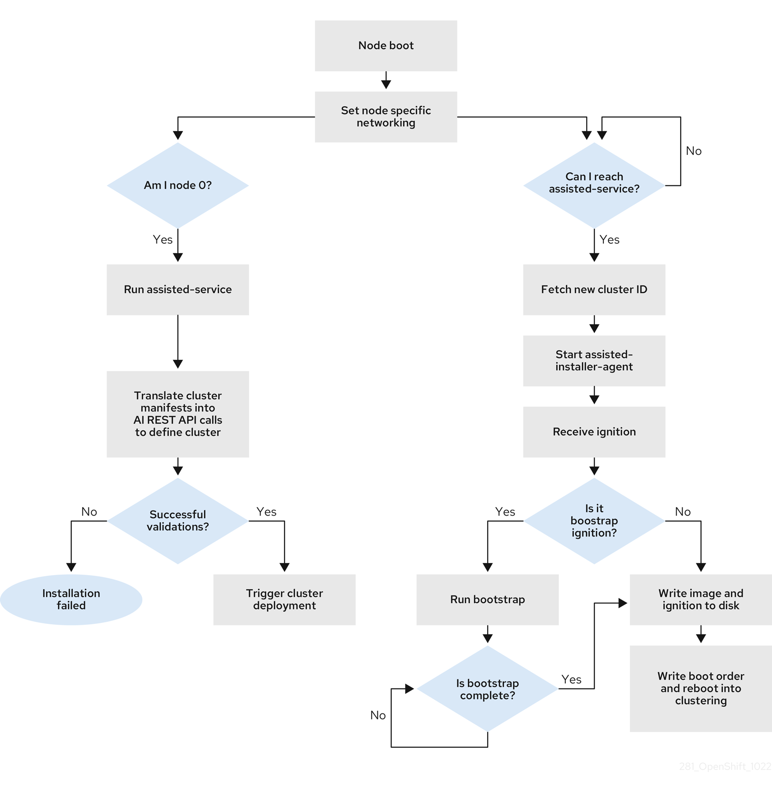
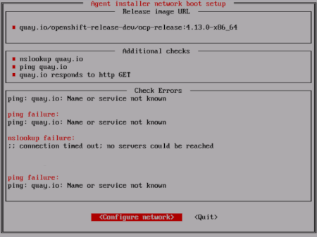
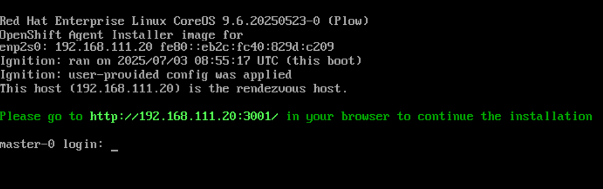

Cài đặt OpenShift
-----------------

# Cài đặt cụm tại chỗ (on-premise) bằng trình cài đặt dựa trên tác nhân (Agent-based Installer)
## I. Chuẩn bị cài đặt bằng trình cài đặt dựa trên tác nhân
Agent-based Installer (trình cài đặt dựa trên tác nhân) mang đến sự linh hoạt, cho phép bạn khởi động các máy chủ tại chỗ (on-premise) theo bất kỳ phương thức nào bạn chọn. Công cụ này kết hợp sự tiện lợi của dịch vụ Assisted Installation (cài đặt có hỗ trợ) với khả năng vận hành ngoại tuyến, bao gồm cả trong các môi trường bị cách ly hoàn toàn với mạng bên ngoài (air-gapped).

Agent-based Installer sử dụng một lệnh phụ (subcommand) của chương trình cài đặt OpenShift Container Platform. Nó tạo ra một tệp ảnh ISO có khả năng khởi động, chứa tất cả thông tin cần thiết để triển khai một cụm (cluster) OpenShift Container Platform, cùng với một tệp ảnh phát hành (release image) đi kèm.

Cấu hình được thiết lập theo cùng định dạng với các phương thức cài đặt trên hạ tầng do trình cài đặt cung cấp (installer-provisioned infrastructure) hoặc hạ tầng do người dùng cung cấp (user-provisioned infrastructure). Ngoài ra, Agent-based Installer còn có tùy chọn tạo hoặc chấp nhận các tài nguyên tùy chỉnh (custom resources) cho quy trình Zero Touch Provisioning (ZTP). ZTP cho phép bạn thiết lập các địa điểm biên (edge site) mới thông qua các cấu hình mang tính khai báo (declarative configurations) cho các thiết bị phần cứng vật lý (bare-metal).

> **Lưu ý:** Để triển khai các cụm với mặt phẳng điều khiển (control plane) được ảo hóa chạy trên các máy ảo (VM) của OpenShift Virtualization, bạn có thể sử dụng KubeVirt Redfish để hiển thị các máy ảo này dưới dạng các điểm cuối (endpoint) tương thích với Redfish. Để biết thêm thông tin về việc sử dụng các mặt phẳng điều khiển được ảo hóa, hãy xem phần "Sử dụng các mặt phẳng điều khiển được ảo hóa".

**Bảng 1.1. Các kiến trúc được hỗ trợ bởi trình cài đặt dựa trên tác nhân**

| Kiến trúc CPU | Cài đặt kết nối | Cài đặt không kết nối |
|---------------|-----------------|-----------------------|
| 64-bit x86    | ✓               | ✓                     |
| 64-bit ARM    | ✓               | ✓                     |
| ppc64le       | ✓               | ✓                     |
| s390x         | ✓               | ✓                     |

### I.1. Tìm hiểu về Trình cài đặt dựa trên tác nhân
Là người dùng OpenShift Container Platform, bạn có thể tận dụng các ưu điểm của dịch vụ Assisted Installer (Trình cài đặt hỗ trợ) trong các môi trường không kết nối mạng (disconnected environments).

Agent-based Installer sử dụng một tệp ISO có khả năng khởi động (bootable ISO), chứa tác nhân khám phá (Assisted discovery agent) và dịch vụ hỗ trợ (Assisted Service). Cả hai thành phần này đều cần thiết để thực hiện cài đặt cụm (cluster), trong đó Assisted Service chỉ chạy trên một trong các máy chủ (host).

> **Lưu ý:** Hiện tại, việc hỗ trợ khởi động từ tệp ISO trên nền tảng IBM Z® (`s390x`) chỉ khả dụng đối với Red Hat Enterprise Linux (RHEL) KVM; cấu hình này cho phép linh hoạt lựa chọn phương thức cài đặt qua PXE hoặc qua tệp ISO. Đối với các hệ thống sử dụng z/VM và Phân vùng logic (Logical Partition - LPAR), chỉ hỗ trợ phương thức khởi động qua PXE.

Lệnh phụ `openshift-install agent create image` sẽ tạo ra một tệp ISO tạm thời dựa trên các thông tin đầu vào mà bạn cung cấp. Bạn có thể cung cấp các thông tin này thông qua các tệp cấu hình (manifest) sau:

Các tệp cấu hình bắt buộc:

* install-config.yaml
* agent-config.yaml

Các tệp cấu hình tùy chọn (dành cho ZTP - Zero Touch Provisioning):

* cluster-manifests/cluster-deployment.yaml
* cluster-manifests/agent-cluster-install.yaml
* cluster-manifests/pull-secret.yaml
* cluster-manifests/infraenv.yaml
* cluster-manifests/cluster-image-set.yaml
* cluster-manifests/nmstateconfig.yaml
* mirror/registries.conf
* mirror/ca-bundle.crt

#### I.1.1. Quy trình cài đặt dựa trên tác nhân
Một trong các máy chủ thuộc mặt phẳng điều khiển (control plane) sẽ chạy dịch vụ Assisted Service ngay khi bắt đầu quá trình khởi động và sau đó trở thành máy chủ khởi động ban đầu (bootstrap host). Nút này được gọi là máy chủ tập hợp (rendezvous host hay nút 0).

Dịch vụ Assisted Service đảm bảo rằng tất cả các máy chủ đều đáp ứng các yêu cầu cần thiết, đồng thời kích hoạt quá trình triển khai cụm OpenShift Container Platform. Hình ảnh hệ điều hành Red Hat Enterprise Linux (RHEL) sẽ được ghi vào ổ đĩa của tất cả các nút. Các nút không phải là nút khởi động ban đầu sẽ thực hiện khởi động lại và bắt đầu quá trình triển khai cụm.

Sau khi các nút khác đã khởi động lại, máy chủ tập hợp (rendezvous host) cũng sẽ khởi động lại và tham gia vào cụm. Đến đây, quá trình khởi động ban đầu (bootstrapping) hoàn tất và cụm đã được triển khai thành công.

**Hình 1.1. Quy trình cài đặt các nút**  


Bạn có thể cài đặt một cụm OpenShift Container Platform trong môi trường không kết nối mạng (disconnected) thông qua lệnh phụ `openshift-install agent create image`, áp dụng cho các cấu trúc liên kết (topology) sau:

* **Cụm OpenShift Container Platform một nút (single-node)**: Một nút đóng vai trò vừa là mặt phẳng điều khiển (control plane) vừa là nút tính toán (compute node). 
* **Cụm OpenShift Container Platform ba nút (three-node)**: Một cụm tinh gọn gồm ba nút đóng vai trò vừa là mặt phẳng điều khiển vừa là nút tính toán. 
* **Cụm OpenShift Container Platform có tính sẵn sàng cao (HA)**: Gồm ba nút mặt phẳng điều khiển cùng với số lượng nút tính toán tùy ý. 
* **Cụm OpenShift Container Platform hai nút với nút trọng tài (Arbiter)**: Gồm hai nút mặt phẳng điều khiển và một nút trọng tài cục bộ (local arbiter node). Để biết thêm thông tin, hãy xem phần "Giới thiệu về nút trọng tài cục bộ".

#### I.1.2. Các tài nguyên được khuyến nghị cho các cấu trúc liên kết
Các tài nguyên cụm (cluster resources) sau đây được khuyến nghị cho từng cấu trúc liên kết:

**Bảng 1.2. Các tài nguyên cụm được khuyến nghị**

| Topology                                      | Số mặt phẳng điều khiển                         | Số nút tính toán | vCPU    | Bộ nhớ    | Lưu trữ |
|-----------------------------------------------|-------------------------------------------------|------------------|---------|-----------|---------|
| Cụm đơn nút                                   | 1                                               | 0                | 8 vCPUs | 16 GB RAM | 120 GB  |
| Cụm OpenShift hai nút với Arbiter             | 2 (nút mặt phẳng điều khiển), 1 (nút trọng tài) | 0                | 4 vCPUs | 16 GB RAM | 120 GB  |
| Cụm OpenShift hai nút có cơ chế cách ly (TNF) | 2                                               | 0                | 4 vCPUs | 16 GB RAM | 120 GB  |
| Cụm nhỏ gọn                                   | 3                                               | 0 hoặc 1         | 8 vCPUs | 16 GB RAM | 120 GB  |
| Cụm HA (High Availability)                    | 3 đến 5                                         | từ 2 trở lên     | 8 vCPUs | 16 GB RAM | 120 GB  |

> **Lưu ý:** Bạn có thể sử dụng tối thiểu 4 vCPU cho một cụm OpenShift đơn nút (single-node).  
> Tuy nhiên, việc chạy OpenShift đơn nút trên 4 vCPU sẽ để lại rất ít "khoảng trống" (headroom) cho các ứng dụng người dùng, đồng thời tạo ra nguy cơ cao về tranh chấp tài nguyên và suy giảm hiệu năng.  
> Để đảm bảo tính ổn định của cụm ở mức cấu hình này, bạn cần thực hiện các biện pháp nhằm giảm thiểu tổng lượng tài nguyên tiêu thụ, chẳng hạn như giới hạn số lượng khối lượng công việc (workload) đang chạy trên cụm hoặc hạn chế các tính năng của cụm. Để biết thêm thông tin, hãy xem phần "Các tính năng của cụm" (Cluster capabilities).  
> Ngoài ra, bạn nên cân nhắc cung cấp thêm tài nguyên tính toán cho cụm.

#### I.1.3. Các nền tảng được hỗ trợ
Trong tệp `install-config.yaml`, hãy chỉ định nền tảng mà bạn muốn thực hiện cài đặt. Các nền tảng sau đây được hỗ trợ:

* baremetal
* vsphere
* nutanix
* external
* none

Đối với cụm OpenShift Container Platform gồm hai nút có cơ chế cách ly (fencing - TNF), chỉ các nền tảng sau đây được hỗ trợ:

* baremetal
* external
* none

Các nền tảng `vsphere` và `nutanix` không được hỗ trợ cho các cụm gồm hai nút có cơ chế cách ly.

> **Quan trọng:** Đối với tùy chọn nền tảng "none" (không xác định):
> 
> * Tùy chọn "none" yêu cầu bạn phải tự cung cấp cơ sở hạ tầng phân giải tên DNS và cân bằng tải trong cụm (cluster) của mình. Để biết thêm thông tin, hãy xem phần "Các yêu cầu đối với cụm sử dụng tùy chọn nền tảng 'none'" trong mục "Tài nguyên bổ sung". 
> * Trước khi cố gắng cài đặt cụm OpenShift Container Platform trong môi trường ảo hóa hoặc môi trường đám mây, hãy tham khảo tài liệu "Triển khai OpenShift 4.x trên các nền tảng chưa được kiểm thử bằng phương pháp cài đặt trên phần cứng vật lý (bare metal)".
> 
> Đối với nền tảng "vsphere", hoặc nền tảng "baremetal" chạy trên vSphere:
> 
> * Bạn phải thiết lập tham số `disk.EnableUUID` thành `TRUE` trên tất cả các nút (node) của OpenShift Container Platform. Nếu tham số này không được kích hoạt, quá trình kiểm tra xác thực của trình cài đặt dựa trên tác nhân sẽ thất bại.

### I.2. Về tuân thủ FIPS
Đối với nhiều khách hàng sử dụng OpenShift Container Platform, việc đáp ứng các quy định—hay còn gọi là tuân thủ—là yêu cầu bắt buộc ở một mức độ nhất định trước khi đưa bất kỳ hệ thống nào vào môi trường vận hành thực tế (production). Các yêu cầu tuân thủ này có thể xuất phát từ các tiêu chuẩn quốc gia, tiêu chuẩn ngành hoặc khung quản trị doanh nghiệp của chính tổ chức đó.

Tuân thủ các Tiêu chuẩn Xử lý Thông tin Liên bang (Federal Information Processing Standards - FIPS) là một trong những yếu tố quan trọng nhất trong các môi trường có yêu cầu bảo mật cao, nhằm đảm bảo rằng chỉ những công nghệ mật mã được hỗ trợ mới được phép sử dụng trên các nút (node).

> **Lưu ý quan trọng:** Để kích hoạt chế độ FIPS cho cụm (cluster) của mình, bạn phải chạy chương trình cài đặt từ một máy tính sử dụng hệ điều hành Red Hat Enterprise Linux (RHEL) đã được cấu hình để vận hành ở chế độ FIPS. Để biết thêm thông tin về cách cấu hình chế độ FIPS trên RHEL, hãy xem phần Chuyển đổi RHEL sang chế độ FIPS.  
> Khi chạy trên Red Hat Enterprise Linux (RHEL) hoặc Red Hat Enterprise Linux CoreOS (RHCOS) ở chế độ FIPS, các thành phần cốt lõi của OpenShift Container Platform sẽ sử dụng các thư viện mật mã của RHEL—những thư viện đã được gửi tới NIST để thực hiện quy trình xác thực FIPS 140-2/140-3—trên các kiến trúc hệ thống x86_64, ppc64le và s390x.

### I.3. Cấu hình FIPS thông qua trình cài đặt dựa trên tác nhân
Trong quá trình triển khai cụm (cluster), thay đổi liên quan đến Tiêu chuẩn Xử lý Thông tin Liên bang (FIPS) sẽ được áp dụng khi các máy chạy hệ điều hành Red Hat Enterprise Linux CoreOS (RHCOS) được triển khai trong cụm của bạn.

Đối với các máy chạy hệ điều hành Red Hat Enterprise Linux (RHEL), bạn phải bật chế độ FIPS khi cài đặt hệ điều hành trên những máy mà bạn dự định sử dụng làm máy worker (worker machine).

> **Quan trọng:** OpenShift Container Platform yêu cầu sử dụng tệp nhị phân cài đặt có hỗ trợ FIPS để triển khai cụm ở chế độ FIPS.

Bạn có thể bật chế độ FIPS thông qua phương thức được khuyến nghị là sử dụng các tệp `install-config.yaml` và `agent-config.yaml`:

Bạn phải đặt giá trị của trường `fips` thành `true` trong tệp `install-config.yaml`:

Ví dụ về tệp `install-config.yaml`

```yaml
apiVersion: v1
baseDomain: test.example.com
metadata:
  name: sno-cluster
fips: true
```

> **Quan trọng:** Để bật chế độ FIPS trên các cụm IBM Z®, bạn cũng phải bật FIPS trong tệp `.parm` hoặc thông qua lệnh `virt-install`, theo các quy trình hướng dẫn cách thêm thủ công các tác nhân (agent) IBM Z®.

Nếu bạn đang sử dụng các tệp cấu hình (manifest) GitOps ZTP tùy chọn, bạn phải đặt giá trị fips thành true trong trường agent-install.openshift.io/install-config-overrides thuộc tệp a`gent-cluster-install.yaml`:

Ví dụ về tệp `agent-cluster-install.yaml`

```yaml
apiVersion: extensions.hive.openshift.io/v1beta1
kind: AgentClusterInstall
metadata:
  annotations:
    agent-install.openshift.io/install-config-overrides: '{"fips":true}'
  name: sno-cluster
  namespace: sno-cluster-test
```

### I.4. Cấu hình máy chủ (host)
Bạn có thể thực hiện các cấu hình bổ sung cho từng máy chủ trong cụm thông qua tệp `agent-config.yaml`, chẳng hạn như các cấu hình mạng và thông tin gợi ý về thiết bị gốc (root device hints).

> **Quan trọng:** Đối với mỗi máy chủ cần cấu hình, bạn phải xác định rõ máy chủ đó bằng cách cung cấp địa chỉ MAC của một giao diện mạng trên máy chủ đó.

#### I.4.1. Vai trò của các host
Mỗi host trong cụm được chỉ định một vai trò là master (chủ) hoặc worker (nút làm việc). Bạn có thể xác định vai trò cho từng host trong tệp `agent-config.yaml` bằng cách sử dụng tham số `role`. Nếu bạn không chỉ định vai trò cho các host, các vai trò sẽ được gán ngẫu nhiên trong quá trình cài đặt.

Bạn nên xác định rõ ràng vai trò cho các host của mình.

`rendezvousIP` phải được gán cho một host có vai trò là master. Việc này có thể được thực hiện theo cách thủ công hoặc để trình cài đặt tự động gán vai trò.

> **Quan trọng:** Bạn không bắt buộc phải xác định rõ ràng vai trò master cho host đóng vai trò `rendezvous`, tuy nhiên, bạn không được tạo các cấu hình gây xung đột với việc gán vai trò này.

Ví dụ: Nếu bạn có 4 host, trong đó 3 host được xác định rõ ràng là master, thì host còn lại (được tự động gán vai trò worker trong quá trình cài đặt) sẽ không thể được cấu hình làm host `rendezvous`.

Tệp `agent-config.yaml` mẫu

```yaml
apiVersion: v1beta1
kind: AgentConfig
metadata:
  name: example-cluster
rendezvousIP: 192.168.111.80
hosts:
  - hostname: master-1
    role: master
    interfaces:
      - name: eno1
        macAddress: 00:ef:44:21:e6:a5
  - hostname: master-2
    role: master
    interfaces:
      - name: eno1
        macAddress: 00:ef:44:21:e6:a6
  - hostname: master-3
    role: master
    interfaces:
      - name: eno1
        macAddress: 00:ef:44:21:e6:a7
  - hostname: worker-1
    role: worker
    interfaces:
      - name: eno1
        macAddress: 00:ef:44:21:e6:a8
```

#### I.4.2. Về các gợi ý thiết bị gốc (root device hints)
Tham số `rootDeviceHints` cho phép chương trình cài đặt triển khai ảnh hệ thống Red Hat Enterprise Linux CoreOS (RHCOS) vào một thiết bị cụ thể.

Chương trình cài đặt sẽ kiểm tra các thiết bị theo thứ tự phát hiện được, sau đó so sánh các giá trị thu thập từ thiết bị với các giá trị gợi ý (hint values). Chương trình sẽ chọn thiết bị đầu tiên khớp với giá trị gợi ý đó. Cấu hình có thể kết hợp nhiều gợi ý cùng lúc, nhưng một thiết bị phải thỏa mãn tất cả các gợi ý này thì chương trình cài đặt mới chọn nó.

**Bảng 1.3. Các trường con**

| Trường con       | Mô tả                                                                                                                                                                                                                                                                         |
|------------------|-------------------------------------------------------------------------------------------------------------------------------------------------------------------------------------------------------------------------------------------------------------------------------|
| deviceName       | Một chuỗi chứa tên thiết bị Linux, chẳng hạn như `/dev/vda` hoặc `/dev/disk/by-path/`. Bạn nên sử dụng liên kết `/dev/disk/by-path/<device_path>` để trỏ đến vị trí lưu trữ. Giá trị gợi ý phải khớp chính xác với giá trị thực tế.                                           |
| hctl             | Một chuỗi chứa địa chỉ bus SCSI, chẳng hạn như `0:0:0:0`. Thông tin gợi ý này phải khớp chính xác với giá trị thực tế.                                                                                                                                                        |
| model            | Một chuỗi chứa định danh thiết bị dành riêng cho nhà cung cấp. Gợi ý này có thể là một chuỗi con của giá trị thực tế.                                                                                                                                                         |
| vendor           | Một chuỗi chứa tên nhà cung cấp hoặc nhà sản xuất thiết bị. Gợi ý này có thể là một chuỗi con của giá trị thực tế.                                                                                                                                                            |
| serialNumber     | Một chuỗi chứa số sê-ri của thiết bị. Gợi ý phải khớp chính xác với giá trị thực tế.                                                                                                                                                                                          |
| minSizeGigabytes | Một số nguyên biểu thị dung lượng tối thiểu của thiết bị, tính bằng gigabyte.                                                                                                                                                                                                 |
| wwn              | Một chuỗi chứa định danh lưu trữ duy nhất. Giá trị gợi ý phải khớp chính xác với giá trị thực tế. Nếu bạn sử dụng lệnh `udevadm` để truy xuất giá trị WWN và lệnh này trả về giá trị cho `ID_WWN_WITH_EXTENSION`, thì bạn phải sử dụng giá trị đó để chỉ định trường con WWN. |
| rotational       | Một giá trị kiểu boolean cho biết thiết bị có nên là đĩa quay (true) hay không (false).                                                                                                                                                                                       |

**Ví dụ sử dụng**

```yaml
     - name: master-0
       role: master
       rootDeviceHints:
         deviceName: "/dev/sda"
```

### I.5. Về mạng
Địa chỉ IP rendezvous (điểm tập kết) phải được xác định tại thời điểm tạo tệp ISO cho tác nhân (agent ISO), để trong quá trình khởi động ban đầu, tất cả các máy chủ (host) có thể kết nối với dịch vụ hỗ trợ (assisted service).

Nếu các địa chỉ IP được cấp phát thông qua máy chủ Giao thức Cấu hình Máy chủ Động (DHCP), thì trường `rendezvousIP` phải được đặt thành địa chỉ IP của một trong các máy chủ sẽ trở thành một phần của mặt phẳng điều khiển (control plane) được triển khai. Trong môi trường không có máy chủ DHCP, bạn có thể thiết lập địa chỉ IP theo cách tĩnh (static).

Ngoài các địa chỉ IP tĩnh, bạn có thể áp dụng bất kỳ cấu hình mạng nào ở định dạng NMState. Điều này bao gồm các VLAN và các kết nối gộp giao diện mạng (NIC bonds).

> **Lưu ý:** Theo mặc định, Podman sử dụng dải mạng con (subnet) 10.88.0.0/16 làm mạng cầu nối (bridge network). Không được đặt tham số `network.machineNetwork.cidr` bao gồm dải địa chỉ này; nếu không, xung đột sẽ xảy ra và khiến quá trình cài đặt cụm (cluster) bị thất bại.

#### I.5.1. Các yêu cầu về cổng (port) đối với máy chủ điều phối (rendezvous host)
Trong các giai đoạn khám phá (discovery) và khởi động (bootstrap) của quá trình cài đặt, tất cả các máy chủ đều kết nối với Dịch vụ Hỗ trợ (Assisted Service) đang chạy trên máy chủ điều phối. Hãy cấu hình tường lửa của bạn để cho phép lưu lượng truy cập sau đây từ mỗi máy chủ đến máy chủ điều phối:

**Bảng 1.4. Các cổng cần thiết để kết nối với Dịch vụ Hỗ trợ (Assisted Service) trên máy chủ điều phối**

| Cổng | Giao thức | Mô tả                                                                                                                                                                  |
|------|-----------|------------------------------------------------------------------------------------------------------------------------------------------------------------------------|
| 8090 | TCP       | API Dịch vụ Hỗ trợ (Assisted Service API). Các máy chủ sử dụng cổng này để đăng ký với Dịch vụ Hỗ trợ, báo cáo thông tin phần cứng và truy xuất các hướng dẫn cài đặt. |

> **Lưu ý:** Cổng 8090 chỉ cần thiết trong quá trình cài đặt. Sau khi quá trình cài đặt hoàn tất, dịch vụ hỗ trợ (Assisted Service) sẽ không còn hiển thị trên máy chủ điều phối (rendezvous host).

Yêu cầu về cổng cụ thể này nằm ngoài các yêu cầu mạng tiêu chuẩn của OpenShift Container Platform dành cho việc cài đặt.

#### I.5.2. DHCP
Khi sử dụng Giao thức Cấu hình Host Động (DHCP), bạn phải chỉ định giá trị cho trường `rendezvousIP` trong tệp `agent-config.yaml`, còn các trường `networkConfig` có thể để trống:

Ví dụ về tệp `agent-config.yaml`

```yaml
apiVersion: v1alpha1
kind: AgentConfig
metadata:
  name: sno-cluster
rendezvousIP: 192.168.111.80
```

Trong đó: `rendezvousIP` chỉ định địa chỉ IP cho máy chủ rendezvous (rendezvous host).

#### I.5.3. Cấu hình mạng tĩnh
Khi sử dụng cấu hình mạng tĩnh với các tệp `install-config.yaml` và `agent-config.yaml` theo quy định, bạn có thể chỉ định giá trị cho trường `rendezvousIP` trong tệp `agent-config.yaml`, hoặc để chương trình cài đặt tự chọn một địa chỉ IP tĩnh từ các trường `networkConfig`.

**Tệp `agent-config.yaml` mẫu**

```yaml
apiVersion: v1alpha1
kind: AgentConfig
metadata:
  name: sno-cluster
rendezvousIP: 192.168.111.80
hosts:
  - hostname: master-0
    interfaces:
      - name: eno1
        macAddress: 00:ef:44:21:e6:a5
    networkConfig:
      interfaces:
        - name: eno1
          type: ethernet
          state: up
          mac-address: 00:ef:44:21:e6:a5
          ipv4:
            enabled: true
            address:
              - ip: 192.168.111.80
                prefix-length: 23
            dhcp: false
      dns-resolver:
        config:
          server:
            - 192.168.111.1
      routes:
        config:
          - destination: 0.0.0.0/0
            next-hop-address: 192.168.111.1
            next-hop-interface: eno1
            table-id: 254
```

Trong đó:

* `rendezvousIP`: Xác định địa chỉ IP cho máy chủ rendezvous (máy chủ điều phối). Nếu trường rendezvousIP không được chỉ định giá trị, một địa chỉ sẽ được chọn từ các địa chỉ IP tĩnh đã khai báo trong các trường networkConfig.
* `hosts.interfaces.macAddress`: Xác định địa chỉ MAC của một giao diện (interface) trên máy chủ; thông tin này được dùng để xác định máy chủ nào sẽ được áp dụng cấu hình.
* `ipv4.address.ip`: Xác định địa chỉ IP tĩnh của máy chủ vật lý (bare-metal host) mục tiêu.
* `ipv4.address.prefix-length`: Xác định độ dài tiền tố mạng (subnet prefix) cho địa chỉ IP tĩnh của máy chủ vật lý mục tiêu.
* `dns-resolver.config.server`: Xác định máy chủ DNS cho máy chủ vật lý mục tiêu.
* `routes.config.next-hop-address`: Xác định địa chỉ "next-hop" (chặng kế tiếp) cho lưu lượng truy cập của nút (node). Địa chỉ này phải nằm cùng mạng con (subnet) với địa chỉ IP đã thiết lập cho giao diện tương ứng.

Khi sử dụng cấu hình mạng tĩnh (static networking) với phương thức tùy chọn thông qua các tài nguyên tùy chỉnh (custom resources) của GitOps ZTP — bao gồm 6 tài nguyên tùy chỉnh — bạn có thể thiết lập các địa chỉ IP tĩnh trong tệp `nmstateconfig.yaml`. Địa chỉ IP rendezvous (điểm tập kết) sẽ được chọn từ các địa chỉ IP tĩnh đã được chỉ định trong các trường cấu hình.

Tệp `nmstateconfig.yaml` mẫu

```yaml
apiVersion: agent-install.openshift.io/v1beta1
kind: NMStateConfig
metadata:
  name: master-0
  namespace: openshift-machine-api
  labels:
    cluster0-nmstate-label-name: cluster0-nmstate-label-value
spec:
  config:
    interfaces:
      - name: eth0
        type: ethernet
        state: up
        mac-address: 52:54:01:aa:aa:a1
        ipv4:
          enabled: true
          address:
            - ip: 192.168.122.2
              prefix-length: 23
          dhcp: false
    dns-resolver:
      config:
        server:
          - 192.168.122.1
    routes:
      config:
        - destination: 0.0.0.0/0
          next-hop-address: 192.168.122.1
          next-hop-interface: eth0
          table-id: 254
  interfaces:
    - name: eth0
      macAddress: 52:54:01:aa:aa:a1
```

Trong đó:

* `ipv4.address.ip`: Chỉ định địa chỉ IP tĩnh của máy chủ vật lý (bare-metal host) mục tiêu.
* `ipv4.address.prefix-length`: Chỉ định độ dài tiền tố mạng con (subnet prefix) cho địa chỉ IP tĩnh của máy chủ vật lý mục tiêu.
* `dns-resolver.config.server`: Chỉ định máy chủ DNS cho máy chủ vật lý mục tiêu.
* `routes.config.next-hop-address`: Chỉ định địa chỉ chặng kế tiếp (next-hop address) cho lưu lượng truy cập của nút (node). Địa chỉ này phải nằm trong cùng mạng con với địa chỉ IP được thiết lập cho giao diện (interface) tương ứng.
* `spec.interfaces.macAddress`: Chỉ định địa chỉ MAC của một giao diện trên máy chủ, được sử dụng để xác định máy chủ nào sẽ được áp dụng cấu hình.

### I.6. Các yêu cầu đối với cụm sử dụng tùy chọn nền tảng "none"
Có những yêu cầu bổ sung khi cài đặt một cụm sử dụng tùy chọn nền tảng "none" (không xác định) với trình cài đặt dựa trên tác nhân.

> **Quan trọng:** Hãy tham khảo mục "Triển khai OpenShift 4.x trên các nền tảng chưa được kiểm thử bằng phương pháp cài đặt trên phần cứng vật lý (bare metal)" trước khi bạn thực hiện cài đặt cụm OpenShift Container Platform trong các môi trường ảo hóa hoặc môi trường đám mây.

#### I.6.1. Các yêu cầu về DNS cho nền tảng "none"
Trong các triển khai OpenShift Container Platform, việc phân giải tên DNS là cần thiết đối với một số thành phần.

Các thành phần sau đây yêu cầu phân giải tên DNS:

* Kubernetes API
* Wildcard (tên miền đại diện) cho ứng dụng trên OpenShift Container Platform
* Các máy thuộc mặt phẳng điều khiển (control plane) và các máy tính toán (compute machines)

Phân giải DNS ngược (reverse DNS resolution) cũng là yêu cầu bắt buộc đối với Kubernetes API, các máy thuộc mặt phẳng điều khiển và các máy tính toán.

Các bản ghi DNS loại A/AAAA hoặc CNAME được sử dụng để phân giải tên, trong khi các bản ghi PTR được sử dụng cho phân giải tên ngược. Các bản ghi ngược đóng vai trò quan trọng vì Red Hat Enterprise Linux CoreOS (RHCOS) sử dụng chúng để thiết lập tên máy chủ (hostname) cho tất cả các nút (node), trừ khi các tên máy chủ này đã được cung cấp thông qua DHCP. Ngoài ra, các bản ghi ngược còn được dùng để tạo các yêu cầu ký chứng chỉ (Certificate Signing Request - CSR) mà OpenShift Container Platform cần để vận hành.
Lưu ý

Bạn nên sử dụng máy chủ DHCP để cung cấp tên máy chủ cho từng nút trong cụm (cluster node).

Các bản ghi DNS dưới đây là bắt buộc đối với một cụm OpenShift Container Platform sử dụng tùy chọn nền tảng "none" (platform none) và phải được thiết lập trước khi tiến hành cài đặt. Trong mỗi bản ghi, `<cluster_name>` là tên cụm và `<base_domain>` là tên miền cơ sở mà bạn chỉ định trong tệp `install-config.yaml`. Một bản ghi DNS hoàn chỉnh sẽ có dạng: `<component>.<cluster_name>.<base_domain>.`

**Bảng 1.5. Các bản ghi DNS bắt buộc**

| Thành phần            | Bản ghi                                   | Mô tả                                                                                                                                                                                                                                                                                                                                                                                                                                                                                                                                                                                                                                              |
|-----------------------|-------------------------------------------|----------------------------------------------------------------------------------------------------------------------------------------------------------------------------------------------------------------------------------------------------------------------------------------------------------------------------------------------------------------------------------------------------------------------------------------------------------------------------------------------------------------------------------------------------------------------------------------------------------------------------------------------------|
| Kubernetes API        | api.<cluster_name>.<base_domain>.         | Một bản ghi DNS A/AAAA hoặc CNAME, cùng với một bản ghi DNS PTR, để xác định bộ cân bằng tải API. Các bản ghi này phải có khả năng được phân giải bởi cả các máy khách bên ngoài cụm và tất cả các nút bên trong cụm đó.                                                                                                                                                                                                                                                                                                                                                                                                                           |
|                       | api-int.<cluster_name>.<base_domain>.     | Cần có bản ghi DNS A/AAAA hoặc CNAME, cùng với bản ghi DNS PTR, để xác định bộ cân bằng tải (load balancer) API trong nội bộ hệ thống. Các bản ghi này phải có thể được phân giải từ tất cả các nút (node) bên trong cụm (cluster). **Quan trọng**: Máy chủ API (API server) phải có khả năng phân giải các nút worker thông qua tên máy chủ (hostname) đã được ghi lại trong Kubernetes. Nếu máy chủ API không thể phân giải tên các nút, các lệnh gọi API thông qua proxy có thể bị lỗi và bạn sẽ không thể truy xuất nhật ký (log) từ các pod.                                                                                                  |
| Routes                | *.apps.<cluster_name>.<base_domain>.      | Một bản ghi DNS wildcard (dạng A/AAAA hoặc CNAME) trỏ đến bộ cân bằng tải ingress (ingress load balancer) của ứng dụng. Bộ cân bằng tải ingress này hướng lưu lượng truy cập đến các máy chủ đang chạy các pod Ingress Controller. Theo mặc định, các pod Ingress Controller này hoạt động trên các máy chủ tính toán (compute machines). Các bản ghi này phải có thể được phân giải bởi cả các client bên ngoài cụm lẫn tất cả các node nằm bên trong cụm. Ví dụ: `console-openshift-console.apps.<cluster_name>.<base_domain>` được sử dụng làm tuyến đường (route) wildcard dẫn đến bảng điều khiển (console) của OpenShift Container Platform. |
| CMặt phẳng điều khiển | <master><n>.<cluster_name>.<base_domain>. | Các bản ghi DNS A/AAAA hoặc CNAME cùng các bản ghi DNS PTR được sử dụng để định danh từng máy trong số các nút thuộc mặt phẳng điều khiển (control plane nodes). Các bản ghi này phải có khả năng được phân giải bởi các nút nằm trong cụm (cluster).                                                                                                                                                                                                                                                                                                                                                                                              |
| Các nút tính toán     | <worker><n>.<cluster_name>.<base_domain>. | Các bản ghi DNS A/AAAA hoặc CNAME cùng các bản ghi DNS PTR được sử dụng để định danh từng máy trong số các nút worker (worker nodes). Các bản ghi này phải có khả năng được phân giải bởi các nút nằm trong cụm (cluster).                                                                                                                                                                                                                                                                                                                                                                                                                         |

> **Lưu ý:** Trong OpenShift Container Platform 4.4 trở về sau, bạn không cần chỉ định các bản ghi SRV và máy chủ etcd trong cấu hình DNS của mình.

##### I.6.1.1. Ví dụ về cấu hình DNS cho các cụm sử dụng nền tảng "none"
Phần này cung cấp các mẫu cấu hình bản ghi A và PTR đáp ứng các yêu cầu DNS để triển khai OpenShift Container Platform với tùy chọn nền tảng là "none". Các ví dụ này không nhằm mục đích đưa ra lời khuyên về việc lựa chọn giải pháp DNS này hay giải pháp DNS khác.

Trong các ví dụ, tên cụm là `ocp4` và tên miền cơ sở là `example.com`.

Ví dụ về cấu hình bản ghi DNS A cho cụm sử dụng nền tảng "none"
Ví dụ dưới đây là tệp vùng (zone file) BIND, hiển thị các bản ghi A mẫu phục vụ việc phân giải tên trong một cụm sử dụng tùy chọn nền tảng "none".

Mẫu cơ sở dữ liệu vùng DNS

> **Lưu ý:** Từ phiên bản OpenShift Container Platform 4.4 trở đi, bạn không cần phải chỉ định các bản ghi máy chủ (host) etcd và bản ghi SRV trong cấu hình DNS của mình.

```
$TTL 1W
@   IN  SOA ns1.example.com.    root (
            2019070700  ; serial
            3H      ; refresh (3 hours)
            30M     ; retry (30 minutes)
            2W      ; expiry (2 weeks)
            1W )        ; minimum (1 week)
    IN  NS  ns1.example.com.
    IN  MX 10   smtp.example.com.
;
;
ns1.example.com.        IN  A   192.168.1.5
smtp.example.com.       IN  A   192.168.1.5
;
helper.example.com.     IN  A   192.168.1.5
helper.ocp4.example.com.    IN  A   192.168.1.5
;
api.ocp4.example.com.       IN  A   192.168.1.5
api-int.ocp4.example.com.   IN  A   192.168.1.5
;
*.apps.ocp4.example.com.    IN  A   192.168.1.5
;
master0.ocp4.example.com.   IN  A   192.168.1.97
master1.ocp4.example.com.   IN  A   192.168.1.98
master2.ocp4.example.com.   IN  A   192.168.1.99
;
worker0.ocp4.example.com.   IN  A   192.168.1.11
worker1.ocp4.example.com.   IN  A   192.168.1.7
;
```

Trong đó:

* `api.ocp4.example.com.`: Cung cấp khả năng phân giải tên cho Kubernetes API. Bản ghi này trỏ đến địa chỉ IP của bộ cân bằng tải (load balancer) dành cho API.
* `api-int.ocp4.example.com.`: Cung cấp khả năng phân giải tên cho Kubernetes API. Bản ghi này trỏ đến địa chỉ IP của bộ cân bằng tải dành cho API và được sử dụng cho các hoạt động giao tiếp nội bộ trong cụm (cluster).
* `*.apps.ocp4.example.com.`: Cung cấp khả năng phân giải tên cho các tuyến đường (route) dạng ký tự đại diện (wildcard). Bản ghi này trỏ đến địa chỉ IP của bộ cân bằng tải dành cho ứng dụng (application ingress load balancer). Bộ cân bằng tải này hướng lưu lượng truy cập đến các máy chủ đang chạy các pod Ingress Controller. Theo mặc định, các pod Ingress Controller sẽ chạy trên các máy chủ tính toán (compute machine). 

> **Lưu ý:** Trong ví dụ này, cùng một bộ cân bằng tải được sử dụng cho cả Kubernetes API và lưu lượng truy cập ứng dụng (application ingress). Trong các môi trường thực tế (production), bạn có thể triển khai riêng biệt bộ cân bằng tải cho API và bộ cân bằng tải cho ứng dụng, nhờ đó có thể mở rộng hạ tầng cân bằng tải cho từng thành phần một cách độc lập.

* `master0.ocp4.example.com.` – `master2.ocp4.example.com.`: Cung cấp khả năng phân giải tên cho các máy chủ thuộc mặt phẳng điều khiển (control plane).
* `worker0.ocp4.example.com.` – `worker1.ocp4.example.com.`: Cung cấp khả năng phân giải tên cho các máy chủ tính toán (compute machine).

**Ví dụ về cấu hình bản ghi DNS PTR cho cụm sử dụng tùy chọn nền tảng "none"**

Tệp vùng (zone file) BIND dưới đây trình bày các bản ghi PTR mẫu phục vụ cho việc phân giải tên ngược trong một cụm sử dụng tùy chọn nền tảng "none".

**Cơ sở dữ liệu vùng DNS mẫu cho các bản ghi phân giải ngược**

```
$TTL 1W
@   IN  SOA ns1.example.com.    root (
            2019070700  ; serial
            3H      ; refresh (3 hours)
            30M     ; retry (30 minutes)
            2W      ; expiry (2 weeks)
            1W )        ; minimum (1 week)
    IN  NS  ns1.example.com.
;
5.1.168.192.in-addr.arpa.   IN  PTR api.ocp4.example.com.
5.1.168.192.in-addr.arpa.   IN  PTR api-int.ocp4.example.com.
;
97.1.168.192.in-addr.arpa.  IN  PTR master0.ocp4.example.com.
98.1.168.192.in-addr.arpa.  IN  PTR master1.ocp4.example.com.
99.1.168.192.in-addr.arpa.  IN  PTR master2.ocp4.example.com.
;
11.1.168.192.in-addr.arpa.  IN  PTR worker0.ocp4.example.com.
7.1.168.192.in-addr.arpa.   IN  PTR worker1.ocp4.example.com.
;
```

Trong đó:

* `api.ocp4.example.com.`: Cung cấp khả năng phân giải DNS ngược (reverse DNS resolution) cho Kubernetes API. Bản ghi PTR trỏ đến tên bản ghi của bộ cân bằng tải (load balancer) API.
* `api-int.ocp4.example.com.`: Cung cấp khả năng phân giải DNS ngược cho Kubernetes API. Bản ghi PTR trỏ đến tên bản ghi của bộ cân bằng tải API và được sử dụng cho các hoạt động giao tiếp nội bộ trong cụm (cluster).
`master0.ocp4.example.com.` – `master2.ocp4.example.com.`: Cung cấp khả năng phân giải DNS ngược cho các máy thuộc mặt phẳng điều khiển (control plane).
`worker0.ocp4.example.com.` – `worker1.ocp4.example.com.`: Cung cấp khả năng phân giải DNS ngược cho các máy tính toán (compute machines).

> **Lưu ý:** Không bắt buộc phải có bản ghi PTR cho tên miền đại diện (wildcard) của ứng dụng trên OpenShift Container Platform.

#### I.6.2. Các yêu cầu về cân bằng tải cho nền tảng "none"
Trước khi cài đặt OpenShift Container Platform, bạn phải cung cấp cơ sở hạ tầng cân bằng tải cho API và Ingress ứng dụng. Trong các môi trường thực tế (production), bạn có thể triển khai riêng biệt các bộ cân bằng tải cho API và Ingress ứng dụng, nhờ đó có thể mở rộng cơ sở hạ tầng cân bằng tải cho từng thành phần một cách độc lập.

> **Lưu ý:** Các yêu cầu này không áp dụng cho các cụm OpenShift đơn nút (single-node) sử dụng tùy chọn nền tảng "none". 
Nếu bạn muốn triển khai các bộ cân bằng tải cho API và Ingress ứng dụng trên một instance Red Hat Enterprise Linux (RHEL), bạn phải mua riêng gói đăng ký (subscription) cho RHEL.

Cơ sở hạ tầng cân bằng tải phải đáp ứng các yêu cầu sau:

###### 1 - Bộ cân bằng tải API
Cung cấp một điểm cuối chung để người dùng (bao gồm cả con người và máy móc) tương tác với nền tảng và định cấu hình nền tảng đó. Hãy định cấu hình các điều kiện sau:

* Chỉ sử dụng cân bằng tải Lớp 4 (Layer 4). Chế độ này còn được gọi là Raw TCP, SSL Passthrough hoặc SSL Bridge. Nếu sử dụng chế độ SSL Bridge, bạn phải bật tính năng Chỉ báo Tên Máy chủ (Server Name Indication - SNI) cho các tuyến API (API routes). 
* Sử dụng thuật toán cân bằng tải không lưu trạng thái (stateless). Các tùy chọn có thể khác nhau tùy thuộc vào cơ chế triển khai bộ cân bằng tải.

> **Quan trọng:** Không định cấu hình tính năng duy trì phiên (session persistence) cho bộ cân bằng tải API.

Định cấu hình các cổng sau ở cả phía trước (front-end) và phía sau (back-end) của các bộ cân bằng tải:
**Bảng 1.6. Bộ cân bằng tải API**

| Cổng  | Các máy chủ phía sau                                                                                                                       | Nội bộ | Bên ngoài | Mô tả                  |
|-------|--------------------------------------------------------------------------------------------------------------------------------------------|--------|-----------|------------------------|
| 6443  | Mặt phẳng điều khiển. Bạn phải cấu hình endpoint /readyz để phục vụ cho quá trình kiểm tra tình trạng (health check probe) của API server. | X      | X         | Máy chủ API Kubernetes |
| 22623 | Mặt phẳng điều khiển                                                                                                                       | X      |           | Máy chủ cấu hình máy   |


> **Quan trọng:** Trình cài đặt dựa trên tác nhân yêu cầu mở cổng TCP 8090 giữa tất cả các máy chủ (host) và máy chủ điều phối (rendezvous host) để các máy chủ này có thể truy cập vào API của Dịch vụ Hỗ trợ (Assisted Service API). Cổng 8090 chỉ cần thiết trong các giai đoạn khám phá (discovery) và khởi động hệ thống (bootstrap). Để biết thêm thông tin, hãy xem phần "Các yêu cầu về cổng cho máy chủ điều phối".

> **Lưu ý:** Bộ cân bằng tải (load balancer) phải được cấu hình sao cho khoảng thời gian từ lúc máy chủ API tắt điểm cuối (endpoint) `/readyz` cho đến khi thực thể máy chủ API đó bị loại bỏ khỏi nhóm (pool) không được vượt quá 30 giây. Trong khoảng thời gian sau khi `/readyz` trả về lỗi hoặc chuyển sang trạng thái khỏe mạnh (healthy), điểm cuối đó phải được loại bỏ hoặc thêm vào tương ứng. Việc thực hiện kiểm tra (probe) mỗi 5 hoặc 10 giây, với quy định cần 2 phản hồi thành công liên tiếp để xác định trạng thái khỏe mạnh và 3 phản hồi không thành công liên tiếp để xác định trạng thái không khỏe mạnh, là các thông số đã được kiểm chứng hiệu quả.

###### 2 - Bộ cân bằng tải Ingress cho ứng dụng
Cung cấp điểm truy cập cho lưu lượng ứng dụng đi từ bên ngoài cụm vào. Cụm OpenShift Container Platform bắt buộc phải có cấu hình hoạt động cho bộ định tuyến Ingress (Ingress router).

Hãy cấu hình các điều kiện sau:

* Chỉ sử dụng cân bằng tải lớp 4 (Layer 4 load balancing). Cấu hình này có thể được gọi là chế độ Raw TCP, SSL Passthrough hoặc SSL Bridge. Nếu sử dụng chế độ SSL Bridge, bạn phải bật tính năng Server Name Indication (SNI) cho các tuyến đường (route) Ingress. 
* Khuyến nghị sử dụng cơ chế duy trì phiên (session persistence) dựa trên kết nối hoặc dựa trên phiên, tùy thuộc vào các tùy chọn khả dụng và loại ứng dụng sẽ được lưu trữ trên nền tảng.

> **Mẹo:** Nếu bộ cân bằng tải Ingress có thể nhận diện được địa chỉ IP thực của máy khách (client), thì việc bật tính năng duy trì phiên dựa trên địa chỉ IP nguồn (source IP-based session persistence) có thể giúp cải thiện hiệu suất cho các ứng dụng sử dụng mã hóa TLS đầu cuối (end-to-end TLS encryption).

Cấu hình các cổng (port) sau đây ở cả phía trước và phía sau của các bộ cân bằng tải:

**Bảng 1.7. Bộ cân bằng tải Ingress cho ứng dụng**

| Cổng | Máy chủ phía sau                                                                                                          | Nội bộ | Bên ngoài | Mô tả           |
|------|---------------------------------------------------------------------------------------------------------------------------|--------|-----------|-----------------|
| 443  | Các máy chạy các pod Ingress Controller — dù là máy tính toán (compute) hay máy thực thi tác vụ (worker) — theo mặc định. | X      | X         | Lưu lượng HTTPS |
| 80   | Các máy chạy các pod Ingress Controller — dù là máy tính toán (compute) hay máy thực thi tác vụ (worker) — theo mặc định. | X      | X         | Lưu lượng HTTP  |

> **Lưu ý:** Nếu bạn triển khai cụm gồm ba nút (node) mà không có nút tính toán (compute node) nào, các pod của Ingress Controller sẽ chạy trên các nút thuộc mặt phẳng điều khiển (control plane node). Đối với các cụm gồm ba nút, bạn phải cấu hình bộ cân bằng tải Ingress cho ứng dụng của mình để định tuyến lưu lượng truy cập HTTP và HTTPS đến các nút thuộc mặt phẳng điều khiển.

##### I.6.2.1. Ví dụ về cấu hình bộ cân bằng tải cho các cụm sử dụng nền tảng "none"
Phần này cung cấp ví dụ về cấu hình bộ cân bằng tải cho API và Ingress ứng dụng, đáp ứng các yêu cầu cân bằng tải đối với các cụm sử dụng tùy chọn nền tảng "none". Ví dụ này là tệp cấu hình `/etc/haproxy/haproxy.cfg` dành cho bộ cân bằng tải HAProxy. Ví dụ này không nhằm mục đích đưa ra lời khuyên về việc chọn giải pháp cân bằng tải này thay vì giải pháp khác.

Trong ví dụ này, cùng một bộ cân bằng tải được sử dụng cho cả API Kubernetes và lưu lượng truy cập Ingress ứng dụng. Trong các môi trường thực tế (production), bạn có thể triển khai riêng biệt các bộ cân bằng tải cho API và Ingress ứng dụng để có thể mở rộng cơ sở hạ tầng cân bằng tải cho từng thành phần một cách độc lập.

> **Lưu ý:** Nếu bạn sử dụng HAProxy làm bộ cân bằng tải và SELinux đang ở chế độ thực thi (enforcing), bạn phải đảm bảo rằng dịch vụ HAProxy có thể liên kết (bind) với cổng TCP đã cấu hình bằng cách chạy lệnh `setsebool -P haproxy_connect_any=1`.

Ví dụ về cấu hình bộ cân bằng tải `HaProxy` cho API và Ingress ứng dụng

```
global
  log         127.0.0.1 local2
  pidfile     /var/run/haproxy.pid
  maxconn     4000
  daemon
defaults
  mode                    http
  log                     global
  option                  dontlognull
  option http-server-close
  option                  redispatch
  retries                 3
  timeout http-request    10s
  timeout queue           1m
  timeout connect         10s
  timeout client          1m
  timeout server          1m
  timeout http-keep-alive 10s
  timeout check           10s
  maxconn                 3000
listen api-server-6443
  bind *:6443
  mode tcp
  server master0 master0.ocp4.example.com:6443 check inter 1s
  server master1 master1.ocp4.example.com:6443 check inter 1s
  server master2 master2.ocp4.example.com:6443 check inter 1s
listen machine-config-server-22623
  bind *:22623
  mode tcp
  server master0 master0.ocp4.example.com:22623 check inter 1s
  server master1 master1.ocp4.example.com:22623 check inter 1s
  server master2 master2.ocp4.example.com:22623 check inter 1s
listen ingress-router-443
  bind *:443
  mode tcp
  balance source
  server worker0 worker0.ocp4.example.com:443 check inter 1s
  server worker1 worker1.ocp4.example.com:443 check inter 1s
listen ingress-router-80
  bind *:80
  mode tcp
  balance source
  server worker0 worker0.ocp4.example.com:80 check inter 1s
  server worker1 worker1.ocp4.example.com:80 check inter 1s
```

* Cổng `6443` xử lý lưu lượng truy cập Kubernetes API và trỏ đến các máy thuộc mặt phẳng điều khiển (control plane). Bạn phải định cấu hình kiểm tra trạng thái (health check) trên cổng này để đảm bảo rằng máy chủ API khả dụng trước khi định tuyến lưu lượng truy cập.
* Cổng `22623` xử lý lưu lượng truy cập của máy chủ cấu hình máy (machine config server) và trỏ đến các máy thuộc mặt phẳng điều khiển.
* Cổng `443` xử lý lưu lượng truy cập HTTPS và trỏ đến các máy chạy các pod Ingress Controller. Theo mặc định, các pod Ingress Controller chạy trên các máy tính toán (compute machines).
* Cổng `80` xử lý lưu lượng truy cập HTTP và trỏ đến các máy chạy các pod Ingress Controller. Theo mặc định, các pod Ingress Controller chạy trên các máy tính toán.

> **Lưu ý:** Nếu bạn đang triển khai một cụm (cluster) ba nút gọn nhẹ không có nút tính toán (compute node) riêng biệt, các pod của Ingress Controller sẽ chạy trên các nút mặt phẳng điều khiển (control plane node). Đối với các cụm ba nút, bạn phải cấu hình bộ cân bằng tải Ingress cho ứng dụng của mình để định tuyến lưu lượng truy cập HTTP và HTTPS đến các nút mặt phẳng điều khiển.

> **Mẹo:** Nếu bạn đang sử dụng HAProxy làm bộ cân bằng tải, bạn có thể kiểm tra xem tiến trình HAProxy có đang lắng nghe trên các cổng 6443, 22623, 443 và 80 hay không bằng cách chạy lệnh `netstat -nltupe` trên nút chạy HAProxy.

### I.7. Giới thiệu về nút trọng tài (arbiter node)
Bạn có thể cấu hình cụm OpenShift Container Platform với hai nút mặt phẳng điều khiển (control plane node) và một nút trọng tài (arbiter node) để duy trì tính sẵn sàng cao (HA), đồng thời giảm chi phí cơ sở hạ tầng cho cụm của mình.

Nút trọng tài là một máy chủ có chi phí thấp hơn, được đặt cùng vị trí và tham gia vào các quyết định thiết lập hạn ngạch (quorum) của mặt phẳng điều khiển. Khác với nút mặt phẳng điều khiển tiêu chuẩn, nút trọng tài không chạy toàn bộ các dịch vụ của mặt phẳng điều khiển. Bạn có thể sử dụng cấu hình này để duy trì tính sẵn sàng cao trong cụm của mình chỉ với hai nút mặt phẳng điều khiển được thiết lập đầy đủ, thay vì ba nút.

Để triển khai một cụm gồm hai nút mặt phẳng điều khiển và một nút trọng tài, bạn phải xác định các nút sau trong tệp `install-config.yaml`:

* 2 nút mặt phẳng điều khiển
* 1 nút trọng tài

Nút trọng tài phải đáp ứng các yêu cầu hệ thống tối thiểu sau:

* 2 vCPU
* 8 GB RAM
* 50 GB ổ cứng SSD hoặc dung lượng lưu trữ tương đương

Nút trọng tài phải được đặt trong môi trường mạng có độ trễ đầu cuối (end-to-end latency) dưới 100 mili giây, bao gồm cả độ trễ I/O của ổ đĩa. Trong các môi trường có độ trễ cao, bạn có thể cần áp dụng cấu hình "etcd slow profile".

Các nút mặt phẳng điều khiển phải đáp ứng các yêu cầu hệ thống tối thiểu sau:

* 4 vCPU
* 16 GB RAM
* 120 GB ổ cứng SSD hoặc dung lượng lưu trữ tương đương

Ngoài ra, các nút mặt phẳng điều khiển cũng phải có đủ dung lượng lưu trữ cho khối lượng công việc (workload).

Ví dụ về cấu hình `install-config.yaml` để triển khai nút trọng tài

```yaml
apiVersion: v1
baseDomain: devcluster.openshift.com
compute:
  - architecture: amd64
    hyperthreading: Enabled
    name: worker
    platform: {}
    replicas: 0
arbiter:
  architecture: amd64
  hyperthreading: Enabled
  replicas: 1
  name: arbiter
  platform:
    baremetal: {}
controlPlane:
  architecture: amd64
  hyperthreading: Enabled
  name: master
  platform:
    baremetal: {}
  replicas: 2
platform:
  baremetal:
    hosts:
      - name: cluster-master-0
        role: master
# ...
      - name: cluster-master-1
        role: master
        ...
      - name: cluster-arbiter-0
        role: arbiter
# ...
```

Trong đó:

* `arbiter`: Xác định nhóm máy chủ đóng vai trò trọng tài (arbiter). Bạn cấu hình trường này để triển khai một cụm (cluster) có chứa một nút trọng tài.
* `arbiter.replicas`: Thiết lập tham số arbiter.replicas bằng 1 cho nhóm máy chủ trọng tài. Bạn không được đặt giá trị cho trường này lớn hơn 1.
* `arbiter.name`: Đặt tên cho nhóm máy chủ trọng tài.
* `controlPlane`: Xác định nhóm máy chủ điều khiển (control plane).
* `controlPlane.replicas`: Thiết lập tham số `controlPlane.replicas`. Khi một nhóm máy chủ trọng tài được xác định, số lượng bản sao (replica) hợp lệ cho nhóm máy chủ điều khiển là 2.

### I.8. Ví dụ: Cấu hình mạng cho các nút sử dụng giao diện Bond và VLAN
Hãy tham khảo các tệp cấu hình mẫu (manifest files) để hiểu rõ hơn về các tùy chọn cấu hình khi triển khai cụm (cluster) của bạn.

Tệp `agent-config.yaml` dưới đây là một ví dụ về tệp cấu hình dành cho các giao diện Bond và VLAN:

```yaml
  apiVersion: v1alpha1
  kind: AgentConfig
  rendezvousIP: 10.10.10.14
  hosts:
    - hostname: master0
      role: master
      interfaces:
       - name: enp0s4
         macAddress: 00:21:50:90:c0:10
       - name: enp0s5
         macAddress: 00:21:50:90:c0:20
      networkConfig:
        interfaces:
          - name: bond0.300
            type: vlan
            state: up
            vlan:
              base-iface: bond0
              id: 300
            ipv4:
              enabled: true
              address:
                - ip: 10.10.10.14
                  prefix-length: 24
              dhcp: false
          - name: bond0
            type: bond
            state: up
            mac-address: 00:21:50:90:c0:10
            ipv4:
              enabled: false
            ipv6:
              enabled: false
            link-aggregation:
              mode: active-backup
              options:
                miimon: "150"
              port:
               - enp0s4
               - enp0s5
        dns-resolver:
          config:
            server:
              - 10.10.10.11
              - 10.10.10.12
        routes:
          config:
            - destination: 0.0.0.0/0
              next-hop-address: 10.10.10.10
              next-hop-interface: bond0.300
              table-id: 254
```

Trong đó:

* `networkConfig.interfaces.name`: Xác định tên của giao diện (interface). Giá trị này không bắt buộc phải trùng với tên thiết bị.
* `networkConfig.interfaces.type`: Xác định loại giao diện. Chỉ định `vlan` sẽ tạo một VLAN, còn chỉ định `bond` sẽ tạo một liên kết gộp (bond).
* `link-aggregation.mode`: Xác định chế độ gộp liên kết (bonding mode).
* `link-aggregation.options.mode`: Xác định tần suất giám sát liên kết MII (tính bằng mili giây). Ví dụ này thực hiện kiểm tra liên kết gộp (bond link) sau mỗi 150 mili giây.
* `dns-resolver`: Xác định các thiết lập tìm kiếm (search) và máy chủ (server) cho máy chủ DNS. Cấu hình này là tùy chọn.
* `routes.config.next-hop-address`: Xác định địa chỉ "next-hop" (chặng kế tiếp) cho lưu lượng truy cập của nút (node). Địa chỉ này phải nằm cùng mạng con (subnet) với địa chỉ IP được thiết lập cho giao diện đã chỉ định.
* `routes.config.next-hop-interface`: Xác định giao diện "next-hop" (chặng kế tiếp) cho lưu lượng truy cập của nút (node).

### I.9. Ví dụ: Cấu hình mạng cho nút (node) sử dụng giao diện mạng kép (dual-NIC) với tính năng gộp cổng (bond) và SR-IOV
Hãy tham khảo các tệp cấu hình mẫu (manifest file) để hiểu rõ hơn về các tùy chọn cấu hình khi triển khai cụm (cluster) của bạn.

Tệp `agent-config.yaml` dưới đây là một ví dụ về tệp cấu hình cho bộ điều khiển giao diện mạng (NIC) hai cổng, bao gồm cả cấu hình gộp cổng (bond) và các giao diện SR-IOV:

```yaml
apiVersion: v1alpha1
kind: AgentConfig
rendezvousIP: 10.10.10.14
hosts:
  - hostname: worker-1
    interfaces:
      - name: eno1
        macAddress: 0c:42:a1:55:f3:06
      - name: eno2
        macAddress: 0c:42:a1:55:f3:07
    networkConfig:
      interfaces:
        - name: eno1
          type: ethernet
          state: up
          mac-address: 0c:42:a1:55:f3:06
          ipv4:
            enabled: true
            dhcp: false
          ethernet:
            sr-iov:
              total-vfs: 2
          ipv6:
            enabled: false
        - name: sriov:eno1:0
          type: ethernet
          state: up
          ipv4:
            enabled: false
          ipv6:
            enabled: false
            dhcp: false
        - name: sriov:eno1:1
          type: ethernet
          state: down
        - name: eno2
          type: ethernet
          state: up
          mac-address: 0c:42:a1:55:f3:07
          ipv4:
            enabled: true
          ethernet:
            sr-iov:
              total-vfs: 2
          ipv6:
            enabled: false
        - name: sriov:eno2:0
          type: ethernet
          state: up
          ipv4:
            enabled: false
          ipv6:
            enabled: false
        - name: sriov:eno2:1
          type: ethernet
          state: down
        - name: bond0
          type: bond
          state: up
          min-tx-rate: 100
          max-tx-rate: 200
          link-aggregation:
            mode: active-backup
            options:
              primary: sriov:eno1:0
            port:
              - sriov:eno1:0
              - sriov:eno2:0
          ipv4:
            address:
              - ip: 10.19.16.57
                prefix-length: 23
            dhcp: false
            enabled: true
          ipv6:
            enabled: false
          dns-resolver:
            config:
              server:
              - 10.11.5.160
              - 10.2.70.215
          routes:
            config:
            - destination: 0.0.0.0/0
              next-hop-address: 10.19.17.254
              next-hop-interface: bond0
              table-id: 254
```

Trong đó:

* `networkConfig`: Chỉ định thông tin về cấu hình mạng của máy chủ (host), bao gồm các trường con như interfaces (giao diện), dns-resolver (bộ phân giải DNS) và routes (các tuyến đường).
* `networkConfig.interfaces`: Chỉ định một mảng các giao diện mạng được định nghĩa cho máy chủ.
* `networkConfig.interfaces.name`: Chỉ định tên của giao diện. Giá trị này không bắt buộc phải trùng với tên thiết bị.
* `networkConfig.interfaces.type`: Chỉ định loại giao diện. Ví dụ này tạo ra một giao diện ethernet.
* `networkConfig.interfaces.ipv4.dhcp`: Chỉ định việc kích hoạt DHCP. Hãy đặt giá trị này là false để vô hiệu hóa DHCP cho chức năng vật lý (Physical Function - PF) nếu không thực sự cần thiết.
* `ethernet.sr-iov.total-vfs`: Chỉ định số lượng các chức năng ảo (Virtual Functions - VF) SR-IOV cần khởi tạo.
* `networkConfig.interfaces.state`: Chỉ định trạng thái của giao diện mạng (networkConfig.interfaces.state). Hãy đặt tham số này là up.
* `networkConfig.interfaces.ipv4.enabled`: Chỉ định việc kích hoạt địa chỉ IPv4 cho VF được gắn vào nhóm liên kết (bond). Hãy đặt giá trị này là false để vô hiệu hóa.
* `networkConfig.interfaces.min-tx-rate`: Chỉ định tốc độ truyền tối thiểu (tính bằng Mbps) cho VF. Giá trị mẫu này thiết lập tốc độ là 100 Mbps. Giá trị này phải nhỏ hơn hoặc bằng tốc độ truyền tối đa. **Lưu ý:** Các card mạng (NIC) của Intel không hỗ trợ tham số min-tx-rate
* `networkConfig.interfaces.max-tx-rate`: Chỉ định tốc độ truyền tối đa (tính bằng Mbps) cho VF. Giá trị mẫu này thiết lập tốc độ là 200 Mbps.
* `link-aggregation.mod`e: Chỉ định chế độ liên kết (bond mode) cần thiết.
* `link-aggregation.options.primary`: Chỉ định cổng ưu tiên của giao diện liên kết (bonding interface). Thiết bị chính (primary device) là thiết bị đầu tiên được sử dụng trong nhóm liên kết và sẽ không bị thay thế trừ khi nó gặp lỗi. Thiết lập này đặc biệt hữu ích khi một card mạng (NIC) trong nhóm liên kết có tốc độ nhanh hơn và do đó có khả năng xử lý tải công việc lớn hơn. Thiết lập này chỉ có hiệu lực khi giao diện liên kết (bonding interface) ở chế độ active-backup (chế độ 1).
* `ipv4.address.ip`: Chỉ định địa chỉ IP tĩnh cho giao diện liên kết (bond interface). Đây chính là địa chỉ IP của nút (node).
* `routes.config.next-hop-interface`: Chỉ định bond0 làm cổng kết nối (gateway) cho tuyến đường mặc định (default route).

### I.10. Tệp install-config.yaml mẫu cho môi trường bare metal
Bạn có thể tùy chỉnh tệp install-config.yaml để chỉ định thêm thông tin chi tiết về nền tảng của cụm OpenShift Container Platform hoặc sửa đổi các giá trị của các tham số bắt buộc.

Tệp install-config.yaml mẫu cho môi trường bare metal

```yaml
apiVersion: v1
baseDomain: example.com
compute:
- name: worker
  replicas: 0
  architecture: amd64
controlPlane:
  name: master
  replicas: 1
  architecture: amd64
metadata:
  name: sno-cluster
networking:
  clusterNetwork:
  - cidr: 10.128.0.0/14
    hostPrefix: 23
  machineNetwork:
  - cidr: 192.168.0.0/16
  networkType: OVNKubernetes
  serviceNetwork:
  - 172.30.0.0/16
platform:
  none: {}
fips: false
pullSecret: '{"auths": ...}'
sshKey: 'ssh-ed25519 AAAA...'
```

Trong đó:

* `baseDomain`: Xác định tên miền cơ sở (base domain) của cụm. Tất cả các bản ghi DNS phải là tên miền phụ (sub-domain) của tên miền cơ sở này và phải bao gồm tên cụm.
* `compute`: Xác định một chuỗi các ánh xạ (mappings). Để đáp ứng các yêu cầu về cấu trúc dữ liệu, dòng đầu tiên của phần `compute` phải bắt đầu bằng một dấu gạch ngang (-).
* `compute.replicas`: Xác định số lượng máy tính toán (compute machines) mà trình cài đặt dựa trên tác nhân cần phát hiện trước khi kích hoạt quy trình cài đặt. Đây là số lượng máy tính toán phải được khởi động bằng tệp ISO đã tạo. **Lưu ý:** Nếu bạn đang cài đặt một cụm gồm ba nút (three-node cluster), đừng triển khai bất kỳ máy tính toán nào khi cài đặt các máy Red Hat Enterprise Linux CoreOS (RHCOS).
* `controlPlane`: Xác định một ánh xạ duy nhất. Để đáp ứng các yêu cầu về cấu trúc dữ liệu, dòng đầu tiên của phần `controlPlane` không được bắt đầu bằng dấu gạch ngang (-). Chỉ một nhóm (pool) control plane được sử dụng.
* `controlPlane.replicas`: Xác định số lượng máy control plane mà bạn thêm vào cụm. Vì cụm sử dụng các giá trị này để xác định số lượng điểm cuối (endpoints) etcd trong cụm, nên giá trị này phải khớp với số lượng máy control plane mà bạn triển khai.
* `metadata.name`: Xác định tên cụm mà bạn đã chỉ định trong các bản ghi DNS của mình.
* `networking.clusterNetwork.cidr`: Xác định một khối địa chỉ IP dùng để cấp phát địa chỉ IP cho các pod. Khối này không được trùng lặp với các mạng vật lý hiện có. Các địa chỉ IP này được sử dụng cho mạng pod. Nếu bạn cần truy cập các pod từ một mạng bên ngoài, bạn phải cấu hình bộ cân bằng tải (load balancers) và bộ định tuyến (routers) để quản lý lưu lượng truy cập. **Lưu ý:** Dải CIDR Lớp E (Class E) được dành riêng cho mục đích sử dụng trong tương lai. Để sử dụng dải CIDR Lớp E, bạn phải đảm bảo rằng môi trường mạng của mình chấp nhận các địa chỉ IP nằm trong dải này.
* `networking.clusterNetwork.hostPrefix`: Xác định độ dài tiền tố mạng con (subnet prefix length) được gán cho từng nút riêng lẻ. Ví dụ: nếu `hostPrefix` được đặt là 23, thì mỗi nút (node) sẽ được gán một mạng con (subnet) /23 từ dải CIDR đã cho, cho phép tạo ra 510 (2^(32 - 23) - 2) địa chỉ IP cho các pod. Nếu bạn cần cho phép truy cập vào các nút từ một mạng bên ngoài, hãy cấu hình bộ cân bằng tải (load balancer) và bộ định tuyến (router) để quản lý lưu lượng truy cập.
* `networking.networkType`: Chỉ định plugin mạng cụm (cluster network plugin) cần cài đặt. Giá trị mặc định `OVNKubernetes` là giá trị duy nhất được hỗ trợ.
* `networking.serviceNetwork`: Chỉ định nhóm địa chỉ IP (IP address pool) được sử dụng cho các địa chỉ IP của dịch vụ (service). Bạn chỉ có thể nhập một nhóm địa chỉ IP duy nhất. Khối địa chỉ này không được trùng lặp với các mạng vật lý hiện có. Nếu bạn cần truy cập các dịch vụ từ một mạng bên ngoài, hãy cấu hình bộ cân bằng tải và bộ định tuyến để quản lý lưu lượng truy cập.
* `platform.none`: Chỉ định nền tảng là `none`. Bạn bắt buộc phải đặt nền tảng là `none` đối với cụm chỉ có một nút (single-node cluster). Đối với các cụm có nhiều nút (multi-node cluster), bạn có thể đặt nền tảng là `vsphere`, `baremetal` hoặc `none`.
* `fips`: Xác định xem có bật hay tắt chế độ FIPS hay không. Theo mặc định, chế độ FIPS không được bật. Nếu chế độ FIPS được bật, các máy chạy hệ điều hành Red Hat Enterprise Linux CoreOS (RHCOS) – nền tảng mà OpenShift Container Platform vận hành trên đó – sẽ bỏ qua bộ mật mã mặc định của Kubernetes và thay vào đó sử dụng các mô-đun mật mã được cung cấp kèm theo RHCOS. **Quan trọng:** Khi chạy Red Hat Enterprise Linux (RHEL) hoặc Red Hat Enterprise Linux CoreOS (RHCOS) ở chế độ FIPS, các thành phần cốt lõi của OpenShift Container Platform sẽ sử dụng các thư viện mật mã của RHEL – vốn đã được gửi tới NIST để thực hiện quy trình xác thực FIPS 140-2/140-3 – trên các kiến trúc x86_64, ppc64le và s390x.
* `pullSecret`: Xác định một "pull secret" (bí mật kéo ảnh) cho phép bạn xác thực với các dịch vụ được cung cấp bởi các đơn vị liên quan, bao gồm cả Quay.io – nơi lưu trữ các hình ảnh container (container images) cho các thành phần của OpenShift Container Platform.
* `sshKey`: Xác định khóa công khai SSH (SSH public key) dành cho người dùng cốt lõi (core user) trong Red Hat Enterprise Linux CoreOS (RHCOS). **Lưu ý:** Đối với các cụm OpenShift Container Platform trong môi trường sản xuất (production) mà bạn dự định thực hiện các thao tác gỡ lỗi cài đặt hoặc khôi phục sau thảm họa, hãy chỉ định một khóa SSH mà tiến trình `ssh-agent` của bạn đang sử dụng.

> **Lưu ý:** Nếu bạn thiết lập nền tảng là `vSphere` hoặc `bare metal` (máy chủ vật lý), bạn có thể cấu hình các điểm cuối (endpoint) địa chỉ IP cho các nút (node) trong cụm theo ba cách:
> 
> * IPv4
> * IPv6
> * IPv4 và IPv6 song song (dual-stack)
> 
> Ví dụ về mạng dual-stack
> 
> ```yaml
> networking:
>   clusterNetwork:
>     - cidr: 172.21.0.0/16
>       hostPrefix: 23
>     - cidr: fd02::/48
>       hostPrefix: 64
>   machineNetwork:
>     - cidr: 192.168.11.0/16
>     - cidr: 2001:DB8::/32
>   serviceNetwork:
>     - 172.22.0.0/16
>     - fd03::/112
>   networkType: OVNKubernetes
> platform:
>   baremetal:
>     apiVIPs:
>     - 192.168.11.3
>     - 2001:DB8::4
>     ingressVIPs:
>     - 192.168.11.4
>     - 2001:DB8::5
> ```

### I.11. Các bước kiểm tra xác thực trước khi tạo tệp ISO tác nhân (agent ISO)
Trình cài đặt dựa trên tác nhân sẽ thực hiện các bước kiểm tra xác thực đối với các tệp YAML do người dùng định nghĩa trước khi tệp ISO được tạo. Sau khi các bước kiểm tra này hoàn tất thành công, tệp ISO tác nhân sẽ được tạo ra.

* **`install-config.yaml`**
    * Hỗ trợ các nền tảng: bare metal (phần cứng vật lý), vSphere và none (không xác định nền tảng cụ thể). 
    * Đối với nền tảng "none", tham số networkType bắt buộc phải là OVNKubernetes. 
    * Đối với các nền tảng bare metal và vSphere, các tham số apiVIPs và ingressVIPs phải được thiết lập. 
    * Một số trường dành riêng cho máy chủ (host) trong cấu hình nền tảng bare metal — vốn đã có các trường tương đương trong tệp agent-config.yaml — sẽ bị bỏ qua. Một thông báo cảnh báo sẽ được ghi lại nếu các trường này được thiết lập.
* **`agent-config.yaml`**
    * Mỗi giao diện mạng (interface) phải có địa chỉ MAC được xác định. Ngoài ra, tất cả các giao diện mạng phải có địa chỉ MAC khác nhau. 
    * Mỗi máy chủ (host) phải có ít nhất một giao diện mạng được định nghĩa. 
    * Các phần mở rộng nhà cung cấp (vendor extensions) của World Wide Name (WWN) không được hỗ trợ trong các chỉ dẫn về thiết bị gốc (root device hints). 
    * Tham số "role" (vai trò) trong đối tượng máy chủ (host object) phải có giá trị là "master" hoặc "worker".
* Các bước kiểm tra xác thực bổ sung cho cấu hình hai nút với cơ chế cách ly (Two-Node with Fencing - TNF)
    * Khi tham số `controlPlane.replicas` được đặt thành 2, bạn phải cung cấp chính xác 2 thông tin xác thực cho cơ chế cách ly (fencing credentials). 
    * Mỗi thông tin xác thực phải bao gồm: `hostName` (tên máy chủ), `address` (địa chỉ), `username` (tên người dùng) và `password` (mật khẩu). 
    * Trường `address` phải chứa một URL Redfish (nghĩa là chuỗi ký tự phải bao gồm từ khóa "redfish"). Các địa chỉ IPMI sẽ bị từ chối. 
    * Tất cả các giá trị `hostName` phải là duy nhất. 
    * Nếu bạn chỉ định `certificateVerification`, giá trị phải là `Enabled` (đã bật) hoặc `Disabled` (đã tắt). 
    * Thông tin xác thực cho cơ chế cách ly chỉ hợp lệ đối với các nền tảng `baremetal` (phần cứng vật lý), `external` (bên ngoài) hoặc `none` (không có). Các nền tảng khác sẽ dẫn đến lỗi xác thực.

#### I.11.1. Các bước kiểm tra xác thực cho tệp cấu hình ZTP (ZTP manifests)
Các bước kiểm tra xác thực sau đây được thực hiện khi sử dụng các tệp cấu hình ZTP:

* `agent-cluster-install.yaml`
    * Đối với IPv6, giá trị duy nhất được hỗ trợ cho tham số networkType là OVNKubernetes. Giá trị OpenshiftSDN chỉ có thể được sử dụng cho IPv4.
* `cluster-image-set.yaml`
    * Tham số ReleaseImage phải khớp với phiên bản phát hành (release) được xác định trong trình cài đặt (installer).

> **Quan trọng:** Tính năng Cung cấp thiết bị không cần thao tác thủ công (Zero Touch Provisioning - ZTP) không được hỗ trợ cho các cụm gồm hai nút có cơ chế cách ly nút (fencing - TNF). Mặc dù bạn có thể sử dụng Red Hat Advanced Cluster Management (RHACM) để thực hiện cài đặt, nhưng các thành phần cơ sở hạ tầng bổ sung cần thiết cho ZTP chưa được kiểm chứng cho cấu trúc liên kết (topology) này.

## II. Hiểu về việc sao chép (mirroring) image cho quá trình cài đặt trong môi trường không kết nối mạng
Bạn có thể sử dụng một registry trung gian (mirror registry) cho các quá trình cài đặt trong môi trường không kết nối mạng (disconnected installation). Cách làm này cũng đảm bảo rằng các cụm (cluster) của bạn chỉ sử dụng những hình ảnh container (container image) đáp ứng các quy định của tổ chức về nội dung từ bên ngoài.

Trước khi cài đặt một cụm trên cơ sở hạ tầng trong môi trường không kết nối mạng, bạn phải sao chép các hình ảnh container cần thiết vào môi trường đó. Để thực hiện việc này, bạn cần có một registry đóng vai trò là nơi lưu trữ các bản sao (mirror registry).

Bạn có thể sử dụng một trong các quy trình sau để sao chép kho lưu trữ image của OpenShift Container Platform sang registry trung gian của mình:

* "Sao chép image cho quá trình cài đặt trong môi trường không kết nối mạng bằng cách sử dụng plugin oc-mirror v2"
* "Sao chép image cho quá trình cài đặt trong môi trường không kết nối mạng"

### II.1. Về việc sao chép (mirror) kho lưu trữ image OpenShift Container Platform cho registry trong môi trường không kết nối mạng (disconnected registry)

Để sử dụng các image đã được sao chép (mirror images) cho quá trình cài đặt trong môi trường không kết nối mạng thông qua Agent-based Installer, bạn cần sửa đổi tệp `install-config.yaml`.

Bạn có thể sao chép image phát hành (release image) bằng cách sử dụng kết quả đầu ra từ lệnh `oc mirror`.
Quan trọng

Lệnh `oc adm release mirror` đã lỗi thời kể từ phiên bản OpenShift Container Platform 4.22 và sẽ bị loại bỏ trong các phiên bản tương lai.

Thay vào đó, hãy sử dụng plugin `oc-mirror` phiên bản 2 (v2).

Ví dụ dưới đây hiển thị kết quả đầu ra của lệnh `oc adm release mirror`.

```bash
$ oc adm release mirror
```

Ví dụ đầu ra

```
To use the new mirrored repository to install, add the following
section to the install-config.yaml:

imageContentSources:

mirrors:
virthost.ostest.test.metalkube.org:5000/localimages/local-release-image
source: quay.io/openshift-release-dev/ocp-v4.0-art-dev
mirrors:
virthost.ostest.test.metalkube.org:5000/localimages/local-release-image
source: registry.ci.openshift.org/ocp/release
```

Ví dụ sau đây hiển thị một phần của tệp `imageContentSourcePolicy.yaml` được tạo bởi `plugin oc-mirror`. Tệp này nằm trong thư mục kết quả, chẳng hạn như `oc-mirror-workspace/results-1682697932/`.

**Ví dụ tệp `imageContentSourcePolicy.yaml`**

```yaml
spec:
  repositoryDigestMirrors:
  - mirrors:
    - virthost.ostest.test.metalkube.org:5000/openshift/release
    source: quay.io/openshift-release-dev/ocp-v4.0-art-dev
  - mirrors:
    - virthost.ostest.test.metalkube.org:5000/openshift/release-images
    source: quay.io/openshift-release-dev/ocp-release
```

#### II.1.1. Cấu hình Agent-based Installer để sử dụng các image đã được sao chép (mirrored images)
Bạn phải sử dụng kết quả đầu ra từ lệnh `oc adm release mirror` hoặc plugin `oc-mirror` để cấu hình Agent-based Installer sử dụng các image đã được sao chép (mirrored images).

##### Quy trình

1. Nếu bạn đã sử dụng plugin `oc-mirror` để sao chép các image phát hành (release images):
    * a. Mở tệp `imageContentSourcePolicy.yaml` nằm trong thư mục kết quả (ví dụ: `oc-mirror-workspace/results-1682697932/`). 
    * b. Sao chép nội dung trong phần `repositoryDigestMirrors` của tệp YAML đó. 
2. Nếu bạn đã sử dụng lệnh `oc adm release mirror` để sao chép các image phát hành:
    * Sao chép nội dung trong phần `imageContentSources` từ kết quả đầu ra của lệnh này. 
3. Dán nội dung đã sao chép vào trường `imageContentSources` trong tệp `install-config.yaml`. 
4. Thêm tệp chứng chỉ (certificate file) được sử dụng cho registry sao chép (mirror registry) vào trường `additionalTrustBundle` trong tệp YAML. **Quan trọng:** Giá trị này phải là nội dung của tệp chứng chỉ mà bạn đã sử dụng cho registry sao chép của mình. Tệp chứng chỉ này có thể là chứng chỉ từ một cơ quan cấp chứng chỉ (CA) đáng tin cậy hiện có, hoặc là chứng chỉ tự ký (self-signed certificate) mà bạn đã tạo cho registry sao chép đó.

Ví dụ tệp install-config.yaml

```yaml
  additionalTrustBundle: |
    -----BEGIN CERTIFICATE-----
    ZZZZZZZZZZZZZZZZZZZZZZZZZZZZZZZZZZZZZZZZZZZZZZZZZZZZZZZZZZZZZZZZ
    -----END CERTIFICATE-----
```

5. Nếu bạn đang sử dụng các tệp manifest GitOps ZTP: hãy thêm các tệp `registries.conf` và `ca-bundle.crt` vào đường dẫn mirror để bổ sung cấu hình mirror vào tệp ISO của agent. **Lưu ý:** Bạn có thể tạo tệp `registries.conf` từ kết quả đầu ra của lệnh `oc adm release mirror` hoặc từ plugin `oc mirror`. Định dạng của tệp `/etc/containers/registries.conf` đã thay đổi; hiện tại tệp này sử dụng phiên bản 2 và có định dạng TOML.

Ví dụ về tệp `registries.conf`

```conf
[[registry]]
location = "registry.ci.openshift.org/ocp/release" mirror-by-digest-only = true

[[registry.mirror]] location = "virthost.ostest.test.metalkube.org:5000/localimages/local-release-image"

[[registry]]
location = "quay.io/openshift-release-dev/ocp-v4.0-art-dev" mirror-by-digest-only = true

[[registry.mirror]] location = "virthost.ostest.test.metalkube.org:5000/localimages/local-release-image"
```

## III. Cài đặt cụm (cluster)
Bạn có thể cài đặt một cụm OpenShift Container Platform cơ bản bằng cách sử dụng trình cài đặt dựa trên tác nhân.

Các quy trình dưới đây hướng dẫn triển khai một cụm OpenShift Container Platform gồm một nút duy nhất (single-node) trong môi trường không kết nối mạng (disconnected environment). Bạn có thể sử dụng các quy trình này làm nền tảng và điều chỉnh tùy theo yêu cầu cụ thể của mình.

Để biết các quy trình bao gồm những tùy chỉnh tùy chọn mà bạn có thể thực hiện khi sử dụng Agent-based Installer, hãy xem phần "Cài đặt cụm với các tùy chỉnh".

### III.1. Các điều kiện tiên quyết để cài đặt cụm bằng trình cài đặt dựa trên tác nhân
Trước khi bắt đầu cài đặt cụm, bạn phải hoàn tất các tác vụ tiên quyết để chuẩn bị môi trường của mình. 

* Bạn đã xem xét các thông tin chi tiết về quy trình cài đặt và cập nhật OpenShift Container Platform. Để biết thêm thông tin, hãy xem phần "Cài đặt và cập nhật". 
* Bạn đã đọc nội dung "Chọn phương pháp cài đặt cụm và chuẩn bị cho người dùng". 
* Nếu sử dụng tường lửa hoặc proxy, bạn đã định cấu hình để cho phép truy cập vào các trang web mà cụm của bạn cần kết nối. Để biết thêm thông tin, hãy xem phần "Định cấu hình tường lửa". 
* Bạn đã định cấu hình tường lửa để cho phép lưu lượng TCP trên cổng `8090` từ tất cả các máy chủ (host) đến máy chủ điều phối (rendezvous host), nhờ đó các máy chủ có thể kết nối với Assisted Service API trong quá trình khám phá (discovery) và khởi động (bootstrap). Để biết thêm thông tin, hãy xem phần "Các yêu cầu về cổng cho máy chủ điều phối".

### III.2. Tải xuống trình cài đặt dựa trên tác nhân
Bắt đầu quy trình cài đặt bằng cách tải xuống trình cài đặt dựa trên tác nhân và giao diện dòng lệnh (CLI) cần thiết cho quá trình cài đặt của bạn.

**Quy trình**

1. Đăng nhập vào Red Hat Hybrid Cloud Console bằng thông tin đăng nhập của bạn. 
2. Điều hướng đến mục Datacenter. 
3. Nhấp vào Run Agent-based Installer locally (Chạy trình cài đặt dựa trên tác nhân cục bộ). 
4. Chọn hệ điều hành và kiến trúc phù hợp cho trình cài đặt OpenShift (OpenShift Installer) và giao diện dòng lệnh (CLI). 
5. Nhấp vào Download Installer (Tải xuống trình cài đặt) để tải xuống và giải nén chương trình cài đặt. 
6. Tải xuống hoặc sao chép "pull secret" (bí mật kéo ảnh container) bằng cách nhấp vào Download pull secret hoặc Copy pull secret. 
7. Nhấp vào Download command-line tools (Tải xuống các công cụ dòng lệnh) và đặt tệp nhị phân `openshift-install` vào một thư mục nằm trong biến môi trường PATH của bạn.

### III.3. Tạo các dữ liệu đầu vào cho cấu hình
Tạo các tệp cấu hình được chương trình cài đặt sử dụng để tạo ảnh (image) của tác nhân (agent).

**Quy trình**

1. Đặt tệp nhị phân `openshift-install` vào một thư mục nằm trong biến môi trường PATH của bạn. 
2. Tạo một thư mục để lưu trữ cấu hình cài đặt bằng cách chạy lệnh sau:

```bash
$ mkdir ~/<directory_name>
```

3. Tạo tệp `install-config.yaml` bằng cách chạy lệnh sau với nội dung:
```bash
$ vi ./my-cluster/install-config.yaml
```

```yaml
apiVersion: v1
baseDomain: test.example.com
compute:
- architecture: amd64
  hyperthreading: Enabled
  name: worker
  replicas: 0
controlPlane:
  architecture: amd64
  hyperthreading: Enabled
  name: master
  replicas: 1
metadata:
  name: sno-cluster
networking:
  clusterNetwork:
  - cidr: fd01::/48
    hostPrefix: 64
  machineNetwork:
  - cidr: fd2e:6f44:5dd8:c956::/120
  networkType: OVNKubernetes
  serviceNetwork:
  - fd02::/112
platform:
  none: {}
pullSecret: '<pull_secret>'
sshKey: '<ssh_pub_key>'
additionalTrustBundle: |
  -----BEGIN CERTIFICATE-----
  ZZZZZZZZZZZZZZZZZZZZZZZZZZZZZZZZZZZZZZZZZZZZZZZZZZZZZZZZZZZZZZZZ
  -----END CERTIFICATE-----
imageContentSources:
- mirrors:
  - <local_registry>/<local_repository_name>/release
  source: quay.io/openshift-release-dev/ocp-release
- mirrors:
  - <local_registry>/<local_repository_name>/release
  source: quay.io/openshift-release-dev/ocp-v4.0-art-dev
```

**Trong đó:**

* `compute.architecture`: Xác định kiến trúc hệ thống. Các giá trị hợp lệ bao gồm amd64, arm64, ppc64le và s390x.  
Nếu sử dụng image phát hành (release image) có chứa nhiều payload (multi-payload), bạn có thể cài đặt cụm (cluster) trên các kiến trúc khác nhau như arm64, amd64, s390x và ppc64le. Nếu không, bạn chỉ có thể cài đặt cụm trên kiến trúc được hiển thị trong kết quả của lệnh `openshift-install version`. Để biết thêm thông tin, hãy xem phần "Xác minh kiến trúc được hỗ trợ để cài đặt cụm bằng Agent-based Installer".
* `metadata.name`: Xác định tên cụm của bạn. Đây là giá trị bắt buộc.
* networking.networkingType: Xác định plugin mạng (network plugin) cho cụm cần cài đặt. Giá trị mặc định là `OVNKubernetes` – đây cũng là giá trị duy nhất được hỗ trợ.
* `platform`: Xác định nền tảng (platform) của bạn. **Lưu ý:** Đối với các nền tảng bare metal (phần cứng vật lý), các thiết lập máy chủ (host settings) được khai báo trong phần `platform` của tệp `install-config.yaml` sẽ được sử dụng theo mặc định, trừ khi chúng bị ghi đè bởi các cấu hình trong tệp `agent-config.yaml`.
* `pullSecret`: Xác định pull secret (bí mật dùng để tải image) của bạn.
* `sshKey`: Xác định khóa công khai (public key) SSH của bạn.
* `additionalTrustBundle`: Xác định nội dung của tệp chứng chỉ (certificate file) mà bạn đã sử dụng cho mirror registry (kho lưu trữ bản sao) của mình. Tệp chứng chỉ này có thể là chứng chỉ từ một cơ quan cấp chứng chỉ (CA) đáng tin cậy hoặc là chứng chỉ tự ký (self-signed certificate) mà bạn đã tạo cho mirror registry đó. Bạn bắt buộc phải chỉ định tham số này nếu đang sử dụng mirror registry trong môi trường không kết nối internet (disconnected environment).
* `imageContentSources`: Xác định phần `imageContentSources` dựa trên kết quả đầu ra của lệnh mà bạn đã sử dụng để sao chép (mirror) kho lưu trữ (repository). Bạn bắt buộc phải chỉ định tham số này nếu đang sử dụng mirror registry trong môi trường không kết nối internet.

**Quan trọng**

* Khi sử dụng lệnh `oc adm release mirror`, hãy dùng dữ liệu đầu ra từ phần `imageContentSources`. 
* Khi sử dụng lệnh `oc mirror`, hãy dùng phần `repositoryDigestMirrors` trong tệp `ImageContentSourcePolicy` được tạo ra sau khi chạy lệnh đó. 
* Tài nguyên `ImageContentSourcePolicy` hiện đã lỗi thời (deprecated).

4. Tạo tệp `agent-config.yaml` bằng cách chạy lệnh sau:

```bash
$ cat > agent-config.yaml << EOF
apiVersion: v1beta1
kind: AgentConfig
metadata:
  name: sno-cluster
rendezvousIP: fd2e:6f44:5dd8:c956::50
EOF
```

Trong đó:

* `rendezvousIP`: Xác định địa chỉ IP được sử dụng để quyết định nút nào sẽ thực hiện quy trình khởi động (bootstrapping) cũng như chạy thành phần dịch vụ hỗ trợ (assisted-service). Bạn bắt buộc phải cung cấp địa chỉ IP rendezvous nếu không chỉ định ít nhất một địa chỉ IP máy chủ (host IP) trong tham số networkConfig. Nếu địa chỉ này không được cung cấp, một địa chỉ IP sẽ được chọn từ danh sách các địa chỉ IP máy chủ đã được khai báo trong tham số networkConfig.

### III.4. Tạo và khởi động ảnh agent (agent image)
Sau khi đã chuẩn bị các thông tin cấu hình đầu vào cho quá trình cài đặt, hãy tạo ảnh ISO và khởi động ảnh đó trên các máy của bạn.

**Điều kiện tiên quyết**

Nếu bạn dự định khởi động ảnh agent từ ổ đĩa USB, hãy đảm bảo rằng bạn đã cài đặt gói phần mềm syslinux.

**Quy trình**

1. Tạo ảnh agent bằng cách chạy lệnh sau:

```bash
$ openshift-install --dir <install_directory> agent create image
```

> **Lưu ý:** Red Hat Enterprise Linux CoreOS (RHCOS) hỗ trợ cơ chế đa đường dẫn (multipathing) trên đĩa chính, giúp tăng cường khả năng chống chịu trước các lỗi phần cứng, từ đó đạt được độ sẵn sàng cao hơn cho máy chủ. Cơ chế đa đường dẫn được bật theo mặc định trong tệp ảnh ISO của tác nhân (agent ISO image), với cấu hình mặc định nằm tại /etc/multipath.conf.

2. Nếu bạn dự định khởi động tệp ảnh ISO từ ổ đĩa USB, hãy thêm bản ghi khởi động chính (master boot record) vào tệp ảnh đó bằng cách chạy lệnh sau:

```bash
$ isohybrid --uefi <agent_iso_image>
```

Ví dụ về lệnh

```bash
$ isohybrid --uefi agent.x86_64.iso
```

3. Khởi động tệp ảnh agent.x86_64.iso, agent.aarch64.iso hoặc agent.s390x.iso trên các máy vật lý (bare-metal).

### III.5. Xác minh khả năng tải xuống các ảnh phát hành (release images) của máy chủ cài đặt
Sau khi bạn khởi động ảnh tác nhân (agent image) và các dịch vụ mạng đã sẵn sàng trên máy chủ, ứng dụng bảng điều khiển tác nhân (agent console application) sẽ thực hiện kiểm tra việc tải xuống để xác minh rằng máy chủ hiện tại có thể truy xuất các ảnh phát hành hay không.

Nếu quá trình kiểm tra tải xuống chính thành công, bạn có thể thoát khỏi ứng dụng để tiếp tục quá trình cài đặt. Nếu quá trình kiểm tra này thất bại, ứng dụng sẽ thực hiện các bước kiểm tra bổ sung — hiển thị trong phần "Các bước kiểm tra bổ sung" (Additional checks) trên giao diện người dùng dạng văn bản (TUI) — nhằm hỗ trợ bạn khắc phục sự cố. Việc thất bại ở bất kỳ bước kiểm tra bổ sung nào không nhất thiết là vấn đề nghiêm trọng, miễn là quá trình kiểm tra tải xuống chính vẫn thành công.

Nếu có các vấn đề về cấu hình mạng trên máy chủ có thể dẫn đến lỗi cài đặt, bạn có thể sử dụng ứng dụng bảng điều khiển để điều chỉnh cấu hình mạng của mình.

> **Lưu ý quan trọng:** Nếu ứng dụng bảng điều khiển tác nhân phát hiện các vấn đề về cấu hình mạng trên máy chủ, quy trình cài đặt sẽ tạm dừng cho đến khi người dùng thực hiện thao tác dừng ứng dụng bảng điều khiển theo cách thủ công và xác nhận ý muốn tiếp tục quy trình.

**Quy trình**

1. Đợi ứng dụng bảng điều khiển tác nhân (agent console application) kiểm tra xem hình ảnh phát hành (release image) đã cấu hình có thể được tải về từ kho lưu trữ (registry) hay không. 
2. Nếu ứng dụng bảng điều khiển tác nhân thông báo rằng các bước kiểm tra kết nối trình cài đặt đã hoàn tất thành công, hãy đợi cho đến khi thông báo nhắc nhở tự động hết thời gian chờ (time out) để tiếp tục quá trình cài đặt.

> **Lưu ý:** Bạn vẫn có thể chọn xem hoặc thay đổi các thiết lập cấu hình mạng ngay cả khi các bước kiểm tra kết nối đã hoàn tất thành công. Tuy nhiên, nếu bạn chọn thao tác trên ứng dụng giao diện người dùng dạng văn bản (TUI) của tác nhân (agent) thay vì để ứng dụng tự động hết thời gian chờ (time out), bạn sẽ cần phải thoát thủ công khỏi TUI này để tiếp tục quá trình cài đặt.

3. Nếu các bước kiểm tra ứng dụng bảng điều khiển tác nhân (agent console application) không đạt yêu cầu – được biểu thị bằng biểu tượng màu đỏ bên cạnh mục kiểm tra lấy URL hình ảnh phát hành (Release image URL pull check) – hãy thực hiện các bước sau để định cấu hình lại cài đặt mạng của máy chủ:
    * Hãy xem phần `Check Errors` trong giao diện văn bản (TUI). Phần này hiển thị các thông báo lỗi cụ thể cho những mục kiểm tra không đạt.
    * Chọn **Configure network** để khởi chạy giao diện TUI của NetworkManager.
    * Chọn **Edit a connection** rồi chọn kết nối mà bạn muốn cấu hình lại.
    * Thay đổi cấu hình và chọn **OK** để lưu các thay đổi.
    * Chọn **Back** để trở về màn hình chính của giao diện TUI NetworkManager.
    * Chọn **Activate a Connection**.
    * Chọn mạng vừa cấu hình lại để hủy kích hoạt mạng đó.
    * Chọn lại mạng vừa cấu hình lại để kích hoạt lại mạng đó.
    * Chọn **Back**, sau đó chọn **Quit** để trở về ứng dụng bảng điều khiển tác nhân (agent console).
    * Đợi ít nhất năm giây để các quy trình kiểm tra mạng liên tục khởi động lại với cấu hình mạng mới.
    * Nếu bước kiểm tra tải URL hình ảnh phát hành (`Release image URL` pull check) thành công và hiển thị biểu tượng màu xanh lá cây bên cạnh URL, hãy chọn **Quit** để rời khỏi ứng dụng bảng điều khiển tác nhân và tiếp tục quá trình cài đặt.



### III.6. Theo dõi và xác minh tiến trình cài đặt
Sau khi quá trình cài đặt bắt đầu, bạn có thể theo dõi tiến trình cài đặt và xác minh xem quá trình cài đặt đã hoàn tất thành công hay chưa.

**Điều kiện tiên quyết**

Bạn đã định cấu hình bản ghi DNS cho máy chủ API Kubernetes.

**Quy trình**

1. Tùy chọn: Để biết khi nào máy chủ khởi động (máy chủ rendezvous) khởi động lại, hãy chạy lệnh sau:

```bash
$ ./openshift-install --dir <install_directory> agent wait-for bootstrap-complete \
    --log-level=info
```

Trong đó:

* `--dir`: chỉ định đường dẫn đến thư mục nơi tệp ISO của tác nhân (agent) được tạo ra.
* `--log-level`: chỉ định mức độ chi tiết của thông tin trong quá trình cài đặt. Các giá trị hợp lệ bao gồm: info, warn, debug và error.

Ví dụ đầu ra

```
...................................................................
...................................................................
INFO Bootstrap configMap status is complete
INFO cluster bootstrap is complete
```

Lệnh này hoàn tất thành công khi Kubernetes API server báo hiệu rằng nó đã được khởi tạo trên các máy thuộc control plane.

2. Theo dõi tiến trình và xác minh quá trình cài đặt đã hoàn tất thành công bằng cách chạy lệnh sau:

```bash
$ openshift-install --dir <install_directory> agent wait-for install-complete
```

Hãy thay thế `<install_directory>` bằng đường dẫn đến thư mục nơi tệp ISO của tác nhân (agent) được tạo ra.

**Ví dụ đầu ra**

```
...................................................................
...................................................................
INFO Cluster is installed
INFO Install complete!
INFO To access the cluster as the system:admin user when using 'oc', run
INFO     export KUBECONFIG=/home/core/installer/auth/kubeconfig
INFO Access the OpenShift web-console here: https://console-openshift-console.apps.sno-cluster.test.example.com
```

### III.7. Thu thập dữ liệu nhật ký (log) từ quá trình cài đặt dựa trên Agent bị lỗi
Nếu bạn gặp lỗi trong quá trình cài đặt dựa trên Agent, bạn có thể thu thập dữ liệu nhật ký để cung cấp cho yêu cầu hỗ trợ (support case).

**Điều kiện tiên quyết**

Bạn đã định cấu hình bản ghi DNS cho máy chủ API Kubernetes.

**Quy trình**

1. Chạy lệnh sau và thu thập kết quả đầu ra:

```bash
$ ./openshift-install --dir <installation_directory> agent wait-for bootstrap-complete --log-level=debug
```

Thông báo lỗi ví dụ

```
...
ERROR Bootstrap failed to complete: : bootstrap process timed out: context deadline exceeded
```

2. Nếu kết quả từ lệnh trước đó cho thấy lỗi, hoặc nếu quá trình khởi động (bootstrap) không tiến triển, hãy chạy lệnh sau để kết nối với máy chủ điều phối (rendezvous host) và thu thập kết quả đầu ra:

```bash
$ ssh core@<node-ip> agent-gather -O >agent-gather.tar.xz
```

> **Lưu ý:** Bộ phận Hỗ trợ của Red Hat có thể chẩn đoán hầu hết các vấn đề bằng cách sử dụng dữ liệu thu thập được từ máy chủ kết nối (rendezvous host); tuy nhiên, nếu một số máy chủ không thể đăng ký, thì việc thu thập dữ liệu này từ tất cả các máy chủ có thể sẽ hữu ích.

3. Nếu quá trình khởi động ban đầu (bootstrap) hoàn tất và các nút trong cụm (cluster nodes) khởi động lại, hãy chạy lệnh sau và thu thập kết quả đầu ra:

```bash
$ ./openshift-install --dir <install_directory> agent wait-for install-complete --log-level=debug
```

4. Nếu kết quả từ lệnh trước đó cho thấy lỗi, hãy thực hiện các bước sau:
    * Xuất tệp `kubeconfig` vào môi trường của bạn bằng cách chạy lệnh sau:

    ```bash
    $ export KUBECONFIG=<install_directory>/auth/kubeconfig
    ```

    * Thu thập thông tin phục vụ việc gỡ lỗi bằng cách chạy lệnh sau:

    ```bash
    $ oc adm must-gather
    ```

    * Hãy tạo một tệp nén từ thư mục `must-gather` vừa được tạo trong thư mục làm việc của bạn bằng cách chạy lệnh sau:

    ```bash
    $ tar cvaf must-gather.tar.gz <must_gather_directory>
    ```

5. Hãy đính kèm thư mục cài đặt được sử dụng trong quá trình triển khai (ngoại trừ thư mục con /auth) vào yêu cầu hỗ trợ của bạn trên [Cổng thông tin khách hàng Red Hat](https://access.redhat.com/).
6. Đồng thời, hãy đính kèm tất cả dữ liệu khác thu thập được từ quy trình này vào yêu cầu hỗ trợ đó.

## IV. Cài đặt cụm với các tùy chỉnh
Bạn có thể cài đặt cụm OpenShift Container Platform bằng trình cài đặt dựa trên tác nhân (Agent-based Installer), với các tùy chỉnh để đáp ứng nhu cầu triển khai của mình.

Các quy trình dưới đây mô tả cách triển khai một cụm OpenShift Container Platform gồm một nút duy nhất trong môi trường không kết nối mạng (disconnected environment). Bạn có thể sử dụng các quy trình này làm nền tảng và điều chỉnh tùy theo yêu cầu cụ thể của mình.

### IV.1. Các điều kiện tiên quyết để cài đặt cụm bằng trình cài đặt dựa trên tác nhân (Agent-based Installer)
Trước khi bắt đầu cài đặt cụm, bạn phải hoàn tất các tác vụ tiên quyết để chuẩn bị môi trường của mình. 

* Bạn đã xem xét các thông tin chi tiết về quy trình cài đặt và cập nhật OpenShift Container Platform. Để biết thêm thông tin, hãy xem phần "Cài đặt và cập nhật". 
* Bạn đã đọc nội dung "Chọn phương pháp cài đặt cụm và chuẩn bị cho người dùng". 
* Nếu sử dụng tường lửa hoặc proxy, bạn đã định cấu hình để cho phép truy cập vào các trang web mà cụm của bạn cần kết nối. Để biết thêm thông tin, hãy xem phần "Định cấu hình tường lửa". 
* Bạn đã định cấu hình tường lửa để cho phép lưu lượng truy cập TCP trên cổng 8090 từ tất cả các máy chủ (host) đến máy chủ điều phối (rendezvous host), nhờ đó các máy chủ có thể kết nối với Assisted Service API trong quá trình khám phá (discovery) và khởi động (bootstrap). Để biết thêm thông tin, hãy xem phần "Yêu cầu về cổng cho máy chủ điều phối".

### IV.2. Tải xuống Trình cài đặt dựa trên tác nhân (Agent-based Installer)
Bắt đầu quy trình cài đặt bằng cách tải xuống Trình cài đặt dựa trên tác nhân (Agent-based Installer) và giao diện dòng lệnh (CLI) cần thiết cho quá trình cài đặt của bạn.

**Quy trình**

1. Đăng nhập vào Red Hat Hybrid Cloud Console bằng thông tin đăng nhập của bạn. 
2. Điều hướng đến mục [Datacenter](https://console.redhat.com/openshift/create/datacenter). 
3. Nhấp vào Run Agent-based Installer locally (Chạy Trình cài đặt dựa trên tác nhân cục bộ). 
4. Chọn hệ điều hành và kiến trúc phù hợp cho Trình cài đặt OpenShift (OpenShift Installer) và giao diện dòng lệnh (CLI). 
5. Nhấp vào Download Installer (Tải xuống trình cài đặt) để tải xuống và giải nén chương trình cài đặt. 
6. Tải xuống hoặc sao chép "pull secret" (bí mật kéo ảnh container) bằng cách nhấp vào Download pull secret hoặc Copy pull secret. 
7. Nhấp vào Download command-line tools (Tải xuống các công cụ dòng lệnh) và đặt tệp nhị phân `openshift-install` vào một thư mục nằm trong biến môi trường PATH của bạn.

### IV.3. Xác minh kiến trúc được hỗ trợ cho quá trình cài đặt dựa trên Agent (Agent-based installation)

Trước khi cài đặt cụm OpenShift Container Platform bằng trình cài đặt dựa trên Agent (Agent-based Installer), bạn có thể tùy chọn xác minh các kiến trúc được hỗ trợ để triển khai cụm.

**Điều kiện tiên quyết**

* Bạn đã cài đặt giao diện dòng lệnh OpenShift (OpenShift CLI - `oc`). 
* Bạn đã tải xuống chương trình cài đặt.

**Quy trình**

1. Đăng nhập vào giao diện dòng lệnh OpenShift (OpenShift CLI - `oc`). 
2. Kiểm tra gói phát hành (release payload) bằng cách chạy lệnh sau:

```bash
$ ./openshift-install version
```

Ví dụ đầu ra

```bash
$ ./openshift-install 4.22.0
built from commit abc123def456
release image quay.io/openshift-release-dev/ocp-release@sha256:123abc456def789ghi012jkl345mno678pqr901stu234vwx567yz0
release architecture amd64
```

Nếu bạn đang sử dụng `release image` với gói dữ liệu `multi`, thì `release architecture` hiển thị trong kết quả của lệnh này chính là kiến trúc mặc định.

3. Để kiểm tra kiến trúc của payload, hãy chạy lệnh sau:

```bash
$ oc adm release info <release_image> -o jsonpath="{ .metadata.metadata}"
```

Thay thế `<release_image>` bằng ảnh phát hành. Ví dụ: `quay.io/openshift-release-dev/ocp-release@sha256:123abc456def789ghi012jkl345mno678pqr901stu234vwx567yz0`.

Ví dụ đầu ra khi hình ảnh phát hành sử dụng cơ chế đa tải trọng (multi-payload)

```json
{"release.openshift.io architecture":"multi"}
```

Nếu bạn đang sử dụng image phát hành (release image) với payload `multi`, bạn có thể cài đặt cụm (cluster) trên các kiến trúc khác nhau như arm64, amd64, s390x và ppc64le. Ngược lại, bạn chỉ có thể cài đặt cụm trên `release architecture` được hiển thị trong kết quả của lệnh `openshift-install version`.

## IV. Cài đặt cụm với các tùy chỉnh
Bạn có thể cài đặt cụm OpenShift Container Platform bằng trình cài đặt dựa trên tác nhân (Agent-based Installer), với các tùy chỉnh phù hợp với nhu cầu triển khai của mình.

Các quy trình dưới đây hướng dẫn triển khai một cụm OpenShift Container Platform gồm một nút duy nhất trong môi trường không kết nối mạng (disconnected environment). Bạn có thể sử dụng các quy trình này làm nền tảng và điều chỉnh tùy theo yêu cầu cụ thể của mình.

### IV.1. Các điều kiện tiên quyết để cài đặt cụm bằng trình cài đặt dựa trên tác nhân (Agent-based Installer)
Trước khi bắt đầu cài đặt cụm, bạn phải hoàn tất các tác vụ tiên quyết để chuẩn bị môi trường của mình. 

Bạn đã xem xét các thông tin chi tiết về quy trình cài đặt và cập nhật OpenShift Container Platform. Để biết thêm thông tin, hãy xem phần "Cài đặt và cập nhật". 
Bạn đã đọc nội dung "Chọn phương pháp cài đặt cụm và chuẩn bị cho người dùng". 
Nếu sử dụng tường lửa hoặc proxy, bạn đã định cấu hình để cho phép truy cập vào các trang web mà cụm của bạn cần kết nối. Để biết thêm thông tin, hãy xem phần "Định cấu hình tường lửa". 
Bạn đã định cấu hình tường lửa để cho phép lưu lượng truy cập TCP trên cổng 8090 từ tất cả các máy chủ (host) đến máy chủ điều phối (rendezvous host), nhờ đó các máy chủ có thể kết nối với Assisted Service API trong quá trình khám phá (discovery) và khởi động (bootstrap). Để biết thêm thông tin, hãy xem phần "Yêu cầu về cổng cho máy chủ điều phối".

### IV.2. Tải xuống Trình cài đặt dựa trên tác nhân (Agent-based Installer)
Bắt đầu quy trình cài đặt bằng cách tải xuống Trình cài đặt dựa trên tác nhân (Agent-based Installer) và giao diện dòng lệnh (CLI) cần thiết cho quá trình cài đặt của bạn.

**Quy trình**

1. Đăng nhập vào Red Hat Hybrid Cloud Console bằng thông tin đăng nhập của bạn. 
2. Điều hướng đến mục Datacenter. 
3. Nhấp vào Run Agent-based Installer locally (Chạy Trình cài đặt dựa trên tác nhân cục bộ). 
4. Chọn hệ điều hành và kiến trúc phù hợp cho Trình cài đặt OpenShift (OpenShift Installer) và giao diện dòng lệnh (CLI). 
5. Nhấp vào Download Installer (Tải xuống trình cài đặt) để tải xuống và giải nén chương trình cài đặt. 
6. Tải xuống hoặc sao chép "pull secret" (bí mật kéo ảnh container) bằng cách nhấp vào Download pull secret hoặc Copy pull secret. 
7. Nhấp vào Download command-line tools (Tải xuống các công cụ dòng lệnh) và đặt tệp nhị phân `openshift-install` vào một thư mục nằm trong biến môi trường PATH của bạn.

### IV.3. Xác minh kiến trúc được hỗ trợ cho quá trình cài đặt dựa trên Agent (Agent-based installation)

Trước khi cài đặt cụm OpenShift Container Platform bằng trình cài đặt dựa trên Agent (Agent-based Installer), bạn có thể tùy chọn xác minh các kiến trúc được hỗ trợ để triển khai cụm.

**Điều kiện tiên quyết**

* Bạn đã cài đặt giao diện dòng lệnh OpenShift (OpenShift CLI - `oc`). 
* Bạn đã tải xuống chương trình cài đặt.

**Quy trình**

1. Đăng nhập vào giao diện dòng lệnh OpenShift (OpenShift CLI - `oc`). 
2. Kiểm tra gói phát hành (release payload) bằng cách chạy lệnh sau:

```bash
$ ./openshift-install version
```

Ví dụ đầu ra

```bash
$ ./openshift-install 4.22.0
built from commit abc123def456
release image quay.io/openshift-release-dev/ocp-release@sha256:123abc456def789ghi012jkl345mno678pqr901stu234vwx567yz0
release architecture amd64
```

Nếu bạn đang sử dụng `release image` với payload `multi`, thì `release architecture` hiển thị trong kết quả đầu ra của lệnh này chính là kiến trúc mặc định.

3. Để kiểm tra kiến trúc của payload, hãy chạy lệnh sau:

```bash
$ oc adm release info <release_image> -o jsonpath="{ .metadata.metadata}"
```

Thay thế `<release_image>` bằng ảnh phát hành. Ví dụ: `quay.io/openshift-release-dev/ocp-release@sha256:123abc456def789ghi012jkl345mno678pqr901stu234vwx567yz0`.

Ví dụ đầu ra khi hình ảnh phát hành sử dụng cơ chế đa tải trọng (multi-payload)

```json
{"release.openshift.io architecture":"multi"}
```

Nếu bạn đang sử dụng image phát hành (release image) có chứa payload `multi`, bạn có thể cài đặt cụm (cluster) trên các kiến trúc khác nhau như arm64, amd64, s390x và ppc64le. Ngược lại, bạn chỉ có thể cài đặt cụm trên kiến trúc phát hành (`release architecture`) được hiển thị trong kết quả của lệnh `openshift-install version`.

### IV.4. Tạo các dữ liệu đầu vào cấu hình ưu tiên
Tạo các dữ liệu đầu vào cấu hình ưu tiên được sử dụng để xây dựng image của agent.

> **Lưu ý:** Việc cấu hình các tệp `install-config.yaml` và `agent-config.yaml` là phương pháp được khuyến nghị khi sử dụng Agent-based Installer. Việc sử dụng các tệp manifest GitOps ZTP là tùy chọn.

**Quy trình**

1. Cài đặt thành phần phụ thuộc `nmstate` bằng cách chạy lệnh sau:

```bash
$ sudo dnf install /usr/bin/nmstatectl -y
```

3. Đặt tệp nhị phân `openshift-install` vào một thư mục nằm trong PATH của bạn.
4. Tạo một thư mục để lưu trữ cấu hình cài đặt bằng cách chạy lệnh sau:

```bash
$ mkdir ~/<directory_name>
```

5. Tạo tệp `install-config.yaml` bằng cách chạy lệnh sau:

```bash
$ vi ./<directory_name>/install-config.yaml
```

```yaml
apiVersion: v1
baseDomain: test.example.com
compute:
- architecture: amd64
  hyperthreading: Enabled
  name: worker
  replicas: 0
controlPlane:
  architecture: amd64
  hyperthreading: Enabled
  name: master
  replicas: 1
metadata:
  name: sno-cluster
networking:
  clusterNetwork:
  - cidr: 10.128.0.0/14
    hostPrefix: 23
  machineNetwork:
  - cidr: 192.168.0.0/16
  networkType: OVNKubernetes
  serviceNetwork:
  - 172.30.0.0/16
platform:
  none: {}
pullSecret: '<pull_secret>'
sshKey: '<ssh_pub_key>'
additionalTrustBundle: |
  -----BEGIN CERTIFICATE-----
  ZZZZZZZZZZZZZZZZZZZZZZZZZZZZZZZZZZZZZZZZZZZZZZZZZZZZZZZZZZZZZZZZ
  -----END CERTIFICATE-----
imageContentSources:
- mirrors:
  - <local_registry>/<local_repository_name>/release
  source: quay.io/openshift-release-dev/ocp-release
- mirrors:
  - <local_registry>/<local_repository_name>/release
  source: quay.io/openshift-release-dev/ocp-v4.0-art-dev
```

Trong đó:

* `compute.architecture`: Xác định kiến trúc hệ thống. Các giá trị hợp lệ bao gồm amd64, arm64, ppc64le và s390x.  
Nếu sử dụng image phát hành (release image) có chứa nhiều payload, bạn có thể cài đặt cụm (cluster) trên các kiến trúc khác nhau như arm64, amd64, s390x và ppc64le. Nếu không, bạn chỉ có thể cài đặt cụm trên kiến trúc được hiển thị trong kết quả của lệnh `openshift-install version`. Để biết thêm thông tin, hãy xem phần "Xác minh kiến trúc được hỗ trợ để cài đặt cụm bằng Agent-based Installer".
* `metadata.name`: Xác định tên cụm của bạn. Đây là giá trị bắt buộc.
* `networking.networkingType`: Xác định plugin mạng cho cụm cần cài đặt. Giá trị mặc định là `OVNKubernetes` – đây cũng là giá trị duy nhất được hỗ trợ.
* `platform`: Xác định nền tảng (platform) của bạn. Nếu đặt nền tảng là `vSphere`, `baremetal` hoặc `none`, bạn có thể cấu hình các điểm cuối (endpoint) địa chỉ IP cho các nút (node) trong cụm theo ba cách: IPv4, IPv6, hoặc cả IPv4 và IPv6 song song (dual-stack).

Ví dụ về mạng dual-stack (ngăn xếp kép)

```yaml
networking:
  clusterNetwork:
    - cidr: 172.21.0.0/16
      hostPrefix: 23
    - cidr: fd02::/48
      hostPrefix: 64
  machineNetwork:
    - cidr: 192.168.11.0/16
    - cidr: 2001:DB8::/32
  serviceNetwork:
    - 172.22.0.0/16
    - fd03::/112
  networkType: OVNKubernetes
platform:
  baremetal:
    apiVIPs:
    - 192.168.11.3
    - 2001:DB8::4
    ingressVIPs:
    - 192.168.11.4
    - 2001:DB8::5
```

> **Lưu ý:** Đối với các nền tảng bare-metal (phần cứng vật lý), các thiết lập máy chủ được thực hiện trong phần nền tảng (platform) của tệp `install-config.yaml` sẽ được sử dụng theo mặc định, trừ khi chúng bị ghi đè bởi các cấu hình được thiết lập trong tệp `agent-config.yaml`.

* `pullSecret`: Chỉ định pull secret của bạn.
* `sshKey`: Chỉ định khóa công khai (public key) SSH của bạn.
* `additionalTrustBundle`: Chỉ định nội dung của tệp chứng chỉ mà bạn đã sử dụng cho registry phản chiếu (mirror registry) của mình. Tệp chứng chỉ này có thể là chứng chỉ từ một cơ quan cấp chứng chỉ (CA) đáng tin cậy hiện có, hoặc là chứng chỉ tự ký (self-signed certificate) mà bạn đã tạo cho registry phản chiếu đó. Bạn bắt buộc phải chỉ định tham số này nếu đang sử dụng registry phản chiếu trong môi trường không kết nối internet (disconnected mirror registry).
* `imageContentSources`: Chỉ định phần imageContentSources dựa trên kết quả đầu ra của lệnh mà bạn đã sử dụng để phản chiếu kho lưu trữ (repository). Bạn bắt buộc phải chỉ định tham số này nếu đang sử dụng registry phản chiếu trong môi trường không kết nối internet (disconnected mirror registry).

> **Quan trọng**
> 
> * Khi sử dụng lệnh `oc adm release mirror`, hãy dùng dữ liệu đầu ra từ phần `imageContentSources`. 
> * Khi sử dụng lệnh `oc mirror`, hãy dùng phần `repositoryDigestMirrors` trong tệp `ImageContentSourcePolicy` được tạo ra sau khi chạy lệnh đó. 
> * Tài nguyên `ImageContentSourcePolicy` hiện đã lỗi thời (deprecated).

5. Tạo tệp `agent-config.yaml` bằng cách chạy lệnh sau:

```bash
$ vi agent-config.yaml
```

```yaml
apiVersion: v1beta1
kind: AgentConfig
metadata:
  name: sno-cluster
rendezvousIP: 192.168.111.80
hosts:
  - hostname: master-0
    interfaces:
      - name: eno1
        macAddress: 00:ef:44:21:e6:a5
    rootDeviceHints:
      deviceName: /dev/sdb
    networkConfig:
      interfaces:
        - name: eno1
          type: ethernet
          state: up
          mac-address: 00:ef:44:21:e6:a5
          ipv4:
            enabled: true
            address:
              - ip: 192.168.111.80
                prefix-length: 23
            dhcp: false
      dns-resolver:
        config:
          server:
            - 192.168.111.1
      routes:
        config:
          - destination: 0.0.0.0/0
            next-hop-address: 192.168.111.2
            next-hop-interface: eno1
            table-id: 254
```

Trong đó:

* `rendezvousIP`: Xác định địa chỉ IP được sử dụng để quyết định nút nào sẽ thực hiện quy trình khởi động (bootstrapping) cũng như chạy thành phần dịch vụ hỗ trợ (assisted-service). Bạn bắt buộc phải cung cấp địa chỉ IP rendezvous nếu không chỉ định ít nhất một địa chỉ IP của máy chủ (host) trong tham số networkConfig. Nếu địa chỉ này không được cung cấp, một địa chỉ IP sẽ được chọn từ danh sách các máy chủ đã khai báo trong networkConfig.
* `hosts`: Xác định cấu hình cho các máy chủ (host). Số lượng máy chủ được định nghĩa không được vượt quá tổng số máy chủ đã khai báo trong tệp install-config.yaml (tổng giá trị của các tham số compute.replicas và controlPlane.replicas). Cấu hình này là tùy chọn.
* `hosts.hostname`: Xác định giá trị thay thế cho tên máy chủ (hostname) nhận được từ giao thức DHCP (Dynamic Host Configuration Protocol) hoặc từ truy vấn DNS ngược (reverse DNS lookup). Mỗi máy chủ phải có một tên duy nhất thông qua một trong các phương thức này. Cấu hình này là tùy chọn.
* `hosts.rootDeviceHints`: Xác định cấu hình cho phép triển khai (provisioning) ảnh hệ điều hành Red Hat Enterprise Linux CoreOS (RHCOS) vào một thiết bị cụ thể. Chương trình cài đặt sẽ kiểm tra các thiết bị theo thứ tự phát hiện được và so sánh các giá trị tìm thấy với các giá trị gợi ý (hint values). Chương trình sẽ chọn thiết bị đầu tiên khớp với giá trị gợi ý đó. **Lưu ý:** Tham số này là bắt buộc đối với các cấu hình FCP multipath trên hệ thống IBM Z.
* `hosts.networkConfig`: Xác định cấu hình giao diện mạng của một máy chủ theo định dạng NMState. Cấu hình này là tùy chọn.

### IV.5. Tạo các tệp manifest bổ sung
Là một tác vụ tùy chọn, bạn có thể tạo thêm các tệp manifest để định cấu hình cụm (cluster) của mình ngoài những cấu hình đã có sẵn trong các tệp `install-config.yaml` và `agent-config.yaml`.

> **Quan trọng:** Các tùy chỉnh đối với cụm thông qua các tệp manifest bổ sung sẽ không được kiểm chứng, không đảm bảo sẽ hoạt động đúng cách và có thể khiến cụm rơi vào trạng thái không thể vận hành.

#### IV.5.1. Tạo thư mục chứa các tệp manifest bổ sung
Nếu bạn tạo thêm các tệp manifest để cấu hình quá trình cài đặt dựa trên Agent (Agent-based installation) ngoài các tệp `install-config.yaml` và `agent-config.yaml`, bạn phải tạo một thư mục con có tên là `openshift` nằm trong thư mục cài đặt của mình.

Tất cả các cấu hình máy (machine configuration) bổ sung của bạn đều phải được đặt bên trong thư mục con này.

> **Lưu ý:** Loại tệp manifest bổ sung phổ biến nhất mà bạn có thể thêm vào là đối tượng `MachineConfig`. Để xem các ví dụ về đối tượng `MachineConfig` có thể thêm trong quá trình cài đặt dựa trên Agent, hãy tham khảo mục "Sử dụng các đối tượng MachineConfig để cấu hình các node" trong phần "Tài nguyên bổ sung".

**Quy trình:** Trên máy chủ thực hiện cài đặt, hãy tạo một thư mục con tên là `openshift` bên trong thư mục cài đặt bằng cách chạy lệnh sau:

```bash
$mkdir <installation_directory>/openshift
```

#### IV.5.2. Tạo đối tượng manifest bao gồm cầu nối br-ex tùy chỉnh
Theo mặc định, OpenShift Container Platform tự động cấu hình cầu nối Open vSwitch (OVS) `br-ex` trên các nút (node). Đối với các yêu cầu mạng nâng cao, bạn có thể ghi đè hành vi mặc định này trên các nền tảng bare-metal (phần cứng vật lý). Để thực hiện việc này, hãy sử dụng Agent-based Installer (trình cài đặt dựa trên tác nhân) để tạo một đối tượng MachineConfig bao gồm tệp cấu hình NMState.

> **Quan trọng:** Các tùy chỉnh đối với cụm (cluster) thông qua các tệp manifest bổ sung sẽ không được kiểm chứng và không có gì đảm bảo rằng chúng sẽ hoạt động đúng cách. Những tệp manifest này có thể khiến cụm không còn hoạt động được. Để biết thêm thông tin về tệp manifest bổ sung, hãy xem phần "Tạo thư mục chứa các tệp manifest bổ sung".

> **Lưu ý:** Bạn có thể sử dụng Butane để tạo các cấu hình máy (machine config). Để biết thêm thông tin, hãy xem phần "Tạo đối tượng MachineConfig bằng cách sử dụng Butane".

Hãy cân nhắc sử dụng cấu hình cầu nối `br-ex` tùy chỉnh cho bất kỳ tác vụ nào sau đây:

* Bạn cần sửa đổi cầu nối `br-ex` sau khi đã cài đặt cụm. 
* Bạn cần sửa đổi đơn vị truyền tải tối đa (MTU) cho cụm của mình. 
* Bạn cần cập nhật các giá trị DNS. 
* Bạn cần sửa đổi các thuộc tính cho một giao diện liên kết (bond interface) khác. Các ví dụ bao gồm MIImon (Media Independent Interface Monitor), chế độ liên kết (bonding mode) hoặc Chất lượng dịch vụ (QoS). 
* Bạn cần bật Giao thức khám phá lớp liên kết (Link Layer Discovery Protocol - LLDP) để phát hiện và khắc phục sự cố kết nối với thiết bị chuyển mạch (switch).

> **Lưu ý:** Hãy sử dụng cầu nối OVS `br-ex` mặc định cho các môi trường tiêu chuẩn. Hãy sử dụng cơ chế cầu nối OVS `br-ex` mặc định cho các môi trường chỉ có một bộ điều khiển giao diện mạng (NIC) với các thiết lập mạng mặc định.

Sau khi bạn cài đặt Red Hat Enterprise Linux CoreOS (RHCOS) và hệ thống khởi động lại, Machine Config Operator sẽ đưa các tệp cấu hình Ignition vào từng nút. Thao tác này đảm bảo rằng mỗi nút đều nhận được cấu hình mạng cho cầu nối `br-ex`. Để tránh xung đột cấu hình, cơ chế cầu nối OVS `br-ex` mặc định sẽ bị vô hiệu hóa. Cảnh báo

> Danh sách tên giao diện dưới đây đã được dành riêng; bạn không được phép sử dụng các tên này trong cấu hình NMstate:
> 
> - br-ext
> - br-int
> - br-local
> - br-nexthop
> - br0
> - ext-vxlan
> - ext
> - genev_sys_*
> - int
> - k8s-*
> - ovn-k8s-*
> - patch-br-*
> - tun0
> - vxlan_sys_*

**Các điều kiện tiên quyết**

* Tùy chọn: Bạn đã cài đặt công cụ dòng lệnh (CLI) `nmstatectl` để xác thực cấu hình NMState của mình. 
* Bạn đã kiểm tra xem thư mục con `openshift` có tồn tại trong thư mục cài đặt hay không. Nếu thư mục con này chưa tồn tại, hãy tạo nó.

**Quy trình**

1. Tạo một tệp cấu hình NMState và xác định cấu hình mạng cầu nối (bridge network) `br-ex` tùy chỉnh trong tệp đó:

Ví dụ về cấu hình NMState cho mạng cầu nối `br-ex` tùy chỉnh

```yaml
interfaces:
- name: enp2s0
  type: ethernet
  state: up
  mtu: 9000
  ipv4:
    enabled: false
  ipv6:
    enabled: false
- name: br-ex
  type: ovs-bridge
  state: up
  ipv4:
    enabled: false
    dhcp: false
  ipv6:
    enabled: false
    dhcp: false
  bridge:
    options:
      mcast-snooping-enable: true
    port:
    - name: enp2s0
    - name: br-ex
- name: br-ex
  type: ovs-interface
  state: up
  copy-mac-from: enp2s0
  mtu: 9000
  ipv4:
    enabled: true
    dhcp: true
    auto-route-metric: 48
  ipv6:
    enabled: true
    dhcp: true
    auto-route-metric: 48
# ...
```

Trong đó:

* `interfaces.name`: Xác định tên của giao diện (interface).
* `interfaces.type`: Xác định loại giao diện Ethernet.
* `interfaces.state`: Xác định trạng thái mong muốn cho giao diện sau khi được tạo.
* `mtu`: Để đảm bảo tính ổn định và hiệu suất mạng, bạn phải khai báo rõ ràng giá trị MTU trong tệp cấu hình (manifest) cho mọi giao diện. Không nên dựa vào cơ chế cấu hình MTU tự động. Giá trị MTU được thiết lập trên một cổng cầu nối (bridge port) hoặc giao diện có gắn thẻ VLAN không được vượt quá kích thước khung hình (frame size) tối đa mà phương tiện vật lý kết nối hỗ trợ. Nếu các giá trị này không khớp, sẽ dẫn đến tình trạng phân mảnh gói tin hoặc mất kết nối.
* `ipv4.enabled`: Trong ví dụ này, tùy chọn này dùng để vô hiệu hóa IPv4 và IPv6.
* `port.name`: Xác định card mạng (NIC) của nút (node) mà cầu nối (bridge) sẽ kết nối vào.
* `auto-route-metric`: Thiết lập tham số này thành 48 để đảm bảo tuyến đường mặc định (default route) của br-ex luôn có mức ưu tiên cao nhất (giá trị metric thấp nhất). Cấu hình này giúp ngăn ngừa xung đột định tuyến với các giao diện khác được dịch vụ NetworkManager tự động cấu hình.

2. Sử dụng lệnh cat để mã hóa nội dung cấu hình NMState sang định dạng base64:

```bash
$ cat <nmstate_configuration>.yml | base64
```

Thay thế `<nmstate_configuration>` bằng tên tệp YAML tài nguyên NMState của bạn.

3. Hãy tạo một tệp `MachineConfig` dưới dạng tệp manifest bổ sung. Trong tệp này, hãy xác định cấu hình mạng cầu nối (bridge network) `br-ex` tùy chỉnh, tương tự như ví dụ dưới đây. Trình cài đặt dựa trên tác nhân (Agent-based Installer) sẽ tự động áp dụng các cập nhật từ đối tượng `MachineConfig` vào cụm (cluster) của bạn.

```yaml
apiVersion: machineconfiguration.openshift.io/v1
kind: MachineConfig
metadata:
  labels:
    machineconfiguration.openshift.io/role: worker
  name: 10-br-ex-worker
spec:
  config:
    ignition:
      version: 3.2.0
    storage:
      files:
      - contents:
          source: data:text/plain;charset=utf-8;base64,<base64_encoded_nmstate_configuration>
        mode: 0644
        overwrite: true
        path: /etc/nmstate/openshift/worker-0.yml
      - contents:
          source: data:text/plain;charset=utf-8;base64,<base64_encoded_nmstate_configuration>
        mode: 0644
        overwrite: true
        path: /etc/nmstate/openshift/worker-1.yml
# ...
```

Trong đó:

* `metadata.name`: Xác định tên của chính sách.
* `contents.source`: Ghi thông tin đã mã hóa base64 vào đường dẫn được chỉ định.
* `path`: Đối với mỗi nút (node) trong cụm (cluster) của bạn, hãy chỉ định đường dẫn dựa trên tên máy chủ (hostname) của nút đó cùng với dữ liệu tệp cấu hình Ignition (đã mã hóa base64) tương ứng với loại máy đó. Vai trò `worker` là vai trò mặc định cho các nút trong cụm của bạn. Bạn bắt buộc phải sử dụng phần mở rộng .yml cho các tệp cấu hình. Ví dụ: hãy sử dụng `$(hostname -s).yml` khi chỉ định đường dẫn theo tên máy chủ rút gọn cho từng nút hoặc tất cả các nút trong tệp manifest `MachineConfig`. 

Bạn có thể áp dụng một cấu hình chung duy nhất cho tất cả các nút trong cụm bằng cách sử dụng tệp cấu hình `/etc/nmstate/openshift/cluster.yml`. Trong trường hợp này, bạn không cần phải chỉ định đường dẫn theo tên máy chủ rút gọn cho từng nút (ví dụ như `/etc/nmstate/openshift/<node_hostname>.yml`). Ví dụ:

Ví dụ về tệp cấu hình `/etc/nmstate/openshift/cluster.yml`

```yaml
# ...
      - contents:
          source: data:text/plain;charset=utf-8;base64,<base64_encoded_nmstate_configuration>
        mode: 0644
        overwrite: true
        path: /etc/nmstate/openshift/cluster.yml
# ...
```

4. Hãy lưu tệp manifest bổ sung vào thư mục con `openshift` nằm trong thư mục cài đặt của bạn.

Sau khi hoàn tất các bước cấu hình khác cho quá trình cài đặt — chẳng hạn như mã hóa ổ đĩa — bạn hãy tạo tệp ảnh ISO. Khi khởi động từ tệp ảnh này, cấu hình tùy chỉnh cho cầu nối `br-ex` sẽ được áp dụng cho từng nút (node) trong cụm (cluster) của bạn.

#### IV.5.3. Tạo các phân vùng đĩa
Thông thường, bạn nên sử dụng cấu hình phân vùng đĩa mặc định được tạo trong quá trình cài đặt RHCOS. Tuy nhiên, trong một số trường hợp, bạn có thể muốn tạo một phân vùng riêng cho một thư mục mà bạn dự đoán sẽ tăng dung lượng theo thời gian.

OpenShift Container Platform hỗ trợ thêm một phân vùng duy nhất để gắn lưu trữ vào thư mục `/var` hoặc một thư mục con của `/var`. Ví dụ:

* `/var/lib/containers`: Chứa các nội dung liên quan đến container; dung lượng này có thể tăng lên khi có thêm nhiều image và container được thêm vào hệ thống. 
* `/var/lib/etcd`: Chứa dữ liệu mà bạn có thể muốn tách riêng, chẳng hạn như để tối ưu hóa hiệu suất lưu trữ của etcd. 
* `/var`: Chứa dữ liệu mà bạn có thể muốn tách riêng, ví dụ như phục vụ mục đích kiểm toán (auditing). 

> **Quan trọng:** Đối với các đĩa có dung lượng lớn hơn 100GB, và đặc biệt là lớn hơn 1TB, bạn nên tạo một phân vùng `/var` riêng biệt.

Việc lưu trữ nội dung của thư mục `/var` trên một phân vùng riêng giúp dễ dàng mở rộng dung lượng lưu trữ cho các khu vực đó khi cần thiết, đồng thời cho phép cài đặt lại OpenShift Container Platform trong tương lai mà vẫn giữ nguyên dữ liệu. Phương pháp này giúp tránh việc phải tải lại các container hoặc sao chép các tệp nhật ký (log) có dung lượng lớn trong quá trình cập nhật hệ thống.

Việc sử dụng phân vùng riêng cho thư mục `/var` (hoặc thư mục con của `/var`) cũng ngăn chặn tình trạng dữ liệu trong thư mục đó tăng lên quá mức, gây đầy hệ thống tệp gốc (root file system).

Quy trình dưới đây thiết lập một phân vùng `/var` riêng biệt bằng cách thêm một tệp cấu hình máy (machine config manifest) vào tệp cấu hình Ignition cho một loại node cụ thể trong giai đoạn chuẩn bị cài đặt.

**Điều kiện tiên quyết**

Bạn đã tạo một thư mục con có tên là `openshift` bên trong thư mục cài đặt của mình.

**Quy trình**

1. Tạo một tệp cấu hình Butane để thiết lập phân vùng bổ sung. Ví dụ: đặt tên tệp là `$HOME/clusterconfig/98-var-partition.bu`, thay đổi tên thiết bị đĩa thành tên thiết bị lưu trữ trên các hệ thống worker, và thiết lập dung lượng lưu trữ phù hợp. Ví dụ này đặt thư mục `/var` trên một phân vùng riêng biệt:

```yaml
variant: openshift
version: 4.22.0
metadata:
  labels:
    machineconfiguration.openshift.io/role: worker
  name: 98-var-partition
storage:
  disks:
  - device: /dev/disk/by-id/<device_name>
    partitions:
    - label: var
      start_mib: <partition_start_offset>
      size_mib: <partition_size>
      number: 5
  filesystems:
    - device: /dev/disk/by-partlabel/var
      path: /var
      format: xfs
      mount_options: [defaults, prjquota]
      with_mount_unit: true
```

Trong đó:

* `<device_name>`: Chỉ định tên thiết bị lưu trữ của ổ đĩa mà bạn muốn phân vùng.
* `<partition_start_offset>`: Chỉ định giá trị độ lệch (offset) tối thiểu cho ổ đĩa khởi động. Để đạt hiệu suất tối ưu, hãy đặt giá trị độ lệch tối thiểu là 25000 mebibyte. Hệ thống tệp gốc (root file system) sẽ tự động được thay đổi kích thước để lấp đầy toàn bộ không gian khả dụng cho đến độ lệch đã chỉ định. Nếu không chỉ định giá trị độ lệch, hoặc nếu giá trị được chỉ định nhỏ hơn mức tối thiểu khuyến nghị, hệ thống tệp gốc sẽ quá nhỏ; điều này có thể dẫn đến việc các lần cài đặt lại RHCOS sau này ghi đè lên phần đầu của phân vùng dữ liệu.
* `<partition_size>`: Chỉ định kích thước của phân vùng dữ liệu (tính bằng mebibyte).
* `mount_options`: Tùy chọn gắn (mount option) `prjquota` phải được bật đối với các hệ thống tệp được sử dụng cho lưu trữ container. 

> **Lưu ý:** Khi tạo một phân vùng `/var` riêng biệt, bạn không thể sử dụng các loại instance (instance type) khác nhau cho các nút tính toán (compute node) nếu các loại instance đó không có cùng tên thiết bị.

2. Tạo tệp manifest từ cấu hình Butane và lưu tệp đó vào thư mục `clusterconfig/openshift`. Chẳng hạn, hãy chạy lệnh sau:

```bash
$ butane $HOME/clusterconfig/98-var-partition.bu -o $HOME/clusterconfig/openshift/98-var-partition.yaml
```

#### IV.5.4. Sử dụng các tệp manifest ZTP
Là một tác vụ tùy chọn, bạn có thể sử dụng các tệp manifest GitOps Zero Touch Provisioning (ZTP) để định cấu hình quá trình cài đặt của mình, vượt ra ngoài các tùy chọn có sẵn thông qua các tệp `install-config.yaml` và `agent-config.yaml`.

Xem phần "Những thách thức tại vùng biên mạng" (Challenges of the network far edge) để tìm hiểu thêm về GitOps Zero Touch Provisioning (ZTP).

> **Quan trọng:** Zero Touch Provisioning (ZTP) không được hỗ trợ cho các cụm gồm hai nút có cơ chế cách ly nút (fencing - TNF). Mặc dù bạn có thể sử dụng Red Hat Advanced Cluster Management (RHACM) để thực hiện cài đặt, nhưng các thành phần cơ sở hạ tầng bổ sung cần thiết cho ZTP vẫn chưa được kiểm chứng cho cấu trúc liên kết (topology) này.

> **Lưu ý:** Các tệp manifest GitOps ZTP có thể được tạo ra dù bạn có định cấu hình trước các tệp `install-config.yaml` và `agent-config.yaml` hay không. Nếu bạn chọn định cấu hình các tệp `install-config.yaml` và `agent-config.yaml`, các cấu hình đó sẽ được nhập vào các tệp manifest cụm ZTP khi chúng được tạo.

**Điều kiện tiên quyết**

Bạn đã đặt tệp nhị phân `openshift-install` vào một thư mục nằm trong biến môi trường PATH của hệ thống. 
Tùy chọn: Bạn đã tạo và định cấu hình các tệp `install-config.yaml` và `agent-config.yaml`.

**Quy trình**

1. Tạo các tệp manifest cụm ZTP bằng cách chạy lệnh sau:

```bash
$ openshift-install agent create cluster-manifests --dir <installation_directory>
```

> **Quan trọng:** Nếu bạn đã tạo các tệp `install-config.yaml` và `agent-config.yaml`, các tệp này sẽ bị xóa và thay thế bằng các tệp cấu hình cụm (cluster manifests) được tạo ra thông qua lệnh này. Mọi cấu hình đã thực hiện trong các tệp `install-config.yaml` và `agent-config.yaml` sẽ được đưa vào các tệp cấu hình cụm ZTP khi bạn chạy lệnh `openshift-install agent create cluster-manifests`.

2. Hãy truy cập vào thư mục cluster-manifests bằng cách chạy lệnh sau:

```bash
$ cd <installation_directory>/cluster-manifests
```

3. Hãy định cấu hình các tệp manifest trong thư mục `cluster-manifests`. Để xem các tệp mẫu, hãy tham khảo phần "Sample GitOps ZTP custom resources" (Các tài nguyên tùy chỉnh ZTP mẫu theo phương pháp GitOps).
4. Đối với các cụm (cluster) trong môi trường không kết nối internet (disconnected clusters): Nếu bạn chưa xác định cấu hình mirror trong tệp `install-config.yaml` trước khi tạo các tệp manifest ZTP, hãy thực hiện các bước sau:
    * Chuyển đến thư mục `mirror` bằng cách chạy lệnh sau: `cd ../mirror`
    * Định cấu hình các tệp manifest trong thư mục `mirror`.

#### IV.5.5. Mã hóa ổ đĩa
Là một tác vụ tùy chọn, bạn có thể mã hóa ổ đĩa hoặc phân vùng của mình trong quá trình cài đặt OpenShift Container Platform bằng trình cài đặt dựa trên tác nhân (Agent-based Installer).

> **Quan trọng:** Nếu vẫn còn các khóa mã hóa TPM từ hệ điều hành trước đó trên máy chủ vật lý (bare-metal host), quá trình triển khai cụm (cluster) có thể bị treo. Để tránh tình trạng này, bạn nên đặt lại (reset) chip TPM trong BIOS trước khi khởi động tệp ISO.

**Điều kiện tiên quyết**

Bạn đã tạo và cấu hình các tệp `install-config.yaml` và `agent-config.yaml`, trừ khi bạn đang sử dụng các tệp cấu hình ZTP (ZTP manifests). 
Bạn đã đặt tệp thực thi `openshift-install` vào một thư mục nằm trong biến môi trường PATH của hệ thống.

**Quy trình**

1. Tạo các tệp cấu hình cụm ZTP bằng cách chạy lệnh sau:

```bash
$ openshift-install agent create cluster-manifests --dir <installation_directory>
```

> **Quan trọng:** Nếu bạn đã tạo các tệp `install-config.yaml` và `agent-config.yaml`, các tệp này sẽ bị xóa và thay thế bằng các tệp cấu hình cụm (cluster manifests) được tạo ra thông qua lệnh này.

Mọi cấu hình đã thực hiện trong các tệp `install-config.yaml` và `agent-config.yaml` sẽ được đưa vào các tệp cấu hình cụm ZTP khi bạn chạy lệnh `openshift-install agent create cluster-manifests`.

> **Lưu ý:** Nếu bạn đã tạo các tệp cấu hình cụm ZTP trước đó, hãy bỏ qua bước này.

2. Hãy truy cập vào thư mục `cluster-manifests` bằng cách chạy lệnh sau:

```bash
$ cd <installation_directory>/cluster-manifests
```

3. Thêm phần sau đây vào tệp `agent-cluster-install.yaml`:

```yaml
diskEncryption:
    enableOn: all
    mode: tang
    tangServers: "server1": "http://tang-server-1.example.com:7500"
```

Trong đó:

* `diskEncryption.enableOn`: Xác định các nút (node) cần bật tính năng mã hóa đĩa. Các giá trị hợp lệ bao gồm: none, all, masters và workers.
* `diskEncryption.mode`: Xác định chế độ mã hóa đĩa sẽ được sử dụng. Các giá trị hợp lệ bao gồm: tpmv2 và tang.
* `diskEncryption.tangServers`: Xác định các máy chủ Tang (Tang servers) nếu bạn sử dụng Tang. Giá trị này là tùy chọn.

#### IV.5.6. Cấu hình MTU cho mạng cụm (cluster network) trong quá trình cài đặt
Bạn có thể thiết lập rõ ràng giá trị MTU (Maximum Transmission Unit - đơn vị truyền tải tối đa) cho mạng cụm trong quá trình cài đặt bằng cách thêm một tài nguyên tùy chỉnh (Custom Resource - CR) loại `Network` vào thư mục `openshift` trong cấu hình của trình cài đặt dựa trên tác nhân (Agent-based Installer).

Việc thiết lập MTU cho mạng cụm với một khoảng dự phòng (headroom) ngay từ giai đoạn triển khai sẽ giúp tránh được nhu cầu cập nhật MTU ở giai đoạn vận hành sau đó (Day 2) — một quy trình vốn đòi hỏi phải khởi động lại tất cả các nút (node) trong cụm theo phương thức cuốn chiếu (rolling reboot) ít nhất hai lần.

Trong quá trình cài đặt, Cluster Network Operator (CNO) sẽ tự động tính toán MTU cho mạng cụm dựa trên MTU của giao diện mạng chính (primary network interface). Nếu bạn bật IPsec ngay từ khi cài đặt, phép tính này sẽ bao gồm cả phần dung lượng tiêu tốn (overhead) của OVN-Kubernetes (100 byte) lẫn phần dung lượng tiêu tốn của IPsec. Nếu bạn dự định bật IPsec hoặc một công nghệ đóng gói (encapsulation) khác ở giai đoạn vận hành sau đó (Day 2), thì giá trị MTU được tính toán ban đầu sẽ chỉ bao gồm phần tiêu tốn của OVN-Kubernetes, dẫn đến việc không đủ dung lượng cần thiết.

Bằng cách thiết lập rõ ràng MTU cho mạng cụm ngay từ lúc cài đặt, bạn có thể dự phòng thêm dung lượng cho các nhu cầu trong tương lai, từ đó tránh được quá trình thay đổi MTU gây gián đoạn hệ thống.

> **Quan trọng:** Giá trị MTU của mạng cụm phải thấp hơn MTU của mạng máy chủ (machine network) ít nhất 100 byte để bù trừ cho phần dung lượng tiêu tốn của lớp phủ (overlay) OVN-Kubernetes. Nếu bạn dự định bật IPsec ở giai đoạn vận hành sau đó (Day 2), hãy dành thêm 46 byte làm khoảng dự phòng cho IPsec. Ví dụ: với MTU của mạng máy chủ là 9100 byte, bạn nên đặt MTU cho mạng cụm là 8900 byte; con số này đã bao gồm các phần bù trừ sau:
> 
> * Phần tiêu tốn của OVN-Kubernetes: 100 byte
> * Khoảng dự phòng cho IPsec: 46 byte
> * Khoảng dự phòng bổ sung: 54 byte
> * Tổng cộng phần bù trừ: 200 byte
> 
> Để tránh chọn giá trị MTU vượt quá khả năng hỗ trợ của nút, hãy kiểm tra giá trị MTU tối đa (`maxmtu`) mà giao diện mạng chấp nhận bằng cách chạy lệnh `ip -d link`.

**Điều kiện tiên quyết**

* Bạn đã tạo các tệp `install-config.yaml` và `agent-config.yaml` cho quá trình cài đặt của mình. 
* Bạn đã tạo thư mục con `openshift` bên trong thư mục cài đặt, như được mô tả trong phần "Tạo thư mục chứa các tệp manifest bổ sung".

**Quy trình**

1. Trong tệp `agent-config.yaml`, hãy thiết lập MTU (Maximum Transmission Unit) cho mạng máy chủ (machine network) trên giao diện mạng của từng máy chủ bằng cách sử dụng cấu hình NMState. 

Ví dụ sau đây cấu hình một giao diện Ethernet với giá trị MTU là 9100:

```yaml
apiVersion: v1beta1
kind: AgentConfig
metadata:
  name: sno-cluster
rendezvousIP: 192.168.111.80
hosts:
  - hostname: master-0
    interfaces:
      - name: eno1
        macAddress: 00:ef:44:21:e6:a5
    networkConfig:
      interfaces:
        - name: eno1
          type: ethernet
          state: up
          mtu: 9100
          ipv4:
            enabled: true
            dhcp: false
            address:
              - ip: "192.168.111.80"
                prefix-length: 24
```

2. Tạo một tệp manifest CR `Network` có tên là set-cluster-mtu.yaml để thiết lập MTU cho mạng cụm:

```yaml
apiVersion: operator.openshift.io/v1
kind: Network
metadata:
  name: cluster
spec:
  defaultNetwork:
    ovnKubernetesConfig:
      mtu: 8900
```

Trong đó:

* `mtu`: Xác định giá trị MTU cho mạng cụm (cluster network). Giá trị này phải nhỏ hơn giá trị MTU của mạng máy chủ (machine network) ít nhất 100 byte. Trong ví dụ này, giá trị được đặt thấp hơn 200 byte so với mức MTU 9100 của mạng máy chủ, nhằm tạo khoảng dự phòng cho IPsec và các yêu cầu khác trong tương lai.

3. Đặt tệp manifest `set-cluster-mtu.yaml` vào thư mục con openshift nằm trong thư mục cài đặt của bạn:

```
<installation_directory>/
├── install-config.yaml
├── agent-config.yaml
└── openshift/
    └── set-cluster-mtu.yaml
```

> **Lưu ý:** Các tệp manifest trong thư mục `openshift` không thể ghi đè lên các tệp manifest mặc định của cụm (cluster). Hạn chế này không áp dụng đối với tài nguyên tùy chỉnh (CR) mạng (Network CR) liên quan đến thông số MTU của mạng cụm, vì cấu hình MTU không nằm trong tập hợp các tệp manifest mặc định.

4. Hãy tạo ảnh (image) tác nhân và khởi động các máy chủ của bạn theo hướng dẫn trong phần "Tạo và khởi động ảnh tác nhân".  
Trong quá trình cài đặt cụm (cluster), chương trình cài đặt sẽ áp dụng Network CR như một tệp manifest bổ sung, và CNO sẽ sử dụng giá trị MTU được chỉ định thay vì tự động tính toán giá trị này.

**Xác minh**

Sau khi quá trình cài đặt cụm hoàn tất, hãy xác minh MTU của mạng cụm bằng cách chạy lệnh sau:

```bash
$ oc get networks.operator.openshift.io cluster -o yaml
```

Ví dụ đầu ra

```yaml
apiVersion: operator.openshift.io/v1
kind: Network
metadata:
  name: cluster
# ...
spec:
  # ...
  defaultNetwork:
    ovnKubernetesConfig:
      # ...
      mtu: 8900
```

### IV.6. Tạo và khởi động ảnh agent
Sau khi đã chuẩn bị các dữ liệu cấu hình cho quá trình cài đặt, hãy tạo ảnh ISO và khởi động ảnh đó trên các máy của bạn.

**Điều kiện tiên quyết**

Nếu bạn dự định khởi động ảnh agent từ ổ đĩa USB, hãy đảm bảo rằng bạn đã cài đặt gói phần mềm syslinux.

**Quy trình**

1. Tạo ảnh agent bằng cách chạy lệnh sau:

```bash
$ openshift-install --dir <install_directory> agent create image
```

> **Lưu ý:** Red Hat Enterprise Linux CoreOS (RHCOS) hỗ trợ cơ chế đa đường dẫn (multipathing) trên đĩa chính, giúp tăng cường khả năng chống chịu trước các lỗi phần cứng, từ đó đạt được độ sẵn sàng cao hơn cho máy chủ. Cơ chế đa đường dẫn được bật theo mặc định trong tệp ảnh ISO của tác nhân (agent ISO image), với cấu hình mặc định nằm tại /etc/multipath.conf.

2. Nếu bạn dự định khởi động tệp ảnh ISO từ ổ đĩa USB, hãy thêm bản ghi khởi động chính (master boot record) vào tệp ảnh đó bằng cách chạy lệnh sau:

```bash
$ isohybrid --uefi <agent_iso_image>
```

Ví dụ về lệnh

```bash
$ isohybrid --uefi agent.x86_64.iso
```

3. Khởi động tệp ảnh `agent.x86_64.iso`, `agent.aarch64.iso` hoặc `agent.s390x.iso` trên các máy vật lý (bare-metal).

### IV.7. Thêm các tác nhân (agent) IBM Z với RHEL KVM
Bạn có thể thêm thủ công các tác nhân IBM Z® với RHEL KVM.

Chỉ sử dụng quy trình này cho các cụm (cluster) IBM Z® sử dụng RHEL KVM.

> **Lưu ý:** Tham số `nmstateconfig` phải được cấu hình cho quá trình khởi động KVM.

**Quy trình**

1. Khởi động máy RHEL KVM của bạn. 
2. Để triển khai máy chủ ảo, hãy chạy lệnh `virt-install` với các tham số sau:

Khởi động từ ISO

```bash
$ virt-install
    --name <vm_name> \
    --autostart \
    --memory=<memory> \
    --cpu host \
    --vcpus=<vcpus> \
    --cdrom \<path_to_image>/<agent_iso_image> \
    --disk pool=default,size=<disk_pool_size> \
    --network network:default,mac=<mac_address> \
    --graphics none \
    --noautoconsole \
    --os-variant rhel9.0 \
    --wait=-1
```

Đối với tham số `--cdrom`, hãy chỉ định vị trí của tệp ảnh ISO trên máy chủ cục bộ, ví dụ: `<path_to_image>/home/<image>.iso`.

> **Lưu ý:** Đối với các quá trình cài đặt dựa trên KVM sử dụng thiết bị DASD trên hệ thống IBM Z, cần tạo một phân vùng (ví dụ: `/dev/dasdb1`) bằng công cụ phân vùng fdasd.

3. Tùy chọn: Bật chế độ FIPS.

Để bật chế độ FIPS trên các cụm IBM Z® sử dụng RHEL KVM, bạn phải dùng phương thức khởi động PXE và chạy lệnh `virt-install` với các tham số sau:

Khởi động qua PXE

```bash
$ virt-install \
   --name <vm_name> \
   --autostart \
   --ram=16384 \
   --cpu host \
   --vcpus=8 \
   --location <path_to_kernel_initrd_image>,kernel=kernel.img,initrd=initrd.img \
   --disk <qcow_image_path> \
   --network network:macvtap ,mac=<mac_address> \
   --graphics none \
   --noautoconsole \
   --wait=-1 \
   --extra-args "rd.neednet=1 nameserver=<nameserver>" \
   --extra-args "ip=<IP>::<nameserver>::<hostname>:enc1:none" \
   --extra-args "coreos.live.rootfs_url=http://<http_server>:8080/agent.s390x-rootfs.img" \
   --extra-args "random.trust_cpu=on rd.luks.options=discard" \
   --extra-args "ignition.firstboot ignition.platform.id=metal" \
   --extra-args "console=tty1 console=ttyS1,115200n8" \
   --extra-args "coreos.inst.persistent-kargs=console=tty1 console=ttyS1,115200n8" \
   --extra-args "fips=1" \
   --osinfo detect=on,require=off
```

Trong đó:

* `--location`: Chỉ định vị trí của kernel/initrd trên máy chủ HTTP hoặc HTTPS.
* `--extra-args "fips=1"`: Chỉ định việc kích hoạt chế độ FIPS. Mục này là bắt buộc, bên cạnh việc thiết lập tham số fips thành true trong tệp `install-config.yaml`. 

> **Lưu ý:** Đối với các quá trình cài đặt dựa trên KVM sử dụng thiết bị DASD trên hệ thống IBM Z, cần tạo một phân vùng (ví dụ: `/dev/dasdb1`) bằng công cụ phân vùng fdasd. Hiện tại, chỉ phương thức khởi động qua PXE (PXE boot) mới được hỗ trợ để kích hoạt chế độ FIPS trên IBM Z®.

### IV.8. Xác minh khả năng tải xuống các image phát hành (release image) của host cài đặt hiện tại
Sau khi bạn khởi động image tác nhân (agent image) và các dịch vụ mạng đã sẵn sàng trên host, ứng dụng console của tác nhân sẽ thực hiện kiểm tra việc tải xuống (pull check) để xác minh rằng host hiện tại có thể truy xuất các image phát hành hay không.

Nếu quá trình kiểm tra tải xuống chính hoàn tất thành công, bạn có thể thoát khỏi ứng dụng để tiếp tục quá trình cài đặt. Nếu quá trình kiểm tra thất bại, ứng dụng sẽ thực hiện các bước kiểm tra bổ sung — hiển thị trong phần "Các bước kiểm tra bổ sung" (Additional checks) của giao diện văn bản (TUI) — nhằm hỗ trợ bạn khắc phục sự cố. Việc một trong các bước kiểm tra bổ sung này thất bại không nhất thiết là vấn đề nghiêm trọng, miễn là quá trình kiểm tra tải xuống chính vẫn thành công.

Nếu có các vấn đề về cấu hình mạng trên host có thể gây lỗi cài đặt, bạn có thể sử dụng ứng dụng console để điều chỉnh cấu hình mạng của mình.

> **Quan trọng:** Nếu ứng dụng console của tác nhân phát hiện các vấn đề về cấu hình mạng trên host, quy trình cài đặt sẽ tạm dừng cho đến khi người dùng chủ động dừng ứng dụng console và xác nhận ý định tiếp tục thực hiện.

**Quy trình**

1. Đợi ứng dụng console của tác nhân kiểm tra xem image phát hành đã cấu hình có thể được tải xuống từ registry hay không. 
2. Nếu ứng dụng console của tác nhân thông báo rằng các bước kiểm tra kết nối của trình cài đặt đã hoàn tất thành công, hãy đợi thông báo nhắc nhở tự động hết thời gian chờ (timeout) để tiếp tục quá trình cài đặt. 

> **Lưu ý:** Bạn vẫn có thể chọn xem hoặc thay đổi các thiết lập cấu hình mạng ngay cả khi các bước kiểm tra kết nối đã thành công. Tuy nhiên, nếu bạn chọn tương tác với ứng dụng console của tác nhân thay vì để thông báo tự động hết thời gian chờ, bạn sẽ cần phải thoát khỏi giao diện TUI theo cách thủ công để tiếp tục quá trình cài đặt.

3. Nếu các bước kiểm tra ứng dụng bảng điều khiển tác nhân (agent console application) không đạt yêu cầu – được biểu thị bằng biểu tượng màu đỏ bên cạnh mục kiểm tra URL hình ảnh phát hành (Release image URL pull check) – hãy thực hiện các bước sau để định cấu hình lại cài đặt mạng của máy chủ:
    * Xem phần **Check Errors** trong giao diện văn bản (TUI). Phần này hiển thị các thông báo lỗi cụ thể cho những mục kiểm tra không đạt.
    * Chọn **Configure network** để khởi chạy giao diện văn bản (TUI) của NetworkManager.
    * Chọn **Edit a connection** rồi chọn kết nối mà bạn muốn cấu hình lại.
    * Chỉnh sửa cấu hình và chọn **OK** để lưu các thay đổi.
    * Chọn **Back** để trở về màn hình chính của NetworkManager TUI.
    * Chọn **Activate a Connection**.
    * Chọn mạng vừa cấu hình lại để hủy kích hoạt mạng đó.
    * Chọn lại mạng đó một lần nữa để kích hoạt lại.
    * Chọn **Back**, sau đó chọn **Quit** để trở về ứng dụng bảng điều khiển tác nhân (agent console).
    * Đợi ít nhất năm giây để các quy trình kiểm tra mạng liên tục khởi động lại với cấu hình mạng mới.
    * Nếu quy trình kiểm tra tải URL hình ảnh phát hành (`Release image URL` pull check) thành công và hiển thị biểu tượng màu xanh lục bên cạnh URL, hãy chọn **Quit** để rời khỏi ứng dụng bảng điều khiển tác nhân và tiếp tục quá trình cài đặt.

### IV.9. Theo dõi và xác minh tiến trình cài đặt
Sau khi quá trình cài đặt bắt đầu, bạn có thể theo dõi tiến trình cài đặt và xác minh xem việc cài đặt đã hoàn tất thành công hay chưa.

**Điều kiện tiên quyết**

Bạn đã định cấu hình bản ghi DNS cho máy chủ API Kubernetes.

**Quy trình**

1. Tùy chọn: Để biết khi nào máy chủ khởi động (bootstrap host/rendezvous host) khởi động lại, hãy chạy lệnh sau:

```bash
$ ./openshift-install --dir <install_directory> agent wait-for bootstrap-complete \
    --log-level=info
```

Trong đó:

* `--dir`: chỉ định đường dẫn đến thư mục nơi tệp ISO của tác nhân (agent) được tạo ra.
* `--log-level`: chỉ định mức độ chi tiết của thông tin trong quá trình cài đặt. Các giá trị hợp lệ bao gồm: `info`, `warn`, `debug` và `error`.

Ví dụ đầu ra

```
...................................................................
...................................................................
INFO Bootstrap configMap status is complete
INFO cluster bootstrap is complete
```

Lệnh này hoàn tất thành công khi Kubernetes API server báo hiệu rằng nó đã được khởi tạo trên các máy thuộc control plane.

2. Theo dõi tiến trình và xác minh quá trình cài đặt đã hoàn tất thành công bằng cách chạy lệnh sau:

```bash
$ openshift-install --dir <install_directory> agent wait-for install-complete
```

Hãy thay thế `<install_directory>` bằng đường dẫn đến thư mục nơi tệp ISO của tác nhân (agent) được tạo ra.

Ví dụ đầu ra

```
...................................................................
...................................................................
INFO Cluster is installed
INFO Install complete!
INFO To access the cluster as the system:admin user when using 'oc', run
INFO     export KUBECONFIG=/home/core/installer/auth/kubeconfig
INFO Access the OpenShift web-console here: https://console-openshift-console.apps.sno-cluster.test.example.com
```

> **Lưu ý:** Nếu bạn đang sử dụng phương pháp tùy chọn là các tệp manifest GitOps ZTP, bạn có thể định cấu hình các điểm cuối địa chỉ IP cho các nút cụm (cluster node) thông qua tệp AgentClusterInstall.yaml theo ba cách:
> 
> * IPv4
> * IPv6
> * IPv4 và IPv6 song song (dual-stack)
> 
> IPv6 chỉ được hỗ trợ trên các nền tảng phần cứng vật lý (bare metal).

Ví dụ về mạng dual-stack (ngăn xếp kép)

```yaml
apiVIP: 192.168.11.3
ingressVIP: 192.168.11.4
clusterDeploymentRef:
  name: mycluster
imageSetRef:
  name: openshift-4.22
networking:
  clusterNetwork:
  - cidr: 172.21.0.0/16
    hostPrefix: 23
  - cidr: fd02::/48
    hostPrefix: 64
  machineNetwork:
  - cidr: 192.168.11.0/16
  - cidr: 2001:DB8::/32
  serviceNetwork:
  - 172.22.0.0/16
  - fd03::/112
  networkType: OVNKubernetes
```

### IV.10. Các tài nguyên tùy chỉnh (custom resource) mẫu cho GitOps ZTP
Bạn có thể tùy chọn sử dụng các đối tượng tài nguyên tùy chỉnh (custom resource - CR) của GitOps Zero Touch Provisioning (ZTP) để cài đặt cụm OpenShift Container Platform bằng trình cài đặt dựa trên tác nhân (Agent-based Installer).

Bạn có thể tùy chỉnh các tài nguyên tùy chỉnh GitOps ZTP dưới đây để chỉ định chi tiết hơn về cụm OpenShift Container Platform của mình. Các tài nguyên tùy chỉnh GitOps ZTP mẫu sau đây dành cho một cụm gồm một nút duy nhất (single-node cluster).

Ví dụ tệp `agent-cluster-install.yaml`

```yaml
  apiVersion: extensions.hive.openshift.io/v1beta1
  kind: AgentClusterInstall
  metadata:
    name: test-agent-cluster-install
    namespace: cluster0
  spec:
    clusterDeploymentRef:
      name: ostest
    imageSetRef:
      name: openshift-4.22
    networking:
      clusterNetwork:
      - cidr: 10.128.0.0/14
        hostPrefix: 23
      serviceNetwork:
      - 172.30.0.0/16
    provisionRequirements:
      controlPlaneAgents: 1
      workerAgents: 0
    sshPublicKey: <ssh_public_key>
```

Ví dụ tệp `cluster-deployment.yaml`

```yaml
apiVersion: hive.openshift.io/v1
kind: ClusterDeployment
metadata:
  name: ostest
  namespace: cluster0
spec:
  baseDomain: test.metalkube.org
  clusterInstallRef:
    group: extensions.hive.openshift.io
    kind: AgentClusterInstall
    name: test-agent-cluster-install
    version: v1beta1
  clusterName: ostest
  controlPlaneConfig:
    servingCertificates: {}
  platform:
    agentBareMetal: {}
  pullSecretRef:
    name: pull-secret
```

Để liên kết các máy chủ vật lý (bare-metal host) cụ thể vào một cụm theo phương thức khai báo, hãy sử dụng chú thích (annotation) `bmac.agent-install.openshift.io/cluster-reference` trên các tài nguyên `BareMetalHost`.

Ví dụ tệp `cluster-image-set.yaml`

```yaml
apiVersion: hive.openshift.io/v1
kind: ClusterImageSet
metadata:
  name: openshift-4.22
spec:
  releaseImage: registry.ci.openshift.org/ocp/release:4.22.0-0.nightly-2022-06-06-025509
```

Ví dụ tệp infra-env.yaml

```yaml
apiVersion: agent-install.openshift.io/v1beta1
kind: InfraEnv
metadata:
  name: myinfraenv
  namespace: cluster0
spec:
  clusterRef:
    name: ostest
    namespace: cluster0
  cpuArchitecture: aarch64
  pullSecretRef:
    name: pull-secret
  sshAuthorizedKey: <ssh_public_key>
  nmStateConfigLabelSelector:
    matchLabels:
      cluster0-nmstate-label-name: cluster0-nmstate-label-value
```

Trường `clusterRef` cùng các trường con của nó (`name` và `namespace`) là tùy chọn. Để kích hoạt quy trình liên kết muộn (late-binding), hãy xóa trường `clusterRef` và các trường con của nó khỏi đối tượng InfraEnv CR. Khi đó, các máy chủ (host) sẽ được liên kết với các cụm (cluster) một cách riêng lẻ thông qua việc sử dụng chú thích (annotation) `bmac.agent-install.openshift.io/cluster-reference` trên các tài nguyên `BareMetalHost`.

Ví dụ tệp `nmstateconfig.yaml`

```yaml
apiVersion: agent-install.openshift.io/v1beta1
kind: NMStateConfig
metadata:
  name: master-0
  namespace: openshift-machine-api
  labels:
    cluster0-nmstate-label-name: cluster0-nmstate-label-value
spec:
  config:
    interfaces:
      - name: eth0
        type: ethernet
        state: up
        mac-address: 52:54:01:aa:aa:a1
        ipv4:
          enabled: true
          address:
            - ip: 192.168.122.2
              prefix-length: 23
          dhcp: false
    dns-resolver:
      config:
        server:
          - 192.168.122.1
    routes:
      config:
        - destination: 0.0.0.0/0
          next-hop-address: 192.168.122.1
          next-hop-interface: eth0
          table-id: 254
  interfaces:
    - name: "eth0"
      macAddress: 52:54:01:aa:aa:a1
```

Ví dụ tệp pull-secret.yaml

```yaml
apiVersion: v1
kind: Secret
type: kubernetes.io/dockerconfigjson
metadata:
  name: pull-secret
  namespace: cluster0
stringData:
  .dockerconfigjson: <pull_secret>
```

#### IV.11. Thu thập dữ liệu nhật ký (log) từ quá trình cài đặt dựa trên Agent bị lỗi
Nếu quá trình cài đặt dựa trên Agent (Agent-based installation) gặp lỗi, bạn có thể thu thập dữ liệu nhật ký để cung cấp cho yêu cầu hỗ trợ (support case).

**Điều kiện tiên quyết**

Bạn đã cấu hình bản ghi DNS cho máy chủ API Kubernetes.

**Quy trình**

1. Chạy lệnh sau và thu thập kết quả đầu ra:

```bash
$ ./openshift-install --dir <installation_directory> agent wait-for bootstrap-complete --log-level=debug
```

Thông báo lỗi ví dụ

```
...
ERROR Bootstrap failed to complete: : bootstrap process timed out: context deadline exceeded
```

2. Nếu kết quả từ lệnh trước đó cho thấy lỗi, hoặc nếu quá trình khởi động (bootstrap) không tiến triển, hãy chạy lệnh sau để kết nối với máy chủ điều phối (rendezvous host) và thu thập kết quả đầu ra:

```bash
$ ssh core@<node-ip> agent-gather -O >agent-gather.tar.xz
```

> **Lưu ý:** Bộ phận Hỗ trợ của Red Hat có thể chẩn đoán hầu hết các vấn đề bằng cách sử dụng dữ liệu thu thập được từ máy chủ kết nối (rendezvous host); tuy nhiên, nếu một số máy chủ không thể đăng ký, thì việc thu thập dữ liệu này từ tất cả các máy chủ có thể sẽ hữu ích.

3. Nếu quá trình khởi động ban đầu (bootstrap) hoàn tất và các nút trong cụm (cluster nodes) khởi động lại, hãy chạy lệnh sau và thu thập kết quả đầu ra:

```bash
$ ./openshift-install --dir <install_directory> agent wait-for install-complete --log-level=debug
```

4. Nếu kết quả từ lệnh trước đó cho thấy lỗi, hãy thực hiện các bước sau:
    * Xuất tệp kubeconfig vào môi trường của bạn bằng cách chạy lệnh sau:

    ```bash
    $ export KUBECONFIG=<install_directory>/auth/kubeconfig
    ```

    * Thu thập thông tin phục vụ việc gỡ lỗi bằng cách chạy lệnh sau:

    ```bash
    $ oc adm must-gather
    ```

    * Hãy tạo một tệp nén từ thư mục "must-gather" vừa được tạo trong thư mục làm việc của bạn bằng cách chạy lệnh sau:

    ```bash
    $ tar cvaf must-gather.tar.gz <must_gather_directory>
    ```

5. Hãy đính kèm thư mục cài đặt được sử dụng trong quá trình triển khai (ngoại trừ thư mục con /auth) vào yêu cầu hỗ trợ của bạn trên Cổng thông tin khách hàng Red Hat (Red Hat Customer Portal).
6. Đồng thời, hãy đính kèm tất cả dữ liệu khác thu thập được từ quy trình này vào yêu cầu hỗ trợ đó.

## V. Cài đặt cụm mà không cần registry bên ngoài
Bạn có thể triển khai một cụm OpenShift Container Platform mà không cần đến registry chứa image bên ngoài, bất kể là trong môi trường có kết nối hay không có kết nối mạng. Phương pháp cài đặt này sử dụng giao diện người dùng được đơn giản hóa cùng với các phương tiện lưu trữ tích hợp sẵn (self-contained media) để hỗ trợ quá trình cài đặt.

Mặc dù phương pháp này hỗ trợ các cụm thông thường, nhưng các phương tiện lưu trữ được tải xuống lại chứa một gói Operator (Operator bundle) được thiết kế riêng cho Red Hat OpenShift Virtualization Engine. Điều này có nghĩa là nếu bạn cần các Operator khác cho những mục đích sử dụng khác, bạn sẽ phải tải chúng về một cách riêng biệt.

### V.1. Ưu điểm của phương pháp cài đặt
Phương pháp này mang lại một số lợi ích cho người dùng muốn thiết lập một cụm (cluster) chủ yếu để chạy các khối lượng công việc (workload) ảo hóa thông qua OpenShift Virtualization.

**Giao diện web đơn giản hóa**  
Việc cài đặt cụm được thực hiện thông qua giao diện người dùng đồ họa. Ngoài việc cung cấp các cấu hình mặc định hợp lý, giao diện này còn hướng dẫn bạn trong suốt quá trình cài đặt bằng cách đưa ra các gợi ý và cảnh báo về việc cấu hình cụm, mà không hạn chế các tùy chọn cấu hình khả dụng tại thời điểm cài đặt. Điều này giúp giảm bớt yêu cầu về kiến thức chuyên sâu đối với OpenShift Container Platform, đồng thời vẫn cho phép thực hiện các cấu hình phức tạp.

**Không cần registry bên ngoài**  
Nếu bạn cài đặt cụm trong môi trường không kết nối internet (disconnected environment), bạn không cần phải thiết lập một registry chứa image (image registry) bên ngoài. Tất cả các phương pháp cài đặt khác trong môi trường không kết nối internet đều yêu cầu thiết lập bổ sung này.

**Gói Operator đi kèm**  
Bạn có thể cài đặt gói Virtualization — bao gồm tất cả các Operator thuộc Operator Lifecycle Manager (OLM) cần thiết để chạy máy ảo trên cụm của mình — ngay cùng lúc với quá trình cài đặt cụm.

> Lưu ý: Phương pháp cài đặt này không bao gồm bất kỳ Operator lưu trữ (storage Operator) nào trong gói Operator đi kèm. Bạn phải tự cấu hình giải pháp lưu trữ riêng của mình.

### V.2. Tải xuống tệp ISO cài đặt
Trước tiên, bạn cần tải xuống tệp ảnh ISO sẽ được sử dụng để thực hiện cài đặt trên các máy vật lý (bare-metal) của mình. Tệp ảnh này bao gồm tất cả các tệp ảnh phát hành (release images) cần thiết của OpenShift Container Platform, cũng như các Operator thuộc Operator Lifecycle Manager (OLM) cần thiết để cài đặt tính năng ảo hóa (Virtualization) trên cụm (cluster).

> **Lưu ý:** Kích thước của tệp ảnh ISO có thể thay đổi tùy thuộc vào phiên bản mà bạn chọn.

**Quy trình**

1. Đăng nhập vào [Red Hat Hybrid Cloud Console](https://console.redhat.com/). 
2. Tại ô **Red Hat OpenShift**, nhấp vào **OpenShift**. 
3. Tại ô **Red Hat OpenShift Container Platform**, nhấp vào **Create cluster**. 
4. Nhấp vào tab **Datacenter**. 
5. Trong mục **Assisted Installer**, nhấp vào **Create cluster**. 
6. Trên trang **Cluster details**, hãy bật tùy chọn "I’m installing on a disconnected/air-gapped/secured environment". 
7. Chọn một phiên bản từ menu thả xuống **OpenShift version**. 
8. Nhấp vào **Next**. 
9. Tùy chọn: Cấu hình trước tệp ISO trên trang **Optional configurations**:
    * Nhập địa chỉ IP Rendezvous vào trường **Rendezvous IP**. 
    * Tải lên khóa công khai SSH vào trường **SSH public key**. 
    * Nhấp vào Replace default NTP sources (Thay thế các nguồn NTP mặc định) và thêm các nhóm (pool) hoặc máy chủ NTP vào trường NTP sources (Các nguồn NTP). 
10. Nhấp vào **Next**. 
11. Nhấp vào **Download ISO**.

### V.3. Gắn tệp ISO và khởi động nút rendezvous (nút điều phối)
Để bắt đầu quá trình cài đặt cụm (cluster), hãy gắn tệp ISO đã tải xuống vào máy tính đóng vai trò là nút rendezvous (rendezvous host) và khởi động máy tính đó từ tệp ISO này.

Trong quá trình cài đặt, nút rendezvous đóng vai trò là máy chủ khởi động (bootstrap host), nơi lưu trữ bảng điều khiển cấu hình trên nền tảng web và chạy Dịch vụ Hỗ trợ (Assisted Service) để tạo điều kiện cho việc triển khai cụm.

**Điều kiện tiên quyết**

Bạn đã tải xuống tệp ISO cài đặt.

**Quy trình**

1. Trên máy tính được chọn làm nút rendezvous, hãy gắn tệp ảnh ISO vào máy và khởi động máy từ tệp này. Bạn cũng có thể khởi động từ ổ đĩa USB có chứa tệp ảnh ISO đó. **Lưu ý:** Nếu bạn gắn tệp ISO thông qua ổ đĩa ảo, quá trình cài đặt cụm có thể mất vài giờ để hoàn tất. Hãy gắn tệp ISO bằng phương tiện vật lý (chẳng hạn như ổ đĩa USB) để rút ngắn tổng thời gian cài đặt. 
2. Đợi máy tính khởi động từ tệp ảnh và hiển thị menu **Rendezvous node setup**. 
3. Trong menu thiết lập nút rendezvous, hãy chọn tùy chọn "This is the rendezvous node" (Đây là nút rendezvous). **Quan trọng:** Bạn chỉ được chọn một máy tính duy nhất để làm nút rendezvous. Hệ thống không hỗ trợ việc chọn hai máy tính trở lên làm nút rendezvous. 
4. Trong menu **Rendezvous node IP selection**, hãy chọn một địa chỉ IP từ danh sách để sử dụng làm địa chỉ IP cho nút rendezvous, sau đó chọn **Continue**. Hãy ghi lại địa chỉ này để sử dụng sau. 
5. Đợi nút rendezvous cung cấp một đường dẫn URL để hoàn tất quá trình cài đặt, sau đó lưu lại URL này để sử dụng sau, như minh họa trong hình dưới đây.



### V.4. Định cấu hình thông tin chi tiết về cụm và chọn các Operator để cài đặt
Sau khi nút rendezvous (nút kết nối ban đầu) đã được khởi động từ tệp ảnh ISO, hãy định cấu hình các thông tin chi tiết về cụm của bạn và chọn các Operator ảo hóa (Virtualization Operators) để cài đặt thông qua bảng điều khiển web.

**Điều kiện tiên quyết**

Bạn đã có URL của bảng điều khiển web cài đặt do nút rendezvous cung cấp.

**Quy trình**

1. Trong trình duyệt web, hãy truy cập URL do nút rendezvous cung cấp. 
2. Định cấu hình cụm của bạn trên trang **Cluster details**:
    * Nhập tên cho cụm (cluster) vào trường **Cluster name**.
    * Nhập tên miền cơ sở (base domain) cho cụm vào trường **Base domain**. Tất cả các tên miền phụ (subdomain) của cụm sẽ sử dụng tên miền cơ sở này. **Lưu ý:** Tên miền cơ sở phải là một tên miền DNS hợp lệ. Bạn không được thiết lập tên miền đại diện (wildcard domain) cho tên miền cơ sở này.
    * Nhập "pull secret" (bí mật kéo ảnh container) của bạn vào trường **Pull secret**. Bạn có thể lấy bản sao của "pull secret" từ [Red Hat Hybrid Cloud Console](https://console.redhat.com/openshift/install/pull-secret).
    * Tùy chọn: Tại trường **Number of control plane nodes**, hãy chọn số lượng nút điều khiển (control plane nodes) cho quá trình cài đặt từ menu thả xuống. Giá trị mặc định là 3.
    * Tùy chọn: Chọn hộp kiểm **Include custom manifests** nếu bạn muốn tải lên các tệp cấu hình tùy chỉnh để định cấu hình thêm cho cụm của mình. Tùy chọn này sẽ thêm một trang riêng để bạn tải lên các tệp cấu hình tùy chỉnh trong các bước tiếp theo của quy trình thiết lập. **Quan trọng:** Nếu bạn đã thêm các tệp cấu hình tùy chỉnh, việc bỏ chọn hộp kiểm **Include custom manifests** sẽ tự động xóa tất cả các tệp đó. Bạn sẽ cần xác nhận việc xóa này.
    * Tùy chọn: Trong phần **Encryption of installation disks**, hãy bật công tắc (toggle switch) cho mỗi ổ đĩa mà bạn muốn mã hóa.
    * Nếu thực hiện mã hóa ổ đĩa, hãy chọn phương thức mã hóa là **TPM v2** hoặc **Tang**.
    * Nếu sử dụng máy chủ Tang để mã hóa ổ đĩa, hãy nhập **Server URL** và **Server Thumbprint** vào mục **Tang servers** trên trang này. Bạn có thể chọn **Add another Tang server** để định cấu hình thông tin cho các máy chủ Tang bổ sung.
    * Nhấp vào **Next** để tiếp tục. Sau khi chuyển sang trang tiếp theo, bạn sẽ không thể quay lại để thay đổi bất kỳ thông tin chi tiết nào về cụm này nữa.
3. Chọn các Operator bổ sung để cài đặt trên trang Operators:
    * Nếu bạn muốn cài đặt tất cả các Operator được khuyến nghị để chạy tính năng ảo hóa (Virtualization) trên cụm (cluster) của mình, hãy chọn **Virtualization** trong phần **Bundles**. 
    * Nếu bạn chỉ muốn cài đặt một số Operator nhất định, hãy chọn từng Operator cụ thể từ phần Single Operators. **Lưu ý:** Một số Operator trong danh sách chỉ khả dụng khi nằm trong gói (bundle) Virtualization Operator. 
    * Nhấp vào **Next** để tiếp tục.

### V.5. Khởi động các máy chủ còn lại trong cụm
Sau khi đã định cấu hình các thông tin ban đầu cho cụm trong bảng điều khiển cài đặt trên nền tảng web và xác định cấu trúc liên kết (topology) của cụm, bạn cần khởi động các máy còn lại — những máy sẽ tạo nên cụm của bạn — từ tệp ảnh ISO.

> **Lưu ý:** Bạn có thể khởi động các máy không đóng vai trò là "nút hội tụ" (rendezvous node) ngay từ giai đoạn đầu của quá trình cài đặt, thậm chí trước cả khi chỉ định một máy cụ thể làm nút hội tụ. Tuy nhiên, bạn phải biết trước địa chỉ IP hợp lệ mà bạn dự định gán cho nút hội tụ đó.  
> Khi khởi động các máy không phải là nút hội tụ, hệ thống sẽ kiểm tra xem "Dịch vụ hỗ trợ" (Assisted Service) có đang chạy tại địa chỉ IP của nút hội tụ đã chỉ định hay không. Nếu dịch vụ này chưa hoạt động, một cảnh báo sẽ xuất hiện để xác nhận xem bạn có muốn tiếp tục khởi động máy từ tệp ảnh ISO hay không.

**Điều kiện tiên quyết**

Bạn đã tải xuống tệp ảnh ISO cài đặt.

**Quy trình**

1. Gắn tệp ảnh ISO vào máy và khởi động máy từ tệp ảnh này. Bạn cũng có thể khởi động từ ổ đĩa USB chứa tệp ảnh ISO đó. 
2. Đợi máy khởi động từ tệp ảnh và hiển thị menu **Rendezvous node setup**. 
3. Nhập địa chỉ IP của nút hội tụ vào menu **Rendezvous node setup**, sau đó chọn **Save rendezvous IP**. 
4. Chọn **Save and Continue**. 
5. Lặp lại quy trình này cho từng máy còn lại sẽ tham gia vào cụm của bạn.

### V.6. Hoàn tất cấu hình cụm và bắt đầu quá trình cài đặt
Trước khi có thể chính thức bắt đầu cài đặt cụm, bạn cần xác minh thông tin chi tiết về các máy chủ (host), cấu hình các thông số mạng cho cụm và tải xuống thông tin xác thực mặc định của cụm.

**Điều kiện tiên quyết**

Bạn đã khởi động tất cả các máy chủ sẽ tạo thành cụm của mình và cấu hình chúng với địa chỉ IP chính xác của nút kết nối (rendezvous node). 

> **Quan trọng:** Bạn có thể thêm bao nhiêu máy chủ tùy thích vào cụm của mình. Tuy nhiên, tại bước này, bạn phải đảm bảo có đủ số lượng máy chủ khả dụng, ít nhất phải bằng với giá trị mà bạn đã chỉ định trong trường **Number of control plane nodes** trên trang **Cluster details** của bảng điều khiển cài đặt.

**Quy trình**

1. Trên bảng điều khiển cài đặt (được lưu trữ tại nút kết nối - rendezvous node), hãy cấu hình các máy chủ tại trang "Khám phá máy chủ" (Host discovery):
    * Hãy xác minh rằng tất cả các máy bạn đã khởi động từ tệp ảnh ISO đều xuất hiện trong phần **Host Inventory** và có giá trị **Status** là **Ready**.
    * Đối với mỗi máy chủ, hãy nhấp vào biểu tượng mở rộng và kiểm tra để đảm bảo rằng tất cả các trường thông số kỹ thuật đều chính xác.
    * Tùy chọn: Đối với mỗi máy chủ (ngoại trừ nút kết nối trung gian - rendezvous node), hãy định cấu hình vai trò bằng cách chọn một tùy chọn từ menu thả xuống trong cột **Role**. Giá trị mặc định cho mọi máy chủ (ngoại trừ nút kết nối trung gian) là Tự động gán (Auto-assign).
    * Nhấp vào **Next** để tiếp tục.
2. Trên trang **Storage**, hãy nhấp vào biểu tượng mở rộng cho từng máy chủ (host) và xác minh rằng tất cả các trường thông số kỹ thuật đều chính xác.
3. Nhấp vào **Next** để tiếp tục.
4. Nếu bạn muốn tự quản lý hệ thống mạng của mình, hãy chọn tùy chọn **User-Managed Networking** trên trang **Networking**.
5. Nếu bạn muốn cụm (cluster) quản lý hệ thống mạng, hãy chọn tùy chọn **Cluster-Managed Networking** trên trang **Networking** và định cấu hình hệ thống mạng cho cụm:
    * Chọn một **Networking stack type**.
    * Tùy chọn: Chọn một mạng máy (machine network) từ menu thả xuống tại trường **Machine network**. Nếu không chọn, hệ thống sẽ sử dụng giá trị mặc định.
    * Nhập địa chỉ IP vào trường **API IP**. Địa chỉ API IP đóng vai trò là điểm cuối (endpoint) để người dùng tương tác với nền tảng và thực hiện các thao tác cấu hình.
    * Nhập địa chỉ IP vào trường **Ingress IP**. Địa chỉ Ingress IP đóng vai trò là điểm cuối (endpoint) cho lưu lượng truy cập ứng dụng từ bên ngoài cụm (cluster) đi vào.
6. Tùy chọn: Chọn hộp kiểm **Use advanced networking** và định cấu hình các tham số khác như **Cluster network CIDR**, **Cluster network host prefix** hoặc **Service network CIDR**. Tùy chọn này khả dụng cho cả cấu hình mạng do cụm quản lý và cấu hình mạng do người dùng quản lý.
7. Tùy chọn: Nhập khóa vào trường **Host SSH Public Key for troubleshooting after installation**. Khóa này cho phép bạn kết nối với các máy chủ thông qua khóa công khai SSH để thực hiện khắc phục sự cố sau khi cài đặt hoàn tất. Tùy chọn này khả dụng cho cả cấu hình mạng do cụm quản lý và cấu hình mạng do người dùng quản lý.
8. Nhấp vào **(Next)** để tiếp tục.
9. Trên trang **Download credentials**, hãy chọn hộp kiểm để xác nhận rằng bạn hiểu mình cần tải xuống các tệp thông tin xác thực trước khi tiến hành cài đặt cụm.
10. Nhấp vào **Download credentials** và lưu tệp thông tin xác thực của cụm tại một vị trí an toàn. **Quan trọng:** Bạn bắt buộc phải tải xuống các thông tin xác thực ở bước này. Sau khi bắt đầu cài đặt cụm, nút kết nối (rendezvous node) sẽ khởi động lại và bạn sẽ không thể truy xuất các thông tin xác thực đó được nữa.
11. Trên trang **Review and create**, hãy kiểm tra lại tất cả thông tin chi tiết về cụm, sau đó nhấp vào **Install cluster** để bắt đầu quá trình cài đặt.

Trong quá trình cài đặt, nút kết nối (rendezvous node) sẽ khởi động lại và bảng điều khiển (console) mà bạn đã sử dụng để cấu hình cài đặt sẽ không còn truy cập được nữa. Tại thời điểm đó, URL của bảng điều khiển web cho cụm đã triển khai sẽ được cung cấp; tuy nhiên, bảng điều khiển này sẽ chỉ có thể truy cập được sau khi quá trình cài đặt cụm hoàn tất.

Sau khi cụm đã được cài đặt, bạn có thể truy cập URL này và đăng nhập vào bảng điều khiển web bằng các thông tin xác thực đã tải xuống trước đó.

## VI. Chuẩn bị các tài nguyên PXE cho OpenShift Container Platform
Bạn có thể tạo các tài nguyên cần thiết để khởi động cụm OpenShift Container Platform thông qua PXE bằng cách sử dụng trình cài đặt dựa trên tác nhân (Agent-based Installer).

Các tài nguyên mà bạn tạo theo các quy trình này sẽ triển khai một hệ thống OpenShift Container Platform gồm một nút duy nhất (single-node). Bạn có thể sử dụng các quy trình này làm nền tảng và điều chỉnh cấu hình tùy theo yêu cầu của mình.

Hãy tham khảo mục "Cài đặt cụm OpenShift Container Platform bằng trình cài đặt dựa trên tác nhân" để tìm hiểu thêm về các tùy chọn cấu hình khác có sẵn với trình cài đặt này.

### VI.1. Các điều kiện tiên quyết để chuẩn bị tài nguyên PXE
Trước khi bắt đầu chuẩn bị các tài nguyên PXE, bạn phải hoàn tất các tác vụ tiên quyết. 

Bạn đã xem xét các thông tin chi tiết về quy trình cài đặt và cập nhật OpenShift Container Platform. Để biết thêm thông tin, hãy xem phần [Cài đặt và cập nhật](https://docs.redhat.com/en/documentation/openshift_container_platform/4.22/html/architecture/architecture-installation).

### VI.2. Tải xuống Trình cài đặt dựa trên tác nhân (Agent-based Installer)
Bắt đầu quy trình cài đặt bằng cách tải xuống Trình cài đặt dựa trên tác nhân (Agent-based Installer) và giao diện dòng lệnh (CLI) cần thiết cho quá trình cài đặt của bạn.

**Quy trình**

1. Đăng nhập vào Red Hat Hybrid Cloud Console bằng thông tin đăng nhập của bạn. 
2. Điều hướng đến mục [Datacenter](https://console.redhat.com/openshift/create/datacenter). 
3. Nhấp vào **Run Agent-based Installer locally**. 
4. Chọn hệ điều hành và kiến trúc phù hợp cho **OpenShift Installer** và **Command line interface**. 
5. Nhấp vào **Download Installer** để tải xuống và giải nén chương trình cài đặt. 
6. Tải xuống hoặc sao chép "pull secret" (bí mật kéo hình ảnh) bằng cách nhấp vào **Download pull secret** hoặc **Copy pull secret**. 
7. Nhấp vào **Download command-line tools** và đặt tệp nhị phân `openshift-install` vào một thư mục nằm trong biến môi trường `PATH` của bạn.

### VI.3. Tạo các tệp cấu hình đầu vào ưu tiên
Tạo các tệp cấu hình đầu vào được sử dụng để tạo các tệp PXE.

> **Lưu ý:** Việc cấu hình các tệp `install-config.yaml` và `agent-config.yaml` là phương pháp ưu tiên khi sử dụng trình cài đặt dựa trên tác nhân (Agent-based Installer). Việc sử dụng các tệp manifest GitOps ZTP là tùy chọn.

**Quy trình**

1. Cài đặt thành phần phụ thuộc `nmstate` bằng cách chạy lệnh sau:

```bash
$ sudo dnf install /usr/bin/nmstatectl -y
```
2. Đặt tệp nhị phân openshift-install vào một thư mục nằm trong PATH của bạn.
3. Tạo một thư mục để lưu trữ cấu hình cài đặt bằng cách chạy lệnh sau:

```bash
$ mkdir ~/<directory_name>
```

4. Tạo tệp install-config.yaml bằng cách chạy lệnh sau:

```bash
$ vi ./<directory_name>/install-config.yaml
```

```yaml
apiVersion: v1
baseDomain: test.example.com
compute:
- architecture: amd64
  hyperthreading: Enabled
  name: worker
  replicas: 0
controlPlane:
  architecture: amd64
  hyperthreading: Enabled
  name: master
  replicas: 1
metadata:
  name: sno-cluster
networking:
  clusterNetwork:
  - cidr: 10.128.0.0/14
    hostPrefix: 23
  machineNetwork:
  - cidr: 192.168.0.0/16
  networkType: OVNKubernetes
  serviceNetwork:
  - 172.30.0.0/16
platform:
  none: {}
pullSecret: '<pull_secret>'
sshKey: '<ssh_pub_key>'
additionalTrustBundle: |
  -----BEGIN CERTIFICATE-----
  ZZZZZZZZZZZZZZZZZZZZZZZZZZZZZZZZZZZZZZZZZZZZZZZZZZZZZZZZZZZZZZZZ
  -----END CERTIFICATE-----
imageContentSources:
- mirrors:
  - <local_registry>/<local_repository_name>/release
  source: quay.io/openshift-release-dev/ocp-release
- mirrors:
  - <local_registry>/<local_repository_name>/release
  source: quay.io/openshift-release-dev/ocp-v4.0-art-dev
```

Trong đó:

* `compute.architecture`: Xác định kiến trúc hệ thống. Các giá trị hợp lệ bao gồm `amd64`, `arm64`, `ppc64le` và `s390x`. Nếu sử dụng image phát hành (release image) có chứa nhiều payload, bạn có thể cài đặt cụm (cluster) trên các kiến trúc khác nhau như `arm64`, `amd64`, `s390x` và `ppc64le`. Nếu không, bạn chỉ có thể cài đặt cụm trên kiến trúc được hiển thị trong kết quả của lệnh `openshift-install version`. Để biết thêm thông tin, hãy xem phần "Xác minh kiến trúc được hỗ trợ để cài đặt cụm bằng Agent-based Installer".
* `metadata.name`: Xác định tên cụm của bạn. Đây là giá trị bắt buộc.
* `networking.networkingType`: Xác định plugin mạng cho cụm cần cài đặt. Giá trị mặc định là `OVNKubernetes` – đây cũng là giá trị duy nhất được hỗ trợ.
* `platform`: Xác định nền tảng (platform) của bạn. Nếu đặt nền tảng là `vSphere`, `baremetal` hoặc `none`, bạn có thể cấu hình các điểm cuối (endpoint) địa chỉ IP cho các nút (node) trong cụm theo ba cách: IPv4, IPv6, hoặc cả IPv4 và IPv6 song song (dual-stack).

Ví dụ về mạng dual-stack (ngăn xếp kép)

```yaml
networking:
  clusterNetwork:
    - cidr: 172.21.0.0/16
      hostPrefix: 23
    - cidr: fd02::/48
      hostPrefix: 64
  machineNetwork:
    - cidr: 192.168.11.0/16
    - cidr: 2001:DB8::/32
  serviceNetwork:
    - 172.22.0.0/16
    - fd03::/112
  networkType: OVNKubernetes
platform:
  baremetal:
    apiVIPs:
    - 192.168.11.3
    - 2001:DB8::4
    ingressVIPs:
    - 192.168.11.4
    - 2001:DB8::5
```

> **Lưu ý:** Đối với các nền tảng bare-metal (phần cứng vật lý), các thiết lập máy chủ được thực hiện trong phần nền tảng (platform) của tệp `install-config.yaml` sẽ được sử dụng theo mặc định, trừ khi chúng bị ghi đè bởi các cấu hình được thiết lập trong tệp `agent-config.yaml`.

* `pullSecret`: Chỉ định pull secret của bạn.
* `sshKey`: Chỉ định khóa công khai (public key) SSH của bạn.
* `additionalTrustBundle`: Chỉ định nội dung của tệp chứng chỉ mà bạn đã sử dụng cho registry phản chiếu (mirror registry) của mình. Tệp chứng chỉ này có thể là chứng chỉ từ một cơ quan cấp chứng chỉ (CA) đáng tin cậy hiện có, hoặc là chứng chỉ tự ký (self-signed certificate) mà bạn đã tạo cho registry phản chiếu đó. Bạn bắt buộc phải chỉ định tham số này nếu đang sử dụng registry phản chiếu trong môi trường không kết nối internet (disconnected mirror registry).
* `imageContentSources`: Chỉ định phần `imageContentSources` dựa trên kết quả đầu ra của lệnh mà bạn đã sử dụng để phản chiếu kho lưu trữ (repository). Bạn bắt buộc phải chỉ định tham số này nếu đang sử dụng registry phản chiếu trong môi trường không kết nối internet (disconnected mirror registry).

> **Quan trọng:**
> 
> * Khi sử dụng lệnh `oc adm release mirror`, hãy dùng dữ liệu đầu ra từ phần `imageContentSources`. 
> * Khi sử dụng lệnh `oc mirror`, hãy dùng phần `repositoryDigestMirrors` trong tệp `ImageContentSourcePolicy` được tạo ra sau khi chạy lệnh đó. 
> * Tài nguyên `ImageContentSourcePolicy` hiện đã lỗi thời (deprecated).

5. Tạo tệp agent-config.yaml bằng cách chạy lệnh sau:

```bash
$ vi agent-config.yaml
```

```yaml
apiVersion: v1beta1
kind: AgentConfig
metadata:
  name: sno-cluster
rendezvousIP: 192.168.111.80
hosts:
  - hostname: master-0
    interfaces:
      - name: eno1
        macAddress: 00:ef:44:21:e6:a5
    rootDeviceHints:
      deviceName: /dev/sdb
    networkConfig:
      interfaces:
        - name: eno1
          type: ethernet
          state: up
          mac-address: 00:ef:44:21:e6:a5
          ipv4:
            enabled: true
            address:
              - ip: 192.168.111.80
                prefix-length: 23
            dhcp: false
      dns-resolver:
        config:
          server:
            - 192.168.111.1
      routes:
        config:
          - destination: 0.0.0.0/0
            next-hop-address: 192.168.111.2
            next-hop-interface: eno1
            table-id: 254
```

Trong đó:

* `rendezvousIP`: Xác định địa chỉ IP được sử dụng để quyết định nút nào sẽ thực hiện quy trình khởi động (bootstrapping) cũng như chạy thành phần dịch vụ hỗ trợ (assisted-service). Bạn bắt buộc phải cung cấp địa chỉ IP rendezvous nếu không chỉ định ít nhất một địa chỉ IP của máy chủ (host) trong tham số networkConfig. Nếu địa chỉ này không được cung cấp, một địa chỉ IP sẽ được chọn từ danh sách các máy chủ đã khai báo trong networkConfig.
* `hosts`: Xác định cấu hình cho các máy chủ (host). Số lượng máy chủ được định nghĩa không được vượt quá tổng số máy chủ đã khai báo trong tệp install-config.yaml (tổng giá trị của các tham số compute.replicas và controlPlane.replicas). Cấu hình này là tùy chọn.
* `hosts.hostname`: Xác định một giá trị để ghi đè lên tên máy chủ (hostname) nhận được từ giao thức DHCP (Dynamic Host Configuration Protocol) hoặc từ truy vấn ngược DNS (reverse DNS lookup). Mỗi máy chủ phải có một tên duy nhất thông qua một trong các phương thức này. Cấu hình này là tùy chọn.
* `hosts.rootDeviceHints`: Xác định cấu hình cho phép triển khai (provisioning) ảnh hệ điều hành Red Hat Enterprise Linux CoreOS (RHCOS) vào một thiết bị cụ thể. Chương trình cài đặt sẽ kiểm tra các thiết bị theo thứ tự phát hiện được, sau đó so sánh các giá trị thu thập từ thiết bị với các giá trị gợi ý (hint values) được cung cấp. Chương trình sẽ chọn thiết bị đầu tiên khớp với giá trị gợi ý đó. **Lưu ý:** Tham số này là bắt buộc đối với các cấu hình FCP multipath trên hệ thống IBM Z.
* `hosts.networkConfig`: Xác định cấu hình giao diện mạng của một máy chủ theo định dạng NMState. Cấu hình này là tùy chọn.

6. Tùy chọn: Để tạo tập lệnh iPXE, hãy thêm bootArtifactsBaseURL vào tệp agent-config.yaml:

```yaml
apiVersion: v1beta1
kind: AgentConfig
metadata:
  name: sno-cluster
rendezvousIP: 192.168.111.80
bootArtifactsBaseURL: <asset_server_URL>
```

Trong đó `<asset_server_URL>` là URL của máy chủ mà bạn sẽ tải các tài nguyên PXE lên.

### VI.4. Tạo các tài nguyên PXE
Tạo các tài nguyên và tập lệnh tùy chọn để triển khai trong cơ sở hạ tầng PXE của bạn.

**Quy trình**

1. Tạo các tài nguyên PXE bằng cách chạy lệnh sau:

```bash
$ openshift-install agent create pxe-files
```

Các tài nguyên PXE được tạo ra cùng với tập lệnh iPXE tùy chọn nằm trong thư mục `boot-artifacts`.

Ví dụ về hệ thống tệp chứa các tài nguyên PXE và tập lệnh iPXE tùy chọn

```
boot-artifacts
    ├─ agent.x86_64-initrd.img
    ├─ agent.x86_64.ipxe
    ├─ agent.x86_64-rootfs.img
    └─ agent.x86_64-vmlinuz
```

> Quan trọng: Nội dung của thư mục `boot-artifacts` thay đổi tùy theo kiến trúc được chỉ định.

> **Lưu ý:** Red Hat Enterprise Linux CoreOS (RHCOS) hỗ trợ cơ chế đa đường dẫn (multipathing) trên ổ đĩa chính, giúp tăng cường khả năng chống chịu trước các lỗi phần cứng, từ đó nâng cao tính sẵn sàng của máy chủ. Cơ chế này được bật theo mặc định trong tệp ảnh ISO của tác nhân (Agent ISO), với cấu hình `/etc/multipath.conf` mặc định.

2. Hãy tải các tài nguyên PXE và tập lệnh tùy chọn lên cơ sở hạ tầng của bạn, tại nơi mà chúng có thể được truy cập trong quá trình khởi động.

> **Lưu ý:** Nếu bạn đã tạo tập lệnh iPXE, vị trí của các tài nguyên đó phải khớp với giá trị `bootArtifactsBaseURL` mà bạn đã thêm vào tệp `agent-config.yaml`.

### VI.5. Thêm thủ công các tác nhân (agent) IBM Z
Sau khi tạo các tài nguyên PXE, bạn có thể thêm các tác nhân IBM Z®.

Chỉ sử dụng quy trình này cho các cụm (cluster) IBM Z®.

Tùy thuộc vào môi trường IBM Z® của mình, bạn có thể chọn một trong các tùy chọn sau:

* Thêm tác nhân IBM Z® với z/VM
* Thêm tác nhân IBM Z® với RHEL KVM
* Thêm tác nhân IBM Z® với Phân vùng logic (Logical Partition - LPAR)

> **Lưu ý:** Hiện tại, tính năng hỗ trợ khởi động từ ISO trên IBM Z® (s390x) chỉ khả dụng đối với Red Hat Enterprise Linux (RHEL) KVM; tùy chọn này mang lại sự linh hoạt trong việc chọn phương thức cài đặt qua PXE hoặc qua ISO. Đối với các hệ thống sử dụng z/VM và Phân vùng logic (LPAR), chỉ hỗ trợ phương thức khởi động qua PXE.

#### VI.5.1. Các yêu cầu về mạng đối với IBM Z
Trong các môi trường IBM Z, các công nghệ mạng tiên tiến như Open Systems Adapter (OSA), HiperSockets và Remote Direct Memory Access (RDMA) over Converged Ethernet (RoCE) đòi hỏi những cấu hình đặc thù, khác biệt so với các thiết lập mạng tiêu chuẩn. Các cấu hình này cần được duy trì ổn định xuyên suốt nhiều lần khởi động trong quá trình cài đặt dựa trên tác nhân (Agent-based Installation).

Để duy trì các tham số này trong suốt quá trình khởi động, cần thêm tham số `ai.ip_cfg_override=1` vào tệp `.parm`. Tham số này được sử dụng cùng với các card mạng đã được cấu hình nhằm đảm bảo quá trình triển khai trên IBM Z diễn ra thành công và hiệu quả.

Bảng dưới đây liệt kê các thiết bị mạng được hỗ trợ trên từng hypervisor đối với chức năng ghi đè cấu hình mạng:

| Thiết bị mạng                                    | z/VM            | KVM                | LPAR Cổ điển   | LPAR DPM       |
|--------------------------------------------------|-----------------|--------------------|----------------|----------------|
| Bộ chuyển mạch ảo                                | Được hỗ trợ (1) | Không áp dụng (2)  | Không áp dụng  | Không áp dụng  |
| Bộ thích ứng hệ thống mở (OSA) kết nối trực tiếp | Được hỗ trợ     | Không bắt buộc (3) | Không bắt buộc | Không bắt buộc |
| RDMA qua Ethernet hội tụ (RoCE)                  | Không bắt buộc  | Không bắt buộc     | Không bắt buộc | Không bắt buộc |
| HiperSockets                                     | Được hỗ trợ     | Không bắt buộc     | Được hỗ trợ    | Không bắt buộc |

1. Được hỗ trợ: Khi tham số `ai.ip_cfg_override` là bắt buộc đối với quy trình cài đặt.
2. Không áp dụng: Khi một card mạng không phù hợp để sử dụng trên hypervisor.
3. Không bắt buộc: Khi tham số `ai.ip_cfg_override` không cần thiết cho quy trình cài đặt.

#### VI.5.2. Cấu hình ghi đè mạng trong môi trường IBM Z
Bạn có thể chỉ định địa chỉ IP tĩnh trên các máy IBM Z sử dụng Phân vùng logic (Logical Partition - LPAR) và z/VM. Cách làm này hữu ích trong trường hợp các thiết bị mạng không được gán địa chỉ MAC tĩnh.

> **Lưu ý:** Nếu bạn đang sử dụng thiết bị mạng OSA ở chế độ Processor Resource/Systems Manager (PR/SM), việc thiếu địa chỉ MAC cố định có thể dẫn đến tình trạng các vai trò của nút (node) được gán một cách linh hoạt (động). Điều này có nghĩa là vai trò của từng nút không cố định và có thể thay đổi, do hệ thống không thể liên kết một cách ổn định các địa chỉ MAC cụ thể với các vai trò nút đã được chỉ định. Nếu địa chỉ MAC không cố định đối với bất kỳ giao diện nào, các vai trò cho các nút sẽ được gán ngẫu nhiên trong quá trình cài đặt dựa trên tác nhân (Agent-based installation).

**Quy trình**

* Nếu bạn đã có sẵn tệp `.parm`, hãy chỉnh sửa tệp đó để thêm mục sau:

```
ai.ip_cfg_override=1
```

Tham số này cho phép tệp bổ sung các thiết lập mạng vào trình cài đặt Red Hat Enterprise Linux CoreOS (RHCOS).

> **Lưu ý:** Tham số ghi đè (override) sẽ thay thế các thiết lập cấu hình mạng của máy chủ.

```
rd.neednet=1 cio_ignore=all,!condev
console=ttysclp0
coreos.live.rootfs_url=<coreos_url>
ip=<ip>::<gateway>:<netmask>:<hostname>::none nameserver=<dns>
rd.znet=qeth,<network_adaptor_range>,layer2=1
rd.<disk_type>=<adapter>
rd.zfcp=<adapter>,<wwpn>,<lun> random.trust_cpu=on
zfcp.allow_lun_scan=0
ai.ip_cfg_override=1
ignition.firstboot ignition.platform.id=metal
random.trust_cpu=on
```

* Đối với thành phần `coreos.live.rootfs_url`, hãy chỉ định thành phần `rootfs` tương ứng với nhân (kernel) và `initramfs` mà bạn đang sử dụng để khởi động. Chỉ hỗ trợ các giao thức HTTP và HTTPS.
* Đối với các trường hợp cài đặt trên thiết bị lưu trữ truy cập trực tiếp (DASD), hãy sử dụng tham số `rd.` để chỉ định thiết bị DASD nơi Red Hat Enterprise Linux CoreOS (RHCOS) sẽ được cài đặt. Đối với các trường hợp cài đặt trên đĩa sử dụng giao thức Fibre Channel (FCP), hãy sử dụng `rd.zfcp=<adapter>,<wwpn>,<lun>` để chỉ định đĩa FCP nơi RHCOS sẽ được cài đặt.
* Hãy cung cấp các giá trị cho `<adapter>`, `<wwpn>` và `<lun>` như trong ví dụ sau: `rd.zfcp=0.0.8002,0x500507630400d1e3,0x4000404600000000`.

> **Quan trọng**
> 
> Tham số nhân (kernel parameter) `ip=` sử dụng cú pháp sau: `ip=[IP]:[Gateway]:[Netmask]:[Hostname]:[Interface]:[None]:[DNS]`
> 
> Đối với các cấu hình VLAN:
> 
> * Cần định nghĩa riêng biệt cả giao diện cơ sở (base interface) và giao diện VLAN được gắn thẻ (tagged VLAN interface). 
> * Tham số `vlan=` dùng để liên kết giao diện được gắn thẻ (ví dụ: `encbdf0.300`) với giao diện vật lý bên dưới (ví dụ: `encbdf0`).
> 
> Đối với các giao diện được gộp nhóm (bonded interfaces):
> 
> * Không cần thay đổi các tham số dòng lệnh mặc định của nhân hệ thống. 
> * Để cài đặt các nút (nodes) sử dụng giao diện được gộp nhóm, hãy cung cấp cấu hình `bond` phù hợp trong tệp `agent-config`.

#### VI.5.3. Thêm các tác nhân (agent) IBM Z với z/VM
Bạn có thể thêm thủ công các tác nhân IBM Z® với z/VM.

Chỉ sử dụng quy trình này cho các cụm (cluster) IBM Z® có sử dụng z/VM.

**Điều kiện tiên quyết**

Bạn đã có một máy chủ tệp (file server) đang hoạt động và có quyền truy cập vào các máy ảo (VM) khách.

**Quy trình**

1. Tạo tệp tham số (parameter file) cho máy ảo khách z/VM:

```
rd.neednet=1 \
console=ttysclp0 \
coreos.live.rootfs_url=<rootfs_url> \
ip=172.18.78.2::172.18.78.1:255.255.255.0:::none nameserver=172.18.78.1 \
zfcp.allow_lun_scan=0 \
ai.ip_cfg_override=1 \
rd.znet=qeth,0.0.bdd0,0.0.bdd1,0.0.bdd2,layer2=1 \
rd.dasd=0.0.4411 \
rd.zfcp=0.0.8001,0x50050763040051e3,0x4000406300000000 \
fips=1 \
random.trust_cpu=on rd.luks.options=discard \
ignition.firstboot ignition.platform.id=metal \
console=tty1 console=ttyS1,115200n8 \
coreos.inst.persistent-kargs="console=tty1 console=ttyS1,115200n8"
```

* Đối với thành phần `coreos.live.rootfs_url`, hãy chỉ định thành phần `rootfs` tương ứng với kernel và `initramfs` mà bạn đang sử dụng để khởi động. Chỉ hỗ trợ các giao thức HTTP và HTTPS.
* Đối với tham số `ip`, bạn có thể để hệ thống tự động cấp địa chỉ IP thông qua DHCP hoặc tự thiết lập địa chỉ IP theo cách thủ công, như được mô tả trong tài liệu "Cài đặt cụm (cluster) với z/VM trên IBM Z® và IBM® LinuxONE".
* Giá trị mặc định của `zfcp.allow_lun_scan` là 1. Hãy bỏ qua tham số này khi sử dụng bộ chuyển đổi mạng OSA.
* Đối với các hệ thống cài đặt trên ổ đĩa loại DASD, hãy sử dụng `rd.dasd` để chỉ định ổ đĩa DASD nơi Red Hat Enterprise Linux CoreOS (RHCOS) sẽ được cài đặt. Không cần sử dụng tham số này đối với ổ đĩa loại FCP.

* Đối với các hệ thống cài đặt trên ổ đĩa loại FCP, hãy sử dụng `rd.zfcp=<adapter>,<wwpn>,<lun>` để chỉ định ổ đĩa FCP nơi RHCOS sẽ được cài đặt. Không cần sử dụng tham số này đối với ổ đĩa loại DASD.

> **Lưu ý:** Đối với các cấu hình FCP đa đường dẫn (multipath), hãy cung cấp tất cả các đường dẫn khả dụng đến ổ đĩa thay vì chỉ một đường dẫn duy nhất, đồng thời thêm `rd.multipath=default` để kích hoạt tính năng đa đường dẫn trong quá trình cài đặt.

```
rd.zfcp=<adapter1>,<wwpn1>,<lun1> \
rd.zfcp=<adapter2>,<wwpn2>,<lun2> \
rd.multipath=default
```

* Để bật chế độ FIPS, hãy chỉ định `fips=1`. Mục này là bắt buộc, bên cạnh việc thiết lập tham số `fips` thành `true` trong tệp `install-config.yaml`.

Giữ nguyên tất cả các tham số khác.

2. Gửi (punch) các tệp kernel.img, generic.parm và initrd.img tới thiết bị đọc ảo (virtual reader) của máy ảo khách z/VM.

Để biết thêm thông tin, hãy xem mục "PUNCH" trong tài liệu của IBM.

> **Mẹo:** Bạn có thể sử dụng lệnh CP PUNCH hoặc, nếu đang dùng Linux, lệnh vmur để truyền tệp giữa hai máy ảo khách z/VM.

3. Đăng nhập vào hệ thống giám sát hội thoại (Conversational Monitor System - CMS) trên máy khởi động (bootstrap machine).
4. Thực hiện IPL (Initial Program Load) cho máy khởi động từ thiết bị đọc (reader) bằng cách chạy lệnh sau:

```bash
$ ipl c
```

Để biết thêm thông tin, hãy xem "[IPL](https://www.ibm.com/docs/en/zvm/latest?topic=commands-ipl)" trong tài liệu của IBM.

#### VI.5.4. Thêm các tác nhân (agent) IBM Z với RHEL KVM
Bạn có thể thêm thủ công các tác nhân IBM Z® với RHEL KVM.

Chỉ sử dụng quy trình này cho các cụm (cluster) IBM Z® sử dụng RHEL KVM.

> **Lưu ý:** Tham số `nmstateconfig` phải được cấu hình cho quá trình khởi động KVM.

**Quy trình**

1. Khởi động máy RHEL KVM của bạn. 
2. Để triển khai máy chủ ảo, hãy chạy lệnh `virt-install` với các tham số sau:

```bash
$ virt-install \
   --name <vm_name> \
   --autostart \
   --ram=16384 \
   --cpu host \
   --vcpus=8 \
   --location <path_to_kernel_initrd_image>,kernel=kernel.img,initrd=initrd.img \
   --disk <qcow_image_path> \
   --network network:macvtap ,mac=<mac_address> \
   --graphics none \
   --noautoconsole \
   --wait=-1 \
   --extra-args "rd.neednet=1 nameserver=<nameserver>" \
   --extra-args "ip=<IP>::<nameserver>::<hostname>:enc1:none" \
   --extra-args "coreos.live.rootfs_url=http://<http_server>:8080/agent.s390x-rootfs.img" \
   --extra-args "random.trust_cpu=on rd.luks.options=discard" \
   --extra-args "ignition.firstboot ignition.platform.id=metal" \
   --extra-args "console=tty1 console=ttyS1,115200n8" \
   --extra-args "coreos.inst.persistent-kargs=console=tty1 console=ttyS1,115200n8" \
   --osinfo detect=on,require=off
```

Đối với tham số `--location`, hãy chỉ định vị trí của các tệp kernel và initrd. Vị trí này có thể là đường dẫn trên máy chủ cục bộ hoặc một URL sử dụng giao thức HTTP hoặc HTTPS.

3. Tùy chọn: Bật chế độ FIPS.

Để bật chế độ FIPS trên các cụm IBM Z® sử dụng RHEL KVM, bạn phải dùng phương thức khởi động PXE (PXE boot) và chạy lệnh `virt-install` với các tham số sau:

Khởi động qua PXE

```bash
$ virt-install \
   --name <vm_name> \
   --autostart \
   --ram=16384 \
   --cpu host \
   --vcpus=8 \
   --location <path_to_kernel_initrd_image>,kernel=kernel.img,initrd=initrd.img \
   --disk <qcow_image_path> \
   --network network:macvtap ,mac=<mac_address> \
   --graphics none \
   --noautoconsole \
   --wait=-1 \
   --extra-args "rd.neednet=1 nameserver=<nameserver>" \
   --extra-args "ip=<IP>::<nameserver>::<hostname>:enc1:none" \
   --extra-args "coreos.live.rootfs_url=http://<http_server>:8080/agent.s390x-rootfs.img" \
   --extra-args "random.trust_cpu=on rd.luks.options=discard" \
   --extra-args "ignition.firstboot ignition.platform.id=metal" \
   --extra-args "console=tty1 console=ttyS1,115200n8" \
   --extra-args "coreos.inst.persistent-kargs=console=tty1 console=ttyS1,115200n8" \
   --extra-args "fips=1" \
   --osinfo detect=on,require=off
```

Trong đó:

* `--location`: Chỉ định vị trí của kernel/initrd trên máy chủ HTTP hoặc HTTPS.
* `--extra-args "fips=1"`: Chỉ định việc kích hoạt chế độ FIPS. Mục này là bắt buộc, bên cạnh việc thiết lập tham số fips thành true trong tệp `install-config.yaml`. 

> **Lưu ý**
> 
> * Đối với các quá trình cài đặt dựa trên KVM sử dụng thiết bị DASD trên hệ thống IBM Z, cần tạo một phân vùng (ví dụ: /dev/dasdb1) bằng công cụ phân vùng fdasd. 
> * Hiện tại, chỉ phương thức khởi động qua PXE (PXE boot) mới được hỗ trợ để kích hoạt chế độ FIPS trên IBM Z®.

#### VI.5.5. Thêm các tác nhân (agent) IBM Z vào một Phân vùng Logic (LPAR)
Bạn có thể thêm thủ công các tác nhân IBM Z® vào cụm (cluster) của mình đang chạy trong môi trường LPAR.

Chỉ sử dụng quy trình này cho các cụm IBM Z® đang chạy trong LPAR.

**Điều kiện tiên quyết**

Bạn đã cài đặt Python 3.
Bạn có một máy chủ tệp (file server) đang hoạt động và có quyền truy cập vào Phân vùng Logic (LPAR).

**Quy trình**

1. Tạo tệp tham số khởi động cho các tác nhân.

```
rd.neednet=1 cio_ignore=all,!condev \
console=ttysclp0 \
ignition.firstboot ignition.platform.id=metal
coreos.live.rootfs_url=http://<http_server>/rhcos-<version>-live-rootfs.<architecture>.img \
coreos.inst.persistent-kargs=console=ttysclp0 \
ip=<ip>::<gateway>:<netmask>:<hostname>::none nameserver=<dns> \
rd.znet=qeth,<network_adaptor_range>,layer2=1
rd.<disk_type>=<adapter> \
fips=1 \
zfcp.allow_lun_scan=0 \
ai.ip_cfg_override=1 \
random.trust_cpu=on rd.luks.options=discard
```

* Đối với thành phần `coreos.live.rootfs_url`, hãy chỉ định thành phần `rootfs` tương ứng với nhân (kernel) và `initramfs` mà bạn đang khởi chạy. Chỉ hỗ trợ các giao thức HTTP và HTTPS.
* Đối với tham số `ip`, hãy gán địa chỉ IP theo cách thủ công, như được mô tả trong phần "Cài đặt cụm (cluster) với z/VM trên IBM Z và IBM LinuxONE".
* Đối với các hệ thống cài đặt trên ổ đĩa loại DASD, hãy sử dụng `rd.dasd` để chỉ định ổ đĩa DASD nơi sẽ cài đặt Red Hat Enterprise Linux CoreOS (RHCOS). Đối với các hệ thống cài đặt trên ổ đĩa loại FCP, hãy sử dụng `rd.zfcp=<adapter>,<wwpn>,<lun>` để chỉ định ổ đĩa FCP nơi sẽ cài đặt RHCOS.

> **Lưu ý:** Đối với các cấu hình FCP đa đường dẫn (multipath), hãy cung cấp nhiều đường dẫn khả dụng đến ổ đĩa thay vì chỉ một đường dẫn duy nhất, đồng thời thêm tham số `rd.multipath=default` để kích hoạt tính năng đa đường dẫn trong quá trình cài đặt.

Ví dụ

```
rd.zfcp=<adapter1>,<wwpn1>,<lun1> \
rd.zfcp=<adapter2>,<wwpn2>,<lun2> \
rd.multipath=default
```

* Để kích hoạt chế độ FIPS, hãy chỉ định `fips=1`. Mục này là bắt buộc, bên cạnh việc thiết lập tham số `fips` thành `true` trong tệp `install-config.yaml`.

> **Lưu ý:** Các tệp `.ins` và `initrd.img.addrsize` được tự động tạo cho kiến trúc `s390x` dưới dạng các thành phần khởi động (`boot-artifacts`) từ chương trình cài đặt; các tệp này chỉ được sử dụng khi khởi động trong môi trường LPAR.

Ví dụ về hệ thống tệp với phương thức khởi động LPAR

```
boot-artifacts
    ├─ agent.s390x-generic.ins
    ├─ agent.s390x-initrd.addrsize
    ├─ agent.s390x-rootfs.img
    └─ agent.s390x-kernel.img
    └─ agent.s390x-rootfs.img
```

2. Hãy đổi tên tệp boot-artifacts được liệt kê trong tệp tham số generic.ins sao cho khớp với tên của các tệp boot-artifacts do chương trình cài đặt tạo ra.
3. Chuyển các tệp tham số initrd, kernel, generic.ins và initrd.img.addrsize sang máy chủ tệp (file server). Để biết thêm thông tin, hãy xem phần "Booting Linux in LPAR mode" (Khởi động Linux ở chế độ LPAR) trong tài liệu của IBM.
4. Khởi động máy.
5. Lặp lại quy trình này cho tất cả các máy khác trong cụm (cluster).

## VII. Chuẩn bị các tài nguyên cài đặt cho việc khởi động qua iSCSI
Bạn có thể khởi động cụm OpenShift Container Platform thông qua giao thức iSCSI (Internet Small Computer System Interface) bằng cách sử dụng tệp ảnh ISO được tạo bởi trình cài đặt dựa trên tác nhân (Agent-based Installer).

Các quy trình dưới đây mô tả cách chuẩn bị những tài nguyên cài đặt cần thiết để khởi động từ một đích iSCSI (iSCSI target).

Các tài nguyên mà bạn tạo ra trong các quy trình này sẽ triển khai một hệ thống OpenShift Container Platform gồm một nút duy nhất (single-node). Bạn có thể sử dụng các quy trình này làm nền tảng và điều chỉnh cấu hình tùy theo yêu cầu cụ thể của mình.

### VII.1. Các yêu cầu đối với khởi động qua iSCSI
Cần thực hiện một số cấu hình để kích hoạt tính năng khởi động qua iSCSI khi sử dụng trình cài đặt dựa trên tác nhân (Agent-based Installer).

Các cấu hình sau đây là bắt buộc:

* Phải thiết lập Giao thức Cấu hình Máy chủ Động (DHCP). Mạng tĩnh (static networking) không được hỗ trợ. 
* Bạn phải tạo một mạng bổ sung dành riêng cho iSCSI, tách biệt với mạng máy (machine network) của cụm (cluster). Mạng máy sẽ bị khởi động lại trong quá trình cài đặt cụm và không thể được sử dụng cho phiên kết nối iSCSI. 
* Nếu máy chủ dùng để khởi động tệp ảnh ISO tác nhân (agent ISO image) đã có sẵn ổ đĩa, bạn có thể cần chỉ định tên ổ đĩa iSCSI trong tham số `rootDeviceHints` để đảm bảo ổ đĩa đó được chọn làm ổ đĩa khởi động cho tệp ảnh Red Hat Enterprise Linux CoreOS (RHCOS) cuối cùng. Bạn cũng có thể sử dụng môi trường không ổ đĩa (diskless) cho việc khởi động qua iSCSI; trong trường hợp này, bạn không cần thiết lập tham số `rootDeviceHints`.

### VII.2. Các điều kiện tiên quyết để cài đặt cụm bằng trình cài đặt dựa trên tác nhân (Agent-based Installer)
Trước khi bắt đầu cài đặt cụm, bạn phải hoàn tất các tác vụ tiên quyết để chuẩn bị môi trường của mình. 

* Bạn đã xem xét các thông tin chi tiết về quy trình cài đặt và cập nhật OpenShift Container Platform. Để biết thêm thông tin, hãy xem phần "Cài đặt và cập nhật" (Installation and update). 
* Bạn đã đọc nội dung "Chọn phương pháp cài đặt cụm và chuẩn bị cho người dùng" (Selecting a cluster installation method and preparing it for users). 
* Nếu sử dụng tường lửa hoặc proxy, bạn đã định cấu hình để cho phép truy cập vào các trang web mà cụm của bạn cần kết nối. Để biết thêm thông tin, hãy xem phần "Định cấu hình tường lửa" (Configuring your firewall). 
* Bạn đã định cấu hình tường lửa để cho phép lưu lượng TCP trên cổng `8090` từ tất cả các máy chủ (host) đến máy chủ điều phối (rendezvous host), giúp các máy chủ có thể kết nối với Assisted Service API trong quá trình khám phá (discovery) và khởi động (bootstrap). Để biết thêm thông tin, hãy xem phần "Yêu cầu về cổng cho máy chủ điều phối" (Port requirements for the rendezvous host).

### VII.3. Tải xuống Trình cài đặt dựa trên tác nhân (Agent-based Installer)
Bắt đầu quy trình cài đặt bằng cách tải xuống Trình cài đặt dựa trên tác nhân (Agent-based Installer) và giao diện dòng lệnh (CLI) cần thiết cho quá trình cài đặt của bạn.

**Quy trình**

1. Đăng nhập vào Red Hat Hybrid Cloud Console bằng thông tin đăng nhập của bạn. 
2. Điều hướng đến mục [Datacenter](https://console.redhat.com/openshift/create/datacenter). 
3. Nhấp vào **Run Agent-based Installer locally**. 
4. Chọn hệ điều hành và kiến trúc phù hợp cho **OpenShift Installer** và **Command line interface**. 
5. Nhấp vào **Download Installer** để tải xuống và giải nén chương trình cài đặt. 
6. Tải xuống hoặc sao chép "pull secret" (bí mật kéo ảnh container) bằng cách nhấp vào **Download pull secret** hoặc **Copy pull secret**. 
7. Nhấp vào **Download command-line tools** và đặt tệp nhị phân `openshift-install` vào một thư mục nằm trong biến môi trường `PATH` của bạn.

### VII.4. Tạo các dữ liệu cấu hình ưu tiên
Tạo các dữ liệu cấu hình ưu tiên được sử dụng để xây dựng image cho agent.

> **Lưu ý:** Việc cấu hình các tệp `install-config.yaml` và `agent-config.yaml` là phương pháp được khuyến nghị khi sử dụng Agent-based Installer. Việc sử dụng các tệp manifest GitOps ZTP là tùy chọn.

**Quy trình**

1. Cài đặt thành phần phụ thuộc `nmstate` bằng cách chạy lệnh sau:

```bash
$ sudo dnf install /usr/bin/nmstatectl -y
```

2. Đặt tệp nhị phân `openshift-install` vào một thư mục nằm trong `PATH` của bạn.
3. Tạo một thư mục để lưu trữ cấu hình cài đặt bằng cách chạy lệnh sau:

```bash
$ mkdir ~/<directory_name>
```

4. Tạo tệp install-config.yaml bằng cách chạy lệnh sau:

```bash
$ vi ./<directory_name>/install-config.yaml
```

```yaml
apiVersion: v1
baseDomain: test.example.com
compute:
- architecture: amd64
  hyperthreading: Enabled
  name: worker
  replicas: 0
controlPlane:
  architecture: amd64
  hyperthreading: Enabled
  name: master
  replicas: 1
metadata:
  name: sno-cluster
networking:
  clusterNetwork:
  - cidr: 10.128.0.0/14
    hostPrefix: 23
  machineNetwork:
  - cidr: 192.168.0.0/16
  networkType: OVNKubernetes
  serviceNetwork:
  - 172.30.0.0/16
platform:
  none: {}
pullSecret: '<pull_secret>'
sshKey: '<ssh_pub_key>'
additionalTrustBundle: |
  -----BEGIN CERTIFICATE-----
  ZZZZZZZZZZZZZZZZZZZZZZZZZZZZZZZZZZZZZZZZZZZZZZZZZZZZZZZZZZZZZZZZ
  -----END CERTIFICATE-----
imageContentSources:
- mirrors:
  - <local_registry>/<local_repository_name>/release
  source: quay.io/openshift-release-dev/ocp-release
- mirrors:
  - <local_registry>/<local_repository_name>/release
  source: quay.io/openshift-release-dev/ocp-v4.0-art-dev
```

Trong đó:

* `compute.architecture`: Xác định kiến trúc hệ thống. Các giá trị hợp lệ bao gồm amd64, arm64, ppc64le và s390x. Nếu sử dụng image phát hành (release image) có chứa nhiều payload, bạn có thể cài đặt cụm (cluster) trên các kiến trúc khác nhau như arm64, amd64, s390x và ppc64le. Nếu không, bạn chỉ có thể cài đặt cụm trên kiến trúc được hiển thị trong kết quả của lệnh `openshift-install version`. Để biết thêm thông tin, hãy xem phần "Xác minh kiến trúc được hỗ trợ để cài đặt cụm bằng Agent-based Installer".
* `metadata.name`: Xác định tên cụm của bạn. Đây là giá trị bắt buộc.
* `networking.networkingType`: Xác định plugin mạng cho cụm cần cài đặt. Giá trị mặc định `OVNKubernetes` là giá trị duy nhất được hỗ trợ.
* `platform`: Xác định nền tảng (platform) của bạn. Nếu đặt nền tảng là `vSphere`, `baremetal` hoặc `none`, bạn có thể cấu hình các điểm cuối (endpoint) địa chỉ IP cho các nút (node) trong cụm theo ba cách: IPv4, IPv6, hoặc cả IPv4 và IPv6 song song (dual-stack). 

Ví dụ về mạng dual-stack (kép)

```yaml
networking:
  clusterNetwork:
    - cidr: 172.21.0.0/16
      hostPrefix: 23
    - cidr: fd02::/48
      hostPrefix: 64
  machineNetwork:
    - cidr: 192.168.11.0/16
    - cidr: 2001:DB8::/32
  serviceNetwork:
    - 172.22.0.0/16
    - fd03::/112
  networkType: OVNKubernetes
platform:
  baremetal:
    apiVIPs:
    - 192.168.11.3
    - 2001:DB8::4
    ingressVIPs:
    - 192.168.11.4
    - 2001:DB8::5
```

> **Lưu ý:** Đối với các nền tảng bare-metal (phần cứng vật lý), các thiết lập máy chủ được thực hiện trong phần nền tảng (platform) của tệp `install-config.yaml` sẽ được sử dụng theo mặc định, trừ khi chúng bị ghi đè bởi các cấu hình được thiết lập trong tệp `agent-config.yaml`.

* `pullSecret`: Chỉ định pull secret của bạn.
* `sshKey`: Chỉ định khóa công khai (public key) SSH của bạn.
* `additionalTrustBundle`: Chỉ định nội dung của tệp chứng chỉ mà bạn đã sử dụng cho registry phản chiếu (mirror registry) của mình. Tệp chứng chỉ này có thể là chứng chỉ từ một cơ quan cấp chứng chỉ (CA) đáng tin cậy hiện có, hoặc là chứng chỉ tự ký (self-signed certificate) mà bạn đã tạo cho registry phản chiếu đó. Bạn bắt buộc phải chỉ định tham số này nếu đang sử dụng registry phản chiếu trong môi trường không kết nối internet (disconnected mirror registry).
* `imageContentSources`: Chỉ định phần `imageContentSources` dựa trên kết quả đầu ra của lệnh mà bạn đã sử dụng để phản chiếu kho lưu trữ (repository). Bạn bắt buộc phải chỉ định tham số này nếu đang sử dụng registry phản chiếu trong môi trường không kết nối internet (disconnected mirror registry).

> **Quan trọng**
> 
> * Khi sử dụng lệnh `oc adm release mirror`, hãy dùng dữ liệu đầu ra từ phần `imageContentSources`. 
> * Khi sử dụng lệnh `oc mirror`, hãy dùng phần `repositoryDigestMirrors` trong tệp `ImageContentSourcePolicy` được tạo ra sau khi chạy lệnh đó. 
> * Tài nguyên `ImageContentSourcePolicy` hiện đã lỗi thời (deprecated).

5. Tạo tệp `agent-config.yaml` bằng cách chạy lệnh sau:

```bash
$ vi agent-config.yaml
```

```yaml
apiVersion: v1beta1
kind: AgentConfig
metadata:
  name: sno-cluster
rendezvousIP: 192.168.111.80
hosts:
  - hostname: master-0
    interfaces:
      - name: eno1
        macAddress: 00:ef:44:21:e6:a5
    rootDeviceHints:
      deviceName: /dev/sdb
    networkConfig:
      interfaces:
        - name: eno1
          type: ethernet
          state: up
          mac-address: 00:ef:44:21:e6:a5
          ipv4:
            enabled: true
            address:
              - ip: 192.168.111.80
                prefix-length: 23
            dhcp: false
      dns-resolver:
        config:
          server:
            - 192.168.111.1
      routes:
        config:
          - destination: 0.0.0.0/0
            next-hop-address: 192.168.111.2
            next-hop-interface: eno1
            table-id: 254
minimalISO: true
```

Trong đó:

* `rendezvousIP`: Xác định địa chỉ IP được sử dụng để quyết định nút nào sẽ thực hiện quy trình khởi động ban đầu (bootstrapping) cũng như chạy thành phần dịch vụ hỗ trợ (assisted-service). Bạn bắt buộc phải cung cấp địa chỉ IP rendezvous nếu không chỉ định ít nhất một địa chỉ IP của máy chủ (host) trong tham số networkConfig. Nếu địa chỉ này không được cung cấp, một địa chỉ IP sẽ được chọn từ danh sách các máy chủ đã khai báo trong networkConfig.
* `hosts`: Xác định cấu hình cho các máy chủ. Số lượng máy chủ được định nghĩa không được vượt quá tổng số máy chủ đã khai báo trong tệp install-config.yaml (tổng của các giá trị compute.replicas và controlPlane.replicas). Cấu hình này là tùy chọn.
* `hosts.hostname`: Xác định giá trị thay thế cho tên máy chủ (hostname) nhận được từ giao thức DHCP (Dynamic Host Configuration Protocol) hoặc từ truy vấn ngược DNS (reverse DNS lookup). Mỗi máy chủ phải có một tên duy nhất thông qua một trong các phương thức này. Cấu hình này là tùy chọn.
* `hosts.rootDeviceHints`: Xác định cấu hình cho phép triển khai (provisioning) ảnh hệ điều hành Red Hat Enterprise Linux CoreOS (RHCOS) vào một thiết bị cụ thể. Chương trình cài đặt sẽ kiểm tra các thiết bị theo thứ tự phát hiện được và so sánh các giá trị thu thập từ thiết bị với các giá trị gợi ý (hint values) được cung cấp. Chương trình sẽ chọn thiết bị đầu tiên khớp với giá trị gợi ý đó. **Lưu ý:** Tham số này là bắt buộc đối với các cấu hình FCP multipath trên hệ thống IBM Z.
* `hosts.networkConfig`: Xác định cấu hình giao diện mạng của một máy chủ theo định dạng NMState. Cấu hình này là tùy chọn.
* `minimalISO`: Xác định xem có tạo tệp ảnh ISO không bao gồm tệp ảnh rootfs hay không; thay vào đó, tệp ISO này sẽ chứa thông tin về vị trí để tải tệp rootfs về. Bạn phải đặt tham số này thành `true` để kích hoạt tính năng khởi động qua iSCSI (iSCSI booting).

### VII.5. Tạo các tệp cài đặt
Tạo tệp ảnh ISO và lập một tập lệnh iPXE để tải lên đích iSCSI (iSCSI target) của bạn.

**Quy trình**

1. Tạo tệp ảnh tác nhân (agent image) bằng cách chạy lệnh sau:

```bash
$ openshift-install --dir <install_directory> agent create image
```

2. Tạo tập lệnh iPXE bằng cách chạy lệnh sau:

```bash
$ cat << EOF > agent.ipxe
!ipxe
set initiator-iqn <iscsi_initiator_base>:\${hostname}
sanboot --keep iscsi:<iscsi_network_subnet>.1::::<iscsi_target_base>:\${hostname}
EOF
```

Trong đó:

* `<iscsi_initiator_base`>: Chỉ định tên iSCSI initiator trên máy chủ đang khởi động tệp ISO. Tên này cũng có thể được iSCSI target sử dụng.
* `<iscsi_network_subnet>`: Chỉ định địa chỉ IP của iSCSI target.
* `<iscsi_target_base>`: Chỉ định tên iSCSI target. Tên này có thể trùng với tên iSCSI initiator.

Ví dụ về lệnh

```bash
$ cat << EOF > agent.ipxe
!ipxe
set initiator-iqn iqn.2023-01.com.example:\${hostname}
sanboot --keep iscsi:192.168.45.1::::iqn.2023-01.com.example:\${hostname}
EOF
```

## VIII. Chuẩn bị một cụm được cài đặt dựa trên tác nhân (agent-based) cho Operator multicluster engine dành cho Kubernetes
Bạn có thể cài đặt Operator của multicluster engine và triển khai một cụm hub (hub cluster) bằng trình cài đặt dựa trên tác nhân (Agent-based Installer).

Quy trình dưới đây được tự động hóa một phần và đòi hỏi các thao tác thủ công sau khi cụm ban đầu đã được triển khai.

### VIII.1. Các điều kiện tiên quyết
Trước khi cài đặt Operator cho multicluster engine (công cụ quản lý đa cụm) và triển khai cụm trung tâm (hub cluster) bằng trình cài đặt dựa trên tác nhân (Agent-based Installer), bạn cần hoàn tất một số điều kiện tiên quyết.

Các điều kiện tiên quyết sau đây phải được đáp ứng:

* Bạn đã đọc các tài liệu sau:
    * "Tổng quan về vòng đời cụm với Operator cho multicluster engine"
    * "Lưu trữ bền vững (persistent storage) sử dụng các volume cục bộ (local volumes)"
    * "Sử dụng GitOps ZTP để cung cấp các cụm tại vùng biên mạng xa (network far edge)"
    * "Chuẩn bị cài đặt bằng trình cài đặt dựa trên tác nhân (Agent-based Installer)"
    * "Thông tin về việc sao chép (mirroring) các thành phần cho quá trình cài đặt trong môi trường không kết nối internet (disconnected installation)"
* Bạn có quyền truy cập internet để tải các image container cần thiết. 
* Bạn đã cài đặt công cụ dòng lệnh OpenShift (oc). 
* Nếu thực hiện cài đặt trong môi trường không kết nối internet, bạn phải thiết lập một registry sao chép cục bộ (local mirror registry) để phục vụ quá trình cài đặt này.

### VIII.2. Chuẩn bị triển khai cụm dựa trên tác nhân (Agent-based cluster) cho multicluster engine dành cho Kubernetes Operator trong môi trường không kết nối internet (disconnected environment)
Bạn có thể sao chép (mirror) các image container cần thiết của OpenShift Container Platform, multicluster engine Operator và Local Storage Operator (LSO) vào registry cục bộ của mình trong môi trường không kết nối internet. Hãy đảm bảo ghi lại tên máy chủ DNS cục bộ và cổng (port) của registry đó.

> **Lưu ý:** Để sao chép kho lưu trữ image của OpenShift Container Platform vào registry cục bộ, bạn có thể sử dụng lệnh `oc adm release image` hoặc `oc mirror`. Trong quy trình này, lệnh `oc mirror` được sử dụng làm ví dụ.

**Quy trình**

1. Tạo một thư mục `<assets_directory>` để chứa các tệp `install-config.yaml` và `agent-config.yaml` hợp lệ. Thư mục này được dùng để lưu trữ tất cả các tài nguyên (assets) cần thiết. 
2. Để sao chép kho lưu trữ image của OpenShift Container Platform, multicluster engine và LSO, hãy tạo một tệp `ImageSetConfiguration.yaml` với các thiết lập sau:

Ví dụ về `ImageSetConfiguration.yaml`

```yaml
  kind: ImageSetConfiguration
  apiVersion: mirror.openshift.io/v1alpha2
  archiveSize: 4
  storageConfig:
    imageURL: <your-local-registry-dns-name>:<your-local-registry-port>/mirror/oc-mirror-metadata
    skipTLS: true
  mirror:
    platform:
      architectures:
        - "amd64"
      channels:
        - name: stable-4.22
          type: ocp
    additionalImages:
      - name: registry.redhat.io/ubi9/ubi:latest
    operators:
      - catalog: registry.redhat.io/redhat/redhat-operator-index:v4.22
        packages:
          - name: multicluster-engine
          - name: local-storage-operator
```

Trong đó:

* `archiveSize`: Xác định kích thước tối đa (tính bằng GiB) của mỗi tệp trong tập hợp hình ảnh (image set).
* `storageConfig`: Xác định vị trí lưu trữ phía sau (back-end) để nhận siêu dữ liệu (metadata) của tập hợp hình ảnh. Vị trí này có thể là một registry hoặc thư mục cục bộ. Bắt buộc phải chỉ định các giá trị cho `storageConfig`.
* `storageConfig.imageURL`: Xác định URL của registry dùng làm nơi lưu trữ.
* `channels.name`: Xác định kênh (channel) chứa các hình ảnh OpenShift Container Platform cho phiên bản mà bạn đang cài đặt.
* `operators.catalog`: Xác định danh mục Operator (Operator catalog) chứa các hình ảnh OpenShift Container Platform mà bạn đang cài đặt.
* `packages`: Chỉ định các gói Operator và kênh cụ thể cần đưa vào tập hợp hình ảnh. Hãy xóa trường này nếu muốn lấy tất cả các gói có trong danh mục. Trong ví dụ này, giá trị `package.name` là `multicluster-engine` sẽ bao gồm các gói và kênh của multicluster engine, còn `local-storage-operator` sẽ bao gồm các gói và kênh của LSO. 

> **Lưu ý:** Tệp này là bắt buộc đối với lệnh `oc mirror` khi thực hiện sao chép nội dung (mirroring).

3. Để sao chép một kho lưu trữ hình ảnh (image repository) cụ thể của OpenShift Container Platform, multicluster engine và LSO, hãy chạy lệnh sau:

```bash
$ oc mirror --dest-skip-tls --config \
    ocp-mce-imageset.yaml docker://<your-local-registry-dns-name>:<your-local-registry-port>
```

4. Cập nhật registry và chứng chỉ trong tệp `install-config.yaml`:

Ví dụ về `imageContentSources.yaml`

```yaml
  imageContentSources:
    - source: "quay.io/openshift-release-dev/ocp-release"
      mirrors:
        - "<your-local-registry-dns-name>:<your-local-registry-port>/openshift/release-images"
    - source: "quay.io/openshift-release-dev/ocp-v4.0-art-dev"
      mirrors:
        - "<your-local-registry-dns-name>:<your-local-registry-port>/openshift/release"
    - source: "registry.redhat.io/ubi9"
      mirrors:
        - "<your-local-registry-dns-name>:<your-local-registry-port>/ubi9"
    - source: "registry.redhat.io/multicluster-engine"
      mirrors:
        - "<your-local-registry-dns-name>:<your-local-registry-port>/multicluster-engine"
    - source: "registry.redhat.io/rhel8"
      mirrors:
        - "<your-local-registry-dns-name>:<your-local-registry-port>/rhel8"
    - source: "registry.redhat.io/redhat"
      mirrors:
        - "<your-local-registry-dns-name>:<your-local-registry-port>/redhat"
```

Ngoài ra, hãy đảm bảo rằng chứng chỉ của bạn có trong trường `additionalTrustBundle` của tệp `install-config.yaml`.

Ví dụ về tệp `install-config.yaml`

```yaml
additionalTrustBundle: |
  -----BEGIN CERTIFICATE-----
  zzzzzzzzzzz
  -----END CERTIFICATE-------
```

> **Quan trọng:** Lệnh `oc mirror` tạo ra một thư mục có tên là `oc-mirror-workspace` chứa một số tệp đầu ra. Trong đó bao gồm tệp `imageContentSourcePolicy.yaml`, tệp này xác định tất cả các bản sao (mirror) cần thiết cho OpenShift Container Platform và các Operator mà bạn đã chọn.

5. Tạo các tệp cấu hình cụm (cluster manifests) bằng cách chạy lệnh sau:

```bash
$ openshift-install agent create cluster-manifests
```

Lệnh này cập nhật thư mục tệp cấu hình (manifest) của cụm để bổ sung một thư mục bản sao (mirror folder) chứa cấu hình bản sao của bạn.

### VIII.3. Chuẩn bị triển khai cụm dựa trên tác nhân (agent-based cluster) cho Operator "multicluster engine" dành cho Kubernetes trong môi trường có kết nối mạng
Tạo các tệp cấu hình (manifest) cần thiết cho Operator "multicluster engine", Operator lưu trữ cục bộ (Local Storage Operator - LSO), và để triển khai một cụm OpenShift Container Platform dựa trên tác nhân (agent-based) đóng vai trò là cụm trung tâm (hub cluster).

**Quy trình**

1. Tạo một thư mục con có tên là openshift bên trong thư mục `<assets_directory`>. Thư mục con này được sử dụng để lưu trữ các tệp cấu hình bổ sung, sẽ được áp dụng trong quá trình cài đặt nhằm tùy chỉnh thêm cho cụm được triển khai. Thư mục `<assets_directory>` chứa tất cả các tài nguyên cần thiết, bao gồm các tệp install-config.yaml và agent-config.yaml. 

> **Lưu ý:** Trình cài đặt không thực hiện kiểm tra tính hợp lệ đối với các tệp cấu hình bổ sung này. 

2. Đối với "multicluster engine", hãy tạo các tệp cấu hình sau đây và lưu chúng vào thư mục `<assets_directory>/openshift`:

Ví dụ: `mce_namespace.yaml`

```yaml
  apiVersion: v1
  kind: Namespace
  metadata:
    labels:
      openshift.io/cluster-monitoring: "true"
    name: multicluster-engine
```

Ví dụ `mce_operatorgroup.yaml`

```yaml
  apiVersion: operators.coreos.com/v1
  kind: OperatorGroup
  metadata:
    name: multicluster-engine-operatorgroup
    namespace: multicluster-engine
  spec:
    targetNamespaces:
    - multicluster-engine
```

Ví dụ `mce_subscription.yaml`

```yaml
  apiVersion: operators.coreos.com/v1alpha1
  kind: Subscription
  metadata:
    name: multicluster-engine
    namespace: multicluster-engine
  spec:
    channel: "stable-2.3"
    name: multicluster-engine
    source: redhat-operators
    sourceNamespace: openshift-marketplace
```

> **Lưu ý:** Bạn có thể triển khai quy mô lớn các đơn vị phân tán (distributed unit - DU) bằng Red Hat Advanced Cluster Management (RHACM) thông qua công cụ hỗ trợ cài đặt (Assisted Installer - AI). Các đơn vị phân tán này phải được kích hoạt trong cụm trung tâm (hub cluster). Dịch vụ AI yêu cầu các phân vùng lưu trữ bền vững (persistent volume - PV), vốn cần được tạo theo cách thủ công.

3. Đối với dịch vụ AI, hãy tạo các tệp manifest sau đây và lưu chúng vào thư mục `<assets_directory>/openshift`:

Ví dụ: `lso_namespace.yaml`

```yaml
  apiVersion: v1
  kind: Namespace
  metadata:
    annotations:
      openshift.io/cluster-monitoring: "true"
    name: openshift-local-storage
```

Ví dụ `lso_operatorgroup.yaml`

```yaml
  apiVersion: operators.coreos.com/v1
  kind: OperatorGroup
  metadata:
    name: local-operator-group
    namespace: openshift-local-storage
  spec:
    targetNamespaces:
      - openshift-local-storage
```

Ví dụ `lso_subscription.yaml`

```yaml
  apiVersion: operators.coreos.com/v1alpha1
  kind: Subscription
  metadata:
    name: local-storage-operator
    namespace: openshift-local-storage
  spec:
    installPlanApproval: Automatic
    name: local-storage-operator
    source: redhat-operators
    sourceNamespace: openshift-marketplace
```

> **Lưu ý:** Sau khi tạo tất cả các tệp manifest, hệ thống tệp của bạn phải hiển thị như sau:
> 
> Ví dụ về hệ thống tệp
> 
> ```
> <assets_directory>
>     ├─ install-config.yaml
>     ├─ agent-config.yaml
>     └─ /openshift
>         ├─ mce_namespace.yaml
>         ├─ mce_operatorgroup.yaml
>         ├─ mce_subscription.yaml
>         ├─ lso_namespace.yaml
>         ├─ lso_operatorgroup.yaml
>         └─ lso_subscription.yaml
> ```

4. Tạo tệp ảnh ISO của tác nhân bằng cách chạy lệnh sau:

```bash
$ openshift-install agent create image --dir <assets_directory>
```

5. Khi hình ảnh hệ thống đã sẵn sàng, hãy khởi động máy đích và chờ quá trình cài đặt hoàn tất.
6. Để theo dõi quá trình cài đặt, hãy chạy lệnh sau:

```bash
$ openshift-install agent wait-for install-complete --dir <assets_directory>
```

> **Lưu ý:** Để cấu hình một cụm trung tâm (hub cluster) hoạt động đầy đủ, bạn cần tạo các tệp manifest sau đây và áp dụng chúng theo cách thủ công bằng cách chạy lệnh `$ oc apply -f <tên-tệp-manifest>`. Thứ tự tạo các tệp manifest này rất quan trọng; trong những trường hợp cần thiết, điều kiện chờ (waiting condition) cũng sẽ được hiển thị.

7. Đối với các PV được dịch vụ AI yêu cầu, hãy tạo các tệp manifest sau:

```yaml
  apiVersion: local.storage.openshift.io/v1
  kind: LocalVolume
  metadata:
   name: assisted-service
   namespace: openshift-local-storage
  spec:
   logLevel: Normal
   managementState: Managed
   storageClassDevices:
     - devicePaths:
         - /dev/vda
         - /dev/vdb
       storageClassName: assisted-service
       volumeMode: Filesystem
```

8. Sử dụng lệnh sau để chờ các PV sẵn sàng, trước khi áp dụng các tệp manifest tiếp theo:

```bash
$ oc wait localvolume -n openshift-local-storage assisted-service --for condition=Available --timeout 10m
```

> Lưu ý: `devicePath` chỉ là ví dụ và có thể thay đổi tùy thuộc vào cấu hình phần cứng thực tế được sử dụng.

9. Tạo tệp cấu hình (manifest) cho một thực thể multicluster engine.

Ví dụ: `MultiClusterEngine.yaml`

```yaml
  apiVersion: multicluster.openshift.io/v1
  kind: MultiClusterEngine
  metadata:
    name: multiclusterengine
  spec: {}
```

10. Tạo tệp cấu hình (manifest) để kích hoạt dịch vụ AI.

Ví dụ: `agentserviceconfig.yaml`

```yaml
  apiVersion: agent-install.openshift.io/v1beta1
  kind: AgentServiceConfig
  metadata:
    name: agent
    namespace: assisted-installer
  spec:
   databaseStorage:
    storageClassName: assisted-service
    accessModes:
    - ReadWriteOnce
    resources:
     requests:
      storage: 10Gi
   filesystemStorage:
    storageClassName: assisted-service
    accessModes:
    - ReadWriteOnce
    resources:
     requests:
      storage: 10Gi
```

11. Tạo một tệp manifest để triển khai các cụm (cluster) thành phần (spoke cluster) sau đó.

Ví dụ: `clusterimageset.yaml`

```yaml
  apiVersion: hive.openshift.io/v1
  kind: ClusterImageSet
  metadata:
    name: "4.22"
  spec:
    releaseImage: quay.io/openshift-release-dev/ocp-release:4.22.0-x86_64
```

12. Tạo một tệp manifest để nhập cụm đã cài đặt agent (nơi lưu trữ multicluster engine và Assisted Service) làm cụm trung tâm (hub cluster).

Ví dụ: `autoimport.yaml`

```yaml
  apiVersion: cluster.open-cluster-management.io/v1
  kind: ManagedCluster
  metadata:
   labels:
     local-cluster: "true"
     cloud: auto-detect
     vendor: auto-detect
   name: local-cluster
  spec:
   hubAcceptsClient: true
```

13. Hãy đợi cụm được quản lý được tạo xong.

```bash
$ oc wait -n multicluster-engine managedclusters local-cluster --for condition=ManagedClusterJoined=True --timeout 10m
```

##### Xác minh
Để xác nhận rằng quá trình cài đặt cụm được quản lý đã thành công, hãy chạy lệnh sau:

```bash
$ oc get managedcluster
NAME            HUB ACCEPTED   MANAGED CLUSTER URLS             JOINED   AVAILABLE  AGE
local-cluster   true           https://<your cluster url>:6443   True     True       77m
```

## IX. Các tham số cấu hình cài đặt cho trình cài đặt dựa trên tác nhân (Agent-based Installer)
Trước khi triển khai cụm OpenShift Container Platform bằng trình cài đặt dựa trên tác nhân (Agent-based Installer), bạn cần cung cấp các tham số để tùy chỉnh cụm của mình cũng như nền tảng lưu trữ cụm đó.

Khi tạo các tệp `install-config.yaml` và `agent-config.yaml`, bạn phải nhập giá trị cho các tham số bắt buộc; ngoài ra, bạn có thể sử dụng các tham số tùy chọn để tùy chỉnh thêm cho cụm của mình.

### IX.1. Các tham số cấu hình cài đặt khả dụng
Để tùy chỉnh quá trình cài đặt cụm (cluster), bạn có thể sử dụng các tham số cấu hình trong tệp `install-config.yaml`.

Các bảng dưới đây liệt kê những tham số cấu hình cài đặt bắt buộc và tùy chọn mà bạn có thể thiết lập trong quy trình cài đặt dựa trên tác nhân (Agent-based installation).

Các giá trị này được chỉ định trong tệp `install-config.yaml`.

> **Quan trọng:** Các thiết lập này chỉ được sử dụng cho quá trình cài đặt và không thể thay đổi sau khi quá trình cài đặt hoàn tất.

#### IX.1.1. Các tham số cấu hình bắt buộc
Các tham số cấu hình cài đặt bắt buộc được mô tả trong bảng dưới đây:

**Bảng 9.1. Các tham số bắt buộc**

| Tham số           | Mô tả                                                                                                                                                                                                                                                                                                                                                                                           | Giá trị                                                                                                                                        |
|-------------------|-------------------------------------------------------------------------------------------------------------------------------------------------------------------------------------------------------------------------------------------------------------------------------------------------------------------------------------------------------------------------------------------------|------------------------------------------------------------------------------------------------------------------------------------------------|
| `apiVersion:`     | Phiên bản API cho nội dung tệp `install-config.yaml`. Phiên bản hiện tại là `v1`. Chương trình cài đặt cũng có thể hỗ trợ các phiên bản API cũ hơn.                                                                                                                                                                                                                                             | Chuỗi                                                                                                                                          |
| `baseDomain:`     | Tên miền cơ sở của nhà cung cấp dịch vụ đám mây của bạn. Tên miền cơ sở này được sử dụng để tạo các tuyến đường (route) dẫn đến các thành phần trong cụm OpenShift Container Platform của bạn. Tên DNS đầy đủ cho cụm của bạn là sự kết hợp giữa các giá trị của tham số `baseDomain` và `metadata.name`, theo định dạng `<metadata.name>.<baseDomain>`.                                        | Một tên miền hoặc tên miền phụ đầy đủ, chẳng hạn như `example.com`.                                                                            |
| `metadata:`       | Đối tượng tài nguyên Kubernetes ObjectMeta, trong đó chỉ tham số name được sử dụng.                                                                                                                                                                                                                                                                                                             | Đối tượng                                                                                                                                      |
| `metadata: name:` | Tên của cụm (cluster). Các bản ghi DNS cho cụm này đều là các tên miền phụ (subdomain) của {{.metadata.name}}.{{.baseDomain}}. Tên cụm sẽ được đặt là `agent-cluster` nếu bạn không cung cấp tham số `metadata.name` thông qua tệp `install-config.yaml` hoặc `agent-config.yaml`. Chẳng hạn, các quy trình cài đặt chỉ sử dụng các tệp manifest ZTP sẽ không cung cấp tham số `metadata.name`. | Chuỗi gồm các chữ cái viết thường, dấu gạch ngang (`-`) và dấu chấm (`.`), chẳng hạn như `dev`.                                                |
| `platform:`       | Cấu hình cho nền tảng cụ thể mà trên đó quá trình cài đặt sẽ được thực hiện: `baremetal`, `external`, `none`, `vsphere` hoặc `nutanix`.                                                                                                                                                                                                                                                         | Đối tượng                                                                                                                                      |
| `pullSecret:`     | Lấy một "pull secret" (bí mật kéo ảnh) từ [Red Hat OpenShift Cluster Manager](https://console.redhat.com/openshift/install/pull-secret) để xác thực việc tải xuống các ảnh container cho các thành phần của OpenShift Container Platform từ các dịch vụ như Quay.io.                                                                                                                            | { "auths":{ "cloud.openshift.com":{ "auth":"b3Blb=", "email":"you@example.com" }, "quay.io":{ "auth":"b3Blb=", "email":"you@example.com" } } } |


#### IX.1.2. Các tham số cấu hình mạng
Bạn có thể tùy chỉnh cấu hình cài đặt dựa trên các yêu cầu của cơ sở hạ tầng mạng hiện có. Ví dụ: bạn có thể mở rộng dải địa chỉ IP cho mạng cụm (cluster network) hoặc cấu hình các dải địa chỉ IP khác với các giá trị mặc định.

Hãy cân nhắc các thông tin sau trước khi cấu hình các tham số mạng cho cụm của bạn:

* Nếu sử dụng plugin mạng OVN-Kubernetes của Red Hat OpenShift, hệ thống sẽ hỗ trợ cả hai loại địa chỉ là IPv4 và IPv6. 
* Nếu bạn đã triển khai các nút (node) trong cụm OpenShift Container Platform trên một mạng hỗ trợ cả địa chỉ IPv4 và địa chỉ IPv6 không thuộc loại link-local (non-link-local IPv6), hãy cấu hình cụm của bạn để sử dụng mạng dual-stack (mạng hỗ trợ cả hai loại địa chỉ). 
    * Đối với các cụm được cấu hình sử dụng mạng dual-stack, lưu lượng truy cập IPv4 và IPv6 phải sử dụng cùng một giao diện mạng làm cổng mặc định (default gateway). Điều này đảm bảo rằng trong môi trường có nhiều bộ điều khiển giao diện mạng (NIC), cụm có thể xác định NIC nào cần sử dụng dựa trên giao diện mạng khả dụng. Để biết thêm thông tin, hãy xem phần "Các hạn chế về IPv6 và dual-stack trong OVN-Kubernetes" trong tài liệu về plugin mạng OVN-Kubernetes. 
    * Để tránh các sự cố kết nối mạng, không nên cài đặt cụm chỉ sử dụng một loại địa chỉ (single-stack IPv4) trên một máy chủ hỗ trợ mạng dual-stack.

Nếu bạn cấu hình cụm của mình để sử dụng cả hai loại địa chỉ IP, hãy lưu ý các yêu cầu sau:

* Cả hai loại địa chỉ IP phải sử dụng cùng một giao diện mạng làm cổng mặc định. 
* Cả hai loại địa chỉ IP đều phải có cổng mặc định. 
* Bạn phải chỉ định các địa chỉ IPv4 và IPv6 theo cùng một thứ tự cho tất cả các tham số cấu hình mạng. Ví dụ: trong cấu hình dưới đây, các địa chỉ IPv4 được liệt kê trước các địa chỉ IPv6:

```yaml
networking:
  clusterNetwork:
  - cidr: 10.128.0.0/14
    hostPrefix: 23
  - cidr: fd00:10:128::/56
    hostPrefix: 64
  serviceNetwork:
  - 172.30.0.0/16
  - fd00:172:16::/112
```

Nếu bạn đang cài đặt cụm (cluster) của mình trên AWS, thứ tự của các họ địa chỉ (address families) phải khớp với tham số `platform.aws.ipFamily`. Ví dụ: nếu bạn đã chỉ định tham số `DualStackIPv6Primary`, bạn phải liệt kê địa chỉ IPv6 trước.

##### Các tham số mạng

* `networking:` Cấu hình cho mạng cụm (cluster network).

**Giá trị:** Đối tượng (Object)

> **Lưu ý:** Bạn không thể thay đổi các tham số được quy định trong đối tượng mạng sau khi đã hoàn tất quá trình cài đặt.

* `networking: networkType:` Plugin mạng của Red Hat OpenShift Networking cần cài đặt.

**Giá trị:** OVNKubernetes. OVNKubernetes là một plugin Giao diện Mạng Container (CNI) dành cho các mạng Linux và mạng lai bao gồm cả máy chủ Linux lẫn Windows. Giá trị mặc định là OVNKubernetes.

* `networking: clusterNetwork:` Các khối địa chỉ IP dành cho các pod. Giá trị mặc định là 10.128.0.0/14 với tiền tố host là /23. Nếu bạn chỉ định nhiều khối địa chỉ IP, các khối này không được phép chồng chéo lên nhau.

**Giá trị:** Một mảng các đối tượng. Ví dụ:

```yaml
networking:
  clusterNetwork:
  - cidr: 10.128.0.0/14
    hostPrefix: 23
  - cidr: fd01::/48
    hostPrefix: 64
```

* `networking: clusterNetwork: cidr:` Bắt buộc nếu bạn sử dụng `networking.clusterNetwork`. Đây là một khối địa chỉ IP. Nếu sử dụng plugin mạng OVN-Kubernetes, bạn có thể chỉ định các mạng IPv4 và IPv6.

**Giá trị:** Một khối địa chỉ IP theo ký hiệu Định tuyến liên miền không phân lớp (CIDR). Độ dài tiền tố cho một khối IPv4 nằm trong khoảng từ 0 đến 32. Độ dài tiền tố cho một khối IPv6 nằm trong khoảng từ `0` đến `128`. Ví dụ: `10.128.0.0/14 `hoặc `fd01::/48`.

* `networking: clusterNetwork: hostPrefix:` Độ dài tiền tố mạng con (subnet prefix length) được chỉ định cho mỗi nút riêng lẻ. Ví dụ: nếu `hostPrefix` được đặt là 23, thì mỗi nút sẽ được cấp một mạng con /23 từ dải CIDR đã cho. Giá trị `hostPrefix` bằng 23 cung cấp 510 (2^(32 - 23) - 2) địa chỉ IP cho các pod.

**Giá trị:** Một tiền tố mạng con (subnet prefix). Đối với mạng IPv4, giá trị mặc định là 23. Đối với mạng IPv6, hostPrefix phải được đặt thành 64; đây cũng là giá trị mặc định.

* `networking: serviceNetwork:` Khối địa chỉ IP dành cho các dịch vụ. Giá trị mặc định là `172.30.0.0/16`. Nếu sử dụng plugin mạng OVN-Kubernetes, bạn có thể chỉ định khối địa chỉ IP cho cả hai họ địa chỉ IPv4 và IPv6.

**Giá trị:** Một mảng chứa khối địa chỉ IP ở định dạng CIDR. Ví dụ:

```yaml
 networking:
  serviceNetwork:
  - 172.30.0.0/16
  - fd02::/112 
```

* `networking: machineNetwork:` Các khối địa chỉ IP dành cho các máy. Nếu bạn chỉ định nhiều khối địa chỉ IP, các khối này không được chồng chéo lên nhau.

**Giá trị:** Một mảng các đối tượng. Ví dụ:

```yaml
 networking:
  machineNetwork:
  - cidr: 10.0.0.0/16 
```

* `networking: machineNetwork: cidr:` Bắt buộc nếu bạn sử dụng `networking.machineNetwork`. Đây là một khối địa chỉ IP. Giá trị mặc định là `10.0.0.0/16` đối với tất cả các nền tảng, ngoại trừ libvirt và IBM Power® Virtual Server. Đối với libvirt, giá trị mặc định là `192.168.126.0/24`. Đối với IBM Power® Virtual Server, giá trị mặc định là `192.168.0.0/24`.

**Giá trị:** Một khối mạng IP theo ký hiệu CIDR. Ví dụ: 10.0.0.0/16 hoặc fd00::/48.

> **Lưu ý:** Hãy thiết lập `networking.machineNetwork` sao cho khớp với CIDR của giao diện mạng (NIC) mà bạn muốn sử dụng. Nếu bạn đang cài đặt cụm (cluster) trên AWS với hệ thống mạng hỗ trợ cả IPv4 và IPv6 (dual-stack), hãy lưu ý các điểm khác biệt sau:  
> * Nếu chương trình cài đặt tự tạo VPC, bạn không cần chỉ định mục IPv6 trong `networking.machineNetwork`. Chương trình cài đặt sẽ tự động gán địa chỉ IPv6 cho VPC đó.  
> * Nếu bạn sử dụng các mạng con (subnet) dual-stack đã có sẵn thông qua tham số `platform.aws.vpc.subnets`, bạn bắt buộc phải chỉ định các mục IPv6 tương ứng với CIDR của VPC hoặc CIDR của các mạng con đó.  
> * Trong cả hai trường hợp, bạn đều phải cung cấp một mục CIDR cho IPv4.

* `networking: ovnKubernetesConfig: ipv4: internalJoinSubnet:` Cấu hình mạng con (subnet) kết nối IPv4 được ovn-kubernetes sử dụng ở cấp độ nội bộ. Mạng con này không được trùng lặp với bất kỳ mạng con nào khác đang được OpenShift Container Platform sử dụng, bao gồm cả mạng của các nút (node). Kích thước của mạng con phải lớn hơn tổng số lượng các nút. Bạn không thể thay đổi giá trị này sau khi quá trình cài đặt hoàn tất.

**Giá trị:** Một khối mạng IP theo ký hiệu CIDR. Giá trị mặc định là 100.64.0.0/16.

#### IX.1.3. Các tham số cấu hình tùy chọn
Các tham số cấu hình cài đặt tùy chọn được mô tả dưới đây:

##### Các tham số tùy chọn

* `additionalTrustBundle:` Một tập hợp chứng chỉ X.509 được mã hóa theo định dạng PEM, được thêm vào kho lưu trữ chứng chỉ tin cậy của các nút (node). Tập hợp chứng chỉ tin cậy này cũng có thể được sử dụng trong trường hợp đã cấu hình proxy.

**Giá trị:** Chuỗi (String)

* `capabilities:` Kiểm soát việc cài đặt các thành phần cốt lõi tùy chọn của cụm (cluster). Bạn có thể giảm quy mô cụm OpenShift Container Platform của mình bằng cách vô hiệu hóa các thành phần tùy chọn này. Để biết thêm thông tin, hãy xem trang "Các khả năng của cụm" (Cluster capabilities) trong phần Cài đặt (Installing).

**Giá trị:** Mảng chuỗi (String array)

* `capabilities: baselineCapabilitySet:` Chọn một tập hợp các tính năng tùy chọn ban đầu để kích hoạt. Các giá trị hợp lệ bao gồm `None`, `v4.11`, `v4.12` và `vCurrent`. Giá trị mặc định là `vCurrent`.

**Giá trị:** Chuỗi (String)

* `capabilities: additionalEnabledCapabilities:` Mở rộng tập hợp các khả năng tùy chọn ngoài những gì bạn đã chỉ định trong `baselineCapabilitySet`. Bạn có thể chỉ định nhiều khả năng trong tham số này.

**Giá trị:** Mảng chuỗi

* `cpuPartitioningMode:` Cho phép phân tách khối lượng công việc (workload partitioning), giúp cô lập các dịch vụ của OpenShift Container Platform, các tác vụ quản lý cụm (cluster management workloads) và các pod hạ tầng để chạy trên một tập hợp CPU dành riêng. Bạn chỉ có thể bật tính năng phân tách khối lượng công việc trong quá trình cài đặt và không thể tắt tính năng này sau khi đã cài đặt xong. Mặc dù tùy chọn này cho phép phân tách khối lượng công việc, nhưng nó không tự động cấu hình để các khối lượng công việc đó sử dụng những CPU cụ thể. Để biết thêm thông tin, hãy xem trang "Phân tách khối lượng công việc" (Workload partitioning) trong phần "Khả năng mở rộng và Hiệu năng" (Scalability and Performance).

**Giá trị:** `None` hoặc `AllNodes`. Giá trị mặc định là `None`.

* `compute:` Cấu hình cho các máy đóng vai trò là các nút tính toán (compute node).

**Giá trị:** Mảng các đối tượng `MachinePool`.

* `compute: architecture:` Xác định kiến trúc tập lệnh của các máy trong nhóm (pool). Hiện tại, các cụm (cluster) có kiến trúc khác nhau không được hỗ trợ. Tất cả các nhóm phải chỉ định cùng một kiến trúc. Các giá trị hợp lệ bao gồm: `amd64`, `arm64`, `ppc64le` và `s390x`.

**Giá trị:** Chuỗi (String)

* `compute: hyperthreading:` Việc quyết định bật hay tắt tính năng đa luồng đồng thời (simultaneous multithreading) – hay còn gọi là siêu phân luồng (`hyperthreading`) – trên các máy tính. Theo mặc định, tính năng đa luồng đồng thời được bật để tăng hiệu suất cho các nhân (core) của máy tính.

> **Quan trọng:** Nếu bạn tắt tính năng đa luồng đồng thời, hãy đảm bảo rằng kế hoạch phân bổ năng lực (capacity planning) của bạn đã tính đến việc hiệu suất máy tính sẽ sụt giảm đáng kể.

Giá trị: `Enabled` hoặc `Disabled`

* `compute: name:` Bắt buộc nếu bạn sử dụng `compute`. Tên của nhóm máy (machine pool).

**Giá trị:** worker

* `compute: platform:` Bắt buộc nếu bạn sử dụng thành phần tính toán (compute). Hãy sử dụng tham số này để chỉ định nhà cung cấp dịch vụ đám mây sẽ lưu trữ các máy worker. Giá trị của tham số này phải khớp với giá trị của tham số `controlPlane.platform`.

**Giá trị:** `baremetal`, `vsphere` hoặc `{}`

* `compute: replicas:` Số lượng máy tính (còn được gọi là máy thực thi - worker machine) cần cung cấp.

**Giá trị:** Một số nguyên dương lớn hơn hoặc bằng `2`. Giá trị mặc định là `3`.

* `featureSet:` Kích hoạt cụm (cluster) cho một tập hợp tính năng (feature set). Tập hợp tính năng là tập hợp các tính năng của OpenShift Container Platform không được bật theo mặc định. Để biết thêm thông tin về cách kích hoạt tập hợp tính năng trong quá trình cài đặt, hãy xem phần "Kích hoạt các tính năng bằng cách sử dụng feature gate".

**Giá trị:** Chuỗi (String). Tên của tập hợp tính năng cần kích hoạt, chẳng hạn như `TechPreviewNoUpgrade`.

* `controlPlane:` Cấu hình cho các máy tạo nên mặt phẳng điều khiển (control plane).

**Giá trị:** Mảng các đối tượng `MachinePool`.

* `controlPlane: architecture:` Xác định kiến trúc tập lệnh của các máy trong nhóm (pool). Hiện tại, các cụm (cluster) có kiến trúc khác nhau không được hỗ trợ. Tất cả các nhóm phải chỉ định cùng một kiến trúc. Các giá trị hợp lệ bao gồm: `amd64`, `arm64`, `ppc64le` và `s390x`.

**Giá trị:** Chuỗi (String)

* `controlPlane: hyperthreading:` Quyết định bật hay tắt tính năng đa luồng đồng thời (simultaneous multithreading) – hay còn gọi là siêu phân luồng (`hyperthreading`) – trên các máy thuộc mặt phẳng điều khiển (control plane). Theo mặc định, tính năng đa luồng đồng thời được bật để tăng hiệu suất cho các nhân (core) của máy.

> **Quan trọng:** Nếu bạn tắt tính năng đa luồng đồng thời, hãy đảm bảo rằng kế hoạch hoạch định năng lực (capacity planning) của bạn đã tính đến việc hiệu suất máy sẽ sụt giảm đáng kể.

**Giá trị:** `Enabled` hoặc `Disabled`

* `controlPlane: name:` Bắt buộc nếu bạn sử dụng `controlPlane`. Tên của nhóm máy (machine pool).

**Giá trị:** `master`

* `controlPlane: platform:` Bắt buộc nếu bạn sử dụng `controlPlane`. Hãy dùng tham số này để chỉ định nhà cung cấp dịch vụ đám mây lưu trữ các máy thuộc mặt phẳng điều khiển (control plane). Giá trị của tham số này phải khớp với giá trị của tham số `compute.platform`.

**Giá trị:** `baremetal`, `vsphere` hoặc `{}`

* `controlPlane: replicas:` Số lượng máy thuộc mặt phẳng điều khiển (control plane) cần cung cấp.

**Giá trị:** Các giá trị được hỗ trợ bao gồm `3`, `4`, `5`, hoặc `1` (khi triển khai OpenShift trên một nút duy nhất).

* `arbiter: name:` Cụm OpenShift Container Platform yêu cầu một tên cho các nút trọng tài (arbiter nodes). Ví dụ: arbiter.

* `arbiter: replicas:` Tham số replicas thiết lập số lượng nút trọng tài (arbiter node) cho cụm OpenShift Container Platform. Bạn không thể đặt giá trị cho trường này lớn hơn 1.

* `credentialsMode:` Chế độ Cloud Credential Operator (CCO). Nếu không chỉ định chế độ nào, CCO sẽ tự động xác định các khả năng của thông tin xác thực được cung cấp; trong đó, chế độ "mint" sẽ được ưu tiên trên các nền tảng hỗ trợ nhiều chế độ.

> **Lưu ý:** Không phải tất cả các chế độ CCO đều được hỗ trợ cho mọi nhà cung cấp dịch vụ đám mây. Để biết thêm thông tin về các chế độ CCO, hãy xem mục "Quản lý thông tin xác thực của nhà cung cấp dịch vụ đám mây" (Managing cloud provider credentials) trong phần nội dung về Xác thực và ủy quyền (Authentication and authorization).

**Giá trị:** `Mint`, `Passthrough`, `Manual` hoặc một chuỗi trống (`""`).

* `fips:` Bật hoặc tắt chế độ FIPS. Giá trị mặc định là false (tắt). Nếu bạn bật chế độ FIPS, các máy chạy hệ điều hành Red Hat Enterprise Linux CoreOS (RHCOS) – nền tảng mà OpenShift Container Platform vận hành trên đó – sẽ bỏ qua bộ mật mã mặc định của Kubernetes và thay vào đó sử dụng các mô-đun mật mã do RHCOS cung cấp.

> **Quan trọng:** Để bật chế độ FIPS cho cụm (cluster) của mình, bạn phải chạy chương trình cài đặt từ một máy tính sử dụng hệ điều hành Red Hat Enterprise Linux (RHEL) đã được cấu hình để hoạt động ở chế độ FIPS. Để biết thêm thông tin về cách cấu hình chế độ FIPS trên RHEL, hãy xem phần Chuyển đổi RHEL sang chế độ FIPS.  
> Khi chạy Red Hat Enterprise Linux (RHEL) hoặc Red Hat Enterprise Linux CoreOS (RHCOS) ở chế độ FIPS, các thành phần cốt lõi của OpenShift Container Platform sẽ sử dụng các thư viện mật mã của RHEL – vốn đã được gửi tới NIST để thực hiện quy trình xác thực FIPS 140-2/140-3 – trên các kiến trúc x86_64, ppc64le và s390x.

> **Quan trọng:** Nếu bạn đang sử dụng dịch vụ lưu trữ Azure File, bạn không thể bật chế độ FIPS.

**Giá trị:** `false` hoặc `true`

* `endpoint: name: <endpoint_name> clusterUseOnly: true hoặc false` Tham số `name` chứa tên của các điểm cuối (endpoint) Private Service Connect (PSC).

> **Quan trọng:** Khi `clusterUseOnly` được đặt là `false` (giá trị mặc định), bạn phải chạy chương trình cài đặt từ một máy chủ trung gian (bastion host) nằm trong cùng VPC nơi bạn muốn triển khai cụm (cluster).

Nếu bạn muốn chương trình cài đặt sử dụng các điểm cuối API công khai (public API endpoints) và các toán tử cụm (cluster Operators) sử dụng các điểm cuối API thay thế (API endpoint overrides), hãy đặt `clusterUseOnly` thành `true`. Nếu bạn muốn cả chương trình cài đặt và các toán tử cụm đều sử dụng các điểm cuối API thay thế — chẳng hạn như khi bạn chạy chương trình cài đặt từ một máy chủ trung gian nằm trong cùng VPC nơi bạn muốn triển khai cụm — hãy đặt `clusterUseOnly` thành `false`. Tham số này là tùy chọn và có giá trị mặc định là `false`.

**Giá trị:** Chuỗi (String) hoặc giá trị boolean

* `imageContentSources:` Các nguồn và kho lưu trữ cho nội dung của ảnh phát hành (release-image).

**Giá trị:** Mảng các đối tượng. Bao gồm một nguồn và tùy chọn các bản sao (mirror), như được mô tả trong các hàng tiếp theo của bảng này.

* `imageContentSources: source:` Bắt buộc nếu bạn sử dụng `imageContentSources`. Hãy chỉ định kho lưu trữ mà người dùng tham chiếu đến, chẳng hạn như trong các thông số kỹ thuật dùng để kéo hình ảnh (image pull specifications).

**Giá trị:** Chuỗi (String)

* `imageContentSources: mirrors:` Chỉ định một hoặc nhiều kho lưu trữ có thể chứa các hình ảnh tương tự.

**Giá trị:** Mảng các chuỗi ký tự

* `osImageStream:` Xác định luồng hình ảnh (image stream) sẽ được sử dụng cho tất cả các máy trong cụm. `osImageStream` là một tính năng ở giai đoạn "Xem trước công nghệ" (Technology Preview). Các tính năng dạng này không được hỗ trợ theo các thỏa thuận cấp độ dịch vụ (SLA) dành cho môi trường sản xuất của Red Hat và có thể chưa hoàn thiện về mặt chức năng. Red Hat khuyến cáo không nên sử dụng các tính năng này trong môi trường sản xuất. Những tính năng này cung cấp quyền truy cập sớm vào các chức năng sản phẩm sắp ra mắt, cho phép khách hàng thử nghiệm và đưa ra phản hồi trong suốt quá trình phát triển.

**Giá trị:** Chuỗi (String). Các giá trị hợp lệ bao gồm `rhel-9` hoặc `rhel-10`.

* `publish:` Cách công bố hoặc hiển thị các điểm cuối (endpoint) hướng tới người dùng trong cụm (cluster) của bạn, chẳng hạn như Kubernetes API hoặc các tuyến đường (route) trong OpenShift.

**Giá trị:** `Internal` (nội bộ) hoặc `External` (bên ngoài). Giá trị mặc định là `External`.

Việc thiết lập trường này thành `Internal` không được hỗ trợ trên các nền tảng không thuộc môi trường đám mây (non-cloud platforms).

* `sshKey:` Khóa SSH dùng để xác thực quyền truy cập vào các máy trong cụm (cluster) của bạn.

> **Lưu ý:** Đối với các cụm OpenShift Container Platform trong môi trường thực tế (production) mà bạn dự định thực hiện các thao tác gỡ lỗi cài đặt hoặc khôi phục sau sự cố, hãy chỉ định khóa SSH mà tiến trình `ssh-agent` của bạn đang sử dụng.

**Giá trị:** Ví dụ: `sshKey: ssh-ed25519 AAAA...`

#### IX.1.4. Các tham số cấu hình bổ sung cho môi trường bare metal (phần cứng vật lý) đối với trình cài đặt dựa trên tác nhân (Agent-based Installer)
Các tham số cấu hình cài đặt bổ sung cho môi trường bare metal dành cho trình cài đặt dựa trên tác nhân (Agent-based Installer) được mô tả trong bảng dưới đây:

> **Lưu ý:** Các trường này không được sử dụng trong quá trình cung cấp (provisioning) cụm ban đầu, nhưng có thể được sử dụng sau khi cụm đã được cài đặt xong. Việc cấu hình các trường này ngay tại thời điểm cài đặt giúp loại bỏ nhu cầu phải thiết lập chúng như một thao tác vận hành giai đoạn sau (Day 2 operation).

##### Các thông số phần cứng bổ sung

* `platform: baremetal: clusterProvisioningIP:` Địa chỉ IP trong cụm nơi các dịch vụ cung cấp (provisioning services) hoạt động. Giá trị mặc định là địa chỉ IP thứ ba của mạng con cung cấp (provisioning subnet). Ví dụ: 172.22.0.3 hoặc 2620:52:0:1307::3.

**Giá trị:** Địa chỉ IPv4 hoặc IPv6.

* `platform: baremetal: provisioningNetwork:` Thiết lập cấu hình `provisioningNetwork` xác định xem cụm (cluster) có sử dụng mạng cung cấp (provisioning network) hay không. Nếu có, thiết lập này cũng xác định liệu cụm đó có quản lý mạng này hay không.
    * `Managed` (Được quản lý): Mặc định. Hãy đặt tham số này thành `Managed` để quản lý toàn diện mạng cung cấp, bao gồm DHCP, TFTP, v.v.
    * `Disabled` (Đã vô hiệu hóa): Hãy đặt tham số này thành `Disabled` để loại bỏ yêu cầu về mạng cung cấp. Khi được đặt thành `Disabled`, bạn chỉ có thể sử dụng phương thức cung cấp dựa trên phương tiện ảo (virtual media) trong giai đoạn vận hành (Day 2). Nếu chọn `Disabled` và có sử dụng tính năng quản lý nguồn (power management), thì các bộ điều khiển quản lý cơ sở (BMC) phải có thể truy cập được từ mạng dành cho thiết bị vật lý (bare-metal network). Nếu chọn `Disabled`, bạn phải cung cấp hai địa chỉ IP trên mạng dành cho thiết bị vật lý để sử dụng cho các dịch vụ cung cấp.

**Giá trị:** `Managed` hoặc `Disabled`.

* `platform: baremetal: provisioningMACAddress:` Địa chỉ MAC trong cụm nơi các dịch vụ cung cấp (provisioning services) hoạt động.

**Giá trị:** Địa chỉ MAC.

* `platform: baremetal: provisioningNetworkCIDR:` CIDR của mạng được sử dụng cho quá trình cung cấp (provisioning). Tùy chọn này là bắt buộc khi không sử dụng dải địa chỉ mặc định trên mạng cung cấp.

**Giá trị:** CIDR hợp lệ, ví dụ: `10.0.0.0/16`.

* `platform: baremetal: provisioningNetworkInterface:` Tên của giao diện mạng trên các nút được kết nối với mạng cung cấp (provisioning network). Hãy sử dụng thiết lập cấu hình `bootMACAddress` để cho phép Ironic xác định địa chỉ IP của card mạng (NIC), thay vì sử dụng thiết lập cấu hình `provisioningNetworkInterface` để xác định tên của card mạng đó.

**Giá trị:** Chuỗi (String).

* `platform: baremetal: provisioningDHCPRange:` Xác định dải IP cho các nút trên mạng cung cấp (provisioning network), ví dụ: 172.22.0.10,172.22.0.254.

**Giá trị:** Dải địa chỉ IP.

* `platform: baremetal: hosts:` Cấu hình cho các máy chủ vật lý (bare metal host).

**Giá trị:** Mảng các đối tượng cấu hình máy chủ.

* `platform: baremetal: hosts: name:` Tên của máy chủ.

**Giá trị:** Chuỗi ký tự.

* `platform: baremetal: hosts: bootMACAddress:` Địa chỉ MAC của card mạng (NIC) được sử dụng để cung cấp cấu hình cho máy chủ.

**Giá trị:** Địa chỉ MAC.

* `platform: baremetal: hosts: bmc:` Cấu hình để máy chủ kết nối với bộ điều khiển quản lý bo mạch chủ (BMC).

**Giá trị:** Tập hợp các đối tượng cấu hình BMC (dưới dạng từ điển).

* `platform: baremetal: hosts: bmc: username:` Tên người dùng cho BMC.

**Giá trị:** Chuỗi ký tự.

* `platform: baremetal: hosts: bmc: password:` Mật khẩu cho BMC.

**Giá trị:** Chuỗi ký tự.

* `platform: baremetal: hosts: bmc: address:` URL dùng để giao tiếp với bộ điều khiển BMC của máy chủ. Cấu hình địa chỉ sẽ xác định giao thức được sử dụng. Ví dụ: `redfish+http://10.10.10.1:8000/redfish/v1/Systems/1234` cho phép sử dụng giao thức Redfish. Để biết thêm thông tin, hãy xem phần "Địa chỉ BMC" (BMC addressing) trong mục "Triển khai các cụm do trình cài đặt cung cấp trên phần cứng vật lý" (Deploying installer-provisioned clusters on bare metal).

**Giá trị:** URL.

* `platform: baremetal: hosts: bmc: disableCertificateVerification:` `redfish` và `redfish-virtualmedia` cần tham số này để quản lý các địa chỉ BMC. Giá trị cần được đặt là `True` khi sử dụng chứng chỉ tự ký cho các địa chỉ BMC.

**Giá trị:** Kiểu Boolean.

#### IX.1.5. Các tham số cấu hình VMware vSphere bổ sung
Các tham số cấu hình VMware vSphere bổ sung được mô tả dưới đây:

##### Các tham số bổ sung cho cụm VMware vSphere

* `platform: vsphere:` Mô tả tài khoản của bạn trên nền tảng đám mây lưu trữ cụm (cluster) của bạn. Bạn có thể sử dụng tham số này để tùy chỉnh nền tảng. Nếu bạn cung cấp các thiết lập cấu hình bổ sung cho các máy tính toán (compute machines) và máy điều khiển (control plane machines) trong nhóm máy (machine pool), thì tham số này là không bắt buộc.

**Giá trị:** Một tập hợp (dictionary) các đối tượng cấu hình vSphere.

* `platform: vsphere: failureDomains:` Thiết lập các mối quan hệ giữa một vùng (region) và một khu vực (zone). Bạn xác định một miền lỗi (failure domain) bằng cách sử dụng các đối tượng vCenter, chẳng hạn như đối tượng kho lưu trữ dữ liệu (datastore). Miền lỗi xác định vị trí trong vCenter dành cho các nút (node) của cụm OpenShift Container Platform.

**Giá trị:** Một mảng các đối tượng cấu hình miền lỗi.

* `platform: vsphere: failureDomains: name:` Tên của miền lỗi (failure domain).

**Giá trị:** Chuỗi (String)

* `platform: vsphere: failureDomains: region:` Nếu bạn xác định nhiều miền lỗi (failure domain) cho cụm (cluster) của mình, bạn phải gắn thẻ (tag) vào từng trung tâm dữ liệu (data center) trong vCenter. Để xác định một vùng (region), hãy sử dụng thẻ từ danh mục thẻ `openshift-region`. Đối với môi trường chỉ có một trung tâm dữ liệu vSphere, bạn không cần gắn thẻ, nhưng vẫn phải nhập một giá trị gồm các ký tự chữ và số (ví dụ: `datacenter`) cho tham số này. Nếu bạn muốn thiết lập các miền lỗi dựa trên các nhóm máy chủ (host group), hãy gắn các thẻ này vào các cụm vSphere thay vì vào các trung tâm dữ liệu.

*Giá trị:* Chuỗi (String)

* `platform: vsphere: failureDomains: regionType:` Chỉ định loại vùng `ComputeCluster` để kích hoạt các nhóm máy chủ (host group).

**Giá trị:** Chuỗi (String)

* `platform: vsphere: failureDomains: server:` Chỉ định tên máy chủ (hostname) đầy đủ hoặc địa chỉ IP của máy chủ VMware vCenter, nhờ đó máy khách có thể truy cập các tài nguyên trong miền lỗi (failure domain). Bạn phải áp dụng vai trò máy chủ (server role) cho vị trí của máy chủ vSphere vCenter đó.

**Giá trị:** Chuỗi (String)

* `platform: vsphere: failureDomains: zone:` Nếu bạn xác định nhiều miền lỗi (failure domain) cho cụm (cluster) của mình, bạn phải gắn một thẻ (tag) vào mỗi cụm vCenter. Để xác định một vùng (zone), hãy sử dụng thẻ từ danh mục thẻ `openshift-zone`. Đối với môi trường trung tâm dữ liệu vSphere đơn lẻ, bạn không cần gắn thẻ, nhưng vẫn phải nhập một giá trị gồm các ký tự chữ và số (ví dụ: `cluster`) cho tham số này. Nếu bạn muốn thiết lập các miền lỗi dựa trên các nhóm máy chủ (host group), hãy xác định các vùng tương ứng với các nhóm máy chủ đó thay vì các cụm. Hãy sử dụng các thẻ này để liên kết từng máy chủ ESXi với nhóm máy chủ tương ứng của nó.

**Giá trị:** Chuỗi (String)

* `platform: vsphere: failureDomains: zoneType:` Chỉ định loại vùng `HostGroup` để kích hoạt các nhóm máy chủ (host group).

**Giá trị:** Chuỗi (String)

* `platform: vsphere: failureDomains: topology: computeCluster:` Đường dẫn đến cụm tài nguyên tính toán vSphere.

**Giá trị:** Chuỗi

* `platform: vsphere: failureDomains: topology: datacenter:` Liệt kê và định nghĩa các trung tâm dữ liệu nơi các máy ảo (VM) của OpenShift Container Platform hoạt động. Danh sách các trung tâm dữ liệu này phải khớp với danh sách các trung tâm dữ liệu được chỉ định trong trường `vcenters`.

**Giá trị:** Chuỗi (String)

* `platform: vsphere: failureDomains: topology: datastore:` Đường dẫn đến vSphere datastore (kho lưu trữ dữ liệu) chứa các tệp máy ảo, mẫu (template) và tệp ảnh ISO.

> **Quan trọng:** Bạn có thể chỉ định đường dẫn của bất kỳ datastore nào nằm trong một cụm datastore (datastore cluster). Theo mặc định, tính năng Storage vMotion được tự động bật cho các cụm datastore. Red Hat không hỗ trợ Storage vMotion; do đó, bạn phải tắt tính năng này để tránh nguy cơ mất dữ liệu đối với cụm OpenShift Container Platform của mình.  
> Nếu bạn cần chỉ định các máy ảo (VM) nằm trên nhiều datastore khác nhau, hãy sử dụng đối tượng datastore để xác định miền lỗi (failure domain) trong tệp cấu hình `install-config.yaml` của cụm. Để biết thêm thông tin, hãy xem phần "Kích hoạt vùng (region) và khu vực (zone) trên VMware vSphere".

**Giá trị:** Chuỗi (String)

* `platform: vsphere: failureDomains: topology: folder:` Tùy chọn: Đường dẫn tuyệt đối đến một thư mục hiện có, nơi người dùng tạo các máy ảo; ví dụ: `/<data_center_name>/vm/<folder_name>/<subfolder_name>`.

**Giá trị:** Chuỗi (String)

* `platform: vsphere: failureDomains: topology: hostGroup:` Chỉ định nhóm máy chủ vSphere cần liên kết với miền lỗi (failure domain).

**Giá trị:** Chuỗi (String)

* `platform: vsphere: failureDomains: topology: networks:` Liệt kê bất kỳ mạng nào trong phiên bản vCenter có chứa các địa chỉ IP ảo và bản ghi DNS mà bạn đã định cấu hình.

**Giá trị:** Chuỗi (String)

* `platform: vsphere: failureDomains: topology: resourcePool:` Tùy chọn: Đường dẫn tuyệt đối đến một nhóm tài nguyên (resource pool) hiện có, nơi chương trình cài đặt sẽ tạo các máy ảo; ví dụ: `/<data_center_name>/host/<cluster_name>/Resources/<resource_pool_name>/<optional_nested_resource_pool_name>`.

**Giá trị:** Chuỗi (String)

* `platform: vsphere: failureDomains: topology: tagIDs:` Tùy chọn: Chỉ định ID của thẻ (tag) sẽ được chương trình cài đặt liên kết với các máy ảo (VM). Mỗi máy ảo do OpenShift Container Platform tạo ra đều được gán một thẻ duy nhất, dành riêng cho cụm (cluster) đó. Thẻ này cho phép chương trình cài đặt xác định và xóa các máy ảo liên quan khi cụm bị loại bỏ. Bạn có thể liệt kê tối đa mười ID thẻ bổ sung để gắn vào các máy ảo do chương trình cài đặt cung cấp. Để biết thêm thông tin về cách xác định ID thẻ, hãy xem tài liệu về [Thẻ và Thuộc tính (Tags and Attributes) trong vSphere](https://docs.vmware.com/en/VMware-vSphere/7.0/com.vmware.vsphere.vcenterhost.doc/GUID-E8E854DD-AA97-4E0C-8419-CE84F93C4058.html).

**Giá trị:** Chuỗi (string), ví dụ: `urn:vmomi:InventoryServiceTag:208e713c-cae3-4b7f-918e-4051ca7d1f97:GLOBAL`.

* `platform: vsphere: failureDomains: topology: template:` Chỉ định đường dẫn tuyệt đối đến một mẫu hình ảnh (image template) hoặc máy ảo Red Hat Enterprise Linux CoreOS (RHCOS) đã tồn tại từ trước. Chương trình cài đặt có thể sử dụng mẫu hình ảnh hoặc máy ảo này để nhanh chóng cài đặt RHCOS trên các máy chủ vSphere. Bạn có thể cân nhắc sử dụng tham số này như một giải pháp thay thế cho việc tải lên một hình ảnh RHCOS trên các máy chủ vSphere. Tham số này chỉ khả dụng khi sử dụng cơ sở hạ tầng do trình cài đặt cung cấp (installer-provisioned infrastructure).

**Giá trị:** Chuỗi (String)

* `platform: vsphere: vcenters:` Cấu hình các thông tin kết nối để các dịch vụ có thể giao tiếp với máy chủ vCenter.

**Giá trị:** Một mảng các đối tượng cấu hình vCenter.

* `platform: vsphere: vcenters: datacenters:` Liệt kê và định nghĩa các trung tâm dữ liệu nơi các máy ảo (VM) của OpenShift Container Platform hoạt động. Danh sách các trung tâm dữ liệu này phải khớp với danh sách các trung tâm dữ liệu được chỉ định trong trường `failureDomains`.

**Giá trị:** Chuỗi (String)

* `platform: vsphere: vcenters: password:` Mật khẩu gắn với người dùng vSphere.

**Giá trị:** Chuỗi

* `platform: vsphere: vcenters: port:` Số cổng được sử dụng để giao tiếp với máy chủ vCenter.

**Giá trị:** Số nguyên

* `platform: vsphere: vcenters: server:` Tên máy chủ đủ điều kiện (FQHN) hoặc địa chỉ IP của máy chủ vCenter.

**Giá trị:** Chuỗi

* `platform: vsphere: vcenters: user:` Tên người dùng gắn với người dùng vSphere.

**Giá trị:** Chuỗi

### IX.2. Các tham số cấu hình Agent khả dụng
Để tùy chỉnh quá trình cài đặt cụm (cluster), bạn có thể sử dụng các tham số cấu hình trong tệp `agent-config.yaml`.

Các bảng dưới đây liệt kê những tham số cấu hình Agent bắt buộc và tùy chọn mà bạn có thể thiết lập trong quy trình cài đặt dựa trên Agent (Agent-based installation).

> **Lưu ý:** Các thiết lập này chỉ được sử dụng cho quá trình cài đặt và không thể thay đổi sau khi quá trình cài đặt hoàn tất.

#### IX.2.1. Các tham số cấu hình bắt buộc
Các tham số cấu hình bắt buộc cho Agent được mô tả trong bảng dưới đây:

**Bảng 9.2. Các tham số bắt buộc**

| Tham số           | Mô tả                                                                                                                                                                                                                                                                                                                                                                                                                                                                                                               | Giá trị                                                                         |
|-------------------|---------------------------------------------------------------------------------------------------------------------------------------------------------------------------------------------------------------------------------------------------------------------------------------------------------------------------------------------------------------------------------------------------------------------------------------------------------------------------------------------------------------------|---------------------------------------------------------------------------------|
| `apiVersion:`     | Phiên bản API cho nội dung trong tệp `agent-config.yaml`. Phiên bản hiện tại là `v1beta1`. Chương trình cài đặt cũng có thể hỗ trợ các phiên bản API cũ hơn.                                                                                                                                                                                                                                                                                                                                                        | Chuỗi                                                                           |
| `metadata:`       | Đối tượng tài nguyên Kubernetes `ObjectMeta`, trong đó chỉ tham số `name` được sử dụng.                                                                                                                                                                                                                                                                                                                                                                                                                             | Đối tượng                                                                       |
| `metadata: name:` | Tên của cụm (cluster). Các bản ghi DNS cho cụm này đều là các tên miền phụ (subdomain) của `{{.metadata.name}}.{{.baseDomain}}`. Giá trị được nhập trong tệp `agent-config.yaml` sẽ bị bỏ qua; thay vào đó, hệ thống sẽ sử dụng giá trị được chỉ định trong tệp `install-config.yaml`. Trong trường hợp bạn không cung cấp `metadata.name` thông qua tệp `install-config.yaml` hoặc `agent-config.yaml` — chẳng hạn như khi chỉ sử dụng các tệp manifest ZTP — thì tên cụm sẽ được đặt mặc định là `agent-cluster`. | Chuỗi gồm các chữ cái viết thường và dấu gạch ngang (`-`), chẳng hạn như `dev`. |

#### IX.2.2. Các tham số cấu hình tùy chọn
Các tham số cấu hình tùy chọn cho Agent được mô tả trong bảng dưới đây:

**Bảng 9.3. Các tham số tùy chọn**

| Tham số                               | Mô tả                                                                                                                                                                                                                                                                                                                                                                                                                                                                                                                                         | Giá trị                                                                                                                                                                      |
|---------------------------------------|-----------------------------------------------------------------------------------------------------------------------------------------------------------------------------------------------------------------------------------------------------------------------------------------------------------------------------------------------------------------------------------------------------------------------------------------------------------------------------------------------------------------------------------------------|------------------------------------------------------------------------------------------------------------------------------------------------------------------------------|
| `rendezvousIP:`                       | Địa chỉ IP của nút thực hiện quy trình khởi động (bootstrapping) cũng như chạy thành phần `assisted-service` (dịch vụ hỗ trợ). Bạn bắt buộc phải cung cấp địa chỉ IP điểm tập hợp (rendezvous IP address) nếu không chỉ định địa chỉ IP của ít nhất một máy chủ trong tham số `networkConfig`. Nếu địa chỉ này không được cung cấp, một địa chỉ IP sẽ được chọn từ danh sách các máy chủ trong `networkConfig`.                                                                                                                               | Địa chỉ IPv4 hoặc IPv6.                                                                                                                                                      |
| `bootArtifactsBaseURL:`               | Khi bạn sử dụng Agent-based Installer để tạo tệp ảnh ISO tối giản, tham số này chỉ định một URL để truy xuất tệp ảnh rootfs trong quá trình cài đặt cụm (cluster). Tham số này là tùy chọn khi khởi động các tệp ảnh ISO tối giản trong môi trường có kết nối mạng. Khi bạn sử dụng Agent-based Installer để tạo tập lệnh iPXE, tham số này chỉ định URL của máy chủ dùng để tải lên các tài nguyên Preboot Execution Environment (PXE). Để biết thêm thông tin, hãy xem phần "Chuẩn bị các tài nguyên PXE cho OpenShift Container Platform". | Chuỗi                                                                                                                                                                        |
| `additionalNTPSources:`               | Danh sách các nguồn Giao thức Thời gian Mạng (NTP) cần được thêm vào tất cả các máy chủ trong cụm; danh sách này sẽ bổ sung vào bất kỳ nguồn NTP nào đã được cấu hình thông qua các phương thức khác.                                                                                                                                                                                                                                                                                                                                         | Danh sách các tên máy chủ hoặc địa chỉ IP.                                                                                                                                   |
| `hosts:`                              | Cấu hình máy chủ. Một danh sách tùy chọn các máy chủ. Số lượng máy chủ được xác định không được vượt quá tổng số máy chủ được quy định trong tệp `install-config.yaml`; con số này chính là tổng các giá trị của các tham số `compute.replicas` và `controlPlane.replicas`.                                                                                                                                                                                                                                                                   | Một mảng các đối tượng cấu hình máy chủ.                                                                                                                                     |
| `hosts: hostname:`                    | Tên máy chủ (Hostname). Ghi đè lên tên máy chủ nhận được từ Giao thức Cấu hình Máy chủ Động (DHCP) hoặc từ truy vấn DNS ngược (reverse DNS lookup). Mỗi máy chủ phải có một tên máy chủ duy nhất được cung cấp thông qua một trong các phương thức này, mặc dù việc cấu hình tên máy chủ bằng tham số này là tùy chọn.                                                                                                                                                                                                                        | Chuỗi                                                                                                                                                                        |
| `hosts: interfaces:`                  | Cung cấp bảng ánh xạ giữa tên và địa chỉ MAC cho các giao diện trên máy chủ. Nếu phần `NetworkConfig` được thiết lập trong tệp `agent-config.yaml`, thì bảng này phải được bao gồm và các giá trị trong đó phải khớp với các ánh xạ được quy định tại phần `NetworkConfig`.                                                                                                                                                                                                                                                                   | Một mảng các đối tượng cấu hình máy chủ.Chuỗi                                                                                                                                |
| `hosts: interfaces: name:`            | Tên của một giao diện trên máy chủ. **Lưu ý:** Giá trị này không nhất thiết phải khớp với tên thiết bị.                                                                                                                                                                                                                                                                                                                                                                                                                                       | Chuỗi                                                                                                                                                                        |
| `hosts: interfaces: macAddress:`      | Địa chỉ MAC của một giao diện trên máy chủ.                                                                                                                                                                                                                                                                                                                                                                                                                                                                                                   | Một địa chỉ MAC, chẳng hạn như ví dụ sau:  `00-B0-D0-63-C2-26`.                                                                                                              |
| `hosts: role:`                        | Xác định xem máy chủ là nút `master` hay nút `worker`. Nếu không có vai trò nào được xác định trong tệp `agent-config.yaml`, các vai trò sẽ được chỉ định ngẫu nhiên trong quá trình cài đặt cụm.                                                                                                                                                                                                                                                                                                                                             | `master` hoặc  `worker`.                                                                                                                                                     |
| `hosts: rootDeviceHints:`             | Cho phép cung cấp (provision) ảnh hệ điều hành Red Hat Enterprise Linux CoreOS (RHCOS) cho một thiết bị cụ thể. Chương trình cài đặt sẽ kiểm tra các thiết bị theo thứ tự phát hiện được, rồi so sánh các giá trị thu thập từ thiết bị với các giá trị gợi ý (hint values). Chương trình sẽ chọn thiết bị đầu tiên khớp với giá trị gợi ý đó; đây chính là thiết bị mà hệ điều hành sẽ được ghi vào trong quá trình cài đặt.                                                                                                                  | Một từ điển gồm các cặp khóa-giá trị. Để biết thêm thông tin, hãy xem phần "Gợi ý thiết bị gốc" (Root device hints) trong trang "Thiết lập môi trường để cài đặt OpenShift". |
| `hosts: rootDeviceHints: deviceName:` | Tên của thiết bị mà hình ảnh RHCOS được cung cấp cho.                                                                                                                                                                                                                                                                                                                                                                                                                                                                                         | Chuỗi                                                                                                                                                                        |
| `hosts: networkConfig:`               | Định nghĩa mạng máy chủ (host network). Cấu hình này phải khớp với API Quản lý Mạng Máy chủ (Host Network Management API) được quy định trong "API Mạng Khai báo (tài liệu nmstate)".                                                                                                                                                                                                                                                                                                                                                         | Một từ điển các đối tượng cấu hình mạng máy chủ.                                                                                                                             |
| `minimalISO:`                         | Xác định xem Agent-based Installer sẽ tạo tệp ISO đầy đủ hay tệp ISO tối giản. Khi tham số này được đặt là `True`, Agent-based Installer sẽ tạo một tệp ISO không bao gồm tệp hình ảnh rootfs; thay vào đó, nó chứa thông tin về vị trí để tải tệp rootfs về. Khi tạo tệp ISO tối giản, nếu bạn không chỉ định URL cho rootfs thông qua tham số `bootArtifactsBaseURL`, Agent-based Installer sẽ tự động nhúng một URL mặc định có thể truy cập được trong các môi trường có kết nối internet. Giá trị mặc định là `False`.                   | Boolean                                                                                                                                                                      |

